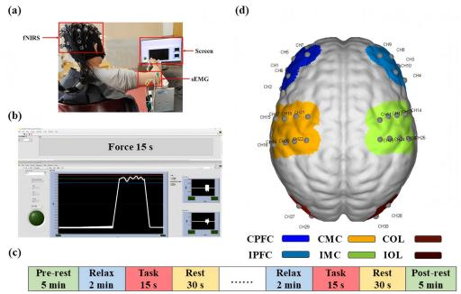
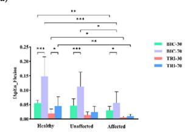
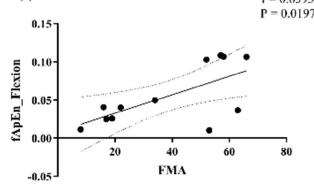
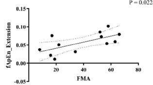
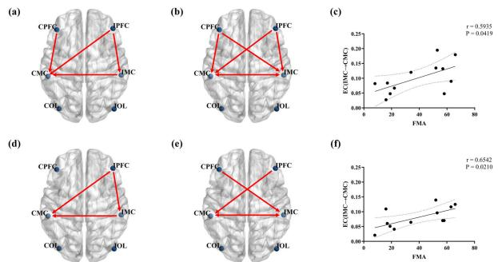
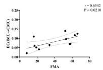
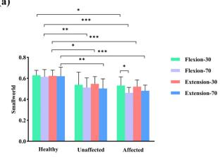
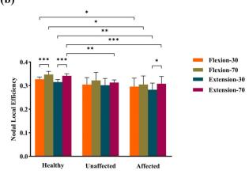
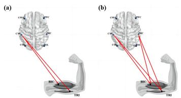
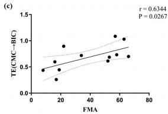

# 肘部等长收缩期间皮层-肌肉耦合变化与临床评分的相关性：一项针对脑卒中患者的 fNIRS-sEMG 研究

Xiaohan Wang , Weidong Li, Rong Song , Senior Member, IEEE, Di Ao , Huijing Hu, and Le Li

摘要— 本研究旨在利用功能性近红外光谱技术（fNIRS）和表面肌电图（sEMG）探究脑卒中患者在肘关节屈曲和伸展过程中皮层-肌肉耦合的变化，并评估耦合特征与临床评估量表之间的关系。本研究招募了12名脑卒中患者和12名年龄匹配的健康受试者，并将受试者进一步分为患侧组、健侧组和年龄匹配的健康组。受试者在 30% 和 70% 最大自主收缩（MVC）下执行肘关节屈曲和伸展任务。同时记录双侧前额叶皮层、运动皮层和枕叶的脑血流动力学，以及肱二头肌和肱三头肌的 sEMG 信号。在匹配的力量水平下，患侧组主动肌和拮抗肌的模糊近似熵值均显著低于健康组（P < 0.05）。在患侧组肘部运动期间，从同侧运动皮层到对侧运动皮层的有效连接与 Fugl-Meyer 评估（FMA）量表评分呈显著正相关。此外，在 70% MVC 肘关节屈曲时，患侧组从对侧运动皮层到主动肌的传递熵与 FMA 量表评分表现出显著正相关。本研究揭示了脑卒中患者与健康个体在运动任务期间肌间协调、脑网络连接以及皮层-肌肉耦合方面的差异，我们的研究结果表明其可作为评估卒中后上肢运动功能的潜在定量指标。这些特征与临床量表之间的关系表明了其作为脑卒中康复潜在定量评估参数的价值，凸显了探索皮层-肌肉耦合在卒中后上肢运动功能恢复中重要性。

关键词— 皮层-肌肉耦合，运动功能，功能性近红外光谱技术（fNIRS），表面肌电图（sEMG），脑卒中。

## I. 引言

脑卒中（Stroke）是一种常见的脑血管疾病，由大脑皮层组织供血异常引起，因脑血管破裂或阻塞导致脑神经受损 [1]。脑卒中幸存者常伴有多种后遗症，其中运动功能障碍严重影响了其生活质量 [2]。研究表明，约 80% 的脑卒中幸存者患有运动功能障碍，表现为步态异常和上肢功能受损 [3]。目前，临床评估量表（如 FMA 和 ARAT）仍用于脑卒中运动功能的康复评估中 [4]。然而，临床评估量表不可避免地具有主观性、模式化和半定量化的局限。因此，定量研究脑卒中幸存者在康复干预过程中的运动功能变化具有重要意义，这有助于深入理解训练过程中的潜在机制。

先前的研究表明，上肢运动受大脑皮层调控，大脑皮层协调多块肌肉并将运动指令传递给特定的靶肌肉 [5], [6]。因此，深入探讨中枢神经系统的机制对于全面理解脑卒中幸存者的上肢运动功能至关重要。功能性近红外光谱技术（fNIRS）是一种无创脑成像技术，能够实时监测大脑皮层的血氧活动 [7], [8]。与功能性磁共振成像（fMRI）和脑电图（EEG）相比，fNIRS 兼具良好的时间与空间分辨率，且具备较强的抗运动伪影和抗电磁干扰能力 [9]。因此，越来越多的研究利用 fNIRS 来评估脑卒中康复干预的效果。Huo 等人证实，fNIRS 可用于评估脑卒中幸存者在各种康复训练过程中大脑皮层的改变 [10], [11]。然而，关于脑卒中幸存者整体脑网络的改变及其与外周神经系统相互作用的认识仍不明确。

脑网络分析和图论对于检查复杂大脑系统的变化以及研究动态网络中不同脑区之间的相互连接至关重要 [12]。不同脑区之间的交流和相互作用能够极大地影响大脑功能并调节行为和认知过程 [13]。针对卒中幸存者的研究表明，与健康个体相比，他们在抓握任务期间的脑网络存在显著损伤 [14], [15]。同时，相关研究已证实卒中幸存者受损半球内存在皮层间信息的传递 [16], [17]。尽管如此，很少有研究探讨卒中幸存者在肘部等长收缩中图论指标的变化。通过利用复杂的脑网络并使用有效连接分析不同脑区之间的信息传递，研究人员可以加深对各脑区之间协同过程及其对运动行为影响的理解 [18]。

人类的运动控制作为一个闭环系统运作，其中中枢神经系统与周围神经系统相互作用 [19], [20]。皮质-肌肉耦合（Corticomuscular coupling）是指大脑皮层传递控制信号，从而导致皮层与周围神经肌肉系统之间产生同步振荡的交流过程 [21]。鉴于皮层指令主要由皮层间网络调控，卒中后受损的皮层间通信可能会阻碍卒中幸存者体内的下游信息传递 [22]。多项研究表明，卒中幸存者大脑皮层与肌肉之间的耦合减弱，导致上肢肌肉协调性降低 [23], [24]。因此，卒中后皮质-肌肉耦合的变化可为运动功能障碍提供关键见解，指示运动功能恢复的进展以及运动障碍中神经可塑性的发展 [25]。而在卒中幸存者中，表面肌电（sEMG）信号的复杂性及协同收缩与中枢神经系统之间的关联鲜有报道。

本研究旨在利用功能性近红外光谱技术（fNIRS）和表面肌电（sEMG），探讨卒中幸存者和年龄匹配的健康个体在不同力量水平的肘部等长收缩过程中皮质-肌肉耦合的变化，并探讨其与临床评估量表之间的关系。研究提出假设：卒中幸存者将表现出独特的皮质-肌肉耦合变化，且这些变化与临床评估参数相关。本研究的发现可为理解卒中幸存者运动功能康复评估的潜在机制奠定概念基础。

TABLE I  
受试者统计数据

<table><tr><td></td><td>年龄匹配健康对照</td><td>脑卒中</td></tr><tr><td>年龄 (years)</td><td>59.65±7.07</td><td>56.58±15.76</td></tr><tr><td>性别 (男/女)</td><td>6/6</td><td>9/3</td></tr><tr><td>身高 (cm)</td><td>166.83±8.33</td><td>170.17±5.80</td></tr><tr><td>体重 (kg)</td><td>62.83±4.93</td><td>64.00±6.45</td></tr><tr><td>病灶侧 (左/右)</td><td>N/A</td><td>5/7</td></tr><tr><td>卒中病程 (years)</td><td>N/A</td><td>2.11±1.68</td></tr><tr><td>FMA</td><td>N/A</td><td>38.75±21.41</td></tr><tr><td>ARAT</td><td>N/A</td><td>25.33±24.33</td></tr><tr><td>MAS</td><td>N/A</td><td>0.55±0.82</td></tr></table>

## II. 材料与方法

## A. 受试者

本研究共招募了24名受试者，包括12名脑卒中幸存者和12名年龄匹配的健康个体。对于脑卒中幸存者，其健侧和患侧均完成了全部实验任务，因此我们将其进一步划分为健侧组和患侧组。所有年龄匹配的健康受试者均使用优势手完成实验任务，因此我们将其定义为健康对照组。详细的受试者信息见 Table I。所有受试者均为右利手，视力正常，且无癫痫或其他精神疾病病史。本研究已获得当地机构伦理委员会的伦理批准，并在中国临床试验注册中心（Chinese Clinical Trial Registry，ChiCTR2200057839）完成注册，所有受试者均签署了知情同意书。

脑卒中幸存者的纳入标准如下：(1) 经 CT 或 MRI 确诊为脑卒中并伴有上肢运动功能障碍；(2) 脑卒中病程超过一个月；(3) 无明显视听觉障碍；(4) 能够在一定范围内自主完成肘关节屈曲和伸展动作；(5) 脑卒中前双上肢无其他运动功能障碍；(6) 自愿配合完成实验。本研究严格按照《赫尔辛基宣言》（Declaration of Helsinki）开展，所有受试者在实验前均签署了知情同意书。在实验开始前，使用 Fugl-Meyer 评定量表（FMA）、动作研究手臂测验（Action Research Arm Test，ARAT）和改良 Ashworth 量表（Modified Ashworth Scale，MAS）对脑卒中幸存者的功能障碍程度进行了评估。

## B. 实验范式

在开始实验之前，操作人员向每位受试者详细解释了实验流程，以确保其充分理解。本研究所采用的实验装置如图 1(a) 所示。在正式实验之前，进行了预实验以确认大脑区域的正常激活。实验期间，受试者坐在正对电脑屏幕的椅子上，前臂固定在定制扶手的凹槽中，桌子的高度可调，以使受试者处于舒适的坐姿来进行肘关节屈曲和伸展。他们的肘部屈曲 90◦，肩部外展 $9 0 ^ { \circ }$。对所有受试者进行了详细指导，教其如何根据视觉反馈调节肌肉激活以达到目标任务值。视觉反馈通过定制的 LabVIEW 程序（LabVIEW 2021；National Instruments，Austin，TX，United States）提供，如图 2(b) 所示。最初，受试者被要求进行每次持续 5 秒的连续最大自主收缩（MVC），并重复三次，中间有 2 分钟的休息间隔以防止肌肉疲劳。然后，受试者在根据视觉反馈进行调节的同时，完成其肘关节的等长屈曲和伸展。肱二头肌（BIC）是肘关节等长屈曲任务中的主动肌，肱三头肌（TRI）是肘关节等长伸展任务中的主动肌。脑卒中幸存者的健侧和患侧分别完成了肘关节屈伸力任务，健康受试者则使用其利手完成了肘关节屈伸力任务。每次试验包含两种条件，即 30% MVC 和 70% MVC，各重复三次。实验包括 2 分钟的放松阶段、15 秒的任务阶段和 30 秒的休息阶段，如图 1(c) 所示。

  
Fig. 1. 评估测试的实验设计。(a) 实验装置。(b) 肘关节屈伸实时控制界面图（30% MVC）。(c) 实验流程。(d) fNIRS 通道布局。15 个光源和 15 个探测器构成 30 个通道，覆盖六个脑区：CPFC、IPFC、CMC、IMC、COL 和 IOL。

## C. 数据采集

使用采样率为 11 Hz 的多通道 fNIRS 系统（NirSmart, Danyang Huichuang Medical Equipment Co. Ltd., China）采集近红外波长为 730 和 850 nm 的 fNIRS 信号。NIR 探头的布局与国际 10–20 系统保持一致，如图 1(d) 所示。为了覆盖双侧前额叶皮层（PFC）、运动皮层（MC）和枕叶（OL），共有 30 个通道策略性地布置在探测器的中点位置。

首先，受试者肱二头肌（BIC）和肱三头肌（TRI）上方的皮肤经过轻微刮擦并用酒精清洁。然后将 Ag-AgCl 双极电极精确放置在 BIC 和 TRI 的肌腹上，固定间距为 20 mm。EMG 信号由双通道自定义 sEMG 放大器捕获，并通过精度为 1000 Hz 的数据转换器进行数字化。sEMG 信号通过 16 位数据转换器（DAQ-6341, National Instruments, Austin, TX, United States）以 1,000 Hz 的采样率进行采样。采用 LabVIEW 程序来监测和存储原始 sEMG 信号。为使 sEMG 和 fNIRS 记录系统保持同步，利用负责任务呈现和视觉反馈的同一台计算机，在每次任务记录的开始和结束时同时向两个设备发送时间戳信号 [25], [26], [27]。

(a)  
(b)  
  
(c)

  
(d)

  
Fig. 2. (a) 不同实验组在屈肘任务中的 fApEn 比较；(b) 不同实验组在伸肘任务中的 fApEn 比较；(c) 屈肘任务中 70% MVC 条件下主动肌（BIC）的 fApEn 与 FMA 量表的相关性；(d) 伸肘任务中 70% MVC 条件下主动肌（TRI）的 fApEn 与 FMA 量表的相关性。$( \mathsf { N o t e } ; \mathsf { \Omega } ^ { * } 0 . 0 1 < \mathsf { p } <$ 0.05, ∗∗ $\mathsf { p } < 0 . 0 1$ ∗∗∗ $\mathsf { p } < 0 . 0 0 1 $ )。

## D. 数据分析

1) EMG 数据分析：首先，离线 sEMG 信号使用设置为 10–490 Hz 的零相移四阶巴特沃斯（Butterworth）带通滤波器以及 50 Hz 的陷波滤波器进行数字滤波，以消除噪声和工频干扰。每次试验均经过人工目视检查，以识别在均方根（RMS）平滑后表现出一致、稳定、平坦响应的 5 秒 sEMG 信号片段。

随后，采用 fApEn 来评估不同条件下 sEMG 信号复杂度的变化。熵作为一种有价值的非线性分析方法，常用于表征人体生理信号的复杂度水平 [28]。在熵理论原理的基础上，Chen 等人引入了模糊集的概念，在样本熵中使用指数函数替代硬阈值函数来定义重构向量的相似度，进而提出了模糊近似熵（fApEn）[29]。然而，在任务执行过程中，肌肉复杂度的变化与脑网络之间的关系仍不明确。在本研究中，我们在非线性分析中利用 fApEn 来评估不同条件下 sEMG 信号复杂度的变化。fApEn 的计算过程概述如下 [30], [31]：

$$
f A p E n (m, r, n, N) = \ln \varphi^ {m} (n, r) - \varphi^ {m + 1} (n, r)\tag{1}
$$

其中函数 $\varphi ^ { m }$ 定义为：

$$
\begin{array}{l} \varphi^ {m} (n, r) = \frac {1}{N - m + 1} \sum_ {i = 1} ^ {N - m + 1} \\ \times \ln \left(\frac {1}{N - m + 1} \sum_ {j = 1, j \neq i} ^ {N - m + 1} D _ {i j} ^ {m}\right) \end{array}\tag{2}
$$

2) fNIRS 数据分析：fNIRS 数据的初始处理包括三个步骤。首先，对采集到的 fNIRS 信号质量进行验证。随后，使用截止频率为 0.01 至 2 Hz 的四阶巴特沃斯带通滤波器对数据进行滤波。该过程旨在提高信噪比并消除生理信号干扰，例如来自心跳和呼吸活动的干扰 [32]。然后利用改良朗伯-比尔定律将初始 fNIRS 信号转换为血流动力学信号。鉴于与 HbR 信号相比，$\mathrm { H b } { \mathrm { O } } _ { 2 }$ 信号表现出更优的信噪比，因此采用 $\mathrm { H b } { \mathrm { O } } _ { 2 }$ 信号作为皮层激活的标志，并计算与任务相关的 $\mathrm { H b } { \mathrm { O } } _ { 2 }$ 浓度 [33]。

随后，以功能连接为基础，采用格兰杰因果分析（Granger causality analysis）来分析不同脑区之间的有效连接。在同时测量两个信号的情况下，如果通过引入第二个信号的历史值（而非仅仅依赖第一个信号自身的信息）提高了第一个信号的预测精度，则认为第二个信号是第一个信号的原因。因此，利用格兰杰因果分析来评估脑区之间的有向连接 [34], [35]。值得注意的是，格兰杰因果分析的一个优势在于其非对称性，这使得检测有效连接成为可能。

图论被用于描绘人脑功能网络的拓扑结构 [36], [37]。为了探究稀疏度与网络特征之间的相关性，我们在稀疏度范围 $( 0 . 0 5 < \mathrm { s } < 0 . 4 0 $ ，步长 = 0.01) 内建立了相关矩阵值 [38]。此外，采用统一的稀疏度值 $( \mathrm { s } = 0 . 4 0 )$ 对所有参与者的大脑功能网络进行归一化，以便在相同尺度下检验网络拓扑结构的组间差异。在本研究中，选择小世界属性（smallworld）和节点局部效率（nodal local efficiency）作为大脑网络分析的指标。

小世界网络在保持强大的局部相互连接的同时，展现出全局尺度上的高效信息传递 [39]。小世界网络的计算过程概述如下 [40]：

$$
S = \frac {C _ {b r a i n} / C _ {r a n d}}{L _ {b r a i n} / L _ {r a n d}}\tag{3}
$$

其中 $C _ { b r a i n }$ 和 $C _ { r a n d }$ 分别为待测网络和随机网络的聚类系数，而 $L _ { b r a i n }$ 和 $L _ { r a n d }$ 分别为其特征路径长度。

某节点的节点局部效率计算为由该节点及其邻居节点组成的子图内平均最短路径长度的倒数 [41]。该指标通过评估当某一节点被移除时邻居节点之间交换信息的程度，作为网络容错能力的一项指标 [42]。节点局部效率的计算公式概述如下 [43]：

$$
E _ {n o d a l} (i) = \frac {1}{N - 1} \sum_ {j \in G} \frac {1}{d _ {i , j}}\tag{4}
$$

其中 $E _ { n o d a l } ( i )$ 为节点的局部效率，$d _ { i , j }$ 为 i 与 j 之间仅包含节点邻居的最短路径长度。

3) 皮层肌肉耦合分析：采用基于传递熵（transfer entropy，TE）的时间序列因果分析进行皮层肌肉耦合分析，该方法依赖于信息论原理，能够对信息的方向性流动提供深入见解 [44]。TE 能够检测不同状态下生理信号之间的连接强度，有助于客观描绘信息传递的方向。通过评估连接强度和信息流方向，该方法全面揭示了生理网络的动态属性 [45]。

如果给定两个时间序列 $X = \{ x _ { 1 } , x _ { 2 } , . . . . , x _ { N } \}$ 和 $Y = \{ y _ { 1 } ,$ $y _ { 2 } , . . . . , y _ { N } \} ,$ 其中 N 为时间序列的长度，从 Y 到 X 的 TE 定义为 $T E _ { Y  X }$ ，其计算公式如下 [22]：

$$
\begin{array}{l}T E _ {Y \rightarrow X}\\= \sum_ {x _ {i + 1}, x _ {i}, y _ {i}} \left(p \left(x _ {i + 1}, x _ {i}, y _ {i}\right) \log \frac {p \left(x _ {i + 1} , x _ {i} , y _ {i}\right) p \left(x _ {i}\right)}{p \left(x _ {i} , y _ {i}\right) p \left(x _ {i + 1} , x _ {i}\right)}\right)\end{array}\tag{5}
$$

其中 $i$ 是离散时间索引 $( I \leq i \leq N ) ;$ ；$p$ 表示概率分布。同时，由于 TE 本质上是不对称的，$T E _ { Y  X }$ 并不等于 $T E _ { X  Y } .$ 。因此，当 $T E _ { X  Y } > T E _ { Y  X } .$ 时，我们称 X 为因、Y 为果，从而在这两个信号之间建立因果关系。

4) 统计分析：所有实验数据均使用 SPSS Statistics 26（IBM Inc., WA, United States）和 MATLAB R2021a（The MathWorks, United States）进行分析。首先，为检验三个实验组在肌肉复杂度、大脑信息传递和皮质肌肉耦合方面的变化，分别执行单因素方差分析（one-way ANOVA）以比较 fApEn、图论指标和 TE。在方差分析中利用 Bonferroni 事后检验进行多重比较。此外，进行配对 t 检验以评估卒中患者和健康受试者在不同力量水平下脑区之间连接性的变化。此外，采用独立样本 t 检验评估三个实验组在不同力量任务期间皮层激活的变化。进一步地，采用 Pearson 相关分析检验患侧组在各项任务期间特征参数与 FMA 量表评分之间的关系（强相关：$\mathrm { r } { > } 0 . 5 ,$ 中等相关：$0 . 3 < \mathbf { r } < 0 . 5 .$ 弱相关：r<0.3）[46]。统计学显著性水平设定为 $\mathrm { ~ P ~ } < 0 . 0 5$ ，并应用了错误发现率（FDR）校正。

## III. 结果

## A. EMG 结果

Fig. 2 展示了不同实验组在进行肘关节屈曲和伸展任务期间 sEMG 活动的 fApEn 结果。单因素方差分析（one-way ANOVA）表明，在不同任务期间，三个实验组之间的 fApEn 值存在显著差异 $( \mathrm { P } < 0 . 0 5 )$。观察发现，在匹配的力量水平下，患侧组的主动肌和拮抗肌 fApEn 值均显著低于健康组 $( \mathbf { P } < 0 . 0 5 )$。相反，在健侧组中，主动肌的 fApEn 仅在 70% MVC 时显著高于患侧组 $( \mathbf { P } < 0 . 0 5 )$，在其他条件下则无显著差异。此外，各实验组主动肌的 fApEn 在 70% MVC 下均显著高于 30% MVC。另外，如图 2(c) 和 (d) 所示，研究检验了患侧组在肘关节屈曲和伸展任务中主动肌 fApEn 值与 FMA 量表评分之间的相关性。结果显示，患侧组主动肌的 fApEn 与 FMA 量表评分在肘关节屈曲（r = 0.6593, $\mathrm { P } = 0 . 0 1 9 7 )$ 和伸展 $( \mathrm { r } = 0 . 6 4 7 5 ^ { }$ , P = 0.0228）任务中均呈显著正相关。

  
Fig. 3. 受试者在不同条件下的 delta ${ \mathsf { H b } } { \mathsf { O } } _ { 2 }$ 皮层激活模式：(a) 健康组；(b) 健侧组；(c) 患侧组。

## B. fNIRS 结果

Fig. 3 展示了健康对照组、健侧组和患侧组在不同运动任务期间的皮层激活结果。在健康对照组中，运动任务期间对侧运动皮层出现了显著激活，尤其在肘关节屈曲 70% MVC 时最为明显 $( \mathrm { P } < 0 . 0 5 )$。相比之下，无论是由健侧还是患侧参与运动任务，脑卒中患者在少数脑区均仅表现出有限的激活。这些发现表明，脑卒中患者在高力量水平运动任务中未能表现出在健康对照组中观察到的显著对侧运动皮层激活。相反，在同侧运动皮层中观察到了代偿性激活（Fig. 3(b) 和 (c)）。

Fig. 4 展示了在不同力量水平的屈肘和伸肘任务中，健康组与患侧组大脑各区域之间有效连接的结果。在健康组中，屈肘期间的对比分析显示，与 30% MVC 相比，70% MVC 条件下的有效连接显著增加。在 CPFC 至 CMC $( \mathrm { P } = 0 . 0 3 4 )$、IPFC 至 CMC $( \mathrm { P } = 0 . 0 4 8 )$、IPFC 至 IMC $( \mathrm { P } = 0 . 0 3 5 )$ 以及 IMC 至 CMC (P = 0.018) 的连接中观察到了显著增强 (Fig. 4(a))。同样，在患侧组中，屈肘期间 70% MVC 下的有效连接显著高于 30% MVC，观察到 CPFC 至 CMC (P = 0.026)、CPFC 至 IMC $( \mathrm { P } = 0 . 0 3 4 )$、IPFC 至 CMC $( \mathrm { P } = 0 . 0 3 9 )$、IPFC 至 IMC $( \mathrm { P } = 0 . 0 1 4 )$、IMC 至 CMC $( \mathrm { P } = 0 . 0 1 8 )$ 以及 CMC 至 IMC (P = 0.022) 的连接增强 (Fig. 4(b))。此外，患侧组在屈肘任务中 IMC 至 CMC 的有效连接与 FMA 量表评分呈正相关 $( \mathrm { r } = 0 . 5 9 3 5$ , P = 0.0419) (Fig. 4(c))。

  
Fig. 4. (a) 健康组屈肘时 70% MVC 与 30% MVC 相比的有效连接；(b) 患侧组屈肘时 70% MVC 与 30% MVC 相比的有效连接；(c) 屈肘 70% MVC 条件下有效连接 (IMC→CMC) 与 FMA 量表的相关性；(d) 健康组伸肘时 70% MVC 与 30% MVC 相比的有效连接；(e) 患侧组伸肘时 70% MVC 与 30% MVC 相比的有效连接；(f) 伸肘 70% MVC 条件下有效连接 (IMC→CMC) 与 FMA 量表的相关性。

在伸肘任务中，观察到了与屈肘任务相似的现象，与健康组相比，患侧组在 70% MVC 条件下 IMC 与 CMC 之间的有效连接显著增强 (Fig. 4(d) 与 (e))。此外，患侧组从 IMC 至 CMC 的有效连接与 FMA 量表呈正相关 $( \mathrm { r } = 0 . 6 5 4 2$ 2 $\mathrm { ~ P ~ } = \ 0 . 0 2 1 0 )$ (Fig. 4(f))。

单因素方差分析（one-way ANOVA）显示，在不同任务条件下，三个实验组之间的小世界特性（smallworld properties）存在显著差异 $( \mathrm { P } ~ < ~ 0 . 0 5 )$。如图 Fig. 5(a) 所示，在屈肘和伸肘任务中，患侧组和健侧组的小世界特性均显著低于健康组。此外，结果表明在屈肘过程中，70% MVC 条件下的小世界特性显著高于 30% MVC，但这种现象仅出现在患侧组（P < 0.05）。单因素方差分析还揭示了在不同任务中，三个实验组 CMC 的节点局部效率存在显著差异 $( { \bf P _ { \alpha } < }$ 0.05)。Fig. 5(b) 展示了在相同力量水平的屈曲和伸展任务中，患侧组 CMC 的节点局部效率明显低于健康组。此外，在 70% MVC 伸肘任务中，健侧组的节点局部效率相比健康组表现出大幅下降。值得注意的是，在患侧组中，70% MVC 伸肘任务期间的节点局部效率显著高于在 30% MVC 下观察到的效率 $( \mathbf { P } ~ < ~ 0 . 0 5 )$，而在健侧组中未发现显著差异。

## C. 皮质肌肉耦合分析结果

如图 Fig.6(a) 所示，对比了在 70% MVC 下患侧组与健康组屈肘时的 TE。单因素方差分析表明，在 70% MVC 下，三个实验组从 CMC 到主动肌和拮抗肌的 TE 存在显著差异（P < 0.05）。结果显示，与健康组相比，患侧组从 CMC 到主动肌和拮抗肌的 TE 均大幅降低（P < 0.05）。同样地，单因素方差分析提示在 30% MVC 下，三个实验组从 CMC 和 IMC 到主动肌和拮抗肌的 TE 存在显著差异（P < 0.05）。在 30% MVC 下，如图 Fig.6(b) 所示，对患侧组和健康组屈肘时的 TE 进行了分析。结果观察到，患侧组从 CMC 到主动肌和拮抗肌的 TE 大幅低于健康组，且患侧组从 IMC 到这些肌肉的 TE 也明显较低 $( \mathbf { P } < 0 . 0 5 )$。此外，如图 Fig.6(c) 所示，在屈肘 70% MVC 条件下，患侧组从 CMC 到主动肌的 TE 与 FMA 评分之间存在正相关。

(a)  

(b)  
  
Fig. 5. (a) 屈肘和伸肘任务下小世界属性结果的比较；(b) 屈肘和伸肘任务下皮层肌肉耦合（CMC）节点局部效率结果的比较。（注：$^ { * } 0 . 0 \dot { 1 } < \mathsf { p } < 0 . 0 5 ,$ ∗∗ $\mathsf { p } < 0 . 0 1 , \mathsf { \Psi } ^ { * * * } \mathsf { p } < 0 . 0 0 1 )$ 。

  
Fig. 6. (a) 70% MVC 屈肘下健康组与患侧组从大脑皮层到肌肉的传递熵（TE）比较；(b) 30% MVC 屈肘下健康组与患侧组从大脑皮层到肌肉的 TE 比较；(c) 70% MVC 屈肘下 TE (CMC→BIC) 与 FMA 量表的相关性分析。

## IV. 讨论

本研究调查了脑卒中患者在屈肘等长收缩任务期间肌间协调、大脑连接和皮层肌肉耦合的改变。利用大脑皮层的有效连接和皮层肌肉耦合的传递熵，探讨了其与脑卒中患者运动功能康复的相关性。结果表明，在屈肘 70% MVC 任务下，患侧组脑卒中患者的不同特征值与临床量表之间存在显著相关性。此外，与对照组相比，脑卒中患者的肌间和脑网络信息传递减少，表明在脑卒中患者的运动功能背景下，中枢和外周神经系统之间的相互作用受损。

## A. 屈肘和伸肘任务中肌间协调的变化

图2 表明，在不同力量水平下，患侧组在屈肘和伸肘过程中主动肌和拮抗肌的 fApEn 均显著低于健康组和健侧组，这表明肌电（EMG）信号的复杂度降低，可能与脑卒中后运动单位的丢失有关。例如，Rosenfalck 等人发现脑卒中患者患侧肌肉中活跃运动单位的数量和放电率均有所降低 [47]。先前的研究也表明，活跃运动单位或传递速率的降低会导致 EMG 信号复杂度下降，从而导致更低的 fApEn [28]。因此，我们的研究结果符合这一规律，显示出 fApEn 从患侧组到健侧组再到健康组逐渐增加。

我们的研究结果表明，与伸肘相比，屈肘过程中 sEMG 信号的 fApEn 更高，这可能反映了在完成屈肘任务时具有更好的控制能力。这一观察结果与现有文献一致，即频繁的屈肘练习（特别是抗重力练习）在增强屈肘控制方面具有有益作用 [48]。同时，我们的研究表明，在 70% MVC 条件下，主动肌的 fApEn 与 FMA 量表呈显著正相关。先前的研究已经表明，接受康复治疗的卒中患者上肢运动功能的变化与 sEMG 及运动学参数的改变之间存在关联 [49], [50]。因此，我们的研究结果表明，与传统临床量表相比，fApEn 可能具有更高的反应度和灵敏度，从而能够对卒中患者的康复进展进行更深入的评估。

## B. 屈肘与伸肘任务中皮层激活与脑连接性的变化

如图 3 所示，我们的研究结果显示，在各项运动任务中，与健康组相比，患侧组和健侧组的皮层激活均显著减弱。此外，我们的研究发现，在 70% MVC 条件下，患侧组的 IMC 存在代偿性激活模式。尽管以往的研究表明 IMC 的代偿性激活可促进卒中后运动功能的康复，但其他研究也发现卒中后对侧大脑半球的兴奋性通常会代偿性增加，从而导致大脑半球间平衡的破坏 [51], [52], [53], [54]。因此，卒中患者代偿性激活的机制仍有待进一步探讨，且同侧半球对患侧运动功能的影响不容忽视。此外，我们的研究结果表明，与 30% MVC 相比，卒中组在 70% MVC 力量下患侧和健侧的皮层激活水平显著增加（Fig.3(b) 和 (c)）。现有文献表明，在卒中患者中，握力的增加与运动皮层激活的增强相关，这一趋势在我们的屈肘和伸肘任务研究中也得到了观察 [55]。总体而言，我们认为更高水平的上肢用力任务对卒中患者的运动功能康复具有更强的促进作用。先前的研究表明，皮层激活可能与任务的强度和难度有关 [56]。我们的结果进一步发现，在 70% MVC 力量水平下，前额叶皮层出现了显著激活 $( { \mathrm { F i g } } 3$ (b) and (c))。因此，在卒中患者的上肢康复训练中，我们不应只关注某一个固定脑区，而应综合考虑整个大脑皮层的作用效果。

我们的研究结果（如图 Fig.4 所示）表明，随着上肢肌力水平的增加，中风幸存者体内 IMC 与 IPFC 之间以及与对侧大脑区域之间的有效连接（effective connectivity）显著增强。Shibuya et al. 发现，同侧大脑半球 M1 区域的 $\mathrm { H b } { \mathrm { O } } _ { 2 }$ 也会随着握力的增加而增加 [57]。我们的结果进一步发现，在 70% MVC 条件下，中风幸存者中从 CMC 到 IMC 以及从 CPFC 到 IMC 的有效连接显著增加（Fig.4(b) 和 (e)）。已有研究证实，中风引起的大脑皮层损伤会导致中枢神经系统严重受损，进而导致大脑皮层指令传递的中断 [58]。越来越多的证据表明，大脑在受损后具有显著的神经可塑性，能够通过神经重组以及在未受损神经元之间建立新连接来促进代偿 [59]。特别是，在涉及感觉运动皮层区域的情况下，对侧大脑半球表现出显著的代偿效应 [59]。

此外，我们的数据表明，患病组中从 IMC 到 CMC 的有效连接与 FMA 量表评分呈显著正相关（Fig.4(c) 和 (f)）。近期的研究越来越多地探索了中风幸存者康复过程中大脑皮层功能连接与临床量表之间的联系 [60]。Chen et al. 显示，中风幸存者在接受 12 周的远程康复训练后，双侧 M1 的静息态功能连接与 FMA 评分呈正相关 [61]。本研究的结果进一步发现了运动任务期间大脑连接与临床量表之间的相关性。因此，本研究结果提示了 IMC 在运动任务执行中的重要作用，及其促进中风幸存者运动功能更好恢复的潜力。同时，未来关于中风运动功能康复训练的研究可以通过驱动神经可塑性适应，聚焦于增强受损大脑半球的功能，或提高未受损半球的代偿能力。

研究结果表明，无论是在屈肘还是伸肘任务中，在不同力量水平下，患病组 CMC 的小世界属性和节点局部效率均显著低于健康组（Fig.5）。此外，观察到在 70% MVC 时，患病组 CMC 的节点局部效率超过了 30% MVC 时的水平。先前研究发现，脑卒中幸存者的神经网络整合与分离存在障碍，导致脑功能网络随机化，并可能降低信息处理的模块化程度和鲁棒性 [62]。即使在临床恢复良好的个体中，这种现象依然存在，表现为与未患脑卒中的个体相比网络效率降低 [63]。我们的研究结果支持了这些结论，并突出了利用 fNIRS 进行脑网络分析在理解脑卒中幸存者上肢运动功能康复评估中脑功能的重要价值。

## C. 屈肘和伸肘任务中皮层肌肉耦合的变化

Fig.6 表明，在屈肘任务中，无论力量水平如何，患病组 CMC 与主动肌及拮抗肌之间的传递熵（TE）均显著低于健康组。此外，在 30% MVC 时，患病组从 IMC 到主动肌和拮抗肌的 TE 也显著低于健康组，而在 70% MVC 时未观察到显著差异。我们的结果显示，在较低力量水平（较低任务难度）下，脑卒中受试者与健康受试者之间的皮层肌肉耦合存在显著差异。然而，在较高力量水平（较高任务难度）下，两者之间的差异减小。这些发现表明，脑卒中后，大脑皮层受损区域与目标肌肉之间的神经肌肉信息传递和连接性有所下降。先前研究已将脑卒中后皮层肌肉耦合的降低与皮层和肌肉之间的连接受损或血流动力学信号与 sEMG 信号之间的耦合减弱联系起来 [64], [65]。我们的结果表明，通过 fNIRS 和 sEMG 信号之间的 TE 评估皮层肌肉耦合，可以定量表征大脑皮层与外周肌肉之间的非线性同步。这为评估脑卒中后上肢运动功能的康复提供了一种新方法。

我们的研究表明，在 70% MVC 条件下，患侧组从 CMC 到主动肌的 TE 与 FMA 量表评分之间存在显著的正相关关系。先前的研究表明，脑卒中幸存者的皮质运动系统、神经元以及神经通路的损伤可能会破坏或削弱相互连接的皮质区域之间的信息传递 [66]。这种破坏减弱了受累大脑皮质区域与上肢肌肉之间的皮质肌肉耦合。我们的研究结果表明，大脑皮质与外周肌肉之间的耦合参数可为脑卒中幸存者运动功能的临床康复提供有价值的见解。此外，我们的结果为评估脑卒中后皮质运动系统的变化提供了一个综合定量评估指标，并为 fNIRS 和 sEMG 在脑卒中康复训练与评估中的广泛应用奠定了基础。

本研究存在若干局限性。首先，本研究的样本量相对较小，建议在后续实验中招募更多处于不同阶段的脑卒中幸存者。其次，在未来的研究中，可进一步利用小波变换或神经网络等方法来研究脑卒中幸存者大脑皮质与外周肌肉之间的动态耦合变化。最后，在未来的研究中将本研究的评估方法与 EEG 相结合可提高时间分辨率，从而更全面地理解脑卒中运动功能康复评估的机制。

## V. 结论

综上所述，本研究阐明了脑卒中幸存者与年龄匹配的健康个体在执行运动任务期间肌间协调和脑网络连接性的差异。本研究的结果表明，脑卒中幸存者的脑网络和皮质肌肉耦合指标与临床量表之间存在显著相关性。这些发现表明，sEMG 信号、脑网络连接性和皮质肌肉耦合等参数可作为脑卒中康复中的定量评估工具。此外，该研究结果为进一步探索上肢运动功能脑卒中后康复过程中的皮质肌肉耦合机制提供了支持。

## 参考文献

[1] F. Z. Caprio and F. A. Sorond, “Cerebrovascular disease: Primary and secondary stroke prevention,” Med. Clinics North Amer., vol. 103, no. 2, pp. 295–308, Mar. 2019.

[2] A. Pollock et al., “Interventions for improving upper limb function after stroke,” Cochrane Database Systematic Rev., vol. 2014, no. 11, Nov. 2014, Art. no. 010820.

[3] H. M. Feys et al., “Effect of a therapeutic intervention for the hemiplegic upper limb in the acute phase after stroke: A single-blind, randomized, controlled multicenter trial,” Stroke, vol. 29, no. 4, pp. 785–792, Apr. 1998.

[4] G. B. Prange-Lasonder et al., “欧洲神经康复上肢临床评估循证建议（CAULIN）：来自系统评价、临床实践指南和专家共识的数据综合，” J. NeuroEng. Rehabil., vol. 18, no. 1, p. 162, Dec. 2021.

[5] C. L. Witham, C. N. Riddle, M. R. Baker, and S. N. Baker, “下行和上行通路对人体皮质肌肉相干性的贡献，” J. Physiol., vol. 589, no. 15, pp. 3789–3800, Aug. 2011.

[6] C. Babiloni et al., “意图性和模仿性运动行为中前额叶前部皮质（BA10）与手部肌肉收缩之间的功能耦合，” NeuroImage, vol. 39, no. 3, pp. 1314–1323, Feb. 2008.

[7] F. Herold, P. Wiegel, F. Scholkmann, and N. Müller, “功能性近红外光谱技术（fNIRS）神经影像在运动-认知科学中的应用：一项聚焦方法的系统评价，” J. Clin. Med., vol. 7, no. 12, p. 466, Nov. 2018.

[8] M. Ferrari and V. Quaresima, “人体功能性近红外光谱技术（fNIRS）发展历史与应用领域的简要综述，” NeuroImage, vol. 63, no. 2, pp. 921–935, Nov. 2012.

[9] H. Kato, M. Izumiyama, H. Koizumi, A. Takahashi, and Y. Itoyama, “近红外光谱地形图作为监测偏瘫性卒中后运动重组的工具：与功能性磁共振成像（fMRI）的比较，” Stroke, vol. 33, no. 8, pp. 2032–2036, Aug. 2002.

[10] C. Huo et al., “通过功能性近红外光谱技术评估亚急性卒中患者上肢任务导向训练诱发的皮质反应，” J. Biophotonics, vol. 16, no. 3, Mar. 2023, Art. no. 202200228.

[11] C. Huo et al., “基于 fNIRS 的偏瘫卒中患者上肢机器人辅助训练脑功能反应研究，” Frontiers Aging Neurosci., vol. 14, Dec. 2022, Art. no. 1060734.

[12] L. Wang et al., “卒中后运动执行网络的动态功能重组，” Brain, vol. 133, no. 4, pp. 1224–1238, Apr. 2010.

[13] M. Thiebaut de Schotten and S. J. Forkel, “连接大脑的涌现特性，” Science, vol. 378, no. 6619, pp. 505–510, Nov. 2022.

[14] Z. Yuan et al., “基于功能性近红外光谱技术的亚急性卒中任务态皮质运动网络特征显示大脑半球优势，” Frontiers Aging Neurosci., vol. 14, Jun. 2022, Art. no. 932318.

[15] R. Li, S. Li, J. Roh, C. Wang, and Y. Zhang, “使用同步 EEG/fNIRS 的多模态神经影像用于卒中后康复评估：一项探索性研究，” Neurorehabil. Neural Repair, vol. 34, no. 12, pp. 1099–1110, Dec. 2020.

[16] K. P. Westlake and S. S. Nagarajan, “与卒中后运动表现及康复相关的脑功能连接，” Frontiers Syst. Neurosci., vol. 5, p. 8, Aug. 2011.

[17] S. Larivière, N. S. Ward, and M.-H. Boudrias, “Disrupted functional network integrity and flexibility after stroke: Relation to motor impairments,”（卒中后功能网络完整性和灵活性的破坏：与运动障碍的关系） NeuroImage, Clin., vol. 19, pp. 883–891, Jun. 2018.

[18] J. Zhang et al., “Disrupted structural and functional connectivity networks in ischemic stroke patients,”（缺血性卒中患者受损的结构和功能连接网络） Neuroscience, vol. 364, pp. 212–225, Nov. 2017.

[19] J. Jia, “Exploration on neurobiological mechanisms of the central– peripheral–central closed-loop rehabilitation,”（“中枢-外周-中枢”闭环康复神经生物学机制的探讨） Frontiers Cellular Neurosci., vol. 16, Sep. 2022, Art. no. 982881.

[20] X. Wang et al., “The interaction between changes of muscle activation and cortical network dynamics during isometric elbow contraction: A sEMG and fNIRS study,”（等长屈肘收缩过程中肌肉激活变化与皮层网络动态之间的相互作用：一项 sEMG 和 fNIRS 研究） Front Bioeng Biotechnol, vol. 11, Apr. 2023, Art. no. 1176054.

[21] Y. Zu et al., “Characteristics of corticomuscular coupling during wheelchair tai chi in patients with spinal cord injury,”（脊髓损伤患者轮椅太极拳运动中皮层-肌肉耦合的特征） J. NeuroEng. Rehabil., vol. 20, no. 1, p. 79, Jun. 2023.

[22] T. Mima, K. Toma, B. Koshy, and M. Hallett, “Coherence between cortical and muscular activities after subcortical stroke,”（皮层下脑卒中后皮层与肌肉活动之间的相干性） Stroke, vol. 32, no. 11, pp. 2597–2601, Nov. 2001.

[23] J. Liu et al., “Correlation evaluation of functional corticomuscular coupling with abnormal muscle synergy after stroke,”（脑卒中后功能性皮层-肌肉耦合与异常肌肉协同的相关性评估） IEEE Trans. Biomed. Eng., vol. 68, no. 11, pp. 3261–3272, Nov. 2021.

[24] M. F. Levin, J. M. Solomon, A. Shah, A. K. Blanchette, and A. G. Feldman, “Activation of elbow extensors during passive stretch of flexors in patients with post-stroke spasticity,”（脑卒中后痉挛患者屈肌被动牵拉过程中伸肘肌的激活） Clin. Neurophysiol., vol. 129, no. 10, pp. 2065–2074, Oct. 2018.

[25] C. Jian, H. Liu, L. Deng, X. Wang, T. Yan, and R. Song, “Stroke-induced alteration in multi-layer information transmission of cortico-motor system during elbow isometric contraction modulated by myoelectriccontrolled interfaces,”（肌电控制接口调制下等长屈肘收缩过程中脑卒中引起的皮层-运动系统多层信息传输改变） J. Neural Eng., vol. 18, no. 4, Aug. 2021, Art. no. 0460e1.

[26] P. Ortega, T. Zhao, and A. A. Faisal, “HYGRIP: Full-stack characterization of neurobehavioral signals (fNIRS, EEG, EMG, force, and breathing) during a bimanual grip force control task,”（HYGRIP：双侧握力控制任务中神经行为信号（fNIRS、EEG、EMG、力量和呼吸）的全栈表征） Frontiers Neurosci., vol. 14, p. 919, Oct. 2020.

[27] Y. Wang et al., “Acute effects of two types of dumbbell exercise on oxygenated hemodynamic concentration of cerebral activation in healthy young male adults: A functional near-infrared spectroscopy study,”（两种哑铃运动对健康年轻男性大脑激活氧合血流动力学浓度的急性影响：一项功能性近红外光谱研究） Frontiers Human Neurosci., vol. 14, Nov. 2020, Art. no. 519171.

[28] D. Ao, R. Sun, K.-Y. Tong, and R. Song, “Characterization of stroke- and aging-related changes in the complexity of EMG signals during tracking tasks,”（追踪任务中肌电信号复杂度与脑卒中及衰老相关变化的表征） Ann. Biomed. Eng., vol. 43, no. 4, pp. 990–1002, Apr. 2015.

[29] W. Chen, Z. Wang, H. Xie, and W. Yu, “Characterization of surface EMG signal based on fuzzy entropy,”（基于模糊熵的表面肌电信号表征） IEEE Trans. Neural Syst. Rehabil. Eng., vol. 15, no. 2, pp. 266–272, Jun. 2007.

[30] R. Sun, R. Song, and K.-Y. Tong, “Complexity analysis of EMG signals for patients after stroke during robot-aided rehabilitation training using fuzzy approximate entropy,” IEEE Trans. Neural Syst. Rehabil. Eng., vol. 22, no. 5, pp. 1013–1019, Sep. 2014.

[31] H.-B. Xie, J.-Y. Guo, and Y.-P. Zheng, “Fuzzy approximate entropy analysis of chaotic and natural complex systems: Detecting muscle fatigue using electromyography signals,” Ann. Biomed. Eng., vol. 38, no. 4, pp. 1483–1496, Apr. 2010.

[32] Q. Zhang, G. E. Strangman, and G. Ganis, “Adaptive filtering to reduce global interference in non-invasive NIRS measures of brain activation: How well and when does it work?” NeuroImage, vol. 45, no. 3, pp. 788–794, Apr. 2009.

[33] J. Ye, S. Tak, K. Jang, J. Jung, and J. Jang, “NIRS-SPM: Statistical parametric mapping for near-infrared spectroscopy,” NeuroImage, vol. 44, no. 2, pp. 428–447, Jan. 2009.

[34] L. Barnett and A. K. Seth, “The MVGC multivariate Granger causality toolbox: A new approach to granger-causal inference,” J. Neurosci. Methods, vol. 223, pp. 50–68, Feb. 2014.

[35] L. Wang, J. Zhang, Y. Zhang, R. Yan, H. Liu, and M. Qiu, “Conditional Granger causality analysis of effective connectivity during motor imagery and motor execution in stroke patients,” BioMed Res. Int., vol. 2016, pp. 1–9, Aug. 2016.

[36] E. Bullmore and O. Sporns, “The economy of brain network organization,” Nature Rev. Neurosci., vol. 13, no. 5, pp. 336–349, Apr. 2012.

[37] G. Zhou, Y. Chen, X. Wang, H. Wei, Q. Huang, and L. Li, “The correlations between kinematic profiles and cerebral hemodynamics suggest changes of motor coordination in single and bilateral finger movement,” Frontiers Human Neurosci., vol. 16, Aug. 2022, Art. no. 957364.

[38] E. Bullmore and O. Sporns, “Complex brain networks: Graph theoretical analysis of structural and functional systems,” Nature Rev. Neurosci., vol. 10, no. 3, pp. 186–198, Mar. 2009.

[39] D. S. Bassett and E. T. Bullmore, “Small-world brain networks revisited,” Neuroscientist, vol. 23, no. 5, pp. 499–516, Sep. 2017.

[40] M. Rubinov and O. Sporns, “Complex network measures of brain connectivity: Uses and interpretations,” NeuroImage, vol. 52, no. 3, pp. 1059–1069, Sep. 2010.

[41] H. Yang et al., “Disrupted intrinsic functional brain topology in patients with major depressive disorder,” Mol Psychiatry, vol. 26, no. 12, pp. 7363–7371, 2021.

[42] S. Achard and E. Bullmore, “Efficiency and cost of economical brain functional networks,” PLoS Comput. Biol., vol. 3, no. 2, p. e17, Feb. 2007.

[43] V. Latora and M. Marchiori, “Efficient behavior of small-world networks,” Phys. Rev. Lett., vol. 87, no. 19, Oct. 2001, Art. no. 198701.

[44] T. Schreiber, “Measuring information transfer,” Phys. Rev. Lett., vol. 85, no. 2, pp. 461–464, Jul. 2000.

[45] Y. Wang and W. Chen, “Effective brain connectivity for fNIRS data analysis based on multi-delays symbolic phase transfer entropy,” J. Neural Eng., vol. 17, no. 5, Oct. 2020, Art. no. 056024.

[46] J. Cohen, Statistical Power Analysis for the Behavioral Sciences. New York, NY, USA: Academic, 1969, pp. 101–105.

[47] A. Rosenfalck and S. Andreassen, “Impaired regulation of force and firing pattern of single motor units in patients with spasticity,” J Neurol. Neurosurg. Psychiatry, vol. 43, no. 10, pp. 907–916, Oct. 1980.

[48] D. Amarantini and B. Bru, “Training-related changes in the EMG– moment relationship during isometric contractions: Further evidence of improved control of muscle activation in strength-trained men?” J. Electromyogr. Kinesiol., vol. 25, no. 4, pp. 697–702, Aug. 2015.

[49] Q. Yang, Y. Yang, J. Luo, L. Li, T. Yan, and R. Song, “Kinematic outcome measures using target-reaching arm movement in stroke,” Ann. Biomed. Eng., vol. 45, no. 12, pp. 2794–2803, Dec. 2017.

[50] C. Hu, T. Wang, K. W. C. Leung, L. Li, and R. K.-Y. Tong, “Muscle electrical impedance properties and activation alteration after functional electrical stimulation-assisted cycling training for chronic stroke survivors: A longitudinal pilot study,” Frontiers Neurol., vol. 12, Dec. 2021, Art. no. 746263.

[51] D. T. Bundy et al., “Contralesional brain–computer interface control of a powered exoskeleton for motor recovery in chronic stroke survivors,” Stroke, vol. 48, no. 7, pp. 1908–1915, Jul. 2017.

[52] N. Murase, J. Duque, R. Mazzocchio, and L. G. Cohen, “Influence of interhemispheric interactions on motor function in chronic stroke,” Ann. Neurol., vol. 55, no. 3, pp. 400–409, Mar. 2004.

[53] V. Sankarasubramanian et al., “Inhibition versus facilitation of contralesional motor cortices in stroke: Deriving a model to tailor brain stimulation,” Clin. Neurophysiol., vol. 128, no. 6, pp. 892–902, Jun. 2017.

[54] G. Xu et al., “Effective brain network analysis in unilateral and bilateral upper limb exercise training in subjects with stroke,” Med. Phys., vol. 49, no. 5, pp. 3333–3346, May 2022.

[55] Y. Ma, Y. Yu, W. Gao, Y. Hong, and X. Shen, “Cerebral hemodynamic changes during unaffected handgrip exercises in stroke patients: An fNIRS study,” Brain Sci., vol. 13, no. 1, p. 141, Jan. 2023.

[56] W. Wolff, J. L. Thürmer, K.-M. Stadler, and J. Schüler, “Ready, set, go: Cortical hemodynamics during self-controlled sprint starts,” Psychol. Sport Exercise, vol. 41, pp. 21–28, Mar. 2019.

[57] K. Shibuya, N. Kuboyama, and J. Tanaka, “Changes in ipsilateral motor cortex activity during a unilateral isometric finger task are dependent on the muscle contraction force,” Physiological Meas., vol. 35, no. 3, pp. 417–428, Mar. 2014.

[58] M. Chen and B. Zheng, “Axon plasticity in the mammalian central nervous system after injury,” Trends Neurosciences, vol. 37, no. 10, pp. 583–593, Oct. 2014.

[59] T. A. Jones, “卒中后的运动代偿及其对神经重组的影响,” Nature Rev. Neurosci., vol. 18, no. 5, pp. 267–280, May 2017.

[60] C. Li et al., “双侧经颅直流电刺激（Dual-tDCS）结合感觉运动训练促进亚急性脑卒中患者的上肢功能：一项随机、双盲、假刺激对照研究,” CNS Neurosci. Therapeutics, vol. 30, no. 4, p. 14530, Apr. 2024.

[61] J. Chen et al., “居家远程康复对脑卒中患者的疗效：一项随机对照试验,” Neurology, vol. 95, no. 17, pp. e2318–e2330, Oct. 2020.

[62] Y. Zhu, L. Bai, P. Liang, S. Kang, H. Gao, and H. Yang, “急性缺血性脑卒中患者受损的脑连接网络,” Brain Imag. Behav., vol. 11, no. 2, pp. 444–453, Apr. 2017.

[63] W. Li, Y. Huang, Y. Li, and X. Chen, “基于计算实验的脑卒中后脑网络演化,” PLoS ONE, vol. 8, no. 12, Dec. 2013, Art. no. e82845.

[64] R. Merletti, A. Botter, A. Troiano, E. Merlo, and M. A. Minetto, “表面肌电信号检测与调理的技术与仪器：现状与最新进展,” Clin. Biomechanics, vol. 24, no. 2, pp. 122–134, Feb. 2009.

[65] J.-H. Park, J.-H. Shin, H. Lee, J. Roh, and H.-S. Park, “脑卒中后等速运动背后的肌间协调改变及其对神经康复的启示,” J. NeuroEng. Rehabil., vol. 18, no. 1, p. 110, Dec. 2021.

[66] C. Jian, L. Deng, H. Liu, T. Yan, X. Wang, and R. Song, “利用二维肌电计算机接口调节和恢复脑卒中患者的肌间协调：一项横断面和纵向研究,” J. Neural Eng., vol. 18, no. 3, Jun. 2021, Art. no. 036005.