# Remote self-measurement of wrist range of motion performed on normal wrists by a minimally trained individual using the iPhone level application only demonstrated good reliability in measuring wrist flexion and extension

Sunni L. Alford OTD, OTR/L, CHT

Department of Occupational Therapy Education, Rockhurst University, Kansas City, MO, USA

## a r t i c l e i n f o

Article history: Received 18 December 2019 Received in revised form 25 April 2020 Accepted 2 May 2020 Available online xxx

Keywords: Goniometry Range of motion Telehealth evaluation Interrater reliability Upper extremity Smartphones Mobile applications

## a b s t r a c t

Study Design: This is a reliability study using the intraclass correlation coefficient Purpose: The purpose of this study was to determine whether an individual with minimal training could use the iPhone Level application to self-measure the range of motion of the forearm and wrist from a remote location. Methods: Forty healthy participants (80 wrists) were measured twice by two examiners using a universa goniometer and the iPhone Level application. After measurement, each participant received a training session in the self-measurement method. They were then asked to perform remote self-measurements two to three days later and report their findings to the examiners using Skype or FaceTime. Results: SPSS, version 26, was used to run intraclass correlation coefficients using a two-way random analysis at a 95% confidence interval with absolute agreement. Comparisons of single measurements were used to determine reliability. Good inter-rater reliability was found between wrist flexion and extension in all testing conditions. Measurement of active motion in supination, pronation, radial, and ulnar deviation demonstrated moderate reliability compared with the universal goniometer where the measurements were performed by the investigators. Self-measurement of the participant resulted in moderate reliability for supination and poor reliability in pronation, radial, and ulnar deviation. Discussion: Some participants found the procedures technologically and perceptually challenging Anatomical variances, positional requirements, and substitution patterns complicated the process. Conclusion: The iPhone Level application may be used to perform reliable self-measurements of wris flexion and extension from a remote location. Further research exploring methods for remote self measurement is indicated.

 2020 Hanley & Belfus, an imprint of Elsevier Inc. All rights reserved.

The measurement of range of motion (ROM) is an important component of examination following wrist injury. Traditionally, the universal goniometer has been the gold standard used by therapists to perform this function. Recently, there has been an increased focus on the use of mobile devices and their ability to reliably measure joint motion. The iPhone Level Application is a free, standard feature, located within the “Measure" application on all iPhones. A study was conducted on normal wrists to explore the inter-rater reliability of the iPhone Level application in the measurement of the forearm and wrist active range of motion compared with the universal goniometer. This study also sought to determine whether an individual with minimal training could perform measurements on themselves from a remote location two to three days following the instruction.

## Methods

Forty healthy participants (80 wrists), 30 females and 10 males, aged 18 to 63 years took part in the study (Table 1). The participants were required to be aged 18 years or older, provide written consent, and have access to an iPhone and an additional electronic device with remote capabilities. Individuals with acute injury to the wrists or forearms, pain in the upper extremity, or an onset of injury between the test and retest were excluded from the study.

Table 1  
Summary of the participant age range

<table><tr><td>Age</td><td>Number</td></tr><tr><td>18-24</td><td>21</td></tr><tr><td>25-34</td><td>6</td></tr><tr><td>35-44</td><td>3</td></tr><tr><td>45-55</td><td>7</td></tr><tr><td>55-65</td><td>3</td></tr></table>

Table 2  
Summary of iPhone models

<table><tr><td>Model</td><td>Number of phones</td></tr><tr><td>5</td><td>2</td></tr><tr><td>5s</td><td>1</td></tr><tr><td>6</td><td>10</td></tr><tr><td>6S</td><td>11</td></tr><tr><td>7</td><td>11</td></tr><tr><td>7+</td><td>1</td></tr><tr><td>8</td><td>1</td></tr><tr><td>8+</td><td>1</td></tr><tr><td>10</td><td>2</td></tr></table>

In addition, participants were excluded if they possessed previous knowledge or training in goniometry. The measurements were performed by a certified hand therapist with 29 years of experi ence and an occupational therapy student who had completed training in goniometry. Good reliability was established between the investigators before data collection. Each participant was measured by both examiners using a 6-inch plastic $1 8 0 ^ { \circ }$ goniometer and the iPhone Level application. The participant's own iPhone was used when obtaining measurements. The model of phone was not controlled to explore ecological validity (Table 2). Preconditioning passive and active range of motion exercises were performed before measurement. The motions measured were supination, pronation, wrist flexion, extension, and radial and ulnar deviation. Wrist flexion and extension were performed using the volar and dorsal methods with the elbow at $9 0 ^ { \circ }$ of flexion and the forearm resting on an arm rest of a chair to control rotation of the forearm and ensure consistency during self-measurement (Figs. 1 and 2). Radial and ulnar deviation were performed with the forearm perpendicular to the floor and resting on the wall for the Level application to function properly (Figs. 3 and 4). Pronation and supination were performed in a seated position with the elbow flexed to 90 degrees and the shoulder adducted to the side (Figs. 5 and 6). To keep the procedures consistent, the testing positions were the same for both measuring techniques. Each motion was repeated in between measurements. The results for goniometry were blinded to the examiner and recorded by a separate reader who had also been trained in goniometry. After the assessment, the participants were provided with written handout and training. They then demonstrated the technique to the examiners. A remote session using Skype or Facetime was conducted two to three days after initial assessment and selfmeasurements were obtained.

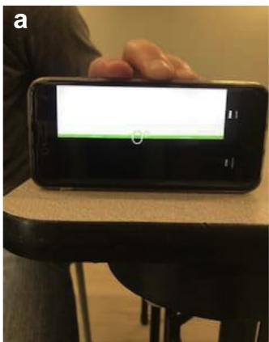

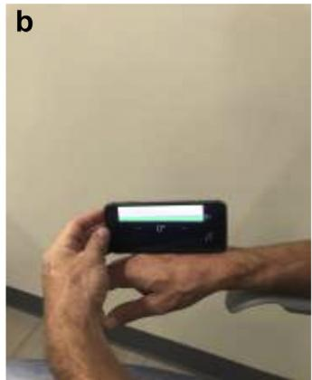

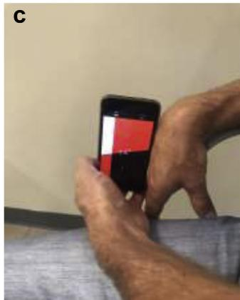  
Fig. 1. Technique for the measurement of wrist flexion. (a) The phone is zeroed out on a level surface. The screen is tapped to confirm zero. (b) The phone is placed over the third metacarpal, and the wrist is held at zero, neutral, and the digits are relaxed. (c) The wrist is actively moved into full flexion. The arm rest should not block the wrist motion.

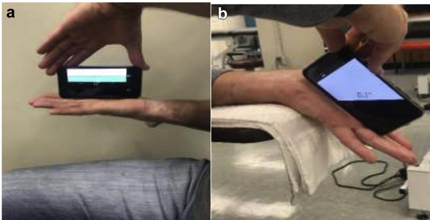  
Fig. 2. Technique for measuring wrist extension. (a) The phone is zeroed out, wrist is supinated in neutral position, resting on the volar surface of the third metacarpal. (b) The forearm is supinated and the wrist moved into full extension. Ensure the surface is not blocking the motion

S.L. Alford / Journal of Hand Therapy xxx (2020) 1e5

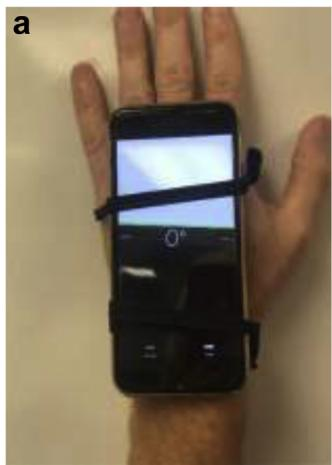

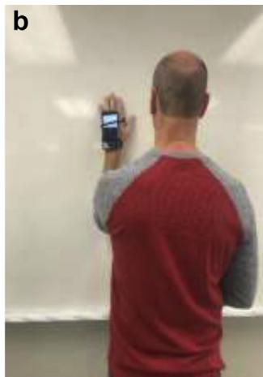

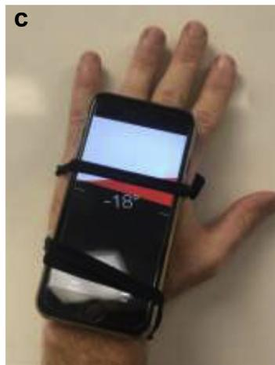  
Fig. 3. Technique for measuring radial deviation. (a) The phone is secured with hair ties to the dorsal aspect of the third metacarpal. (b) The wrist is in neutral with forearm resting on the wall. (c) The wrist is moved into radial deviation. Avoid substitution patterns of the shoulder and cupping of the hand. Do not follow the phalanges.

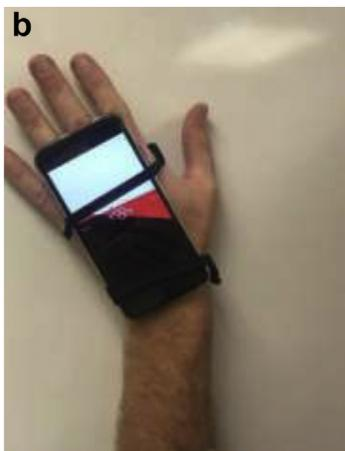

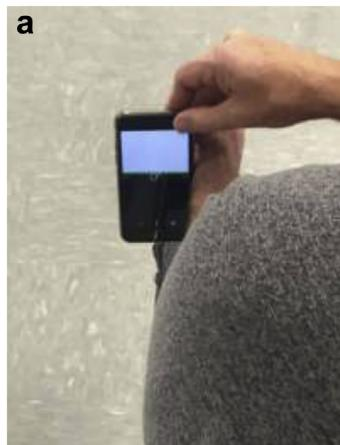

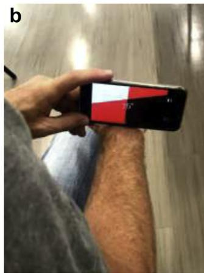  
Fig. 5. Technique for measurement of pronation. (a) The phone is zeroed out with the forearm in neutral and hash mark on the dorsal surface at the level of the distal radia ulnar joint. (b) The forearm is pronated. The phone should rest flush across the radiu and ulna with the hash mark centered on the distal radial ulnar joint. Avoid rotating the phone over the radius and substitution patterns of the shoulder

Fig. 4. Technique for measuring ulnar radial deviation. (a) The wrist starting position at zero. (b) The wrist is ulnarly deviated. The phone should rest on the third meta carpal. Avoid substitution patterns of the shoulder and cupping of the hand. Do no follow phalanges.  
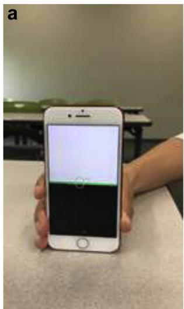

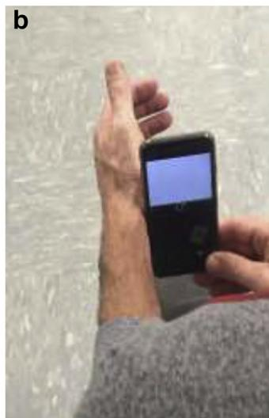

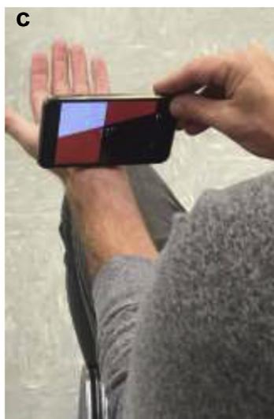  
Fig. 6. Technique for measurement of supination. (a) The phone is zeroed out in a vertical position on a level surface. Tap the screen to confirm zero degrees. (b) The starting position with the forearm in neutral. The hash mark in the middle of the phone on the volar surface at the level of the distal radial ulnar joint. (c) The position of the phone at the end range. The humerus is adducted to the side. The forearm is in full active supination. Substitution patterns of the external rotation of the shoulder should be avoided

Analysis

SPSS 26 was used to run intraclass correlation coefficients using a two-way random analysis at a 95% confidence interval with ab solute agreement. Descriptive statistics were performed to explore the standard deviation, mean, range, and standard error of means.

## Results

## Findings

Good reliability was determined in wrist flexion and extension in all conditions when using the criteria of single measures

Table 3  
Table 4  
Inter-rater reliability of the iPhone Level application

<table><tr><td>Motion</td><td>95% CI</td><td>95% CI</td><td>95% CI</td><td>95% CI</td></tr><tr><td>N = 80</td><td>Goniometer compared with iPhone</td><td>iPhone compared with iPhone</td><td>Subject self-measure compared with examiner iPhone</td><td>Subject self-measure iPhone compared with the goniometer</td></tr><tr><td>Flexion</td><td></td><td></td><td></td><td></td></tr><tr><td>Single measures</td><td>0.862 (0.685-0.930)</td><td>0.921 (0.879-0.949)</td><td>0.899 (0.857-0.930)</td><td>0.806 (0.455-0.913)</td></tr><tr><td>Average measures</td><td>0.962 (0.987-0.982)</td><td>0.959 (0.935-0.974)</td><td>0.962 (0.944-0.975)</td><td>0.926 (0.715-0.969)</td></tr><tr><td>Extension</td><td></td><td></td><td></td><td></td></tr><tr><td>Single measures</td><td>0.808 (0.536-0.907)</td><td>0.944 (0.914-0.963)</td><td>0.930 (0.901-0.952)</td><td>0.788 (0.443-0.902)</td></tr><tr><td>Average measures</td><td>0.944 (0.822-0.975)</td><td>0.971 (0.955-0.981)</td><td>0.976 (0.965-0.984)</td><td>0.917 (0.705-0.965)</td></tr><tr><td>Radial deviation</td><td></td><td></td><td></td><td></td></tr><tr><td>Single measures</td><td>0.685 (0.413-0.824)</td><td>0.837 (0.757-0.893)</td><td>0.562 (0.325-0.721)</td><td>0.360 (0.037-0.610)</td></tr><tr><td>Average measures</td><td>0.897 (0.738-0.949)</td><td>0.911 (0.861-0.943)</td><td>0.794 (0.591-0.886)</td><td>0.628 (0.103-0.825)</td></tr><tr><td>Ulnar deviation</td><td></td><td></td><td></td><td></td></tr><tr><td>Single measures</td><td>0.711 (0.595-0.800)</td><td>0.837 (0.757-0.892)</td><td>0.488 (0.228-0.671)</td><td>0.373 (0.080-0.599)</td></tr><tr><td>Average measures</td><td>0.908 (0.570-0.800)</td><td>0.911 (0.862-0.943)</td><td>0.741 (0.470-0.859)</td><td>0.641 (0.207-0.818)</td></tr><tr><td>Supination</td><td></td><td></td><td></td><td></td></tr><tr><td>Single measures</td><td>0.725 (0.642-0.799)</td><td>0.864 (0.796-0.910)</td><td>0.764 (.680-0.833)</td><td>0.595 (0.476-0.702)</td></tr><tr><td>Average measures</td><td>0.913 (0.878-0.941)</td><td>0.927 (0.886-0.953)</td><td>0.907 (.864-0.937)</td><td>0.815 (0.732-0.876)</td></tr><tr><td>Pronation</td><td></td><td></td><td></td><td></td></tr><tr><td>Single measures</td><td>0.700 (0.570-0.796)</td><td>0.720 (0.588-0.814)</td><td>0.574 (0.324-0.586)</td><td>0.410 (0.225-0.570)</td></tr><tr><td>Average measures</td><td>0.903 (0.841-0.940)</td><td>0.837(0.741-0.897)</td><td>0.802 (0.707-0.868)</td><td>0.675 (0.465-0.799)</td></tr></table>

Table 3 displays the inter-rater reliability of the iPhone Level application compared with traditional goniometric measurements obtained by a trained examiner and self measurements performed by a minimally trained participant from a remote location. The intraclass correlation coefficient was calculated using SPSS 26. A two-way random analysis was used at absolute agreement with a 95% confidence interval (CI). Good reliability was determined in single measures exhibiting intraclass correlation coefficients .75.

Summary of score distributions between the examiners and subject self-measurement

<table><tr><td>Measurement</td><td>Mean</td><td>Range</td><td>SD</td><td>SE</td></tr><tr><td>Examiner 1 goniometer flexion</td><td>73.2</td><td>40-91</td><td>9.3</td><td>1.044</td></tr><tr><td>Examiner 2 goniometer flexion</td><td>74.3</td><td>45-92</td><td>9.09</td><td>1.017</td></tr><tr><td>Examiner 1 Level app flexion</td><td>77.6</td><td>48-95</td><td>9.7</td><td>1.088</td></tr><tr><td>Examiner 2 Level app flexion</td><td>78.4</td><td>47-93</td><td>8.7</td><td>0.981</td></tr><tr><td>Subject self-measure flexion</td><td>79.07</td><td>49-93</td><td>8.2</td><td>0.921</td></tr><tr><td>Examiner 1 goniometer extension</td><td>67.4</td><td>50-85</td><td>8.4</td><td>0.941</td></tr><tr><td>Examiner 2 goniometer extension</td><td>67.8</td><td>51-84</td><td>7.3</td><td>0.819</td></tr><tr><td>Examiner 1 Level app extension</td><td>72.4</td><td>51-89</td><td>7.9</td><td>0.884</td></tr><tr><td>Examiner 2 Level app extension</td><td>72.6</td><td>50-88</td><td>7.7</td><td>0.863</td></tr><tr><td>Subject self-measure extension</td><td>72.5</td><td>50-87</td><td>7.5</td><td>0.839</td></tr><tr><td>Examiner 1 goniometer RD</td><td>20.55</td><td>14-36</td><td>4.1</td><td>0.458</td></tr><tr><td>Examiner 2 goniometer RD</td><td>20.51</td><td>13-34</td><td>4.2</td><td>0.475</td></tr><tr><td>Examiner 1 Level app RD</td><td>23.78</td><td>16-36</td><td>4.3</td><td>0.482</td></tr><tr><td>Examiner 2 Level app RD</td><td>23.72</td><td>15-36</td><td>4.2</td><td>0.472</td></tr><tr><td>Subject self-measure RD</td><td>27.05</td><td>15-38</td><td>4.9</td><td>0.550</td></tr><tr><td>Examiner 1 goniometer UD</td><td>35.6</td><td>24-46</td><td>5.4</td><td>0.609</td></tr><tr><td>Examiner 2 goniometer UD</td><td>35.2</td><td>26-46</td><td>4.9</td><td>0.559</td></tr><tr><td>Examiner 1 Level app UD</td><td>37.8</td><td>23-48</td><td>5.08</td><td>0.568</td></tr><tr><td>Examiner 2 Level app UD</td><td>37.4</td><td>25-46</td><td>5</td><td>0.559</td></tr><tr><td>Subject self-measure UD</td><td>42.3</td><td>30-56</td><td>6.01</td><td>0.672</td></tr><tr><td>Examiner 1 goniometer supination</td><td>89.1</td><td>75-102</td><td>5.7</td><td>0.647</td></tr><tr><td>Examiner 2 goniometer supination</td><td>88.6</td><td>74-101</td><td>5.4</td><td>0.607</td></tr><tr><td>Examiner 1 Level app supination</td><td>88.3</td><td>63-106</td><td>8.1</td><td>0.907</td></tr><tr><td>Examiner 2 Level app supination</td><td>88.8</td><td>65-105</td><td>8.1</td><td>0.908</td></tr><tr><td>Subject self-measure supination</td><td>90.4</td><td>72-110</td><td>7.1</td><td>0.800</td></tr><tr><td>Examiner 1 goniometer pronation</td><td>84.9</td><td>70-94</td><td>4.9</td><td>0.556</td></tr><tr><td>Examiner 2 goniometer pronation</td><td>84</td><td>69-92</td><td>4.7</td><td>0.536</td></tr><tr><td>Examiner 1 Level app pronation</td><td>87.06</td><td>70-98</td><td>4.8</td><td>0.547</td></tr><tr><td>Examiner 2 Level app pronation</td><td>86.07</td><td>72-94</td><td>4.4</td><td>0.498</td></tr><tr><td>Subject self-measure pronation</td><td>88.08</td><td>79-100</td><td>4.8</td><td>0.543</td></tr></table>

RD radial deviation; UD ulnar deviation; SD standard deviation; SE standard error of means.  
Table 4 compares the mean, range, standard deviation, and standard error of measure between each examiner and the participant's self-measurements

Summary of combined means for goniometry and the level application compared with remote self-measurement

<table><tr><td>Motion N = 80</td><td>Mean goniometric measurements</td><td>Mean Level app measurements</td><td>Difference in means</td><td>Subject mean</td><td>Difference in means between self-measurement and goniometry</td></tr><tr><td>Wrist flexion</td><td>73.7 (40-92)</td><td>78.02 (47-95)</td><td>4.2</td><td>79.07 (49-93)</td><td>5.2</td></tr><tr><td>Wrist extension</td><td>67.6 (50-85)</td><td>72.5 (51-89)</td><td>4.8</td><td>72.5 (50-87)</td><td>4.4</td></tr><tr><td>Radial deviation</td><td>20.5 (13-36)</td><td>23.7 (15-36)</td><td>3.2</td><td>27.05 (15-38)</td><td>6.5</td></tr><tr><td>Ulnar deviation</td><td>35.4 (24-46)</td><td>37.6 (23-48)</td><td>2.1</td><td>42.3 (30-56)</td><td>6.8</td></tr><tr><td>Supination</td><td>88.9 (74-102)</td><td>89.07 (63-105)</td><td>4.5</td><td>90.4 (72-110)</td><td>1.5</td></tr><tr><td>Pronation</td><td>84.4 (69-94)</td><td>86.5 (70-98)</td><td>2.08</td><td>88.08 (79-100)</td><td>3.5</td></tr></table>

Table 5 displays the differences between the combined mean of both examiners using the Level App and the participant's self-measure mean compared with the combined mean using the universal goniometer.

exhibiting >.75 intraclass correlation coefficient at absolute agreement. The examiners demonstrated moderate reliability in measuring pronation, supination, and radial and ulnar deviation between the Level application and the universal goniometer. The participants demonstrated moderate reliability when measuring supination and poor reliability when measuring pronation, radial and ulnar deviation compared with the goniometer (Table 3). A comparison of means further illustrates the variability between the participant's self-measurement scores and the goniometric measurements obtained by the examiners. Radial and ulnar deviation demonstrated the greatest differences in means at 6.5 and 6.8 degrees respectively (Table 4 and 5).

## Discussion

Recent studies have reported the reliability of various smartphone applications in measuring range of motion. Most of these investigated the ability of a trained examiner to perform the measurements (Keogh et al 2019, Pourahmadi et al 2017).1,2 Few studies have examined whether individuals unfamiliar with goniometry could achieve similar results. Modest et al (2018)3 found good reliability in the self-measurement of the wrist flexion, extension, supination, and pronation when the examiner was physically present and simultaneously performing goniometry. This study expands on these findings, and the results indicate that individuals with uninjured wrists can perform reliable selfmeasurement of wrist flexion and extension from a remote location without the physical presence of an examiner. However, unlike previous studies, supination, pronation, and radial and ulnar deviation were not as reliable.

Differences in statistical analysis and parameters selected to determine reliability may contribute to this variance. Limitations to this study include the decreased generalizability of its findings as it was performed on normal wrists. Individuals with injuries would demonstrate more variability secondary to factors such as swelling and pain. Therefore, the results do not apply to injured wrists and forearms. Some participants found the procedure complicated and reported perceptual and technological difficulties when performing the self-measurements.

Anatomical variations and the hand size also affected the placement of the phone in some individuals.

## Conclusion

The ability of a person to self-monitor improvements in range of motion at home might result in increased motivation and compliance to home exercise programs. In addition, with the growing focus on telehealth, further research exploring the reliability of this method on injured individuals as well as identifying other assessments that can be performed remotely is indicated

## Acknowledgments

The author would like to thank the following student researchers for their contribution to this study. Aubrey Adkisson, OTR, Morganne Appl-Culp, OTR, Shelsea Lies, OTR, Joshua Wilson, OTR, Madison Zubradt, OTR, Adrian Cochren, OTR, Jack Dickens OTR, Kara Greiner, OTR, Margaret Munro, OTR, and Jessica Tietz, OTR.

## References

1. Keogh J, Cox A, Anderson S, et al. Reliability and validity of clinically accessible smartphone applications to measure joint range of motion: a systemic review. PLoS One. 2019;14(5):e0215806.

2. Pourahmadi MR, Ebrahimi Takamjani I, Sarrafzadeh J, et al. Reliability and concurrent validity of a new iPhone goniometric application for measuring active wrist range of motion: a cross-sectional study in asymptomatic subjects. J Anat. 2017;230(3):4484e4495.

3. Modest J, Clair B, DeMasi R, et al. Self-measured wrist range of motion by wrist-injured and wrist-healthy study participants using a built-in iPhone feature as compared to the universal goniometer. J Hand Ther. 2018;32(4): 507e514.