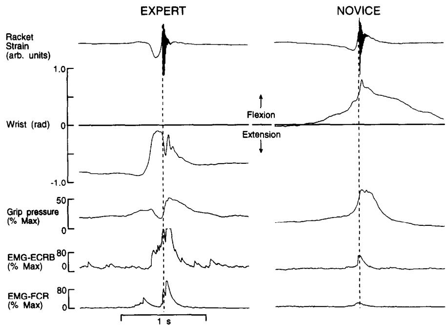
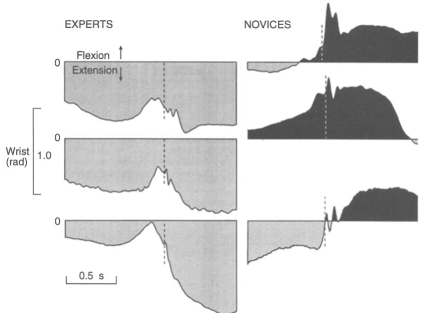
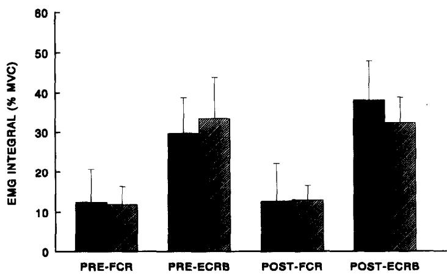

# WRIST KINEMATICS DIFFER IN EXPERT AND NOVICE TENNIS PLAYERS PERFORMING THE BACKHAND STROKE: IMPLICATIONS FOR TENNIS ELBOW

JOHN R. BLACKWELL\* and KELLY J. COLE†

Department of Exercise Science, The University of Iowa, Iowa City, IA 52240, U.S.A.

Abstract—Investigators have suggested that the greater prevalence of lateral humeral epicondylitis (tennis elbow, TE) in novice tennis players compared to expert players may reflect the novice players' use of faulty mechanics for the backhand stroke. We investigated the wrist kinematics (flexion/extension), grip pressures, and wrist muscle electromyographic activity in novice $N=8$ and expert $N=8$ tennis players performing the backhand stroke. Experts performed the backhand stroke with the wrist extended (re: neutral alignment of the forearm and hand dorsum). Collision of the ball and racket occurred with the wrist extended an average of 0.41 rad (about 23° from neutral alignment) in the expert players; moreover, their wrists were moving further into extension at impact. In contrast, novice subjects struck the ball with the wrist flexed 0.22 rad (about 13°) while moving their wrists further into flexion. Wrist extensor EMGs showed similar levels of activity during the 500 ms interval before ball-racket impact, whereas expert subjects displayed greater EMG levels after contact, consistent with the accompanying wrist extension. The wrist kinematic and EMG data together show that the novice subjects eccentrically contracted their wrist extensor muscles throughout the stroke. We argue that conditions exist for novice subjects that assist stretch of wrist extensor muscles upon collision of the ball and racket. The resulting eccentric contraction of wrist extensor muscles may contribute to lateral TE in novice players, given previous research indicating that eccentric muscle contraction facilitates muscle fiber injury.

## INTRODUCTION

Tennis elbow (TE), or humeral epicondylitis, occurs with pain at the epicondylar regions, and frequently the lateral epicondyle (Nirschl, 1973, 1974). Overexertion of the extensor carpi radialis brevis (ECRB) muscle may be one important etiological factor for lateral TE (Coonrad and Hooper, 1973; Cyriax, 1936; Durbin, 1966; Garden, 1961; Johnson, 1986; Murtagh, 1988; Nirschl and Sobel, 1981), although other causes of pain in this region exist, such as nerve entrapment (cf. Viikari-Juntura, 1984). Persons performing repetitive wrist movements appear to be at greatest risk for injury (Bernhang, 1979; Cooney III, 1984; Cyriax, 1936; Kivi, 1984; Klimek, 1984; Roto and Kivi, 1984; Williams et al., 1989).

Novice tennis players often develop lateral TE and report increased pain during the backhand stroke (Cooney III, 1984; Kohn, 1984; Nirschl, 1973; Priest et al., 1974; Ryan, 1977). Investigators have attempted to identify behaviors that may contribute to the increased prevalence of lateral TE in these players (e.g. Bernhang et al., 1974; Groppel and Nirschl, 1986; Hobart, 1967; Kashiwagi, 1985; McCue III, 1982; Pecore, 1978). Kinematic analyses prompted investigators to suggest that skilled players maintain a constant wrist position, whereas novice players are more likely to use more wrist motion to produce the stroke (Bernhang et al., 1974; Pecore, 1978), and hence requiring greater forces from wrist extensor muscles. However, wrist angular motion was not quantified in these studies. Also, novice players may maintain their peak grip pressures for longer durations during the stroke than expert players (Bernhang et al., 1974; McCue III, 1982). This would require application of wrist extensor muscle force for similarly longer durations (Kashiwagi, 1985; Groppel and Nirschl, 1986) to balance the wrist flexion torques produced when extrinsic finger flexors are activated (Bunnell, 1944; Cabrera and McCue III, 1986; Snijders et al., 1987).

In the present investigation we sought to determine if novice and expert tennis players performing the backhand stroke differ in wrist kinematics for the flexion-extension directions. We also simultaneously recorded the grip pressure that subjects used to hold the racket, and accompanying wrist extensor muscle EMGs. Behaviors that may facilitate injury to the wrist extensor muscles in novice players are considered. In particular, we focus on possible eccentric contractions of wrist extensor muscles because eccentric muscle contraction has been related to muscle injury (cf. Lieber et al., 1991).

## METHODS

Subjects were 16 normal healthy males between the ages of 18 and 30 yr. Informed consent was obtained from all subjects according to the Declaration of Helsinki. None of the subjects reported any history of injury or pain at the elbow or forearm. All were right-handed except one expert player and all subjects used a one-handed, backhand stroke. Eight of the subjects were novice tennis players and were recruited from The University of Iowa student population. They claimed to play tennis only at the recreational level and infrequently. The remaining eight subjects were expert tennis players. Each subject's skill level was evaluated by a member of the United States Professional Tennis Association using the National Tennis Rating Program (NTRP; a continuum from 0 to 7 with 7 denoting a world-class player). All novice players were rated less than 2.0 (mean 0.9). The NTRP descriptions of these players ranged from those 'just starting to play tennis' (a score of 1.0) to 'players that have had some lessons but need on-court experience' (a score of 2.0). These players were familiar with the backhand stroke and used some form of this stroke in their play. All expert players were rated greater than 5.0 (mean 5.8), where a score of 6.0 reflects players who have had 'intensive training for national competition at junior or collegiate levels'. Six of the eight expert players were members of the men's tennis team at The University of Iowa.

A Wilson, tapered beam, mid-sized tennis racket (model Kevlar Ultra 95), strung with nylon at 65 lb of tension, was modified to measure racket handle strain and grip pressure. Strain gauges were applied to opposite sides of the racket handle, just above the grip and parallel to the racket face, and wired into a Wheatstone bridge. The racket handle strain signal was used to identify specific phases of the tennis stroke, including the time of collision between the ball and racket. The racket handle was modified for grip pressure measurement. The factory-applied leather grip was removed, which exposed a rigid foam material. This material was then ground to a circular shape with a diameter of 3.5 cm. Flexible plastic tubing (0.040" 1D, 0.070" OD and 0.015" wall thickness) was wrapped around the handle to surround the grip in a continuous coil. One end of the tubing was attached to a closed stopcock at the butt end of the racket. The other end of the tubing was attached to the input port of a temperature-compensated pressure sensor (Sensym model SCX15DN). The lightweight plastic sensor was suspended from flexible tubing within the open area of the racket throat. Any effect of the sensor on the mechanical characteristics of the racket (e.g. moment of inertia, stiffness) were assumed to be negligible. The output of this signal was amplified by a high-gain differential amplifier and low-pass filtered by a 2-pole, -1 dB Chebyshev active filter with the end of the ripple channel at 30 Hz (model B328C, Bioengineering, The University of Iowa). The output linearity over the range of pressures measured in this experiment was indicated by a Pearson product moment correlation coefficient (R) of 0.997.

A biaxial wrist electrogoniometer developed at the Mayo Clinic (Ryu et al., 1986) was used to transduce wrist position independently in the flexion/extension and radial/ulnar deviation directions, although the present investigation focussed on flexion/extension kinematics. The device has been used to characterize wrist motion during behaviors such as basketball shooting (Ohnishi et al., 1990) and golf (Cahalan et al., 1991). Rotational potentiometers transduced wrist angles, with transducer axes of rotation aligned with the corresponding wrist rotation axis reported by Youm et al. (1978). The zero positions of the transducers were set with the wrist aligned to conventional neutral positions of the wrist (American Academy of Orthopaedic Surgeons, 1963). In particular, baseline in the flexion/extension axis (0 rad) was set with the dorsal skin of the forearm and the hand dorsum aligned. The goniometer was placed on the subjects by an individual from the Orthopaedic Biomechanics Laboratory of the Mayo Clinic experienced in the use of the device. The goniometer was attached to the subject in two locations. An aluminum saddle was fitted to the hand dorsum, on the skin overlying the metacarpal bones. This plate, which was connected to a linkage rod for the electrogoniometer, was held against the skin with a wide elastic band that wrapped around the hand at midpalmar level. The second attachment point was at the distal forearm. A second aluminum saddle was fitted to the volar skin of the forearm; this saddle was formed to fit around the side of the forearm and continued to attach to the goniometer mechanism on the dorsal aspect of the forearm. An elastic strap that was attached to the saddle wrapped around the forearm to hold the device in place.

Surface EMG electrodes (silver–silver chloride) in a bipolar arrangement (2 cm apart), were used with on-site pre-amplifiers (gain=35). The true root-mean-square (RMS) value of the raw EMG signal (De Luca and Van Dyk, 1975) was obtained using a low-pass filter circuit (time constant of 55 ms) that was integral to the amplifier (GSC model 67; Therapeutics Unlimited, Iowa City). Electrodes were placed on the skin overlying the flexor carpi radialis (FCR) and extensor carpi radialis brevis (ECRB) after abrading the skin and applying conductive paste to the electrodes. The signals from these electrodes were taken to represent in general wrist flexor and extensor muscle activity. Crosstalk from nearby muscles (e.g. finger flexors and extensors) existed variably across subjects, but was minimized by adjusting electrode placements.

Flexor and extensor muscle EMGs were obtained first while the subjects performed maximal voluntary contractions. These data were used to normalize the EMG signals to maximum voluntary contraction. The subject was seated comfortably with the racket forearm resting on a table. The subject attempted to either extend or flex the wrist against resistance with the fingers clenched in a fist. Each trial lasted approximately 3 s with 10–15 s rest in between trials. Three trials in each direction were performed before the tennis trials. Maximum grip pressure was obtained similarly while the subject held the racket with a backhand grip.

We were interested in sampling subjects' behavior during the backhand stroke that was representative of each population's natural performance. A tennis ball machine (Prince) located 80 ft from the subject, projected new tennis balls (Wilson Championship) toward the subject at the rate of one ball every 10 s. The ball bounced once to a height of about 3.5 ft. The subject attempted to return the ball with a flat backhand ground stroke (i.e. without intentionally imparting spin to the ball) to the other side of the court, aiming in the direction of the ball machine. Subjects were instructed simply to return the ball using a backhand stroke without instruction regarding the form of that stroke. They were allowed an initial practice period consisting of approximately 10 balls, after which they all hit a minimum of 25 balls. The unskilled subjects in general were delivered about 10–20% more balls because of missed balls and hits that were off-axis or misdirected. The increased number of swings was not thought to be significantly fatiguing. No subjects complained of fatigue, and there was a break after each swing while the experimenter adjusted the baseline associated with the grip pressure signal, which drifted slightly.

All signals were obtained simultaneously, amplified, and recorded onto a Vetter, eight-channel, FM instrumentation recorder (model D) with a bandwidth of 0–1125 Hz (frequency response at -3 dB). Data were digitized at 125 samples per second using a 12-bit analog-to-digital converter and a personal computer. The racket was in the full back-swing position when data collection began. Wrist angular velocities were obtained from differentiating the wrist position signals digitally with central difference approximation over three data points. Grip pressure and EMG signals were normalized to facilitate comparisons across subjects. The normalization process involved obtaining the integral of the signal over two 500 ms intervals for each subject, one ending at ball-racket impact and one beginning at impact. The integral values obtained during the backhand stroke were then expressed as a percentage of the integral values obtained during maximal voluntary contractions. Comparisons of absolute grip pressure levels were not performed across subjects because racket handle diameter or maximum grip pressure were not adjusted according to each subject's finger length. Thus, we could not be sure that the racket handle diameter placed the subject's finger flexors at the optimal length for force production.

Data were obtained from individual trials and the resulting values were averaged across all trials within each subject to obtain statistics that were descriptive of the total set of trials for a particular subject. These mean values were used as dependent variables in two-factor (group X subjects) analyses of variance (ANOVA), unless otherwise specified in Results section. All values in the text are means pooled across subjects ±1S.D. of these means. To avoid artifact from vibration at the time of ball-racket impact, values described as occurring at impact were measured 8 ms (one digitized sample) before impact.

## RESULTS

Subjects in both groups moved their wrists in the flexion direction before the ball and racket collided (collision marked by dashed vertical lines in Figs 1 and

  
Fig. 1. Exemplar signals from an expert and novice player striking a tennis ball with a backhand stroke of the racket. The dashed vertical line is aligned with ball-racket collision, as determined from the racket strain signal at high temporal magnification. The expert player maintained his wrist in extension angular positions and struck the ball while extending the wrist further (also, see Fig. 2). The novice player performed much of the stroke with the wrist flexed and struck the ball while flexing the wrist further. The racket strain signals were amplified equally and are displayed in arbitrary units. Grip pressure and EMGs are calibrated with reference to the maximum voluntary effort of each subject (cf. Methods section).

2). The peak amplitude in the flexion direction before ball-racket impact coincided roughly with the peak strain for backward racket bending (Fig. 1). We observed this correspondence most clearly for the expert subjects. The initial wrist flexion thus may result in part from inertial effects on the racket and hand from racket acceleration during the stroke.

Just before ball-racket impact the expert players, but not the novice players, reversed their initial wrist motion to begin a rapid extension movement (Fig. 2) that ensured an extended wrist at the time of ball-racket impact. For most of the expert players the entire flexion/extension movement sequence occurred with the wrist nearly always in extension angular positions (re: neutral alignment of the wrist and forearm). On occasion when the expert subjects' initial wrist flexion motion carried the wrist into flexion angles, the wrist returned to extension angular positions before the moment of ball-racket impact. As a result, the wrists of seven of eight expert subjects were in extension $(-0.41 \pm 0.26$ rad) at the time of ball-racket impact. In contrast, the novice subjects were more likely to continue the initial wrist flexion motion until ball-racket impact. The wrists of five of the eight novice subjects were in flexion positions $(0.22 \pm 0.48$ rad) at the time of ball-racket impact (Fig. 2). The difference in the mean wrist angular position at ball-racket impact was statistically significant between groups (F1, $14 = 9.18$ ; $p < 0.009$ ).

The direction of wrist rotation at the moment of ball-racket impact also differed between the two groups of subjects, with expert subjects extending their wrists and novice subjects flexing their wrists at impact. Ball-racket collision occurred with a wrist angular velocity averaging $1.69 \pm 1.41$ rad s $^{-1}$ in the extension direction for expert players, and a wrist angular velocity of $2.76 \pm 2.5$ rad s $^{-1}$ in the flexion direction for novice subjects. These differences were statistically significant (F1, 14 = 16.54; p < 0.001). Novice subjects maintained their wrists in flexion after impact, finishing the stroke with the wrist flexed, whereas subjects in the expert group typically completed the stroke with the wrist extended.

We were particularly interested in the effects of ball-racket collision on wrist motion, and would predict greater, faster wrist extensor muscle lengthening due to ball-racket impact in novice subjects. The transfer of momentum from the ball to the racket-hand system may increase wrist acceleration in the flexion direction more for novice players because their wrists were already moving in this direction, in contrast to the expert players. However, the wrist position signal was difficult to interpret for about 150 ms after ball-racket impact due to artifacts from the collision (note variable oscillation of wrist position signals in Fig. 2). From an examination of the wrist transducer in place on the hand and arm, we suggest that artifacts in the wrist position signal following impact resulted from the inertia of the transducer system along with slip of the skin over bone and muscle at the goniometer attachment points (hand dorsum and forearm).

It can be deduced from the wrist kinematic behavior described previously that the wrist extensor muscles of novice players typically were undergoing eccentric activation (lengthening) at impact, whereas these muscles in expert players were concentrically active (shortening). The EMG signals from the wrist extensor muscle (ECRB) indicated that this muscle was active in both groups of subjects throughout the backhand stroke, consistent with the need to grip the racket (Fig. 1). There were no differences in overall level of EMG activity between the two groups for either the wrist flexor (FCR) or extensor muscle during the 1 s interval centered on the time of ball-racket impact (Fig. 3). The activity of ECRB increased during the post-impact interval for the expert players, consistent with the wrist extension they produced following ball-racket impact. Activity of the FCR remained unchanged from the pre- to post-impact intervals in both groups. An analysis of variance was performed with two groups (novice and expert), with the factors of time (pre- and post-impact) and muscle group (FCR and ECRB) repeated within subjects. The only significant effect was a three-way interaction (Group × Time × Muscle) from the increased ECRB activity for the expert group over the post-impact interval (F1, 14 = 5.92; p < 0.092). Two-factor (Group and Time) analyses on the separate muscle groups were performed and confirmed the two-way interaction for the ECRB (F1, 14 = 6.05; p < 0.027) and no interaction for the FCR.

  
Fig. 2. Examples of wrist angular position (flexion/extension) from three expert players (left; different from the expert player of Fig. 1) and three novice players (right). Note that the expert players before ball-racket impact reduced their wrist extension and then rapidly increased wrist extension, and that the wrist position signals of most subjects oscillated after impact. The dashed vertical lines indicate ball-racket impact. The horizontal lines indicate neutral wrist position for each subject. Solid filled regions indicate flexed wrist angular positions; lighter filled regions indicate extended wrist angular positions.

Both groups showed significantly increased integrated grip pressure values in the 500 ms after impact compared to the 500 ms interval before impact. The main effect of Time was the only significant result of a two (Time) by two (Groups) split-plot ANOVA with Time as a repeated factor (F1, 14=9.54; p<0.008). However, these findings should be considered cautiously given that a single racket handle size was used and therefore grip pressure signals may not have been normalized using each subject's true maximum grip force (see Methods section). Inspection of the grip pressure patterns revealed no differences between the two groups of subjects. In particular, novice subjects did not appear to maintain their peak grip pressures for longer durations than the expert subjects.

## DISCUSSION

We undertook this investigation to address whether differences in wrist kinematic behaviors characterized expert and novice tennis players performing the flat backhand ground stroke. Such behavioral differences may explain the greater prevalence of lateral tennis elbow (lateral humeral epicondylitis) in novice players, provided, of course, that a reasonable injury mechanism exists. To our knowledge simultaneous measures of wrist kinematics, grip pressure, and forearm EMGs have not been obtained from groups of expert and novice tennis players performing a tennis stroke.

The present results clarify and extend previous descriptions of novice and expert tennis players' wrist kinematic patterns for the backhand stroke. Expert players consistently produced the stroke with the wrist extended and with wrist angular velocity in the extension direction at the time of ball-racket impact. In contrast, novice players were more likely to produce the stroke with the wrist flexed and with wrist angular velocities in the flexion direction at the time of ball-racket collision. We assume that the stroke each group used was characteristic of most expert and novice subjects because we gave no instructions regarding grip, body orientation, or stroke, other than to return the ball without spin over the net and towards the ball machine. We also assume that expert subjects indeed hit the ball without intentionally imparting spin. Such strokes would facilitate the wrist extension behavior observed in the present expert players, although this would not affect our conclusions regarding the possible contribution of wrist flexion following ball-racket impact in novice subjects to injury of the wrist extensor muscles.

  
Fig. 3. Bar graphs showing mean EMG levels ( $\pm$ 1S.D.) normalized to each subject's maximum voluntary effort for the 500 ms measurement interval ending at ball-racket impact (pre-impact) and for the measurement interval beginning at impact (post-impact). Solid bars are averages of expert players (N=8); hatched bars represent averages of novice players (N=8).

Previous descriptions of the backhand stroke suggested that skilled players maintained the wrist and elbow in a fixed position (Bernhang et al., 1974; Pecore, 1978). Bernhang et al. (1974, p. 241) also examined video and film records of less-skilled players with tennis elbow and described an upper limb configuration for the backhand stroke, which they termed the 'leading elbow'. In this stroke the elbow was bent at the time of ball-racket impact, with the olecranon pointing towards the net, rather than towards the ground as they described for world-class players. Racket acceleration was claimed to result from shoulder abduction and elbow extension for the leading elbow stroke. Wrist angular position was not described, but photographic sequences in Bernhang et al. (1974) of two players employing this stroke reveal flexed wrist positions.

These differences in upper limb kinematic patterns during the backhand stroke may result from differences in body orientation to the approaching ball (McCue III, 1982; Pecore, 1978; Ryan, 1977), although other explanations are possible. Novice players are claimed to assume body positions that expose their frontal planes to the approaching ball, rather than orienting the frontal plane more or less in parallel with the ball's path. Positioning the body in the former manner requires varying amounts of wrist and elbow flexion to direct the ball's rebound path appropriately.

The pre-impact sequence of wrist flexion followed by rapid extension occurred mostly for expert players and may reflect a stretch–shorten cycle of the active wrist extensor muscles. The lengthening wrist extensors may store energy in the series elastic components of muscle and tendon that in turn can be released during the subsequent wrist extension, provided that the muscle stretch is brief and followed quickly by shortening (Cavagna, 1977; Cavagna and Citterio, 1974; also cf. Enoka, 1988). The release of this stored energy may explain why expert subjects reliably reversed wrist flexion motion to the extension direction before impact, although EMG records from wrist extensor muscles are also consistent with active mechanisms of force generation leading to this movement (e.g. Fig. 1).

The wrist flexion patterns observed for the novice tennis players may indicate conditions that facilitate wrist extensor muscle injury. However, muscle force cannot be determined from our data and discussions regarding potential injury mechanisms are necessarily speculative. Nevertheless, we shall argue that the flexion wrist angular velocity that existed for novice subjects at the time of ball-racket impact facilitated eccentric contractions of the wrist extensor muscles, which damage muscle tissue.

Ongoing wrist flexion in novice subjects at the moment of ball-racket impact makes it more likely that the transfer of momentum from the ball to the racket accelerated the wrist flexion, and therefore rapidly stretched the wrist extensor muscles. In contrast, we should expect smaller eccentric contractions of wrist extensors in expert subjects because wrist motion was in the extension direction at impact. It was unfortunate in the present experiment that the impact artifact in the wrist position signal precluded reliable measurement of the amplitude and rate of wrist flexion following impact. Nevertheless, there are additional factors that cause us to predict smaller stretches of the wrist extensor muscles in the expert players following ball-racket impact. Compared with novice players, expert players' wrist muscles should have been stiffer and thus more resistant to forced lengthening from wrist flexion torques upon impact. The effects of long-term muscle training of wrist extensors in the expert group of players will increase the contractile protein content in muscle (MacDougall, 1986; also see Strizak et al., 1983). This will yield greater numbers of active cross-bridges in expert players compared to novice players at equivalent levels of neural drive. Wrist extensor EMG in expert players indeed was present in equal or greater levels (percentage of MVC) during ball-racket impact compared to novice subjects, consistent with the wrist extension angular velocities that the expert subjects exhibited at this point in time. The elasticity contributed by these additional cross-bridges, organized in parallel, sums to yield increased muscle stiffness, particularly during the first millimeter or so of lengthening (i.e. short-range muscle stiffness; cf. Joyce et al., 1969). However, muscle sarcomere length will also affect the number of active cross-bridges that will form, and it is unclear as to where on the length-tension relationship the relatively longer wrist extensors for the novice subjects (due to their flexed wrist) will fall.

Despite our inability to confirm predictions of greater wrist flexion following impact in novice subjects, this suggestion is consistent with Pecore's (1978) report of increased forward racket velocity after impact in skilled players and decreased racket velocity in novice players. Provided that the racket handle and hand were sufficiently coupled, these data may indicate that novice players are subject to greater wrist flexion after impact than expert players. However, changes in elbow and shoulder motion after impact may have also contributed to the reduced racket velocity that Pecore (1978) reported for novice players.

The likelihood that the wrist extensor muscles were forcibly stretched more in the novice players is important because soft tissue injury at the elbow (lateral TE) may result from such stretch. Two mechanisms can be considered. First, in novice players this stretch would occur with the wrist extensor muscles already lengthened given the flexed wrist positions they use for the backhand stroke. These flexed wrist positions may lengthen the wrist extensor muscles beyond the plateau of the length-tension relationship, and expose the connective tissue of the wrist extensor muscles to large loads during the imposed muscle stretch from ball-racket impact. Second, eccentric muscle contraction has been related to muscle injury (cf. Lieber et al., 1991). Studies of isolated rabbit and mouse muscle indicated that repetitive eccentric muscle contraction damaged muscle fibers at forces mimicking moderate exercise levels (McCully and Faulkner, 1985, 1986; Lieber, 1991). These force levels did not damage muscle when exerted through isometric or concentric contractions. Muscle injury in these studies was revealed by muscle fiber degeneration (enlarged fibers, disorganization of sarcomeric band patterns, infiltration of macrophages) and large decreases in maximum force beyond that expected from fatigue mechanisms. McCully and Faulkner (1986, p. 298) concluded that although the extent of injury depended upon the peak forces that were developed, 'a characteristic of lengthening contractions other than the peak force development appears to be implicated in the injury'. Their data further indicated that injury occurred early in an exercise bout, before fatigue limited the peak forces.

It may be argued that the compliant tendons could absorb much of the rapid, short-duration muscle stretch which would result from ball-racket impact. For example, Morgan et al. (1978) found that when muscle developed close to the maximum isometric tension, almost eight times as much tendon movement occurred as in the muscle fibers. However, the tendon used in their study was the long, thin tendon of the wallaby's gastrocnemius muscle. The tendon of the human ECRB is very short and wide. In an earlier study (Morgan, 1977), the cat soleus muscle and tendon (a shorter, wider tendon than the wallaby's gastrocnemius tendon) stretched equally. More recent work on cat soleus tendon and human flexor pollicis longus tendon (Rack and Ross, 1984; Rack and Westbury, 1984) indicated that at low forces the tendon was much more compliant than muscle. However, at higher forces the tendon's elastic modulus increased, and imposed joint rotation yielded greater muscle stretch than at low forces. These higher forces would appear to characterize the conditions of the wrist extensors during the backhand stroke, based on the EMG observations from the present study. It appears unlikely that the imposed wrist flexion could be absorbed entirely at the wrist extensor tendons without increased length, and hence increased force, in the extensor muscles.

If, as we suggest, the occurrence of eccentric contraction of novice players' wrist extensor muscles facilitates lateral epicondylitis due to wrist flexion during the backhand stroke, one might speculate that eccentric contraction of wrist flexor muscles may facilitate medial epicondylitis in expert players (because expert subjects' extend their wrists during the backhand stroke, as observed in the present study). However, expert subjects with medial elbow pain find the serve and forehand strokes to be most painful, not the backhand. Additionally, the level of wrist flexor muscle activity should be less during a backhand stroke (for which wrist extension occurs) than during a forehand or serve (for which wrist flexion occurs).

It is likely that multiple factors contribute to the development of soft tissue injuries of the humeral epicondyles in tennis players, and the importance of any single factor may vary across individuals. For example, off-center impact of the ball on the racket face (which occurred more often for novice subjects in the present study; cf. Methods section) yields increased EMG levels in wrist extensor muscles (Bernhang et al., 1974) that may also increase extensor muscle force to injurious levels. Nevertheless, wrist flexion during the backhand stroke should be considered further as facilitating lateral TE through mechanisms associated with eccentric contraction of wrist extensor muscles. Instructors and clinicians may wish to consider emphasizing proper body position for the backhand stroke to reduce the need for wrist flexion during the stroke. Additionally, techniques to produce wrist extension before impact may be useful. These practices may reduce the severity or incidence of injury in players at all skill levels.

Acknowledgements—This research was supported by The United Tennis Association, The University of Iowa Collegiate Associations Council, and Wilson Sporting Goods Inc. We thank Steve Houghton and The University of Iowa Men's Tennis team. We especially thank Dr E. Y. S. Chao for use of the wrist electrogoniometer, Tom Cahalan, RPT of the Orthopaedic Biomechanics Laboratory, Mayo Clinic for assistance with placement of the device, and Dr Warren Darling and anonymous referees for their critiques of earlier drafts of this manuscript.

## REFERENCES

American Academy of Orthopaedic Surgeons (1963) Measuring and Recording Joint Motion.

Bernhang, A. (1979) The many causes of tennis elbow. NY J. Med. 79, 1363–1366.

Bernhang, A., Dehner, W. and Fogarty, C. (1974) Tennis elbow: a biomechanical approach. J. Sports Med. 2, 235–260.

Bunnell, S. (1944) Surgery of the Hand, pp. 435–436. J. B. Lippincott, Philadelphia.

Cabrera, J. M. and McCue III, F. C. (1986) Nonosseous athletic injuries of the elbow, forearm, and hand. Clin. Sports Med. 5, 681–700.

Cahalan, T. D., Cooney, I. W. P., Tamai, K. and Chao, E. Y. S. (1991) Biomechanics of the golf swing in players with pathologic conditions of the forearm, wrist, and hand. Am. J. Sports Med. 19, 288–293.

Cavagna, G. A. (1977) Storage and utilization of elastic energy in skeletal muscles. In Exercise and Sport Sciences Reviews (Edited by Hutton, R. S.), Vol. 5, pp. 89–129. Journal Publishing Affiliates, Santa Barbara, CA.

Cavagna, G. A. and Citterio, G. (1974) Effect of stretching on the elastic characteristics and the contractile component of frog striated muscle. J. Physiol. (Lond.) 239, 1–24.

Cooney III, W. P. (1984) Sports injuries to the upper extremity. How to recognize and deal with some common problems. Sports Injuries 76, 45–50.

Coonrad, R. and Hooper, R. (1973) Tennis elbow: its course, natural history, conservative and surgical management. J. Bone Jt Surg. 55A, 1177–1182.

Cyriax, J. (1936) The pathology and treatment of tennis elbow. J. Bone Jt Surg. 18, 921–940.

De Luca, C. J. and Van Dyk, E. J. (1975) Derivation of some parameters of myoelectric signals recorded during sustained constant force isometric contractions. Biophys. J. 15, 1167–1180.

Durbin, F. C. (1966) Tennis elbow. Nursing Times 62, 609–610.

Enoka, R. M. (1988) Neuromechanical Basis of Kinesiology. Human Kinetics Books, Champaign, IL.

Garden, R. (1961) Tennis elbow. J. Bone Jt Surg. 43B, 100–106.

Groppel, J. and Nirschl, R. (1986) A mechanical and electromyographical analysis of the effects of various joint counterforce braces on the tennis player. Am. J. Sports Med. 14, 195–200.

Hobart, D. (1967) A cinematographical analysis of the tennis backhand using three different levels of skill. Master's thesis, University of Maryland.

Joyce, G. C., Rack, P. M. H. and Westbury, D. R. (1969) The mechanical properties of cat soleus muscle during controlled lengthening and shortening movements. J. Physiol. (Lond.) 204, 461–474.

Johnson, R. K. (1986) Soft-tissue injuries of the forearm and hand. Clin. Sports Med. 5, 701–707.

Kashiwagi, D. (1985) The tennis elbow—statistical and EMG studies. In Elbow Joint (Edited by Kashiwagi, D.), pp. 159–173. Elsevier, Amsterdam.

Klimek, E. (1984) Potato picker's plight. Can. Med. Assoc. J. 130, 106.

Kohn, H. (1984) Current status and treatment of tennis elbow. Wisc. Med. J. 83, 18–19.

Kivi, R. (1984) Rheumatic disorders of the upper limbs associated with repetitive occupational tasks in Finland in 1975–1979. Scand. J. Rheumatol. 10, 101–107.

Lieber, R. L., Woodburn, T. M. and Friden, J. (1991) Muscle damage induced by eccentric contractions of 25% strain. J. appl. Physiol. 70, 2498–2507.

McCue III, F. (1982) The elbow, wrist, and hand. In The Injured Athlete (Edited by Kulund, D.), pp. 295–329. J. B. Lippincott, Philadelphia.

McCully, K. K. and Faulkner, J. A. (1985) Injury to skeletal muscle fibers of mice following lengthening contractions. J. appl. Physiol. 59, 119–126.

McCully, K. K. and Faulkner, J. A. (1986) Characteristics of lengthening contractions associated with injury to the skeletal muscle fibers. J. appl. Physiol. 61, 293–299.

MacDougall, J. D. (1986) Morphological changes in human skeletal muscle following strength training and immobilization. In Human Muscle Power (Edited by Jones, N. L., McCartney, N. and McComas, A. G.), pp. 269–288. Human Kinetics, Champaign, IL.

Morgan, D. L. (1977) Separation of active and passive components of short-range stiffness of muscle. Am. J. Physiol. 242, 45–49.

Morgan, D. L., Proske, U. and Warren, D. (1978) Measurements of muscle stiffness and the mechanism of elastic

storage of energy in hopping kangaroos. J. Physiol. (Lond.) 282, 253–261.

Murtagh, J. E. (1988) Tennis elbow. Austr. Fam. Phys. 17, 90–95.

Nirschl, R. P. (1973) Tennis elbow. Orthop. Clin. North. Am. 4, 787–799.

Nirschl, R. P. (1974) The etiology and treatment of tennis elbow. J. Sports Med. 2, 308–323.

Nirschl, R. P. and Sobel, J. (1981) Conservative treatment of tennis elbow. Phys. Sportsmed. 9, 43–54.

Ohnishi, N., Ryu, J., Chung, I. S., Johnson, B. and Rowen, B. (1990) Wrist motion analysis in basketball shooting. Abstract of the First World Congress of Biomechanics, p. 236. La Jolla, CA.

Pecore, L. (1978) A biomechanical analysis of the one-handed backhand groundstroke. Master's thesis, University of Wisconsin, La Crosse.

Priest, J. D., Jones, H. H. and Nagle, D. A. (1974) Elbow injuries in highly skilled tennis players. J. Sports Med. 2, 137–149.

Rack, P. M. H. and Ross, H. F. (1984) The tendon of flexor pollicis longus: its effects on the muscular control of force and position at the thumb. J. Physiol. (Lond.) 351, 99–110.

Rack, P. M. H. and Westbury, D. R. (1984) Elastic properties of the cat soleus tendon and their functional importance. J. Physiol. (Lond.) 347, 479–495.

Roto, P. and Kivi, P. (1984) Prevalence of epicondylitis and tenosynovitis among meatcutters. Scand. J. Work Environ. Health 10, 203–205.

Ryan, A. (1977) Round table: prevention and treatment of tennis elbow. Phys. Sportsmed. 5, 33–55.

Ryu, J., Cooney III, W., Askew, L., An, K. and Chao, E. Y. S. (1986) Functional ranges of motion of the wrist. J. Hand Surg. 16A, 409–419.

Snijders, C., Volkers, A., Mechelse, K. and Vleeming, A. (1987) Provocation of epicondylitis lateralis (tennis elbow) by power grip or pinching. Med. Sci. Sports Exer. 19, 518–523.

Strizak, A. M., Gliem, G. W., Sapega, A. and Nicholas, J. A. (1983) Hand and forearm strength and its relation to tennis. Am. J. Sports Med. 11, 234–239.

Williams, J. M. Auerbach, K. G. and Jacobi, A. (1989) Lateral epicondylitis (tennis elbow) in breast-feeding mothers. Clin. Pediatr. 28, 42–43.

Youm, Y., McMurtry, R. Y., Flatt, A. E. and Sprague, B. L. (1978) Kinematics of the wrist I. An experimental study of radial-ulnar deviation and flexion-extension. J. Bone Jt Surg. 60A, 423–431.

Viikari-Juntura, E. (1984) Tenosynovitis, peritendinitis and the tennis elbow syndrome. Scand. J. Work Environ. Health 10, 443–449.