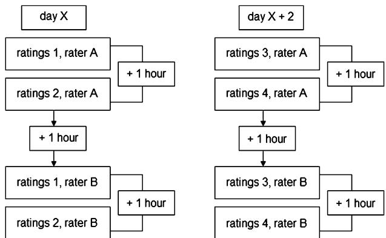
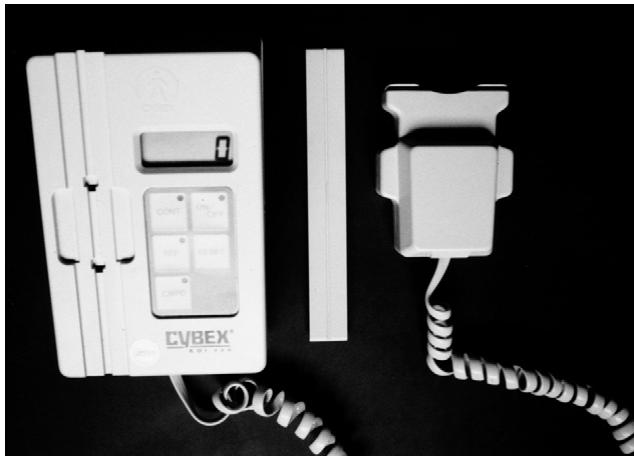
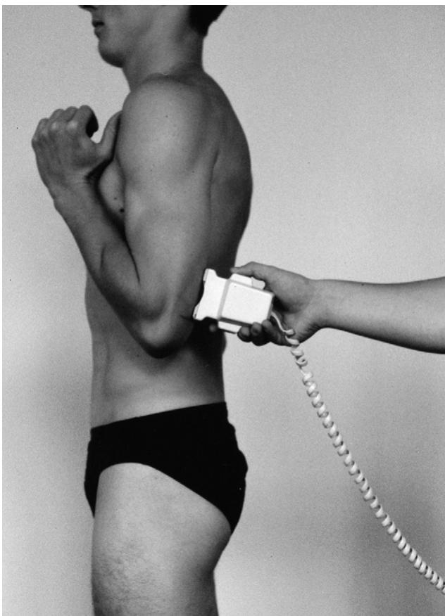
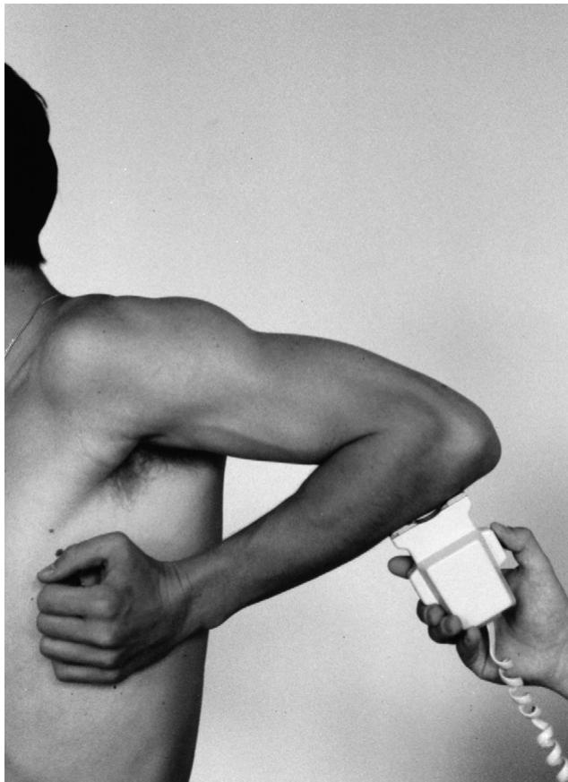
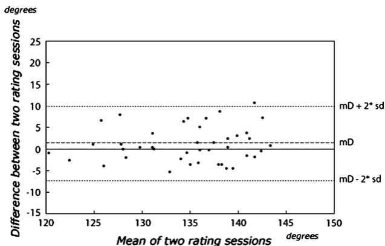

# 严格双盲方案下肘关节角度计测量的重测信度：用于区分测量误差与临床变化的区间

Berry Cleffken, MD,a Gerard van Breukelen, PhD,b Henk van Mameren, MD, PhD,c Peter Brink, MD, PhD,a and Steven Olde Damink, MD, MSc, PhD,a Maastricht, The Netherlands

肘关节运动的角度测量越来越广泛地用于评估研究结果。然而，信度的表述所采用的参数并不便于进行结果比较。我们改进了 Bland-Altman 方法，得出了最小可检测差异（smallest detectable differences, SDD）。两位评估者在经典的重测交叉研究设计中，使用电子数字倾角仪测量了 42 名受试者的肘关节活动度（每位受试者进行 144 次测量）。所得 SDD 分别为：无上臂固定时，主动伸展为 $O \pm 4 . 2 ^ { \circ }$，主动屈曲为 $O \pm 8 . 2 ^ { \circ }$；有上臂固定时，主动伸展为 $0 \pm 6 . 3 ^ { \circ }$，主动屈曲为 $O \pm 5 . 7 ^ { \circ }$，被动屈曲为 $O \pm 7 . 4 ^ { \circ }$；上臂后伸位主动屈曲为 $0 \pm \ 1 0 .$ 1-；主动和被动关节活动度（ROM）分别为 $0 \pm 8 . 5 ^ { \circ }$ 和 $O \pm \nobreakspace 1 0 . 8 ^ { \circ }$。在临床或科研环境中发现的小于这些 SDD 的差异应归因于测量误差，并不代表出现改善。(J Shoulder Elbow Surg 2007;16:788-794.)

骨科医生的日常临床工作中有相当大的比例涉及骨折治疗和关节活动障碍。对疗效进行有效评估至关重要。公认的治疗结果评价指标包括骨折愈合时间、延迟愈合发生率、假关节形成和感染率、疼痛评分、负重能力，以及受累及邻近关节的关节活动度（range of motion, ROM）。客观评估关节运动对于识别治疗失败和确定是否需要治疗干预至关重要。

评估关节运动的金标准是通过放射学检查测量最大关节活动范围，6,7,23 但其缺点是耗时且使患者暴露于辐射。在临床实践中，用于替代 X 线测量关节角度的最常用无创方法是关节角度计测量法（goniometry）。传统的平行四边形角度计以及像重力角度计这类精密器械均得到了广泛应用。14

在科研环境中，数字重力测角法越来越广泛地用于评估治疗效果，并且据报道具有良好的再现性。2,21,22然而，这些研究中用于表达评估者内及评估者间再现性的统计方法（Pearson相关系数、组内相关系数或变异系数）仅仅是表示相关性的统计工具，缺乏临床适用性。在本研究中，我们采用严格的双盲方案研究了重力测角法在肘关节测量中的评估者内和评估者间再现性。此外，我们引入了一种以具有临床适用性的方式表达再现性的统计学方法，通过置信限来界定数字测角法的再现性。这些置信限可作为未来科研环境中的参考。若使用数字测角法测得的差异小于这些区间，应谨慎解读，因为这些差异极有可能是测量误差所致。

## 材料与方法

## 受试者

设定检验效能为90%、显著性水平为1%且真实相关性为 $. 6 0 \ | \alpha = . 0 1 , \beta = . 1 \bar { 0 } |$ 时，计算出的样本量最少为30名受试者。11在本研究中，共招募了42名健康志愿者（男性23名；平均年龄22.1岁；年龄范围19-27岁）。受试者在知情同意后参与研究。排除标准为既往或当前的肘部或肩部症状主诉，以及既往肘部或肩部损伤或手术史。左利手和右利手受试者均测量其优势侧。15

  
Figure 1 测量阶段时间关系。各阶段之间休息1小时，阶段2与阶段3之间休息2天，起始评估者（A或B）随机分配。

## 方案

我们采用了经典的重测交叉设计（Figure 1），由2名评估者（A和B）执行，他们都是经验丰富的使用者，并接受了针对该设备和试验方案的严格培训。评估者和受试者均对测量结果设盲。每名评估者对受试者进行4个阶段的测量，其中第1个测量日进行2个阶段，2天后的同一时间进行另外2个阶段（Figure 1）。在每个阶段中，对每个关节活动度进行3次测量，每位受试者总共进行144次测量。两名评估者在同一天对受试者进行测量（其间休息1小时）。对于每名受试者，执行第1个测量阶段的评估者保持固定，但在通过密封信封抽签随机化后，在受试者之间平均分配（评估者A首先评估22名受试者，评估者B首先评估20名）。

## 材料

关节活动度（Joint excursion）采用 EDI 320 型电子数字倾角仪（electronic digital inclinometer, EDI；Cybex Inc, Ronkonkoma, NY）进行测量。该设备依赖重力，在 360- 刻度上指示运动。EDI 320 由一个手持单元和一个带有内置可充电电源的便携式显示单元组成（Figure 2）。EDI 320 具有 3 种测量序列：用于连续记录的连续模式、用于记录粗略运动的单一参考模式，以及可在更大活动范围内测定各个独立角度（即精确关节角度检测）的复合参考模式。在本研究中，所有关节位置测量均在单一参考模式下进行。

## 设置与标准化

评估和数据收集环节在一所大学的运动学实验室进行。事先进行了练习测试以建立标准化的测试流程。所有测量均始终在与重力场垂直的方向上进行。为了使测试程序标准化，在肘关节屈曲 90- 时用皮肤标记笔标出解剖参考点。参考点分别位于尺骨背侧鹰嘴远端 3 cm 处，以及肱骨内、外上髁连线中点近端 3 cm 处。19 在进行关节活动度测量之前，受试者完成 3 次全关节活动，以减少牵拉和学习效应带来的偏倚。3

  
Figure 2 电子数字倾角仪（EDI 320）。

## 测量

肘关节 ROM 受肩关节运动的影响。18,20,24 理论上，固定上臂应能减少肩部运动，从而提高重现性。为了评估固定上臂的必要性，本研究评估了 3 种测试主动最大屈曲的方法。第一种方法（A）的设置为将上臂固定在固定块上，受试者取坐位，肩部与固定块（20 x 22 x 15 cm）处于同一水平面，从而使肩关节前屈 90-。EDI 放置在上臂远端的背侧（Figure 3）。第二种方法（B）中受试者保持直立。上臂内收贴紧身体，肩关节处于 0- 屈曲位，手和前臂处于半旋前位。在保持上臂位置不变的情况下，从该位置屈曲肘部（Figure 4）。另一种替代测量方法（C）（理论上通过拉伸肱二头肌可产生更大的最大屈曲）在肩关节后伸且无外展和旋转的状态下进行。18,20 同样，受试者取仰卧位，在保持上臂静止的情况下完成屈曲（Figure 5）。肘关节主动最大屈曲和被动最大屈曲的测量均从主动最大伸展的起始位置开始，反之亦然，因为这已被证明能产生最大的关节活动度。被动最大屈曲仅通过方法 A 进行测定，因为在对前臂施力时无法保持上臂和肩部处于相同位置。

## 统计学分析

重现性可以通过多种方法表示，其中皮尔逊积矩相关系数（Pearson’s r）和组内相关系数

  
Figure 3 主动最大屈曲方法 A。

  
Figure 4 主动最大屈曲方法 B。

组内相关系数（ICC）是最常用的。Pearson 相关系数（Pearson’s r）考虑了测试分数之间的随机误差，但未考虑系统误差。9,10高重现性取决于重复测量之间较小的随机误差以及不存在系统误差。17ICC 同时考虑了随机误差和系统误差，因此是比 Pearson 相关性更好的度量指标。9然而，这两种度量方法不仅强烈依赖于系统误差和随机误差的大小，还依赖于研究人群的异质性，8,13这使得比较不同的信度研究以及将这些系数用于临床决策变得困难。因此，我们更倾向于使用 Bland5 和 Altman 提出的一致性界值（limits of agreement），该方法基于同一患者两次评估之间差值的均值和标准差（SD），从而具有 3 个优势。第一，它不系统地依赖于研究人群的异质性。第二，它以所用测量尺度的单位（例如度数）来量化测量误差的大小。第三，在确定评估者间信度时，它仅极小程度地受到评估者数量的影响。

  
Figure 5 主动最大屈曲方法 C。

  
Figure 6 Bland-Altman 散点图示例，评估者 B 内部（intra-rater B），极端测试期，主动最大屈曲方法 C。mD：平均差（mean difference）。sd：标准差（standard deviation）。mD 6 2 \* sd 内的区域代表给定测量方法的最小可检测变化（SDD）。

Table I 基于极端测试期在临床上最具信息价值的评估者间及评估者内 SDD

<table><tr><td></td><td>评定者间 SDD，1m $0 \pm (|mD| + 1.96^{*}sd)$ </td><td>Pearson's r，1m</td><td>评定者间 SDD，m3 $0 \pm (|mD| + 1.96^{*}sd)$ </td><td>Pearson's r，m3</td><td>评定者内 SDD，m3 $0 \pm (|mD| + 1.96^{*}sd)$ </td><td>Pearson's r，m3</td></tr><tr><td>AME 无固定</td><td> $0 \pm 7.6$ </td><td>0.82</td><td> $0 \pm 4.2$ </td><td>0.89</td><td> $0 \pm 5.7$ </td><td>0.89</td></tr><tr><td>AME 有固定</td><td> $0 \pm 8.5$ </td><td>0.75</td><td> $0 \pm 6.3$ </td><td>0.84</td><td> $0 \pm 5.7$ </td><td>0.87</td></tr><tr><td>AMF 方法 A</td><td> $0 \pm 7.1$ </td><td>0.77</td><td> $0 \pm 5.7$ </td><td>0.85</td><td> $0 \pm 5.4$ </td><td>0.87</td></tr><tr><td>AMF 方法 B</td><td> $0 \pm 10.5$ </td><td>0.66</td><td> $0 \pm 8.2$ </td><td>0.77</td><td> $0 \pm 7.8$ </td><td>0.82</td></tr><tr><td>AMF 方法 C</td><td> $0 \pm 13.7^{*}$ </td><td>0.67</td><td> $0 \pm 10.1^{*}$ </td><td>0.79</td><td> $0 \pm 7.2$ </td><td>0.85</td></tr><tr><td>PMF 有固定</td><td> $0 \pm 8.5$ </td><td>0.71</td><td> $0 \pm 7.4$ </td><td>0.78</td><td> $0 \pm 6.1$ </td><td>0.85</td></tr><tr><td>AROM 方法 A</td><td> $0 \pm 11.3$ </td><td>0.78</td><td> $0 \pm 8.5$ </td><td>0.87</td><td> $0 \pm 8.1$ </td><td>0.89</td></tr><tr><td>AROM 方法 B</td><td> $0 \pm 13.1$ </td><td>0.75</td><td> $0 \pm 10.2$ </td><td>0.84</td><td> $0 \pm 9.0$ </td><td>0.88</td></tr><tr><td>AROM 方法 C</td><td> $0 \pm 16.7^{*}$ </td><td>0.75</td><td> $0 \pm 12.5^{*}$ </td><td>0.89</td><td> $0 \pm 9.1$ </td><td>0.88</td></tr><tr><td>PROM 有固定</td><td> $0 \pm 14.1^{*}$ </td><td>0.76</td><td> $0 \pm 10.8^{*}$ </td><td>0.84</td><td> $0 \pm 7.9$ </td><td>0.89</td></tr></table>

AMF，主动最大屈曲（active maximum flexion）；AME，主动最大伸展（active maximum extension）；PMF，被动最大屈曲（passive maximum flexion）；ROM，关节活动度（range of motion）  
\*带标记的区间已针对平均差（mD）进行校正；其他区间未校正。在评定者等同假设下，评定者内区间为每位评定者 SDD 的平均值。

一致性度量指标必须能够体现由于系统误差以及随机测量误差导致的两位评估者之间（或同一评估者的多次评估之间）可能存在的差异大小。两位评估者之间的平均差异若具有统计学显著性，则表明其中某位评估者存在系统误差。评估者之间差异的标准差（SD）表示随机误差的大小，因为该差异的方差等于评估者 A 的测量误差方差与评估者 B 的测量误差方差之和。Bland 和 Altman 提出计算 95% 一致性界限（差异均值 ± 1.96\*SD），它表示因系统和随机测量误差所预期的评估者间最大差异。1,4,5 这种 Bland and Altman 方法可以通过绘制第一次与第二次评估结果之差相对于两次评估结果均值的散点图来直观展示（Figure 6）。除抽样误差外，除非两位评估者之间存在系统性差异，否则两位评估者之间 N 个个体差异的均值必须为零。这可以通过 Student 配对 t 检验（Student’s paired t test）进行检验。如果平均差异显著，则一致性置信限必须考虑到这一点，Bland and Altman 方法已经做到了这一点。然而，如果要将这些界限应用于临床实践中本研究所涉两位评估者之外的其他评估者，那么平均差异的符号 $( \mathsf { m } \mathsf { D } > 0 \mathsf { o r } < 0 )$ 事先是未知的。

将我们评估者的 mD 作为在临床实践中具有类似经验和培训的其他评估者之间预期可能出现的平均差异的最佳估计，并考虑到这两位其他评估者的 mD 符号（>0 或 <0）事先未知，我们得到两位评估者之间个体差异的以下 95% 置信限：-|mD| - 1.96\*SD 至 +|mD| + 1.96\*SD。

这些校正后的置信限也可以称为最小可检测变化（smallest detectable difference, SDD），因为它们代表了超出系统和随机测量误差之外、可被 EDI 320 检测到的变化（95%）阈值。4,9 这些区间假设，除了由不等于零的 mD 所反映的可能存在的系统性差异之外，评估者的可靠性是相同的。因此，两位评估者两次测量之间的评估者内相关性应当大致相同。数据证实了评估者之间这种评估者内相关性和 SD 的一致性（例如，参见附录，其中评估者 A 和 B 具有非常相似的 SD 和相关性）。

可重复性是基于以下两项确定的：(a) 每位患者在每次测量时段中全部 3 次测量的平均值（下文记为 m3），以及 (b) 每位患者在每次测量时段中的第 1 次测量值（记为 1 m）。需要注意的是，由于心理测量学文献中众所周知的斯皮尔曼-布朗效应（Spearman Brown effect），m3 会比 1 m 产生更高的可重复性。基于这两种基准，进行了以下评估者内和评估者间比较以评估可重复性。

评估者内。同一天（对于每位评估者每天的情况：计算该评估者在当天两个测量时段之间的 mD、SD、SDD 和 r，然后计算各统计量在不同天数间的平均值）（表 1 和附录）。不同天的测量时段（即测量时段 1 与 3、1 与 4、2 与 3、2 与 4），差异来源：随机误差。极端测量时段（仅使用第一次和最后一次测量时段，即 1 和 4），差异来源：随机误差加上患者对同一临床医生重复就诊之间可能发生的时间效应。

评估者间。相同测量时段（对于每位评估者的 4 个测量时段中的每一个，计算评估者之间的 mD、sd、SDD 和 r，然后将这些统计量在 4 个测量时段中取平均值，即测量时段 1 评估者 A 与 1 评估者 B、2 与 2、3 与 3、4 与 4），差异来源：随机误差加上评估者之间的系统性差异。首次测量时段，差异来源：与相同测量时段相同，但首次测量时段在临床上可能更为贴近实际（即仅使用：测量时段 1 评估者 A 与 1 评估者 B）。极端测量时段（即仅使用：测量时段 1 评估者 A 与 4 评估者 B、测量时段 4 评估者 A 与 1 评估者 B），差异来源：随机误差加上评估者之间的系统性差异再加上患者重复就诊之间的时间效应。

数据使用 SPSS 12.0 版（Statistics Package for the Social Sciences, SPSS Inc, Chicago, Il）进行分析。对于每项结局指标，采用配对样本 Student t 检验检测评估者之间或同一评估者不同测量时段之间是否存在系统性均值差异，设定双侧 a 为 5%。尽管多重检验会增加 I 类错误（即假阳性/伪显著性）的风险，但为了防止 II 类错误（即假阴性/伪不显著性），我们没有选择更小的 a，因为 II 类错误会导致所得的 SDD 过小。

此外，我们使用非配对样本 Student t 检验检测了男女患者之间的平均结局差异，结局指标采用每人 24 次（8 个测量时段，* 3 次测量）重复测量的平均值。

需要注意的是，这种差异的存在对 SDD 的计算没有影响，因为 SDD 是基于重复测量之间的患者自身内部差异，因此不受患者间变异大小的影响。相比之下，ICC 和 Pearson 相关系数等指标则会随着患者间变异的增加而变大。8

## 结果

重测方案按计划执行，所有受试者均接受了相应测量。对于肘关节主动最大屈曲方法 $\mathsf { C } ,$、使用方法 C 测定的 AROM 以及 PROM，发现了系统性评估者间差异（即 mD 显著异于 0）。因此，对这些 SDD 进行了校正（参见材料与方法部分）。对这些置信限的进一步审查表明，评估者之间的这种系统性差异为 # 2.1-。对于所有其他关节位置复位中的所有其他评估者内及评估者间 mD 比较，配对样本 Student’s t 检验均未显示出显著的均值差异。

Table I 显示了临床上最具信息量的评估者间一致性比较方法（即极端测试期）的 SDD。mD 的系统性差异导致区间使用标记的 -jmDj 或 +jmDj 进行了校正。可以确定，与 1 次单次测量相比，取 3 次测量的均值时，SDD 缩小了 1.1- 至 4.2-。将上臂置于固定块上（方法 A）测量的肘关节主动最大屈曲得出了更窄的 SDD $( 0 ~ \pm$ $\dot { 5 } . 7 \% 1$，反映出其重现性优于方法 B $\left( 0 \pm 8 . 2 ^ { \circ } \right)$ ) 和 $\dot { \mathsf { C } } \left( 0 \pm 1 0 . 1 \mathrm { \dot { } { } ^ { \circ } } \right)$ )。对于主动最大伸展，使用固定块时的 SDD 略大（无固定 [方法 B] 为 $1 0 ~ \pm ~ 4 . 2 ^ { \circ }$ $\mathsf { v s }$ 有固定 [方法 A] 为 $0 \pm 6 . 3 \mathsf { \mathrm { \mathrm { \Omega } } }$）。与单关节活动度 SDD 相比，由主动最大屈曲和伸展计算出的 AROM 使 SDD 增大了 2 - 2.8-。

Table I 还显示了使用 Pearson’s r 估算的评估者间（极端测试期）和评估者内（极端测试期）重现性水平。Pearson’s r 值在 1.0 至 .90 之间通常被认为是极佳，.89-.80 为良好，.79-.70 为尚可，低于 .70 为较差。16 本研究中测定的每个测试期测量均值（m3）之间几乎所有的相关性都被评为极佳或良好重现性（数据未显示，但可在附录中查阅；参见 www.jshoulderelbow.org）。仅在基于首次测量（1 m）时，方法 B 和 C 中的主动最大屈曲表现出较差的相关性 $( . 6 0 \ \cdot 7 0 )$。对于大多数关节定位，仅基于首次测量的测量间重现性水平为尚可至良好。对于评估者间比较，基于 m3 方法的 Pearson 相关系数比基于 1 m 方法的 Pearson’s r 高出最多 .14，具体取决于所分析的结果。

同样值得注意的是，我们的结果显示女性的主动最大屈曲度大于男性（以每位受试者所有 24 次重复测量的平均值作为结果，$P < . 0 5$ ，双尾未配对 t 检验；Table II）。对于总体研究人群而言，肘关节被动最大屈曲度显著大于主动最大屈曲度（以每位受试者所有 24 次重复测量的平均值作为结果，$P < . 0 0 1$ 1，双尾配对 t 检验；Table II）。

## 讨论

本研究的主要目的是在简单方案下探索使用 EDI 320 重力式量角器进行量角读数可重复性的临床应用。本研究的数据表明，量角测量方案的良好标准化使得两位评估者的绝对评估者内 $\mathsf { S D D s }$ 高度可比。这也可以通过以下事实来解释：我们选取了健康的年轻个体以排除变异性，并通过测量前的练习环节将学习和拉伸偏差降至最低。在上臂固定与不固定的测量方法之间，未发现主动最大伸展 SDD 的统计学显著差异。然而，我们确实发现两种方法之间主动最大伸展存在 $2 . 7 ^ { \circ }$ 的差异，其中不固定导致了更大的关节活动度（Table II）。这可能是由于在方法 A 中将 EDI 320 量角器放置在背侧且肌肉放松，而在方法 B 中肱三头肌并未完全放松。

在主动最大屈曲的测量中，方法 B 比方法 C 具有更高的可重复性 $( \mathsf { S D D } 0 \pm 8 . 2 ^ { \circ } \mathsf { v s } 0 \pm 1 0 . 1 ^ { \circ } )$ ）。方法 B 也比方法 C 产生了更大的主动最大屈曲度 $( 1 3 7 . 2 ^ { \circ } \lor \mathfrak { s } \ 1 3 5 . 5 ^ { \circ } )$ ，尽管这显然在统计学上不显著。这否定了肩关节后伸位时的肘关节屈曲会由于肱二头肌的拉伸而产生更大活动度的理论。

与方法 B 和 C 相比，固定上臂（方法 A）使主动最大屈曲的置信区间缩窄了 $2 . 5 ^ { \circ }$ 和 4.4-。我们的结果表明，测量肘关节运动时应固定上臂。可以假设该方法在老年人中应用时甚至能进一步提高可重复性，但这需要进一步研究。在主动最大屈曲与被动最大屈曲的 SDD 之间发现了可重复性的微小差异（置信限 0 6 $5 . 7 ^ { \circ } \mathsf { v s } 0 \pm 7 . 4 ^ { \circ } )$ 。正如预期的那样，被动最大屈曲的最大关节活动度更大（156.5- vs 150.7-）。 12

Table II 肘关节运动的性别差异

<table><tr><td></td><td>组别</td><td>均值</td><td>SD</td><td>最小值</td><td>最大值</td></tr><tr><td rowspan="3">AME 无固定</td><td>总体</td><td>-3.5</td><td>5.9</td><td>-12.7</td><td>11.3</td></tr><tr><td>♂</td><td>-3.6</td><td>5.9</td><td>-12.7</td><td>6.5</td></tr><tr><td>♀</td><td>-3.2</td><td>6.1</td><td>-10.6</td><td>11.3</td></tr><tr><td rowspan="3">AME 有固定</td><td>总体</td><td>-0.8</td><td>5.1</td><td>-8.5</td><td>16.0</td></tr><tr><td>♂</td><td>-1.4</td><td>4.6</td><td>-8.5</td><td>8.0</td></tr><tr><td>♀</td><td>-0.1</td><td>5.6</td><td>-7.4</td><td>16.0</td></tr><tr><td rowspan="3">AMF 方法 A</td><td>总体</td><td>141.3**</td><td>4.9</td><td>131.0</td><td>150.7</td></tr><tr><td>♂</td><td>139.9*</td><td>5.1</td><td>131.0</td><td>150.7</td></tr><tr><td>♀</td><td>142.9*</td><td>4.2</td><td>134.3</td><td>149.5</td></tr><tr><td rowspan="3">AMF 方法 B</td><td>总体</td><td>137.2</td><td>5.6</td><td>125.4</td><td>147.5</td></tr><tr><td>♂</td><td>135.2*</td><td>5.7</td><td>125.4</td><td>144.9</td></tr><tr><td>♀</td><td>139.6*</td><td>4.4</td><td>133.4</td><td>147.5</td></tr><tr><td rowspan="3">AMF 方法 C</td><td>总体</td><td>135.5</td><td>6.0</td><td>119.9</td><td>147.2</td></tr><tr><td>♂</td><td>132.7*</td><td>5.8</td><td>119.9</td><td>143.7</td></tr><tr><td>♀</td><td>138.9*</td><td>4.4</td><td>131.1</td><td>147.2</td></tr><tr><td rowspan="3">PMF</td><td>总体</td><td>146.0**</td><td>5.0</td><td>132.9</td><td>156.5</td></tr><tr><td>♂</td><td>145.0</td><td>5.6</td><td>132.9</td><td>156.5</td></tr><tr><td>♀</td><td>147.1</td><td>3.9</td><td>139.5</td><td>155.0</td></tr><tr><td rowspan="3">AROM 方法 A</td><td>总体</td><td>142.0</td><td>7.9</td><td>118.2</td><td>156.5</td></tr><tr><td>♂</td><td>141.3</td><td>7.6</td><td>124.2</td><td>150.1</td></tr><tr><td>♀</td><td>142.9</td><td>8.3</td><td>118.2</td><td>156.5</td></tr><tr><td rowspan="3">AROM 方法 B</td><td>总体</td><td>140.6</td><td>8.6</td><td>119.3</td><td>156.9</td></tr><tr><td>♂</td><td>138.8</td><td>8.5</td><td>119.3</td><td>149.8</td></tr><tr><td>♀</td><td>142.8</td><td>8.3</td><td>124.0</td><td>156.9</td></tr><tr><td rowspan="3">AROM 方法 C</td><td>总体</td><td>138.9</td><td>8.9</td><td>117.5</td><td>151.5</td></tr><tr><td>♂</td><td>136.3*</td><td>9.0</td><td>117.5</td><td>148.6</td></tr><tr><td>♀</td><td>142.1*</td><td>7.9</td><td>119.8</td><td>151.5</td></tr><tr><td rowspan="3">PROM</td><td>总体</td><td>146.8</td><td>7.8</td><td>125.8</td><td>159.8</td></tr><tr><td>♂</td><td>146.4</td><td>7.9</td><td>129.6</td><td>155.4</td></tr><tr><td>♀</td><td>147.2</td><td>7.9</td><td>125.8</td><td>159.8</td></tr></table>

以每位患者全部 24 次重复测量的平均值作为结局指标，患者总数 N = 42。  
AMF，主动最大屈曲；AME，主动最大伸展；PMF，被动最大屈曲；ROM，关节活动度。  
\*性别间 p < 0.05。  
\*\*AMFP 方法 A 与 PMFP 间 p < 0.001。

文献表明，女性的肘关节活动度（ROM）大于男性。这种差异一直被归因于伸展范围更大。通过我们方法中的 ROM 计算，我们也发现女性的 ROM 更大（$1 1 4 2 . \dot { 1 ^ { \circ } }$ 对 136.3-），但这是基于方法 $\textsf { C } ( 1 3 8 . 9 ^ { \circ }$ 对 132.7-）中主动最大屈曲的活动范围更大（Table II）。正如预期的那样，根据主动最大屈曲和伸展确定 ROM 导致置信限的分布范围扩大，范围为 2- - 2.8-。

使用 3 次测量的平均值计算重现性导致 SDD（最小可检测差异）缩小了 $1 . 1 ^ { \circ } \cdot 4 . 2 ^ { \circ }$，因此也提高了重现性。在临床实践中仅使用 1 次测量会降低重现性，并且由于 Spearman-Brown 效应，还会降低检测患者关节运动能力真实变化的能力。8

如本研究所采用的那样，使用 Bland-Altman 方法计算 SDD 对单个患者的临床实践非常有用。与 Pearson 的 r 或 ICC 等重现性指标相比，SDD 可用于临床实践，因为它表示了 EDI 320 超出测量误差所能检测到的变化阈值。因此，SDD 是一种适用于临床的统计量，它为医生提供了一个有力的工具，可用于确定单个患者关节活动范围的变化是基于测量的随机误差，还是基于治疗的成功或失败。可以推测，在临床实践中测定 SDD 将导致更宽的置信限，因为我们的结果是在没有关节不适的年轻健康志愿者中严格标准化的结果。

正如预期的那样，我们发现评估者内部的重现性得分优于评估者之间的重现性得分。不出所料，我们的数据表明，对关节运动变化的理想评估是由同一评估者在固定时间使用标准化方案进行至少 3 次测量。然而，在临床实践中，复查并不总是由同一评估者进行。

如前所述，在文献中测角法越来越常用于评估治疗的成功。对于未来使用数字测角法的研究，即使是两个干预组之间统计检验得出的结论，关于改善的判断也应当谨慎。在技术上，以角度表示的关节运动变化的统计差异若小于本文提出的 SDD，则无法用数字测角法进行测量，因为这在该测量方法的最小可检测差异范围内。我们建议使用 Table I 中的 SDD 来判断临床变化。小于这些 SDD 的差异可能归因于测量误差，并不表明有所改善。

## 参考文献

1. Altman D, Bland JM. Confidence intervals illuminate absence of evidence. Br Med J 2004;328:1016-7.

2. Armstrong AD, MacDermid JC, Chinchalkar S, Stevens RS, King GJ. Reliability of range-of-motion measurement in the elbow and forearm. J Shoulder Elbow Surg 1998;7:573-80.

3. Bazett-Jones DM, Winchester JB, McBride JM. Effect of potentiation and stretching on maximal force, rate of force development, and range of motion. J Strength Cond Res 2005;19:421-6.

4. Beckerman H, Roebroeck ME, Lankhorst GJ, Becher JG, Bezemer PD, Verbeek AL. Smallest real difference, a link between reproducibility and responsiveness. Qual Life Res 2001;10: 571-8.

5. Bland JM, Altman DG. Comparing methods of measurement: why plotting difference against standard method is misleading. Lancet 1995;346:1085-7.

6. Brosseau L, Balmer S, Tousignant M, et al. Intra- and intertester reliability and criterion validity of the parallelogram and universal goniometers for measuring maximum active knee flexion and extension of patients with knee restrictions. Arch Phys Med Rehabil 2001;82:396-402.

7. Cotton BA, Gracias VH, Insko EK, Gupta R, Born CT, Schwab CW. Use of goniometry to predict inadequate flexion extension roentgenograms: a preliminary study. J Trauma 2005; 59:396-401.

8. Crocker L, Algina J. Introduction to classical and modern test theory. Orlando: Harcourt Brace Javonovich College Publishers; 1986.

9. de Vet HC, Bouter LM, Bezemer PD, Beurskens AJ. Reproducibility and responsiveness of evaluative outcome measures. Theoretical considerations illustrated by an empirical example. Int J Technol Assess Health Care 2001;17:479-87.

10. de Vet HC. Observer reliability and agreement. In: Armitage P, Colton T, editors. Encyclopaedia biostatistica. Boston: John Wiley; 1998. p. 3123-8.

11. Donner A, Eliasziw M. Sample size requirements for reliability studies. Stat Med 1987;6:441-8.

12. Dunning CE, Duck TR, King GJ, Johnson JA. Simulated active control produces repeatable motion pathways of the elbow in an in vitro testing system. J Biomech 2001;34:1039-48.

13. Fleiss JL, Shrout PE. The effects of measurement errors on some multivariate procedures. Am J Public Health 1977;67:1188-91.

14. Gerhardt JJ, Rondinelli RD. Goniometric techniques for range-of-motion assessment. Phys Med Rehabil Clin N Am 2001;12: 507-27.

15. Gunal I, Kose N, Erdogan O, Gokturk E, Seber S. Normal range of motion of the joints of the upper extremity in male subjects, with special reference to side. J Bone Joint Surg Am 1996;78:1401-4.

16. Haas M. Statistical methodology for reliability studies. J Manipulative Physiol Ther 1991;14:119-32.

17. Hoving JL, Pool JJ, van Mameren H, et al. Reproducibility of cervical range of motion in patients with neck pain. BMC Musculoskelet Disord 2005;6:59.

18. Philippou A, Maridaki M, Bogdanis GC. Angle-specific impairment of elbow flexors strength after isometric exercise at long muscle length. J Sports Sci 2003;21:859-65.

19. Roux E, Bouilland S, Godillon-Maquinghen AP, Bouttens D. Evalu ation of the global optimisation method within the upper limb kine matics analysis. J Biomech 2002;35:1279-83.

20. Stokdijk M, Biegstraaten M, Ormel W, de Boer YA, Veeger HE, Rozing PM. Determining the optimal flexion-extension axis of the el bow in vivo - a study of interobserver and intraobserver reliability. J Biomech 2000;33:1139-45.

21. Tousignant M, Boucher N, BourbonnaisJ, Gravelle T, Quesnel M, Brosseau L. Intratester and intertester reliability of the Cybex elec tronic digital inclinometer (EDI-320) for measurement of active neck flexion and extension in healthy subjects. Man Ther 2001; 6:235-41.

22. Urban V, Kalberer F, Roos M, Dumont CE. Reliability of active range-of-motion measurement of the rotation in the forearm: com parison of three measurement devices. Z Orthop Ihre Grenzgeb 2002;140:72-6.

23. Van Mameren H, Drukker J, Sanches H, Beursgens J. Cervical spine motion in the sagittal plane (I) range of motion of actually performed movements, an X-ray cinematographic study. EurJ Morpho 1990;28:47-68.

24. Velner M, Dijkstra Y, Oosterveld F. Mobiliteitsonderzoek van de elleboog met de Cybex 320 en conventionele goniometer (in Dutch). Nederlands tijdschrift voor Fysiotherapie 1990;100: 267-9.

附录 评估者内与评估者间比较

<table><tr><td rowspan="2"></td><td colspan="3">第1次测量 (1m)</td><td colspan="3">3次测量平均值 (m3)</td></tr><tr><td>mD</td><td>1.96 * sd</td><td>r</td><td>mD</td><td>1.96 * sd</td><td>r</td></tr><tr><td colspan="7">AME 无固定</td></tr><tr><td colspan="7">评估者间</td></tr><tr><td>相同测试期</td><td>-1.0</td><td>7.6</td><td>.82</td><td>0.1</td><td>5.6</td><td>.90</td></tr><tr><td>首次测试期</td><td>-0.5</td><td>8.0</td><td>.81</td><td>0.5</td><td>6.2</td><td>.88</td></tr><tr><td>极端测试期</td><td>-0.1</td><td>7.6</td><td>.82</td><td>-0.3</td><td>4.2</td><td>.89</td></tr><tr><td colspan="7">评估者内 A</td></tr><tr><td>同日测试期</td><td>-0.1</td><td>7.7</td><td>.81</td><td>-0.3</td><td>4.3</td><td>.94</td></tr><tr><td>极端测试期</td><td>0.3</td><td>7.5</td><td>.82</td><td>-0.3</td><td>5.4</td><td>.90</td></tr><tr><td colspan="7">评估者内 B</td></tr><tr><td>同日测试期</td><td>0.1</td><td>7.3</td><td>.83</td><td>0.0</td><td>5.6</td><td>.90</td></tr><tr><td>极端测试期</td><td>-1.0</td><td>6.3</td><td>.88</td><td>-0.7</td><td>6.0</td><td>.89</td></tr><tr><td colspan="7">AME 有固定</td></tr><tr><td colspan="7">评估者间</td></tr><tr><td>相同测试期</td><td>-0.7</td><td>8.0</td><td>.75</td><td>-0.3</td><td>5.9</td><td>.85</td></tr><tr><td>首次测试期</td><td>-0.7</td><td>9.3</td><td>.69</td><td>-0.4</td><td>6.5</td><td>.84</td></tr><tr><td>极端测试期</td><td>-0.8</td><td>8.5</td><td>.75</td><td>-0.4</td><td>6.3</td><td>.84</td></tr><tr><td colspan="7">评估者内 A</td></tr><tr><td>同日测试期</td><td>-0.4</td><td>7.0</td><td>.82</td><td>-0.4</td><td>5.2</td><td>.89</td></tr><tr><td>极端测试期</td><td>-0.1</td><td>6.9</td><td>.83</td><td>-0.3</td><td>5.0</td><td>.90</td></tr><tr><td colspan="7">评估者内 B</td></tr><tr><td>同日测试期</td><td>-0.1</td><td>7.6</td><td>.79</td><td>-0.2</td><td>5.8</td><td>.86</td></tr><tr><td>极端测试期</td><td>-0.3</td><td>8.8</td><td>.74</td><td>-0.3</td><td>6.4</td><td>.84</td></tr><tr><td colspan="7">AMF 方法 A</td></tr><tr><td colspan="7">评估者间</td></tr><tr><td>相同测试期</td><td>0.8</td><td>6.7</td><td>.81</td><td>0.6</td><td>5.6</td><td>.86</td></tr><tr><td>首次测试期</td><td>0.7</td><td>6.0</td><td>.84</td><td>0.6</td><td>5.6</td><td>.86</td></tr><tr><td>极端测试期</td><td>0.6</td><td>7.1</td><td>.77</td><td>0.6</td><td>5.7</td><td>.85</td></tr><tr><td colspan="7">评估者内 A</td></tr><tr><td>同日测试期</td><td>-0.1</td><td>5.8</td><td>.84</td><td>-0.1</td><td>5.1</td><td>.87</td></tr><tr><td>极端测试期</td><td>0.2</td><td>6.2</td><td>.82</td><td>0.3</td><td>5.4</td><td>.86</td></tr><tr><td colspan="7">评估者内 B</td></tr><tr><td>同日测试期</td><td>-0.1</td><td>6.3</td><td>.84</td><td>0.0</td><td>4.3</td><td>.93</td></tr><tr><td>极端测试期</td><td>-0.1</td><td>6.7</td><td>.82</td><td>0.3</td><td>5.4</td><td>.88</td></tr><tr><td colspan="7">AMF 方法 B</td></tr><tr><td colspan="7">评估者间</td></tr><tr><td>相同测试期</td><td>0.4</td><td>10.1</td><td>.68</td><td>0.7</td><td>7.6</td><td>.81</td></tr><tr><td>首次测试期</td><td>-0.7</td><td>11.9</td><td>.56</td><td>-0.2</td><td>7.7</td><td>.80</td></tr><tr><td>极端测试期</td><td>0.3</td><td>10.5</td><td>.66</td><td>0.6</td><td>8.2</td><td>.77</td></tr><tr><td colspan="7">评估者内 A</td></tr><tr><td>同日测试期</td><td>-0.4</td><td>10.3</td><td>.69</td><td>-0.4</td><td>6.1</td><td>.88</td></tr><tr><td>极端测试期</td><td>-1.3</td><td>8.7</td><td>.77</td><td>-1.2</td><td>7.7</td><td>.81</td></tr><tr><td colspan="7">评估者内 B</td></tr><tr><td>同日测试期</td><td>1.3</td><td>8.4</td><td>.76</td><td>0.8</td><td>6.1</td><td>.86</td></tr><tr><td>极端测试期</td><td>0.6</td><td>9.4</td><td>.72</td><td>0.4</td><td>6.9</td><td>.82</td></tr><tr><td colspan="7">AMF 方法 C</td></tr><tr><td colspan="7">评估者间</td></tr><tr><td>相同测试期</td><td>1.5</td><td>11.7</td><td>.68</td><td>1.6</td><td>7.8</td><td>.82</td></tr><tr><td>首次测试期</td><td>0.7</td><td>12.4</td><td>.66</td><td>1.0</td><td>8.2</td><td>.80</td></tr><tr><td>极端测试期</td><td>1.9</td><td>11.8</td><td>.67</td><td>1.6</td><td>8.5</td><td>.79</td></tr><tr><td colspan="7">评估者内 A</td></tr><tr><td>同日测试期</td><td>-0.5</td><td>8.9</td><td>.80</td><td>-0.3</td><td>6.6</td><td>.87</td></tr><tr><td>极端测试期</td><td>-1.2</td><td>8.9</td><td>.81</td><td>-0.5</td><td>6.4</td><td>.89</td></tr><tr><td colspan="7">评估者内 B</td></tr><tr><td>同日测试期</td><td>1.3</td><td>11.8</td><td>.69</td><td>0.9</td><td>7.1</td><td>.84</td></tr><tr><td>极端测试期</td><td>1.2</td><td>14.4</td><td>.53</td><td>0.8</td><td>8.0</td><td>.80</td></tr><tr><td colspan="7">PMF</td></tr><tr><td colspan="7">评估者间</td></tr><tr><td>相同测试期</td><td>1.1</td><td>8.4</td><td>.72</td><td>0.8</td><td>6.0</td><td>.84</td></tr><tr><td>首次测试期</td><td>0.6</td><td>7.7</td><td>.74</td><td>0.3</td><td>5.6</td><td>.88</td></tr><tr><td>极端测试期</td><td>1.1</td><td>8.5</td><td>.71</td><td>0.8</td><td>7.4</td><td>.78</td></tr><tr><td colspan="7">评估者内 A</td></tr><tr><td>同日测试期</td><td>-0.1</td><td>6.8</td><td>.81</td><td>-0.2</td><td>4.5</td><td>.91</td></tr><tr><td>极端测试期</td><td>-0.3</td><td>6.9</td><td>.78</td><td>0.1</td><td>5.9</td><td>.85</td></tr><tr><td colspan="7">评估者内 B</td></tr><tr><td>同日测试期</td><td>0.0</td><td>7.2</td><td>.80</td><td>0.1</td><td>5.6</td><td>.87</td></tr><tr><td>极端测试期</td><td>0.7</td><td>8.2</td><td>.76</td><td>1.0</td><td>6.3</td><td>.85</td></tr><tr><td colspan="7">AROM 方法 A</td></tr><tr><td colspan="7">评估者间</td></tr><tr><td>相同测试期</td><td>1.4</td><td>10.3</td><td>.75</td><td>1.0</td><td>8.0</td><td>.89</td></tr><tr><td>首次测试期</td><td>1.4</td><td>11.8</td><td>.76</td><td>0.9</td><td>9.2</td><td>.85</td></tr><tr><td>极端测试期</td><td>1.3</td><td>11.3</td><td>.78</td><td>0.9</td><td>8.5</td><td>.87</td></tr><tr><td colspan="7">评估者内 A</td></tr><tr><td>同日测试期</td><td>0.1</td><td>9.1</td><td>.86</td><td>0.2</td><td>7.7</td><td>.89</td></tr><tr><td>极端测试期</td><td>0.3</td><td>9.0</td><td>.86</td><td>0.6</td><td>7.8</td><td>.89</td></tr><tr><td colspan="7">评估者内 B</td></tr><tr><td>同日测试期</td><td>-0.1</td><td>9.4</td><td>.86</td><td>0.2</td><td>7.5</td><td>.91</td></tr><tr><td>极端测试期</td><td>0.1</td><td>11.2</td><td>.80</td><td>0.6</td><td>8.3</td><td>.88</td></tr><tr><td colspan="7">AROM 方法 B</td></tr><tr><td colspan="7">评估者间</td></tr><tr><td>相同测试期</td><td>0.7</td><td>12.5</td><td>.78</td><td>0.9</td><td>9.4</td><td>.87</td></tr><tr><td>首次测试期</td><td>-1.2</td><td>13.6</td><td>.73</td><td>-0.7</td><td>9.7</td><td>.85</td></tr><tr><td>极端测试期</td><td>0.4</td><td>13.1</td><td>.75</td><td>0.3</td><td>10.2</td><td>.84</td></tr><tr><td colspan="7">评估者内 A</td></tr><tr><td>同日测试期</td><td>-0.2</td><td>11.7</td><td>.81</td><td>-0.1</td><td>6.8</td><td>.93</td></tr><tr><td>极端测试期</td><td>-1.6</td><td>10.7</td><td>.84</td><td>-0.7</td><td>9.3</td><td>.87</td></tr><tr><td colspan="7">评估者内 B</td></tr><tr><td>同日测试期</td><td>1.0</td><td>11.1</td><td>.81</td><td>0.8</td><td>8.6</td><td>.88</td></tr><tr><td>极端测试期</td><td>1.5</td><td>10.7</td><td>.83</td><td>1.3</td><td>8.7</td><td>.88</td></tr><tr><td colspan="7">AROM 方法 C</td></tr><tr><td colspan="7">评估者间</td></tr><tr><td>相同测试期</td><td>1.8</td><td>13.5</td><td>.78</td><td>1.8</td><td>9.3</td><td>.88</td></tr><tr><td>首次测试期</td><td>0.2</td><td>13.9</td><td>.78</td><td>0.6</td><td>9.9</td><td>.85</td></tr><tr><td>极端测试期</td><td>2.0</td><td>14.7</td><td>.75</td><td>1.4</td><td>11.1</td><td>.83</td></tr><tr><td colspan="7">评估者内 A</td></tr><tr><td>同日测试期</td><td>-0.4</td><td>11.7</td><td>.82</td><td>0.0</td><td>7.9</td><td>.91</td></tr><tr><td>极端测试期</td><td>-1.5</td><td>12.0</td><td>.82</td><td>-0.1</td><td>8.4</td><td>.91</td></tr><tr><td colspan="7">评估者内 B</td></tr><tr><td>同日测试期</td><td>1.1</td><td>14.3</td><td>.76</td><td>0.9</td><td>8.4</td><td>.90</td></tr><tr><td>极端测试期</td><td>2.1</td><td>15.2</td><td>.74</td><td>1.6</td><td>9.7</td><td>.87</td></tr><tr><td colspan="7">PROM 方法 A</td></tr><tr><td colspan="7">评估者间</td></tr><tr><td>相同测试期</td><td>1.8</td><td>11.8</td><td>.77</td><td>1.3</td><td>8.4</td><td>.87</td></tr><tr><td>首次测试期</td><td>1.3</td><td>11.7</td><td>.77</td><td>0.7</td><td>7.9</td><td>.90</td></tr><tr><td>极端测试期</td><td>1.9</td><td>12.2</td><td>.76</td><td>1.2</td><td>9.6</td><td>.84</td></tr><tr><td colspan="7">评估者内 A</td></tr><tr><td>同日测试期</td><td>0.2</td><td>10.3</td><td>.81</td><td>-0.2</td><td>6.6</td><td>.91</td></tr><tr><td>极端测试期</td><td>-0.2</td><td>11.6</td><td>.74</td><td>0.4</td><td>8.1</td><td>.87</td></tr><tr><td colspan="7">评估者内 B</td></tr><tr><td>同日测试期</td><td>-0.1</td><td>9.9</td><td>.85</td><td>0.2</td><td>7.4</td><td>.91</td></tr><tr><td>极端测试期</td><td>1.0</td><td>11.0</td><td>.82</td><td>1.3</td><td>7.7</td><td>.91</td></tr></table>

AMF，主动最大屈曲；AME，主动最大伸展；PMF，被动最大屈曲；ROM，关节活动度。