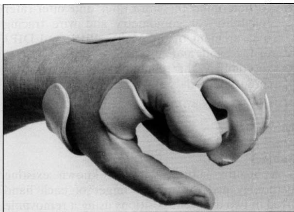
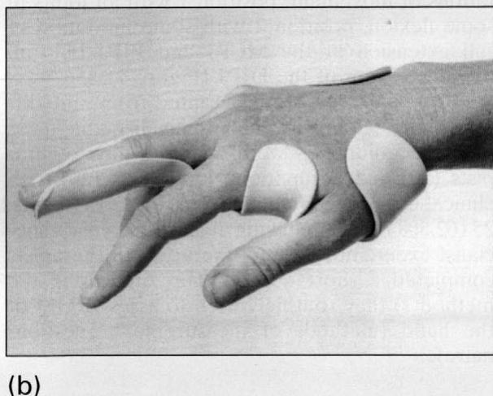

# 关节角度测量：手部角度测量法与铅丝描记法信度的比较研究

Bridget Ellis, Anne Bruton，南安普顿大学（University of Southampton）作业治疗与物理治疗学院，南安普顿；Jonathan R Goddard，南安普顿大学南安普顿总医院（Southampton General Hospital, University of Southampton）医学统计与计算学系，南安普顿

目的：比较角度测量法（goniometry）和铅丝描记法（wire tracing）在评估手指关节角度（掌指关节 [MCPJ]、近端指间关节 [PIPJ] 和远端指间关节 [DIPJ]）时的评估者间及评估者内信度。

设计：从 9 个不同中心招募了 20 名作业治疗师和 20 名具有不同临床经验的物理治疗师。他们使用盲法量角器和铅丝描记法，对固定在两个不同位置的正常受试者的 MCPJ、PIPJ 和 DIPJ 进行了重复评估。

结果：这两种评估方法未能产生具有可比性的角度测量值。角度测量法的评估者间和评估者内信度均高于铅丝描记法。无论使用何种评估工具，重复性系数均表明 DIPJ 测量的信度低于其他关节。临床经验和专科经验对信度没有影响。

结论：尽管角度测量法和铅丝描记法作为可靠的评估工具都存在局限性，但建议在可能的情况下应优先使用角度测量法。

## 引言

关节活动度（ROM）被许多临床医生视为一个可测量且可明确界定的指标，因此常被用作评估工具。关节角度测量值还被用作反映变化的指标，以及评估药物、手术和其他治疗干预效果的结局指标。

测量手部 ROM 的传统方法包括目测估计、角度测量法、手指复合屈曲至远端掌褶距离、扭矩活动度以及铅丝描记图（铅丝描记法）。$^{1-3}$ 铅丝描记法是指将焊锡丝沿手背侧放置并弯曲以贴合每个关节的角度，然后将铅丝从手指上取下平放在纸上，用铅笔描摹出其形状的过程。1986 年，英国骨科协会（British Orthopaedic Association）与英国手外科学会（British Society for Surgery of the Hand）联合推荐了一份手部评估表，其中包括使用角度测量法和铅丝描记法来测量关节活动角度。$^{4}$

任何用作制定治疗方案依据或用于研究目的的测量都必须具备信度。关节测量的信度是指对同一关节进行连续测量之间的一致性程度，一致性越高，测量越可靠。$^{5}$ 评估者内信度检验单个测试者在连续测量中获得一致结果的能力；评估者间信度则是指不同测试者对同一关节测量结果的一致性程度。

许多研究检验了使用特定仪器、针对特定关节以及在特定条件下进行测角术（goniometry）的信度。$^{6-15}$ 一些研究比较了不同类型的量角器，$^{16-21}$ 而另一些研究则将测角术与其他仪器进行了比较。$^{22-25}$ 许多研究人员还开展了测角术与目测估计的比较。$^{26-29}$ 学界已撰写了大量关于测角术的综述，$^{30-34}$ 其信度问题也得到了深入探讨。$^{35-37}$

迄今为止，尚未有已发表的研究比较测角术与金属丝描记法（wire tracing）在评估手指关节角度方面的效果。普遍的共识似乎倾向于 Salter$^{34}$ 在 1955 年提出的断言是正确的，即量角器非常精准且可靠，而不准确的测量结果是由错误的使用方法造成的。尽管存在误差的可能，许多学者发现测角术具有很高的评定者内信度（intra-rater reliability）：Low$^{26}$ 发现五名测试人员在测量肘关节屈曲角度的 10 次测量中，平均评定者内误差小于 5 度；Hellebrandt 等人$^{37}$ 发现一名熟练的观察者在 95% 的情况下测量差异在 7 度或以下。通常发现评定者间信度（inter-rater reliability）较低。Hamilton 和 Lachenbruch$^{17}$ 此前针对手指关节角度测角术进行的研究中，使用七名熟练的测试人员，在关节侧面或关节背侧评估了三种不同量角器测量手部掌指关节（metacarpo-phalangeal joint, MCPJ）、近端指间关节（proximal interphalangeal joint, PIPJ）和远端指间关节（distal interphalangeal joint, DIPJ）的信度。该研究显示评定者间信度的方差较小，但三种不同类型量角器的测量结果之间没有显著差异。

全面的文献检索未发现任何关于将金属丝描记法作为评估关节活动度（ROM）方法的信度的已发表研究。

鉴于缺乏关于手部关节测量信度的数据，本研究的目的为：

\- 确定使用测角术和金属丝描记法测量手部 MCPJ、PIPJ 和 DIPJ 的评定者内信度和评定者间信度；以及

• 比较这两种不同方法的信度。

## 方法

## 受试者

一名无已知现存病理改变的健康受试者，使用热塑性材料制成的可拆卸夹板（Rolyan Ezeform, Smith & Nephew, Hull, UK）将其双手中指固定在两个不同位置。这两个位置重现了临床上常见的运动受限情况：位置 1 为所有关节均处于一定程度的屈曲状态，位置 2 为 MCPJ 和 PIPJ 的完全伸展受到一定限制，但 DIPJ 处于完全过伸状态（Figure 1）。

从9个不同机构招募了40名志愿者，其中4个机构专门从事手部治疗。志愿者为合格的物理治疗师（20名）和作业治疗师（20名），临床经验从不足1年到16年以上不等，其中25名（62.5%）在手部治疗方面拥有至少1年的专科经验。所有治疗师均完成了一份简短问卷，说明他们常规用于评估手部关节活动度（ROM）的方法（测量方法问卷）。

## 仪器与工具

本研究选用的量角器为 Rolyan 屈曲/过伸手指量角器 $^{38}$（Smith & Nephew，Hull，UK）。该量角器具有一个带分度盘头部的短臂和一个便于放置在手部小关节上的长臂，测量范围可从过伸30度到屈曲120度。量角器刻度以1度为增量，表面用接触纸覆盖，使测试人员无法读取刻度，但记录人员可以从背面读取。由于以往的研究人员 $^{17}$ 发现三种不同类型量角器的结果之间无显著差异，因此在整个研究过程中使用了相同的量角器。所使用的焊丝为 16 SWG 规格的锡/铅焊丝，长 25 cm，按文献 $^{1,2}$ 推荐套入 2 mm 硅胶管中。共提供了六根焊丝，以便测试人员在每次描记时都能使用一根全新的平直焊丝。

  
(a)

  
Figure 1 (a) 受试者手部固定于位置 1。(b) 受试者手部固定于位置 2。

## 流程

同意参与该研究的治疗师在测试日前收到了焊丝描记法和量角器测量法的操作方案。这使得不熟悉任一测量方法的人员能够熟悉这些测量方法；在以往的一些研究中，测试前缺乏可参考的测量方案可能是导致结果不佳的原因 $^{3,26}$。两项测量均在关节的背侧进行。选择量角器背侧测量是因为这是推荐的测量方法之一 $^{3}$，已被证实与侧方放置同样可靠 $^{17}$，并且能提供与焊丝描记具有可比性的数据。在每次测试中，手腕和前臂均以标准方式固定。

完成测量方法问卷后，每位治疗师对位置1的MCPJ（掌指关节）、PIPJ（近端指间关节）和DIPJ（远端指间关节）进行测量，并将测角仪的两臂调整至满意的对齐位置。当他们对其放置位置满意后，由记录员读取数值。随后，治疗师对相同位置进行铅丝描记，并按照方案描述将铅丝描记转录到纸上。治疗师被要求用一条平分描记线的单线来标识每个关节。对位置2重复此过程。整个流程共进行了三次。因此，每位治疗师对六个关节总共进行了六次测量。在测量阶段的任何时候，都不允许治疗师查看他们的结果。在测量替代方法及其他关节的同时，每种关节测量方法的重复之间有很短的时间间隔。先前的研究表明$^{36}$，评估者自身信度仅应在较短的时间间隔内进行测试，因为这样可以提供更准确的评估，并减少不可控变量。

每次均由同一名记录员记录所有测角仪测量值。对其读取测角仪的准确性进行了测试，发现其最大误差为1度。另一名记录员严格按照方案使用量角器转录所有铅丝描记角度。这确保了不存在偏倚，并实现了标准化测量。

## 数据分析

记录的测量值和观察者特征被录入SPSS数据库，随后导入SAS，使用SAS/STAT过程VARCOMP和GLM进行统计分析。首先使用描述性统计对测量值进行汇总，重点关注范围和方差。随后，每次测量的方差被分解为由观察者间变异和观察者内变异引起的成分。由此计算出相同观察者和不同观察者的重复性系数。相同观察者的重复性系数用于估计同一治疗师进行的两次测量之间差异的95%限度。我们可以预期，在95%的情况下，任意一对测量值之间的差异均在此距离之内。类似地，不同观察者的重复性系数用于估计不同治疗师进行的两次测量之间差异的95%限度。

采用重复测量方差分析评估职业、临床和专科年限、测量工具的常规使用及经验在均值上的差异。采用双方差比值的F检验评估这些亚组之间观察者内方差的差异。

Table 1 手部关节评估的常规方法

<table><tr><td>评估方法</td><td>响应人数</td></tr><tr><td>仅使用关节测角术</td><td>20 (50%)</td></tr><tr><td>仅目测估算</td><td>8 (20%)</td></tr><tr><td>仅金属丝描记法</td><td>3 (7.5%)</td></tr><tr><td>金属丝描记法 + 目测估算</td><td>2 (5%)</td></tr><tr><td>金属丝描记法 + 关节测角术</td><td>1 (2.5%)</td></tr><tr><td>关节测角术 + 目测估算</td><td>5 (12.5%)</td></tr><tr><td>金属丝描记法 + 关节测角术 + 目测估算</td><td>1 (2.5%)</td></tr></table>

小关节的测量中，其应用可能仅限于治疗手部的临床医生。尽管所有参与者都接受过关节测角术原理的培训，但熟悉金属丝描记法使用的参与者仅有 22 人（55%）。那些熟悉金属丝描记法使用的人是通过多种不同途径获得该技能的，包括培训学校、在职教育、研究生课程以及向其他同事学习。一名参与者为自学。

## 结果

由治疗师填写的测量方法问卷结果如 Table 1 所示。在临床实践中，关节角度的测量最常使用关节测角术。尽管金属丝描记法的使用率看似要低得多，但必须指出的是，半数志愿者并不经常评估手部。由于金属丝描记法仅在

Table 2 显示了同一关节三次测量的均值、标准差和极差。在像本研究这样缺乏参考金标准的研究中，结果的方差、标准差和极差比均值更为重要。可以看出，与金属丝描记法相比，关节测角术始终产生更小的极差和更低的标准差。有趣的是，对于这两种测量方法，极差和标准差都呈现出随着关节越偏向远端而增大的趋势。这表明关节测角术通常比金属丝描记法更可靠，但力臂较短的远端关节在使用任何一种方法测量时难度都更大。因此，在临床情况下，对于在较远端关节活动度中发现的任何变化都应谨慎解释。

Table 2 位置 1 和位置 2 关节测角术与金属丝描记法的描述性统计

<table><tr><td>关节</td><td>方法</td><td>均值</td><td>SD</td><td>最小值</td><td>最大值</td><td>极差</td></tr><tr><td colspan="7">位置 1</td></tr><tr><td rowspan="2">MCP</td><td>测角法</td><td>44.46°</td><td>1.09</td><td>41°</td><td>47°</td><td>6°</td></tr><tr><td>铅丝描记法</td><td>41.58°</td><td>2.58</td><td>36°</td><td>47°</td><td>11°</td></tr><tr><td rowspan="2">PIP</td><td>测角法</td><td>74.93°</td><td>2.16</td><td>70°</td><td>79°</td><td>9°</td></tr><tr><td>铅丝描记法</td><td>70.40°</td><td>2.98</td><td>61°</td><td>76°</td><td>15°</td></tr><tr><td rowspan="2">DIP</td><td>测角法</td><td>47.46°</td><td>2.94</td><td>42°</td><td>55°</td><td>13°</td></tr><tr><td>铅丝描记法</td><td>42.13°</td><td>3.14</td><td>37°</td><td>49°</td><td>12°</td></tr><tr><td colspan="7">位置 2</td></tr><tr><td rowspan="2">MCP</td><td>测角法</td><td>7.76°</td><td>1.68</td><td>4°</td><td>13°</td><td>9°</td></tr><tr><td>铅丝描记法</td><td>4.38°</td><td>2.84</td><td>-2°</td><td>9°</td><td>11°</td></tr><tr><td rowspan="2">PIP</td><td>测角法</td><td>14.67°</td><td>1.70</td><td>10°</td><td>17°</td><td>7°</td></tr><tr><td>铅丝描记法</td><td>10.88°</td><td>2.42</td><td>6°</td><td>17°</td><td>11°</td></tr><tr><td rowspan="2">DIP</td><td>测角法</td><td>-1.61°</td><td>3.04</td><td>-9°</td><td>6°</td><td>15°</td></tr><tr><td>铅丝描记法</td><td>-3.10°</td><td>3.55</td><td>-10°</td><td>5°</td><td>15°</td></tr></table>

在 Table 3 中，针对特定响应的 120 次观察值的方差被分解为归因于评估者内部（intra-rater）和评估者之间（inter-rater）变异的方差分量。重复性系数（repeatability coefficient, RC）是对同一受试者进行两次重复测量之间差异的 95% 界限，即在 95% 的情况下，任意两次测量值的差异都将处于该范围之内。因此，RC 越低，可靠性越高。可以看出，测角法的 RC 明显低于铅丝描记法。在使用铅丝描记法和测角法时，测量更远端关节的 RC 均较高，这表明 MCP 关节测量的可靠性更高。

在职业、临床与专科经验年限、常规使用情况或测量工具的使用经验方面，均未发现均值存在显著差异。对于特定的手部位置和关节，观察者内部方差的差异被发现是由其中某些因素引起的，但没有任何一个亚组在所有关节和位置上都表现出更高的可靠性（即更小的方差）。熟悉任一测量工具的治疗师的可靠性并不高于不熟悉该工具的治疗师。

## 讨论

这些结果支持了先前研究的结论，即在评估 ROM（关节活动度）时，无论使用何种测量工具，评估者间可靠性均显著低于评估者内部可靠性。$^{6-15,26-29}$

在本研究中，测角术显示出始终优于金属丝描记法的信度，在某些情况下其重复性系数仅为金属丝描记法的一半。测角术在评估者内部信度的结果与 Low $^{26}$ 的研究结果相当，但表现出比 Hamilton and Lachenbruch $^{17}$ 更大的变异性，这可以通过多种因素来解释。在后一项研究中，仅采用了来自同一工作单位的 7 名熟练观察者，而在本研究中，则采用了来自 9 个地点、具有不同关节测量经验的 40 名观察者。

金属丝描记法具有较大变异性的原因可能有多种。由于近一半的参与者不熟悉金属丝描记法，而所有人都熟悉测角术，原本可能预期这会影响结果；然而事实证明并非如此。使用金属丝本身似乎存在更大的潜在误差，例如将金属丝从受试者手上取下时和/或在纸上描画轮廓时金属丝发生变形、金属丝在纸上的朝向偏差，以及在描记线上正确识别关节的误差。其他误差来源可能包括记录者对描记图的解读以及治疗师操作手法缺乏一致性。由于仅使用了一种类型的金属丝，进一步开展研究以评估不同线规和类型金属丝的信度可能会很有价值。

Table 3 方差分量与重复性系数

<table><tr><td rowspan="2">方法</td><td rowspan="2">测量指标</td><td colspan="3">位置 1</td><td colspan="3">位置 2</td></tr><tr><td>MCP</td><td>PIP</td><td>DIP</td><td>MCP</td><td>PIP</td><td>DIP</td></tr><tr><td rowspan="2">测角仪</td><td>观察者间 $\sigma^2$</td><td>0.59</td><td>3.78</td><td>6.93</td><td>2.05</td><td>2.10</td><td>7.73</td></tr><tr><td>观察者内 $\sigma^2$</td><td>1.80</td><td>2.7</td><td>5.07</td><td>2.31</td><td>2.33</td><td>4.61</td></tr><tr><td rowspan="3"></td><td>重复性系数：</td><td></td><td></td><td></td><td></td><td></td><td></td></tr><tr><td>同一观察者</td><td>3.8°</td><td>4.7°</td><td>6.4°</td><td>4.3°</td><td>4.3°</td><td>6.1°</td></tr><tr><td>不同观察者</td><td>4.4°</td><td>7.2°</td><td>9.8°</td><td>5.9°</td><td>6.0°</td><td>9.9°</td></tr><tr><td rowspan="2">金属丝描记法</td><td>观察者间 $\sigma^2$</td><td>3.31</td><td>3.95</td><td>5.88</td><td>5.37</td><td>3.11</td><td>7.99</td></tr><tr><td>观察者内 $\sigma^2$</td><td>9.97</td><td>14.86</td><td>11.95</td><td>8.08</td><td>8.23</td><td>13.80</td></tr><tr><td rowspan="3"></td><td>重复性系数：</td><td></td><td></td><td></td><td></td><td></td><td></td></tr><tr><td>同一观察者</td><td>8.9°</td><td>10.9°</td><td>9.8°</td><td>8.0°</td><td>8.1°</td><td>10.5°</td></tr><tr><td>不同观察者</td><td>10.3°</td><td>12.3°</td><td>11.9°</td><td>10.4°</td><td>9.5°</td><td>13.2°</td></tr></table>

重复性系数是两次测量值之间差异的 95% 界限。

在使用测角法时观察到的潜在误差包括：治疗师施加在测角仪臂上的压力大小存在差异；治疗师的手指对测角仪臂的精准对齐产生干扰；解剖标志（例如 DIPJ 线）识别中的误差；以及治疗师操作手法缺乏一致性。

由于本研究的目的是评估治疗师使用特定测量工具的信度，受试者的手部均为正常状态，无水肿或创伤等使操作复杂化的情况。在临床环境中，这些因素可能会影响使用不同关节角度测量方法的可行性以及所获测量值的可靠性。

另一项此前未被证明的重要发现是，手指不同关节测量的信度存在显著差异。MCPJ（掌指关节）的测量结果始终表现出比更远端关节更高的可重复性，而 DIPJ（远端指间关节）产生的不一致性最大。这在一定程度上可以解释为：用于对齐铅丝或测角仪的力臂要短得多、关节线较难明确界定（特别是在过伸时），以及缺乏用于对准的远端骨性标志点。在评估内科或外科干预后使用关节角度测量报告的预后时，这一点尤为重要，例如针对支配远端指间关节的屈肌长腱进行外科修复后的疗效评估。

本研究强调了使用关节角度测量来评估对手术干预或治疗反应时存在的潜在问题，例如屈肌腱修复后 ROM（关节活动度）结局的评级。此类结果通常计算为所达到的关节角度变化，例如将 DIPJ 和 PIPJ（近端指间关节）的总联合 ROM 计算为预期正常 ROM 的百分比。$^{38}$ 本研究的结果表明，使用铅丝描记法获取的对比测量值可能是一种信度较低的结局指标。

## 结论

关节角度测量被广泛用于提供基线信息，以便与后续测量进行对比从而反映变化及疗效。尽管铅丝描记法无疑能够指示变化趋势，但鉴于观察者内和观察者间的巨大变异性，指示趋势似乎已是其主要价值所在。测角法在观察者内和观察者间的测试中均表现出更高的信度，这表明在可行的情况下，应将其作为首选测量工具。

## 参考文献

1 Salter MI, Salter MI (eds). Hand injuries: a therapeutic approach, first edition. New York: Churchill Livingstone, 1987: 15–59.

2 Brand PW, Hollister A, Ryan JD, Thorp D (eds). Clinical mechanics of the hand, second edition. St Louis: Mosby-Year Book, 1993: 223–53.

3 Cambridge-Keeling C, Hunter JM, Mackin EJ, Callahan AD (eds). Rehabilitation of the hand: surgery and therapy, fourth edition. St Louis: Mosby, 1995: 93–108.

4 Robins RHC. Hand assessment charts. J Hand Surg 1986; 11-B(2): 287–99.

5 Norkin CC, White DJ. Measurement of joint motion. A guide to goniometry. Philadelphia: FA Davis, 1995.

6 Dijkstra PU, de Bont LG, van der Weele LT, Boering G. Joint mobility measurements: reliability of a standardised method. Cranio 1994; 12(1): 52–57.

7 Ekstrand J, Wiktorsson M, Öberg B, Gillquist J. Lower extremity goniometric measurements: a study to determine their reliability. Arch Phys Med Rehabil 1982; 63(4): 171–75.

8 Hogeweg JA, Langereis MJ, Bernards ATM, Faber JAJ, Helders PJM. Goniometry – variability in the clinical practice of a conventional goniometer in healthy subjects. Eur J Phys Med Rehabil 1994; 4(1):2–7.

9 LaStayo PC, Wheeler DL. Reliability of passive wrist flexion and extension goniometric measurements: a multicentre study. Phys Ther 1994;74(2):162–76.

10 Mayerson NH, Milano RA. Goniometric measurement reliability in physical medicine. Arch Phys Med Rehabil 1984; 65(2): 92–94.

11 Mitchell WS, Millar J, Sturrock RD. An evaluation of goniometry as an objective parameter for measuring joint motion. Scot Med J 1975; 2057–59.

12 Nilsson N. Measuring passive cervical motion: a study of reliability. J Manipulative Physiol Ther 1995; 18(5): 293–97.

13 Solgaard S, Carlsen A, Kramhoft M, Petersen VS. Reproducibility of goniometry of the wrist. Scand J Rehabil Med 1986; 18(1): 5–7.

14 Youdas JW, Carey JR, Garrett TR. Reliability of measurements of cervical spine range of motion – comparison of three methods. Phys Ther 1991; 71(2): 98–106.

15 Youdas JW, Carey JR, Garrett TR, Suman VJ. Reliability of goniometric measurements of active arm elevation in the scapular plane obtained in a clinical setting. Arch Phys Med Rehabil 1994; 75(10):1137–44.

16 Goodwin J, Clark C, Deakes J, Burdon D, Lawrence C. Clinical methods of goniometry: a comparative study. Disabil Rehabil 1992; 14(1): 10–15.

17 Hamilton GF, Lachenbruch PA. Reliability of goniometry in assessing finger joint angle. Phys Ther 1969; 49(5): 465–69.

18 Rheault W, Miller M, Nothnagel P. Straessle J, Urban D. Intertester reliability and concurrent validity of fluid-based and universal goniometers for active knee flexion. Phys Ther 1988; 68(11): 1676–78.

19 Rome K, Cowieson F. A reliability study of the universal goniometer, fluid goniometer, and electrogoniometer for the measurement of ankle dorsiflexion. Foot Ankle 1996; 17(1): 28–32.

20 Rothstein JM, Miller PJ, Roettger RF. Goniometric reliability in a clinical setting. Phys Ther 1983;63(10):1611–15.

21 Watkins B, Darrah J, Pain K. Reliability of passive ankle dorsiflexion measurements in children: comparison of universal and biplane goniometers. Pediatric Phys Ther 1995; 7(1): 3–8.

22 Clapper MP, Wolf SL. Comparison of the reliability of the Orthoranger and the standard goniometer for assessing active lower extremity range of motion. Phys Ther 1988; 68(2): 214–18.

23 Gill K, Krag MH, Johnson GB, Haugh LD, Pope MH. Repeatability of four clinical methods for assessment of lumbar spine motion. Spine 1988;13(1):50–53.

24 Reynolds PM. Measurement of spinal mobility: a comparison of three methods. Rheumatol Rehabil 1975; 14(3): 180–85.

25 Theiler R, Stucki G, Schutz R et al. Parametric and non-parametric measures in the assessment of knee and hip osteoarthritis: interobserver reliability and correlation with radiology. Osteoarthr Cart 1996;4(1):35–42.

26 Low JL. The reliability of joint measurement. Physiotherapy 1978; 62(7): 227–29.

27 Watkins MA, Riddle DL, Lamb RL, Personius WJ. 临床环境下膝关节活动度的量角器测量与目测估计的信度. Phys Ther 1991; 71(2): 90–97.

28 Williams JG, Callaghan M. 目测估计与关节量角法在测定肩关节角度中的比较. Physiotherapy 1990; 76(10):655–57.

29 Youdas JW, Bogard CL, Suman VJ. 临床环境下踝关节主动活动度的量角器测量与目测估计的信度. Arch Phys Med Rehabil 1993; 74:1113–18.

30 Defibaugh JJ. 头部运动的测量。第1部分：关节运动测量方法综述. Phys Ther 1964; 44: 157–63.

31 Lea RD, Gerhardt JJ. 关节活动度测量. J Bone Joint Surg 1995; 77-A(5):784–99.

32 Moore ML. 关节运动的测量。第1部分：文献导引性综述. Phys Ther Rev 1949; 29: 195–205.

33 Moore ML. 关节运动的测量。第II部分：关节量角法技术. Phys Ther Rev 1949;29:256–64.

34 Salter N. 肌肉与关节功能的测量方法. J Bone Joint Surg 1955; 37B(3): 474–91.

35 Boone DC, Azen SP, Lin C, Spence C, Baron C, Lee L. 关节量角测量的信度. Phys Ther 1978; 58(11): 1355–60.

36 Gajdosik RL, Bohannon RW. 关节活动度的临床测量：重点关注信度与效度的量角法综述. Phys Ther 1987;67(12):1867-72.

37 Hellebrandt FA, Duvall EN, Moore ML. 关节运动的测量。第III部分：量角法的信度. Phys Ther Rev 1949; 29: 302–307.

38 Stickland J. II区屈肌腱手术的疗效. Hand Clin 1985; 1(1): 167–79.