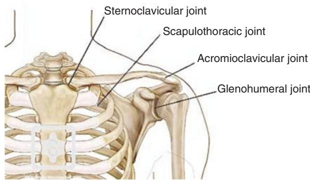
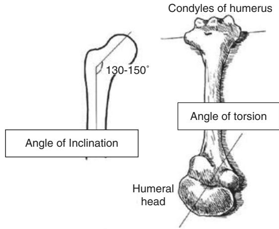
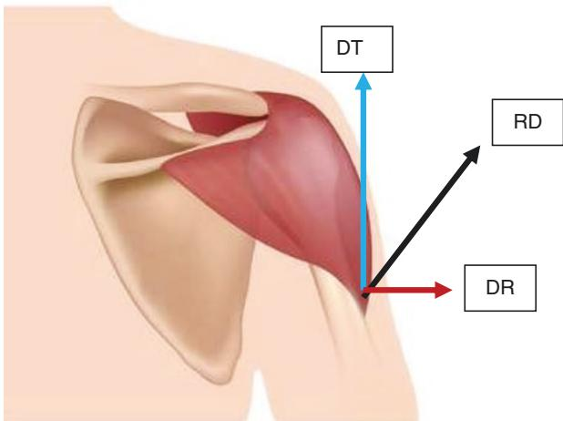
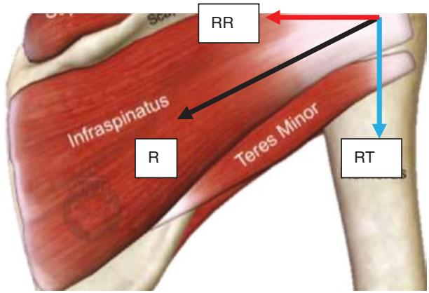
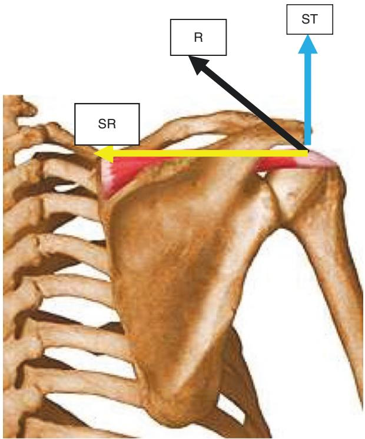
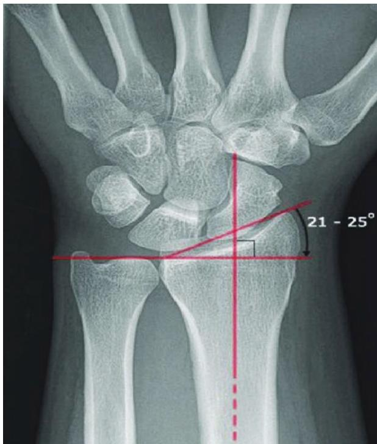
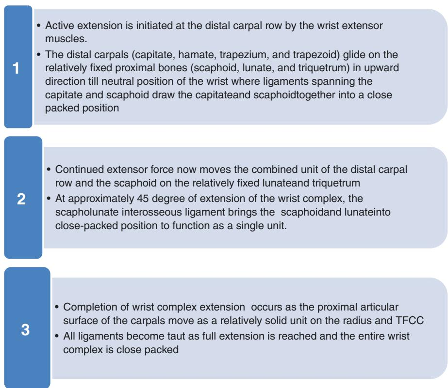

# Kinematics and Kinetics of Shoulder Complex, Elbow, and Wrist

## 8.1 Introduction

The shoulder complex biomechanics is one of the most dynamic areas of study and research. This chapter focuses on the clinical significance of shoulder joint complex. It is important to understand the biomechanics to precisely analyze the complexity of the joint [1]. The shoulder complex includes four joints linked to each other functionally and structurally, viz. (i). glenohumeral (GH) joint, (ii). acromioclavicular (AC) joint, (iii). sternoclavicular (SC) joint, and (iv). scapulothoracic (ST) joint (Fig.  8.1). The shoulder muscles act as a team to create highly organized motion. The weakening in muscle alters the shoulder joint’s natural kinematic chain [2]. Since the shoulder joint is a complex anatomical structure with multiple landmarks, it would be helpful to briefly focus on the anatomy of the shoulder joint before we discuss the kinematics and kinetics in detail.

## 8.1.1 Anatomical Background

The osseous or bony segments in the shoulder joint include the sternum, clavicle, scapula, and humerus.

## Clavicle

The clavicle is located between the sternum and the scapula, from which it holds the upper body to the humerus. The S-shaped clavicle acts as the osseous linkage between the shoulders to the thorax. It serves as a solid brace for the upper limb located away from the thorax and enhances more comprehensive position for usage of the limb. As other long bones, both medial and lateral epiphysis are found in the clavicle [3].

Fig. 8.1 Depicts the shoulder joint complex  

## Scapula

The scapula, also commonly known as the shoulder blade, is an agile, thin, flat trilateral bone located on the posterolateral side of the thorax. It consists of two surfaces, three borders, three angles, and three processes. The subscapular fossa is the somewhat concave in the anterior part of the bone, which allows the scapula to slide efficiently over the posterior convex thoracic cage. The concave glenoid fossa is a partially oval-shaped surface that articulates with the humeral head to constitute the glenohumeral joint [4]. The borders of superior and inferior glenoid tubercles and the glenoid fossae act as proximal attachments for the long head of biceps and the long head of triceps, respectively. The posterior part of the scapula is divided by the scapular spine into the supraspinatus fossa and the infraspinatus fossa. A long, flattened bony prominence from the most superior-lateral part of the scapula is the acromion process. The finger-like projection of bone from the anterior surface of the scapula, palpable about 1 inch below the most concave component of the distal clavicle, is the coracoid process. At the inferior angle, or tip, of the scapula, the medial and lateral edges of the scapula meet. The inferior angle is clinically significant in helping to detect scapular motion [5].

## Humerus

The humerus is one of the long bone in the human body. At the shoulder joint, the humerus binds across the glenoid fossa of the scapula to the axial body and attaches to the ulna’s olecranon fossa at the elbow.

The upper part of the humerus is the center for many ligament and muscle attachments. The humeral head is half of a complete sphere of glenoid cavity that articulates with glenoid fossa. A sharp, anterior bone projection just beneath the humeral head is the lesser tubercle. The greater tubercle creates a more oval lateral bony projection. Deltoid tuberosity located at lateral upper one-third of humerus shaft allows insertion for all deltoid muscle. The radial or spiral groove, which aids in establishing the insertion of the triceps’ lateral and medial heads, runs obliquely across the humerus’ posterior surface [6].

## Sternum

The sternum is a flat bone located at the midpoint of the anterior thorax that consists of the manubrium, the body, and the xiphoid process. The manubrium is the upper section of the sternum that articulates with the upper part of the second costal cartilage, the first rib of both sides, and the clavicle that forms the sternoclavicular joint. The quadrangular manubrium sits between third and fourth thoracic vertebrae level. The jugular notch is the thickest portion of the bone where the anterior side is convex, and the posterior side is concave. The sternum’s body has margins that articulate with the cartilage of the second to seventh rib. The “sword-shaped” xiphoid process is the lower tip and the shortest portion of the sternum. It does not articulate with the ribs. The xiphoid process anchors many essential muscles, such as the rectus abdominis and the transversus thoracis, and the diaphragm that is essential for breathing [7].

## 8.1.2 Articulations

The four main articulations involved with the shoulder complex, including the clavicle, sternum, ribs, scapula, and humerus, work in association with each other for providing a large range of movements in all three planes of motion to the upper extremity. The shoulder complex includes 3 physiological joints and 1 functional joint. The interplay among four articulations of the shoulder complex results in a synchronized pattern of arm movement. The movements involved are continuous and interdependent at each joint, although they occur at different intervals and at different angles of motion of the shoulder complex. GH, AC, and SC joints link the upper extremity to the axial skeleton. The ST joint makes the scapula to glide over the contours of the thoracic posterior wall. To attain normal shoulder girdle movements, all four joints work together cohesively. The shoulder joint movement is complex and allows dynamic relationship between ligament constraints, muscle forces, and bony articulations. The GH joint is primarily designed for mobility and ability to move and position the hand through a wide range in space, permitting the largest range of motion in the body [5].

## 8.1.3 Shoulder Joint Angulations

The humerus head faces medially, superiorly, and posteriorly, whereas the glenoid fossa is 6–7 degrees retroverted from scapular plane. Thus, at the shoulder joint two distinct angulations are observed.

Angle of inclination—the angle is formed in the frontal plane between the line intersecting the humerus shaft and humerus neck. The normal angle ranges from 130 to $1 5 0 ^ { \circ }$ (Fig. 8.2).

Angle of torsion—the angle is formed in the transverse plane between the line intersecting the humerus neck and humerus condyles. The normal angle ranges from 20 to $3 0 ^ { \circ }$ (Fig. 8.2).

Fig. 8.2 Depicts shoulder angle of inclination and angle of torsion  

## 8.1.4 Supporting Structures of the Shoulder Joint

## (A) Joint Capsule

The joint capsule is essential passive stabilizer of the shoulder joint. The glenohumeral joint capsule is thickened at the front and is double the diameter of the humerus head. It supplies much of its extensibility before and below, and “winds up” during abduction with external rotation. The joint capsule has an inherent negative intra-articular pressure, which holds the joint together.

## (B) Ligaments

I. Glenohumeral ligaments

(a) Superior GH ligament restricts the external rotation and inferior translation of the humeral head.

(b) Middle GH ligament restricts external rotation and forward translation at $4 5 ^ { \circ }$ abduction [8].

(c) The lower GH ligament is the thickest of the ligaments and checks superior, anterior, and posterior humeral motion as it consists of three distinct portions: the anterior and posterior band and the axillary pouch.

II. Coracohumeral ligament: It covers the superior glenohumeral joint forward and upward and fills the space between supraspinatus and subscapularis tendons. It limits forward and downward translation at lower levels of elevation, extension, and extension with adduction.

III. Coracoacromial ligament: It is a strong triangular band, extending from coracoid process to acromion that together forms a vault for the protection of the head of the humerus [9].

IV. Capsular ligament (fibrous capsule): It is made up of collagen and elastic fibers. Medially it is attached to the peripheral margin of the glenoid cavity outside of the glenoid labrum. Common shoulder pain is seen at the sub-acromial space, which includes the theoretic space between the coracoacromial arch and the humerus head. More precisely, the sub-acromial canal lies underneath the acromion, the coracoid process, and the coracoacromial ligament. Sub-acromial bursa situated here provides lubrication for rotator cuff (RC) tendons, the insertion of the long head of the biceps [10].

## (C) Glenoid Labrum

It is a ridge-like fibrocartilaginous, connective tissue that enhances the articular surface of the humeral head with the glenoid fossa. It provides the main link to the glenohumeral ligaments and provides partial origin to the long head of biceps tendon, capsule, and anatomical neck of the humerus. Its curvature enhances about 50% of the depth of the shoulder joint. During shoulder joint rotational movement, it stretches out at the front with external rotation and stretches out at the back with internal rotation. Therefore, the lack of labrum integrity has been shown to minimize translation resistance of shoulder complex about 20% [11].

## (D) Bursae

Bursa is a fluid-filled synovial sac that serves as cushion for tendons and other structures of joint. In the shoulder, there are eight bursae. The bursae have both a nerve supply and a mechanoreceptor that serves to provide proprioceptive information on the joint position of the shoulder. This indicates that bursae do not act exclusively as a lubricator between tissues. The upper limits of the bursae are the coracoacromial ligament, the bone of the acromion, and the deltoid. The lower limits are the humeral head, the joint of the shoulder, and the supraspinatus [12].

## 8.2 Kinematics of the Shoulder Joint Complex

## 8.2.1 Sternoclavicular Joint: Osteokinematics and Arthrokinematics

It is a plain synovial saddle joint formed between the sternum and the clavicle. The joint is slightly incongruent and maintained by the fibrocartilagenous disk. It allows 3 degrees of rotatory and 3 degrees of translatory motions.

(A) Elevation and Depression: Sagittal axis motion with convex clavicle moving over concave manubrium. Following convex–concave rule, the clavicle rolls superiorly and glides inferiorly during elevation and vice versa during depression.

Available Range of Motion: Elevation—48 degree, Depression—15 degree. Ligaments

Costoclavicular ligaments: strong ligament between the clavicle and the first rib.

Function—checks elevation of the lateral end of the clavicle.

## Interclavicular ligament

Function—limits upward glide of the medial clavicle and depression of the distal clavicle.

## (B) Protraction and Retraction

It is a vertical axis motion of the concave clavicle over the convex manubrium. During protraction, the clavicle rolls and slides anterior and vice versa for retraction following concave–convex rule.

Available Range of Motion: Protraction – 15–20 degrees, Retraction – 20–30 degrees.

## Ligaments

Sternoclavicular ligaments: Anterior and posterior bands. The function is to check anterior–posterior translation of medial end of the clavicle.

## (C) Anterior and Posterior Rotation

It occurs as a spin along the long axis of the clavicle from its neutral position.

Available Range of Motion: Anterior rotation—10 degrees, Posterior rotation—50 degrees.

## 8.2.2 Acromioclavicular Joint

It is a plane synovial joint articulation between a larger lateral clavicle end and a small facet on acromion process of the scapula, thus making it very incongruent. There are three major motions available.

## (A) Internal and External Rotation

It takes place in the vertical axis and transverse plane. During internal rotation, the glenoid fossa comes anterior and medial and just the opposite for external rotation.

Available Range of Motion—combined 30 degrees.

## (B) Anterior and Posterior Tipping

It is a coronal axis motion. During anterior tipping, acromion tips forward with the inferior angle of the scapula tipping backward. During posterior tipping, the inferior angle of scapula tips forward.

Available Range of Motion: Anterior tipping—30 degrees, Posterior tipping − 40 degrees.

## (C) Upward and Downward Rotations

Sagittal axis and frontal plane motion.

Available Range of Motion: Upward rotation—30 degrees, downward rotation—17 degrees

## Ligaments

Acromioclavicular ligaments—Superior and inferior fibers. Provides anterior and posterior stability

Coracoclavicular ligament—Two portions

Lateral trapezoid portion—it is horizontally oriented and restricts posterior translation of distal clavicle.

Medial conoid portion—it is vertically oriented and acts as restraint for superior– inferior translation.

They together also limit upward rotation of the scapula on the thorax and play the most critical role in posterior rotation of the clavicle for efficient external rotation during arm abduction beyond 90 degrees.

## 8.2.3 Scapulothoracic Joint

It is a functional joint rather than a true anatomical joint as it lacks the fibrocartilage union and synovial tissue [8]. The motion at ST joint is a resultant motion at AC and/or SC both [8].

(A) Elevation /depression: translatory cephalocaudal motion of the scapula on the thorax accompanied by: SC JOINT—elevation /depression AC JOINT—internal/external rotation

(B) Protraction/retraction: translatory motion toward or away from the vertebral column accompanied by: SC JOINT—protraction/retraction AC JOINT—internal/external rotation

(C) Anterior/posterior tipping: predominant AC joint motion along with anterior/posterior rotation of the clavicle at SC joint.

## 8.2.4 Glenohumeral Joint

The glenohumeral joint (GH joint) is a true synovial ball-and-socket joint that is responsible for integrating the upper limb to the thorax, allowing 6 degrees of freedom. The articulation is formed by the humeral head and the glenoid fossa of the scapula. It is to be noted that the glenoid fossa is relatively flat, in comparison to a large, rounded hemisphere of the head of the humerus. In addition, it is approximated that only one-quarter of the humeral head articulates with the glenoid fossa during movements at any given time; thus, the joint is mobile but incongruent [13].

The shoulder joint is the most moveable and least stable joint in the body and commonly gets dislocated. The joint itself has limited bony congruency, due to the relatively large surface area of the humeral head in correspondence with the fossa, and consequently relies heavily on surrounding soft tissues for support. In a healthy individual, the surrounding passive structures (labrum, joint capsule, and ligaments) along with active structures (muscles and related tendons) work together to maintain static and dynamic stability throughout movement. It is to note that the ligaments and capsules of the GH joint are relatively thin and even provide secondary joint stability, while the rotator cuff muscles provide the primary stabilizing force along surrounding musculature [14]. The shoulder joint has motion available in all planes as listed below.

## (A) Flexion and Extension

Osteokinematics: frontal axis and sagittal plane motion.

Arthrokinematics: in open chain kinematics where the humeral head (convex) would move over the glenoid fossa (concave), rolling and gliding would occur in opposite directions. Thus for flexion, rolling would be anterior and gliding would be posterior. The extension of the shoulder would consist of opposite direction of rolling and gliding. In close kinematic chain, where the humerus is fixed and glenoid fossa moves, rolling and gliding would occur in the same directions. Thus, the flexion would consist of anterior rolling and anterior gliding and opposite for extension.

## (B) Adduction and Abduction

Osteokinematics: sagittal axis and frontal plane motion.

Arthrokinematics: in open chain kinematics for abduction, rolling would be superior and gliding would be inferior. The adduction of the shoulder would consist of opposite direction of rolling and gliding.

## (C) Medial and Lateral Rotation

Osteokinematics: vertical axis and transverse plane motion.

Arthrokinematics: in open chain kinematics for lateral rotation, rolling would be backward and gliding would be forward. The internal rotation of the shoulder would consist of opposite direction of rolling and gliding.

(D) Circumduction: Apart from the pure planar motions, the shoulder has the ability to show multiplanar motions completing a circular motion (combination of flexion, adduction, abduction, and extension in succession) and thus known as the circumduction of the shoulder.

The open chain kinematics of the glenohumeral joint has been summarized in Table 8.1.

Table 8.1 Open chain kinematic characteristics of the glenohumeral join

<table><tr><td>Available motion</td><td>OsteokinematicsAxis and plane</td><td>ArthrokinematicsConvex-concave</td><td>Range of motion in degrees</td></tr><tr><td>Flexion</td><td>Frontal axis and sagittal plane</td><td>Rolling—anterior Gliding – posterior</td><td>0–110</td></tr><tr><td>Extension</td><td>Frontal axis and sagittal plane</td><td>Rolling—posterior Gliding—anterior</td><td>0–60</td></tr><tr><td>Adduction</td><td>Sagittal axis and frontal plane</td><td>Rolling—inferior Gliding—superior</td><td>120–0</td></tr><tr><td>Abduction</td><td>Sagittal axis and frontal plane</td><td>Rolling—superior Gliding—inferior</td><td>0–120</td></tr><tr><td>Medial rotation</td><td>Vertical axis and transverse plane</td><td>Rolling—forward Gliding—backward</td><td>0–90</td></tr><tr><td>Lateral rotation</td><td>Vertical axis and transverse plane</td><td>Rolling—backward Gliding—forward</td><td>0–90</td></tr></table>

## 8.2.5 Scapulohumeral Rhythm

During arm elevation, the scapulohumeral rhythm is defined as the ratio of the glenohumeral movement to the scapulothoracic movement. This is most often determined by taking the total amount of shoulder elevation by the scapular upward rotation (humerothoracic) (scapula-thoracic). The shoulder’s actions are paired with the scapula’s actions. This increases the upper extremity’s available range of motion and allows the glenoid fossa to be positioned in a more stable position relative to the humeral head. Scapulohumeral rhythm, first published by Codman in the 1930s, is the kinematic interaction between the scapula and the humerus [15]. For the optimal function of the shoulder, this interaction is substantial. In the sagittal plane, the scapulohumeral rhythm or ratio is significantly greater in scapular plane (less scapular movement and more humeral movement) than in other planes. The dominant side, consistent with the findings, shows significantly higher scapulohumeral rhythm values than the non-dominant side, but only in the coronal and scapular planes. Scapulohumeral rhythm is described as a proportion of humeral elevation and scapulothoracic rotation. The overall ratio of 2:1 during arm elevation is commonly used. According to the 2-to-1 ratio framework, flexion or abduction of $9 0 ^ { \circ }$ in relation to the thorax would be accomplished through approximately $6 0 ^ { \circ }$ of GH and $3 0 ^ { \circ }$ of ST motion [16]. When there is a change in the normal position of the humerus-related scapula, this can cause scapulohumeral rhythm dysfunction, often referred to as reverse scapulohumeral rhythm and lead to scapular dyskinesia.

## 8.3 Kinetics of the Shoulder Joint: Static and Dynamic Stability of the Shoulder Complex

The shoulder joint stability depends on the coordination of both static (noncontractile, for example, ligaments) and dynamic (contractile, for example, tendons and muscles) tissues [17].

## 8.3.1 Static Stability

## Articular Surfaces and Bony Geometry

The bony architecture of the glenohumeral joint is favorable but loses bony stability to excessive joint mobility. It is thicker at the periphery and provides the basis for the effect of rotator cuff muscles [18]. The superior angulation of the glenoid helps to hold the humeral head stuck over it and the joint capsule created a negative joint pressure to maintain the integrity of the humeral head within the labrum.

## Static Structures and Mechanoreceptors

The shoulder complex’s static structures, which include the labrum (a fibrocartilaginous ring), capsule, cartilage, ligaments, and fascia, serve collectively as the physical constraints of the bone and provide the shallow glenoid fossa with a deepening effect. They also provide protection in addition to their passive stabilization function through the different mechanoreceptors embedded within their fibers. Mechanoreceptors are distinguished by specialized nerve endings that are responsive to tissue mechanical deformation and thus contribute to the regulation of the adjacent muscles’ motor responses. Our sense of touch, sensation, and proprioceptive positioning is the responsibility of mechanotendinous receptors (muscle spindles and golgi tendon organs), capsuloligamentous receptors (Ruffini and Pacinian corpuscles), and cutaneous receptors (Meissner, Merkel, and free nerve endings), as well as providing feedback on muscle length, stress, and orientation, further to the speed and strength of the contractions of the muscle fibers. Through feed-forward and feedback input, the passive shoulder structures provide a neural defense mechanism that directly mediates reflex musculature stabilization around the glenohumeral joint [19].

## 8.3.2 Dynamic Stability

For the shoulder complex, dynamic stabilization results in a large range of mobility and provides stability within the functional limit. The active, contractile tissues constitute the dynamic stabilizers of the shoulder complex. This includes the muscles of the rotator cuff, the deltoid muscles, and the scapular muscles that regulate the scapulohumeral rhythm and are linked to proprioception-related sensorimotor system (joint location sense, kinesthesia (sense of motion), sense of force, sense of vibration, and sense of velocity). The dynamic stability of the shoulder is mainly dependent on the following muscles [8].

Deltoid and glenohumeral stabilization

Rotator cuff and glenohumeral stabilization

Supraspinatus stabilization

Long head of biceps brachii

Role of Deltoid—The dynamic stabilizers must function in an effective synergistic fashion for optimum shoulder stabilization. During movement, these dynamic stabilizers help maintain the central position of the humeral head within the glenoid fossa. The deltoid muscle is the shoulder joint’s powerful abductor and elevator. Let us analyze the deltoid force vector in dynamic stabilization. Consider Fig.  8.3, where the deltoid muscle is shown for the right shoulder from the posterior aspect.

Fig. 8.3 Deltoid muscle action in dynamic stability  

The resultant force of the deltoid is in the line of pull for middle deltoid muscle as shown by the force vector RD. The force vector DT represents the translatory force of the deltoid, whereas the force vector DR represents the rotatory force component of deltoid. It can be seen that the translatory component of the deltoid helps to counter the gravitation pull on the humerus. Also, the rotatory component helps to abduct the humerus.

## Role of Infraspinatus, Teres Minor, and Subscapularis Muscles

It is essential that during overhead activities, three rotator cuff muscles (infraspinatus, teres minor, and subscapularis supraspinatus) activate the humeral head in synergy with the deltoid for dynamic stability [20]. Let us understand the force action of rotator cuff muscle like infraspinatus, teres minor, and subscapularis using Fig.  8.4 for the right shoulder in posterior view. The resultant line of action for infraspinatus and teres minor is shown by the force vector R where the rotatory component is represented by RR and translatory component by RT. It can be seen that the translatory component of these rotator cuffs is offsetting the excessive superior translation of deltoid as it is directed downward against the superior translation of deltoid. Also, the rotatory component pushes the head of the humerus into the glenoid fossa medially and thus helps to maintain the congruency during motion.

Role of Supraspinatus—The supraspinatus muscle has a significant role in dynamic stabilization of shoulder during abduction. Referring to Fig. 8.5, we see that the small translatory component of the supraspinatus is upward represented by force vector ST, and thus assists the deltoid to overcome gravitational pull downward. In contrast, the rotatory component is large and directed to push the humerus head into the glenoid fossa, thus maintaining stability. The larger rotatory component allows the supraspinatus muscle to initiate the abduction.

Fig. 8.4 Depicts force vector for rotator cuff in dynamic shoulder stabilization  

Fig. 8.5 Depicts force vector for supraspinatus in dynamic shoulder stabilization  

## Biceps Mechanism

It has been found that both long heads of biceps have parallel functions as anterior stabilizers of the glenohumeral joint during actions like abduction and external rotation, and their role increases as shoulder stability declines. Both heads of the biceps act as stabilizing function in resisting anterior humeral head displacement, and consideration is given to strengthening the biceps during rehabilitation programs in case of chronic anterior instability [21].

## Secondary Dynamic Stabilizers

Teres major is a small muscle located at the lateral border of the scapula. It forms the inferior border for both the triangular space and quadrangular space. It is sometimes called “lat’s little helper” because of its synergistic action along with latissimus dorsi.

Latissimus dorsi, which means “broadest muscle of the back,” is one of the widest muscles in the human body. Also known as the “lat’s,” it is a very thin triangular muscle that is not used strenuously in common daily activities but plays a crucial role in many pelvic and core exercises and swimming.

Pectoralis major is a thick, fan-shaped muscle, situated at the chest which makes up the bulk of the chest muscles [22].

## 8.3.3 Force Couple

A force couple is described as two equal but oppositely directed forces acting concurrently on the opposite sides of an axis that generates rotation. In biomechanics, a couple is a system of muscular forces that results in a moment without a resultant force and creates a rotation without translation at joint.

Synergetic mechanisms of co-contractions of the shoulder muscles, appropriate positioning, control, and coordination of the shoulder, as well as the scapulathoracic complex obtain dynamic stabilization during upper extremity movements. The dynamic stability of the shoulder complex can be categorized into the following: glenohumeral stability (local) and scapulothoracic stability (global). Deltoid muscle plays an important role as a stabilizer in glenohumeral joint stability and is generally accepted during abduction as a prime mover for the glenohumeral joint, along with the supraspinatus muscle [23]. The deltoid is the main muscle that is responsible for abduction from 15 to 90 degrees of the limb. It also acts as a humeral head stabilizer, especially in cases of carrying a load. The supraspinatus muscle is better than the other three rotator cuff muscles in terms of the location. The deltoid and rotator cuff muscles for the motions associated with the glenohumeral joint work as a mutual force coupling. Biomechanical alterations can be caused by an imbalance of one or more of these muscles and contribute to shoulder disorders such as impingement syndromes, bursitis, instability, scapular dyskinesia, or chronic conditions associated with pathological wear and tear.

The trapezius muscle helps to rotate the scapula upward with serratus anterior, which helps maintain sub-acromial space. Serratus anterior’s strong action as a protractor/upward rotator requires an opposite force to regulate this movement (equally strong antagonist). As a primary force coupling, the serratus anterior and trapezius (middle) muscles function to rotate the scapula upward [24].

## 8.3.4 Scapular Muscles

The scapular stability depends on the coordinated activity of the 18 muscles directly attached to the scapula. For the humeral head to remain centered and allow arm movement to occur, the scapular muscles must dynamically control the positioning of the glenoid. When there is weakness or neuromuscular dysfunction of the scapular musculature, normal scapular arthrokinematics are altered and an individual is eventually predisposed to an injury to the GH joint [25].

There is an impressive array of muscles that attach and act on the four joints of the shoulder complex as listed below.

Intrinsic muscles, commonly called as the scapulohumeral muscular group, are deeper muscles that originate from the scapula and /or the clavicle and insert on the humerus.

• Supraspinatus •Infraspinatus •Subscapularis •Teres minor.

Extrinsic muscles are larger, more superficial muscles that originate on the thorax and attach to the bones of the shoulder complex (the humerus, clavicle, and scapula).

• Latissimus dorsi • Teres major • Pectoralis major • Pectoralis minor

Other muscles act on the shoulder joint, which act as secondary movers. They are generally in the pectoral area of the body or the upper arm.

• Biceps brachii • Triceps brachii

## 8.4 Pathomechanics of Shoulder Complex

Freedom of movement has been produced at the cost of stability (commonly referred to as the trade-off of mobility-stability), and increasing demands for both mobility and stability, combined with complex structural and functional architecture, make the shoulder complex highly susceptible to dysfunction and instability [26].

Rotator cuff disorders: The two foremost disorders of the rotator cuff are impingement and tendinopathy. Multifactorial and pathological changes, both of which influence the quality of tendons, are the result of rotator cuff injuries and tendon degeneration. The supraspinatus, followed by infraspinatus, subscapularis, and teres minor, is commonly injured tendon of the rotator cuff muscles. The tendon tear of the subscapularis can be associated with the rupture of a biceps tendon from the bicipital tendon groove moving medially into the tendon of the subscapularis. The absence of the biceps tendon in the empty bicipital groove is confirmation of intra-articular tendon tears. Musculoskeletal pain patients often develop local tissue changes that affect functional participation, focal tenderness, and pain related to activity. This presents with pain, altered range of motion in contexts of capsuloligamentous restrictions and movement abnormalities, or altered muscle activation patterns at glenohumeral and scapulothoracic joints. The cuff accounts for a substantial share of the shoulder’s rotational strength [27].

## Shoulder Instability

The term “shoulder instability” refers to the inability of the glenoid fossa to retain the humeral head. A balanced joint reaction force is created by the ligamentous and muscle structures around the glenohumeral joint under normal conditions. If the integrity of any of these structures is disturbed, atraumatic or traumatic instability can result. Traumatic injury mechanisms may result in frank dislocations where there has been a loss of integrity of the joint. Instability, regardless of the mechanism of injury, can occur anteriorly, posteriorly, or in multiple directions. Traumatic shoulder instability is a common condition which is associated with high recurrence rates, particularly in young patients.

Anterior dislocation due to trauma is the most common type among the different types of joint instability, representing more than 90% of the cases. A subclassification of glenohumeral joint instability is atraumatic (non-traumatic) shoulder instability, encompassing those for whom trauma is not considered the primary etiology [28].

## Shoulder Subluxation

Glenohumeral subluxation is defined as a partial or incomplete dislocation, which is usually caused by changes in the joint’s mechanical integrity. The humeral head slips out of the glenoid cavity in subluxation because of weakness in the rotator cuff or a knock to the area of the shoulder. One of three types of subluxation may occur: anterior (forward), posterior (backward), and inferior (downward). The distinction is the fact that the humeral head pops back into its socket with a shoulder dislocation. Because it is the most frequently dislocated joint, the proposition that stability must be sacrificed to obtain mobility gives an effective demonstration. The glenohumeral ligament is the largest ligament, and in shoulder joint subluxation it is commonly damaged or overstretched. In individuals with hemiplegic stroke or with a paralyzed upper extremity, shoulder subluxations often occur. The incidence reported varies greatly, from 17 percent to 81 percent. Traumatic shoulder subluxation can occur in many sports, such as football, rugby, wrestling, and boxing [29].

## Bicep Tendinopathy

The bicep tendinopathy pathology was extensively investigated by, among others, De Palma and Callery, Lippmann, and Hitchcock and Bechtol in the 1940s and 1950s. Neer described long head of biceps involvement in rotator cuff disease but overemphasized the role of the tendon as a humeral head depressor. Long head of biceps (LHB) tendinitis is an inflammatory tenosynovitis that occurs as the tendon travels along its constrained path within the humerus’ bicipital groove. LHB tendinitis is present with anterior shoulder pain and is often exacerbated by overuse, like other types of biceps tendinopathy [30].

## Labral Injuries

In different patient populations, various types of shoulder labral tears can be found. SLAP lesions are most common.

## Adhesive Capsulitis

Adhesive shoulder capsulitis is a common condition that affects 2–5% of the general adult population and up to 20% of diabetes patients. The term “adhesive capsulitis” was given by Neviaser in 1945 for painful shoulder stiffening. To classify a painful shoulder condition of insidious onset with stiffness and difficulty sleeping on the affected side, Codman used the term “frozen shoulder”. It was Duplay, however, who originally defined the condition as “periarthrite scapulo-humerale” in 1872. Such terms are used synonymously now [31]. The deposition of hydroxyapatite crystals into the muscle tendon is the cause of the frozen shoulder. The most common site of hydroxyapatite calcification in the human body is the supraspinatus tendon. Diabetes mellitus is associated with frozen shoulder, but can also be linked with coronary artery disease, cerebral vascular disease, rheumatoid arthritis, and thyroid disease. Emig et al. found that the capsule and synovium thickness > 4 mm adjacent to the axillary recess was highly specific to adhesive capsulitis; changes in the coracohumeral ligament were found to be not consistent. Others have reported that a more common finding was scarring within the rotator interval [32].

## Scapular Dyskinesia

The imbalance in the scapular muscle strength could lead to abnormal scapulohumeral rhythm as well as altered scapular tracking over the thorax which is commonly termed as scapular dyskinesis. It is thus important to know the normal resting position of scapula on the thorax as described below.

Resting position of scapula:

• Resting between 2 and 7 ribs

• 2 inches from midline

• 30–45 degrees internal rotation

• 10–20 degrees anterior tipping

• 10–20 degree of upward rotation

## 8.5 Biomechanics of Elbow Joint

## 8.5.1 Introduction

The elbow and wrist is biomechanically linked to the shoulder joint for providing a greater range of mobility through space. The elbow joint serves as the mechanical linkage between the shoulder joint and wrist and provides greater reach, whereas the wrist joint’s main function is to perform intricate skilled movements. In this chapter, we shall focus on the most important aspects of elbow, wrist, and biomechanics.

## 8.5.2 Biomechanics of Elbow Joint

The structure and function of the elbow joint is efficient to perform both mobility and stability. The elbow joint complex is formed by the two articulations. The proximal articulation is seen between the humerus and the ulna known as the humeroulnar joint, as well as between the humerus and the radius known as the humeroradial joint. The distal articulation is formed between the radius and the ulna known as the superior and inferior radioulnar joint.

The humeroulnar joint is formed by the concave trochlear notch of the ulna and the convex medial humeral epicondyle. The humeroradial joint is formed by the concave radial head and convex humeral capitulum.

## 8.5.2.1 Osteokinematics

The predominant motion seen at the elbow joint (humeroulnar and humeroradial) is flexion and extension occurring in the sagittal plane and frontal axis. Minimal abduction and adduction can also be seen. The other major motion available at the superior and inferior radioulnar joint is supination and pronation which takes place in the transverse plane as rotational movements.

## 8.5.2.2 Arthokinematics

At the proximal articulation (humeroulnar and humeroradial joints), the concave surfaces of the ulna and radius move over the convex humerus in open chain kinematics. Thus, rolling and gliding would be occurring in the same direction. For instance, the elbow flexion would consist of anterior rolling and anterior gliding.

The superior radioulnar joint consists of ulnar radial notch, the capitulum of the humerus, and the head of the radius covered by the annular ligament. The circular ring of the annular ligament allows the movement of radius as a pure spin at the superior radioulnar joint. During pronation, the radius rides over the ulna through its spinning movement, and during supination, it comes back to resting position through reverse spin [8].

The inferior radioulnar joint is composed of the ulnar notch of the radius, the articular disk (triangular fibrocartilage, TFC), and the head of the ulna. During pronation and supination, the concave surface of the ulnar notch of the radius slides around the ulnar head, and the disk follows the radius by twisting at its apex and sweeping along beneath the ulnar head [8].

## Summary of Pronation and Supination Movement at Elbow

• Pronation of the forearm occurs as a result of the radius’s crossing over the ulna at the superior radioulnar joint.

• During pronation and supination, the rim of the head of the radius spins within the osteoligamentous enclosure formed by the radial notch and the annular ligament.

• At the same time, the surface of the head spins on the capitulum of the humerus.

• At the distal radioulnar joint, the concave surface of the ulnar notch of the radius slides around the ulnar head.

## 8.5.3 Kinetics of the Elbow Joint

The elbow joint is considered to be a congruent joint because of greater articulating surface through a wider range of joint motion. The stability is provided by the joint bony structure and alignment, its surrounding ligaments and joint capsule, as well as muscles around the joint.

## 8.5.3.1 Ligaments of Elbow

The elbow joint is supported by a number of ligaments that provide significant static stability to the joint. The important ligaments are listed below along with their role in specific directional stability.

Annular

Quadrate ligaments

Oblique cord

Dorsal and palmar radioulnar ligament

Interosseous membrane

## Medial Stability

Major stability to the medial aspect of the joint is given by the ulnar collateral ligament.

## Lateral Stability

Major stability to the lateral aspect of the joint is given by the radial collateral annular ligament and lateral ulnar collateral ligament.

## Proximal Radioulnar Joint

Proximal radioulnar joint is reinforced by the annular and quadrate ligaments, oblique cord (limits supination), and interosseous membrane [8, 33, 34].

## Distal Radioulnar Joint

Distal radioulnar joint is stabilized by interosseous membrane [35], dorsal radioulnar ligament (limits pronation) [36], palmar radioulnar ligament (limits supination), triangular fibrocartilage, and joint capsule [8].

## 8.5.3.2 Muscles of the Elbow Joint

## Primary Flexors:

Brachialis Brachioradialis Biceps brachii Accessory Flexors: Extensor carpi radialis longus Pronator teres Primary Extensor: Triceps Anconeus Supination and Pronation: Supinator and Pronator Teres

## 8.5.3.3 Dynamic Stabilization through Muscles

The muscles of the elbow joint play a significant role in providing dynamic stabilization. The important muscles and their role have been listed below.

Triceps: a major stabilizer for flexion and extension movements. The reciprocal concentric and eccentric contraction of the triceps during push-up and push-down phase can be seen as the most significant contribution for dynamic stabilization [8].

Pronator quadratus: is active throughout supination and pronation and provides dynamic stabilization for the distal radioulnar joint [8].

Extensor carpi ulnaris: exerts a depressive force on the dorsal aspect of the ulnar head during supination [8]. Extensor carpi radialis brevis also provides support for the forearm, for gripping during pronation.

Pronators teres: are found to be most efficient around the neutral position of the forearm when the elbow is flexed to 90 degree [8].

## 8.5.3.4 Pathomechanics

The elbow joint is prone to multiple pathological changes as a number of structures pass through the joint. The most commonly seen pathomechanics due to specific dysfunction has been listed here and few important ones from the biomechanica perspective have been discussed in detail.

(a) Osseous and articular changes: Bone hypertrophy Traction spur formation Osteochondral defects Loose bodies Joint degeneration Chondromalacia Osteophyte formation Epiphyseal and apophyseal deformity Dislocation/avulsion fractures

(b) Ligamentous changes: Sprains Calcium deposition

(c) Soft tissue changes: Synovitis Adhesive capsulitis

(d) Tendon related: Tendinosis/itis

(e) Muscle alteration: Myositis fibrosis/ossification

(f) Nerve related: Ulnar nerve entrapment Pronator syndrome Radial nerve entrapment

Lateral antebrachial cutaneous nerve entrapment

(g) Bursae:

Olecranon bursitis

(h) Altered angulations:

Cubitus valgus and varus

## Lateral Epicondylitis

The term “tennis elbow” was introduced by Major and Runje in 1880. Nirschl and Pettrone concluded tendinitis as a misnomer as no inflammatory cells were present in the surgical specimens. Pathoanatomical changes primarily occur in extensor carpii radialis brevis and secondarily to extensor digitorum. Therefore, it is commonly referred to as lateral epicondylitis due to its site as common extensor origin. “Backhand strokes” are the most common predisposing factors with repetitive muscle contraction.

## Medial Epicondylitis

Similar pathological condition with respect to histological pathoanatomy. It frequently occurs over the tip of the medial epicondyle, and extending distally 1 to 2 inches along the common flexor origin. Muscles like pronator teres and flexor carpii radialis are usually involved.

## Little League Elbow

A pathology seen at younger age groups due to an accelerated apophyseal growth and delayed medial epicondyle epiphysis growth. It is often characterized by weakness in triceps giving a sense of “locking” or “catching” sensation with decreased pronation and supination range.

## Cubitus Valgus and Cubitus Varus Angle

The long axis of humerus forms a medial angle with the long axis of ulnar in full extended position at the elbow. The normal angle is 15° [8]. If the angle increased significantly, it is referred to as cubitus valgus, whereas a significant decrease in angle is known as the cubitus varus.

## 8.6 Biomechanics of the Wrist Joint

The wrist is the most distal segment of the upper extremity which performs many intricate skilled movements. The main function of the wrist is to allow grasping power and precision. The wrist joint complex is formed by the radiocarpal and midcarpal articulations. As the name suggests, the radiocarpal joint is articulation between the distal end of the radius with the carpal bones and midcarpal joint is the articulation between the proximal and distal rows of the carpal bones. Clearly, there is no bony articulation between the ulna and carpal though ligamentous connections are present [8].

## 8.6.1 Proximal Articulation

The proximal articulation of the wrist joint complex is formed by the radiocarpal joint consisting of radius, radioulnar disk, and triangular fibrocartilage complex (TFCC) proximally with the scaphoid, lunate, and triquetrum carpal bones distally [8]. The distal radius is biconcave which articulates with the scaphoid and lunate predominately; the triquetrum is connected through TFCC [8]. The pisiform, anatomically part of the proximal row, does not participate in the radiocarpal articulation, and its role is to increase the moment arm of the flexor carpi ulnaris muscle [8].

## 8.6.2 Distal Articulation

The distal articulation of the wrist joint complex is formed by the midcarpal joint consisting of scaphoid, lunate, and triquetrum as proximal carpal bones and trapezium, trapezoid, capitate, and hamate as distal carpal bones [8].

## 8.6.3 Angulations of the Wrist

The radiocarpal joint has two main angulations. One consists of radial inclination in the frontal plane of about 23° (Fig. 8.6), and the other in the sagittal plane of about 11 ° [8]. These angulations add to the functional anatomy of the wrist.

Fig. 8.6 Radiographic presentation for inclination of radius  

The length of the ulna compared to the distal radius has a significant role in biomechanical function [37]. If the ulna is significantly shorter at the distal radial end, then it is known as negative ulnar variance and if longer then positive ulnar variance [8]. These conditions affect the range of wrist joint motion significantly.

## 8.6.4 Ligaments of the Wrist Complex

A number of ligaments are present at the wrist to support the numerous structures passing in and around. They primarily work to stabilize the carpals bone during dynamic motion. The ligaments of the wrist can be broadly classified as the intrinsic and extrinsic ligaments [8].

Intrinsic ligaments: ligaments that interconnect the carpals themselves and are also known as intercarpal or interosseous ligaments.

Extrinsic ligaments: ligaments that connect the carpals to the radius or ulna proximally or to the metacarpals distally.

Both intrinsic and extrinsic ligaments are found on the volar and dorsum of the hand and have been named accordingly as listed below.

## Radiocarpal Ligaments: Extrinsic on the Volar Aspect

Radioscaphocapitate ligament: connects radius proximally and scaphoid and capitates distally

Radioscapholunate ligament: connects radius proximally and scaphoid and lunate distally

Radiolunate ligament: connects radius proximally and lunate distally

## Radiocarpal Ligaments: Intrinsic on the Volar Aspect

Scapholunate ligament: connects scaphoid to lunate

Lunotriquetral ligament: connects lunate to triquetrum

## Radiocarpal Ligaments: Dorsal Aspect

Dorsal radiocarpal ligament

Dorsal intercarpal ligament

## Ulnocarpal Ligament: Volar Aspect

Ulnar collateral ligament

Ulnolunate ligament

## 8.6.5 Kinematics of the Wrist Joint Complex

The kinematics of the wrist joint is facilitated by its anatomical structure, presence of the carpal bones, and active and passive forces caused by the muscles and ligaments, respectively. The wrist can be considered to have four degrees of freedom predominately seen as flexion/extension as well as radial/ulnar deviation [8].

## 8.6.5.1 Osteokinematics

The flexion and extension movement of the wrist is seen in the sagittal plane through the frontal axis. The radial and ulna deviation occurs in the frontal plane and sagittal axis for a human body in anatomical position.

## 8.6.5.2 Arthokinematics

The flexion and extension of the wrist can be described as proposed through a sequence of events [38]. The event has been step wise listed for wrist extension from full flexion and shown in Fig. 8.7. The opposite sequence takes place for flexion from extension.

Radial and ulnar deviation: The proximal carpal row displays a unique “reciprocal” motion with radial and ulnar deviation [39]. In radial deviation, the carpals slide ulnarly on the radius. The carpal motion not only produces deviation of the proximal and distal carpals radially, but simultaneous flexion of the proximal carpals and extension of the distal carpals [8, 40]. Opposite motion can be seen in ulnar deviation.

  
Fig. 8.7 Flowchart depicting sequence of events for extension of wrist from full flexion

## 8.6.6 Kinetics of the Wrist Joint

The wrist joint is well supported by its ligaments passively and muscle actively. We have learnt about the ligaments of the wrist in the above section and muscles of the wrist complex have been listed here. The force generated by the muscles of the wrist is used for gripping function at hand which we shall deal in the next section.

<table><tr><td>Wrist Flexors</td></tr><tr><td>Primary</td></tr><tr><td>Palmaris longus (PL)</td></tr><tr><td>Flexor carpi radialis (FCR)</td></tr><tr><td>Flexor carpi ulnaris (FCU)</td></tr><tr><td>Secondary</td></tr><tr><td>Flexor digitorum superficialis (FDS)</td></tr><tr><td>Flexor digitorum profundus (FDP)</td></tr><tr><td>Flexor pollicis longus (FPL)</td></tr><tr><td>Wrist Extensors</td></tr><tr><td>Primary</td></tr><tr><td>Extensor carpi radialis longus (ECRL)</td></tr><tr><td>Extensor carpi radialis brevis (ECRB)</td></tr><tr><td>Extensor carpi ulnaris (ECU)</td></tr><tr><td>Secondary</td></tr><tr><td>Extensor digitorum communis (EDC)</td></tr><tr><td>Extensor indicis proprius (EIP)</td></tr><tr><td>Extensor digiti minimi (EDM)</td></tr><tr><td>Extensor pollicis longus (EPL)</td></tr><tr><td>Extensor pollicis brevis (EPB)</td></tr><tr><td>Abductor pollicis longus (APL)</td></tr></table>

## 8.7 Biomechanics of the Hand Complex

The biomechanics of the wrist complex varies at the most distal segment and thus discussed separately here under the hand complex. The smaller structures with abundance of mechanics involved make it a very dynamic though complicated segment. The neural inputs and drives command are met at these joint segments for executing many functions of the wrist and hand complex together.

The hand complex consists of 19 bones and 19 joints and classified into three major segments.

Carpometacarpal—CMC joint

Metacarpophalangeal—MP joint

Interphalangeal joint—IP joints, the proximal (PIP) and distal (DIP)

## 8.7.1 CMC Articulation

The second metacarpal articulates with trapezoid primarily and secondarily with the trapezium and capitate.

The third metacarpal articulates primarily with the capitate.

The fourth metacarpal articulates with the capitate and hamate.

The fifth metacarpal articulates with the hamate.

## 8.7.2 Kinematics at CMC

Flexion and extension movement is predominately seen for the second and third CMC allowing one degree of freedom. The fifth CMC has two degrees of freedom [8].

## 8.7.3 Kinematics at MCP

Each of the four MCP joints of the fingers is composed of the convex metacarpal head proximally and the concave base of the first phalanx distally. The MCP joint is condyloid with two degrees of freedom: flexion/extension and abduction/adduction [8].

## 8.7.4 Kinematics and Kinetics of the Hand Complex

The hand complex as a whole has major kinematic function, i.e., gripping and grasping, collectively known as the prehension. The presence of hand arches, ligaments, and volar plates makes it suitable structure to perform this function.

Prehension can be categorized as either power grip (full-hand prehension) or precision handling (finger-thumb prehension) [8]. Power grip is generally a forceful act resulting in flexion at all finger joints. When the thumb is used, it acts as a stabilizer. Precision is the skillful placement of an object between fingers or between finger and thumb [8].

## 8.7.4.1 Functional Steps of Power Grip [8]

1. Opening the hand

2. Positioning the fingers

3. Bringing the fingers to the object

4. Maintaining a static phase that actually constitutes the grip

## 8.7.4.2 Types of Power Grip

Cylindrical grip: In the dynamic phase of finger closing, the power is generated by the flexor digitorum muscle (FDP). In the static phase, the flexor digitorum superficialis (FDS) muscle assists when the intensity of the grip requires greater force [8].

The interossei muscles function primarily as MP joint flexors and abductors/ adductors.

Cylindrical grip is typically performed with the wrist in neutral flexion/extension and slight ulnar deviation [8], e.g., holding a mobile phone tightly.

Spherical grip: The main distinction from the cylindrical grip can be made by the greater spread of the fingers to encompass the object. This demands more interosseous activity, e.g., holding a ball.

Hook grip: Finger flexors are mostly active at the DIP and PIP.  It does not involve thumb, e.g., holding a vegetable bag.

## Lateral Prehension

Lateral prehension is seen when contact occurs between two adjacent fingers.

The MP and IP joints are usually maintained in extension and MP joints simultaneously abduct and adduct, e.g., holding a paper between the fingers.

## 8.7.4.3 Functional Steps of Precision Grip [8]

It shares the first three steps of the power grip sequence but does not contain a static phase. In precision handling, the fingers and thumb grasp the object for the purpose of manipulating it within the hand.

## 8.7.4.4 Types of Precision Grip

Pad-to-pad: involves opposition of the thumb pad to the pad of the finger. The MP and PIP joints of the fingers are partially flexed, whereas the DIP joint may be fully extended or in slight flexion, e.g., holding a pen.

Tip-to-tip: the IP joints of the finger and thumb are flexed. The MP joint is ulnarly deviated (with finger tip pointed radially) to present the tip of the finger to the thumb, e.g., pinching movements.

Pad-to-side: involves contact between pad of the thumb and side of the index finger. Thumb is more adducted and less rotated as compared to tip-to-tip and requires higher activity of flexor pollicis brevis and opponens pollicis, e.g., holding a key.

## 8.8 Functional Position of Wrist and Hand

At wrist: slight extension (20°) and slight ulnar deviation (10°).

At hand: fingers moderately flexed at the MP joints (45°) and PIP joints (30°) and slightly flexed at the DIP joints.

## 8.9 Pathomechanics of Wrist and Hand

## Wrist Instability

Dorsal intercalated segmental instability (DISI)—extended lunate. Progressive degenerative problem from an untreated DISI is known as scapholunate advanced collapse (SLAC wrist).

Volar intercalated segmental instability (VISI)—flexion of lunate and scaphoid and extension of triquetrum and distal carpal row.

Kienbock’s disease—avascular necrosis of the lunate associated with negative ulnar variance.

## 8.10 Summary

The shoulder joint complex is the most mobile segment of the human body. The joint complex has integrated function with the scapula and thorax. The stability in shoulder is compromised over mobility, and thus, utmost care should be taken to maintain the normal biomechanics during dynamic motions in particular.

The elbow, wrist, and hand complex are the anatomical units of the upper limb which serve the stability and mobility functions. These add to the wider domain of biomechanics for the shoulder. The dysfunction of any segment would cause altered biomechanics and interfere with smooth functioning of the upper extremity. Due to the close kinematic chain function, the joints are interlinked and can affect the adjoining segments significantly.

## References

1. Veeger HEJ, Van Der Helm FCT. Shoulder function: the perfect compromise between mobility and stability. J Biomech. 2007;40(10):2119–29.

2. Guyot J.  The shoulder girdle and shoulder joints. In: Atlas of human limb joints. Berlin, Heidelberg: Springer; 1981. p. 102–33.

3. Rockwood CA, editor. The shoulder, vol. 1. Philadelphia, PA: Elsevier Health Sciences; 2009.

4. Calais-Germain B. Anatomy of movement. Seattle: Eastland Press; 1993.

5. Kent BE. Functional anatomy of the shoulder complex: a review. Phys Ther. 1971;51(8):867–88.

6. Terry GC, Chopp TM. Functional anatomy of the shoulder. J Athl Train. 2000;35(3):248.

7. O'Neal ML, Dwornik JJ, Ganey TM, Ogden JA. Postnatal development of the human sternum. J Pediatr Orthop. 1998;18(3):398–405.

8. Levangie, P.K. and Norkin, C.C., 2011. Joint structure and function: a comprehensive analysis.

9. Warner JJ, Bowen MK, Deng X, Torzilli PA, Warren RF. Effect of joint compression on infe rior stability of the glenohumeral joint. J Shoulder Elb Surg. 1999;8(1):31–6.

10. Werner CM, Nyffeler RW, Jacob HA, Gerber C. The effect of capsular tightening on humeral head translations. J Orthop Res. 2004;22(1):194–201.

11. Provencher CMT, Bhatia S, Ghodadra NS, Grumet RC, Bach BR Jr, Dewing LCB, et  al. Recurrent shoulder instability: current concepts for evaluation and management of glenoid bone loss. JBJS. 2010;92(Supplement\_2):133–51.

12. Mohammed H, Skalski MR, Patel DB, Tomasian A, Schein AJ, White EA, et  al. Coracoid process: the lighthouse of the shoulder. Radiographics. 2016;36(7):2084–101.

13. Schenkman M, Rugo de Cartaya V. Kinesiology of the shoulder complex. J Orthop Sports Phys Ther. 1987;8(9):438–50.

14. Wilk KE, Arrigo CA, Andrews JR. Current concepts: the stabilizing structures of the glenohumeral joint. J Orthop Sports Phys Ther. 1997;25(6):364–79.

15. Lee ST, Moon J, Lee SH, Cho KH, Im SH, Kim M, Min K.  Changes in activation of serratus anterior, trapezius and latissimus dorsi with slouched posture. Ann Rehabil Med. 2016;40(2):318.

16. Sugamoto K, Harada T, Machida A, Inui H, Miyamoto T, Takeuchi E, et al. Scapulohumeral rhythm: relationship between motion velocity and rhythm. Clin Orthop Rela Res®. 2002;401:119–24.

17. Lugo R, Kung P, Ma CB. Shoulder biomechanics. Eur J Radiol. 2008;68(1):16–24.

18. Voight ML, Cook G. Clinical application of closed kinetic chain exercise. J Sport Rehabil. 1996;5(1):25–44.

19. Janwantanakul P, Magarey ME, Jones MA, Dansie BR. Variation in shoulder position sense at mid and extreme range of motion. Arch Phys Med Rehabil. 2001;82(6):840–4.

20. Lephart SM, Pincivero DM, Giraido JL, Fu FH. The role of proprioception in the management and rehabilitation of athletic injuries. Am J Sports Med. 1997;25(1):130–7.

21. Itoi EIJI, Kuechle DK, Newman SR, Morrey BF, An KN. Stabilising function of the biceps in stable and unstable shoulders. J Bone Joint Surg Br. 1993;75(4):546–50.

22. Sharkey NA, Marder RA, Hanson PB. The entire rotator cuff contributes to elevation of the arm. J Orthop Res. 1994;12(5):699–708.

23. Baritello O, Khajooei M, Engel T, Kopinski S, Quarmby A, Mueller S, Mayer F. Neuromuscular shoulder activity during exercises with different combinations of stable and unstable weight mass. BMC Sports Sci Med Rehabil. 2020;12(1):1–14.

24. Phadke V, Camargo PR, Ludewig PM. Scapular and rotator cuff muscle activity during arm elevation: a review of normal function and alterations with shoulder impingement. Braz J Phys Ther. 2009;13(1):1–9.

25. Fayad F, Roby-Brami A, Yazbeck C, Hanneton S, Lefevre-Colau MM, Gautheron V, et  al. Three-dimensional scapular kinematics and scapulohumeral rhythm in patients with glenohu meral osteoarthritis or frozen shoulder. J Biomech. 2008;41(2):326–32.

26. Happee R, Van der Helm FCT. The control of shoulder muscles during goal directed movements, an inverse dynamic analysis. J Biomech. 1995;28(10):1179–91.

27. Haza T.  Analysis of the scapulohumeral rhythm. Nihon Seikeigeka Gakkai Zasshi. 1988;62(12):1105–19.

28. Gebremariam L, Hay EM, van der Sande R, Rinkel WD, Koes BW, Huisstede BM. Subacromial impingement syndrome—effectiveness of physiotherapy and manual therapy. Br J Sports Med. 2014;48(16):1202–8.

29. Warren RF. Subluxation of the shoulder in athletes. Clin Sports Med. 1983;2(2):339–54.

30. Uhorchak JM, Arciero RA, Huggard D, Taylor DC.  Recurrent shoulder instability after open reconstruction in athletes involved in collision and contact sports. Am J Sports Med. 2000;28(6):794–9.

31. Kim DS, Yoon YS, Yi CH. Prevalence comparison of accompanying lesions between primary and recurrent anterior dislocation in the shoulder. Am J Sports Med. 2010;38(10):2071–6.

32. Shah N, Lewis M. Shoulder adhesive capsulitis: systematic review of randomised trials using multiple corticosteroid injections. Br J Gen Pract. 2007;57(541):662–7.

33. Fuss F. The ulnar collateral ligament of the human elbow joint. Anatomy, function and biomechanics. J Anat. 1991;175:203.

34. Olsen BS, Vaesel MT, Sojbjerg JO, et  al. Lateral collateral ligament of the elbow joint: Anatomy and kinematics. J Shoulder Elbow Surg. 1996;5:103.

35. Murray WM, Buchanan TS, Delp SL. The isometric functional capacity of muscles that cross the elbow. J Biomech. 2000;33:943.

36. Savnik A, Jensen B, Nørregaard J, Egund N, Danneskiold-Samsøe B, Bliddal H. Magnetic resonance imaging in the evaluation of treatment response of lateral epicondylitis of the elbow. Eur Radiol. 2004;14(6):964–9.

37. O'Driscoll SW, Farsetti P, Potenza V, Caterini R, Ippolito E. Stress radiographs are important in diagnosing valgus instability of the elbow. JBJS. 2002;84(4):686–7.

38. Conwell H. Injuries to the wrist. Summit, NJ: CIBA Pharmaceutical; 1970.

39. Berger R.  Anatomy and kinesiology of the wrist. In: Mackin E, Callahan AD, Skirven T, et al., editors. Rehabilitation of the hand and upper extremity. 5th ed. St. Louis: Mosby-year book; 2002.

40. Kobayashi M, Berger R, Linscheid R, et al. Intercarpal kinematics during wrist motion. Hand Clin. 1997;13:143–9.