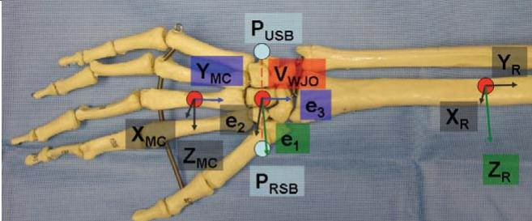

# AN EXTENSION TO THE ISB WRIST JOINT COORDINATE SYSTEM: AN IN VITRO ACCURACY STUDY

M. Lenhoff1, T.I. Carter1, B. Pansy1, A. Wolff1, R.Y. Cheng1, S.I. Backus1, J.J. Crisco2, H.J. Hillstrom1,3, S.W. Wolfe1 1Hospital for Special Surgery, New York, NY 10021; 2Brown University, Providence, RI 02912 3Corresponding Author; email: HillstromH@HSS.EDU

## INTRODUCTION

Investigators have used a variety of marker sets and methods to describe upper extremity kinematics. However, withou a standard set of anatomical and joint coordinate system definitions for 3-D motion analysis (3DMA), data sets cannot be compared between investigators. In an effort to summarize the descriptions of upper extremity motion, Wu and colleagues [1] published a set of joint coordinate system recommendations. This proposed kinematic solution is an extension from that standard. The purpose of this investigation is to develop an anatomically based wrist joint coordinate system (WJCS) and appropriate tracking frames. To test this new WJCS a comparison between the 3-D motion analysis (3DMA) implementation, manual goniometry (MG), and electro-goniometry (EG) was performed. We hypothesize that 3DMA would provide increased accuracy over the other methods.

## METHODS

The proposed WJCS is based upon the International Society of Biomechanics (ISB) [1] recommended standards. Tracking frames are formed by additional forearm and third metacarpal triads. To implement the WJCS, several physical markers (9mm passive retro-reflective), 3-D positions identified by a digital pointer, and virtual markers are required (Figure 1).

To establish the WJCS origin, the radial (P ) and ulnar snuffboxes $\left( \mathrm { P _ { U S B } } \right)$ are registered with the 3-D digital pointer. The virtual wrist joint origin (V ) is defined as the midpoint of the line segment connecting P with $\mathrm { P _ { U S B } . }$ Note that the WJCS origin passes through the capitate. This is a departure from ISB’s definitions where the origin of the WJCS is the midpoint between the radial and ulnar styloids (P and $\mathrm { P _ { U S } ) }$ Previous work by Neu et al. and Youm et al. have identified the capitate as the wrist structure through which the origin of motion resides [2,3]. The WJCS is defined as: $\mathrm { V _ { W J O } } { = } ~ ( \mathrm { P _ { R S B } } { - } \mathrm { P _ { U S B } } ) / 2$ where V is the Wrist Joint Coordinate System Origin; ${ \bf e } _ { 1 } = { \bf Z } _ { \bf R }$ where $\mathbf { Z _ { R } }$ is the medial-lateral axis of the radial coordinate system transfixed to $\mathrm { V } _ { \mathrm { W J O } ; } \mathbf { e } _ { 3 } = \mathbf { Y } _ { \mathbf { M C } }$ where $\mathbf { Y _ { M C } }$ is the longitudinal axis of the metacarpal coordinate system; and $\mathbf { e } _ { 2 } = \mathbf { e } _ { 1 } \mathrm { \mathrm { X } } \ \mathbf { e } _ { 3 }$ where $\scriptstyle { e _ { 2 } }$ is perpendicular to e and e .

Note: $\theta _ { \uparrow }$ is $\mathsf { Y } _ { \mathsf { M C } } ; \mathsf { e } _ { 3 }$ is $Z _ { \scriptscriptstyle { \mathrm { R } } }$ transfixed to $v _ { w s i o } ,$ $\mathtt { e } _ { 2 }$ is perpendicular to $\ominus _ { \gamma }$ and $\mathtt { e } _ { 3 }$

The kinematic solution technique is based upon the Grood and Suntay floating axis method [4] which is capable of a six degree of freedom representation ofjoint motion.

Ten cadaver wrists were prepared by inserting cannulated intramedullary rods for fluoroscopic determination (Hologic Insight mini C-arm) of actual wrist posture. Wrist position was assessed using an electro-goniometer (Biometrics Ltd. (Cwmfelinfach, Gwent, UK) dual axis device (model SG65) capable of simultaneously measuring flexion-extension and radioulnar deviation. 3-D kinematics was acquired for the WJCS using a Motion Analysis Corporation (Santa Rosa, CA) 3DMA system with 8 Eagle (1.3 MPixel) cameras capturing data at 200Hz. A one-degree resolution manual goniometer was used for all dorsal/volar goniometry measurements. The wrist was placed at approximately 10, 15, 30, and 45, degrees of flexion as well as maximum range of flexion. Values of rotation were recorded by dorsal/volar MG, EG, and 3DMA. The process was repeated for the other three primary wrist motions: extension, radial deviation, ulnar deviation, as well as neutral position. Root mean square error (RMSE) values were determined between fluoroscopy (gold standard) and values measured by each of the techniques.

## RESULTS AND DISCUSSION

As shown in the RMSE calculations of Table 1, the new WJCS, as implemented with video motion capture, was most accurate (3DMA: 4.4°; MG: 6.6°; EG: 7.2°.) EG became less accurate at maximum ranges of motion (RMSE 9.17°) while 3DMA did not exhibit this characteristic (RMSE 4.25°).

Figure 1: Wrist Joint Coordinate System. Dorsal Apsect—Right Wrist.  
Table 1: Accuracy referenced with fluoroscopy

<table><tr><td></td><td>MG</td><td>EG</td><td>3DMA</td></tr><tr><td>RMSE</td><td>6.6°</td><td>7.2°</td><td>4.4°</td></tr></table>

We have demonstrated the accuracy of dorsal/volar MG, EG, and an extension of the ISB WJCS, and have shown that 3DMA was more accurate than MG (p<0.0001 2-tailed paired t-test of mean squared error) and more accurate than EG (p<0.005), the conventional technique of measuring wrist positions during dynamic motion. Future studies targeting accuracy and reliability of the new WJCS in vivo are in progress.

## REFERENCES

1. Wu G, et al. J Biomech 38(5), 981-92, 2005.

2. Neu CP, et al. J Biomech 34(11), 1429-38, 2001.

3. Youm Y, et al. J Bone Joint Surg Am 60(4), 423-31, 1978.

4. Grood ES, et al. J Biomech Eng 105(2), 136-44, 1983.