www.elsevier.com/locate/jbiomech www.JBiomech

# ISB recommendation on definitions of joint coordinate systems of various joints for the reporting of human joint motion—Part II: shoulder, elbow, wrist and hand

Ge Wua,,1, Frans C.T. van der Helmb,2, H.E.J. (DirkJan) Veegerc,d,2, Mohsen Makhsouse,2, Peter Van Royf,2, Carolyn Angling,2, Jochem Nagelsh,2, Andrew R. Kardunai,2, Kevin McQuadej,2, Xuguang Wangk,2, Frederick W. Wernerl,3,4, Bryan Buchholzm,3

aDepartment of Physical Therapy, University of Vermont, 305 Rathwell Building, Burlington, VT, USA bDepartment of Mechanical Engineering, Delft University of Technology, Delft, The Netherlands cDepartment of Human Movement Sciences, Institute for Fundamental and Clinical Movement Sciences, Amsterdam, The Netherlands dDepartment of Mechanical Engineering, Delft University of Technology, Delft, The Netherlands eDepartment of Physical Therapy and Human Movement Sciences, Northwestern University, Chicago, IL, USA fExperimental Anatomy, Vrije Universiteit Brussel, Belgium gDepartment of Mechanical Engineering, University of British Columbia, Vancouver, Canada hDepartment of Orthopaedics, Leiden University Medical Center, The Netherlands iExercise and Movement Science, University of Oregon, Eugene, OR, USA jDepartment of Physical Therapy and Rehabilitation Science, University of Maryland, Baltimore, MD, USA kBiomechanics and Human Modeling Laboratory, National Institute for Transport and Safety Research, Bron, France lDepartment of Orthopedic Surgery, SUNY Upstate Medical University, Syracuse, NY, USA mDepartment of Work Environment, University of Massachusetts, Lowell, MA, USA

Accepted 27 May 2004

## Abstract

In this communication, the Standardization and Terminology Committee (STC) of the International Society of Biomechanics proposes a definition of a joint coordinate system (JCS) for the shoulder, elbow, wrist, and hand. For each joint, a standard for the local axis system in each articulating segment or bone is generated. These axes then standardize the JCS. The STC is publishing these recommendations so as to encourage their use, to stimulate feedback and discussion, and to facilitate further revisions. Adopting these standards will lead to better communication among researchers and clinicians. r 2004 Elsevier Ltd. All rights reserved.

Keywords: Joint coordinate system; Shoulder; Elbow; Wrist; Hand

## 1. Introduction

In the past several years, the Standardization and Terminology Committee (STC) of the International Society of Biomechanics has been working to propose a set of standards for defining joint coordinate systems (JCS) of various joints based on Grood and Suntay’s JCS of the knee joint (Grood and Suntay, 1983). The primary purpose of this work is to facilitate and encourage communication among researchers, clinicians, and all other interested parties.

The STC has established a total of nine subcommittees, involving nearly 30 people who have extensive experience (either research or clinical) in joint biomechanics, and had developed proposals for nine major joints in the body. These joints include: foot, ankle, hip, spine, shoulder, elbow, hand and wrist, TMJ, and whole body. The proposals are based on the ISB standard for reporting kinematic data published by Wu and Cavanagh (1995). The first set of these standards for the ankle joint, hip joint, and spine was published in Journal of Biomechanics in April 2002 (Wu et al., 2002). A response to comments to this set of standards was later published in 2003 (Allard et al., 2003).

In this publication, the proposed standards for the shoulder joint, elbow joint, and wrist and hand are included. For each joint, the standard is divided into the following sections: (1) Introduction, (2) Terminology, (3) Body segment coordinate systems, and (4) JCS and motion for the constituent joints. It is then up to the individual researcher to relate the marker or other (e.g. electromagnetic) coordinate systems to the defined anatomic system through digitization, calibration movements, or population-based anatomical relationships.

The two major values in using Grood and Suntay’s JCS are: (1) conceptual, since it appears easier to communicate the rotations to clinicians when using individual axes embedded in the proximal and distal segments and (2) the inclusion of calculations for clinically relevant joint translations. Some confusion, however, has arisen over their statement that the JCS is sequence independent, whereas Euler or Cardan angle representations are not. It should be noted that the Grood and Suntay’s convention, without the translations, is simply a linkage representation of a particular Cardan angle sequence; the floating axis is the second, i.e. rotated, axis in the Cardan sequence (Small et al., 1992; Li et al., 1993, Baker, 2003). The angles are independent because the sequence is defined by the mechanism; a Cardan or Euler sequence is equally ‘‘independent’’ once the sequence is defined.

## 2. JCS for the shoulder

Standardization ofjoint motions is very important for the enhancement of the study of motion biomechanics. The International Shoulder Group (ISG) supports the efforts of the ISB on this initiative, and recommends that authors use the same set of bony landmarks; use identical local coordinate systems (LCS); and report motions according to this recommended standard.

The starting point for the shoulder standardization proposal was a paper by Van der Helm (1996). More information can be obtained at: http://www.internationalshouldergroup.org.

## 2.1. Introduction

The standardization of motions is only described for right shoulder joints. Whenever left shoulders are measured, it is recommended to mirror the raw position data with respect to the sagittal plane ðz ¼ zÞ. Then, all definitions for right shoulders are applicable.

Rotations are described using Euler angles. For a clearer interpretation of these angles it is suggested that the coordinate systems of the proximal and distal body segments are initially aligned to each other by the introduction of ‘anatomical’ orientations of these coordinate systems. The rotations of the distal coordinate system should then be described with respect to the proximal coordinate system. If both coordinate systems are aligned, the first rotation will be around one of the common axes, the second rotation around the (rotated) axis of the moving coordinate systems, and the third rotation again around one of the rotated axes of the moving coordinate system. This last axis is preferably aligned with the longitudinal axis of the moving segment. This method is equivalent to the method of Grood and Suntay (1983) using floating axes. They also describe the first rotation around an axis of the proximal coordinate system and the last rotation around the longitudinal axis of the moving segment. The second axis is by definition perpendicular to both the first and third rotation axis.

For joint displacements, a common point in both the proximal and distal coordinate systems should be taken, preferably the initial rotation center (or a point on the fixed rotation axis in the case of a hinge joint). For most shoulder motions the rotation center would be only a rough estimate, since only the glenohumeral joint resembles a ball-and-socket joint. The definition of the common rotation centers of the sternoclavicular joint and acromioclavicular joint are left to the discretion of the researcher. Displacements should be described with respect to the axes of the coordinate system of the segment directly proximal to the moving segment to represent true joint displacements.

## 2.2. Terminology

2.2.1. Anatomical landmarks used in this proposal (Fig. 1)

Thorax: C7: Processus Spinosus (spinous process) of the 7th cervical vertebra

T8: Processus Spinosus (spinal process) of the 8th thoracic vertebra

IJ: Deepest point of Incisura Jugularis (suprasternal notch)

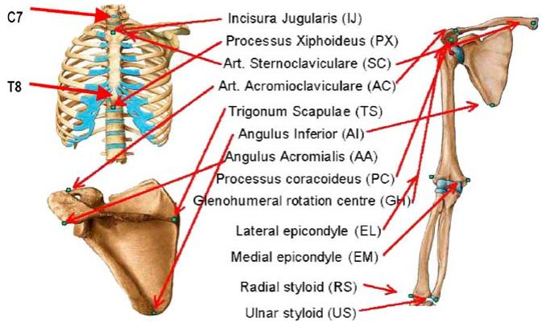  
Fig. 1. Bony landmarks and local coordinate systems of the thorax, clavicle, scapula, and humerus.

PX: Processus Xiphoideus (xiphoid process), most caudal point on the sternum

Clavicle: SC: Most ventral point on the sternoclavicular joint

AC: Most dorsal point on the acromioclavicular joint (shared with the scapula)

Scapula: TS: Trigonum Spinae Scapulae (root of the spine), the midpoint of the triangular surface on the medial border of the scapula in line with the scapular spine

AI: Angulus Inferior (inferior angle), most caudal point of the scapula

AA: Angulus Acromialis (acromial angle), most laterodorsal point of the scapula

PC: Most ventral point of processus coracoideus

Humerus: GH: Glenohumeral rotation center, estimated by regression or motion recordings

EL: Most caudal point on lateral epicondyle

EM: Most caudal point on medial epicondyle

Forearm: RS: Most caudal–lateral point on the radial styloid

US: Most caudal–medial point on the ulnar styloid

For the clavicle only two bony landmarks can be discerned: SC and AC. Hence, the axial rotation of the clavicle cannot be determined through non-invasive palpation measurements, but can be estimated on the basis of optimization techniques (Van der Helm and Pronk, 1995). In contrast to Van der Helm (1996), the use of the landmark AA is now proposed instead of the acromioclavicular joint (AC joint). This choice will reduce the occurrence of complications due to gimbal lock (Groot, 1998). The GH is strictly speaking not a bony landmark, but is needed to define the longitudinal axis of the humerus. The GH can be estimated by regression analysis (Meskers et al., 1998) or by calculating the pivot point of instantaneous helical axes (IHA) of GH motions (Stokdijk et al., 2000; Veeger et al., 1996). The IHA method is preferred since it is more accurate, and is also valid for patients in whom the GH has changed due to degeneration of the articular surfaces, or due to an implant. In some pathological cases it is likely that the GH cannot be accurately estimated with the IHA method due to translations in the joint. It is then, however, a question whether the regression method will be an acceptable alternative or whether different methods (such as CT or MRI) should be used.

## 2.3. Body segment coordinate systems

2.3.1. Thorax coordinate system— $X _ { \mathrm { { t } } } Y _ { \mathrm { { t } } } Z _ { \mathrm { { t } } }$ (see Figs. 1 and 2)

$O _ { \mathrm { t } } \mathrm { : }$ The origin coincident with IJ.

$Y _ { \mathrm { { t } } } \mathrm { { : } }$ The line connecting the midpoint between PX and T8 and the midpoint between IJ and C7, pointing upward.

$Z _ { \mathrm { t } } \mathrm { : }$ The line perpendicular to the plane formed by IJ, C7, and the midpoint between PX and T8, pointing to the right.

$X _ { \mathrm { t } } \mathrm { : }$ The common line perpendicular to the $Z _ { \mathrm { t } ^ { - } }$ and $Y _ { \mathrm { t ^ { - } a x i s , } }$ pointing forwards.

2.3.2. Clavicle coordinate system— $X _ { \mathrm { { c } } } Y _ { \mathrm { { c } } } Z _ { \mathrm { { c } } }$ (see Figs. 1 and 3)

$O _ { \mathrm { c } } \mathrm { : }$ The origin coincident with SC.

$Z _ { \mathrm { c } } \mathrm { : }$ The line connecting SC and AC, pointing to $\mathbf { A C } .$

$X _ { \mathrm { { c } } } \colon$ The line perpendicular to $Z _ { \mathrm { c } }$ and $Y _ { \mathrm { t } } ,$ , pointing forward. Note that the $X _ { \mathrm { { c } ^ { - } \mathrm { { a x i s } } } }$ is defined with respect to the vertical axis of the thorax $( Y _ { \mathrm { { t } ^ { - } } }$ axis) because only two bony landmarks can be discerned at the clavicle.

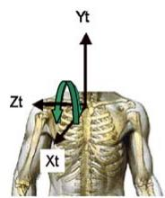  
Flexion/Extension

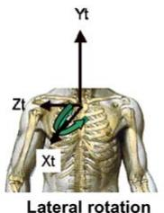

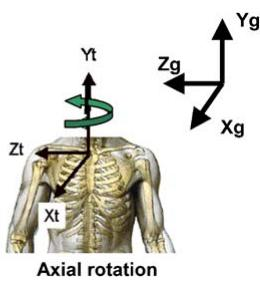  
Fig. 2. Thorax coordinate system and definition of motions.

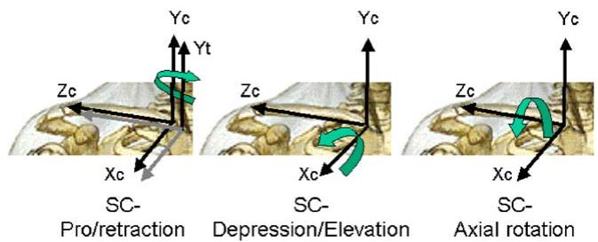  
Fig. 3. Clavicule coordinate system and definition of SC motions. $Y _ { \mathrm { t } }$ is the local axis for the thorax coordinate system, which is initially aligned with $Y _ { \mathrm { c } }$ of the clavicle.

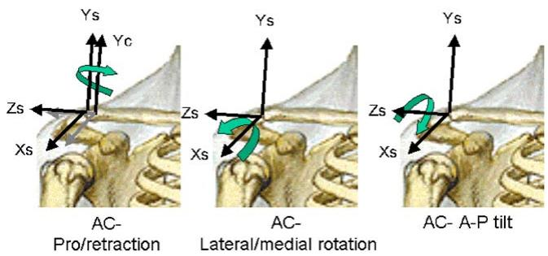  
Fig. 4. Scapula coordinate system and definition of AC motions. $Y _ { \mathrm { c } }$ is the local axis for the clavicle coordinate system (Please note, the origin, shown here at $\mathrm { { A C } , }$ should be placed at AA).

$Y _ { \mathrm { { c } } } \mathrm { { : } }$ The common line perpendicular to the $X _ { \mathrm { { c } ^ { - } } }$ and $Z _ { \mathrm { c } ^ { - } \mathrm { a x i s } . }$ , pointing upward.

2.3.3. Scapula coordinate system— $X _ { \mathrm { s } } Y _ { \mathrm { s } } Z _ { \mathrm { s } }$ (see Figs. 1 and 4)

$O _ { \mathrm { s } } \mathrm { . }$ The origin coincident with AA.

Zs: The line connecting TS and AA, pointing to AA.

$X _ { \mathrm { s } } \mathrm { : }$ The line perpendicular to the plane formed by AI, AA, and TS, pointing forward. Note that because of the use of AA instead of AC, this plane is not the same as the visual plane of the scapula bone.

$Y _ { \mathrm { s } } \mathrm { : }$ The common line perpendicular to the $X _ { \mathrm { { s } ^ { - } } }$ and $Z _ { \mathrm { s } } \mathrm { - a x i s . }$ , pointing upward.

2.3.4. Humerus (1st option) coordinate system— $X _ { \mathrm { h l } } Y _ { \mathrm { h l } } Z _ { \mathrm { h l } }$ (see 1 and 5; see also notes 1 and 2)

$O _ { \mathrm { h l } }$ : The origin coincident with GH.

$Y _ { \mathrm { h l } } \mathrm { : }$ The line connecting GH and the midpoint of EL and EM, pointing to GH.

$X _ { \mathrm { h l } } \colon$ The line perpendicular to the plane formed by EL, EM, and GH, pointing forward.

$Z _ { \mathrm { h l } } \mathrm { i }$ The common line perpendicular to the $Y _ { \mathrm { h l } } .$ - and $Z _ { \mathrm { h l } } \mathrm { - a x i s . }$ , pointing to the right.

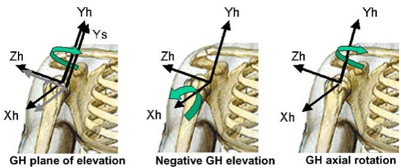  
Fig. 5. Humerus coordinate system and definition of GH motions. $Y _ { \textrm { s } }$ is the local axis for the scapula coordinate system.

2.3.5. Humerus (2nd option) coordinate system— $X _ { \mathrm { h } 2 } Y _ { \mathrm { h } 2 } Z _ { \mathrm { h } 2 }$

$O _ { \mathrm { h 2 } } \mathrm { : }$ The origin coincident with GH.

$Y _ { \mathrm { h } 2 } \mathrm { : }$ The line connecting GH and the midpoint of EL and EM, pointing to GH.

$Z _ { \mathrm { h } 2 } \colon$ The line perpendicular to the plane formed by $Y _ { \mathrm { h } 2 }$ and $Y _ { \mathrm { f } }$ (see Section 2.3.6), pointing to the right.

$X _ { \mathrm { h } 2 } { \mathrm { : } }$ The common line perpendicular to the $Z _ { \mathrm { h } 2 ^ { - } }$ and $Y _ { \mathrm { h 2 ^ { - } a X i s , } }$ pointing forward.

Note 1: The second definition of humerus coordinate system is motivated by the high error sensitivity of the direction connecting EL and EM due to the short distance between them. Since it cannot be assured that the $Z _ { \mathrm { h 2 } } \mathrm { - a x i s }$ is equal to the joint rotation axis, its orientation depends on the position of the upper arm and forearm as well as the forearm orientation (Wang, 1996). Therefore, by definition, the $Z _ { \mathrm { h 2 } } \mathrm { - a x i s }$ is taken with the elbow flexed 90 in the sagittal plane and the forearm fully pronated.

Note 2: We are faced with two difficulties in defining $Z _ { \mathrm { { h } } } \colon \mathit { \Omega } ( 1 )$ the anatomical definition of neutral humeral internal/external rotation is unclear; and (2) the numerical and practical inaccuracies in defining EL and EM may swamp the accuracy of our definition. The 1st and 2nd definitions will not agree if the true EM–EL line is rotated with respect to the forearm axis (in pronation). For the humerus, the difference will only affect the value for internal/external rotation; for the forearm it will affect all three angles to some degree, most significantly pro/supination. Our recommendation is to use option 2 when the forearm is available for recording and otherwise to use option 1.

2.3.6. Forearm coordinate system— $X _ { \mathrm { f } } Y _ { \mathrm { f } } Z _ { \mathrm { f } }$ (see Figs. 1 and 6)

$O _ { \mathrm { f } } \mathrm { : }$ The origin coincident with US.

$Y _ { \mathrm { f } } { : }$ The line connecting US and the midpoint between EL and EM, pointing proximally.

$X _ { \mathrm { f } } { \mathrm { : } }$ The line perpendicular to the plane through US, RS, and the midpoint between EL and EM, pointing forward.

$Z _ { \mathrm { f } } \mathrm { : }$ The common line perpendicular to the $X _ { \mathrm { f } }$ and $Y _ { \mathrm { { f } ^ { - } { a X i s } . } }$ , pointing to the right.

## 2.4. JCS and motion for the shoulder complex

In the shoulder, it can be useful to report two types of rotations. One is joint rotation, i.e., rotation of a segment with respect to the proximal segment including the clavicle relative to the thorax (SC joint), the scapula relative to the clavicle (AC joint), and the humerus relative to the scapula (GH joint). The other is segment rotation, i.e., rotation of the clavicle, scapula, or humerus relative to the thorax (the non-existent thoracohumeral joint, often loosely defined as the shoulder joint). The definition of joint displacements is only useful if it is defined with respect to the proximal segment.

Many rotation orders are possible (such as X–Y–Z in Cardan angles or $Y – Z – Y$ in Euler angles). We have chosen rotation orders so that the angles remain as close as possible to the clinical definitions of joint and segment motions. Differences are unavoidable since these clinical definitions are not consistent in 3-D. For example, although flexion and abduction each is clearly defined in 2-D, flexion followed by abduction gives a different result than abduction followed by flexion (see Anglin and Wyss, 2000, Section 8.1).

In the following definitions, a is around the Z-axis, $\beta$ around the X-axis, and g around the Y-axis, irrespective of the order of rotation.

2.4.1. JCS and motions of the thorax relative to the global coordinate system $( Z { - } X { - } Y$ order, $F i g . ~ 2$

Displacement $( q ) \colon$ corresponds to motions of IJ with respect to the global coordinate system $( X _ { \mathrm { g } } { - } Y _ { \mathrm { g } } { - } Z _ { \mathrm { g } }$ defined by Wu and Cavanagh (1995)).

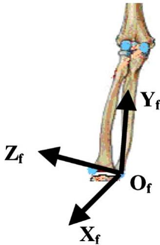  
Fig. 6. Definition of forearm coordinate system.

e1: The axis coincident with the $Z _ { \mathrm { g } } .$ -axis of the global coordinate system.

Rotation $( \alpha _ { G T } ) \colon$ flexion (negative) or extension (positive).

$e 3 { \ : } :$ The axis fixed to the thorax and coincident with the $Y _ { \mathrm { t ^ { - } a x i s } }$ of the thorax coordinate system.

Rotation $( \gamma _ { G T } ) \colon$ axial rotation to the left (positive) or to the right (negative).

$e 2 \colon$ The common axis perpendicular to e1 and $e 3 ,$ i.e., the rotated $X _ { \mathrm { t ^ { - } a x i s } }$ of the thorax.

Rotation $( \beta _ { G T } ) \colon$ lateral flexion rotation of the thorax, to the right is positive, to the left is negative.

2.4.2. JCS and motion for the SC joint (clavicle relative to the thorax, Y–X–Z order, Fig. 3

Displacement $( q ) \colon$ corresponds to translations of the common rotation center of the SC joint with respect to the thorax coordinate system.

e1: The axis fixed to the thorax and coincident with the $Y _ { \mathrm { t ^ { - } a x i s } }$ of the thorax coordinate system. Rotation $( \gamma _ { \mathrm { S C } } ) { : }$ retraction (negative) or protraction (positive).

$e 3 { \ : } :$ The axis fixed to the clavicle and coincident with the $Z _ { \mathrm { c } ^ { - } \mathrm { a x i s } }$ of the clavicle coordinate system.

Rotation $( \alpha _ { \mathrm { S C } } ) \colon$ axial rotation of the clavicle; rotation of the top backwards is positive, forwards is negative.

$e 2 \colon$ The common axis perpendicular to e1 and $\mathrm { e } 3 ,$ the rotated $X _ { \mathrm { { c } ^ { - } \mathrm { { a x i s } } } }$ Rotation $( \beta _ { \mathrm { S C } } ) { : }$ : elevation (negative) or depression (positive).

2.4.3. JCS and motion for the AC joint (scapula relative to the clavicle, Y–X–Z order, Fig. 4

Displacement $( q ) \colon$ corresponds to translations of the common rotation center of the AC joint with respect to the clavicle coordinate system.

Note: The following sequence is supported by Karduna et al. (2000), who studied the six possible Euler sequences for scapular motion. They found that the proposed sequence is ‘‘consistent with both researchand clinical-based 2-D representations of scapular motion’’. They also found that changing the sequence resulted in ‘‘significant alterations in the description of motion, with differences up to $5 0 ^ { \circ }$ noted for some angles’’. Since the scapular coordinate system is initially aligned with the clavicular coordinate system even though this position is never assumed anatomically, typical angle values are offset from zero (either positive or negative).

e1: The axis fixed to the clavicle and coincident with the $Y _ { \mathrm { { c } } } .$ -axis of the clavicle coordinate system.

Rotation $( \gamma _ { \mathrm { A C } } ) { \mathrm { : } }$ AC retraction (negative) or AC protraction (negative); the scapula is usually retracted.

e3: The axis fixed to the scapula and coincident with the Z -axis of the scapular coordinate system (scapular spine).

Rotation $( \alpha _ { \mathrm { A C } } ) { \mathrm { : } }$ : AC-anterior (negative) or $\mathrm { A C } \cdot$ posterior (Positive) tilt; the scapula is usually tilted posteriorly.

$e 2 \colon$ The common axis perpendicular to e1 and $e 3 .$ the rotated $X _ { \mathrm { s } ^ { - } \mathrm { a x i s } }$ of the scapula coordinate system.

Rotation $( \beta _ { A C } ) { \mathrm { : } }$ AC-lateral (negative) or $\mathrm { A C } \cdot$ medial (positive) rotation; the scapula is usually laterally rotated.

2.4.4. JCS and motionfor the GHjoint (humerus relative to the scapula, Y–X–Y order, $F i g . ~ 5 )$

Note: This is the one joint that is based on an Euler rotation sequence. Since e1 and $^ { e 3 }$ start in the same direction, the standard Grood and Suntay (floating-axis) equations cannot be used. Instead, an Euler decomposition is used to find the corresponding angles. As stated before, we have avoided the clinical terms flexion and abduction because flexion followed by abduction would give radically different results than abduction followed by flexion. Furthermore, these terms are only defined relative to the thorax, not the scapula (see Section 2.4.7). For comparison, flexion is elevation parallel to the sagittal plane and abduction is elevation in the coronal (frontal) plane.

Displacement $( q ) \colon$ : Corresponds to translations of the common rotation center of the GH joint with respect to the scapular coordinate system. In particular, we define $q x = \mathrm { a n t e r i o r / p o s t e r i o r }$ translation; $q y = \mathrm { i n f e r i o r } /$ superior translation; and $q z = \mathrm { j o i n t }$ distraction.

e1: The axis fixed to the scapula and coincident with the $Y _ { \mathrm { s } ^ { - } \mathrm { a x i s } }$ of the scapular coordinate system.

Rotation $( \gamma _ { \mathrm { G H 1 } } )$ : GH plane of elevation.

$e 3 \colon$ Axial rotation around the $Y _ { \mathrm { h ^ { - } d X i s } }$

Rotation $( \gamma _ { \mathrm { G H 2 } } ) \colon$ GH-axial rotation, endo- or internal-rotation (positive) and exo- or external-rotation (negative).

$e 2 \colon$ The axis fixed to the humerus and coincident with the $X _ { \mathrm { h ^ { - } a x i s } }$ of the humerus coordinate system.

Rotation $( \beta _ { \mathrm { G H } } ) \mathrm { : }$ GH elevation (negative5).

2.4.5. JCS and motion for the clavicle relative to the thorax

For the motions of the clavicle no distinction between segment and joint rotations needs to be made, since the proximal coordinate system of the clavicle is the thorax. Definitions are equal to the definitions in Section 2.4.2: $\alpha _ { \mathrm { c } } = \alpha _ { \mathrm { S C } } ; \beta _ { \mathrm { c } } = \beta _ { \mathrm { S C } } ;$ and $\gamma _ { \mathrm { c } } ~ = ~ \gamma _ { \mathrm { S C } }$

2.4.6. JCS and motion for the scapula relative to the thorax (Y–X–Z order)

e1: The axis fixed to the thorax and coincident with the $Y _ { \mathrm { t ^ { - } a X i s } }$ of the thorax coordinate system. Rotation $( \gamma _ { \mathrm { s } } ) \colon$ retraction (negative) or protraction (positive).

$e 3 { \ : } :$ The axis fixed to the scapula and coincident with the $Z _ { \mathrm { s } } \mathrm { - a x i s }$ of the scapular coordinate system.

Rotation $( x _ { \mathrm { s } } ) \colon$ anterior (negative) or posterior (positive) tilt.

$e 2 \colon$ The common axis perpendicular to e1 and $e 3 .$ Rotation $( \beta _ { \mathrm { s } } ) \mathrm { : }$ lateral (negative) or medial (positive) rotation.

2.4.7. JCS and motion for the humerus relative to the thorax (Y–X–Y order) $( F i g . ~ 7 )$

e1: The axis fixed to the thorax and coincident with the $Y _ { \mathrm { { t } } }$ -axis of the thorax coordinate system. Rotation $( \gamma _ { \mathrm { h } } ) \mathrm { : }$ Plane of elevation, $0 ^ { \circ }$ is abduction, $9 0 ^ { \circ }$ is forward flexion.

e3: Axial rotation around the $Y _ { \mathrm { h ^ { - } a X i s . } }$ Rotation $( \gamma _ { \mathrm { h } } ) _ { 2 } \mathrm { : }$ : axial rotation, endo- or internalrotation (positive) and exo- or external-rotation (negative).

e2: The axis fixed to the humerus and coincident with the $X _ { \mathrm { h } }$ -axis of the humerus coordinate system.

Rotation $( \beta _ { \mathrm { h } } ) \mathrm { : }$ elevation (negative).

## 3. JCS for the elbow

## 3.1. Introduction

To make a kinematic description of the elbow joint useful and practical, we use the following anatomical approximations (see Fig. 1):

1. The GH joint is a ball joint.

2. The humeroulnar joint is a hinge joint.

3. The radioulnar joint (contacting proximally and distally) is a hinge joint. The center of the capitulum on the humerus and the axes of the two radioulnar joints (proximal and distal) are on the joint axis.

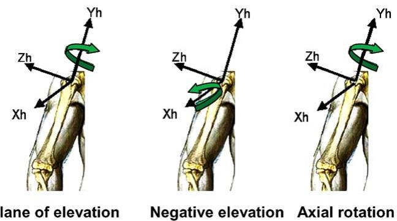  
Fig. 7. Definition of thoracohumeral rotations.

A special problem is posed to the definitions of the segment coordinate systems of the ulna and radius, in that there are only a few palpable bony landmarks. Therefore, bony landmarks of other bones are needed for definitions, which result in position-dependent definitions of the segment coordinate systems.

## 3.2. Terminology

See Fig. 1(1) and Section 2.2.

## 3.3. Body segment coordinate systems

3.3.1. Humerus coordinate system— $- X _ { \mathrm { h l } } Y _ { \mathrm { h l } } Z _ { \mathrm { h l } }$ (1st option) or $X _ { \mathrm { h } 2 } Y _ { \mathrm { h } 2 } Z _ { \mathrm { h } 2 }$ (2nd option)

See Sections 2.3.4 and 2.3.5 for a description of the two options for humerus coordinate systems. Since the forearm is obviously needed when studying the elbow, we recommend using the second definition.

## 3.3.2. Forearm coordinate system— $X _ { \mathrm { f } } Y _ { \mathrm { f } } Z _ { \mathrm { f } }$

See Section 2.3.6.

3.3.3. Ulnar coordinate system— $X _ { \mathrm { u } } Y _ { \mathrm { u } } Z _ { \mathrm { u } }$ (defined at elbow flexed 90 in the sagittal plane)

$O _ { \mathrm { u } } \mathrm { : }$ The origin is at US.

$Y _ { \mathrm { u } } \mathrm { : }$ The line pointing proximally from US to the midpoint between EM and EL.

$X _ { \mathrm { u } } \colon$ The line perpendicular to the plane formed by US, EM, and EL, pointing forward.

$Z _ { \mathrm { u } } \mathrm { : }$ The common line perpendicular to the $X _ { \mathrm { u ^ { - } } }$ and $Y _ { \mathrm { u ^ { - } a x i s } }$ , pointing to the right.

3.3.4. Radius coordinate system— $X _ { \mathrm { { r } } } Y _ { \mathrm { { r } } } Z _ { \mathrm { { r } } }$ (defined with forearm in the neutral position and elbow flexed $9 0 ^ { \circ }$ in the sagittal plane)

$O _ { \mathrm { r } } \mathrm { . }$ The origin is at RS.

$Y _ { \mathrm { r } } \mathrm { : }$ The line pointing proximally from RS towards EL.

$X _ { \mathrm { r } } \mathrm { : }$ The line perpendicular to the plane formed by RS, US, and EL, pointing forward.

$Z _ { \mathrm { r } } \mathrm { : }$ The common line perpendicular to the $X _ { \mathrm { r } ^ { - } }$ and $Y _ { \mathrm { r } ^ { - } \mathrm { a x i s } . }$ , pointing to the right.

## 3.4. JCS and motion for the elbow joints

Realistically, the elbow joint and radioulnar joint do not coincide with the axes of the segment coordinate systems. However, in situations where simplifications are allowed, the axis of rotation for each of these joints can be assumed to coincide with the local axes of the humerus $( Z _ { \mathrm { h l } }$ or $Z _ { \mathrm { h } 2 } )$ or ulna $( Y _ { \mathrm { u } } )$ . For a detailed study of the joint kinematics, the orientation of the hinge axis with respect to the proximal coordinate system should be determined; approximations of these are available from the literature. Only joint rotations with respect to the proximal segment coordinate system are defined here, as segment rotations with respect to the thorax would be meaningless.

## 3.4.1. JCS and motion for the elbow joint (forearm relative to the humerus, Z–X–Y order)

e1: The axis fixed to the proximal segment and coincident with the $Z _ { \mathrm { h ^ { - } a x i s } }$ of the humerus coordinate system (preferably an approximation of the elbow flexion/extension axis).

Rotation (aHF): flexion (positive) and hyperextension (negative).

e3: The axis fixed to the distal segment and coincident with the $Y _ { \mathrm { { f } ^ { - } { a X i s } } }$ of the forearm coordinate system.

Rotation $( \gamma _ { \mathrm { H F } } ) { \colon }$ axial rotation of the forearm, pronation (positive) and supination (negative).

e2: The floating axis, the common axis perpendicular to e1 and $e 3 .$ , the rotated $X _ { \mathrm { f } }$ -axis of the forearm coordinate system.

Rotation $( \beta _ { \mathrm { H F } } ) \colon$ carrying angle, the angle between the longitudinal axis of the forearm and the plane perpendicular to the flexion/ extension axis. The carrying angle occurs due to both a tilt in the humeral (flexion/extension) axis at the humeroulnar joint and an angulation of the ulna itself (see Anglin and Wyss, 2000, Section 5.6). It is therefore a passive response to elbow flexion/extension. Since the carrying angle is passive, it is rarely reported.

3.4.2. JCS and motion of the humeroulnar joint (ulna relative to the humerus, Z–X–Y order)

e1: The axis fixed to the proximal segment and coincident with the $Z _ { \mathrm { h ^ { - } a x i s } }$ of the humerus coordinate system (preferably an approximation of the flexion/extension axis).

Rotation $( \alpha _ { \mathrm { H U } } )$ : flexion (positive). Hyperextension is defined negative.

e3: The axis fixed to the distal segment and coincident with the $Y _ { \mathrm { u ^ { - } a x i s } }$ of the ulnar coordinate system.

Rotation $( \gamma _ { \mathrm { H U } } ) { : }$ : axial rotation of the ulna (negligible).

$e 2 \colon$ The common axis perpendicular to e1 and $e 3 .$ the rotated $X _ { \mathrm { u } ^ { - } \mathrm { a x i s } }$ of the ulnar coordinate system.

Rotation $( \beta _ { \mathrm { H U } } ) { : }$ carrying angle, the angle between the longitudinal axis of the ulna and the plane perpendicular to the flexion/extension axis (see 3.4.1).

3.4.3. JCS and motion for the radioulnar joint (radius relative to the ulna, X–Z–Y order)

e1: The axis fixed to the proximal segment and coincident with the $X _ { \mathrm { u } ^ { - } \mathrm { a x i s } }$ of the ulnar coordinate system (describing the orientation of the pro/supination axis with respect to the ulna). It is implicitly assumed that the pro/ supination axis intersects the elbow flexion/ extension axis, although in reality this is not the case.

Rotation $( \beta _ { \mathrm { U R } } ) .$ : orientation of the pro/supination axis relative to the ulna (constant).

e3: The axis fixed to the distal segment and coincident with the $Y _ { \mathrm { r } }$ -axis of the radius coordinate system.

Rotation $( \gamma _ { \mathrm { U R } } ) { \tt : \quad }$ pro/supination of the radius with respect to the ulna.

$e 2 \colon$ The common axis perpendicular to e1 and $^ { e 3 , }$ the rotated $Z _ { \mathrm { r ^ { - } a x i s } }$ of the radius coordinate system.

Rotation $( \alpha _ { \mathrm { U R } } ) \mathrm { : }$ : abduction/adduction of the radius (negligible).

## 4. JCS for the hand and wrist

## 4.1. Introduction

Separate coordinate systems have been developed for each bone that is distal to the elbow, so that relative motion between any two adjacent segments may be described. These systems are then also applicable to global wrist motion as well as to motion of the individual components that cause the global motion. Global wrist motion is typically considered as the motion of the second and/or third metacarpal with respect to the radius (here, we use the third metacarpal) and is achieved by movement of the carpal bones with respect to the radius as well as the numerous articulations of the eight carpal bones with respect to each other. Some researchers, who only examine global wrist motion and have no need to examine carpal motion, can still use the definitions given for the radius and the metacarpal bones to describe wrist motion.

The ISB committee proposal (Wu and Cavanagh, 1995) recommends that orthogonal triads be fixed at the segmental center of mass. In the hand and wrist, the center of mass is simply not known for most of the segments or bones. Data from cadaver studies do exist that describe the center of mass location for the forearm and hand as a proportion of the entire length of each of these segments. These center of mass definitions may be suitable for global wrist motions, but cannot be used to describe the kinematics of the component parts. The phalanges cannot be ignored as many researchers are examining individual movement of the carpal bones or movement of the radius with respect to the ulna. Therefore for this joint coordinate system application, the location of the orthogonal triad on each bone is primarily based on bony landmarks and is usually located at the axial center for the long bones or the volumetric centroid for the carpal bones. (CT scans might be used to define the volumetric centroid; however, this method may not be available or necessary for all applications.)

## 4.2. Terminology

## 4.2.1. Anatomical landmarks used (see Figs. 8–10)

Radius: Radioscaphoid fossa—articulation of the scaphoid with the radius Radiolunate fossa—articulation of the lunate with the radius Radial Styloid Sigmoid Notch—depression in the distal radius where the ulna articulates with it Radial Head (proximal) Ulna: Dome of Ulnar Head (distal) Coronoid Process Carpal Bones: Scaphoid Lunate Triquetrum Pisiform Trapezium Trapezoid Capitate Hamate

Phalanges: Distal Head Center of Base

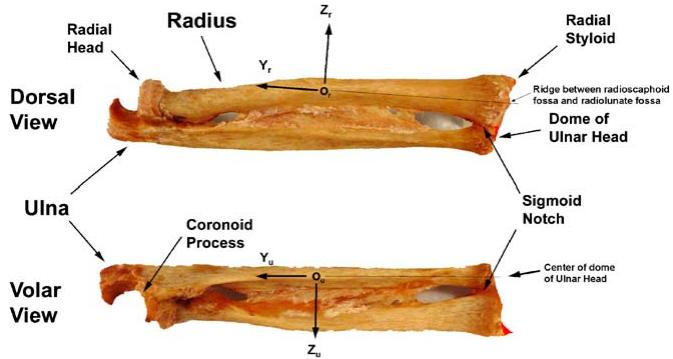  
Fig. 8. View of a right forearm in neutral forearm rotation illustrating radial and ulnar coordinate systems. X-axis is pointing volarly. (For a left arm, X-axis is dorsal, Y-axis is distal, Z-axis is to the right (ulnarly) in the anatomical position, so that flexion, pronation, and ulnar deviation are all positive for left and right arms.)

## 4.2.2. Standard wrist positions

Neutral wrist position:

Position of the wrist relative to the radius is defined as in neutral flexion/ extension and neutral radial/ulnar deviation when the third metacarpal long axis is parallel to the Y axis in the radius.

Neutral Position of the radius relative to the forearm ulna when the elbow is flexed $9 0 ^ { \circ }$ and rotation: the thumb is pointing to the shoulder.

## 4.3. Body segment coordinate systems

For each bone, a coordinate system is given, assuming that the forearm is initially in the standard anatomical position, with the palm forward (anterior), and the thumb lateral. The dorsum of the hand and forearm face posteriorly. In general for a right arm, the positive $Y _ { i }$ axis is directed proximally, the positive $X _ { i }$ axis is directed volarly, and the positive $Z _ { i }$ axis is directed to the right in the anatomical position (radially) (Figs. 8–10). In order to have the same sign convention for clinical motion of left and right arms, for a left arm, $Y _ { i }$ is directed distally, $X _ { i }$ is directed dorsally, and $Z _ { i }$ is directed to the right in the anatomical position (ulnarly).

The following radius and ulna coordinate systems differ from those given in the elbow section above. Here, we are primarily concerned with studies that are based on all available bony landmarks. If a more general motion is of interest, similar to the artificial humerothoracic joint, one can use the forearm and 3rd metacarpal axes to create a simplified wrist joint.

$$
Y _ {\mathrm{r}}:
$$

## 4.3.1. Radius coordinate system— $X _ { \mathrm { r } } Y _ { \mathrm { r } } Z _ { \mathrm { r } }$

$O _ { \mathrm { r } } \mathrm { . }$ The origin is located midway between the distal radius at the level of the ridge between the

$$
Z _ {\mathrm{r}}:
$$

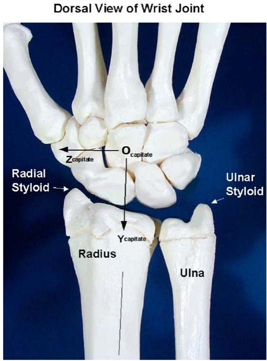  
Fig. 9. Dorsal view of a right wrist joint illustrating the capitate coordinate system as an example of the carpal coordinate systems. Xaxis is pointing volarly. (For a left arm X-axis is dorsal, Y-axis is distal, Z-axis is to the right (ulnarly) in the anatomical position.)

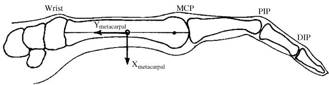  
Fig. 10. Sagittal view of a right finger illustrating the metacarpal coordinate system as an example of phalangeal and metacarpal coordinate systems. X-axis is directed volarly and Y-axis is directed proximally. (For a left arm X-axis is dorsal, Y-axis is distal, and Z-axis is to the right in the anatomical position.)

radioscaphoid fossa and the radiolunate fossa, and the proximal radius at the level of the depression in the proximal radial head. If the distance to the ridge between the radioscaphoid and radiolunate fossas varies, then the location halfway between the dorsal and volar extremes of the ridge will be used to define the distal landmark on the radius. In the transverse plane it will be at the approximate center $\mathrm { o f }$ the tubular bone (along its principal axis of inertia). The line parallel to the long shaft of the radius from $O _ { \mathrm { r } }$ to intersect with the ridge of bone between the radioscaphoid fossa and the radiolunate fossa (midway dorsally and volarly along the ridge).

The line perpendicular to the $Y _ { \mathrm { r } }$ axis, and in a plane defined by the tip of the radial styloid, the base of the concavity of the sigmoid notch and the specified origin.

$X _ { \mathrm { r } } \mathrm { : }$ The common line perpendicular to the $Y _ { \mathrm { { r } ^ { - } } }$ and $Z _ { \mathrm { r ^ { - } a X i s . } }$

## 4.3.2. Ulna coordinate system— $X _ { \mathrm { u } } Y _ { \mathrm { u } } Z _ { \mathrm { u } }$

$O _ { \mathrm { u } } \mathrm { . }$ The origin is located midway between the distal ulna at the level of the dome of the ulnar head, and the proximal ulna at the level of the coronoid process. In the transverse plane it is at the approximate center of the tubular bone (along its principal axis of inertia).

$Y _ { \mathrm { u } } \mathrm { : }$ The line parallel to the long shaft of the ulna from $O _ { \mathrm { u } }$ to intersect with the center of the dome of the ulnar head.

$X _ { \mathrm { u } } \mathrm { : }$ The line parallel to $X _ { \mathrm { r } }$ when the radius is in neutral forearm rotation.

$Z _ { \mathrm { u } } \mathrm { : }$ The common line perpendicular to the $X _ { \mathrm { u } ^ { - } }$ and $Y _ { \mathrm { u ^ { - } d X i s } }$

## 4.3.3. Carpal bones coordinate system— $X _ { \mathrm { { c } } } Y _ { \mathrm { { c } } } Z _ { \mathrm { { c } } }$

The eight carpal bones, scaphoid, lunate, triquetrum, pisiform, trapezium, trapezoid, capitate, and hamate, will be considered simultaneously. Most researchers only report angular changes in carpal bone motion and use the neutral wrist position as a neutral reference position. The neutral wrist position is when the wrist is in neutral flexion/extension and neutral radial/ulnar deviation such that the third metacarpal long axis is parallel with the $Y _ { \mathrm { r } }$ axis in the radius. These researchers define the motion relative to the radius and typically not the ulna. Therefore, the orientation of the coordinate systems for each carpal bone (Fig. 2) should be parallel with the radial coordinate system when the wrist is in the neutral wrist position. Thus, $Y _ { \mathrm { c a r p a l ~ b o n e } }$ will be parallel to $Y _ { \mathrm { r } }$ and similarly for $X _ { \mathrm { c a r p a l ~ b o n e } }$ and $Z _ { \mathrm { c a r p a l ~ b o n e } } .$ At present, most researchers who need to define a coordinate system origin in a carpal bone use the volumetric centroid of the bone. Therefore it is proposed that, when necessary, the origin of a coordinate system in a carpal bone be located at the volumetric centroid of the bone.

A separate coordinate system is required for the trapezium in order to describe motion at the trapeziometacarpal joint of the thumb. The coordinate system defined by Cooney et al. (1981) will be adapted for this purpose: ‘‘The Y axis extends from the exact mid-point of the central ridge of the trapezial saddle to the center of the junction of the trapezium, scaphoid and trapezoid. The X axis runs in a dorsal-to-volar direction along a line perpendicular to the central ridge of the trapezium and passes through the mid-point of the dorsal surface to the proximal volar pole of the tubercle of the trapezium. The Z axis is perpendicular to the X and Y axes and nearly parallel to the central ridge of the trapezial metacarpal surface’’.

## 4.3.4. Metacarpals coordinate system— $- X _ { \mathrm { m } } Y _ { \mathrm { m } } Z _ { \mathrm { m } }$

The five coordinate systems for the five metacarpals are described in the same manner. The major differences in the metacarpals are in the shape of their bases where ‘‘contact’’ with the carpals is made and their relative movement capabilities. In this regard, the first metacarpal has a very large range of motion. The third metacarpal has special significance because of its use in the definition of global wrist motion. Most researchers consider either the second or third metacarpal as representative of hand motion.

$O _ { \mathrm { m } } \mathrm { : }$ The origin for each of these coordinate systems is located midway between the base and head of each metacarpal. In the transverse plane, it will be at the approximate center of the tubular bone (at its moment of inertia).

$Y _ { \mathrm { m } } { \mathrm { : } }$ The line parallel to a line from the center of the distal head of the metacarpal to the midpoint of the base of the metacarpal.

$X _ { \mathrm { { m } } } \colon$ The $X _ { \mathrm { m } }$ and $Y _ { \mathrm { m } }$ -axis will form a sagittal plane that splits the metacarpal into mirror images.

$Z _ { \mathrm { m } } \mathrm { : }$ The common line perpendicular to the $X _ { \mathrm { m } ^ { + } }$ - and $Y _ { \mathrm { m } ^ { - } \mathrm { a x i s } . }$

## 4.3.5. Phalanges coordinate system— $- X _ { \mathfrak { p } } Y _ { \mathfrak { p } } Z _ { \mathfrak { p } }$

The 14 coordinate systems for the phalanges of the five digits can be described in a manner that is analogous to the description used for the metacarpal systems. The proximal and middle phalanges for the five digits are similar in shape as are the five distal phalanges.

## 4.4. JCS and motion for the hand and wrist

4.4.1. JCS and motion for the interphalangeal, metacarpophalangeal, intercarpal, radiocarpal, and carpometacarpal joints

e1: The axis fixed to the proximal segment and coincident with the Z-axis of the proximal segment coordinate system.

Rotation (a): flexion or extension (flexion is positive).

Displacement ðq1Þ: radial or ulnar translation.

e3: The axis fixed to the distal segment and coincident with the Y-axis of the distal segment coordinate system.

Rotation (g): rotation (pronation–supination). Zero degrees of rotation is defined to be at the neutral forearm position. Pronation is a positive rotation. Supination is a negative rotation.

Displacement $( q 3 ) { \mathrm { : } }$ : proximal or distal translation.

e2: The common axis perpendicular to e1 and e3. Rotation (b): adduction or abduction, or radial or ulnar deviation (ulnar deviation is positive). Displacement ðq2Þ: dorsal or volar translation.

For the interphalangeal, first metacarpophalangeal, intercarpal, and radiocarpal joints, a neutral posture is defined as the position where the orientations of the proximal and distal segmental systems are aligned. For the second through fifth metacarpophalangeal joints, a neutral posture is defined as the position where the orientation of the distal segmental system is identical to that of the third metacarpal. The third carpometacarpal joint will be neutral when the third metacarpal system is aligned with the wrist system. For the first carpometacarpal (trapeziometacarpal) joint, a neutral posture will be defined as the position where the orientations of the proximal segmental system (as defined by Cooney et al., 1981) and distal segmental system are identical. The neutral posture for the second, fourth, and fifth carpometacarpal joints can be defined in an analogous manner.

## 4.4.2. JCS and motion for the radioulnar joint

For the radioulnar joint, the Y-axis of the radius and ulna may not be parallel at the neutral posture. They may only diverge by a few degrees depending upon the subject. The neutral position for the radius and ulna is clinically called neutral forearm rotation. With the elbow flexed to 90, this position can be visualized as when the thumb is pointing to the shoulder. In the standard anatomical position, the radius is supinated about the ulna.

For the radioulnar joint, we propose an intermediate coordinate system whose origin is identical with the radius coordinate system origin. The orientation of this intermediate coordinate system will be aligned with the ulnar coordinate system when the forearm is in neutral forearm rotation. The motion of the radius with respect to the ulna will then be described using the flexion/ extension, radioulnar deviation, and pronation/supination definitions given above but using the intermediate coordinate system of the radius and the ulnar coordinate system. The user of this standard should define the orientation of the intermediate coordinate system relative to the anatomically based radial coordinate system.

e1: The axis fixed to the ulna and coincident with the Y-axis of the intermediate radial coordinate system.

Rotation ðaÞ: supination or pronation (pronation is positive).

Displacement ðq1Þ: proximal or distal transla-tion.

e3: The axis fixed to the intermediate radial coordinate system and coincident with the Zaxis of the intermediate radial coordinate system.

Rotation ðgÞ: flexion–extension (flexion is positive).

Displacement ðq3Þ: radial or ulnar translation.

e2: The common axis perpendicular to e1 and e3: Rotation ðbÞ: radial–ulnar deviation (ulnar deviation is positive).

Displacement ðq2Þ: dorsal or volar translation.

## Acknowledgements

We thank Ed Chadwick, Brendan McCormack, A.C. Nicol, Bo Peterson, and Victor Waide for their past involvement in the development of the elbow joint standard.

## References

Allard, P., Cristofolini, L., D’Lima, D., Kirtley, C., Leardini, A., Rosenbaum, D., Schmid, O., Siegler, S., Stokes, I., Whittle, M., Witte, H., Wu, G., 2003. Response to Dr. Baker’s letter to the editor. Journal of Biomechanics 36 (2), 303–304.

Anglin, C., Wyss, U.P., 2000. Review of arm motion analyses. Proceedings of the Institute of Mechanical Engineers 214 (Part H), 541–555.

Baker, R., 2003. Letter to the editor regarding ISB recommendation on definition of joint coordinate systems for the reporting of human joint motion—part I: ankle, hip and spine. Journal of Biomechanics 36 (2), 300–302.

Cooney, W.P., Lucca, M.J., Chao, E.Y.S., Linscheid, R.L., 1981. The kinesiology of the thumb trapeziometacarpal joint. Journal of Bone and Joint Surgery 63A (9), 1371–1381.

de Groot, J.H., Valstar, E.R., Arwert, H.J., 1998. Velocity effects on the scapulo-humeral rhythm. Clin Biomech 13, 593–602.

Grood, E.S., Suntay, W.J., 1983. A joint coordinate system for the clinical description of three-dimensional motions: Application to the knee. Journal of Biomechanical Engineering 105, 136–144.

Karduna, A.R., McClure, P.W., Michener, L.A., 2000. Scapular kinematics: effects of altering the Euler angle sequence of rotations. Journal of Biomechanics 33, 1063–1068.

Li, J., Wyss, U.P., Costigan, P.A., Deluzio, K.J., 1993. An integrated procedure to assess knee-joint kinematics and kinetics during gait using an optoelectronic system and standardized X-rays. Journal of Biomedical Engineering 15, 392–400.

Meskers, C.G.M., Fraterman, H., Van der Helm, F.C.T., Vermeulen, H.M., Rozing, P.M., 1998. In vivo estimation of the glenohumeral joint rotation center from scapular bony landmarks by linear regression. Journal of Biomechanics 31, 93–96.

Small, C.F., Bryant, J.T., Pichora, D.R., 1992. Rationalization of kinematic descriptors for three-dimensional hand and finger motion. Journal of Biomedical Engineering 14 (2), 133–141.

Stokdijk, M., Nagels, J., Rozing, P.M., 2000. The glenohumeral joint rotation centre in vivo. Journal of Biomechanics 33 (12), 1629–1636.

Van der Helm, F.C.T., 1996. A standardized protocol for motions recordings of the shoulder. In: Veeger, H.E.J., VanderHelm, F.C.T.,, Rozing, P.M. (Eds.), Proceedings of the First Conference

of the International Shoulder Group. Shaker Publishing, Maastricht, pp. 1–7.

Van der Helm, F.C.T., Pronk, G.M., 1995. Three-dimensional recording and description of motions of the shoulder mechanism. Journal of Biomechanical Engineering 117, 27–40.

Veeger, H.E.J., Yu, B., An, K.N., 1996. Orientation of axes in the elbow and forearm for biomechanical modeling. In: Veeger, H.E.J., VanderHelm, F.C.T., Rozing, P.M. (Eds.), Proceedings of the First Conference of the International Shoulder Group. Shaker Publishing, Maastricht, pp. 83–87.

Wang, X., 1996. Construction of arm kinematic linkage from external surface markers. In: Proceeding of the Fourth International

Symposium on 3D Analysis of Human Movement, 1–3 July, 1996, Grenoble, France.

Wu, G., Cavanagh, P.R., 1995. Recommendations for standardization in the reporting of kinematic data. Journal of Biomechanics 28 (10), 1257–1260.

Wu, G., Siegler, S., Allard, P., Kirtley, C., Leardini, A., Rosenbaum, D., Whittle, M., D’Lima, D., Cristofolini, L., Witte, H., Schmid, O., Stokes, I., 2002. ISB recommendation on definitions of joint coordinate system of various joints for the reporting of human joint motion—part I: ankle, hip, and spine. Journal of Biomechanics 35 (4), 543–548.