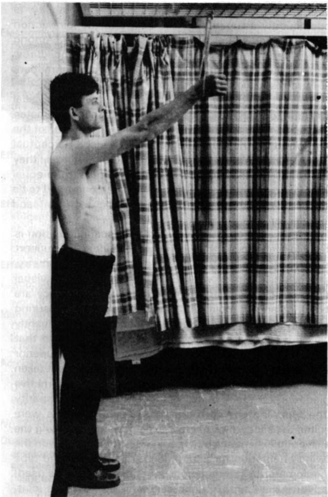
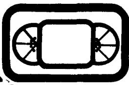

<!-- 本文件是 MinerU 自动抽取的**英文结构化正文**，不是中文翻译。 -->
<!-- 中文翻译若需要，须另走 06_附录/pdf2zh调用脚本/translate_all.py，不得把本文件当译文引用。 -->
<!-- 抽取来源：01_参考论文/整合系统/生物力学线/B1_视觉运动学_估计与验证方法学/Williams1990-Physiotherapy：肩关节角目视估计与量角器测定的比较/Williams1990-Physiotherapy：肩关节角目视估计与量角器测定的比较.pdf -->
<!-- DOI：10.1016/S0031-9406(10)63103-3 -->
<!-- 图片：2 张，位于同级 images/，已按正文引用相对路径改写。 -->

# Comparison of Visual Estimation and Goniometry in Determination of a Shoulder Joint Angle

JOHN G WILLIAMS PhD CPsychol AFBPsS

Psychologist, Department of Movement Science and Physical Education University of Liverpool

MICHAEL CALLAGHAN MCSP

Senior Physiotherapist, Royal Liverpool Hospital

Key words: Goniometry, visual estimation

Summary: This study compared the performance of two groups of physiotherapists (practised and non-practised) who used visual estimation and three types of standard goniometer to measure the angle of a shoulder joint of a model whose right arm was fully extended and elevated in flexion to a fixed neutral position (taken to be 100°). Analysis of variance showed that there were no differences in performance either between the criterion groups or among the four measurement methods. There were no significant interactions. The grand mean value recorded was 103.60° (range 101.60° to 105.00°). It was concluded that physiotherapy training in goniometry, which includes the use of both a measuring tool and standard reference system for the human body, provides an organising schema for visual estimation. Coupled with experience and practice, this permits therapists to obtain joint measurements of the shoulder that can be as accurate as those obtained with a mechanical goniometer. The suggestion is advanced that, for highly skilled therapists, visual estimation is the more valid technique and the goniometer may be redundant.

Biography: John Williams is a psychologist with particular interests in the the role of perceptual processes in skilled action and the analysis of skill.

Michael Callaghan is a physiotherapist currently working in a busy outpatient department. He has a specialist interest in sports injuries and is engaged in research into the biomechanical aspects of knee rehabilitation.

## Introduction

DETERMINING range of movement by measuring the angle size of the body's numerous joints is an established part of the assessment of patients who require physiotherapy and the evaluation of the treatment which they receive. Given that angles are of value to physiotherapists it is essential that the measurements taken are accurate and can be consistently obtained by both an individual and a team of therapists. Furthermore, it is desirable that the process is relatively cheap, quick and easy to perform. Despite the apparently straightforward nature of these criteria, the extent to which they are attainable is a contentious issue. Type of instrument, joint size and position on body, team or individual measurement, 'one off' or repeated measures, type of patient, time of day, and reference system are among the many variables that are believed to influence the accuracy of measurement (see discussions in Gajdosik and Bohannon, 1987).

The most common method of measuring joint angles is with a mechanical goniometer (basically a protractor with ‘arms' which may be made of plastic or metal). Physiotherapists are trained to use this instrument in relation to a standard procedure such as that outlined by Norkin and White (1985). Training is based on a reference system for measuring and recording joint motion such as that suggested by the American Academy of Orthopaedic Surgeons (1965) or by Russe and Gerhardt (1975). Although there are several apparently more sophisticated angle measuring devices, notably Polgon (Grieve, 1969) and Orthoranger (Clapper and Wolf, 1988), the mechanical version is still the most frequently used instrument. Whatever the device, the measurement principles remain the same and any differences lie either in the manner in which the goniometer is 'driven' or in the collection and presentation of the actual measurements.

There is little doubt that the standard (universal) goniometer possesses 'face' validity, at least, and that trained therapists should be abie to use this tool to derive consistent and replicable measurements. However, there have been a number of reports in the physical therapy literature which indicate that human goniometry is frequently inaccurate (see, for example, Boone et al, 1978; Gajdosik and Bohannon, 1987; Fish and Wingate, 1985; Gogia et al, 1987; Rothstein et al, 1983). The sources of error cited in these papers suggest that measurement variability is predominantly a function of the user and the joint/action being measured rather than the instrument itself. Among the variables mentioned are standardisation of procedures, different joint actions, passive versus active range of motion, and intra-tester versus inter-tester variance.

Although trained in goniometry, many therapists use visual estimation to measure joint angles rather than a goniometer. This is especially so when measuring the larger joints of the body. Whatever the reason for reliance on visuo-perceptual processes rather than an actual measurement tool, they seem to believe that visual estimation is at least the equal of conventional goniometry. If this were demonstrated to be true, the method would fulfil all of the technical and economic criteria mentioned above.

The generally accepted view is that visual estimation is unreliable even though there is very little evidence to support this contention. In an otherwise good review of goniometry, Gajdosik and Bohannon (1987) are dismissive of visual estimation, stating that when precision and accuracy are needed, reliance should be placed on an angle-measuring instrument. Their assertion seems to be based predominantly on a study reported by Low (1976) which concluded that measurement with the standard goniometer was superior to estimation. However, a number of variables were not taken into account in this study which could provide an alternative explanation for the results. Specifically, the wide disparity in the type and size of the joints that the subjects were required to assess, lack of clear explanation concerning the training and experience of the subjects, inconsistency in the viewing orientation for estimation of joint angle, and type of goniometer (a standard short-arm instrument was used) relative to the length of limb segments forming the joint. Although not an exhaustive list, these variables would have to be taken into account if the distinction between visual estimation and goniometry is to be fairly tested.

This experiment compared the performance of practised and non-practised groups of physiotherapists in the assessment of a joint angle using visual estimation and angle measuring instruments (three types of standard goniometer — long-arm, short-arm and digital read-out).

## Method

## Subjects, Equipment and Design

The subjects were 22 Chartered physiotherapists who had worked continuously for a minimum of three years in physical therapy and had received training in human joint angle measurement. They were assigned to two equal-size criterion groups, namely those who were carrying out many rangeof-movement assessments daily, and those who worked in various physiotherapy specialties which did not require regular joint angle assessment. Each subject visually estimated a human joint angle and measured the angle by using a standard goniometer (three types: short arm, long arm, digital read-out) (within subjects' conditions).

## Procedure

A male model stood upright with heels, back and head against a wall. The upper body was unclothed and the right arm, with elbow fully extended and shoulder elevated in flexion to a fixed neutral position was held at the wrist in a sling, which was suspended from a hook attached to a suspension frame as shown in the figure. The angle of the shoulder joint was approximately 100º flexion.

  
Model on whom measurements were made

Subjects were instructed to assess the angle of flexion of the same model's shoulder joint as accurately as possible. Working individually, each was requested first to use visual estimation to make a single assessment of the angle of the joint, then to use the goniometers, given to them in random order, to take a single measurement of the same joint with each instrument. The goniometers were used in the manner recommended by the American Academy of Orthopaedic Surgeons (1965). Oral instruction was given to all subjects concerning the read-out of the digital goniometer because few of the subjects were familiar with this device.

## Results

The raw data (angles in degrees) were submitted to a twoway analysis of variance to examine the main effects of 'practice in joint angle measurement' (practised or nonpractised therapists), 'type of method/device used to measure' (visual estimation, and long-arm, short-arm or digital read-out goniometers), and any interaction effects. No statistically significant differences were found for any of the possible effects (p< 0.05). The grand mean value for all subjects was 103.60° (standard deviation 9.08°). Descriptive statistics for the two criterion groups using the four joint assessment methods are set out in the table.

Descriptive statistics (means and standard deviations) for shoulder joint angle assessment in degrees
<table><tr><td rowspan="2">Criterion Group</td><td colspan="3">Assessment method</td></tr><tr><td>Visual estimation</td><td>Goniometers</td><td>Digital read-out</td></tr><tr><td></td><td></td><td>Long-arm Short-arm</td><td></td></tr><tr><td>Practised subjects</td><td>106.36</td><td>102.27</td><td>101.36 104.27 (10.51)</td></tr><tr><td>Non-practised</td><td>(11.85) 103.63</td><td>(11.48) 105.00</td><td>(6.32 102.63</td></tr><tr><td></td><td></td><td></td><td>101.81</td></tr><tr><td>subjects</td><td>(8.50)</td><td>(5.91)</td><td>(8.71) (4.03</td></tr></table>

## Discussion

These results demonstrate that groups of relatively experienced physiotherapists were able to achieve quite consistent measurements of a human shoulder joint angle under conditions which were appropriately standardised and similar to their normal working conditions. The mean range of their measurements, which included values derived through visuo-perceptual processes as opposed to those acquired with a measuring device, was less than 4º. Furthermore, the participants in this study achieved the same levels of consistency whether or not they were highly practised in the skill because of the current daily demands at work. Considered from an individual perspective, a joint angle value could vary some 9º to 10º but this was more or less the same for all methods used except for the digital goniometer which was some 6°. The digital method avoids any contribution to the margin of error from inaccurate reading of the angle on the protractor scale.

The place of estimation skill in physiotherapy assessment requires careful consideration because, on the one hand, the extant research literature implies that the technique is unacceptably inaccurate yet, on the other, it is much used by therapists and seems to be more precise than is believed. Some evidence for this is provided in the results that we have obtained, although clearly the experimental design and procedures employed here were quite rudimentary and the joint measurement task perhaps the easiest that would be required of a physiotherapist. Further research would be desirable to determine the accuracy of visual estimation in the assessment of different types of joint from a range of viewing orientations.

When estimating a human joint angle, the therapist applies a developed and powerful visuo-perceptual system which is probably quite capable of taking account of some of the frequently cited patient and user variables which can introduce error into joint angle measurement when reliance is placed upon the mechanical goniometer alone. The practised physiotherapist 'knows'and 'understands'much more about the measured joint than degrees of angle can tell and may well be using training and practice with the goniometer and accompanying reference system as the basis of an organising schema to produce quite valid assessments. Some very general evidence for this has emerged by questioning student physiotherapists in the early phase (year 'three) of learning how to assess range of movement. This indicates that, when called upon to estimate the angle of a joint, they either 'imagine' the standard goniometer which they have learned to use in other phases of their training or base their judgements on 'visualisation of a right angle'.

Visual estimation in the measurement of joint angles could represent a level of skill in physiotherapy which has been acquired through experience and practice to a point at which the measuring tool itself becomes virtually redundant. This has been found in other skills which are based, initially, on measuring instruments (Hatano et al, 1977).

At best, estimation (a misleading description?) is probably as reliable and consistent as measurements taken with a standard goniometer. Furthermore, because goniometry emphasises certain types of procedure related to the placement of the instrument and the reading of its scale, a user may be distracted from taking account of other important sources of variance in the assessment which 'finely tuned' visuo-perceptual processes are able to consider. It is plausible that estimation technique possesses better construct validity and, for that reason, skilled therapists rely on it.

## ACKNOWLEDGMENT

The authors thank two anonymous reviewers for hetpful comments and suggestions for further research on this topic.

## REFERENCES

American Academy of Orthopaedic Surgeons (1965). Joint Motion — Method of measuring and recording, Churchill Livingstone, Edinburgh.

Boone, D C, Azen, S P and Lin, C et a/ (1978). 'Reliability of goniometric measurements', Physica/ Therapy, 58, 11, 1355-60.

Clapper, M P and Wolf, S (1988). 'Comparison of the reliability of the Orthoranger and the standard goniometer for assessing lower extremity range of motion', Physical Therapy, 68, 2, 214–218.

Fish, D R and Wingate, L (1985). 'Sources of goniometric error at the elbow', Physical Therapy, 65, 11, 1666–70.

Gajdosik, R and Bohannon, R (1987). 'Clinical measurement of range of motion: Review of goniometry emphasising reliability and validity', Physical Therapy, 67, 12, 1867–72.

Gogia, P, Braatz, J, Rose, S J et al (1987). 'Reliability and validity of goniometric measurements at the knee’, Physical Therapy, 67, 2, 192–195.

Grieve, D (1969). 'A device called Polgon for the measurement of the orientation parts of the body relative to a fixed external axis', Journal of Physiology, 210, 70.

Hatano, G, Miyake, Y and Binks, M G (1977). ‘Performance of expert abacus operators', Cognition, 5, 57–71.

Low, J (1976). ‘The reliability of joint measurement', Physiotherapy, 62, 7, 227–229.

Norkin, C C and White, D J (1985). Measurement of Joint Motion: A Guide to Goniometry, Davis, Philadelphia.

Rothstein, J M, Miller, P J and Roettger, R F (1983). 'Goniometric reliability in a clinical setting: Elbow and knee measurements', Physical Therapy, 63, 10, 1611-15.

Russe, O A and Gerhardt, J J (1975). International SFTR Method of Measurement and Recording Joint Motion, Hans Huber, Bern.

## video review

Back First. Video Communication Services with Northampton Health Authority, Highfield, Clifton Road, Northampton NN1 5DN. 1990. 28 minutes. Price VHS and Beta £55, (Umatic £60) plus VAT. Hire £10 (£15) plus VAT per week.

Making a training-educational video is no easy task. It requires a lot of thought, planning and hard work. The makers can consider themselves to have succeeded if the end product is 80% right and suits the requirements of the majority of the users for whom it was designed.

'Back First', which was produced in collaboration with the Northampton Physiotherapy Services, has been made to meet the needs of nursing staff, ambulance personnel, health and safety representatives and other hospital and care staff.

It is divided into three sections: 'Correct lifting techniques and application', 'Lifting everyday objects' and 'Specific patient lifting techniques'. A number of situations are covered including lifting a box, moving a large cupboard, handling a paving slab, and examples of mechanical handling as well as a variety of patient handling manoeuvres from turning a patient to a three person 'trolley' lift.

If the production team had released 'Back First' in 1980 it would probably have been commended for its fresh, innovative approach and style. However, over the past decade the level of knowledge, as well as the standards and quality demanded by an increasingly discerning public, require that any product of this nature, sold on the open market, is of a very high standard.

'Back First' does not meet these standards because it relies on a dated format and more importantly fails to pay sufficient attention to the fine detail in some of the sequences. In one or two instances the techniques shown could cause problems for those attempting to use them.

For example, in an attempt to emphasise the need to bend the knees and use leg power, a number of lifts are demonstrated in a deep squat position. Surely one of the team is aware of the fact that until at least ten degrees of extension has been achieved from a full squat, that the power of the quadriceps muscles is limited. This point is well illustrated by the man lifting a 2 ft by 2 ft slab. His compensatory back movements could easily have resulted in injury.

When demonstrating patient handling techniques a modern hydraulic rehabilitation couch is used throughout, yet there is a standard hospital bed standing next to it!

The use of the couch not only reduces the credibility of the manoeuvres being demonstrated, but does not enable the lifts to be performed in a realistic manner.

In one scene, two young women are carrying a large table downstairs. At the very moment when the commentary says: 'Can you imagine the disaster that could have happened if this lift had not been carefully planned?' the lifter in front of the camera gets her head and neck trapped under the table leg as it is lowered.

The three-person lift has now become obsolute, with the introduction of the easeslide and transfer boards. Lifting patients from bed to trolley is no longer necessary in the majority of situations. This lift is difficult and has to be performed in a specific manner. A failure to adhere to the 'bench mark' of the 1987 RCN manual The Handling of Patients has already resulted in at least two nurses being compensated for injuries sustained. I would suggest that the Northampton team read the description on page 46 of this manual and compare it with their own version.

Disappointing as it must be, more work is required before 'Back First' can be considered to be suitable for the 1990s. CHRISTOPHER R HAYNE FCSP F Erg