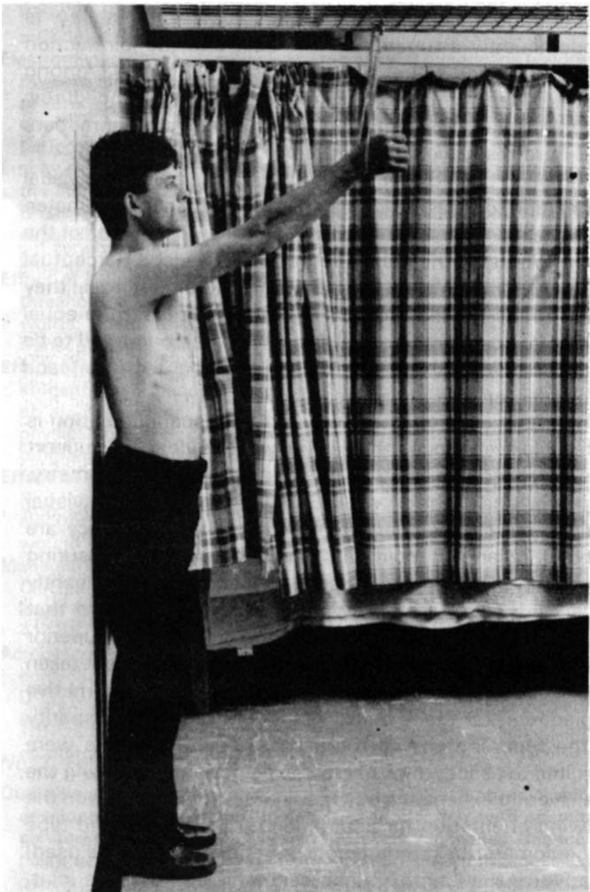
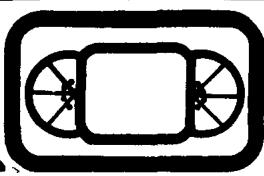

# 目测法与量角器法在肩关节角度测定中的比较

JOHN G WILLIAMS 博士，特许心理学家，英国心理学会副会士（PhD CPsychol AFBPsS）

心理学家，利物浦大学（University of Liverpool）运动科学与体育系

MICHAEL CALLAGHAN，英国特许物理治疗学会会员（MCSP）

资深物理治疗师，皇家利物浦医院（Royal Liverpool Hospital）

关键词：量角法（Goniometry），目测法（visual estimation）。

摘要：本研究比较了两组物理治疗师（熟练组与非熟练组）的表现，他们使用目测法和三种标准量角器测量一位模特的肩关节角度，该模特的右臂完全伸展并屈曲抬高至一个固定的中立位置（设定为 100°）。方差分析显示，标准组之间以及四种测量方法之间的表现均无差异。不存在显著的交互作用。记录的总均值为 103.60°（范围为 101.60° 至 105.00°）。结论表明，包括测量工具使用和人体标准参考系统在内的量角法物理治疗培训，为目测提供了组织图式。结合经验和实践，这使治疗师能够获得与机械量角器测量结果一样精确的肩关节测量值。进而提出建议：对于高技能治疗师而言，目测法是更有效的技术，而量角器可能是多余的。

作者简介：John Williams 是一名心理学家，特别关注知觉过程在熟练动作中的作用以及技能分析。

Michael Callaghan 是一名物理治疗师，目前在一家繁忙的门诊部工作。他对运动损伤特别感兴趣，并正从事膝关节康复生物力学方面的研究。

## 引言

通过测量身体众多关节的角度大小来确定关节活动度，是对需要物理治疗的患者进行评估以及评价其所接受治疗效果的公认组成部分。鉴于角度对物理治疗师具有重要价值，测得的测量值必须准确，并且无论是单个治疗师还是治疗团队都能一致地获得。此外，该过程最好相对低廉、快速且易于操作。尽管这些标准看似直接明了，但其可实现的程度一直是一个备受争议的问题。仪器类型、关节大小及在身体上的位置、团队还是个体测量、“单次”还是重复测量、患者类型、测量时间以及参考系统，都被认为是影响测量准确性的众多变量之一（见 Gajdosik and Bohannon, 1987 的讨论）。

测量关节角度最常用的方法是使用机械量角器（本质上是一个带有“臂”的量角规，臂可由塑料或金属制成）。物理治疗师接受过按照标准程序使用该仪器的培训，例如 Norkin and White (1985) 所述的程序。培训基于用于测量和记录关节运动的参考系统，例如 American Academy of Orthopaedic Surgeons（美国骨科医师学会，1965）或 Russe and Gerhardt (1975) 提出的系统。尽管有几种显然更先进的角度测量设备，特别是 Polgon (Grieve, 1969) 和 Orthoranger (Clapper and Wolf, 1988)，但机械版本仍然是最常使用的仪器。无论使用何种设备，测量原理都是相同的，任何差异要么在于量角器的“驱动”方式，要么在于实际测量数据的采集和呈现方式。

毫无疑问，标准（通用）量角器至少具有“表面”效度，并且经过培训的治疗师应该能够使用该工具获得一致且可重复的测量结果。然而，物理治疗文献中的许多报告表明，人体关节角度测量往往是不准确的（例如参见 Boone et al., 1978; Gajdosik and Bohannon, 1987; Fish and Wingate, 1985; Gogia et al., 1987; Rothstein et al., 1983）。这些论文中引用的误差来源表明，测量变异性主要取决于使用者以及被测量的关节/动作，而不是仪器本身。提及的变量包括操作规程的标准化、不同的关节动作、被动与主动活动度，以及测试者内部与测试者之间的方差。

尽管接受过量角法培训，许多治疗师在测量关节角度时仍使用目测法而非量角器。在测量人体较大的关节时尤其如此。无论依赖视觉感知过程而非实际测量工具的原因是什么，他们似乎都认为目测法至少与传统量角法相当。如果这一观点被证实是正确的，该方法将满足上述所有的技术和经济标准。

普遍接受的观点认为目测评估是不可靠的，尽管几乎没有证据支持这一论断。在一篇原本很出色的角度测量术综述中，Gajdosik and Bohannon (1987) 对目测评估持否定态度，指出在需要精密度和准确度时，应依赖测角仪器。他们的断言似乎主要基于 Low (1976) 报告的一项研究，该研究得出结论认为使用标准关节角度计测量优于目测估计。然而，该研究未考虑到一些变量，而这些变量可能对结果提供另一种解释。具体而言，包括受试者被要求评估的关节类型和大小差异巨大、对受试者的培训与经验缺乏明确说明、用于估计关节角度的观察视角不一致，以及测角仪类型（使用的是标准短臂仪器）相对于构成关节的肢体节段长度的不匹配。尽管上述列举并不详尽，但若要公正地检验目测估计与关节角度计测量之间的差异，就必须考虑这些变量。

本实验比较了熟练组与非熟练组物理治疗师在使用目测估计和测角仪器（三种标准关节角度计——长臂、短臂和数字读数式）评估关节角度时的表现。

## 方法

## 受试者、设备与设计

受试者为 22 名注册物理治疗师（Chartered physiotherapists），他们均已在物理治疗领域连续工作至少三年，并接受过人体关节角度测量的培训。他们被分配到两个人数相等的标准组中：一组为日常进行大量关节活动度评估的治疗师，另一组为在不需要定期进行关节角度评估的各个物理治疗专科工作的治疗师。每位受试者均对一个人体关节角度进行目测估计，并使用标准关节角度计（三种类型：短臂、长臂、数字读数式）测量该角度（受试者内条件）。

## 步骤

一名男性模特直立站立，脚跟、背部和头部紧贴墙壁。上半身未着衣物，右臂手肘完全伸展，肩部前屈抬起至固定的中立位置，手腕处用吊带固定，吊带悬挂在连接于悬吊架的挂钩上，如图所示。肩关节角度约为屈曲 $100^{\circ}$。

  
接受测量的模特

受试者被要求尽可能准确地评估同一模型的肩关节屈曲角度。每位受试者单独操作，首先被要求通过目视估计对关节角度进行单次评估，随后使用按随机顺序提供的测角计，分别用每种仪器对同一关节进行单次测量。测角计的使用方式遵循 American Academy of Orthopaedic Surgeons（美国骨科医师学会，1965）推荐的方法。由于很少有受试者熟悉数显测角计，因此对所有受试者就该设备的读数进行了口头指导。

## 结果

原始数据（以度为单位的角度）进行了双因素方差分析，以检验“关节角度测量练习”（熟练或非熟练治疗师）、“使用的测量方法/设备类型”（目视估计，以及长臂、短臂或数显测角计）的主效应以及任何交互效应。对于任何可能的影响，均未发现具有统计学显著性的差异 $(p < 0.05)$ 。所有受试者的总平均值为 $103.60^{\circ}$ （标准差 $9.08^{\circ}$ ）。使用四种关节评估方法的两个标准组的描述性统计数据列于表中。

肩关节角度评估（以度为单位）的描述性统计（均值和标准差）

<table><tr><td rowspan="3">标准组</td><td colspan="4">评估方法</td></tr><tr><td rowspan="2">目视估计</td><td colspan="2">测角计</td><td rowspan="2">数显读数</td></tr><tr><td>长臂</td><td>短臂</td></tr><tr><td>熟练受试者</td><td>106.36(11.85)</td><td>102.27(11.48)</td><td>101.36(10.51)</td><td>104.27(6.32)</td></tr><tr><td>非熟练受试者</td><td>103.63(8.50)</td><td>105.00(5.91)</td><td>101.81(8.71)</td><td>102.63(4.03)</td></tr></table>

## 讨论

这些结果表明，在经过适当标准化且与其日常工作条件相似的条件下，相对有经验的物理治疗师群体能够对人体肩关节角度实现相当一致的测量。他们的测量均值范围（包括通过视觉感知过程获得的值，以及使用测量设备获得的值）小于 $4^{\circ}$ 。此外，无论本研究的参与者是否由于当前日常工作的需求而在该技能上高度熟练，他们都达到了相同水平的一致性。从个体角度来看，关节角度值的变异可能在 $9^{\circ}$ 至 $10^{\circ}$ 左右，但除数显测角计约为 $6^{\circ}$ 外，所使用的所有方法在这一点上大致相同。数显方法避免了因量角器刻度读数不准而对误差范围造成的任何影响。

估算技能在物理治疗评估中的地位需要仔细考量，因为一方面，现有的研究文献暗示该技术的准确性低到令人无法接受，但另一方面，它又被治疗师广泛使用，且似乎比人们所认为的更加精准。我们获得的结果为这一点提供了一些证据，尽管显而易见的是，本研究采用的实验设计和程序还相当简陋，且所涉及的关节测量任务可能是对物理治疗师而言最简单的一类任务。未来有必要开展进一步的研究，以确定从多种观察角度评估不同类型关节时目测估计的准确性。

在估算人体关节角度时，治疗师运用的是一套成熟且强大的视觉感知系统，当仅依赖机械量角器时，某些经常被提及的患者和使用者变量可能会给关节角度测量带来误差，而该系统很可能完全有能力将这些变量考虑在内。经验丰富的物理治疗师对受测关节的“了解”和“理解”远超过角度数值本身所能传达的信息，并且很可能将量角器及其配套参考系统的训练和实践作为一种组织图式（organising schema）的基础，从而得出相当有效的评估。通过对处于学习如何评估活动度早期阶段（第三学年）的物理治疗专业学生进行询问，得出了一些非常普遍的证据。这表明，当被要求估算关节角度时，他们要么“想象”自己在其他培训阶段学会使用的标准量角器，要么将判断建立在“对直角的视觉化感知”之上。

关节角度测量中的目测估计可能代表了物理治疗中的一种技能水平，这种技能通过经验和实践习得，乃至测量工具本身几乎变得多余。在最初基于测量仪器的其他技能中也发现了这种现象（Hatano et al, 1977）。

往好里说，估算（这一描述是否具有误导性？）可能与使用标准量角器所进行的测量一样可靠且一致。此外，由于量角法强调与仪器放置和刻度读取相关的特定流程，使用者可能会因此分心，无法兼顾评估中其他重要的变异来源，而“经过精细调谐”的视觉感知过程却能够将这些因素纳入考量。估算技术具备更好的构念效度（construct validity）是合乎情理的，这也正是熟练的治疗师依赖它的原因。

## 致谢

作者感谢两位匿名审稿人对本主题提出的有益意见以及对后续研究的建议。

## 参考文献

American Academy of Orthopaedic Surgeons (1965). Joint Motion — Method of measuring and recording, Churchill Livingstone, Edinburgh.

Boone, D C, Azen, S P and Lin, C et al (1978). 'Reliability of goniometric measurements', Physical Therapy, 58, 11, 1355–60.

Clapper, M P and Wolf, S (1988). 'Comparison of the reliability of the Orthoranger and the standard goniometer for assessing lower extremity range of motion', Physical Therapy, 68, 2, 214–218.

Fish, D R and Wingate, L (1985). 'Sources of goniometric error at the elbow', Physical Therapy, 65, 11, 1666–70.

Gajdosik, R and Bohannon, R (1987). 'Clinical measurement of range of motion: Review of goniometry emphasising reliability and validity', Physical Therapy, 67, 12, 1867–72.

Gogia, P, Braatz, J, Rose, S J et al (1987). 'Reliability and validity of goniometric measurements at the knee', Physical Therapy, 67, 2, 192–195.

Grieve, D (1969). 'A device called Polgon for the measurement of the orientation parts of the body relative to a fixed external axis', Journal of Physiology, 210, 70.

Hatano, G, Miyake, Y and Binks, M G (1977). 'Performance of expert abacus operators', Cognition, 5, 57–71.

Low, J (1976). 'The reliability of joint measurement', Physiotherapy, 62, 7, 227–229.

Norkin, C C and White, D J (1985). Measurement of Joint Motion: A Guide to Goniometry, Davis, Philadelphia.

Rothstein, J M, Miller, P J and Roettger, R F (1983). 'Goniometric reliability in a clinical setting: Elbow and knee measurements', Physical Therapy, 63, 10, 1611–15.

Russe, O A and Gerhardt, J J (1975). International SFTR Method of Measurement and Recording Joint Motion, Hans Huber, Bern.

## 视频评介

《脊柱优先》（Back First）。Video Communication Services 联合 Northampton Health Authority，地址：Highfield, Clifton Road, Northampton NN1 5DN。1990年。时长 28 分钟。售价：VHS 与 Beta 格式 55 英镑，（Umatic 格式 60 英镑）另加增值税。租金：每周 10 英镑（15 英镑）另加增值税。

制作一部培训教学视频绝非易事。它需要大量的构思、规划和辛勤付出。如果最终成品能达到 80% 的水准，并满足其目标受众中大多数人的需求，制作者便可以认为自己取得了成功。

《脊柱优先》是与北安普敦物理治疗服务部（Northampton Physiotherapy Services）合作制作的，旨在满足护理人员、救护人员、职业健康与安全代表以及其他医院和护理工作人员的需求。

该视频分为三个部分：“正确的搬运技术与应用”、“搬运日常物品”以及“特定患者搬运技术”。视频涵盖了多种情境，包括搬运箱子、移动大柜子、搬动铺路石板以及机械搬运示例，此外还展示了从协助患者翻身到三人“推车式”搬运等多种患者搬运操作手法。

如果制作团队在 1980 年发布《Back First》，它很可能会因其新颖、创新的方法和风格而受到赞誉。然而，在过去的十年里，知识水平的提升，以及日益挑剔的公众所要求的标准和质量，都要求在公开市场上销售的任何此类产品必须具备极高的水准。

《Back First》未能达到这些标准，因为它依赖于过时的形式，更重要的是，未能对某些环节中的细节给予足够的关注。在一两个实例中，所展示的技术甚至可能会给尝试使用它们的人带来隐患。

例如，为了强调弯曲膝盖和利用腿部力量的必要性，片中在深蹲姿势下演示了多次提举动作。制作团队中肯定有人清楚这样一个事实：从完全深蹲姿势开始，直到膝关节伸展至少达到 10 度之前，股四头肌的力量都是非常有限的。一名男子搬运一块 2 英尺见方的石板的场景很好地说明了这一点。他背部的代偿性动作极易导致受伤。

在演示患者搬运技术时，全程使用的是现代液压康复床，然而旁边就放着一张标准的医院病床！

使用这种康复床不仅降低了所演示操作的可信度，而且无法以贴合实际情况的方式完成搬运。

在一个场景中，两名年轻女性正抬着一张大桌子下楼。就在解说词说道“你能想象如果这次搬运没有经过周密计划可能会发生的灾难吗？”的那一刻，镜头前方的搬运者在放下桌子时，头部和颈部恰好被卡在了桌腿下面。

随着易滑布和过床板的引入，三人搬运法现已完全过时。在绝大多数情况下，已不再需要将患者从病床抬到平车上。这种提举操作难度大，且必须以特定的方式进行。未能遵循 1987 年 RCN（英国皇家护理学会）手册《The Handling of Patients》中的“基准”，已经导致至少两名护士因受伤而获得赔偿。我建议 Northampton 团队阅读该手册第 46 页的描述，并将其与他们自己的版本进行对比。

尽管这难免令人失望，但在《Back First》被认为能够适用于 20 世纪 90 年代之前，还需要做更多的工作。CHRISTOPHER R HAYNE FCSP F Erg