Article

# Analysis of Upper-Limb and Trunk Kinematic Variability: Accuracy and Reliability of an RGB-D Sensor

Alessandro Scano 1,\* , Robert Mihai Mira 2, Pietro Cerveri 3, Lorenzo Molinari Tosatti 1 and Marco Sacco 1

1 Institute of Intelligent Industrial Systems and Technologies for Advanced Manufacturing (STIIMA), Italian Council of National Research (CNR), Via Alfonso Corti 12, 20133 Milan, Italy; lorenzo.molinaritosatti@stiima.cnr.it (L.M.T.); marco.sacco@stiima.cnr.it (M.S.)

Politecnico di Milano, 20133 Milano, Italy; robertmihai.mira@mail.polimi.it

3 Electronics, Information and Bioengineering Department, Politecnico di Milano, 20133 Milano, Italy; pietro.cerveri@polimi.it

\* Correspondence: alessandro.scano@stiima.cnr.it

Received: 2 March 2020; Accepted: 23 April 2020; Published: 26 April 2020

Abstract: In the field of motion analysis, the gold standard devices are marker-based tracking systems. Despite being very accurate, their cost, stringent working environments, and long preparation time make them unsuitable for small clinics as well as for other scenarios such as industrial application. Since human-centered approaches have been promoted even outside clinical environments, the need for easy-to-use solutions to track human motion is topical. In this context, cost-effective devices, such as RGB-Depth (RBG-D) cameras have been proposed, aiming at a user-centered evaluation in rehabilitation or of workers in industry environment. In this paper, we aimed at comparing marker-based systems and RGB-D cameras for tracking human motion. We used a Vicon system (Vicon Motion Systems, Oxford, UK) as a gold standard for the analysis of accuracy and reliability of the Kinect V2 (Microsoft, Redmond, WA, USA) in a variety of gestures in the upper limb workspace—targeting rehabilitation and working applications. The comparison was performed on a group of 15 adult healthy subjects. Each subject had to perform two types of upper-limb movements (point-to-point and exploration) in three workspace sectors (central, right, and left) that might be explored in rehabilitation and industrial working scenarios. The protocol was conceived to test a wide range of the field of view of the RGB-D device. Our results, detailed in the paper, suggest that RGB-D sensors are adequate to track the upper limb for biomechanical assessments, even though relevant limitations can be found in the assessment and reliability of some specific degrees of freedom and gestures with respect to marker-based systems.

Keywords: markerless acquisition systems; marker-based optical tracking systems; motor rehabilitation; human motion tracking; Kinect V2; Vicon system; upper limb; biomechanics

## 1. Introduction

Human motion analysis (HMA) is a domain in the biomechanics field aiming at quantitatively describing the human movement, which is traditionally acquired by means of motion tracking technologies. Applications of HMA span many areas ranging from clinics and motor rehabilitation to industrial and entertainment fields [1]. In the area of human motor rehabilitation, the data obtained from motion tracking are used for medical treatment plans and evaluations [2]. The most accurate standard systems for this field are marker-based optoelectronic tracking equipment. Placing the markers on anatomical landmarks on the subject’s body, such systems allow a precise reconstruction of the kinematic parameters. Many studies describe a variety of usages of the optoelectronic tracking equipment [3–9]. This high precision, however, is achieved with time-consuming marker-positioning procedures, which places constraints on usage environments such as laboratories, as well as coming at a high cost. These issues limit the use of such systems to scientific research laboratories and hospitals, preventing their use in small clinics, home rehabilitation, and industrial applications due to less controllable environments. Because of these limitations, a need for systems requiring faster setup time, more flexible acquisition environments, and lower costs has arisen [1]. During these last two decades, many new instruments have been developed that are able to provide refined kinematic and/or dynamic data of human motion in three dimensions (3D), such as wearable sensors or optical motion acquisition systems, some of which have been tested in clinical settings and rehabilitation scenarios [10,11]. The development of inertial sensors and RGB-depth (RGB-D) sensors has allowed the implementation of devices that meet these requirements. RGB-D sensors manage this through a sensor fusion mechanism and allow the reconstruction of human movement through video frame segmentation coupled with depth analysis [12]. A popular example of an RGB-D device is the Microsoft’s Kinect V2. It features quick set-up time, acquires large ranges of motion, and provides good motor tracking capabilities [13,14]. Some studies confirmed a good reliability of devices such as Kinect and Kinect V2 in recording the kinematics of the upper limb when compared to marker-based systems [15,16]. Applications to the field of rehabilitation and health of low-cost RGB-D systems such as Kinect include a variety of studies, including biomechanical assessments [17–27], translation of quantitative clinical scales [28–30], post-stroke patients’ assessments [31–34], validation for their usage in home environments [35–37], and assisted living [38].

Only recently has human motion tracking acquired visibility in industrial contexts. Recent roadmaps [39,40] suggested the need of human-centered approaches and solutions for improving workers’ health and injury prevention in the workplaces, and motion tracking applicability to assess users in working environments [41]. Thus, in recent years, a growing interest in motion tracking technologies has arisen since they have become widely available and applicable outside of standard clinical environments. A first field of application is injury prevention: it has been suggested that, as most manual labor in industry requires elaborate movements in unmonitored environments, this could lead to injuries and work-related disorders [42]. Secondly, motion tracking systems could provide data of the stress and strain on the body, and in this way improve workstation safety [42], help avoid unnecessary work risks, and ensure safe and successful human–robot interactions [43,44]. Moreover, tracking technologies have been used to properly provide designer with data that will help them improving products and making them easier to use and more comfortable for people [45,46]. An ofline use of tracking is found in a recent work [47] that presented a method by which changing the manipulator’s behavior in volume areas where there is higher probability to find a human cooperator Occupied volumes were computed based on pre-recorded data of the human motion

Another important aspect of both industrial and rehabilitative motion capture deals with possible obtrusive settings, such as when interacting with a robot. In some human–robot interactions, the machine is required to co-operate or mimic operators; motion tracking is essential in order to avoid harmful or unwanted interactions [48]. Some works exploited this concept. For instance, methods of motion tracking, integrated in the context of human–robot interaction were proposed [49].

Lastly, it is noteworthy that many recent laboratory studies used bio-inspired approaches based on tracking systems to assess human–robot interaction, when testing devices for assisting manual works [50]. These recent works aim to translate biomedical technologies in industrial environments.

Given the major application of human motion tracking in clinical settings and the growing interest in human-centered approaches even outside of the biomedical field, some studies were performed in order to assess the usability of RGB-D devices and assess their accuracy and reliability with respect to gold standard systems [16,18,51–53]. Comparing a marker-based system with Kinect $[ 1 6 , 1 8 ]$ , the authors showed good sensitivity of the RGB-D sensor, even though they concentrated on a small sample of subjects and only reaching movements. In one study [51], the authors made clear that there is a high correlation between the gait parameters registered with a marker-based system and the Kinect device, concluding that it can be used to track gait parameters, although for its use in a clinical environment they suggest that further improvements in its sensitivity are needed. The accuracy of the Kinect V2 in full body acquisitions, concentrated on walking and balance control was assessed [52], concluding that Kinect V2 could achieve good level of precision for motion analysis. Another work [53] concentrated only on some degrees of freedom of the upper-limb. They tested the accuracy of the sensor, and found that the RGB-D sensor could approximate the results of the marker-based system, even though the range of movements analyzed was quite limited. A comprehensive assessment [54] analyzed the performance of Kinect in movements in respect to the Vicon system in detail. The authors concluded that the system is suitable for motion tracking, but the analyzed degrees of freedom were associated to specific gestures conceived to emphasize each specific motor primitive—a favorable condition for tracking. In general, we found that there was a limited number of studies that concentrated on assessing the validity of RGB-D sensors in assessing the upper limb movement in multiple workspace sectors resembling the variety of the possible tasks during daily-life or working activities. Especially, we noted how previous studies in this field concentrated mainly on paradigmatic rehabilitation tasks, gait, or functional movements, rather than mapping the variety of upper-limb gestures typical of working and real-life applications. Consequently, given that RGB-D sensors can promote a human-centered perspective in the context of motor evaluation, in this pilot study we implemented a comparison between the Kinect V2 (as a well-known RGB-D sensor widely used for motion tracking) and an optoelectronic marker-based Vicon system (as golden standard). The aim was to evaluate the accuracy and reliability of the upper-limb and trunk movement in an extended simulation of gestures typical of working environment, addressing in particular novel applications related to the scaling-up of rehabilitation assessments to the industrial field.

## 2. Materials and Methods

## 2.1. Participants

Fifteen young adults with a similar age range (19–35) were recruited (8 females, 7 males, mean age $2 4 \pm 3$ years, mean height $1 . 7 2 \pm \ : 0 . 1 0$ m, mean weight $6 3 \pm 1 2 \mathrm { ~ k g } )$ Participants had no musculoskeletal impairments afecting their performance. The studies involving human participants were reviewed and approved by the CNR Ethical Committee (Rome, Italy, protocol number 0044338/2018). The patients/participants provided their written informed consent to participate in this study. Written informed consent was obtained from the individual(s) for the publication of any potentially identifiable images or data included in this article.

## 2.2. Equipment

The tests were performed in the motion acquisition laboratory of the Italian Council of National Research (CNR) in Italy, Lecco. The laboratory was equipped with:

1. One Vicon Vero system, composed of 10 infrared cameras; a set of reflective markers for motion tracking to be used with the Vicon system. In this experimental condition, 34 markers were used (25 for the upper-limb model, 9 for the target);

2. One Kinect V2.0 device to track the human body in space. Kinect uses an RGB-D camera, for frame acquisition at 30 Hz sampling frequency, and a time of flight infrared camera, for depth sensing. For more in-depth on the Kinect systems, exhaustive details can be found in previous works [55,56]. The Kinect was mounted on an easel and was at about 2.5 m from the recorded scene for best tracking [52];

3. Two general purpose computers: the first one connected to the Vicon system and containing the software for the acquisition and for the pre-processing of the tracking data, and the second one containing a custom-made software in C#, which communicated directly with the Kinect V2 device. It could generate a file containing 25 points of interest composing the SDK Kinect skeleton;

4. One 60 cm diameter circular target with 9 points of interest named N, NE, E, SE, S, SW, W, NW, and O. This target was used as a reference for the subjects to execute point-to-point and workspace exploration movements [57].and O. This target w

A schematic of the set-up is portrayed in Figure 1.

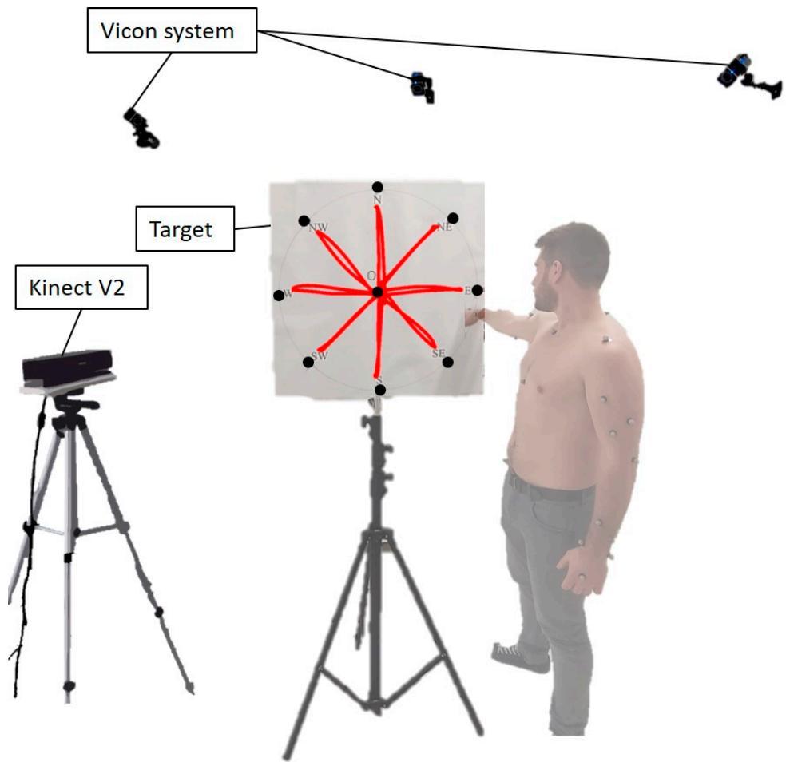  
Figure 1. Graphical schematic of the experimental set-up.

## 2.3. Movement Selection

Each subject was asked to execute two types of movements with the right arm. The selected tasks were point-to-point and hand exploration movements [57], commonly adopted in the context of motor motor rehabilitation. These are gestures extrapolated from daily life activities, and at the same time rehabilitation. These are gestures extrapolated from daily life activities, and at the same time allow allow exploring up to the limits of the upper limb available woexploring up to the limits of the upper limb available workspace.

The point-to-point movement (Figure 2, top row) is a paradigmatic movement used by clinicians The point-to-point movement (Figure 2, top row) is a paradigmatic movement used by clinicians to test motor capabilities of patients. It was chosen for its wide use in the rehabilitation contexts [28]. The movement involves multi-joint coordination and is used often in daily life activities. The subject toward a specific point on the circular target and then returned to the starting position. The first started from a predefined resting position with the upper-arm leaning along the body, then reached movement, performed by each subject, was reaching towards the ‘O’ point, then back to resting toward a specific point on the circular target and then returned to the starting position. The first movement, performed by each subject, was reaching towards the ‘O’ point, then back to resting position. Afterwards, the subject pointed to ‘NE’, back to resting position, and then continued the motion pattern clockwise until reaching the ‘N’ point, and backwards.

The hand exploration task (Figure 2, lower row) is another gesture conceived to simulate movements on a working surface and object displacement for distal limb coordination. Again, the circular target was used as reference to drive the subject’s movement. The objective of each participant was to move the hand radially across the target, starting from the resting position and going to different points on the circumference. The resting position for this movement was upright with the hand pointing towards theparticipant was to move the hand radially across the target, starting from the resting position and $^ \prime \mathrm { O ^ { \prime } }$ point. The first movement was towards $' \mathrm { N E } ^ { \prime } ,$ , then $' \mathrm { O ^ { \prime } } _ { \mathrm { \ell } }$ , and the motion pattern proceeded clockwise until the subjects reached ‘N’, and finally back to $^ \prime \mathrm { O ^ { \prime } }$

(f)  
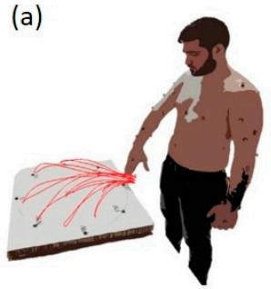

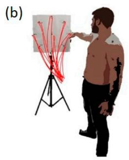

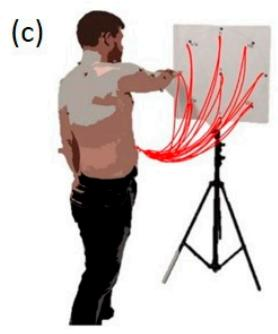

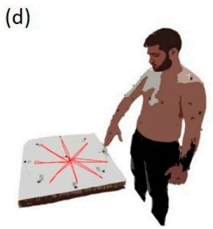

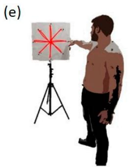

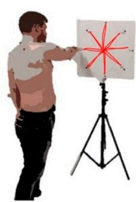  
Figure 2. Graphical representation of the workspace sectors and movements. Top row: Point-to-point Figure 2. Graphical representation of the workspace sectors and movements. Top row: Point-to-point movements: (a) Central, (b) Right, and (c) Left Sector; Lower Row: Exploration movements: (d) movements: (a) Central, (b) Right, and (c) Left Sector; Lower Row: Exploration movements: (d) Central (e) Right, and (f) Left Sector.

## 2.4. Experimental Set-Up

The equipment was placed in the acquisition volume of the Vicon system. The subject faced was placed in three different positions: on the right of the subject; on the left; in front of the frontally with respect to the Kinect. In order to test the field of view of the device, the circular target participant, horizontally. Regardless of the position of the target, movements were always performed was placed in three diferent positions: on the right of the subject; on the left; in front of the participant, with the right upper limb. For the right and left sectors, the target was placed on a tripod and adjusted horizontally. Regardless of the position of the target, movements were always performed with the so that the ‘O’ target was at the subject’s shoulder height. While in the central sector, the target was right upper limb. For the right and left sectors, the target was placed on a tripod and adjusted so that the ‘O’ target was at the subject’s shoulder height. While in the central sector, the target was placed horizontally on a table. The workspace sectors are depicted in Figure 2.

in the workspace were a table, the target, the two tripods, and the Kinect. Two general-purpose computers—operating Vicon and Kinect, respectively—were positioned outside of the acquisition volume so as not to interfere with the acquisition. The only objects present in the workspace were a table, the target, the two tripods, and the Kinect.

## designed2.5. Acquisition

Before each recording session, the subject was equipped in accordance to the upper limb model designed for the Vicon system. Five markers were placed on the trunk, one on each shoulder, three on each upper arm, two on each elbow, and four on each forearm and wrist (Figure 3), for a total of 25 markers [53]. Meanwhile, the Kinect V2 started to warm-up for about 20 min.

The datasets were acquired in the previously described environment with both the Kinect and the Vicon. Since the software for the two systems were on different computers, the acquisition of the data was not synchronized during the recordings. We chose to always start the registration with the Vicon and afterwards start the Kinect data stream. At the signal of the operator, the subject started the movement.

The two different acquisition systems provided specific data structures. The Kinect dataset consisted in the Microsoft SDK 2.0 skeleton 3D data from 25 anatomical points (Figure 3). The custom-made software used to interact with the Kinect provided a file readable with MATLAB (Mathworks, Natick, MA, USA). This file contained the 3D coordinates of the SDK skeleton’s points with respect to thewas performed about 2 min after the first, in a similar way in respect to a previous analogous study Kinect’s reference system.[27].

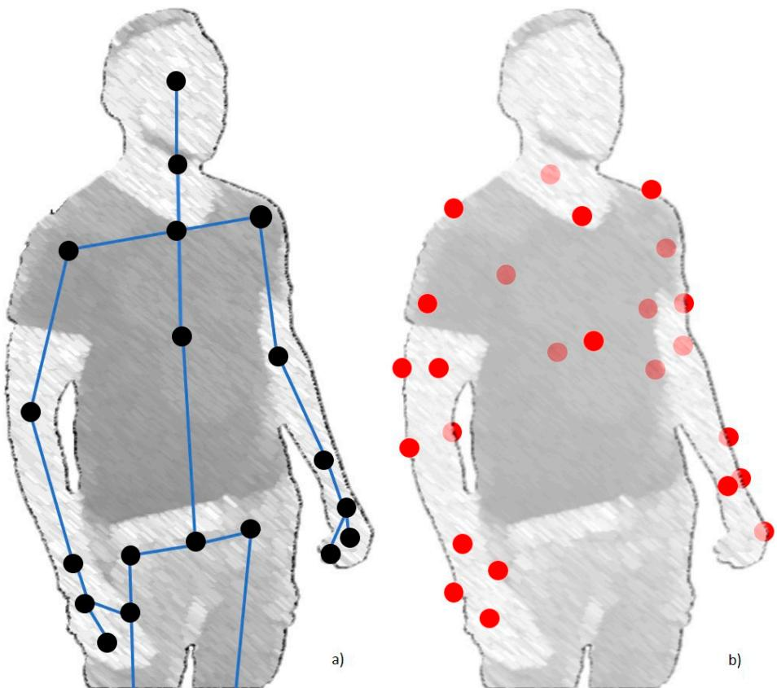  
Figure 3. Kinect V2 tracked joints (a) and the location of the markers in the upper-limb Vicon system Figure 3. Kinect V2 tracked joints (a) and the location of the markers in the upper-limb Vicon system (b).

The dataset registered with the Vicon system needed preprocessing in the Nexus virtual environment (Vicon software), including marker tracking and labelling. Afterwards, using the upper limb model, the software could accurately reconstruct the position of the glenohumeral joint center (shoulder center of rotation), humeroulnar joint center (elbow center of rotation) and radiocarpal joint center (wrist joint center) for both left and right upper limbs, as well as estimating the position of the trunk [58]. This tracking allowed the estimation of 11 degrees of freedom (details in Section 2.6). After preprocessing, the data were saved in c3d file format and imported in MATLAB.

In order to allow test–retest comparison, each acquisition was repeated twice; the second trial was performed about 2 min after the first, in a similar way in respect to a previous analogous study [27]

## 2.6. Data Analysis

All computed angular data (Vicon and Kinect) were filtered with a low-pass Butterworth filter at 5 Hz [59]. Then, since the two systems acquired data at diferent sampling frequencies (100 Hz Vicon; 30 Hz Kinect) and acquisition times (Vicon started about 1 s before Kinect and ended 1 s after Kinect), the two datasets were aligned. The first step was the detection of movement phases: each acquisition was subdivided into sub-movements (nine sub-movements for arm point-to-point forward phases, eight forward phases and eight backward phases for workspace exploration). The segmentation into movement phases was achieved as follows. The curvilinear abscissa and velocity profile of the wrist marker (end efector) were computed. Then, synchronization of each phase onset and ofset was achieved by means of an algorithm based of thresholding and local minimum detection on the velocity profile. Then, after onset alignment, the data from each phase (O->NE, NE->O . . . )

was resampled so that each of them was 100 samples long to allow inter-variable, inter-sector, and inter-subject comparisons.

In order to compare the two systems, the position of the centers of rotation of the right upper-limb was used to compute a set of 11 variables, namely the rotational degrees of freedom (DoF), which described the upper-limb motion. The following degrees of freedom were considered (Figure 4): shoulder elevation, shoulder rotation along the vertical axis, shoulder internal–external rotation, elbow flexion–extension, hand flexion–extension, hand pronation–supination, hand deviation, scapular elevation, trunk torsion, trunk anterior–posterior flexion, and trunk medial–lateral flexion. The direction of the arrows indicates ‘positive’ angles. In order to avoid problems of reference system registration, all variables were computed relative to a subject specific reference system.

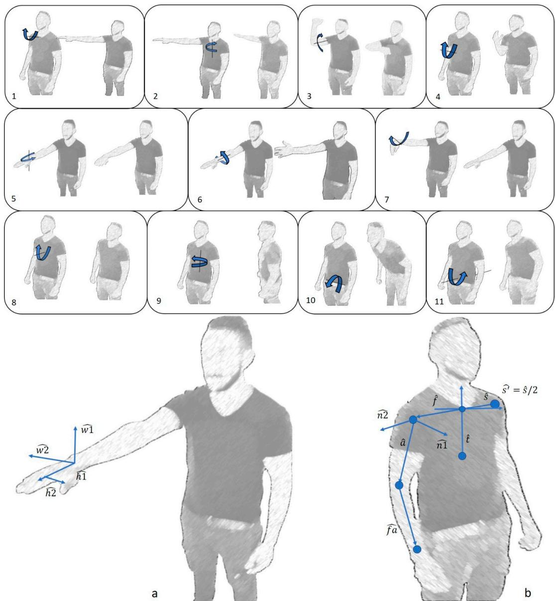  
Figure 4. Graphical representation of the degrees of freedom computed with Vicon and Kinect V2: 1. Figure 4. Graphical representation of the degrees of freedom computed with Vicon and Kinect V2: Shoulder elevation, 2. Shoulder rotation along the vertical axis, 3. Shoulder internal–external rotation, 1. Shoulder elevation, 2. Shoulder rotation along the vertical axis, 3. Shoulder internal–external rotation, 4. Elbow flexion–extension, 5. Hand flexion–extension, 6. Hand pronation–supination, 7. Hand 4. Elbow flexion–extension, 5. Hand flexion–extension, 6. Hand pronation–supination, 7. Hand deviation, 8. Scapular elevation, 9. Trunk torsion, 10. Trunk anterior–posterior flexion, 11. Trunk deviation, 8. Scapular elevation, 9. Trunk torsion, 10. Trunk anterior–posterior flexion, 11. Trunk medial–lateral flexion, a. Hand reference vectors, b. Subject reference system. The direction of the medial–lateral flexion, a. Hand reference vectors, b. Subject reference system. The direction of the arrows indicates ‘positive’ angles. The procedures for computation and the definition of projection arrows indicates ‘positive’ angles. The procedures for computation and the definition of projection planes are presented in Appendix A.

## 2.7. Outcome Measures and Statistical Analysis

For measuring Kinect accuracy, the chosen comparison metric was the angular distance (ad) computed between the corresponding degrees of freedom, phase-by-phase, obtained with the Vicon and the Kinect systems, respectively. The implicit assumption was that the Vicon was the gold standard. First, directional pie-charts illustrating the ad for each of the degree of freedom (DoF) considered were generated, accounting for directions and for each of the sectors. For point-to-point movements, the directional pie-charts had 8 cardinal directions, referred to the forward phases of the movements; for exploration movements, we considered also the backward phases and thus the resolution of the pie-charts was doubled. A heatmap was designed to show the magnitude of the ad between Vicon and Kinect.

Then, all the ad data were pooled into three matrices, one matrix per sector, each matrix containing the ad for each DoF and computed phase. These three matrices were used as parameters for a two-way ANOVA test, with ad compared between degrees of freedom (dimension: 11) and sectors (3: central, right and left) as factors, in order to see how each DoF was tracked with the Kinect in respect to Vicon and quantify the performance of the RGB-D sensor in each degree of freedom and sector. The p-value (p) determined the probability of obtaining test results at least as extreme as the results actually observed during the test, assuming that the null hypothesis is correct. The tests were repeated separately for point-to-point and exploration movements. Post-hoc tests (MATLAB function multcompare) were also implemented to determine which degrees of freedom and/or sectors difered from the others. The post-hoc test was Tukey’s honest significant diference criterion or (HSD). This method compares the variables of interest two at a time under the assumption of equal variance and statistical independence. The results ofer a pairwise confidence interval of similarity. Level of significance for all statistical tests was 0.05.

For measuring Kinect repeatability, the chosen comparison metric was the angular distance (ad) computed between the corresponding degrees of freedom, phase-by-phase, obtained with the Kinect system in the test and re-test trials.

To show this, directional, heatmap pie-charts depicting the ad comparing Kinect performance in test and retest conditions were plotted. For point-to-point movements, the directional pie-charts had eight cardinal directions, referred to the forward phases of the movements; for exploration movements, we considered also the backward phases and thus the resolution of the pie-charts was doubled. A heatmap was designed to show the magnitude of the ad between test and retest.

In order to provide a metric for reliability of the statistical results, a test-retest analysis was also performed, taking advantage of the fact that each acquisition was repeated twice. In order to quantify the reliability through test-retest datasets, the interclass correlation coeficient (ICC) between the datasets was chosen [54]. Post-hoc tests (MATLAB function ‘multcompare’) were also implemented to determine which degrees of freedom and/or sectors difered from the others. The post-hoc test was Tukey’s honest significant diference criterion or (HSD). This method compares the variables of interest two at a time under the assumption of equal variance and statistical independence. The results ofer a pairwise confidence interval of similarity. The level of significance for all statistical tests was set to 0.05.

## 3. Results

## 3.1. Marker-Based System vs. RGB-D Sensor

In this section, Kinect accuracy in respect to the marker-based system and the statistical results obtained for all subjects are presented.

A series of visual representations of the circular target illustrate, through heatmaps, the performance of the Kinect against the Vicon system for each specific DoF, in each sector, and with respect to the directionality of the target. The mean accuracy of the Kinect device (across the two repetitions), averaged across subjects, obtained using the protocol established in this study is reported. First, the averaged data error (all subjects) for point-to-point in the central sector was reported (Figure 5a). The same result for the right (Figure 5b) and left (Figure 5c) sectors was reported. The same results were also reported for exploration for the central sector (Figure 6a), right sector (Figure 6b), and left sector (Figure 6c).

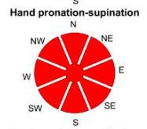

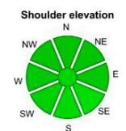  
Trunk torsion along the vertical axis

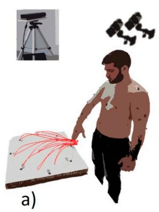

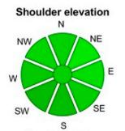  
Shoulder rotation along vertical axis Shoulder internal-external rotation

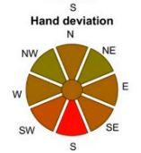

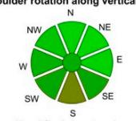

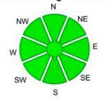

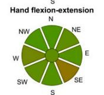

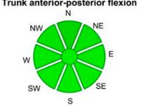

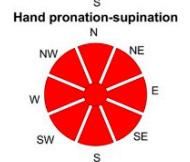

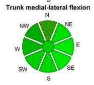

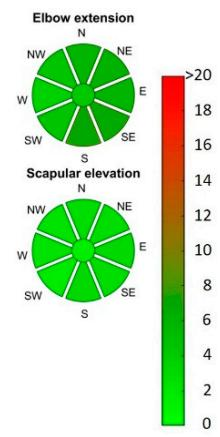  
Shoulder rotation along vertical axis Shoulder internal-external rotation

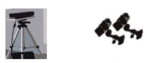

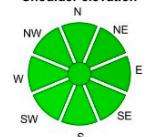

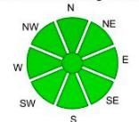

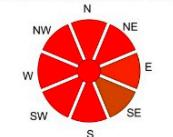

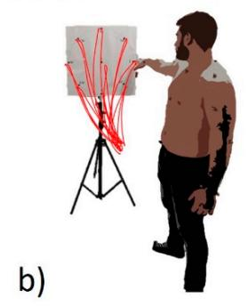

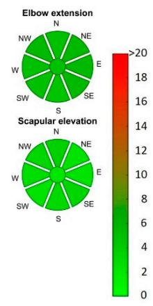

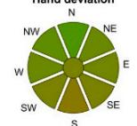

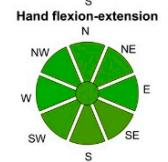

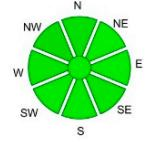

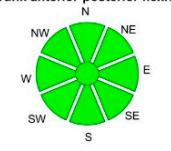

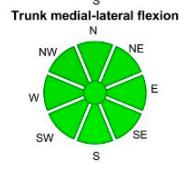

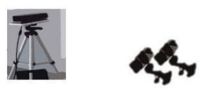  
Shoulder rotation along vertical axis Shoulder internal-external rotatior

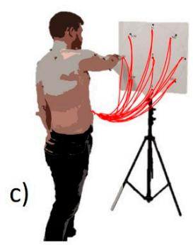

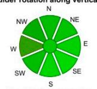

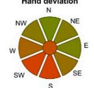

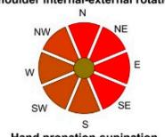

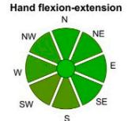

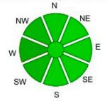

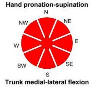

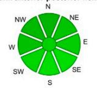

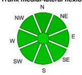

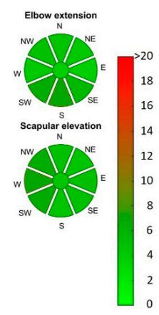  
Figure 5. Pie-charts of the Kinect V2-Vicon angular distance in the point-to-point movements as an Figure 5. Pie-charts of the Kinect V2-Vicon angular distance in the point-to-point movements as average of the test and re-test trials. In order from top to bottom, the considered sectors were (a) an average of the test and re-test trials. In order from top to bottom, the considered sectors were central sector, (b) right sector, (c) left sector. The directional pie-charts had 8 cardinal directions, (a) central sector, (b) right sector, (c) left sector. The directional pie-charts had 8 cardinal directions, referred to the forward phases of the movements. The graphical representation adopted a heatmap to depict the magnitude of the ad.

Shoulder rotation along vertical axis Shoulder internal-external rotation

Shoulder rotation along vertical axis Shoulder internal-external rotation

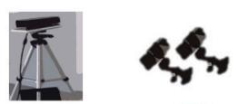

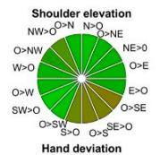

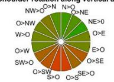

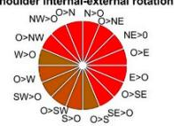

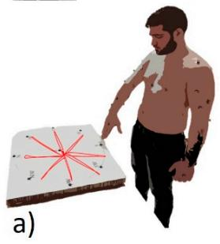

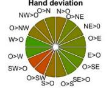  
Trunk torsion along the vertical axis

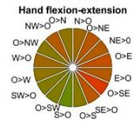

  
Figure 6. Pie-charts of the Kinect V2-Vicon angular distance in the exploration movements, as an Figure 6. Pie-charts of the Kinect V2-Vicon angular distance in the exploration movements, as an average of the test and re-test trials. In order from top to bottom, the considered sectors were (a) average of the test and re-test trials. In order from top to bottom, the considered sectors were (a) central central sector, (b) right sector, (c) left sector. The directional pie-charts had 16 cardinal directions. The sector, (b) right sector, (c) left sector. The directional pie-charts had 16 cardinal directions. The graphical graphical representation adopted a heatmap to depict the magnituderepresentation adopted a heatmap to depict the magnitude of the ad.

The results presented in this section are related to the test dataset (comparison between test and The results presented in this section are related to the test dataset (comparison between test and retest is presented in Section 3.2). The two-way Anova analysis showed that, on average, seven DoF retest is presented in Section 3.2). The two-way Anova analysis showed that, on average, seven DoF presented an average error lower thanpresented an average error lower than $1 0 ^ { \circ }$ Two DoF presented an average error in the range between . Two DoF presented an average error in the range between $1 0 ^ { \circ } - 2 0 ^ { \circ }$ and one had adand one had ad $> 2 0 ^ { \circ }$ for both the executed movements (point-to-point and exploration). for both the executed movements (point-to-point and exploration). Furthermore, one DoF had error greater than Furthermore, one DoF had error greater than $2 0 ^ { \circ }$ and different mean between point-to-point and and diferent mean between point-to-point and exploration movements.exploration movements.

A more in-depth analysis of the arm point-to-point movement revealed that trunk torsion, trunk antero-posterior flexion, trunk medio-lateral flexion, shoulder elevation, shoulder rotation along the vertical axis, elbow extension, and scapular elevation were tracked with an error lower or equal to $5 ^ { \circ }$ . The hand deviation angle and hand flexion–extension were tracked with an error range between $5 ^ { \circ }$ and $1 5 ^ { \circ }$ . The shoulder internal–external rotation showed a mean error of about $2 0 ^ { \circ }$ . Lastly, the hand pronation–supination angle had a mean error greater than $2 0 ^ { \circ }$ . Furthermore, from the analysis of the point-to-point movement, statistical diference was not found between the mean of shoulder elevation and the means of shoulder rotation along the vertical axis $( p = 0 . 9 6 )$ , scapular elevation $( p = 0 . 9 9 )$ , trunk torsion $( p = 0 . 7 8 )$ , trunk medio-lateral flexion $( p = 1 )$ , elbow extension $( p = 0 . 5 9 )$ , and trunk antero-posterior flexion $( p = 0 . 6 1 )$ . While shoulder internal–external rotation, hand pronation–supination, hand flexion–extension, and hand deviation had statistically diferent mean one with the other and in respect to the other angles $( p < 0 . 0 0 1 )$ ). Meanwhile, considering the comparison between the sectors, we found that the average error in the right sector was smaller than in the other two sectors, ranging between $8 ^ { \circ }$ and 9◦, and was statistically diferent from the left and central sectors (respectively, $p = 0 . 0 1 2$ and $p = 0 . 0 0 5 3 )$ . Left and central sectors had similar means and were not statically diferent $\left( { p = 0 . 9 6 } \right) ;$ ; the mean error varied between $9 ^ { \circ }$ and $1 0 ^ { \circ }$

The same test performed for the exploration movement provided similar results regarding the average variations between the DoF but with diferent statistical significance. We could identify some groups: shoulder elevation, shoulder rotation along the vertical axis, and elbow extension were grouped together; in fact, we could not find statistical diference in respect to shoulder elevation (respectively, shoulder rotation along vertical axis, $p = 1$ and elbow extension $p = 0 . 9 9 )$ ). These DoF showed statistical diference from the rest of the variables with $p < 0 . 0 1$ for all three. Hand pronation–supination and hand flexion–extension were not statistically diferent $( p = 0 . 8 7 )$ and were statistically diferent from all the others $( p < 0 . 0 0 1 )$ ; then, scapular elevation, trunk torsion and trunk medio-lateral were not statistically diferent, respectively compared to trunk torsion $( p = 0 . 9 4 )$ , meanwhile trunk antero-posterior flexion had not a statistically diferent mean only in respect to trunk medio-later flexion $( p = 0 . 9 9 )$ but were statistically diferent in respect to trunk torsion $( p = 0 . 0 5 )$ and scapular elevation $( p \leq 0 . 0 0 1 )$ ). Lastly, shoulder internal–external rotation and hand pronation–supination had statistically diferent means if compared one with the other $( p < 0 . 0 0 0 1 )$ ) and from the others $( p < 0 . 0 0 1 )$ . In the case of exploration, the inter-sector error was diferently distributed: all the sectors had no statistical diferences central $( 1 1 . 1 3 ^ { \circ } )$ , right $( 1 1 . 3 9 ^ { \circ } )$ , and left (11.18◦). Comparing right and left sectors, they resulted not to have statistical diferences $( p = 0 . 7 9 )$ ). The same could be said for right and central $( p = 0 . 6 8 )$ and for central and left $( p = 0 . 9 8 )$

## 3.2. RGB-D Sensor Reliability

In this section, we describe the test-retest as a measure of reliability of the RGB-D sensor. An overview of the results is available in Tables 1 and 2.

A series of visual representations of the circular target illustrate through heatmaps the repeatability of the Kinect for each specific DoF in each sector with respect to the directionality of the target. First, the mean angular distance for point-to-point in the central sector was reported (Figure 7a). Then, the same result was reported for the right (Figure 7b) and left (Figure 7c) sectors. The same results were also reported for exploration for the central sector (Figure 8a), right sector (Figure 8b), and left sector (Figure 8c)

For a more general view of the reproducibility, the interclass correlation coeficient between the datasets separately for each sector and for each movement was also computed. The interclass correlation coeficient in point-to-point movement was 0.81 $( p = 0 )$ for the right sector, 0.82 $( p = 0 )$ for the central sector and the 0.73 $( p < 0 . 0 0 1 )$ for the left sector. Meanwhile, for the exploration movement the ICC was 0.84 $( p = 0 )$ for the right sector, $0 . 7 5 \ : ( p = 0 )$ for the central sector and $0 . 6 2 \left( p < 0 . 0 0 1 \right)$ for the left sector.

Trunk torsion along the vertical axis

Trunk torsion along the vertical axis

  
Shoulder rotation along vertical axis Shoulder internal-external rotatior

Shoulder rotation along vertical axis Shoulder internal-external rotation  

Shoulder rotation along vertical axis Shoulder internal-external rotation  

Figure 7. Pie-charts of the Kinect V2 angular distance across repetitions, in the point-to-point Figure 7. Pie-charts of the Kinect V2 angular distance across repetitions, in the point-to-point movements. movements. In order from top to bottom, the considered sectors were (a) central sector, (b) right In order from top to bottom, the considered sectors were (a) central sector, (b) right sector, (c) left sector. sector, (c) left sector. For point-to-point movements, the directional pie-charts had eight cardinal For point-to-point movements, the directional pie-charts had eight cardinal directions, referred to the directions, referred to the forward phases of the movements. The graphical representation adopted a forward phases of the movements. The graphical representation adopted a heatmap to depict the heatmap to depict thmagnitude of the ad.

Figures 9 and 10 portray visual representation of the statistical analysis of point-to-point movements and exploration movements, respectively. Furthermore, statistical results between test and retest datasets were provided. As seen in Figure 9 and as reported with the ICC, for the point-to point movement consistency between the results both in mean diferences and in significance was found. Figure 10 shows that consistency between the degrees of freedom for the right and central sectors was preserved; meanwhile, the left sector had a slight diference, although not presenting statistical significance with respect to the other sectors.

  
Shoulder rotation along vertical axis Shoulder internal-external rotatior  
Shoulder rotation along vertical axis Shoulder internal-external rotation  
Trunk torsion along the vertical axis  
Trunk torsion along the vertical axis

  
Shoulder rotation along vertical axis Shoulder internal-external rotatior

  
Figure 8. Pie-charts of the Kinect V2 angular distance across repetitions, in the exploration Figure 8. Pie-charts of the Kinect V2 angular distance across repetitions, in the exploration movements. movements. In order from top to bottom, the considered sectors were (a) central sector, (b) right In order from top to bottom, the considered sectors were (a) central sector, (b) right sector, (c) left sector, (c) left sector. For exploration movements, we considered also the backward phases and thus sector. For exploration movements, we considered also the backward phases and thus the resolution of the resolution of the pie-charts included 16 directions. The graphical representation adopted a the pie-charts included 16 directions. The graphical representation adopted a heatmap to depict the heatmap to depict tmagnitude of the ad.

Point to point 2-way Anova 1 Degrees of freedom  

Point to point 2-way Anova 2 Degrees of freedom  

  
Figure 9. Point-to-point movements: two-way ANOVA test results, for test and re-test datasets.

Table 1. Mean angular distance, order by degrees of freedom, and sectors (test and retest), and ICC: point-to-point movements.

<table><tr><td>Degree of Freedom</td><td>Test Mean (deg°)</td><td>Retest Mean (deg°)</td></tr><tr><td>Shoulder elevation</td><td>3.96</td><td>3.82</td></tr><tr><td>Shoulder rotation along the vertical axis</td><td>4.73</td><td>4.88</td></tr><tr><td>Shoulder internal-external rotation</td><td>19.00</td><td>18.18</td></tr><tr><td>Elbow extension</td><td>5.20</td><td>5.36</td></tr><tr><td>Hand deviation angle</td><td>11.25</td><td>11.60</td></tr><tr><td>Hand flexion-extension angle</td><td>8.10</td><td>7.89</td></tr><tr><td>Hand pronation angle</td><td>36.40</td><td>38.59</td></tr><tr><td>Scapular elevation</td><td>3.64</td><td>3.70</td></tr><tr><td>Trunk torsion</td><td>3.02</td><td>3.01</td></tr><tr><td>Trunk anterior-posterior flexion</td><td>2.41</td><td>2.61</td></tr><tr><td>Trunk medial-lateral flexion</td><td>4.06</td><td>4.22</td></tr></table>

<table><tr><td>Sectors</td><td>Test Mean (deg°)</td><td>Retest Mean (deg°)</td><td>ICC</td></tr><tr><td>Right</td><td>8.59</td><td>8.77</td><td>0.81</td></tr><tr><td>Central</td><td>9.55</td><td>9.73</td><td>0.82</td></tr><tr><td>Left</td><td>9.60</td><td>9.82</td><td>0.73</td></tr></table>

Exploration 2-way Anova 2 Degrees of freedom  
Table 2. Mean angular distance, order by degrees of freedom and sectors (test and retest), and ICC: exploration movements.

<table><tr><td colspan="2">Degree of Freedom</td><td>Test Mean (deg°)</td><td>Retest Mean (deg°)</td></tr><tr><td colspan="2">Shoulder elevation</td><td>7.09</td><td>6.92</td></tr><tr><td colspan="2">Shoulder rotation along the vertical axis</td><td>7.44</td><td>8.67</td></tr><tr><td colspan="2">Shoulder internal-external rotation</td><td>25.63</td><td>26.93</td></tr><tr><td colspan="2">Elbow extension</td><td>7.56</td><td>7.43</td></tr><tr><td colspan="2">Hand deviation angle</td><td>10.70</td><td>10.47</td></tr><tr><td colspan="2">Hand flexion-extension angle</td><td>9.69</td><td>9.70</td></tr><tr><td colspan="2">Hand pronation angle</td><td>43.28</td><td>44.06</td></tr><tr><td colspan="2">Scapular elevation</td><td>4.60</td><td>4.67</td></tr><tr><td colspan="2">Trunk torsion</td><td>3.70</td><td>4.16</td></tr><tr><td colspan="2">Trunk anterior-posterior flexion</td><td>1.71</td><td>1.67</td></tr><tr><td colspan="2">Trunk medial-lateral flexion</td><td>2.16</td><td>2.17</td></tr><tr><td>Sectors</td><td>Test Mean (deg°)</td><td>Retest Mean (deg°)</td><td>ICC</td></tr><tr><td>Right</td><td>11.39</td><td>11.81</td><td>0.84</td></tr><tr><td>Central</td><td>11.13</td><td>11.45</td><td>0.75</td></tr><tr><td>Left</td><td>11.18</td><td>11.34</td><td>0.62</td></tr></table>

  
Figure 10. Exploration movements: two-way ANOVA test results, for test and re-test datasets.

## 4. Discussion

## 4.1. Summary of the Results

The RGB-D device was in general able to track upper-limb and trunk motion for the majority of the considered articular angles. However, the ad found in shoulder internal-external rotation and forearm pronation-supination was not negligible. As seen, if one can accept this error, the Kinect V2 is useful to track the glenohumeral joint center motion, the humeroulnar joint center motion, and the trunk movements especially in the right and central sector while performing the arm point-to-point movement. On the contrary, our results recommend more caution while registering exploration movements, since the mean error per sector resulted slightly higher especially with respect to point-to-point movement.

## 4.1.1. Degrees of Freedom

Most degrees of freedom were tracked with an error below 10◦. This result is consistent with previous studies [18], in which the variables describing shoulder elevation and elbow extension were tracked with an error around 5◦, but in a more constrained scenario (mono-directional reaching movements). The test of accuracy on healthy people, on indexes related to rehabilitation, revealed that most clinical parameters presented an absolute agreement and no systematic bias between RGB-D and marker-based systems [52]. Other similar investigations [53] found that most of the parameters extrapolated were tracked with an RMSE below $1 0 ^ { \circ }$ , which is comparable to the results obtained through the methodologies illustrated in this work. Other studies reported even more precise results for shoulder tracking but focused on a restricted range of postures [20]. The only degrees of freedom presenting low accuracy were the ones related to the hand. This finding suggests that one should be careful when registering data with RGB-D cameras in a context of high variability of motion or in not favorable postures. In fact, in the current study, two angles presented a very high error: the shoulder internal–external rotation and the hand pronation–supination. The first one is critical since it is based on the projection of the forearm on the transversal plane of the upper arm. This projection highly depends on the angle of elbow extension, which means that when the angle between the arm and upper arm approaches 0◦, the shoulder internal–external rotation cannot be computed with high reliability since the arm is approaching kinematic singularity. Moreover, in similar configurations, small displacements in joint center reconstruction can produce unpredictable variations in the angle extrapolation. In this study, this condition is stressed since the limb is often in a fully extended, singularity posture (especially in exploration movements). This is most likely the reason for finding, in general, worse results in respect to previous works [20,54]. It is likely that, in a wide exploration of the workspace, the tracking is worse in respect to more constrained scenarios.

Since the morphology of the reconstructed skeletons is diferent when using Vicon and Kinect V2 [54], pronation–supination angle is critical too. Using the Kinect SDK skeleton, this variable was computed using the angular variation of a unitary vector starting from wrist and pointing towards the thumb. The angular variation of this vector around the axis of the forearm could be assumed to be the hand pronation–supination. A critical observation that made dificult the extrapolation of this angle was the poor quality of the tracking of the thumb with Kinect. Our results are in partial accordance with the findings of a comprehensive previous study [54], revealing that fine movements related to the hand could benefit from ad-hoc hand-models, which were not implemented in this study Moreover, in the assessment of body extremities (hands and feet), even previous works found lower signal-to-noise ratio [52] leading to poor tracking. Furthermore, the movements we analyzed were very demanding for reliable hand pronation and supination computation.

In a more general discussion, a relevant finding was that the tracking performance appears to be better for movements with wide range of motions (such as point-to-point movements, which have been better tracked than hand exploration movements). Arguably, Microsoft’s built-in algorithms have made it possible to better reconstruct wider movements that have a higher articular range. These results should be taken into account when tracking people in environments with high tracking precision requirements, or where high accuracy is requested in fine movements.

## 4.1.2. Sectors

So far, RGB-D sensors such as Kinect V2 were tested mainly considering the performance of the sensor for tracking gestures conceived to emphasize specific degrees of freedom [54], or during rehabilitative-oriented tasks [18,33,36,51]. In this study, our novel contribution was to strongly characterize the performance of the RGB-D sensor in upper-limb movements in a context of continuous variability which is naturally found in daily-life tasks and working activities [57].

The accuracy in tracking workspace sectors was different between the two analyzed movements. For the point-to-point movement, there was a statistically significant difference for the left and central sectors, in which tracking performance of the Kinect was poor with respect to the right sector. This deterioration in tracking performance was probably due to the fact that, even if the target was positioned to the left or in front of the subject, the movement was performed with the right arm. Consequently, during the execution of the tasks in these conditions, part of the subject’s body was partially hidden by the arm for significant periods of time, causing the Kinect device to estimate the position of the covered points, probably introducing a further error. This experimental condition is common to RGB-D devices and should be considered as one of the main limitations to the adoption of such sensors in respect to marker-based systems. Depending on the context, the use of ad-hoc algorithms might be considered to solve this issue.

For the exploration movement, we found that the performances on the left and central sectors were comparable, while for the right sectors they were slightly worse. Although, the ICC for the right and central sectors proved to be higher and thus these two sectors provided more consistent and reliable data. This suggests that the central sector might be the most appropriate one in which to register exploration movements, in order to have the highest reliability and lowest error. These results remark that, in presence of obstruction, the use of RGB-D devices can be more critical. However, we still have to underline that the overall diference is limited to less than 3◦, even when performances were not statistically repeatable.

Our results might be of interest of the scientific community also in estimating more reliable configurations for accurate gesture recognition for several field of applications [60], and in particular for the use of the upper-limb in the contexts of assisted living, clinics, and working environments [38].

## 4.1.3. RGB-D Sensor: Reliability

The test-retest allowed to characterize the reliability of the RGB-D sensor. We found that repeatability was quite high in both point-to-point and exploration movements, except for hand pronation and supination degree of freedom. Our results are in general in line with the previous findings. In fact, preliminary studies on healthy people declared that RGB-D sensors offer the same repeatability of marker-based systems [16]. Similar results were found in a comprehensive rehabilitation-oriented study analyzing whole body movement and especially walking. The authors concluded that repeatability analysis yielded rather similar results for both Kinect V2 and Vicon [52]. The results of the current study agree with previous ones that show acceptable reliability and sensitivity across the sessions for many parameters measured by Kinect for both healthy subjects and also for stroke patients [61]. All these studies considered gestures strongly coupled with degrees of freedom: the slightly more cautious results achieved in this study are probably related to the choice of a more demanding protocol (choice of gestures, variability, and configurations) that stressed the tracking capability of the sensor on generic movements. No remarkable differences were found in repeatability across sectors, even though, as expected, the left sector showed little worse repeatability, probably due to obstruction.

## 4.1.4. Applications in Real Scenarios

As highlighted from the literature, the RGB-D devices can register upper-limb gestures and have already been used in rehabilitative applications for physical assessment or training, like bi-dimensional movements in the sagittal plane [28], in a tele-rehabilitation scenarios [62], or even the three-dimensional range of motion of the upper limb [63]. Its use in this domain is a great advantage for both clinicians and patients alike. For example, ranges of motion provide accurate enough approximations of the joint positions, providing clinicians with an objective indicator on the well-being of the patients. From the patient’s point of view, it might make more popular home-based rehabilitative treatments.

On the other hand, industrial applications are oriented towards monitoring of workplace physical occupation, safety, and injury prevention. Thus, movements on a workbench include many simple movements such as reaching for objects or more complex ones such as manipulating items on the table, or interacting with machines using simple and controlled movements such as hand-over gestures [48–50]. In more general industrial contexts, it has been already used to study workers’ safeness in working environments. In this context, we mention that in the framework of the recently started European H2020 research project “Mindbot” [64], RGB-D technologies will be used to provide monitoring of workers during interaction with collaborative robots. Moreover, the newly released Kinect Azure [65] enhances the tracking capability of Kinect V2 and provides a more evolved tool to foster the concepts proposed in this paper related to people and workers in living and working environments.

## 4.2. Limitations

The first limitation of this work is the limited number of workspace sectors. Real application scenarios might require the use of other sectors, such as shown in other upper-limb studies [57] simulating assembly scenarios, that were excluded in this study due to limitations of the Kinect system tracking algorithms. Also, the number of movements could be expanded to mimic real scenarios, including other upper-limb gestures useful in industry [47,66,67] and including the tracking of other body segments such as legs [52,63]. Including a total body model would allow to inspect a wider number of degrees of freedom and compare the performances on full 3D movement. Moreover, other RGB-D solutions can be considered, both in the adopted sensors and employed algorithms. For this study, we decided to refer to a well-documented, commercial solution with wide difusion, even though further developments of the proposed concepts should involve the use of other sensors, or algorithms for skeleton segmentation.

In fact, only conditions in which the subjects partially obstruct the tracking were considered; in real scenarios, the environment might include further limitations and occlusions which were not considered in this study. Lastly, in order to propose a more solid statistical analysis, a more extended group of subjects might be enrolled.

## 5. Conclusions

In this paper, we investigated the comparison of an RGB commercial sensor with a golden standard optoelectronic marker-based system. We found that the RGB-D sensor with embedded human tracking algorithm could properly approximate the DoF computed with the marker-based system. However, we found that the performance of the RGB-D sensor is not well usable for the detection of some DoF and that ‘wider’ movements, such as point-to-point, are tracked with greater accuracy than those of exploration. Even though with some limitations, we can conclude that RGB-D sensor is a potential candidate for motion analysis in rehabilitative and industrial environments when marker-based systems cannot be employed.

Author Contributions: Conceptualization. A S and R M M : Methodology. A S and R M M : Software, R M M Validation, A.S. and R.M.M.; Formal analysis, A.S. and R.M.M.; Investigation, R.M.M. and A.S.; Resources, A.S., R.M.M., L.MT., M.S, and P.C.; Data curation, R.M.M. and A.S.; Writing—original draft preparation, A.S., R.M.M., P.C., M.S., and L.M.T.; Writing—review and editing, R.M.M., P.C., M.S., and L.M.T.; Visualization, R.M.M.; Supervision, P.C.; Project administration, A.S., M.S., and L.M.T.; Funding acquisition, A.S., M.S., and L.M.T. All authors have read and agreed to the published version of the manuscript.

Funding: This research received no external funding.

Conflicts of Interest: The authors declare no conflict of interest.

Appendix A

$$
\text { Shoulder   elevation } = a c o s (\hat {a} \times (- \hat {t})),\tag{A1}
$$

$$
\text { Shoulder   rotation } = a c o s \left[ \widehat {a p} \times (- \hat {f}) \right] - 9 0,\tag{A2}
$$

$$
\text { Shoulder   internal / external   rotation } = a c o s (\widehat {a f \_ p} \times \widehat {n 2}) - 9 0,\tag{A3}
$$

$$
E l b o w e x t e n s i o n = a c o s (\widehat {a} \times \widehat {a f}),\tag{A4}
$$

$$
H a n d d e v i a t i o n = a c o s (u \widehat {h a n d} _ {-} \Phi \times \widehat {w 2}) - 9 0,\tag{A5}
$$

$$
H a n d f l e x i o n a n d e x t e n s i o n = a c o s (u \_ h a n d \_ \Pi \times \widehat {w 1}) - 9 0,\tag{A6}
$$

$$
H a n d p r o n a t i o n / s u p i n a t i o n = a c o s (u \_ h a n d 2 \_ \Omega \times \widehat {w 1}) - 9 0,\tag{A7}
$$

$$
\text { Scapular   elevation } = a c o s \bigl (\hat {s ^ {\prime}} \times (\hat {s}) \bigr),\tag{A8}
$$

$$
\text { Trunk   torsion } = a c o s \left[ \hat {s} \times (- \hat {f}) \right] - 9 0,\tag{A9}
$$

$$
\text { Trunk   antero / posterior   flexion } = a c o s \bigl (\widehat {t _ {\_} s a g} \times \hat {f} \bigr),\tag{A10}
$$

$$
T r u n k m e d i o / l a t e r a l f l e x i o n = a c o s \bigl [ \widehat {t \_ f r o n t} \times (- \hat {s}) \bigr ] - 9 0,\tag{A11}
$$

Note: In Equation (A2), the vector $\widehat { a p }$ is the arm vector projected on a plane orthogonal to the vector $\hat { t } ;$ in Equation (A3), the vector $\widehat { a f _ { - } p }$ is the forearm vector projected on a plane orthogonal to the vector $\hat { a } ;$ in (A5), the vector $u \widehat { \mathrm { ~ \textmu ~ } h a n d \mathrm { ~ \textmu ~ } } \Phi$ is the projection of $\widehat { h 1 }$ on the plane orthogonal to the vector wc1; in (A6), the vector u\_hand\\_Π is the projection of $\widehat { h 1 }$ on a plane orthogonal to the vector $\widehat { w 2 } ;$ in (A7), the vector u\_hand\2\_Ω is the projection of $\widehat { h 2 }$ on the plane orthogonal to the vector ${ \widehat { a f } } ;$ in (A8), sˆ is the shoulder vector in the initial position and $\hat { s ^ { \prime } }$ is the vector connecting the trunk to the right glenohumeral joint center projected on the plane orthogonal to the vector ${ \hat { f } } ;$ in (A9), the vector $- { \hat { f } }$ represents the direction orthogonal to the back of the subject in the first frame; in (A10), $\widehat { \mathbf { t } \_ s a g }$ is the projection of vector $\hat { t }$ on the sagittal plane, orthogonal to the vector sˆ in the first frame; in (A11), t\_\front is the projection of vector ˆt on the frontal plane, orthogonal to the vector $\hat { f }$ in the first frame.

## References

1. Colyer, S.; Evans, M.; Cosker, D.; Salo, A.I.T. A Review of the Evolution of Vision-Based Motion Analysis and the Integration of Advanced Computer Vision Methods Towards Developing a Markerless System. Sports Med. Open 2018, 4, 24. [CrossRef] [PubMed]

2. Zhou, H.; Hu, H. Human motion tracking for rehabilitation—A survey. Biomed. Signal Process. Control. 2008, 3, 1–18. [CrossRef]

3. Lu, T.W.; O’Connor, J. Bone position estimation from skin marker co-ordinates using global optimisation with joint constraints. J. Biomech. 1999, 32, 129–134. [CrossRef]

4. Roux, E.; Bouilland, S.; Godillon-Maquinghen, A.-P.; Bouttens, D. Evaluation of the GO method within the upper limb kinematics analysis. J. Biomech. 2002, 35, 1279–1283. [CrossRef]

5. Petuskey, K.; Bagley, A.; Abdala, E.; James, M.A.; Rab, G. Upper extremity kinematics during functional activities: Three-dimensional studies in a normal pediatric population. Gait Posture 2007, 25, 573–579. [CrossRef]

6. Pontonnier, C.; Dumont, G. Inverse dynamics method using optimization techniques for the estimation of muscles forces involved in the elbow motion. Int. J. Interact. Des. Manuf. (IJIDeM) 2009, 3, 227–236. [CrossRef]

7. Nussbaum, M.A.; Zhang, X. Heuristics for locating upper extremity joint centres from a reduced set of surface markers. Hum. Mov. Sci. 2000, 19, 797–816. [CrossRef]

8. Cappozzo, A.; Catani, F.; Della Croce, U.; Leardini, A. Position and orientation in space of bones during movement: Anatomical frame definition and determination. Clin. Biomech. 1995, 10, 171–178. [CrossRef]

9. Cappozzo, A.; Catani, F.; Leardini, A.; Benedetti, M.G.; Della Croce, U. Position and orientation in space of bones during movement: Experimental artefacts. Clin. Biomech. 1996, 11, 90–100. [CrossRef]

10. Carpinella, I.; Cattaneo, D.; Ferrarin, M. Quantitative assessment of upper limb motor function in Multiple Sclerosis using an instrumented Action Research Arm Test. J. Neuroeng. Rehabil. 2014, 11, 67. [CrossRef]

11. Carpinella, I.; Lencioni, T.; Bowman, T.; Bertoni, R.; Turolla, A.; Ferrarin, M.; Jonsdottir, J. Planar robotic training versus arm-specific physiotherapy: Efects on arm function and motor strategies in post-stroke subjects. Gait Posture 2019, 74, 7. [CrossRef]

12. Dorazio, T.; Marani, R.; Renò, V.; Cicirelli, G. Recent trends in gesture recognition: How depth data has improved classical approaches. Image Vis. Comput. 2016, 52, 56–72. [CrossRef]

13. Gesto-Diaz, M.; Tombari, F.; Rodríguez-Gonzálvez, P.; González-Aguilera, D. Analysis and Evaluation Between the First and the Second Generation of RGB-D Sensors. IEEE Sens. J. 2015, 15, 6507–6516. [CrossRef]

14. Pagliari, D.; Pinto, L. Calibration of Kinect for Xbox One and Comparison between the Two Generations of Microsoft Sensors. Sensors 2015, 15, 27569–27589. [CrossRef]

15. Kutlu, M.; Freeman, C.; Spraggs, M. Functional electrical stimulation for home-based upper-limb stroke rehabilitation. Curr. Dir. Biomed. Eng. 2017, 3, 25–29.

16. Bonnechère, B.; Jansen, B.; Salvia, P.; Bouzahouene, H.; Omelina, L’.; Moiseev, F.; Sholukha, V.; Cornelis, J.; Rooze, M.; Jan, S.V.S. Validity and reliability of the Kinect within functional assessment activities: Comparison with standard stereophotogrammetry. Gait Posture 2014, 39, 593–598. [CrossRef]

17. Cruz, L.M.V.; Lucio, D.; Velho, L. Kinect and RGBD Images: Challenges and Applications. In Proceedings of the 2012 25th SIBGRAPI Conference on Graphics, Patterns and Images Tutorials, Ouro Preto, Brasil, 22–25 August 2012; pp. 36–49.

18. Scano, A.; Caimmi, M.; Malosio, M.; Tosatti, L.M. Using Kinect for upper-limb functional evaluation in home rehabilitation: A comparison with a 3D stereoscopic passive marker system. In Proceedings of the 5th IEEE RAS/EMBS International Conference on Biomedical Robotics and Biomechatronics, Ouro Preto, Brasil, 12–15 August 2014; pp. 561–566.

19. Kurillo, G.; Chen, A.; Bajcsy, R.; Han, J.J. Evaluation of upper extremity reachable workspace using Kinect camera. Technol. Heal. Care 2013, 21, 641–656. [CrossRef]

20. Lee, S.H.; Yoon, C.; Chung, S.G.; Kim, H.C.; Kwak, Y.; Park, H.-W.; Kim, K. Measurement of Shoulder Range of Motion in Patients with Adhesive Capsulitis Using a Kinect. PLoS ONE 2015, 10, e0129398. [CrossRef]

21. Huber, M.E.; Seitz, A.; Leeser, M.; Sternad, D. Validity and reliability of Kinect skeleton for measuring shoulder joint angles: A feasibility study. Physiotherapy 2015, 101, 389–393. [CrossRef]

22. Clark, R.; Pua, Y.-H.; Oliveira, C.C.; Bower, K.J.; Thilarajah, S.; McGaw, R.; Hasanki, K.; Mentiplay, B.F. Reliability and concurrent validity of the Microsoft Xbox One Kinect for assessment of standing balance and postural control. Gait Posture 2015, 42, 210–213. [CrossRef]

23. Yahya, M.; Shah, J.; Kadir, K.; Warsi, A.; Khan, S.; Nasir, H. Accurate Shoulder Joint Angle Estimation Using Single RGB camera for Rehabilitation. In Proceedings of the 2019 IEEE International Instrumentation and Measurement Technology Conference (I2MTC), Auckland, New Zealand, 20–23 May 2019; pp. 1–6.

24. Scano, A.; Chiavenna, A.; Malosio, M.; Tosatti, L.M. Kinect V2 Performance Assessment in Daily-Life Gestures: Cohort Study on Healthy Subjects for a Reference Database for Automated Instrumental Evaluations on Neurological Patients. Appl. Bionics Biomech. 2017, 2017, 1–16. [CrossRef] [PubMed]

25. Chen, Y.C.; Lee, H.J.; Lin, K.H. Measurement of body joint angles for physical therapy based on mean shift tracking using two low cost Kinect images. In Proceedings of the 2015 37th Annual International Conference of the IEEE Engineering in Medicine and Biology Society (EMBC), Milan, Italy, 25–29 August 2015; Volume 2015, pp. 703–706.

26. Scano, A.; Caimmi, M.; Chiavenna, A.; Malosio, M.; Tosatti, L.M. A Kinect-Based Biomechanical Assessment of Neurological Patients’ Motor Performances for Domestic Rehabilitation. Adv. Med Technol. Clin. Pract. 2016, 252–279. [CrossRef]

27. Yang, Y.; Pu, F.; Li, Y.; Li, S.; Fan, Y.; Li, D. Reliability and Validity of Kinect RGB-D Sensor for Assessing Standing Balance. IEEE Sens. J. 2014, 14, 1633–1638. [CrossRef]

28. Scano, A.; Chiavenna, A.; Malosio, M.; Tosatti, L.M.; Molteni, F. Kinect V2 implementation and testing of the reaching performance scale for motor evaluation of patients with neurological impairment. Med. Eng. Phys. 2018, 56, 54–58. [CrossRef] [PubMed]

29. Kim, W.-S.; Cho, S.; Baek, D.; Bang, H.; Paik, N.-J. Upper Extremity Functional Evaluation by Fugl-Meyer Assessment Scoring Using Depth-Sensing Camera in Hemiplegic Stroke Patients. PLoS ONE 2016, 11, e0158640. [CrossRef] [PubMed]

30. Fernández-Baena, A.; Susin, A.; Lligadas, X. Biomechanical Validation of Upper-Body and Lower-Body Joint Movements of Kinect Motion Capture Data for Rehabilitation Treatments. In Proceedings of the 2012 Fourth International Conference on Intelligent Networking and Collaborative Systems, Bucharest, Romania, 19–21 September 2012; pp. 656–661.

31. Okuyama, K.; Kawakami, M.; Tsuchimoto, S.; Ogura, M.; Okada, K.; Mizuno, K.; Ushiba, J.; Liu, M. Depth Sensor–Based Assessment of Reachable Work Space for Visualizing and Quantifying Paretic Upper Extremity Motor Function in People with Stroke. Phys. Ther. 2020. [CrossRef]

32. Latorre, J.; Colomer, C.; Alcañiz, M.; Llorens, R. Gait analysis with the Kinect v2: Normative study with healthy individuals and comprehensive study of its sensitivity, validity, and reliability in individuals with stroke. J. Neuroeng. Rehabil. 2019, 16, 11–97. [CrossRef]

33. Scano, A.; Caimmi, M.; Chiavenna, A.; Malosio, M.; Tosatti, L.M. Kinect One-based biomechanical assessment of upper-limb performance compared to clinical scales in post-stroke patients. In Proceedings of the 2015 37th Annual International Conference of the IEEE Engineering in Medicine and Biology Society (EMBC), Milan, Italy, 25–29 August 2015; Volume 2015, pp. 5720–5723

34. Scano, A.; Molteni, F.; Tosatti, L.M. Low-Cost Tracking Systems Allow Fine Biomechanical Evaluation of Upper-Limb Daily-Life Gestures in Healthy People and Post-Stroke Patients. Sensors 2019, 19, 1224. [CrossRef]

35. Gu, Y.; Pandit, S.; Saraee, E.; Nordahl, T.; Ellis, T.; Betke, M. Home-Based Physical Therapy with an Interactive Computer Vision System. In Proceedings of the 2019 IEEE/CVF International Conference on Computer Vision Workshop (ICCVW), Seoul, Korea, 27–28 October 2019; pp. 2619–2628.

36. Cameirão, M.; Smailagic, A.; Miao, G.; Siewiorek, D. Coaching or gaming? Implications of strategy choice for home based stroke rehabilitation. J. Neuroeng. Rehabil. 2016, 13, 18. [CrossRef]

37. Vieira, Á.; Gabriel, J.; Melo, C.; Machado, J. Kinect system in home-based cardiovascular rehabilitation. Proc. Inst. Mech. Eng. Part H J. Eng. Med. 2016, 231, 40–47. [CrossRef]

38. Mosca, N.; Renó, V.; Marani, R.; Nitti, M.; D’Orazio, T.; Stella, E. Human Walking Behavior detection with a RGB-D Sensors Network for Ambient Assisted Living Applications. In Proceedings of the AI\* AAL@ AI\* IA, Bari, Italy, 14–17 November 2017; pp. 17–29.

39. Terkaj, W.; Tolio, T. The Italian Flagship Project: Factories of the Future. In Factories of the Future; Springer Science and Business Media LLC: Berlin, Germany, 2019; pp. 3–35.

40. Santos, C.; Mehrsai, A.; Barros, A.C.; Araújo, M.; Ares, E. Towards Industry 4.0: An overview of European strategic roadmaps. Procedia Manuf. 2017, 13, 972–979. [CrossRef]

41. Geiselhart, F.; Otto, M.; Rukzio, E. On the Use of Multi-Depth-Camera Based Motion Tracking Systems in Production Planning Environments. Procedia CIRP 2016, 41, 759–764. [CrossRef]

42. Dufy, V.G. A methodology for assessing industrial workstations using optical motion capture integrated with digital human models. Occup. Ergon. 2007, 7, 11–25.

43. Ramey, A.; González-Pacheco, V.; Salichs, M.A. Integration of a low-cost RGB-D sensor in a social robot for gesture recognition. In Proceedings of the 6th international conference on Multimodal interfaces—ICMI ’04, Alicante, Spain, 14–18 November 2011; pp. 229–230.

44. Basso, F.; Munaro, M.; Michieletto, S.; Pagello, E.; Menegatti, E. Fast and Robust Multi-people Tracking from RGB-D Data for a Mobile Robot. In Advances in Intelligent Systems and Computing; Springer Science and Business Media LLC: Berlin, Germany, 2013; Volume 193, pp. 265–276.

45. Colombo, G.; Regazzoni, D.; Rizzi, C. Markerless Motion Capture Integrated with Human Modeling for Virtual Ergonomics. Lect. Notes Comput. Sci. 2013, V, 314–323. [CrossRef]

46. Bachynskyi, M.; Oulasvirta, A.; Palmas, G.; Weinkauf, T. Is motion capture-based biomechanical simulation valid for hci studies? study and implications. In Proceedings of the SIGCHI Conference on Human Factors in Computing Systems, Toronto, ON, Canada, 26 April–1 May 2014; pp. 3215–3224.

47. Pellegrinelli, S.; Moro, F.L.; Pedrocchi, N.; Tosatti, L.M.; Tolio, T. A probabilistic approach to workspace sharing for human–robot cooperation in assembly tasks. CIRP Ann. 2016, 65, 57–60. [CrossRef]

48. Glasauer, S.; Huber, M.; Basili, P.; Knoll, A.; Brandt, T. Interacting in time and space: Investigating human-human and human-robot joint action. In Proceedings of the 19th International Symposium in Robot and Human Interactive Communication, Roman, Italy, 13–15 September 2010; pp. 252–257. [CrossRef]

49. Field, M.; Stirling, D.; Naghdy, F.; Pan, Z. Motion capture in robotics review. In Proceedings of the IEEE International Conference on Control and Automation, Christchurch, New Zealand, 9–11 December 2009; pp. 1697–1702.

50. Kim, S.; Nussbaum, M.A.; Esfahani, M.I.M.; Alemi, M.M.; Alabdulkarim, S.A.; Rashedi, E. Assessing the influence of a passive, upper extremity exoskeletal vest for tasks requiring arm elevation: Part I—“Expected” efects on discomfort, shoulder muscle activity, and work task performance. Appl. Ergon. 2018, 70, 315–322. [CrossRef]

51. Pfister, A.; West, A.M.; Bronner, S.; Noah, J.A. Comparative abilities of Microsoft Kinect and Vicon 3D motion capture for gait analysis. J. Med. Eng. Technol. 2014, 38, 274–280. [CrossRef]

52. Otte, K.; Kayser, B.; Mansow-Model, S.; Verrel, J.; Paul, F.; Brandt, A.U.; Schmitz-Hübsch, T. Accuracy and Reliability of the Kinect Version 2 for Clinical Measurement of Motor Function. PLoS ONE 2016, 11, e0166532. [CrossRef]

53. Cai, L.; Ma, Y.; Xiong, S.; Zhang, Y. Validity and Reliability of Upper Limb Functional Assessment Using the Microsoft Kinect V2 Sensor. Appl. Bionics Biomech. 2019, 2019, 7175240. [CrossRef]

54. Galna, B.; Barry, G.; Jackson, D.; Mhiripiri, D.; Olivier, P.; Rochester, L. Accuracy of the Microsoft Kinect sensor for measuring movement in people with Parkinson’s disease. Gait Posture 2014, 39, 1062–1068. [CrossRef]

55. Sarbolandi, H.; Lefloch, D.; Kolb, A. Kinect range sensing: Structured-light versus Time-of-Flight Kinect. Comput. Vis. Image Underst. 2015, 139, 1–20. [CrossRef]

56. Mahmoudzadeh, A.; Golroo, A.; Jahanshahi, M.R.; Yeganeh, S.F. Estimating Pavement Roughness by Fusing Color and Depth Data Obtained from an Inexpensive RGB-D Sensor. Sensors 2019, 19, 1655. [CrossRef]

57. Scano, A.; Dardari, L.; Molteni, F.; Giberti, H.; Tosatti, L.M.; D’Avella, A. A Comprehensive Spatial Mapping of Muscle Synergies in Highly Variable Upper-Limb Movements of Healthy Subjects. Front. Physiol. 2019, 10, 1231. [CrossRef] [PubMed]

58. Moore, K.L.; Dalley, A.F.; Agur, A.M. Clinically Oriented Anatomy, 7th ed.; Taylor, C., Ed.; Lippincott Williams & Wilkins: Philadelphia, PA, USA, 2013.

59. Sinclair, J.; Taylor, P.; Hobbs, S.J. Digital Filtering of Three-Dimensional Lower Extremity Kinematics: An Assessment. J. Hum. Kinet. 2013, 39, 25–36. [CrossRef] [PubMed]

60. Cicirelli, G.; Attolico, C.; Guaragnella, C.; D’Orazio, T. A Kinect-Based Gesture Recognition Approach for a Natural Human Robot Interface. Int. J. Adv. Robot. Syst. 2015, 12, 22. [CrossRef]

61. Mobini, A.; Behzadipour, S.; Foumani, M.S. Test-retest reliability of Kinect’s measurements for the evaluation of upper body recovery of stroke patients. Biomed. Eng. Online 2015, 14, 75. [CrossRef]

62. Capecci, M.; Ceravolo, M.G.; Ferracuti, F.; Iarlori, S.; Longhi, S.; Romeo, L.; Russi, S.N.; Verdini, F. Accuracy evaluation of the Kinect v2 sensor during dynamic movements in a rehabilitation scenario. In Proceedings of the 2016 38th Annual International Conference of the IEEE Engineering in Medicine and Biology Society (EMBC), Orlando, FL, USA, 16–20 August 2016; pp. 5409–5412.

63. Bonnechère, B.; Sholukha, V.; Omelina, L.; Jansen, B.; Jan, S.V.S. Three-dimensional functional evaluation of the shoulder complex using the Kinect™ sensor. In Proceedings of the 4th Workshop on ICTs for improving Patients Rehabilitation Research Techniques, Lisbon, Portugal, 13–14 October 2016; pp. 5–8.

64. Cordis European Commission. Available online: https://cordis.europa.eu/project/id/847926 (accessed on 15 February 2020).

65. Microsoft Azure. Available online: https://azure.microsoft.com/it-it/services/kinect-dk/ (accessed on 2 February 2020).

66. Jiang, S.; Liu, P.; Fu, D.; Xue, Y.; Luo, W.; Wang, M. A low-cost rapid upper limb assessment method in manual assembly line based on somatosensory interaction technology. In Proceedings of the 2017 5TH International Conference on Computer-Aided Design, Manufacturing, Modeling And Simulation (CDMMS 2017), Busan, Korea, 22–23 April 2017. [CrossRef]

67. Miguez, S.A.; Hallbeck, M.S.; Vink, P. Work Movements: Balance Between Freedom and Guidance on an Assembly Task in a Furniture Manufacturer. In Advances in Intelligent Systems and Computing; Springer Science and Business Media LLC: Berlin, Germany, 2016; Volume 491, pp. 503–511.

© 2020 by the authors. Licensee MDPI, Basel, Switzerland. This article is an open access article distributed under the terms and conditions of the Creative Commons Attribution (CC BY) license (http://creativecommons.org/licenses/by/4.0/).