WILEY

# 两种用于上肢测量的无标记动作捕捉系统精度评估：Kinect V2 与 Captiv

Tim Steinebach1 | Eric H. Grosse2 | Christoph H. Glock2 | Jurij Wakula1 | Alexander Lunin2

1Technische Universität Darmstadt 人机工程学与人因工程研究所，德国达姆施塔特

2Technische Universität Darmstadt 生产与供应链管理研究所，德国达姆施塔特

## 通讯作者

Tim Steinebach, Institute for Ergonomics and Human Factors, Technische Universität Darmstadt, Otto‐Bernd‐Straße 2, 64287 Darmstadt, Germany. 邮箱: t.steinebach@jad.tu-darmstadt.de

## 摘要

动作捕捉是一种极具前景的方法，用于评估工作姿势和人体动作，并以此评估在工业环境中执行手工任务时可能发生的肌肉骨骼损伤风险。为了获得可靠的风险评估，所使用的动作捕捉系统必须准确测量工人在任务期间所采取的身体姿势。本研究评估了两种不同的动作捕捉系统——即 Microsoft Kinect V2 和 Captiv 系统——在测量上肢关节角度方面的准确性。为此，开展了一项涉及 12 名受试者的实验研究，受试者执行了预设的静态姿势和基本动作，包括肘部屈曲、肩部屈曲和肩部外展。此外，为了检验自身遮挡或工作设备对身体部位的遮挡是否对 Kinect V2 的精度产生影响，受试者在部分测试中搬运了箱子。作为金标准，静态练习使用量角器，动态练习使用角度标尺。Captiv 系统在除肘部屈曲以外的所有动作中均表现出高相关系数（r > .93）和较小的平均绝对误差（<5°）。Kinect V2 在无遮挡情况下捕捉的关节角度也取得了令人满意的结果，但当发生遮挡时，其精度显著下降。

关键词

精度, Captiv, Kinect V2, 遮挡, 上肢

## 1 | 引言

尽管技术与自动化取得了长足进步，但人工劳动在许多行业中仍然是一个关键因素。例如在物流领域，西欧约有 80% 的仓库仍主要依靠人工操作（De Koster, Le‐duc, & Roodbergen, 2007）。人工物料搬运通常在不良姿势下进行，包括伴随重复性动作的背部伸展和弯曲。这可能导致与工作相关的肌肉骨骼疾患（MSD），它是工业领域病假和丧失工作能力的主要原因之一（BKK Gesundheitsreport, 2013）。例如在德国，由于劳动生产力损失，病假造成的成本每年累计约为 1330 亿欧元。这些缺勤中约有 22.8% 是由肌肉骨骼疾患引起的（BAuA, Federal Institute for Occupational Safety & Health, 2018）。为了降低患肌肉骨骼疾患的风险，建议（且在许多国家法律要求）对工业工作场所进行人体工效学分析，以创建合适的工作场所设计，防止出现高身体负荷或过度劳累，特别是对于以频繁人工搬运重物为特征的工作。

近年来，动作捕捉技术越来越频繁地用于工业工作场所身体负荷的人体工效学评估。这些系统能够在人工操作任务期间自动记录姿势和动作。收集到的数据可以被数字化、图形可视化，并使用统计计算方法进行分析。尽管基于标记点的系统（marker‐based systems）在实验室环境中被视为黄金标准（Lai et al., 2013），但无标记点系统（markerless systems）对于从业人员来说更为适用，因为它们使用时所需的准备工作较少，且成本显著更低（例如，Corazza, Mündermann, Gambaretto, Ferrigno, & Andriacchi, 2010）。本研究评估了两种无标记点动作捕捉系统在上肢工作姿势和动作人体工效学评估中的适用性：光学传感器 Microsoft Kinect V2 以及由 TEA（http://teaergo.com）提供的 Captiv L7000 系统的随身佩戴惯性传感器。鉴于目前文献中关于 Captiv 系统可靠性的证据甚少，本研究在理解这些技术在上肢动作中的适用性方面迈出了重要第一步，并提供了对 Captiv 系统准确性的见解。

过去，Kinect 系统在评估姿势和特定动作方面的准确性常被研究，且通常是在实验室环境中进行。在大多数研究中，Kinect 测量的参数均与金标准数据进行了对比。最常见的是将基于标记的光学系统用作金标准（例如，Bonnechère et al, 2014; Clark et al., 2015; Dutta, 2012; Kuster, Heinlein, Bauer, & Graf, 2016; Plantard, Muller et al., 2017）。佩戴式传感器（例如，Huber, Seitz. Leeser, & Sternad, 2015; Romero et al., 2017）、测角仪（例如，Hawi et al., 2014; Lee et al., 2015）以及正交参考照片（例如，Matsen, Lauder, Rector, Keeling, & Cherones, 2016）也已被用作姿势和动作的金标准。基于这些研究发现，Kinect 已被用于通过计算关节角度来实现人机工程学评估的自动化，例如使用 Ovako 工作姿势评估系统（Ovako Working Posture Assessment；Diego‐Mas & Alcaide‐Marzal, 2014）或快速上肢评估（Rapid Upper Limb Assessment，RULA；Manghis et al., 2017）。即使在真实工作环境的次优条件下，通过 Kinect 数据计算得出的这些工具的结果与专家评分相比也是充分的，对上半身 RULA 分数的正确评估率超过了 70%（Plantard, Shum Le Pierres, & Multon, 2017）。此外，一些研究人员使用来自多个 Kinect 系统的原始数据，从不同视角捕获并整合动作。其中大多数研究侧重于人体步态分析（Dolatabadi, Taati, & Mihailidis. 2016; Geerse Coolen, & Roerdink, 2015; Müller, Ilg, Giese, & Ludolph, 2017）；例如，Chen Lee, and Lin (2015) 开发了一种使用多个 Kinect V1 传感器的方法，以评估上肢活动度（range‐of‐motion）实验中的准确性。然而，研究人员一致认为，对于上肢动作捕捉，新一代设备（Kinect V2）比 Kinect V1 更为准确（Mishra, Skubic, & Abbott, 2015; Wang, Kurillo, Ofli, & Baicsy, 2015）。因此，建议在后续研究中使用当前的 Kinect V2 型号。文献中提到的 Kinect V2 的一个主要缺点是在存在遮挡的环境中捕获工作过程。在此背景下，由于相机的视野被阻挡，遮挡既可能是由受试者操作的物体（例如箱子）引起的，也可能是由受试者自身造成的。这可能会降低光学系统（即 Kinect V2）的准确性。这一点对于实际工作环境中的应用案例尤为重要，因为此类遮挡情况经常发生（Dzeng, Hsueh, & Ho, 2017; Kuster et al., 2016; Müller et al., 2017）。尽管 Plantard, Shum et al. (2017) 指出，即使在发生遮挡的情况下，Kinect V2 的准确性也足以计算 RULA 分值，但在真实工作环境中使用多个 Kinect V2 传感器进行关节角度测量的准确性评估目前仍然缺失。据作者所知，先前的研究尚未利用多个 Kinect V2 系统从不同视角捕获人体动作，以减少上肢遮挡的影响并提高系统在实际工作任务中的准确性。

与 Kinect V1 和 V2 相比，Captiv 系统的精度此前完全没有被评估过。到目前为止，该系统仅用于研究其他课题，因此默认了一定程度的系统精度。例如，Bartnicka, Ziętkiewicz, and Kowalski (2015) 使用 Captiv 捕捉外科医生在手术过程中的身体姿势。此外，Bartnicka et al. (2017) 检查了骨科医生和医护人员的动作，以改善人机工程学工作条件。Taber, Sweeney, Bishop, and Boute (2017) 使用 Captiv 测量肢体、躯干和头部的运动，以推开直升机应急外推窗。在另一项研究中，Vignais, Bernard, Touvenot, and Sagot (2017) 通过向生物力学模型输入来自 Captiv 的运动数据，建立了连续 RULA 计算。此外，Captiv 基于惯性传感器，因此遮挡不会影响系统的精度。

本研究旨在通过包含特定工作任务（搬运箱子）的受试者实验，定量评估并比较由两台 Kinect V2 传感器组成的动作捕捉系统与 Captiv 系统的精度。在此，将测得的上肢关节角度与静态姿势（测角计，例如 Hawi et al., 2014）和动作（角度标尺）的金标准进行比较。本研究主要探讨以下研究问题：

(1) 在捕捉基本姿势和动作时，Captiv 系统和包含两台传感器的 Kinect V2 系统在相对于金标准以及相互之间的精度如何？

(2) 双传感器 Kinect V2 系统的精度如何受到上肢遮挡的影响？

## 2 | 材料与方法

## 2.1 | 分析的系统

Kinect V2 是由 Microsoft 提供的第二代低成本深度传感设备，最初是为与 Xbox 进行交互而开发的（见 Figure 1 左）。Kinect V2 采用的飞行时间（time-of-flight）技术能够在 512 × 426 像素的深度分辨率下以每秒 30 帧的速度进行捕捉。一种算法能够检测出被分析受试者的总共 25 个关节。在本研究中，使用了 iPi Soft（http://ipisoft.com/）提供的软件进行两台 Kinect 传感器的数据集成以及原始数据的转换。在早期的研究中，该程序经过分析并被评估为比同类软件更精确（例如 Choppin, Lane, & Wheat, 2014；Choppin & Wheat, 2012）。此外，其他研究人员也经常基于使用 iPi Soft 获得的数据计算得出结论（例如 Cha et al., 2015；Fornaser, Tomasin, De Cecco, Tavernini, & Zanetti, 2017；Skals, Rasmussen, Bendtsen, Yang, & Andersen, 2017；Zhou, Li, & Bai, 2017）。

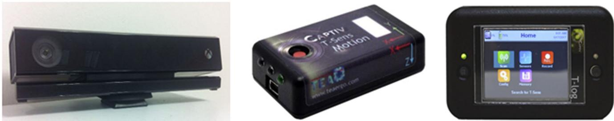  
F I G U R E 1 Kinect V2（左）、Captiv 传感器（中）和 Captiv 记录设备（右）

本研究所使用的第二个运动捕捉系统是由 TEA group 提供的 Captiv L7000 系统（见 Figure 1）。该系统使用集成了磁力计、加速度计和陀螺仪的惯性传感器来进行运动检测。传感器通过绑带固定在受试者身上，严格按照制造商的建议正确佩戴传感器是确保精确测量的必要条件。共有 15 个传感器分别放置在左右上臂、前臂、手部（通过手套固定）、大腿、小腿、足部，以及前额、背部和臀部的正中位置。如果仅检查某些特定关节，也可以使用较少的传感器——但每次测量都必须佩戴背部传感器。由电池供电的传感器为无线传输，并与佩戴在受试者身上的记录设备进行通信。采样率可选 32、64 或 128 Hz。借助 TEA 提供的配套软件，来自加速度计、陀螺仪和磁力计的数据被转换为四元数，然后通过算法合成关节角度。

出于本研究的目的选择这两个系统，一方面是因为 Kinect 是一种相当便宜且广泛普及的系统，在文献中常被评估为具有足够的性能。因此，它可能特别适合那些没有足够资金购买昂贵系统的企业。此外，与许多替代的运动捕捉技术不同，操作员在工作时不会受到标记点或线缆的影响。另一方面，评估 Captiv 是因为它采用了与 Kinect 不同的运动捕捉方法，且尚未经过充分验证。此外，与光学运动捕捉系统相比，基于惯性测量单元的系统由于设置快捷，更适合现场研究，这使得 Captiv 系统在实际分析中极具吸引力。

因此，这两个系统都是由硬件和软件组成的成熟完整解决方案。我们的重点不在于改进系统所使用的算法。相反，整个系统被视为一个集成的测量工具，我们对其输出结果进行分析。通过对比这两个系统，我们可以评估两种截然不同的运动捕捉技术，从而为工业作业任务中哪种系统更适合捕捉姿势和运动提供行动建议。

## 2.2 | 受试者

12 名年轻且健康的受试者（年龄：23.8 ± 2.6 岁，身高：177.3 ± 9.4 cm，体重：70.9 ± 12.3 kg，7 名男性和 5 名女性）参与了本研究，该样本量与同类研究相当（例如，Huber et al.. 2015: Plantard. Muller et al.. 2017: Plantard, Shum et al., 2017）。所有受试者在实验前均阅读了伦理声明并签署了书面知情同意书。受试者身着紧身衣物，以便能够妥善佩戴惯性传感器。

## 2.3 | 实验流程

实验装置包括将两个 Kinect V2 传感器分别放置在受试者前方 2.5 m 和 2.7 m 处，且高出地面 1.5 m；参见 Figure 2。其中一个传感器正对受试者，因为这常被描述为最佳传感器布置方案（例如，Xu, Robertson, Chen, Lin, & McGorry, 2017）。在初步测试中，第二个传感器与第一个传感器呈 80° 夹角放置（iPi Soft, 2019）。该布置方式在以往的研究中也曾被采用（例如 Skals et al., 2017；Stone & Skubic, 2011），并在我们的测试前被证实特别稳健，即使对于复杂动作也是如此，因此在实验中予以采用。在本研究的所有实验中，均注意尽可能排除所有潜在影响，如铁磁性金属、电磁辐射或传感器对齐不准等。

为了评估两个系统的准确性，记录了 12 名志愿者的静态姿势和基本动作（双手持箱和不持箱两种情况）。重点关注上肢关节角度：(a) 肩关节外展/内收，(b) 肩关节屈曲/伸展，以及 (c) 肘关节屈曲/伸展，因为肩部和肘部通常与上肢的工作相关肌肉骨骼疾患（work‐related MSDs）相关联（Aptel, Aublet‐Cuvelier, & Cnockaert, 2002；Buckle & Devereux, 2002）。在实验过程中，使用两个系统同时测量关节角度，并使用光信号对两个系统的原始数据进行时间同步。如 Table 1 所述，该流程分为三个阶段。

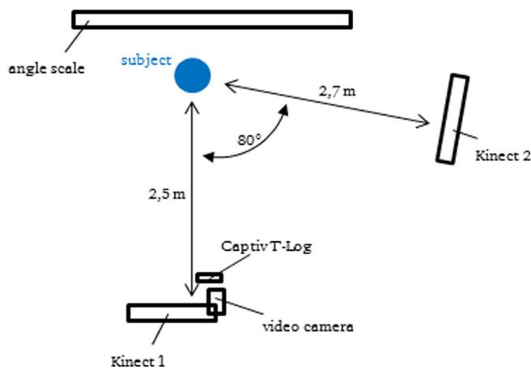  
Figure 2 实验装置

阶段 1 包括四种与上肢相关的预设静态姿势（见 Figure 3）。随后，使用动作捕捉系统和测角计（goniometer）测量受试者的关节角度。由于资源限制，无法使用通常作为金标准的光学标记点系统；取而代之的是使用测角计，它是测量关节角度的标准工具（Lee et al., 2015；Milanese et al., 2014）。它具有较高的效度（Rothstein, Miller, & Roettger, 1983）以及测试者内和测试者间信度（Brosseau et al., 2001）。因此，在类似研究中，测角计针对简单动作已成功被用作金标准，例如 Lee et al. (2015) 和 Hawi et al. (2014)。例如，针对肘关节屈曲/伸展所选取的解剖标志点为外上髁、肩峰尖和腕关节中线（Chapleau, Canet, Petit, Laflamme, & Rouleau, 2011）。

在阶段 2 和阶段 3 中，评估了两种系统在上肢基本运动中的准确性。因此，进行了肩部外展和屈曲以及肘部屈曲（左右两侧）。在测试过程中，受试者保持直立，不移动腿部或弯曲背部。阶段 2 中的动作是在没有手持物体的情况下进行的。在阶段 3 中，动作期间双手持有一个箱子（尺寸：35 cm × 25 cm × 25 cm）。在这种情况下，一个 Kinect 传感器对其中一只手臂的视线被遮挡。因此，可以确定手持箱子对 Kinect V2 角度测量准确性的影响。

安装了一个角度刻度标尺（尺寸 2 m × 1 m）作为运动的金标准，因为使用测角仪无法连续记录角度。上肢围绕角度刻度标尺的原点旋转，以便精确读取角度。为此，刻度标尺通过绳索安装在天花板上，以便调节其高度。角度刻度标尺的原点必须精确位于被测关节的高度。使用摄像机从标尺确定角度以进行动作评估。借助激光将摄像机对准该高度，以防止透视失真。Matsen et al. (2016) 采用了类似的程序，他们在照片上测量了实际的关节角度。

## 2.4 | 原始数据处理

首先，导出两个系统的运动数据。Captiv L7000 软件提供了自动计算关节角度（肩部外展/屈曲和肘部屈曲）的功能，可直接用于评估。数据集的采样频率从 32 Hz 降采样至 30 Hz，以与 Kinect 数据保持一致。

相比之下，在用于 Kinect V2 的 iPi Soft 软件中，只能导出关节的笛卡尔坐标。为了从坐标计算关节角度 φ，通过线性代数计算了向量 $\vec { v } _ { \mathrm { i } }$ 和解剖平面。数学模型基于 Lee et al. (2015) 以及 Diego‐Mas and Alcaide‐Marzal (2014) 的模型。例如，肘部角度是利用上臂和前臂的向量计算得出的。

$$
\varphi_ {\mathrm{elbow}} = \cos^ {- 1} \left(\frac {\langle \overrightarrow {v _ {\mathrm{upperarm}}} \cdot \overrightarrow {v _ {\mathrm{forearm}}} \rangle}{| \overrightarrow {v _ {\mathrm{upperarm}}} | \cdot | \overrightarrow {v _ {\mathrm{forearm}}} |}\right).\tag{1}
$$

确定了解剖学平面以计算肩关节角度。对于额状面，选取了左右肩的连接向量以及由脊柱基部与颈部之间的连接所构成的躯干向量。以此为基础，定义了矢状面。第一个支撑向量也通过躯干向量进行描述。第二个支撑向量被定义为额状面的法向量 n⃗ (Diego‐Mas &

T A B L E 1 本研究各阶段概述

<table><tr><td>阶段</td><td>活动</td><td>重复次数</td><td>金标准</td></tr><tr><td>1</td><td>与上肢相关的四种不同静态姿势</td><td>一次</td><td>量角器</td></tr><tr><td>2</td><td>无箱子情况下的肩关节外展、内收以及屈肘至 90°</td><td>各三次</td><td>角度标尺</td></tr><tr><td>3</td><td>有箱子情况下的肩关节外展、内收以及屈肘至 90°</td><td>各三次</td><td>角度标尺</td></tr></table>

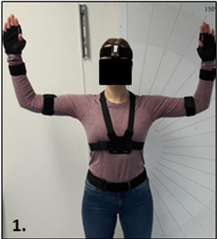

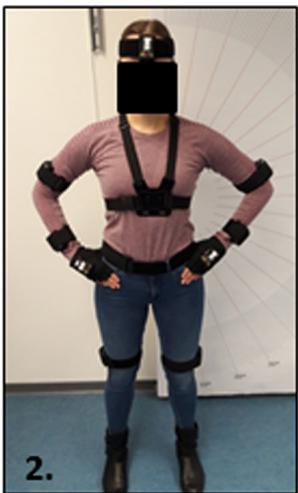

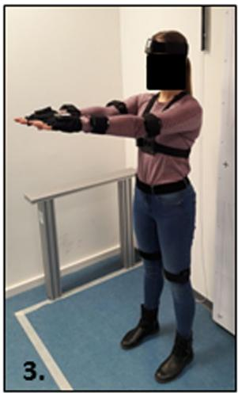

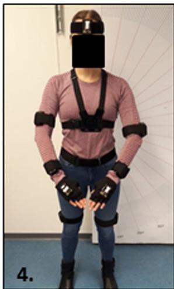  
F I G U R E 3 阶段 1 中的静态姿势（测量了以下关节角度：(a) 左右肩外展；(b) 左右肩外展与屈肘；(c) 左右肩屈曲；(d) 左右肩屈曲与屈肘）

Alcaide‐Marzal, 2014)。采用以下方法来确定肩关节的外展或屈曲角度。

(1) 上臂在额状面上的投影向量与矢状面之间的夹角与肩关节的外展角度一致。

(2) 上臂在矢状面上的投影向量与额状面之间的夹角与肩关节的屈曲角度一致 (Lee et al., 2015)。

为了使上述过程自动化，开发了一个 Visual Basic for Applications (VBA) 宏。在计算出两个动作捕捉系统测量的角度、完成同步并收集到一个数据集中后，手动添加了相应的金标准数值。为此，使用了阶段 1 中用量角器测量的数值。对于阶段 2 和阶段 3，从角度标尺上读取每个动作和受试者的时间同步测量点，并添加到数据集中。

## 2.5 | 统计分析

为了确定两种动作捕捉系统与金标准（gold standard）之间的偏差，计算了平均绝对误差（MAE）。假定金标准代表真实值，则 MAE 表示系统的测量误差。在文献中，这种误差计算方式经常用于评估 Kinect V2 传感器（例如，Cippitelli et al., 2015；Eltoukhy, Kuenze, Oh, Wooten, & Signorile, 2017；Nixon, Howard, & Chen, 2013；Schmitz et al., 2015）。

在本研究中，MAE 的计算公式如下，其中 $n$ 为测量值的数量。

$$
\text { MAE } = \frac {\sum_ {i = 1} ^ {n} \left| \varphi_ {\text { KinectV2 / Captiv }} - \varphi_ {\text { gold   standard }} \right|}{n}.\tag{2}
$$

我们遵循 Willmott 和 Matsuura (2005) 的建议，选择 MAE 而非均方根误差（RMSE）作为偏差的衡量指标，因为 RMSE 赋予较大误差相对更高的权重，因而难以解释。然而，下文也报告了 RMSE，以便将我们的结果与以往依赖 RMSE 的研究进行比较。为了分析两个系统之间的差异，由于相应的数据不呈正态分布，因此进行了 Wilcoxon 符号秩检验（$\alpha = .05$）。

此外，通过比较每次动作重复的最大角度、最小角度和中点角度（在 $0.5 \times t$ 处产生的角度，其中 $t = t _ { \mathrm { m a x a n g l e } } - t _ { \mathrm { m i n a n g l e } } )$，计算了两个系统与金标准之间的相关系数。需要注意的是，高相关性并不一定意味着测量值具有高度的定量一致性（Dolatabadi et al., 2016）。根据数据集是否呈正态分布，应用了两种不同的方法，即 Pearson 和 Spearman 相关系数。所有必要的计算均使用 IBM SPSS 进行。为了便于说明，绘制了 Bland–Altman 图。这些图用于考察两个系统的测量值与金标准之间是否存在绝对一致性（Bland & Altman, 1986）。金标准与 Kinect 或 Captiv 测量值的平均值 x xgold standard − Kinect Captiv/ 被绘制在 x 轴 2 上，两种测量值之间的差值 $x _ { \mathrm { K i n e c t / C a p t i v } } - x _ { \mathrm { g o l d s t a n d a r d } }$ 被绘制在 y 轴上。

## 3 | 结果

本节展示了关于两个系统在各阶段准确性的受试者研究的描述性结果。

## 3.1 | 阶段 1 的结果

与测角仪相比，在静态姿势下，各系统测量值的 MAE 对于 Kinect V2 介于 2.5° 到 12.9° 之间，对于 Captiv 则介于 1.9° 到 14.9° 之间（见 Table 2）。尤其是针对肘部，Captiv 系统表现出较高的误差，而在所有姿势中肩部角度的捕捉都非常准确，偏差 <4°。

总体而言，两个系统的相关系数都非常高且显著，除了 Kinect 对外展（姿势 1）和屈曲（姿势 3）的测量，以及 Captiv 对肘部角度的测量。

## 3.2 | 阶段 2 和 3 的结果

在使用角度标尺对运动过程中的关节角度进行手动评估后，重新计算了 MAE、RMSE 和相关系数。对于阶段 2（无箱子）和阶段 3（有箱子），这些数值分别总结在 Table 3 和 Table 4 中。

在阶段 2 中，肩部外展期间的测量误差对于 Kinect V2 传感器和 Captiv 系统而言均相对较低，${ \mathsf { M A E } } < 3 . 9 ^ { \circ }$。与阶段 2 相比，在阶段 3 中添加箱子导致 Kinect V2 在该动作中的测量值显著偏高（Wilcoxon signed‐rank 检验；左侧：$p = . 0 1 )$。然而总体而言，在肩部外展方面，两个系统的平均误差均保持在 5.0° 以下。因此，在有箱子和无箱子的实验中，r > .89 的相关性非常高且具有统计学意义。就阶段 2 的外展而言，两种动作捕捉系统的相关系数 r > .97，几乎达到完全相关。

对于肩部屈曲，Kinect V2 的 MAE 明显高于 Captiv L7000。Captiv 系统的误差保持在 4.2° 以下。Kinect V2 的偏差较大，尤其是左臂在阶段 $2 \ ( \mathsf { M A E } _ { \mathsf { r i g h t } } = 9 . 5 ^ { \circ } , \mathsf { M A E } _ { \mathsf { l e f t } } = 2 0 . 9 ^ { \circ }$，Wilcoxon signed‐rank 检验；p = .068）和阶段 3 $\mathsf { \Gamma } ( \mathsf { M A E } _ { \mathrm { r i g h t } } = 1 0 . 2 ^ { \circ }$ $\mathsf { M A E } _ { \mathsf { l e f t } } = 2 6 . 7 ^ { \circ }$，Wilcoxon signed‐rank 检验；p < .001）的屈曲过程中均表现出比右臂更大的平均绝对误差。对此的讨论见 Section 4。

对于肘部屈曲，Kinect 系统的 MAE 也高于 Captiv，尤其是在左臂检测方面。这也反映在相关性上，Kinect 的相关系数（r < .72）低于 Captiv（r > .93）。

最后，可以观察到，在肩部和肘部的屈曲测量中，Kinect 系统在阶段 3（Phase 3）的测量偏差显著高于阶段 2（Phase 2）。例如，左肘的 MAE 从阶段 2 的 22.5° 偏差增加到阶段 3 的 40.2° 极高误差（Wilcoxon 符号秩检验；p < .001）。然而，Captiv 在这两个阶段之间的测量差异要小得多，甚至可以忽略不计。

基于计算得到的数据，生成了 Bland–Altman 图，如图 4–6（Figures 4–6）所示。

## 4 | 讨论

## 4.1 | 静态姿势

如表 2（Table 2）所示，两个系统捕获的肩部静态外展平均绝对误差都非常小。这既适用于较小的外展角度，也适用于较大的外展角度，

Table 2 MAE、RMSE 与相关系数——阶段 1

<table><tr><td rowspan="2" colspan="3">阶段 1</td><td colspan="2">MAE</td><td colspan="2">RMSE</td><td colspan="2">相关系数</td></tr><tr><td>Kinect V2</td><td>Captiv</td><td>Kinect V2</td><td>Captiv</td><td>Kinect V2</td><td>Captiv</td></tr><tr><td rowspan="4">肩部外展/内收</td><td rowspan="2">姿势 1</td><td>右侧</td><td>6.5°</td><td>3.3°</td><td>10.0°</td><td>4.5°</td><td>0.146</td><td>0.984**</td></tr><tr><td>左侧</td><td>4.9°</td><td>2.8°</td><td>8.2°</td><td>3.4°</td><td>0.120</td><td>0.947**</td></tr><tr><td rowspan="2">姿势 2</td><td>右侧</td><td>2.5°</td><td>3.1°</td><td>3.2°</td><td>4.9°</td><td>0.815**</td><td>0.660*</td></tr><tr><td>左侧</td><td>2.9°</td><td>2.1°</td><td>4.7°</td><td>2.7°</td><td>0.658*</td><td>0.945**</td></tr><tr><td rowspan="4">肩部屈曲/伸展</td><td rowspan="2">姿势 3</td><td>右侧</td><td>12.9°</td><td>2.1°</td><td>15.0°</td><td>2.7°</td><td>0.300</td><td>0.957**</td></tr><tr><td>左侧</td><td>7.9°</td><td>2.1°</td><td>10.0°</td><td>2.6°</td><td>0.554</td><td>0.967**</td></tr><tr><td rowspan="2">姿势 4</td><td>右侧</td><td>10.9°</td><td>1.8°</td><td>13.3°</td><td>2.5°</td><td>0.848**</td><td>0.989**</td></tr><tr><td>左侧</td><td>8.8°</td><td>1.9°</td><td>11.1°</td><td>2.5°</td><td>0.854**</td><td>0.989**</td></tr><tr><td rowspan="4">肘部屈曲/伸展</td><td rowspan="2">姿势 2</td><td>右侧</td><td>7.0°</td><td>13.3°</td><td>8.5°</td><td>15.1°</td><td>0.861**</td><td>0.737**</td></tr><tr><td>左侧</td><td>4.4°</td><td>12.1°</td><td>7.0°</td><td>14.0°</td><td>0.751**</td><td>0.494</td></tr><tr><td rowspan="2">姿势 4</td><td>右侧</td><td>4.4°</td><td>13.8°</td><td>5.6°</td><td>16.8°</td><td>0.923** (S)</td><td>0.650* (S)</td></tr><tr><td>左侧</td><td>4.6°</td><td>14.9°</td><td>5.0°</td><td>15.9°</td><td>0.979**</td><td>-0.343</td></tr></table>

\*\*p < .01.  
注：(S)：Spearman 相关系数，其余为 Pearson 相关系数。  
\*p < .05.  
缩略语：MAE，平均绝对误差（mean absolute error）；RMSE，均方根误差（root mean square error）。

TABLE 3 无箱条件下的 MAE、RMSE 和相关系数——阶段 2

<table><tr><td rowspan="2" colspan="2">阶段 2</td><td colspan="2">MAE</td><td colspan="2">RMSE</td><td colspan="2">相关系数</td></tr><tr><td>Kinect V2</td><td>Captiv</td><td>Kinect V2</td><td>Captiv</td><td>Kinect V2</td><td>Captiv</td></tr><tr><td rowspan="2">肩关节外展/内收</td><td>右侧</td><td>3.9°</td><td>2.6°</td><td>5.1°</td><td>3.1°</td><td>0.978**</td><td>0.992**</td></tr><tr><td>左侧</td><td>2.8°</td><td>2.8°</td><td>4.1°</td><td>4.0°</td><td>0.972** (S)</td><td>0.977** (S)</td></tr><tr><td rowspan="2">肩关节屈曲/伸展</td><td>右侧</td><td>9.5°</td><td>4.1°</td><td>10.9°</td><td>5.0°</td><td>0.972**</td><td>0.991**</td></tr><tr><td>左侧</td><td>20.9°</td><td>3.0°</td><td>31.6°</td><td>3.9°</td><td>0.494**</td><td>0.990**</td></tr><tr><td rowspan="2">肘关节屈曲/伸展</td><td>右侧</td><td>14.8°</td><td>6.9°</td><td>32.8°</td><td>8.9°</td><td>0.645**</td><td>0.979**</td></tr><tr><td>左侧</td><td>22.5°</td><td>7.2°</td><td>40.7°</td><td>8.9°</td><td>0.519** (S)</td><td>0.975**</td></tr></table>

注：(S)：Spearman 相关系数，其余为 Pearson 相关系数。  
缩写：MAE，平均绝对误差（mean absolute error）；RMSE，均方根误差（root mean square error）。

$$
^ {* *} p <  . 0 1.
$$

其中 Captiv 的误差略小，为 ≤3.3°。这些数值与 Chen et al. (2015) 的研究一致，他们使用两个 Kinect 传感器在外展动作中获得了 4.4° 的平均误差。需要注意的是，在姿势 1（Posture 1）中，一名受试者的手臂未被 Kinect V2 正确识别。因此，该动作中的误差高于姿势 2，这也对相关系数产生了影响。

从相应的 Bland–Altman 图（Figure 4）来看，Captiv 在许多情况下的平均差异均接近于零。此外，在 Captiv 测量中，两条虚线（95% 一致性界限）彼此更加接近。一致性界限越窄，该测量方法的实用性就越高（Dolatabadi et al., 2016）。

然而，对于肩部屈曲，我们观察到两个系统之间存在显著的精度差异（Wilcoxon 符号秩检验）。虽然 Captiv 给出了非常准确的值（$M A E \leq 2 . 1 ^ { \circ } ,$），但对于各个独立姿势，Kinect V2 的平均误差在 7.9° 至 12.9° 之间。Fernandez‐Baena、Susin 和 Lligadas（2012）在通过 Kinect V1 测量肩部屈曲时也观察到了类似的平均误差（7°‐10°）。另一方面，Huber 等人（2015）报道，当使用放置在受试者前方的 V1 型号检测屈曲时，平均偏差 >15°。特别是右侧，由于受到受试者身体的遮挡，只能被两个 Kinect 传感器中的一个捕获，因而显示出非常高的误差。Bland–Altman 图（Figure 5）显示，Kinect 与测角仪之间的均值差为负值。因此，Kinect V2 低估了肩部的屈曲角度。

在静态姿势下的肘部屈曲则得出了相反的结果。在两侧以及两种姿势下，Kinect 测量的平均绝对误差均低于 7°。然而，与测角仪测量相比，Captiv 系统的误差明显更高，误差 ≥12°。

该误差可能是由 Captiv 系统的初始化（手动对齐传感器以尽量减少环境影响）引起的；尽管初始化完全按照制造商的建议进行，但根据软件显示，其质量仅为“中等”（moderate）。中等的初始化质量可能无法满足最高的精度要求，在解释结果时必须将此因素考虑在内。

总之，在没有身体部位遮挡的非常简单、静态的情境下，Kinect V2 能够提供与 Captiv L7000 几乎同样准确的结果。

## 4.2 | 基础动作

本小节对动态实验进行评估。以下几类遮挡尤其值得关注。

T A B L E 4 带有箱子时的 MAE、RMSE 和相关系数——阶段 3

<table><tr><td rowspan="2" colspan="2">阶段 3</td><td colspan="2">MAE</td><td colspan="2">RMSE</td><td colspan="2">相关性</td></tr><tr><td>Kinect V2</td><td>Captiv</td><td>Kinect V2</td><td>Captiv</td><td>Kinect V2</td><td>Captiv</td></tr><tr><td rowspan="2">肩关节外展/内收</td><td>右侧</td><td>5.0°</td><td>2.0°</td><td>6.5°</td><td>2.5°</td><td>0.891** (S)</td><td>0.996**</td></tr><tr><td>左侧</td><td>4.3°</td><td>2.8°</td><td>5.2°</td><td>3.6°</td><td>0.977**</td><td>0.993**</td></tr><tr><td rowspan="2">肩关节屈曲/伸展</td><td>右侧</td><td>10.2°</td><td>4.2°</td><td>11.0°</td><td>5.2°</td><td>0.926** (S)</td><td>0.940** (S)</td></tr><tr><td>左侧</td><td>26.7°</td><td>3.4°</td><td>35.7°</td><td>4.4°</td><td>0.161 (S)</td><td>0.931** (S)</td></tr><tr><td rowspan="2">肘关节屈曲/伸展</td><td>右侧</td><td>13.8°</td><td>10.7°</td><td>20.5°</td><td>14.1°</td><td>0.721**</td><td>0.939**</td></tr><tr><td>左侧</td><td>40.2°</td><td>9.4°</td><td>49.1°</td><td>12.5°</td><td>0.013 (S)</td><td>0.952**</td></tr></table>

注：(S)：斯皮尔曼相关系数（Spearman's correlation coefficient），否则为皮尔逊相关系数（Pearson's correlation coefficient）。  
缩写：MAE，平均绝对误差（mean absolute error）；RMSE，均方根误差（root mean square error）。

$$
^ {* *} p <  . 0 1.
$$

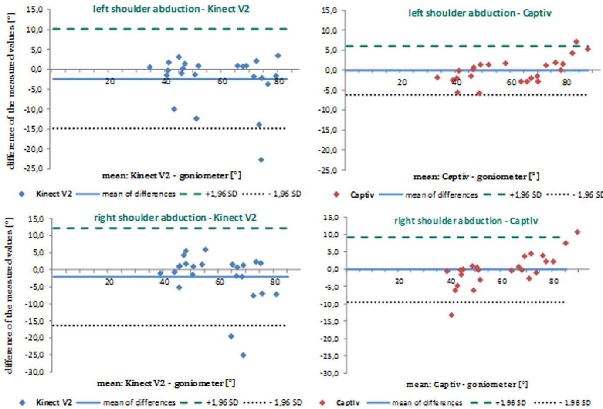  
F I GU R E 4 Bland–Altman 图——阶段 1：肩关节外展

(1) 自身遮挡（左臂被右臂遮挡）。

(2) 工具/设备遮挡（双手所持箱子遮挡的身体部位）。

如上一节所述，在阶段 2 中，两个系统对于肩关节外展的平均绝对偏差非常低（MAE < 4.4°），且相关系数很高（r > .9）。对于这些无遮挡的运动，推荐使用这两个系统。

在阶段 3 中，Kinect 系统的 MAE 更高。平均值的统计比较表明，阶段 3 中左肩外展的平均绝对误差显著高于阶段 2（Wilcoxon 符号秩检验；p = .01）。这可能是由于在进行外展或屈曲时，侧向放置的传感器的视野被箱子遮挡。尽管正对受试者的摄像头应该能够较好地检测运动，但当受试者手持箱子时，误差会有所增加。第二台 Kinect 传感器（配合 iPi Soft 软件）似乎无法完全补偿另一台传感器被遮挡的视野。

关于肩关节屈曲的捕捉，Captiv 在阶段 2 和阶段 3 中的最大 MAE 为 4.2°。显著的相关系数（r > .93）表明其与金标准几乎完全一致。相比之下，与静态姿势类似，Kinect 系统的误差显著更高。

为了深入了解自遮挡对 Kinect 传感器获取结果的影响，对受试者左右关节的误差进行了比较。在阶段 2 中，左肩的 MAE 为 20.9°，而右臂的 MAE 仅为 9.5°。尽管如此，这些差异在阶段 2 中勉强显著，p = .068（阶段 3 中 p < .001）。这种效应可以解释为在双侧肩部同时屈曲期间，左臂被右臂遮挡。第二台 Kinect 传感器由于放置位置不同而能够捕捉到未被遮挡的双臂，但无论在有箱子还是无箱子的阶段，都无法弥补第一台传感器的遮挡问题。

图 6 中的 Bland–Altman 图直观地展示了这些误差。右侧图中（无自遮挡）的点状一致性界限线比左侧图中彼此靠得更近得多。从左侧图中位于差值（y轴）负值范围的大量左肩测量值中，自遮挡也变得显而易见。当 Kinect 无法检测到被遮挡手臂的关节时，就会出现这些较大的负差值。相应的 iPi Soft 可视化结果表明，在这些情况下，尽管手臂实际上屈曲了 90°，但手臂却显示为平行于上身向下垂。此外，对于肩部屈曲，也可以识别出箱子遮挡的影响。第三阶段的 MAE 再次高于第二阶段。

Kinect V2 差值均值   +1,96 SD … - 1,96 SD

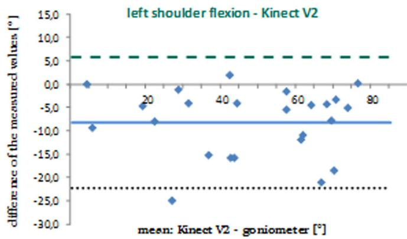

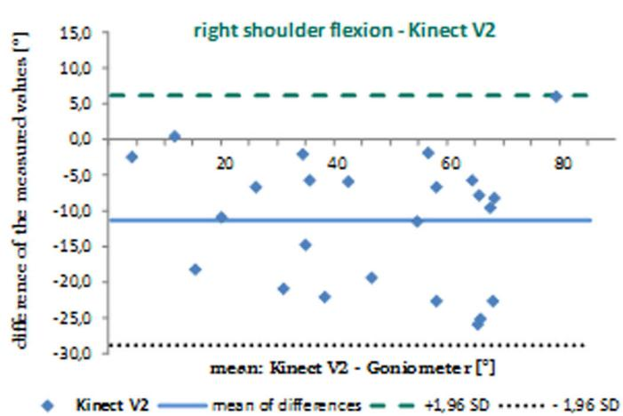  
图 5 Bland–Altman 图——阶段 1：肩部屈曲

在肘部屈曲期间，两个系统对关节角度的检测都不能令人完全满意。在静态阶段已经描述过的 Captiv 初始化问题在运动过程中也可以观察到。6.9° 至 10.7° 之间的平均绝对误差对于特定的临床研究或人机工程学分析可能不够精确。一个系统是否仍可用于调查，最终取决于分析的背景以及分析的结论是否会因测量误差而改变（Myles & Cui, 2007）。Kinect V2 传感器对肘部关节角度的检测误差甚至高于 Captiv 的测量误差。与肘部屈曲静态动作捕捉相对准确的结果相反，Kinect 传感器对某些受试者动态运动的检测失败了。身体部位的自遮挡似乎再次成为了问题所在。阶段 2 中左肘的平均绝对误差（MAE = 22.5°）高于右肘获得的误差（MAE = 14.8°）。

除了本节中呈现的数学误差计算之外，还对 Kinect 进行了反复的定性观察。在搬运箱子的所有动作中，有近一半出现了系统误差。iPi Soft 可视化显示，Kinect 将受试者双手之间抱着的箱子错误地识别为受试者的腿部（见 Figure 7）。因此，Kinect 可能会将工作物件错误地识别为身体部位，从而记录下错误的动作。此处描述的误差模式对上半身关节角度的影响微乎其微，因为仅有一条腿受到影响。然而，系统的这种误判使得工业实践中的检测变得困难甚至无法进行，尤其是当下半身角度具有重要意义时。

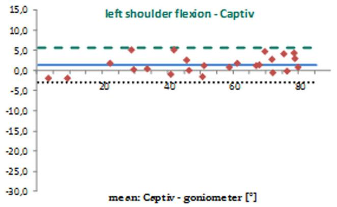  
Captiv 差异均值   +1,96 SD  - 1,96SD

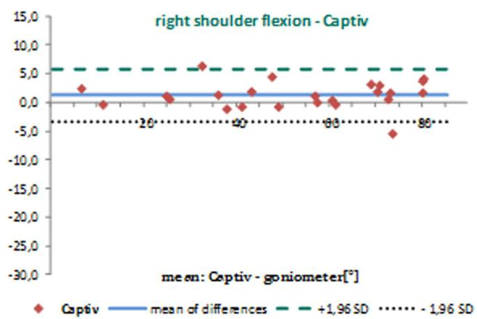

本研究的结果存在一定的局限性。首先，必须考虑到本研究仅针对三种不同的关节角度对这两种动作捕捉系统进行了评估。此外，Kinect 系统在真实工作环境中可能会面临更多挑战。日光、背景中的移动物体、次优的传感器放置位置以及受试者更大范围的运动，都可能进一步降低动作捕捉的准确性。另外，实验仅针对相对年轻的参与者（20–27 岁）开展，这并不一定符合从事人工操作（例如物流行业中）人员的平均年龄。

## 5 | 结论

本研究旨在通过受试者实验研究，定量比较 Kinect V2 与 Captiv L7000 动作捕捉系统的精度。将两个系统在静态姿势和运动过程中测得的上肢关节角度与参考系统进行了对比。该实验研究的一个核心目标是探究从另一个角度检测运动的第二个 Kinect V2 传感器，是否能够弥补诸如搬运箱子等操作所引起的遮挡问题。这一缺点此前在文献中已有描述。研究结果表明，当受到工作物件或受试者自身的遮挡时，上肢角度的测量误差显著增大。这尤其适用于肩部和肘部的屈曲。

Kinect V2 差异均值 – – -+1,95 SD ......- 1,96 SD  
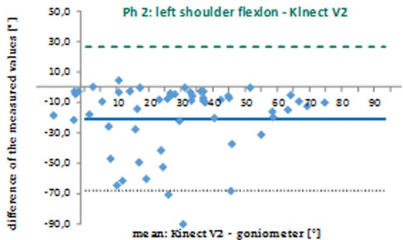

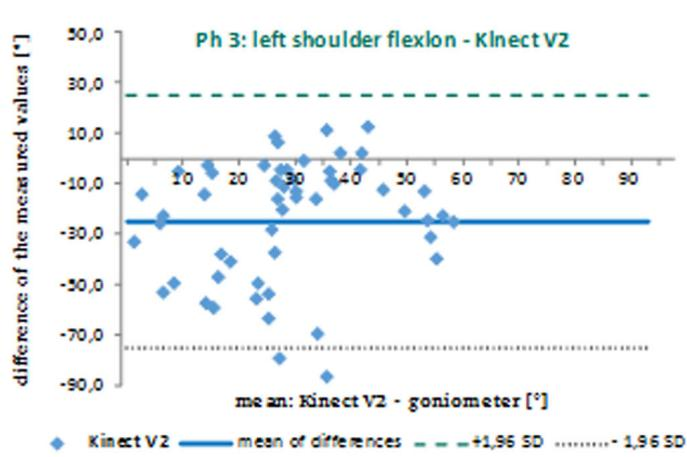  
FIGURE 6 Bland–Altman 图——阶段 2 和 3：肩部屈曲

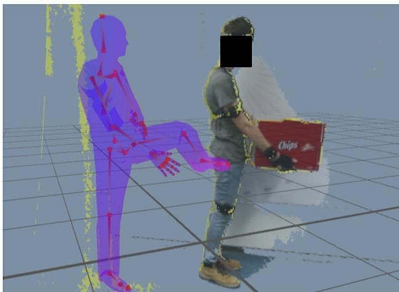

FIGURE 7 搬箱动作的误差模式  
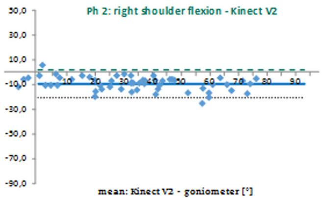

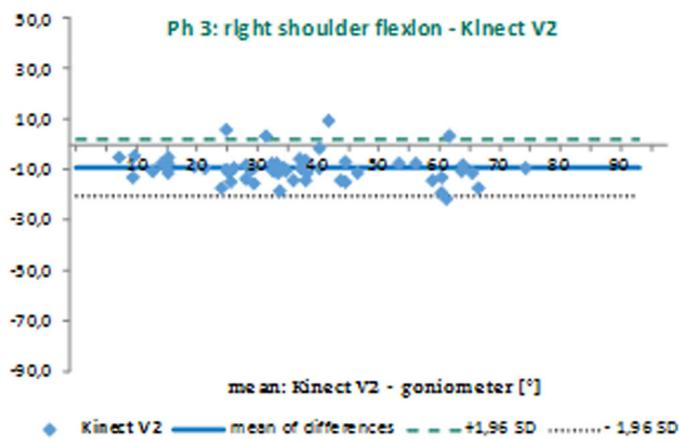

因此，即使使用两台 Kinect 传感器，遮挡仍然是一个主要的劣势。对于复杂动作，特别是在存在遮挡的工业工作环境中，就精度而言，Captiv 系统在大多数情况下更适用于人机工程学分析。

我们得出结论：在无遮挡情况下，Kinect V2 传感器和 Captiv L7000 系统均能获得准确的上肢关节角度结果。然而，使用 Kinect V2 测量时肩部屈曲角度被低估。此外，Captiv 在确定肘关节角度方面精度较低；在本研究中，这可能是由于初始化质量不足所致。对于许多临床研究而言，只要使用 Kinect 采集时肢体未被遮挡，这些特性就足够满足需求。在下一步工作中，在真实制造环境中由 Captiv 采集的动作数据可整合到人机工程学风险评估中，例如 RULA 或 European Assembly Worksheet（欧洲装配工单）。

此外，在进一步的研究中测试 Captiv 系统在更复杂动作序列中的精度是很有价值的，以进一步证明其在真实工作环境中的适用性。另外，评估初始化质量对 Captiv 系统精度的影响也是十分必要的。同时，作为本研究的拓展，还可以评估使用两台以上 Kinect 传感器进行采集，或将原始数据与 iPi Soft 以外的其他软件进行集成，以分析这是否能带来更高的精度。

## 利益冲突

作者声明不存在利益冲突。

## ORCID

Tim Steinebach http://orcid.org/0000-0003-1224-9121

## 参考文献

Aptel, M., Aublet‐Cuvelier, A., & Cnockaert, J. C. (2002). Work‐related musculoskeletal disorders of the upper limb. Joint, Bone, Spine, 69 546–555.

Bartnicka, J., Piedrabuena, A., Portilla, R., Mleczko, K., Moyano, C., Pagador, J., … Tokarczyk, J. (2017). Ergonomic education in orthopedic surgery. LIFE: International Journal of Health and Life‐Sciences, 3, 194–215.

Bartnicka, J., Ziętkiewicz, A., & Kowalski, G. (2015). Ergonomic analysis of surgeries with the use of wireless body postures measurement system. Innovations in Manufacturing Management and Engineering, 2, 361–371.

BAuA–Federal Institute for Occupational Safety and Health (2018). Economic Costs due to Incapacity for Work 2016. Retrieved from https://www.baua.de/DE/Themen/Arbeitswelt-und-Arbeitsschutz-im-Wandel/Arbeitsweltberichterstattung/Kosten‐der‐AU/pdf/Kosten‐2016. pdf? blob=publicationFile&y=4

BKK Gesundheitsreport (2013). BKK Gesundheitsreport 2013—Gesundheit in Bewegung. Berlin, Germany: BKK Dachverband e. V.

Bland, J. M., & Altman, D. G. (1986). Statistical methods for assessing agreement between two methods of clinical measurement. Lancet, 1, 307–310.

Bonnechère, B., Jansen, B., Salvia, P., Bouzahouene, H., Sholukha, V., & Cornelis, J. (2014). Determination of the precision and accuracy of morphological measurements using the Kinect™ sensor. Comparison with standard stereophotogrammetry. Ergonomics, 57, 622–631.

Brosseau, L., Balmer, S., Tousignant, M., O'Sullivan, J. P., Goudreault, C., Goudreault, M., & Gringras, S. (2001). Intra‐ and intertester reliability and criterion validity of the parallelogram and universal goniometers for measuring maximum active knee flexion and extension of patients with knee restrictions. Archives of Physical Medicine and Rehabilitation 82, 396–402.

Buckle, P. W., & Devereux, J. J. (2002). The nature of work‐related neck and upper limb musculoskeletal disorders. Applied Ergonomics, 33, 207–217.

Cha, K., Lee, E. Y., Heo, M. H., Shin, K. C., Son, J., & Kim, D. (2015). Analysis of climbing postures and movements in sport climbing for realistic 3d climbing animations. Procedia Engineering, 112, 52–57.

Chapleau, J., Canet, F., Petit, Y., Laflamme, G. Y., & Rouleau, D. M. (2011) Validity of goniometric elbow measurements: Comparative study with a radiographic method. Clinical Orthopaedics and Related Research, 469 3134-3140.

Chen, Y. C., Lee, H. J., & Lin, K. H. (2015). Measurement of body joint angles for physical therapy based on mean shift tracking using two low cost Kinect images. 37th Annual International Conference of the IEEE Engineering in Medicine and Biology Society, 703–706.

Choppin, S., Lane, B., & Wheat, J. (2014). The accuracy of the Microsoft Kinect in joint ang‐le measurement. Sports Technology, 7, 98–105.

Choppin, S., & Wheat, J. (2012). Marker‐less tracking of human movement using Microsoft Kinect. 30th Annual Conference of Biomechanics in Sports—Conference Proceedings Archive, 86, 231–234.

Cippitelli, E., Gasparrini, S., Spinsante, S., Gambi, E., Verdini, F., Burattini, L., & Fioretti, S. (2015). Validation of an optimized algorithm to use Kinect in a non‐structured environment for Sit‐to‐Stand analysis. Engineering in Medicine and Biology Society (EMBC), 5078–5081.

Clark, R. A., Pua, Y.‐H., Oliveira, C. C., Bower, K. J., Thilarajah, S., & McGaw, R. (2015). Reliability and concurrent validity of the Microsoft

Xbox One Kinect for assessment of standing balance and postura control. Gait & Posture, 42, 210–213

Corazza, S., Mündermann, L., Gambaretto, E., Ferrigno, G., & Andriacchi, T. P. (2010). Markerless motion capture through visual hull articulated ICP and subject specific model generation. International Journal of Computer Vision, 87, 156–169.

De Koster, R., Le‐duc, T., & Roodbergen, K. J. (2007). Design and control of warehouse order picking: A literature review. European Journal of Operational Research, 182, 481–501.

Diego‐Mas, J. A., & Alcaide‐Marzal, J. (2014). 在评估工作姿势的观察方法中使用 Kinect™ 传感器. Applied Ergonomics, 45, 976–985.

Dolatabadi, E., Taati, B., & Mihailidis, A. (2016). Microsoft Kinect for Windows v2 测量时空步态参数的同效效度. Medical Engineering and Physics, 38, 952–958.

Dutta, T. (2012). 用于工作场所三维运动学测量的 Kinect™ 传感器评估. Applied Ergonomics, 43, 645–649.

Dzeng, R. J., Hsueh, H. H., & Ho, C. W. (2017). 建筑工人姿势自动评估. 40th International Convention on Information and Communication Technology, Electronics and Microelectronics, 1027–1031.

Eltoukhy, M., Kuenze, C., Oh, J., Wooten, S., & Signorile, J. (2017). 基于 Kinect 的星偏移平衡测试期间下肢运动学和动态姿势控制评估. Gait & Posture, 58 421–427.

Fernandez‐Baena, A., Susin, A., & Lligadas, X. (2012). 用于康复治疗的 Kinect 动作捕捉数据上下肢关节运动的生物力学验证. 4th International Conference on Intelligent Net‐working and Collaborative Systems, 656–661.

Fornaser, A., Tomasin, P., De Cecco, M., Tavernini, M., & Zanetti, M (2017). 多台 Kinect V2 ToF 相机基于图的自动时空外参标定. Robotics and Autonomous Systems, 98, 105–125.

Geerse, D. J., Coolen, B. H., & Roerdink, M. (2015). 用于定量步态评估的多 Kinect v2 配备 10 米走道的运动学验证. PLOS One, 10, 1–15.

Hawi, N., Liodakis, E., Musolli, D., Suero, E. M., Stuebig, T., Claassen, L., & Citak, M. (2014). 使用体感输入设备评估肩关节和肘关节的活动度：一项初步研究. Technology and Health Care, 22, 289–295.

Huber, M. E., Seitz, A. L., Leeser, M., & Sternad, D. (2015). Kinect 骨骼用于测量肩关节角度的有效性与可靠性：一项可行性研究. Physiotherapy, 101, 389–393.

iPi Soft (2019). 双深度传感器配置. 检索自 http:/ docs.ipisoft.com/User\_Guide\_for\_Multiple\_Depth\_Sensors\_Configuration# Recording\_Video\_from\_Multiple\_Depth\_Sensors

Kuster, R. P., Heinlein, B., Bauer, C. M., & Graf, E. S. (2016). KinectOne 量化上肢运动学的准确性. Gait & Posture, 47, 80–85.

Lai, C. L., Tseng, S. Y., Huang, C. H., Pei, C., Chi, W. M., Hsu, L. C., & Sun, T. L. (2013). 增强老年人防跌倒能力的趣味且精准的静态平衡训练：一项初步研究. Human Factors and Ergonomics in Manufacturing & Service Industries, 23, 517–527.

Lee, S. H., Yoon, C., Chung, S. G., Kim, H. C., Kwak, Y., Park, H. W., & Kim, K. (2015). 使用 Kinect 测量粘连性肩关节囊炎患者的肩关节活动度. PLOS One, 10, 1–12.

Manghisi, V. M., Uva, A. E., Fiorentino, M., Bevilacqua, V., Trotta, G. F., & Monno, G. (2017). Real time RULA assessment using Kinect v2 sensor. Applied Ergonomics, 65, 481–491.

Matsen, F. A., Lauder, A., Rector, K., Keeling, P., & Cherones, A. L. (2016) Measurement of active shoulder motion using the Kinect, a commercially available infrared position detection system. Journal of Shoulder and Elbow Surgery, 25, 216–223.

Milanese, S., Gordon, S., Buettner, P., Flavell, C., Ruston, S., & Coe, D. (2014). Reliability and concurrent validity of knee angle measurement. Smart phone app versus universal goniometer used by experienced and novice clinicians. Manual Therapy, 19, 569–574.

Mishra, A. K., Skubic, M., & Abbott, C. (2015). Development and preliminary validation of an interactive remote physical therapy system. 37th Annual International Conference of the IEEE Engineering in Medicine and Biology Society, 190–193.

Müller, B., Ilg, W., Giese, M. A., & Ludolph, N. (2017). Validation of enhanced kinect sensor based motion capturing for gait assessment. PLOS One, 12, 1–18.

Myles, P. S., & Cui, J. (2007). Using the Bland‐Altman method to measure agreement with repeated measures. British Journal of Anesthesia, 99, 309–311.

Nixon, M. E., Howard, A. M., & Chen, Y. (2013). Quantitative evaluation of the Microsoft Kinect for use in an upper extremity virtual rehabilitation environment. 2013 International Conference on Virtual Rehabilitation, 222–228.

Plantard, P., Muller, A., Pontonnier, C., Dumont, G., Shum, H. P., & Multon, F. (2017). Inverse dynamics based on occlusion‐resistant Kinect data: Is it usable for ergonomics? International Journal of Industrial Ergonomics, 61, 71–80.

Plantard, P., Shum, H. P., Le Pierres, A. S., & Multon, F. (2017). Validation of an ergonomic assessment method using Kinect data in real workplace conditions. Applied Ergonomics, 65, 562–569.

Romero, V., Amaral, J., Fitzpatrick, P., Schmidt, R. C., Duncan, A. W., & Richardson, M. J. (2017). Can low‐cost motion‐tracking systems substitute a Polhemus system when researching social motor coordination in children? Behavior Research Methods, 49(2), 588–601.

Rothstein, J. M., Miller, P. J., & Roettger, R. F. (1983). Goniometric reliability in a clinical setting. Physical Therapy, 63, 1611–1615.

Schmitz, A., Ye, M., Boggess, G., Shapiro, R., Yang, R., & Noehren, B. (2015). The measurement of in vivo joint angles during a squat using a single camera markerless motion capture system as compared to a marker based system. Gait & Posture, 41, 694–698.

Skals, S., Rasmussen, K. P., Bendtsen, K. M., Yang, J., & Andersen, M. S. (2017). A musculoskeletal model driven by dual Microsoft Kinect Sensor data. Multibody System Dynamics, 41, 297–316.

Stone, E. E., & Skubic, M. (2011). Evaluation of an inexpensive depth camera for passive in‐home fall risk assessment. 5th International ICST Conference on Pervasive Computing Technologies for Healthcare, 71–77.

Taber, M. J., Sweeney, D., Bishop, N., & Boute, R. (2017). Factor effecting the capability to jettison an S92 push‐out window. Internationa Journal of Industrial Ergonomics, 58, 79–89.

Vignais, N., Bernard, F., Touvenot, G., & Sagot, J. C. (2017). Physical risk factors identification based on body sensor network combined to videotaping. Applied Ergonomics, 65, 410–417.

Wang, Q., Kurillo, G., Ofli, F., & Bajcsy, R. (2015). Evaluation of pose tracking accuracy in the first and second generations of Microsoft Kinect. Proceedings of the 2015 International Conference on Healthcare Informatics, 380‐389.

Willmott, C. J., & Matsuura, K. (2005). Advantages of the mean absolute error (MAE) over the root mean square error (RMSE) in assessing average model performance. Climate Research, 30, 79–82.

Xu, X., Robertson, M., Chen, K. B., Lin, J. H., & McGorry, R. W. (2017). Using the Microsoft Kinect™ to assess 3‐D shoulder kinematics during computer use. Applied Ergonomics, 65, 418–423.

Zhou, L., Li, Y., & Bai, S. (2017). A human‐centered design optimization approach for robotic exoskeletons through biomechanical simulation. Robotics and Autonomous Systems, 91, 337–347.

本文引用格式：Steinebach T, Grosse EH, Glock CH, Wakula J, Lunin A. Accuracy evaluation of two markerless motion capture systems for measurement of upper extremities: Kinect V2 and Captiv. Hum. Factors Man. 2020;30:291–302. https://doi.org/10.1002/hfm.20840