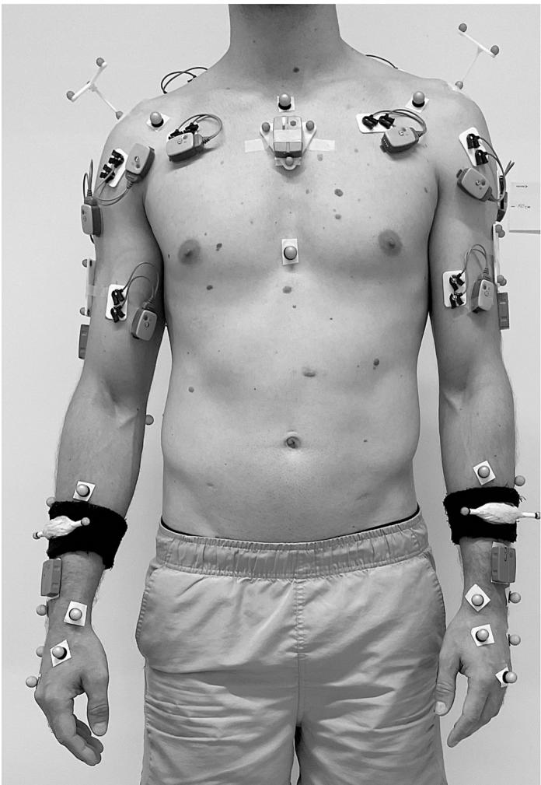
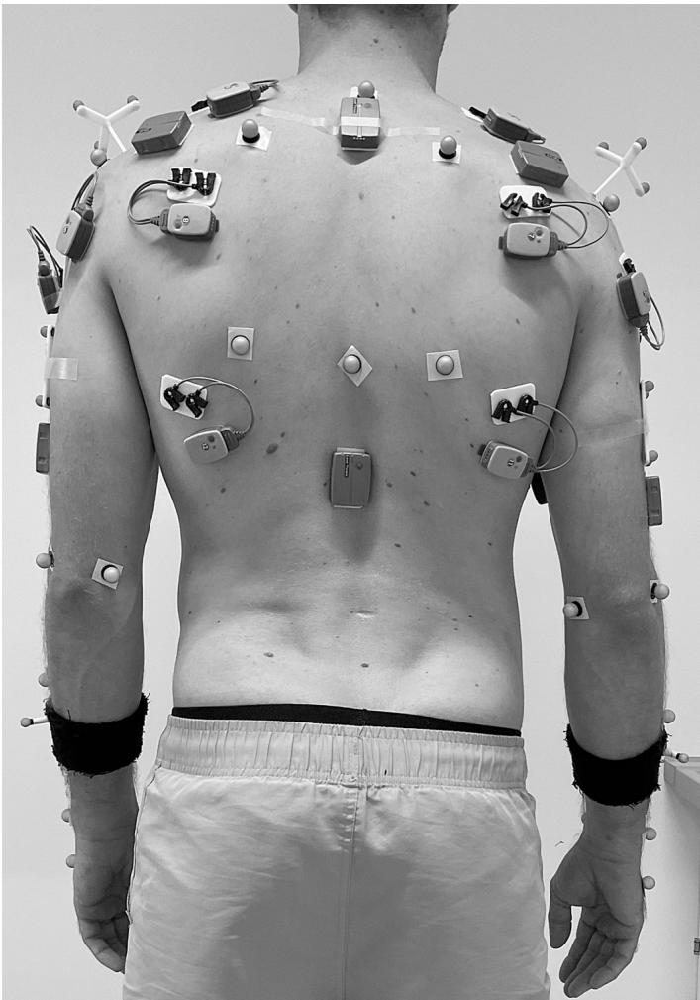
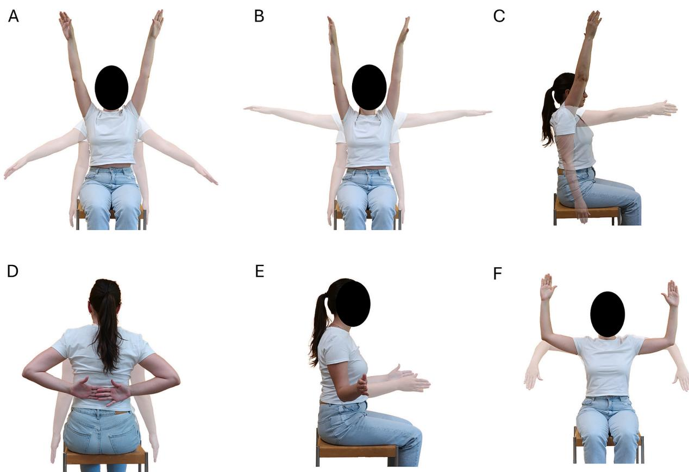
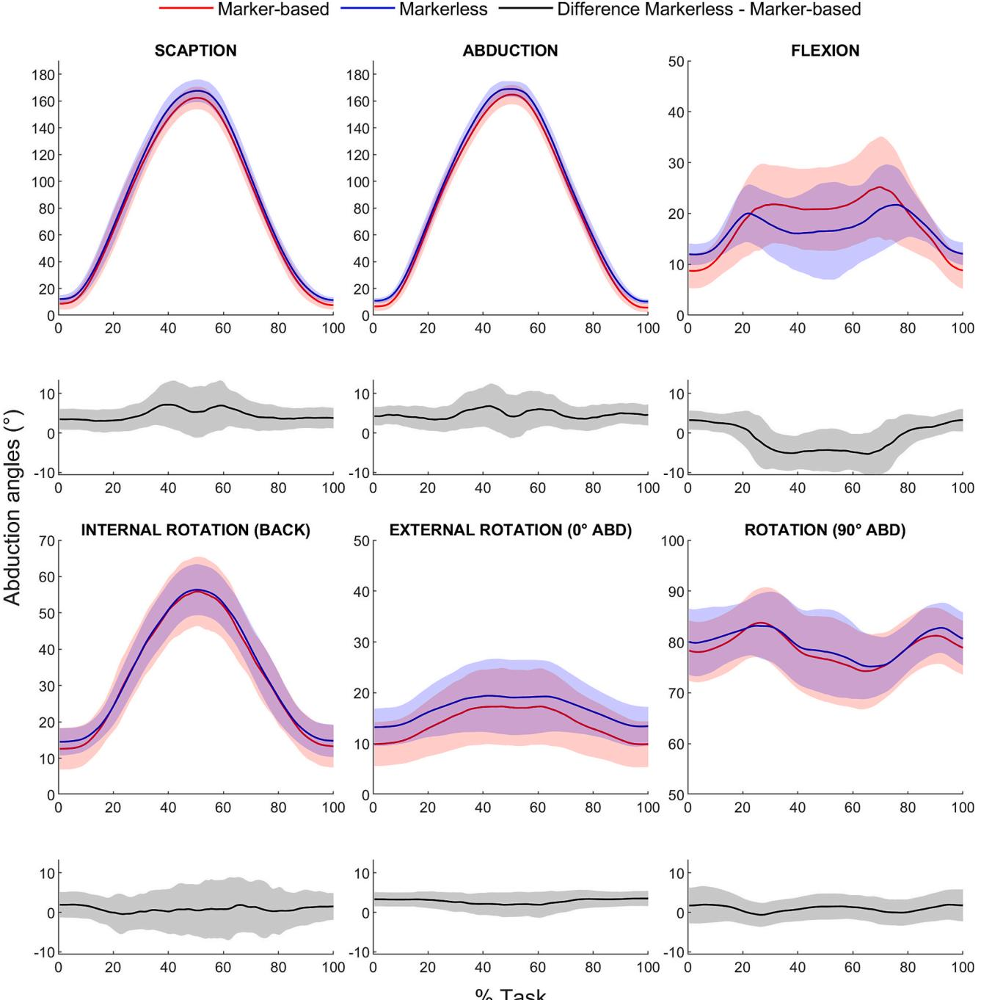
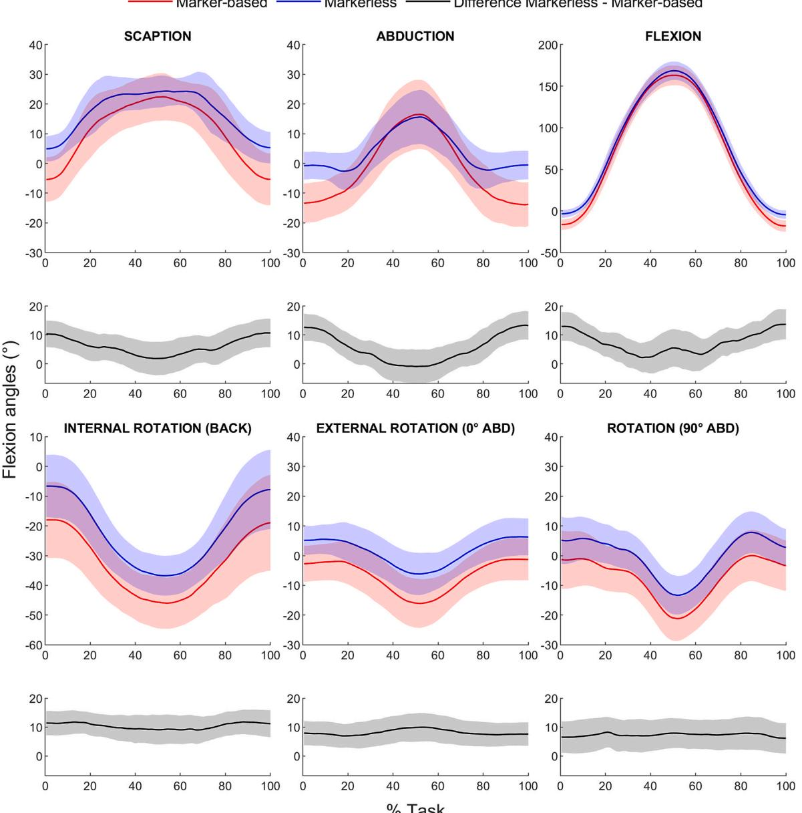
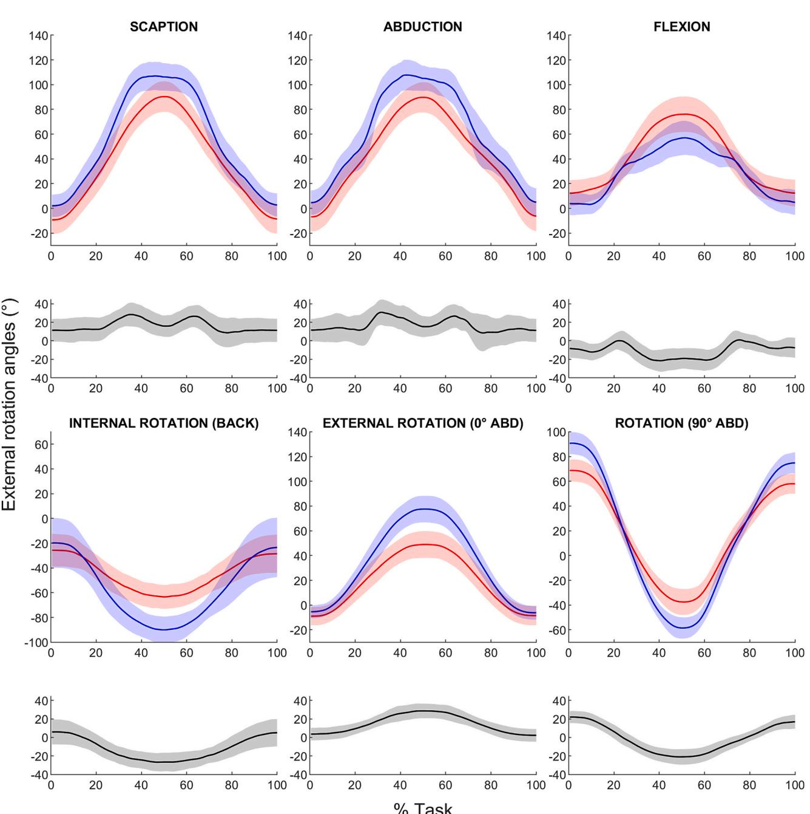

# 全臂活动度下 Theia 3D 无标记动作捕捉与基于标记动作捕捉的肩关节运动学比较

Eleonora Croci a,b,\* , Christoph Künzel a,c , Dominic Gehring c , Andreas Marc Müller a,b , Annegret Mündermann a,b,d,e

a Department of Biomedical Engineering, University of Basel, Basel, Switzerland

b Department of Orthopaedics and Traumatology, University Hospital Basel, Basel, Switzerland

c Department of Sport and Sport Science, University of Freiburg, Freiburg, Germany

d Department of Clinical Research, University of Basel, Basel, Switzerland

e Department of Teaching, Research and Development, Schulthess Clinic, Zurich, Switzerland

## 文章信息 (A R T I C L E I N F O)

关键词：肩关节（Shoulder） 活动度（Range of motion） 无标记动作捕捉（Markerless motion capture） 基于标记的动作捕捉（Marker-based motion capture）

## 摘 要 (A B S T R A C T)

尽管无标记动作捕捉系统近年来备受关注，但关于 Theia 3D 测量肩关节运动学准确性的了解仍十分有限。本研究旨在比较 Theia 3D 与金标准基于标记的动作捕捉系统在全手臂活动度范围内的肩关节运动学。研究测量了 20 名健康受试者在进行 3 次双侧全臂肩胛平面抬升（scaption）、外展、前屈、内旋、外旋以及 90° 外展位内旋和外旋动作时的肩关节运动学数据。数据由 Theia 3D (v2024.1.24) 无标记动作捕捉与基于标记动作捕捉系统同步采集。无标记和基于标记的角度轨迹呈现相似的模式，在运动转折点附近差异较大，且无标记轨迹的数值大多大于基于标记的轨迹。均方根差（RMSD）在外展角中最小（<6°），在外旋角中最大（15.3°–22.3°）。复相关系数（CMC）大多为良好至极佳（>0.75），但在 90° 外展旋转过程中的前屈角 CMC 为中等（0.65–0.75），在外旋过程中的前屈角 CMC 较弱（<0.65）。对于几乎所有动作任务，两种测量系统在三个平面上的活动度均存在显著差异。然而，冠状面和矢状面的平均差异均在最小临床重要差异范围内。我们发现两种测量方法的活动度参数之间存在中等至极强的相关性。利用 Theia 3D 评估肩关节运动学具有广阔的应用前景，但若要应用于常规临床实践，仍需进一步改进。

## 1. 引言 (Introduction)

肩袖肌群是盂肱关节的主要动态稳定结构，赋予其极大的关节活动度（range of motion, ROM）（Veeger and van der Helm, 2007），这对于许多日常活动至关重要。然而，肩部肌肉骨骼疾病的年发病率达 17.9/1000，可能会限制肩部功能（Iavernig et al., 2023）。因此，准确评估肩关节 ROM 对于临床评估、训练或康复具有重要意义。

在临床实践中，肩关节功能的评估通常结合了所有平面内的手臂运动范围以及患者报告结局指标，其中最常用的是 Constant 评分（Constant et al., 2008; Constant and Murley, 1987）、美国肩肘外科医师学会肩关节评分（American Shoulder and Elbow Surgeons Shoulder score）（Richards et al., 1994）或上肢功能障碍问卷（Disabilities of Arm, Shoulder and Hand questionnaire）（Hudak et al., 1996）。然而，这些评分包含主观成分，通常无法提供关于特定运动特征（如速度、减速时间或 ROM）的客观数据（De Baets et al., 2017; Longo et al., 2022）。肩关节运动学分析有助于获取此类客观数据，提供有关功能受损的相关信息，并可用于监测康复进展。

目前用于肩关节运动学非侵入性且无辐射测量的金标准是基于标记点（marker-based）的动作捕捉系统（Hansen et al., 2024），但由于准备和后处理时间较长，且标记点的粘贴位置可能因检查者而异（Chiari et al., 2005; Lahkar et al., 2022），其在临床环境中的适用性受到限制。为了克服这些局限性，诸如 Theia 3D 等无标记点动作捕捉系统（markerless motion capture systems）近来引起了广泛关注。Theia 3D 利用深度卷积神经网络和逆运动学，从视频中估计身体各环节的三维空间位置。由于所需准备工作极少，无标记点动作捕捉系统的数据采集耗时较短，因此在临床环境中更具可行性。尽管 Theia 3D 未对肩胛骨进行建模，但它通过提供客观的肱胸运动学（humerothoracic kinematics）数据，对于肩部或神经系统疾病患者的临床评估以及在体育运动中监测训练和进展仍具有重要价值。相比于基于标记点的动作捕捉系统，Theia 3D 在测量步态运动学方面的准确性已被广泛研究，并取得了良好的结果（D’Souza et al., 2024; Kanko et al., 2021b, 2021a; Outerleys et al., 2024; Wren et al., 2023）。相比之下，用于评估肩关节运动学的此类准确性仅在以下研究中进行了探讨：成年人拳击过程中（Lahkar et al., 2022），肩关节角度的均方根差（RMSDs）为 6.3◦ 至 12◦；成年人变向跑步过程中（Edwards et al., 2024），肩关节角度的 RMSDs 为 6.7◦ 至 56.6◦；以及儿童进行盒与块测试（box and block test）期间（Hansen et al., 2024），所有上肢关节角度的 RMSDs 均低于 6◦。由于这些研究分析的都是活动度（ROM）有限的特定动作，因此需要进一步研究来确定 Theia 3D 在包括过顶动作在内的所有平面上的全范围手臂运动中的表现。因此，本研究旨在比较健康成年人在全范围手臂运动中，通过 Theia 3D 无标记点动作捕捉系统与金标准基于标记点的动作捕捉系统测量的肩关节运动学。

  
Fig. 1. 标记点粘贴位置，前视图（左）和后视图（右）。肌电图和惯性测量单元传感器也已佩戴，但在本研究中未进行分析。

## 2. 方法

## 2.1. 受试者

共有20名年轻对照受试者参与了本项前瞻性对照研究。纳入标准为：年龄在18至30岁之间，且既往无已知肘部或肩部损伤或症状。排除标准为：体重指数（BMI）大于35 kg/m2、无法签署知情同意书、已知怀孕、植入心脏起搏器，以及存在任何影响上肢运动的神经肌肉疾病或其他病理状况。上述标准通过病史采集进行核对。在数据采集前，所有受试者均签署了书面知情同意书。本研究获得了区域伦理委员会（瑞士西北与中部伦理委员会，Ethics Committee Northwestern and Central Switzerland，EKNZ 2024–00479）的批准，并按照《赫尔辛基宣言》（Declaration of Helsinki）进行。

## 2.2. 研究流程与数据采集

根据国际生物力学学会（ISB）指南（Wu et al., 2005），所有受试者的上肢和躯干解剖标志点上均贴附了解剖反光标记点。上臂、肩峰和躯干处还放置了额外的集群标记点（Fig. 1）。

在受试者重复进行三次双侧全臂肩胛面抬举、外展、屈曲、内旋、外旋以及在90◦外展位下的内旋和外旋动作期间，同步采集了无标记点（采样率 100 Hz，Miqus 相机，Qualisys AB, Gothenburg, Sweden）和基于标记点（采样率 200 Hz，Arqus 相机，Qualisys AB, Gothenburg, Sweden）的动作捕捉数据（Fig. 2）。全臂肩胛面抬举、外展和屈曲在肘部伸直、手部处于中立位的情况下进行，从双臂垂于体侧的起始位置运动至最大 ROM 后返回。进行内旋动作时，受试者被要求从双臂垂于体侧的起始位置开始，沿背部中线向上触摸到最高可触及的点，然后返回。进行外旋动作时，受试者被要求从双臂垂于体侧的起始位置将肘部屈曲至90◦，然后将手臂向外旋转至其最大 ROM，再向内旋转返回至起始旋转位置。最后，受试者被要求在手臂外展90◦且肘部屈曲90◦的姿势下，先向内旋转，然后再向外旋转至其最大 ROM，最后向内旋转返回至中立旋转位置。所有动作任务均在受试者坐在凳子上的状态下完成。参与者接受了关于如何执行运动任务的口头和视觉指导，并在试验记录前和记录期间对其动作执行的正确性进行了定性评估。在受试者端坐、手臂垂于体侧且大拇指朝向前方的姿态下，还额外记录了一次静态试验。

  
Fig. 2. 肩部动作。肩胛骨平面外展（A）、外展（B）、屈曲（C）、内旋（D）、外旋（E），以及外展 90° 时的内旋和外旋（F）。

## 2.3. 数据处理

无标记数据使用 Theia 3D（v2024.1.24, Theia Markerless Inc., Kingston, ON, Canada）进行处理。肩关节允许 6 个自由度，三维姿态采用截止频率为 6 Hz 的样条低通巴特沃斯（Butterworth）滤波器进行滤波（Song et al., 2023）。来自 Theia 3D 的输出数据随后在 Matlab（Version 2024b, MathWorks Inc., Natick, MA, USA）中作进一步处理。Theia 3D 的旋转矩阵（X 轴指向外侧，Y 轴指向前方，Z 轴指向头侧）经过调整，以匹配 ISB 坐标系（X 轴指向前方，Y 轴指向头侧，Z 轴指向外侧）（Wu et al., 2005）。

对于基于标记的动作捕捉，标记点轨迹在 Qualisys Track manager（v2023.3, Qualisys AB, Gothenburg, Sweden）中进行重建，并在 Matlab 中作进一步处理。标记数据经过降采样以匹配无标记数据的采样率（100 Hz），并使用截止频率为 6 Hz 的低通零滞后四阶巴特沃斯滤波器进行滤波（Winter, 2009）。在静态试验中，基于五个肩胛骨解剖标志（肩胛冈三角、下角、肩峰角、喙突、肩锁关节），利用国际肩关节学会（International Shoulder Group）概述的回归方程估计盂肱关节中心（Campbell et al., 2009）。采用最小二乘算法以减少皮肤运动伪影（Challis, 1995）。

对于这两种系统，除完全屈曲采用 Z-X-Y 序列（对应屈曲、外展和外旋）外，所有动作的肱胸关节运动学均使用 X-Z-Y 序列（对应外展、屈曲和外旋）进行重建（Lempereur et al., 2014）。在某些情况下观察到的无标记运动学非生理性尖峰，在 Matlab 中被识别为相邻帧差值的离群值并予以剔除，缺失处通过样条函数（改进的 Akima 分段三次埃尔米特插值，Matlab 中的“makima”）进行填补。

随后，利用任务主要运动平面内基于标记点数据的肱胸关节最小和最大角度，确定每个任务三次重复动作的关键事件（起始、最大幅度、结束）（肩胛平面外展和外展任务为外展角；前屈任务为前屈角；所有旋转任务为外旋角）。这些利用标记点数据确定的事件也被应用于无标记点数据。然后对每次重复动作进行时间归一化处理：从起始位置到最大幅度位置取 101 个数据点，从最大幅度位置到结束位置取 101 个数据点。基于所有任务中每个肩关节的三次重复动作，计算出各平面内肱胸关节角度的平均波形。

  
Fig. 3. 所分析的所有任务中，基于标记点和无标记点测量的平均（标准差）外展角波形及其差异。ABD，外展。

## 2.4. 统计分析

所有统计分析均在 Matlab 中进行。利用 RMSD 和复相关系数（coefficient of multiple correlation, CMC）（Ferrari et al., 2010），将无标记点系统计算得到的肱胸关节运动学数据与参考的基于标记点系统进行对比。所有分析均基于所有肩关节 $\left( \mathtt { n } = 4 0 \right)$ 的平均波形，针对每个角度和每个运动任务分别进行。CMC 通过考虑两次同步测量的偏移差异来衡量波形的相似性，并被定义为弱 $( \mathbf { C M C } < 0 . 6 5 )$、中等 $( 0 . 6 5 \leq \mathrm { C M C } < 0 . 7 5 )$、良好 $( 0 . 7 5 \leq \mathrm { C M C } < 0 . 8 5 )$、非常好 $( 0 . 8 5 \leq \mathrm { C M C } < 0 . 9 5 )$ 以及极佳 $( \mathrm { C M C } \geq 0 . 9 5 ) ( \mathrm { F e r r a r i e t a l . } , 2 0 1 0 )$。此外，采用配对 t 检验检测无标记点系统与基于标记点系统在各项任务所有平面内的 ROM（即峰值之间的绝对差值）测量差异。同时分析了这些离散测量值的一致性界限（Limits of agreements, Bland and Altman, 1986）。针对每个任务，计算了两种测量方法测得的各平面 ROM 的 Pearson 相关系数。相关性被判定为极弱 $( \mathrm { R } < 0 . 2 )$、弱 $( 0 . 2 \leq \mathrm { R } < 0 . 4 )$、中等 $( 0 . 4 \leq \mathrm { R } < 0 . 6 )$、强 $( 0 . 6 \leq \mathrm { R } < 0 . 8 )$ 以及极强 $\left( \mathbb { R } \geq 0 . 8 \right)$ (Salkind, 2017)。显著性水平设定为 $P = 0 . 0 5$。采用外展 $7 ^ { \circ }$、前屈 $1 2 ^ { \circ }$ 和外旋 $3 ^ { \circ }$ 的最小临床重要差异（minimal clinically important differences, MCID）（Simovitch et al., 2018）来确定两种测量方法之间角度差异的临床相关性。

据估计，在 90% 的检验效能和双尾显著性水平 $\mathrm { P } < 0 . 0 5$ 下，至少需要 17 名受试者才能检测出 $\mathrm { R } = 0 . 7$ 的强相关性。

Table 2  
所有任务中各平面肱胸关节角度的评估参数（均数 ± 标准差）。

<table><tr><td rowspan="2">任务</td><td colspan="2">外展角</td><td colspan="2">屈曲角</td><td colspan="2">外旋角</td></tr><tr><td>RMSD (°)</td><td>CMC</td><td>RMSD (°)</td><td>CMC</td><td>RMSD (°)</td><td>CMC</td></tr><tr><td>肩胛面抬高</td><td>6.0 ± 1.8</td><td>0.997</td><td>8.1 ± 1.9</td><td>0.836</td><td>21.0 ± 4.5</td><td>0.919</td></tr><tr><td>外展</td><td>5.9 ± 1.2</td><td>0.997</td><td>8.2 ± 3.2</td><td>0.822</td><td>22.3 ± 4.7</td><td>0.897</td></tr><tr><td>屈曲</td><td>5.4 ± 1.5</td><td>0.770</td><td>9.1 ± 2.7</td><td>0.995</td><td>15.6 ± 5.6</td><td>0.871</td></tr><tr><td>内旋</td><td>5.3 ± 1.4</td><td>0.971</td><td>11.3 ± 0.8</td><td>0.788</td><td>19.2 ± 6.1</td><td>0.793</td></tr><tr><td>外旋</td><td>3.7 ± 0.2</td><td>0.755</td><td>9.3 ± 0.9</td><td>0.439</td><td>17.0 ± 8.5</td><td>0.879</td></tr><tr><td>90°外展位外旋</td><td>3.6 ± 0.6</td><td>0.856</td><td>9.1 ± 0.4</td><td>0.685</td><td>15.3 ± 5.7</td><td>0.967</td></tr></table>

RMSD，均方根差（root mean square difference）；CMC，复相关系数（correlation of multiple correlation）

## 3. 结果

本研究样本包括 10 名男性和 10 名女性（年龄均数 ± 标准差：$2 7 . 1 \pm 1 . 9$ 岁；身高：$1 7 3 . 3 \pm 1 0 . 7$ cm；体重：$7 0 . 3 \pm 1 2 . 2$ kg；BMI：$2 3 . 2 \pm 2 . 0 \mathrm { k g / m } ^ { 2 }$）。所有参与者均使用双臂完成了所有任务，因此共有 40 个肩关节纳入分析。每次重复动作的持续时间分别为：肩胛面抬高 5.2 ± 1.0 s，外展 5.1 ± 1.0 s，屈曲 $5 . 1 \pm 0 . 8 s$，内旋 $4 . 2 \pm 0 . 7$ s，外旋 3.1 ± 0.5 s，90° 外展位外旋 3.8 ± 0.5 s。

## 3.1. 冠状面

在所有任务的整个运动过程中，无标记（markerless）和基于标记（marker-based）的外展角波形在定性上具有相似的模式，其中与基于标记的波形相比，无标记波形向更高的外展角偏移（Fig. 3）。两个系统之间最大的差异出现在屈曲任务中，在此任务中无标记波形的值并非始终高于基于标记的波形，而是在任务的大约 20 % 到 80 % 阶段具有更低的值。这也反映在中等的 CMC（多重相关系数）和信度上（Table 1），但屈曲任务中外展角的 RMSD 平均为 5.4◦。在所分析的任务中，外旋任务和外展 90◦ 旋转任务在两种波形之间的 RMSD 最低，数值低于 4◦，且具有良好至极佳的 CMC（Table 1）。其他任务的 RMSD 略高，但仍小于 6◦（在 MCID 范围内），且具有极佳的 CMC（Table 1）。

关于冠状面（外展/内收角），仅在屈曲和外旋任务中发现无标记和基于标记的 ROM（关节活动度）之间存在显著差异 $( \mathbf { P } \le 0 . 0 0 1 )$。然而，平均差异小于 5◦（在 MCID 范围内），且无标记角度小于基于标记的角度（Table 2）。系统间 ROM 的一致性界值（limits of agreement）在外展 90◦ 外旋任务中最小（在 6.2◦ 以内），在屈曲任务中最大（在 20.3◦ 以内），且该任务仅测得较弱的相关性。所有其他任务在无标记和基于标记的 ROM 之间均具有强至极强的相关性（Table 2）。

## 3.2. 矢状面

在所分析的任务中，无标记系统与基于标记系统之间的屈曲角波形十分相似，且无标记系统往往比基于标记系统具有更高的数值。相比之下，对于肩胛平面外展（scaption）和内收任务，在任务的大约 30 % 至 70 % 阶段出现了相反的情况（Fig. 4）。总体而言，在所分析的任务中，两个系统之间的平均 RMSD 介于 8.1◦ 和 11.3◦ 之间（低于 MCID）（Table 1）。然而，

用于在所有任务中所有平面上比较基于标记与无标记肱胸关节活动度的评估参数。

<table><tr><td></td><td>肩胛平面上举</td><td>外展</td><td>前屈</td><td>内旋</td><td>外旋</td><td>90°外展位外旋</td></tr><tr><td colspan="7">冠状面</td></tr><tr><td>基于标记点 ROM (°)，均值 ± 标准差</td><td>155.1 ± 8.9</td><td>159.6 ± 8.3</td><td>20.9 ± 7.8</td><td>44.2 ± 10.5</td><td>9.6 ± 5.2</td><td>14.9 ± 4.7</td></tr><tr><td>无标记点 ROM (°)，均值 ± 标准差</td><td>156.8 ± 8.5</td><td>159.7 ± 6.5</td><td>16.0 ± 6.8</td><td>42.8 ± 7.5</td><td>8.1 ± 5.3</td><td>14.3 ± 5.5</td></tr><tr><td>平均差 (°)[LoA]</td><td>1.8[-11.3; 14.9]</td><td>0.2[-11.9; 12.3]</td><td>-4.9[-20.3; 10.5]</td><td>-1.3[-13.1; 10.4]</td><td>-1.4[-6.5; 3.6]</td><td>-0.6[-6.2; 4.9]</td></tr><tr><td>P值a</td><td>0.101</td><td>0.863</td><td>&lt;0.001</td><td>0.168</td><td>0.001*</td><td>0.156</td></tr><tr><td>Pearson 相关系数b</td><td>0.703</td><td>0.674</td><td>0.428</td><td>0.827</td><td>0.880</td><td>0.857</td></tr><tr><td colspan="7">矢状面</td></tr><tr><td>基于标记点 ROM (°)，均值 ± 标准差</td><td>32.4 ± 11.3</td><td>33.5 ± 12.9</td><td>181.3 ± 12.4</td><td>30.8 ± 10.8</td><td>16.8 ± 7.1</td><td>23.9 ± 6.1</td></tr><tr><td>无标记点 ROM (°)，均值 ± 标准差</td><td>24.6 ± 6.4</td><td>22.4 ± 7.2</td><td>173.1 ± 12.3</td><td>31.9 ± 9.7</td><td>14.2 ± 6.5</td><td>23.1 ± 4.8</td></tr><tr><td>平均差 (°)[LoA]</td><td>-7.8 [-22.4; 6.9]</td><td>-11.1[-29.0; 6.9]</td><td>-8.2 [-23.4; 7.0]</td><td>1.0[-6.5; 8.6]</td><td>-2.6[-8.8; 3.7]</td><td>-0.8[-8.4; 6.9]</td></tr><tr><td>P值a</td><td>&lt;0.001</td><td>&lt;0.001</td><td>&lt;0.001</td><td>0.232*</td><td>&lt;0.001</td><td>0.225</td></tr><tr><td>Pearson 相关系数b</td><td>0.783</td><td>0.721</td><td>0.802</td><td>0.935</td><td>0.892</td><td>0.769</td></tr><tr><td colspan="7">横断面</td></tr><tr><td>基于标记点 ROM (°)，均值 ± 标准差</td><td>100.6 ± 13.6</td><td>97.7 ± 14.3</td><td>66.0 ± 14.6</td><td>39.5 ± 13.4</td><td>59.1 ± 9.4</td><td>106.7 ± 11.4</td></tr><tr><td>无标记点 ROM (°)，均值 ± 标准差</td><td>109.7 ± 12.7</td><td>108.2 ± 16.3</td><td>58.2 ± 12.4</td><td>73.0 ± 24.6</td><td>85.4 ± 11.0</td><td>149.9 ± 12.5</td></tr><tr><td>平均差 (°)[LoA]</td><td>9.1[-12.0; 30.2]</td><td>10.5[-16.8; 37.8]</td><td>-7.8[-29.0; 13.4]</td><td>33.5[1.9; 65.1]</td><td>26.3[10.9; 41.7]</td><td>43.2[29.7; 56.7]</td></tr><tr><td>P值a</td><td>&lt;0.001</td><td>&lt;0.001</td><td>&lt;0.001</td><td>&lt;0.001</td><td>&lt;0.001</td><td>&lt;0.001</td></tr><tr><td>Pearson 相关系数b</td><td>0.665</td><td>0.593</td><td>0.690</td><td>0.794</td><td>0.713</td><td>0.838</td></tr></table>

SD，标准差；ROM，关节活动度；LoA，一致性界限。  
a 配对 t 检验的 P 值。  
b Pearson 相关性的所有 P 值 ≤ 0.006  
Wilcoxon 符号秩检验的 P 值。

基于标记点 — 无标记点 差值 无标记点 - 基于标记点

  
Fig. 4. 所有分析任务中基于标记点和无标记点屈曲角波形的均值（标准差）及其差异。ABD，外展。

CMC在屈曲任务中表现极佳（excellent），在肩胛面抬升（scaption）、外展以及手臂外展90°时的外旋任务中表现为中等到良好（moderate to good），但在外旋任务中较弱（Table 1）。

除内旋 $( \mathbf { P } = 0 . 2 3 2 )$ 和外展90°下的外旋 (P = 0.225, Table 2) 外，所有任务中无标记点系统测得的矢状面（屈曲/伸展角）ROM与基于标记点的ROM相比，均存在统计学显著差异 $( \mathbf { P } < 0 . 0 0 1 )$。在ROM测量中观察到的最大差异出现在外展任务中，无标记点系统显示的ROM平均比基于标记点的系统小11.1°（Table 2）。然而，这些差异仍处于屈曲角的MCID范围内。肩胛面抬升、外展和屈曲任务的一致性界值（高达29.0°）大于所有旋转任务（高达8.8°, Table 2）。对于所有任务，两种测量系统之间的ROM相关性均为强到极强（Table 2）。

## 3.3. 横断面

外旋角的无标记点波形与基于标记点的波形具有相似的模式，在所有分析任务的反曲点附近差异较大（Fig. 5）。我们发现平均RMSD较大，远高于外旋角的MCID，范围从手臂外展90°时外旋任务的15.3°到外展任务的22.3°不等。然而，对于所有分析的任务，CMC均为良好到极佳（Table 1）。

横断面上的无标记点ROM在所有任务中均与基于标记点的ROM存在显著差异 $( \mathbf { P } \le 0 . 0 0 1 )$，其平均差异大于MCID，在外展90°下的外旋任务中差异值高达43.2°（Table 2）。与基于标记点的ROM相比，除屈曲任务中观察到相反情况外，无标记点系统在所有其他任务中均高估了ROM（Table 2）。所有任务均显示出较大的测量一致性界值，最高达65.1°。对于所执行的所有任务，无标记点与基于标记点在外旋/内旋角方面的ROM测量值之间呈现出中等至极强的相关性（Table 2）。

## 4. 讨论

本研究比较了在所有平面的全手臂关节活动度任务期间，使用 Theia 3D 和基于标记点的动作捕捉同时采集的肱胸运动学数据。这使我们能够深入了解 Theia 3D 在上肢评估中的准确性。

—基于标记— 无标记 — 差异（无标记 - 基于标记）  
  
Fig. 5. 所有分析任务中基于标记与无标记外旋角波形的平均值（标准差）及其差异。ABD，外展

总体而言，我们发现两种测量方法在所有任务的所有平面上均表现出相似的肩关节运动学模式，但在拐点处的偏差较大。冠状面上的测量一致性最好，而横断面最差。外展角确实具有最小的 RMSD 和最高的 CMC，而外旋角具有最大的 RMSD，但其 CMC 高于屈曲角。这些较高的 CMC 可能是由于横断面上的 ROM 往往大于矢状面。

与将 Theia 3D 与基于标记的肩关节运动学进行比较的其他研究相比，我们发现本研究的 RMSD（> 6◦）大于 Hansen 等人（Hansen et al., 2024）。然而，我们发现与 Lahkar 等人和 Edwards 等人相比，

外展角和屈曲角的 RMSD 相似至略高，外旋角的 RMSD 远小于 Edwards 等人，但约为 Lahkar 等人的两倍（分别为本研究 vs. Lahkar 等人 vs. Edwards 等人；外展：6.6◦ vs. 6.6◦ vs. 6.7◦；屈曲：11.5◦ vs. 10◦ vs 15.7◦；外旋：22.4◦ vs. 12◦ vs. 56.6◦）（Edwards et al., 2024; Lahkar et al., 2022）。对我们研究中较大 RMSD 的一个合理解释可能是，与其他研究（外展：−20◦ 至 70◦，屈曲：−40◦ 至 110◦，外旋角：−0◦ 至 50◦）相比，我们的任务所需的 ROM 更大（外展：0◦ 至 180◦；屈曲：−50◦ 至 180◦；外旋：−80◦ 至 100◦）（Edwards et al., 2024; Hansen et al., 2024; Lahkar et al., 2022）。

我们在任务的极限位置观察到了两种测量方法之间较大的差异。因此，在矢状面和横断面上，Theia 3D 与基于标记点的动作捕捉之间几乎所有的关节活动度（ROM）测量值均存在统计学差异。这可能是由于极限姿态在 Theia 3D 训练数据集中代表性不足，因为迄今为止大多数已发表的研究都集中在仅涉及有限上肢运动的下肢分析上（D’Souza et al., 2024; Kanko et al., 2021b, 2021a; Outerleys et al., 2024; Wren et al., 2023）。横断面波形的最大均方根差（RMSD）可能是由于绕手臂纵轴的旋转对外部外观产生的变化极小，因为各肢体节段高度近似圆柱形，这使得无标记系统准确量化此类旋转角度极具挑战性。横断面中这些较大的差异也可能是所采用旋转顺序的结果，因为外旋角是第三次序旋转。我们根据主要运动平面为每个任务选择了旋转顺序（Lempereur et al., 2014）。然而，由于肩关节在所有三个平面上均有大幅度运动，因此没有任何一种旋转顺序能够为所有运动平面提供清晰明确的临床解释（Senk ˇ and Ch\`eze, 2006）。根据所关注的平面和任务，无标记 ROM 测量值可能小于或大于基于标记点的测量值。然而，大多数相关性呈中度至强相关，表明两种系统的测量结果之间存在一定的相似性。此外，对于旋转任务，两种方法在冠状面和矢状面上的 ROM 测量均值差异均在最小临床重要差异（MCID）范围内（Simovitch et al., 2018）。

无标记动作捕捉系统仍在持续发展中，Theia 3D 也会频繁发布重大更新。与 Theia 3D 的先前版本（v2023.1.0.3160）相比，当前版本（v2024.1.24）在下肢运动学方面有了明显改善（Theia, 2024），但对肩部运动学的改善幅度微乎其微（Supplementary Fig. S1）。这突显了建立适用于特定应用和任务的训练数据集的必要性。尽管 Theia 3D 仍有需要改进之处，但本研究的结果表明，Theia 3D 不仅在临床评估中，而且在康复进展监测和运动表现评估方面都具有良好的应用前景。目前，Theia 3D 在冠状面上能够提供足够准确的肩关节运动学评估，但在矢状面和横断面上的准确度逐渐下降。因此，当临床评估、训练或康复的重点在外展角时，Theia 3D 是最为适用的。

本研究具有若干优势和局限性。本研究的优势在于制定了明确的研究方案，通过同步且同时采集无标记与基于标记的数据，在整个活动度（ROM）范围内对肩关节运动学进行了对比。以基于标记的系统测得的肩关节运动学作为参考标准。尽管标记点的放置始终由同一位具有充分触诊技能的人员进行检查，但仍无法排除一定的变异性，且由于软组织伪影的存在，这些数据可能无法代表真实的肩关节运动学，并可能与真实情况（ground truth）存在差异。因此，我们不能排除 Theia 3D 与真实肩关节运动学之间的一致性水平可能略高于其与基于标记系统一致性的可能性。然而，由于无标记系统对视频数据质量（如光照、对比度、分辨率）较为敏感，若在受控程度较低的环境中或穿着不同服装进行记录，结果可能会有所不同。与基于标记的数据一样，无标记数据同样需要质量检查和清理，因此应对结果进行谨慎解读。此外，在具有较高 BMI 或患有影响上肢运动学疾病的受试者中，结果也可能存在差异。本研究仅纳入了无已知肩部或肘部疾患的受试者，但我们不能排除部分肩部存在肩袖撕裂或肌腱病变的可能性，尽管其概率应该相当低。

## 5. 结论

Theia 3D 无标记动作捕捉系统生成的肩关节总体运动学模式与基于标记的动作捕捉系统测得的模式相似。这突显了 Theia 3D 的临床应用潜力，特别是在识别运动模式至关重要的情况下。然而，两系统之间的一致性水平随所执行的动作而变化，在 ROM 极值处以及横断面测量中往往存在较大差异。使用 Theia 3D 评估肩关节运动学前景广阔，但仍需要进行某些改进，以提高与作为金标准的基于标记动作捕捉系统的一致性。目前，与金标准的基于标记动作捕捉相比，Theia 3D 仅在冠状面的肩关节运动学测量中具有足够的准确性，而在其他平面上尚不具备。

## IRB/伦理委员会批准

瑞士西北与中部伦理委员会（Ethics Committee Northwestern and Central Switzerland）EKNZ 2024–00479。

## CRediT 作者贡献声明

Eleonora Croci：撰写 – 初稿，方法学，调查研究，形式分析，数据管理。Christoph Künzel：撰写 – 审阅与编辑，调查研究，形式分析。Dominic Gehring：撰写 – 审阅与编辑，监督指导。Andreas Marc Müller：撰写 – 审阅与编辑，监督指导。Annegret Mündermann：撰写 – 审阅与编辑，监督指导，资源提供，概念构思。

## 利益冲突声明

作者声明，不存在可能影响本文所报道工作的已知竞争性经济利益或人际关系。

## 致谢

资助主要由 University of Basel（巴塞尔大学）生物医学工程系（Department of Biomedical Engineering）通过提供基础设施予以支持。

## 附录 A. 补充材料

本文的补充数据可在网络上获取：https://doi. org/10.1016/j.jbiomech.2025.112905。

## 参考文献

Bland, M.J., Altman, D.G., 1986. Statistical methods for assessing agreement between two methods of clinical measurement. Lancet 327, 307–310. https://doi.org 10.1016/S0140-6736(86)90837-8.

Campbell, A.C., Lloyd, D.G., Alderson, J.A., Elliott, B.C., 2009. MRI development and validation of two new predictive methods of glenohumeral joint centre location identification and comparison with established techniques. J. Biomech. 42, 1527 1532. https://doi.org/10.1016/j.jbiomech.2009.03.039.

Challis, J.H., 1995. A procedure for determining rigid body transformation parameters. J. Biomech. 28, 733–737. https://doi.org/10.1016/0021-9290(94)00116-L.

Chiari, L., Croce, U.D., Leardini, A., Cappozzo, A., 2005. Human movement analysis using stereophotogrammetry. Gait Posture 21, 197–211. https://doi.org/10.1016/j. gaitpost.2004.04.004.

Constant, C.R., Gerber, C., Emery, R.J.H., Søjbjerg, J.O., Gohlke, F., Boileau, P., 2008. A review of the constant score: modifications and guidelines for its use. J. Shoulder Elb. Surg. 17, 355–361. https://doi.org/10.1016/j.jse.2007.06.022.

Constant, C.R., Murley, A.H.G., 1987. A clinical method of functional assessment of the shoulder. Clin. Orthop. Relat. Res. No. 214, 160–164. https://doi.org/10.1097/ 00003086-198701000-00023.

D Souza, S., Siebert, T., Fohanno, V., 2024. A comparison of lower body gait kinematics and kinetics between Theia3D markerless and marker-based models in healthy subjects and clinical patients. Sci. Rep. 14, 29154. https://doi.org/10.1038/s41598- 024-80499-8.

De Baets, L., van der Straaten, R., Matheve, T., Timmermans, A., 2017. Shoulder assessment according to the international classification of functioning by means of inertial sensor technologies: a systematic review. Gait Posture 57, 278 294. https:/ doi.org/10.1016/j.gaitpost.2017.06.025.

Edwards, N.A., Caccese, J.B., Tracy, R., Hagen, J., Quatman-Yates, C., Onate, ˜ J., 2024. The validity and usability of markerless motion capture and inertial measurement units for quantifying dynamic movements. Med. Sci. Sports Exerc. https://doi.org/ 10.1249/MSS.0000000000003579.

Ferrari, A., Cutti, A.G., Cappello, A., 2010. A new formulation of the coefficient of multiple correlation to assess the similarity of waveforms measured synchronously by different motion analysis protocols. Gait Posture 31, 540–542. https://doi.org 10.1016/j.gaitpost.2010.02.009.

Hansen, R.M., Arena, S.L., Queen, R.M., 2024. Validation of upper extremity kinematics using Markerless motion capture. Biomed. Eng. Adv. 7, 100128. https://doi.org/ 10.1016/j.bea.2024.100128

Hudak, P.L., Amadio, P.C., Bombardier, C., 1996. Development of an upper extremity outcome measure: the DASH (disabilities of the arm, shoulder, and head). Am. J. Ind. Med. 29, 602–608. https://doi.org/10.1002/(SICI)1097-0274(199606)29:6<602:: AID-AJIM4>3.0.CO;2-L

Iavernig, T., Zanette, M., Miani, A., Ronchese, F., Larese Filon, F., 2023. Incidence of shoulder disorders in a cohort of healthcare workers from 2009 to 2020. Int. Arch. Occup. Environ. Health 96, 883–889. https://doi.org/10.1007/s00420-023-01976- 7.

Kanko, R.M., Laende, E., Selbie, W.S., Deluzio, K.J., 2021a. Inter-session repeatability of markerless motion capture gait kinematics. J. Biomech. 121, 110422. https://doi. org/10.1016/j.jbiomech.2021.110422.

Kanko, R.M., Laende, E.K., Davis, E.M., Selbie, W.S., Deluzio, K.J., 2021b. Concurrent assessment of gait kinematics using marker-based and markerless motion capture. J. Biomech. 127, 110665. https://doi.org/10.1016/j.jbiomech.2021.110665.

Lahkar, B.K., Muller, A., Dumas, R., Reveret, L., Robert, T., 2022. Accuracy of a markerless motion capture system in estimating upper extremity kinematics during boxing. Front. Sport. Act. Living 4. https://doi.org/10.3389/fspor.2022.939980.

Lempereur, M., Brochard, S., Leboeuf, F., R´emy-N´eris, O., 2014. Validity and reliability of 3D marker based scapular motion analysis: a systematic review. J. Biomech. 47, 2219–2230. https://doi.org/10.1016/j.jbiomech.2014.04.028.

Longo, U.G., De Salvatore, S., Carnevale, A., Tecce, S.M., Bandini, B., Lalli, A., Schena, E., Denaro, V., 2022. Optical motion capture systems for 3D kinematic analysis in patients with shoulder disorders. Int. J. Environ. Res. Public Health 19. https://doi. org/10.3390/ijerph191912033.

Outerleys, J., Mihic, A., Keller, V., Laende, E., Deluzio, K., 2024. Markerless motion capture provides repeatable gait outcomes in patients with knee osteoarthritis. J. Biomech. 168, 112115. https://doi.org/10.1016/j.jbiomech.2024.112115.

Richards, R.R., An, K.-N., Bigliani, L.U., Friedman, R.J., Gartsman, G.M., Gristina, A.G., Iannotti, J.P., Mow, V.C., Sidles, J.A., Zuckerman, J.D., 1994. A standardized method for the assessment of shoulder function. J. Shoulder Elb. Surg. 3, 347–352. https://doi.org/10.1016/S1058-2746(09)80019-0.

Salkind, N.J., 2017. Statistics for people who (think they) hate statistics, 6th ed. SAGE Publications Incorporated.

Senk, ˇ M., Ch\`eze, L., 2006. Rotation sequence as an important factor in shoulder kinematics. Clin. Biomech. 21, 3–8. https://doi.org/10.1016/j. clinbiomech.2005.09.007.

Simovitch, R., Flurin, P.H., Wright, T., Zuckerman, J.D., Roche, C.P., 2018. 全肩关节置换术后成功的量化：最小临床重要差异。J. Shoulder Elb. Surg. 27, 298–305. https://doi.org/10.1016/j.jse.2017.09.013.

Song, K., Hullfish, T.J., Scattone Silva, R., Silbernagel, K.G., Baxter, J.R., 2023. 在 8 种动作中无标记动作捕捉对下肢运动学和动力学的估计与基于标记的动作捕捉相当。J. Biomech. 157. https://doi.org 10.1016/j.jbiomech.2023.111751.

Theia, 2024. Theia3D Apollo 发布第 1 部分：更新的验证，2024 年 7 月 15 日。Theia Markerless Blog, https://www.theiamarkerless.com/blog/theia-2024-release-part -1-updated-validation.

Veeger, H.E.J., van der Helm, F.C.T., 2007. 肩关节功能：灵活性与稳定性之间的完美平衡。J. Biomech. 40, 2119–2129. https://doi.org/ 10.1016/j.jbiomech.2006.10.016.

Winter, D.A., 2009. 人体运动生物力学与运动控制：第四版（Biomechanics and Motor Control of Human Movement: Fourth Edition），Biomechanics and Motor Control of Human Movement: Fourth Edition. 10.1002/9780470549148.

Wren, T.A.L., Isakov, P., Rethlefsen, S.A., 2023. 临床患者中 Theia 无标记与传统基于标记的步态分析运动学对比。Gai Posture 104, 9–14. https://doi.org/10.1016/j.gaitpost.2023.05.029.

Wu, G., Van Der Helm, F.C.T., Veeger, H.E.J., Makhsous, M., Van Roy, P., Anglin, C., Nagels, J., Karduna, A.R., McQuade, K., Wang, X., Werner, F.W., Buchholz, B., 2005. ISB（国际生物力学学会）关于人体关节运动报告中各关节坐标系定义的建议——第二部分：肩、肘、腕和手。J. Biomech. 38, 981–992. https://doi.org/10.1016/j.jbiomech.2004.05.042.