# 前臂旋前与旋后的生物力学

Adalbert Kapandji, MD

旋前-旋后（Pronation-supination）是前臂绕其纵轴的旋转运动。这是一项重要的运动，因为它使手能够朝上——旋后（supination）——以及朝下——旋前（pronation）。$^{1}$ 该运动与腕部的屈伸、桡偏和尺偏运动相结合，使其成为一个具有三个自由度的关节。借助这种调整方向的能力（Fig. 1），手可以从桌上拿取食物并送入口中——这是进食这一重要生命功能所必需的；并且，得益于旋前运动，人们能够推靠障碍物并克服它。旋后对于支撑重物或在超市找零是必不可少的。旋后对于进行后会阴部的个人卫生清洁同样不可或缺，这是个体自理能力的必要条件。

## 前臂的两块骨骼

关于旋前-旋后的功能，出现了一个问题：为什么前臂会有两块骨头？$^{2}$ 换句话说，为什么前臂不是单单一根骨头并在腕部配有一个球窝关节？如果真是那样，肌腱（Fig. 2）、神经和动脉（Fig. 3）就会在腕部水平发生扭曲，导致严重的功能障碍。为了避免肌肉问题，人们可以设想将肌肉安置在手部，但这样一来，手就会变得畸形、凸起且沉重，而不是凹陷、纤细且轻巧。相反，通过两块相互旋转的骨骼，可以将肌肉、神经和血管布置在旋转的骨骼——桡骨上，而没有任何扭曲的风险。因此，尺骨——即稳定的骨骼——通过肘关节与肱骨相连，而旋转的桡骨则通过腕关节支撑手部。

我们从遥远的祖先鱼石螈（ichtyostega，Fig. 4）那里继承了前臂和小腿的双骨结构，它是一种总鳍四足动物，于 3 亿年前从海洋中走出，将其鳍转变成了肢体。

## 桡骨绕尺骨的旋转

得益于连接桡骨和尺骨的两个关节——近端桡尺关节（proximal radioulnar joint, PRUJ）和远端桡尺关节（distal radioulnar joint, DRUJ），二者之一可以绕另一个旋转。这两块骨头就像一个矩形框架 $^{3}$，在其对角线上装有一个斜向铰链（Fig. 5）。当该框架展平时，两块骨头平行并列，桡骨位于尺骨外侧。当桡骨以 $180^{\circ}$ 的幅度绕铰链旋转时，它会从尺骨的前方跨过。若这种倾斜未被上部关节——肘部的反向倾斜所补偿，其结果会导致下部关节——腕部的方向发生改变；而肘部具有一种内在结构，即生理性肘外翻（physiologic cubitus valgus，Fig. 6）。因此，手的轴线始终保持在前臂纵轴的延伸线上。

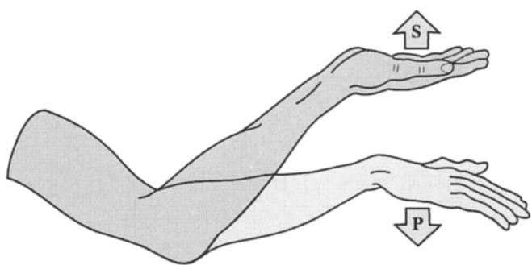  
Figure 1. 旋前-旋后运动的实用性。旋后（S）在支撑重物或在超市取零钱时是必需的。旋前（P）使人能够靠在障碍物上，或者在桌上取食物并送入口中。

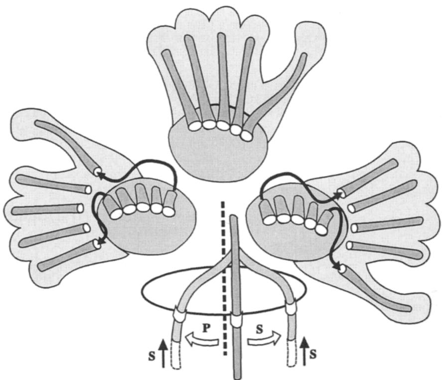  
Figure 2. 假设腕部为球窝关节时的肌腱问题。肌腱在腕关节水平发生扭转，且在旋前-旋后运动过程中其长度会发生改变。S = 旋后；P = 旋前。

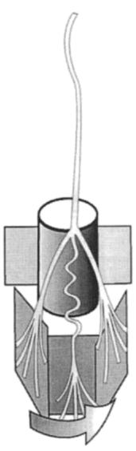  
A

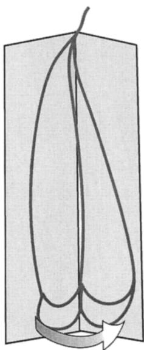  
B  
Figure 3. 假设腕部为球窝关节时的血管问题。A，动脉发生扭转并伴有长度改变。B，采用纵向铰链时，扭转分散在前臂的全长上。

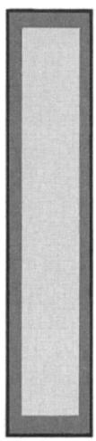  
A  
B

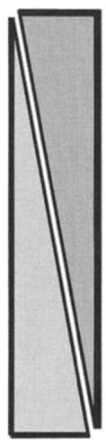

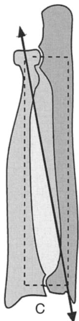  
Figure 5. 前臂骨骼。其可被视为一个矩形框架（A），并在对角线上具有一个倾斜的铰链（B）。当该框架处于平展状态（C）时，两块骨骼平行并列，桡骨位于尺骨的外侧。

## 自由运动的条件

两个桡尺关节的轴线必须同轴对齐；否则就会发生卡阻：当门的两个铰链不在一条线上时，门就无法打开（Fig. 7）。连接两桡尺关节中心的这条理想连线可被视为旋前-旋后的机械轴。这些关节属于车轴型关节，具有大致呈圆柱形的关节面。PRUJ（近端桡尺关节）整合于肘关节内，而 DRUJ（远端桡尺关节）则属于腕部。

## 近端桡尺关节的稳定性

PRUJ 的稳定性极佳（Fig. 8），因为桡骨头被容纳在一个非常坚固的骨韧带性关节腔内，该腔由尺骨的桡骨切迹和环状韧带构成，环状韧带是一条极具抵抗力的韧带；它同时兼具可变形性，以适应桡骨头轻微的椭圆形外形。除了桡骨头骨折外，该关节很少发生问题。

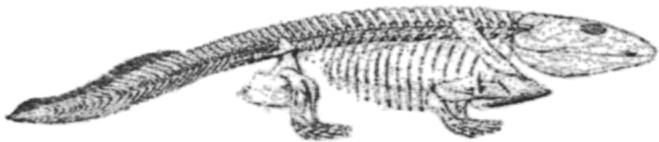  
Figure 4. 我们远古的四足类祖先。鱼石螈（Ichthyostega）是一种总鳍类四足动物，于 3 亿年前从海洋走向陆地，将鱼鳍转化为四肢，其前臂和小腿部均具有两块骨骼。

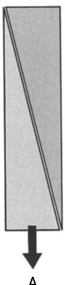  
A

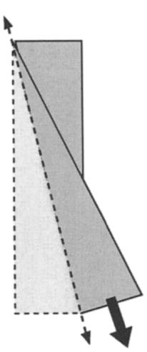  
B

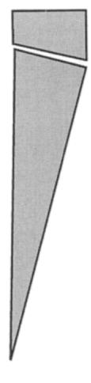  
C

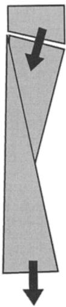  
D  
Figure 6. 肘外翻的作用。在铰链倾斜的情况下（A），桡骨的旋转（B）会改变腕部的方向。而在由肘关节轴线倾斜所引起的肘外翻（C）作用下，腕部和手部（D）的方向仍保持为纵向。

## 下桡尺关节的稳定性

下桡尺关节（DRUJ）要脆弱得多，因为其关节面不相适应（图 9）：桡骨乙状切迹的宽度小于尺骨头关节面的展开弧度，且桡骨的曲率与尺骨头的曲率并不相等。但其潜在不稳定性的主要原因在于其连接系统较为脆弱。事实上，主要的韧带是三角韧带，它也像半月板一样将桡腕关节和桡尺关节分隔开。它呈双凹形，具有两个关节面和一个较薄的中央部分（有时发生穿孔），并在其前缘和后缘各有一处增厚加强。该三角形的底边附着在桡骨乙状切迹的下缘，其顶点附着在尺骨茎突基底部与尺骨头下表面之间的区域。在挤压和剪切应力下，该韧带常常发生撕裂或脱落。然而，它得到了其他韧带结构的加强（图 10）——下桡尺关节的前后韧带、腕背侧支持带的内侧延伸部，尤其是位于腱鞘内的尺侧腕伸肌（ECU）肌腱，后者是一处强有力的加强结构。由于三角韧带的结构特点（图 11），在中间位时各束的张力是相等的，但由于顶点的附着点相对于尺骨头的旋转中心偏向内侧，显然在旋前时后束收紧，在旋后时前束收紧。这些束的作用是使尺骨头居中，而尺骨头在旋前-旋后过程中在桡骨切迹中并不完全稳定。

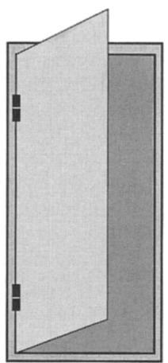  
A

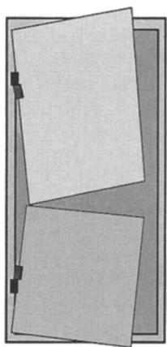  
B  
Figure 7. 桡尺关节轴线的重合。A，两个桡尺关节的轴线必须对齐共轴，就像门的合页一样。B，如果不共轴，则会发生卡阻且门无法打开。

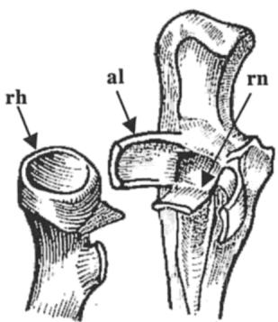  
Figure 8. 上桡尺关节。具有极佳的稳定性：桡骨头（rh）被封闭在由尺骨的桡切迹（rn）和环状韧带（al）构成的坚固骨韧带腔内。

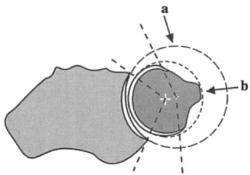  
Figure 9. 下尺桡关节（DRUJ）关节面的不协调性。桡骨切迹的曲率（a）与尺骨头的曲率（b）不相等。因此，关节面是不协调的，且旋转中心并不重合。

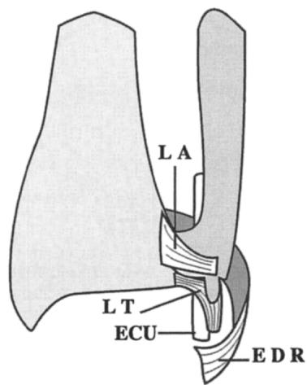  
Figure 10. 三角韧带的加强结构。三角韧带（LT）由 DRUJ 的前韧带（L.A.）、包含在其腱鞘内的尺侧腕伸肌（ECU）肌腱以及伸肌支持带内侧延展部（EDR）共同加强。

DRUJ 的运动是复杂的（图 12）：桡骨骨骺围绕尺骨头旋转，而尺骨头则沿着圆形路径做平移运动，自身不发生任何自转。这种运动结合了伸展和侧向平移。其结果是围绕位于桡骨骨骺某处（而非尺骨头内）的瞬时移动轴进行的一场“芭蕾舞”。旋转并不是尺骨头在桡骨切迹中的唯一运动。事实上，在旋前过程中桡骨跨越尺骨时逐渐产生的倾斜度，导致了其相对于桡骨切迹产生倾斜；这就是尺骨头关节面在垂直方向上略呈凸起的原因，但该垂直线的倾斜度在个体之间存在差异。此外，在旋前位时（图 13），桡骨变得比尺骨短，且尺骨头的下表面相对于桡骨切迹的下缘向下移动。当桡骨远端骨折后尺骨变异（UV）已呈阳性时，旋前会加剧尺骨头对腕骨（月骨或三角骨）的撞击。

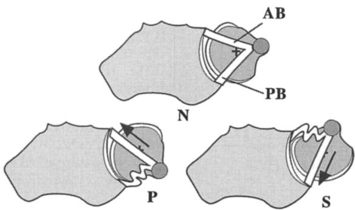  
Figure 11. 三角韧带的结构与功能（下视图）。在中立位（N）下，三角韧带的加强束——前束（AB）和后束（PB）受到等程度的拉伸。在旋前位（P）时前束被拉伸，而在旋后位（S）时后束被拉紧。

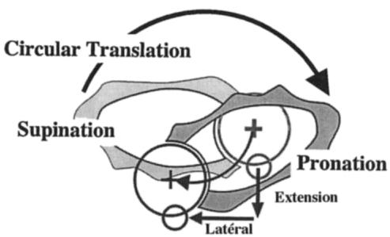  
Figure 12. 桡骨围绕尺骨的“芭蕾舞”。从旋后到旋前，桡骨围绕尺骨头旋转。尺骨头沿圆形路径运动而自身无平移，结合了伸展和侧向平移。

## 旋前-旋后运动的范围

旋前-旋后（Figure 14）的总活动范围约为 $180^{\circ}$，但该活动度必须从一个参考位置 $(O)$ 开始测量——屈肘呈直角，手处于垂直平面内，拇指朝上。从该位置开始，旋前 $(P)$ 为 $90^{\circ}$，手掌朝下旋转且拇指朝向内侧。在相反的运动——旋后——中，手掌朝上且拇指朝向外侧。通过“服务员试验”（waiter's test）（Figure 15），可以了解旋后是否完全：手掌可以托住放有一杯水的托盘而水不洒出。旋后（通常为 $90^{\circ}$）是最重要的运动，因为它无法由肩关节代偿，而旋前的缺失则可以通过肩关节的外展来替代。

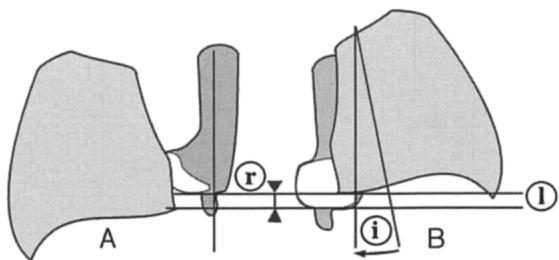  
Figure 13. 尺骨变异（ulnar variance, UV）的变化。A，在旋后时两骨平行，尺骨变异呈负值（r）。B，在旋前时，由于桡骨变为倾斜（i），其相对短于尺骨，尺骨变异变为正值。当已存在桡骨短缩时，旋前会加剧尺骨头对腕骨（月骨或三角骨）的撞击。

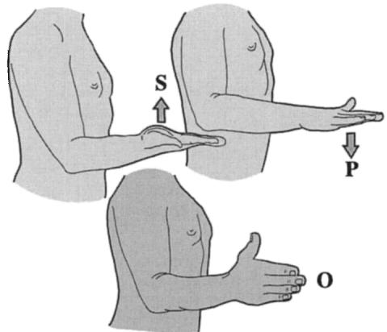  
Figure 14. 旋前-旋后运动的幅度。该运动从零位（O）测量，即屈肘 $90^{\circ}$ 且拇指朝上。当拇指朝向内侧且手掌朝下时，旋前（P）为 $85^{\circ}$ 至 $90^{\circ}$。当拇指朝向外侧且手掌朝上（S）时，旋后为 $90^{\circ}$。

## 桡骨与尺骨之间的对合

前臂两骨之间的稳固连接不仅由两个桡尺关节的韧带维持，而且还由骨间膜和肌肉共同承担。

骨间膜（图 16）实际上是一个柔韧的铰链，连接桡骨内侧缘与尺骨外侧缘。它由两层斜行纤维组成——前层主要由向远端和内侧斜行的纤维以及部分向远端和外侧斜行的纤维构成；后层仅由向远端和外侧斜行的纤维构成。这些纤维在将桡骨和尺骨结合在一起，并阻止桡骨向近端（前层）和向远端（后层）滑动方面起着至关重要的作用。在上方，桡骨还受到肱骨髁的阻挡，但在下方，后层纤维发挥了重要作用，并由连接两骨末端的 Weitbrecht 斜索协助。然而，防止肘关节和腕关节脱位以及桡骨相对尺骨滑脱的主要因素是手指屈肌（图 17）为双关节肌；它们部分附着于肱骨下端，因此当它们收缩以在手中支撑负荷时，会将桡骨沿尺骨向上拉动。

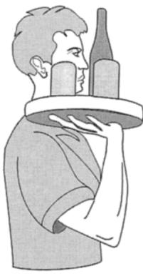  
A

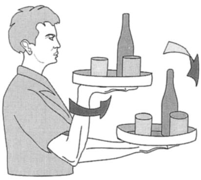  
B  
Figure 15. 服务员测试。从行走姿势（A，托盘保持在肩部高度）到服务姿势（B，服务员的前臂进行旋后动作）。当旋后完成时，托盘呈水平状态，杯中的液体不会洒出。

由于屈肌附着在骨间膜的前表面，在旋前过程中它们会在两骨之间受到挤压（图 18）。这为运动提供了软性缓冲并拉紧了骨间膜。两骨末端之间一个重要且主动的连接是旋前方肌，它在旋前过程中充当主动韧带。

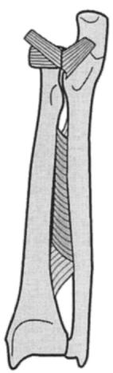  
A

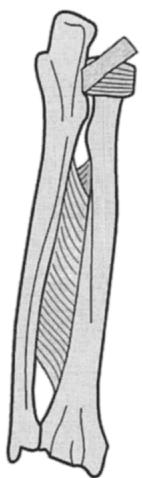  
B  
Figure 16. 骨间膜。这一柔韧的铰链由两层斜行纤维组成：前层（A），主要由向远端和内侧斜行的纤维构成；后层（B），仅由向远端和外侧斜行的纤维构成。

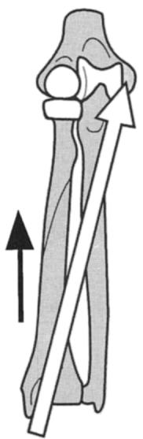  
A

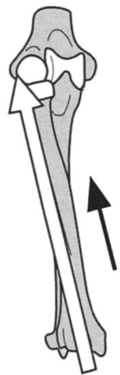  
B  
Figure 17. 纵向对合。手指屈肌是双关节肌；它们附着于肱骨下端，因此当它们收缩以用手支撑负荷时，会将桡骨沿尺骨向上拉动，无论是在旋后位（A）还是在旋前位（B）。

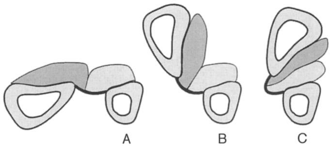  
Figure 18. 旋前时两骨之间的软性抵触。由于屈肌附着在骨间膜的前面 (A)，在旋前过程中它们被挤压在两骨之间 (B)，形成了该运动的软性抵触并收紧了骨间膜 (C)。

## 旋前-旋后的动力肌群

旋前-旋后运动有两对动力肌。它们固定在桡骨的精确点上，桡骨的形状大致呈曲柄状，具有两个末端和两个弯曲角。旋后肌固定在桡骨的上端——即旋后短肌（supinator brevis）。它通过“解卷”（unrolling）机制发挥作用。第二块肌肉附着在“曲柄”上角的桡骨粗隆上——即肱二头肌——这是一块非常强大的肌肉，同时也是肘关节的屈肌。肱桡肌通常不作为旋后肌，仅在前臂处于完全旋前位时才发挥旋后作用。实际上，它是一块肘关节屈肌。旋前肌的排列呈对称性：一块是旋前圆肌，附着于桡骨旋前弯曲的顶点；其作用较弱，尤其在肘关节伸展时。第二块是旋前方肌，它包裹在尺骨远端周围，通过“解旋”（unwinding）发挥作用。总体而言，旋前肌的力量弱于旋后肌，而这些肌肉的效能取决于该“曲柄”形态的完整性。因此，桡骨骨折后的畸形愈合可能会破坏这一机制。

关于旋前-旋后运动的问题在于：这种运动的扭矩是如何传递到手部的？事实上，腕骨髁并未牢固地嵌入桡骨关节盂内，当手部固定在某一物体上时，桡腕关节在旋前-旋后的应力下可能会发生脱位。通过在施加和不施加旋前-旋后应力下进行的 CT 扫描 $^{5}$（Fig. 19），已经证实，当手部肌肉未收缩时，腕骨在桡骨下方的旋转移位为 $45^{\circ}$，而当手部肌肉收缩时仅为 $15^{\circ}$。腕周肌肉形成的“笼状包裹”是防止脱位的完美保护，当手部肌肉收缩时，它们的作用就如同一个“离合器机制”。

## 旋前-旋后功能障碍及其治疗

总结上述讨论，旋前-旋后是一个精细且精准的机制，许多因素都可能导致其出现问题。作者在此仅讨论最常见的创伤性原因。

两根骨骼中单根骨的孤立性骨折或双骨骨折，会通过改变骨架的精确几何形态，从而永久性地损害旋前-旋后活动度，因为其中一根骨骼的曲度发生反转并导致阻挡。治疗包括通过适当的截骨术恢复骨骼的正常解剖形态。有时，单根骨的骨折会伴随两个关节之一的脱位：

尺骨骨折合并PRUJ前脱位（孟氏骨折[Monteggia's fracture]；图 20A）。诊断需要全前臂X光片，以避免漏诊上关节脱位。

桡骨骨折合并DRUJ前脱位（盖氏骨折[Galeazzi's fracture]；图 20B）。诊断要点相同：切勿漏诊关节脱位。

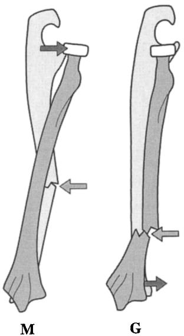  
Figure 20. 单骨骨折合并另一骨脱位。孟氏（Monteggia, M）骨折合并尺骨骨折与桡尺近侧关节（PRUJ）脱位。盖氏（Galeazzi, G）骨折合并桡骨骨折与DRUJ脱位。

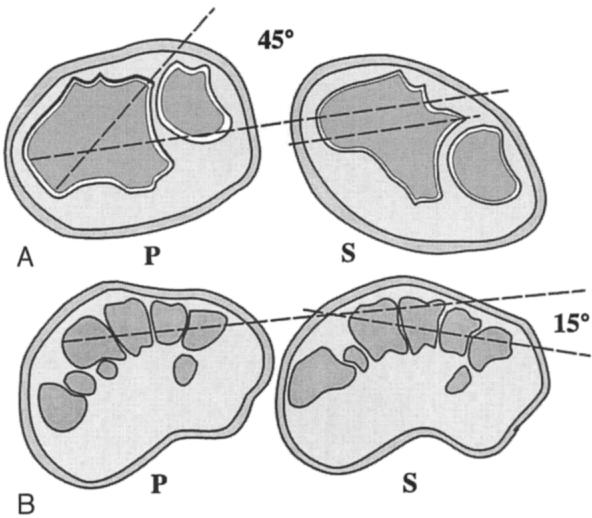  
Figure 19. 旋前-旋后扭矩向手部的传递。在有和无旋前（P）及旋后（S）负荷的CT扫描下，当手部肌肉收缩时，腕骨在DRUJ水平（A）的旋转位移为45°，而在掌骨水平（B）仅为15°。

如果骨折和脱位未能得到正确固定，这两种类型的骨折会导致严重的旋前-旋后功能障碍。

在患有先天性畸形——马德隆病（Madelung illness）的情况下，一次简单的腕部扭伤就可能导致永久性的旋前-旋后问题，并可能需要进行复杂的手术。

桡骨头骨折有时可能因桡骨短缩而引起DRUJ脱位。这被称为Essex-Lopresti综合征（图 21），且难以修复。在骨折后切除桡骨头也可能发生这种情况。

DRUJ的单纯脱位较为罕见，后脱位由极度的旋前动作引起，前脱位则由强力的旋后动作引起。其治疗较为困难，需要后文将讨论的一种手术方式。

DRUJ最常见的脱位是由桡骨远端骨折引起的。桡骨下端的倾斜会产生四种类型的紊乱（图 22）：

\- 关节因向外侧移位而增宽
- 因向后倾斜导致的乙状切迹轴线改变

\- 乙状切迹下缘抬高

\- 尺骨头撞击月骨

这些标准可以通过前后位和侧位 X 线平片进行观察。因此，腕关节内侧会出现疼痛，且旋前-旋后活动度受限。根据撞击的严重程度以及 DRUJ（下尺桡关节）关节面和韧带的完整性，有多种方法可以治疗这些问题。

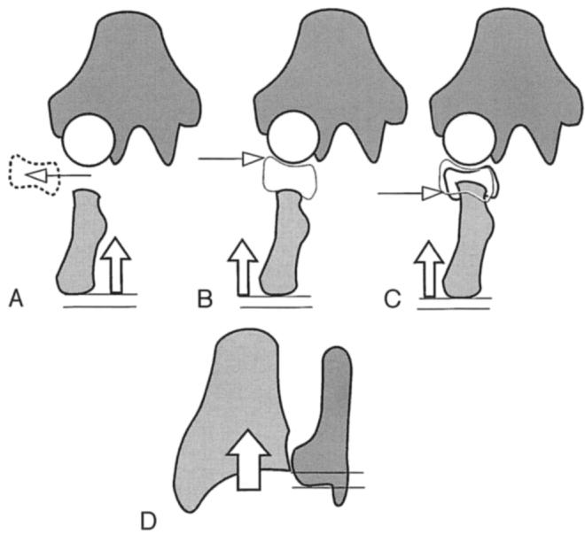  
Figure 21. Essex–Lopresti 综合征。桡骨短缩的三种原因：尺骨头撕脱（A）、尺骨头上部磨损（B）以及尺骨头嵌插（C）引起尺骨正变异（UV+）和尺腕撞击（D）。

对于尺骨头撞击月骨引起的疼痛性撞击，根据三角韧带的完整性，有几种术式可供选择：如果该韧带完好，可以通过尺骨短缩术（Milch 术式）进行治疗，采用带加压的短斜形截骨或使用 4 孔或 6 孔接骨板的长斜形切除截骨（图 23）。这是一项具有风险的手术，并发症发生率较高，因为尺骨骨愈合时间长且存在不确定性。

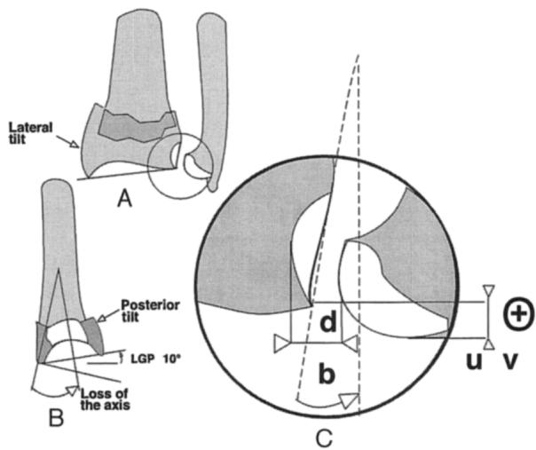  
Figure 22. 桡骨远端骨折引起的 DRUJ 脱位。侧向倾斜（A）和后向倾斜（B）导致关节盂线（LGP）反转并使 DRUJ 脱位（C）；d = 关节间隙增宽；b = 乙状切迹轴线改变；uv+ = 乙状切迹下缘抬高，导致尺骨头撞击月骨。

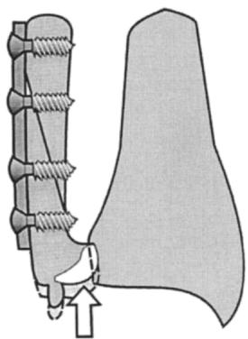  
Figure 23. Milch 术式。尺骨头撞击月骨引起的疼痛性撞击可通过尺骨斜行短缩截骨术进行治疗。

还有几种用于尺骨头短缩和重塑的术式（图 24），既可采用开放技术——Bowers 术式或 K. Watson 术式，也可采用关节镜下 Wafer 术式。

当三角韧带破坏时，常用的术式是 Moore-Darrach 术式。该术式包括切除尺骨头（图 25），并最大限度地保留纤维和韧带连接。

许多术者尝试过多种韧带成形术技术，其疗效各异。也可以重建三角韧带的后束（Zancolli 术式）。

最难解决的问题是伴有 DRUJ 脱位的桡骨畸形愈合。根据对屈伸活动度受限或旋后受阻的重视程度，可以选择桡骨畸形愈合矫形截骨术，或进行恢复旋前-旋后的手术。

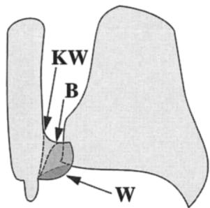  
Figure 24. 尺骨头缩短术。可采用三种手术方法来治疗尺骨头的疼痛性撞击：两种切开手术：Kirk Watson（KW）术式和 Bowers（B）术式，以及一种关节镜手术：Wafer 术式（W）。

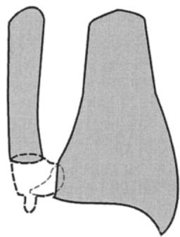  
Figure 25. Moore–Darrach 术式。尺骨头的切除必须尽可能保守（最小化），并最大程度地保留韧带连接。

通常，矫正性桡骨截骨术旨在重建关节面的正常方向和桡骨的长度，采用梯形骨移植结合钢板内固定。这是一项难度较大的手术，因为移植物的精确计算必须考虑三个因素——长度、后倾的矫正以及侧方移位的矫正。由于延长作用，使用钢板固定这些骨块也较为困难；使用外固定架则相对更容易。也可以对桡骨进行楔形切除以重新调整关节面方向，但这会导致桡骨缩短，必须通过例如尺骨缩短术在尺骨上进行代偿。

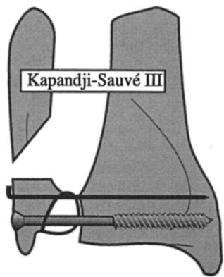  
Figure 26. Kapandji–Sauvé III 术式。在不倾斜尺骨头的情况下剥除下尺桡关节（DRUJ）软骨，使用一枚松质骨螺钉和一枚克氏针将其固定至桡骨，随后斜行切除尺骨干，以在旋前位时留下至少 5 mm 的间隙。

当旋后功能丧失被视为最严重的功能障碍时，可采用两种手术方式：尺骨头切除术（Moore-Darrach）或 Sauvé-Kapandji 术式（DRUJ 融合联合尺骨干下段节段性切除）。该手术在恢复旋后功能方面起效迅速且效果显著，但在其最初的版本中，需要将尺骨头完全倾斜以彻底剥离 DRUJ 的软骨面，并切除 15 至 $20\mathrm{mm}$ 长的尺骨干下段。现已认识到，这种术式是导致尺骨残端不稳的一个因素。因此，学者描述了一种新的术式（Kapandji-Sauvé III；图 26）。通过强行撑开 DRUJ 磨除关节软骨，并在中立位下使用松质骨螺钉将尺骨头固定于乙状切迹（有时使用两枚螺钉或加用一枚克氏针以防止尺骨头绕第一枚螺钉旋转），随后对尺骨干下段进行斜行截骨，同时不破坏 ECU（尺侧腕伸肌）腱鞘与尺骨的连接。该切口的斜行部分朝向远端和内侧，必须确保在旋前时，该切口边缘不会与下方截骨面接触。在此位置下的间隙必须为 $5\mathrm{-mm}$ 宽。通过该术式，尺骨残端要稳定得多。当尺骨头与腕骨发生撞击时，该术式可包括在将尺骨头固定于乙状切迹之前先将其抬高。该术式还可与桡骨畸形愈合的矫形截骨术联合进行。

最后，在某些情况下，DRUJ 假体（图 27）可能是解决疑难问题的良好方案 $^{4}$，但此类材料目前仍处于实验阶段。

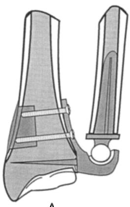  
A

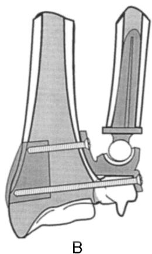  
Figure 27. DRUJ 假体。在实验性阶段中，提出了两种类型的 DRUJ 假体：用于 Moore–Darrach 术后无尺骨头的情况（A），以及用于 Kapandji–Sauvé 术后伴有尺骨残端不稳且保留尺骨头的情况（B）。

## References

1. Kapandji AI: The Physiology of the Joints, ed 5, vol 1: Upper Limb. Edinburgh, Churchill Livingstone 1982 In French: Physiologie Articulaire Schémas commentés de Mécanique Humaine lère Édition. Tome I: Member Supérieur. Paris, Maloine 1963

2. Kapandji AI: Why are there two bones in the forearm? Pourquoi l'avant-bras comporte-t-il deux os? Ann Chir 29:5 463–470, 1975

3. Kapandji AI: Le Cadre Radio-Ulnaire. Son importance foncitonnelle dans les fractures des deux os de l'avant-bras. Ann Chir Main 11: 328–361, 1998

4. Kapandji AI: An original prosthesis of the distal radioulnar joint. In Wrist Disorders, a monograph published under the direction of R Nakamura, RL Linscheid, and T Miura. Tokyo, Springer Verlag 1992

5. Kapandji AI, Martin-Boyer Y, Verdeille S: Etude due carpe au scanner à trois dimensions sous contrainte de prono-supination. Ann Chir Main 10: 36–47, 1991

抽印本索取地址：
Adalbert Kapandji, MD
Clinique de L'Yvette
43, Route de Corbeil
91160 Longjumeau
France（法国）