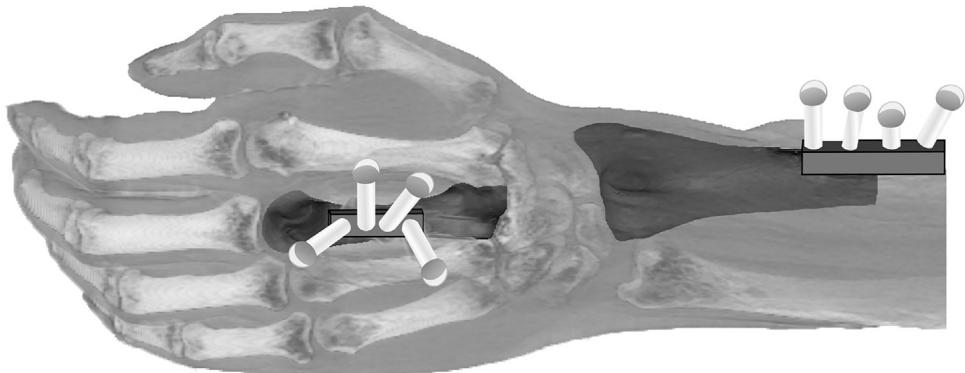
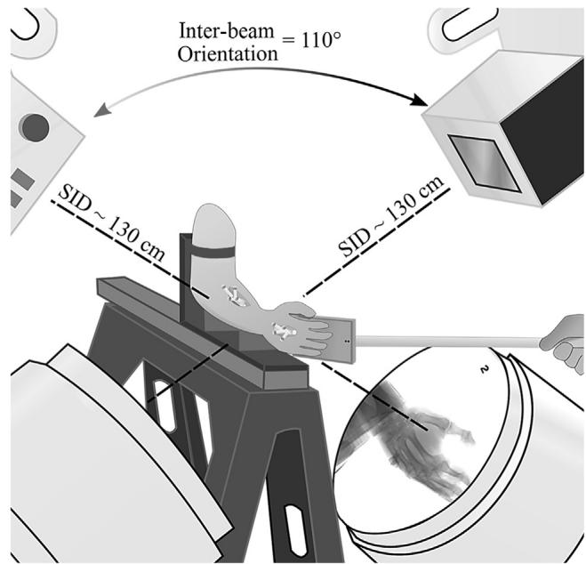
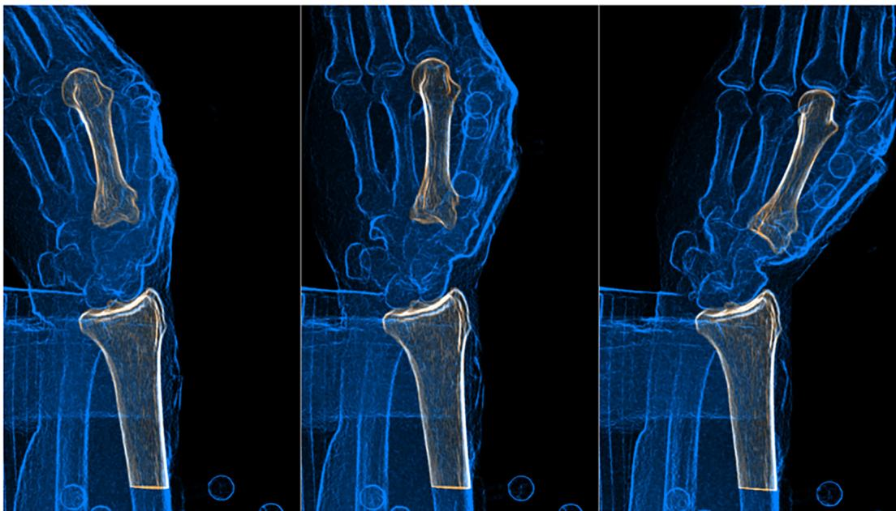
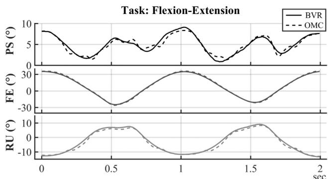

# Accuracy of biplane videoradiography for quantifying dynamic wrist kinematics

Bardiya Akhbari a, Amy M. Morton b, Douglas C. Moore b, Arnold-Peter C. Weiss b, Scott W. Wolfe c, Joseph J. Crisco a,b,⇑

a Department of Biomedical Engineering, Brown University, Providence, RI 02912, United States

b Department of Orthopedics, Alpert Medical School of Brown University and Rhode Island Hospital, Providence, RI 02912, United States

c Hand and Upper Extremity Center, Hospital for Special Surgery, New York, NY 10021, United States

## a r t i c l e i n f o

Article history: Accepted 26 May 2019

Keywords: Biplane videoradiography Wrist kinematics Accuracy study Markerless tracking

## a b s t r a c t

Accurately assessing the dynamic kinematics of the skeletal wrist could advance our understanding of the normal and pathological wrist. Biplane videoradiography (BVR) has allowed investigators to study dynamic activities in the knee, hip, and shoulder joint; however, currently, BVR has not been utilized for the wrist joint because of the challenges associated with imaging multiple overlapping bones. Therefore, our aim was to develop a BVR procedure and to quantify its accuracy for evaluation of wrist kinematics. BVR was performed on six cadaveric forearms for one neutral static and six dynamic tasks, including flexion-extension, radial-ulnar deviation, circumduction, pronation, supination, and hammering. Optical motion capture (OMC) served as the gold standard for assessing accuracy. We propose a feedforward tracking methodology, which uses a combined model of metacarpals (second and third) for initialization of the third metacarpal (MC3). BVR-calculated kinematic parameters were found to be consistent with the OMC-calculated parameters, and the BVR/OMC agreement had submillimeter and subdegree biases in tracking individual bones as well as the overall joint’s rotation and translation. All dynamic tasks (except pronation task) showed a limit of agreement within 1 5° for overall rotation and within 1.3 mm for overall translations. Pronation task had a 2.1 and 1.4 mm limit of agreement for rotation and translation measurement. The poorest precision was achieved in calculating the pronation-supination angle, and radial-ulnar and volar-dorsal translational components, although they were sub-degree and submillimeter. The methodology described herein may assist those interested in examining the complexities of skeletal wrist function during dynamic tasks.

 2019 Elsevier Ltd. All rights reserved.

## 1. Introduction

Dynamic assessment of wrist kinematics is crucial for understanding both normal and pathological joint function to advance diagnosis and treatment strategies. An accurate technique that measures the overall wrist motion, which is described as the motion of third metacarpal relative to the radius (Neu et al., 2001), during dynamic tasks allows comparison of the normal wrist motion with patients having carpal bone injuries or total wrist arthroplasty.

Model-based tracking with biplane videoradiography (BVR) is a well-established method that has allowed investigators to directly study the dynamic in-vivo skeletal kinematics of the knee (Anderst et al., 2009; Bey et al., 2008a; Miranda et al., 2011; Stentz-Olesen et al., 2017), shoulder (Bey et al., 2008b, 2006), hip (Martin et al., 2011), and ankle (Ito et al., 2015) joints in various settings. BVR is capable of high-speed captures (up to 1000 Hz) with a low radiation dosage (e.g., 0.03 mSv/s for upper extremity studies), and it can be a practical system for studying the dynamic motion of the wrist joint during activities of daily living.

BVR tracking software packages typically use volumetric models of the bones that are reconstructed from the CT images and have the internal structure’s information, stored as gray-values (Miranda et al., 2011). The BVR programs then employ raycasting algorithms on the density-based volumes to create digitally reconstructed radiographs (DRR) that mimic the similar attenuations that the X-ray sources generate from the bones on the radiographs.

The objective of the model-based BVR tracking system is to match the similar features of the DRRs and the bones’ image on the radiographs to accurately locate the bones in the 3D space. DRRs are generated from the isolated and segmented portions of the CT images specific to the bone of interest, while the radiographs are the projection of all anatomy inside the field-of-view of X-ray sources. Therefore, bone overlap (e.g., metacarpals overlap in the wrist), or large surrounding soft-tissue (e.g., around the hip joint) negatively impacts tracking accuracy because the matching images are no longer one-to-one correspondence. The effects of surrounding soft tissue can be lessened, and the matching similarities between DRRs and radiographs can be increased, by modifying the X-ray acquisition parameters (i.e., kV and mA), or the captured radiographs intensity in post-processing can be modified. However, the undesirable effect of bone overlap cannot be reduced by changing pre- or post-processing parameters. To overcome this issue, Hill et al. considered the set of five metatarsals as one rigid body to evaluate the metatarsals motion (Hill, 2018). Another study by Ito et al. utilized contact optimization algorithms in the BVR program to track the calcaneus and talus bones (Ito et al., 2015); but, contact calculation requires tracking of all the bones which is both time-consuming and unnecessary in calculating the wrist motion.

Accordingly, our aim was to develop a BVR setup and tracking methodology for studying wrist kinematics and to quantify its accuracy. A feedforward tracking procedure which uses a combined model of metacarpals (second and third) for initialization of the third metacarpal was proposed to increase the accuracy of tracking.

## 2. Methods

To develop a BVR setup and evaluate its accuracy, we used optical motion capture (OMC) technique as the gold standard comparator that has shown a submillimeter accuracy in our experimental setup (Akhbari et al., 2019). For all experiments, both methods simultaneously captured the wrist motion (third metacarpal motion relative to the radius), and then they were compared for accuracy assessment.

## 2.1. Specimen preparation and imaging

Six intact forearms from four cadaver specimens (70.5 ± 12.3 yrs., 2 rights and 2 bilateral, 2 females) were obtained. The dorsal surface of the third metacarpal and a portion of the radius of all specimens were exposed by removing their surrounding soft tissue. Exposure of the radius was limited to its radial surface from 7 to 14 cm proximal to the radiocarpal joint. Two clusters, each with four lightweight retro-reflective marker spheres (9.5 mm dia.) on nylon standoffs, were rigidly attached to the third metacarpal and the radius by custom-made blocks of solid foam photoniccrystal fiber (Sawbones USA, Vashon Island, Washington) (Fig. 1). The blocks were affixed to the bones with heavy-duty adhesives (Gorilla Glue Company, Cincinnati, OH). CT scans (Lightspeed 16. GE Medical, Milwaukee, WI) of the forearms were acquired at tube settings of 80 kVp and 80 mA and reconstructed with voxel dimensions of 0.39 0.39 mm2 in the transverse plane of the forearm, and 0.625 mm along the forearm’s long axis.

## 2.2. BVR and OMC instruments

The experiment was performed in the W.M. Keck Foundation biplanar videoradiography facility at Brown University (xromm. org) (Brainerd et al., 2010; Miranda et al., 2013). Briefly, the system includes two Varian Medical Systems X-ray tubes (Palo Alto, CA, USA), two X-ray generators (Saint-Eustache, Quebec, Canada), two 40 cm Dunlee image intensifiers (Aurora, IL, USA), and two high-speed digital video cameras (Vision Research, Wayne, NJ, USA). To devise a set-up that permits an in-vivo study and have more perpendicular X-ray beams for most possible hand/forearm orientations in the tasks (to minimize the possible overlap of the metacarpal bones in the radiographs), we selected source-toimage distance of 130 cm, with the source-to-object distance of 95 cm, and the inter-beam orientation of 110 for X-ray sources. BVR acquisition was in the continuous mode with the beam current of 80 mA, and beam energy of 68–76 kVp, with a camera shutter speed of 500 ms for both sources. The radiograph images resolution was 0.22 0.22 mm/pixel, and they were stored in 8- bit format. OMC data was captured using eight Oqus 5 + cameras (Qualisys, Gothenburg, Sweden), with the start of data acquisition synchronized to the BVR by an external trigger (active low). Both BVR and OMC acquisition rates were set to 200 frames per second. The conversion matrix from OMC coordinate system to the BVR coordinate system was calculated by a simultaneous capture of a custom-designed cross-calibration ‘‘cylinder” (xromm.org) in both systems (Miranda et al., 2013).

## 2.3. Data acquisition

Specimens were manipulated in the field-of-view of the X-ray systems and the optical motion capture cameras (Fig. 2). Each specimen was secured to a custom-made L-frame, which was rigidly clamped to a sawhorse from the arm, and it was secured to a rigid board binding its proximal phalanges from the palmar side. A dowel, fastened to the board, facilitated remote and robust manipulation of the specimen’s hand and forearm in one neutral static and six dynamic wrist tasks: flexion-extension, radial-ulnar deviation, circumduction, pronation, supination, and hammering. The neutral static position, defined by the back of the hand being coplanar with the back of the forearm, was captured for 500 ms (i.e., 100 radiograph frames). The pronation and supination tasks were recorded for 1 s each, during which the wrist and forearm were manipulated from neutral pose to a fully-pronated or fullysupinated pose, respectively.

  
Fig. 1. Marker clusters on the hand (four markers for tracking the third metacarpal), and on the forearm (four markers for tracking the radius), as well as 3D models of the radius and the third metacarpal constructed from the CT images. For visualization, just the distal forearm and hand are depicted (CT scan was from the whole arm).

  
Fig. 2. Experimental setup for biplanar videoradiography capture (right-side wrist is depicted). The intra-beam angle of 110, with the source-to-image distance of 130 cm for both X-ray sources. The specimen’s arm was secured, and the wrist and forearm were manipulated manually with a dowel attached the distal side of the hand.

All range-of-motion tasks and the hammering task, described as the wrist motion along a path oblique to flexion-extension and radial-ulnar deviation (Leventhal et al., 2010), were captured for 2 s. The full range of motion was limited by the operator’s subjective perception of increasing wrist and forearm stiffness. All tasks were performed as fast as was practical for the operator to mimic in-vivo conditions. The resulting range-of-motions and velocities of the tasks as an average were 53 and 53/s for flexion-extension, 28 and 42/s for radial-ulnar deviation, 38 and 19/s for circumduction, 23 and 46/s for pronation, 13 and 27/s for supination, and 38 and 38/s for hammering, respectively (Supp. Table 1).

## 2.4. Image processing and data reduction

The radius, second metacarpal (MC2), and third metacarpal (MC3) were semi-automatically segmented from the CT images using MIMICS software (v19, Materialise, Leuven, Belgium) using thresholding and manual editing. A volumetric model of the distal radius with the length of 60 mm was generated comparable with the length of the distal radius scanned in the in-vivo studies. In addition to the distal radius, volumetric models of MC3 alone and with the second metacarpal (MC2-MC3) were constructed (Fig. 1; models in dark-color1). A transformation matrix from the MC2-MC3 model to MC3 model was determined using an iterative closest point registration for later conversion of MC2-MC3 kinematics to MC3 kinematics (Wrap 2017, 3D Systems, Rock Hill, SC).

The BVR radiographic images were enhanced with Autoscoper software (xromm.org, Brown University, Providence, RI), and the kinematic data was generated for each bone. In Autoscoper, digitally reconstructed radiographs (DRRs) were generated from the isolated CT images of the bones using a ray-casting approach and then enhanced using imaging filters to improve the matching cost function (Fig. 3) (Miranda et al., 2011). The same image filters were then used for tracking the bones in all specimens. To enhance the edges of the bones’ image on the radiographs, a Sobel filter with a scale factor of 3 and a blend value of 0.4, in addition to a contrast filter with an alpha (for image contrast) of 2.5, and beta (for image brightness) of 0.9 were used. To match the DRRs with the radiograph, a ray intensity value of 0.35 was chosen, and a Sobel filter with 0.1 blend value and 1.7 scale factor was used. Normalized cross-correlation was employed to measure the similarity between DRRs and the radiographs, and the global optimization techniques of particle swarm optimization and downhill simplex were used to find the optimized fit between the DRR and the radiographs (Kennedy and Eberhart, 1995; Nelder and Mead, 1965). After optimization, a 4x4 transformation matrix of the DRRs in the X-ray world was exported from the software for further processing and joint motion calculation.

To reduce the effects of bone overlap, tracking was first performed with the model combining the second and third metacarpals (MC2-MC3). After locating the combined DRR position and rotation in the radiographs, the output kinematics were transformed to the MC3 model coordinate system to seed the initial position of the MC3. The MC3 was then tracked, and its kinematic was calculated. The accurate position of the radius in the radiographs was also calculated during all tasks. The kinematics were filtered using a moving average method (with a span of 5 frames) using a built-in MATLAB function (R2018b, The MathWorks, Inc.).

The gold-standard OMC kinematic data was processed using Visual3D v6 (C-Motion, Germantown, MD). The motion of the hand and radius reflective marker clusters were calculated based on the markers’ positions and singular value decomposition method in Visual3D (Söderkvist and Wedin, 1993). The reliability of OMC tracking was evaluated by comparing the distances between all markers for each segment (i.e., third metacarpal and radius) throughout all trials, which should be unchanged under the assumption of a rigid body. Any change in marker distances of more than 0.5 mm (resolution of OMC in our experimental setup), with respect to their average distances, was considered a violation of rigid body assumption, and only in this case, the OMC data was considered unreliable and removed from the comparison.

## 2.5. Wrist kinematics

The wrist motion was defined as the motion of third metacarpal relative to the radius, and both the BVR and OMC kinematic data were reported relative to the neutral wrist position in the neutral static task in the radial coordinate system (RCS) (Coburn et al., 2007; Kobayashi et al., 1997). The x-axis of RCS was defined by a best-fit line passing through the centroids of the radial crosssections. The RCS origin was the intersection of the x-axis with the surface of the radiocarpal articulation. The y-axis was defined in the direction of the midpoint of the sigmoid cavity toward the radial styloid, and the direction of the z-axis was defined by the cross product of the x and y-axes.

The kinematics are described by Helical Axis of Motion (HAM) parameters, which define rigid body kinematics between two positions in terms of an overall rotation (/) around and an overall translation (t) along with a unique axis in space (i.e., screw axis).

  
Fig. 3. Bone features were enhanced using Sobel and contrast filters on the radiographs, and the digitally reconstructed radiographs (bolded in white) were tracked in the radiographs. From left to right, the tracked metacarpal and radius are visualized from flexion to extension in one source for a left wrist

HAM parameters were then decomposed to three rotational (pronation-supination [PS], flexion-extension [FE], and radialulnar deviation [RU]) and three translational (proximal-distal, radial-ulnar, and volar-dorsal translation) components around and along the described axes of RCS.

## 2.6. Statistical analysis

The Bland-Altman analysis was used to determine the agreement of BVR- and OMC-determined overall wrist rotation and translation (Bland and Altman, 1999). The Bland-Altman analysis describes the accuracy of BVR compared to the OMC using a bias (mean differences between the two methods), and a 95% limit of agreement (LOA) (mean differences ± 1.96 standard deviations [SD] of the differences). The decomposed rotations and translations were compared using the bias and precision (SD of the differences between methods) (ASTM E177-14, 2014), and the individual bone motions were compared using LOA calculated from Bland-Altman analysis. Finally, to analyze the variations between specimens the bias and LOA of the overall wrist rotation and translation were compared.

## 3. Results

The overall wrist translation and rotation calculated with the BVR post-processing technique were highly consistent with the gold standard OMC-derived parameters and demonstrated a less than 0.1 and 0.2 mm biases among all tasks (Table 1). In the neutral static task, BVR and OMC had a small bias and an LOA of within 0.5 and 0.2 mm or better. The dynamic tasks showed wider LOA, which were within 1.5 for overall rotation, and within 1.3 mm for overall translations, except pronation task, which had the widest LOA of within 2.1 and 1.4 mm for overall rotation and translation. Biases of overall wrist rotation or translation for all specimens were less than 1 and 1 mm, and the LOAs were enclosed around 0 and 0 mm; thus, specimens did not skew the final accuracy measurements (Supp. Table 2-5).

OMC- and BVR-derived rotational components of the wrist motion (MC3 in RCS) demonstrated same motion patterns (Fig. 4;

## Table 1

The agreement of biplane videoradiography (BVR) with the gold standard in evaluating the overall wrist joint motion in terms of bias and limit of agreement (LOA) for all tasks. BVR in all tasks had a subdegree and submillimeter bias, and LOA was less than 1.5 and 1.4 mm for all tasks except pronation.

<table><tr><td rowspan="2">Task</td><td colspan="2">Overall wrist rotation (°)</td><td colspan="2">Overall wrist translation (mm)</td></tr><tr><td>Bias</td><td>LOA</td><td>Bias</td><td>LOA</td></tr><tr><td>Neutral (static)</td><td>0.1</td><td>-0.2 to 0.5</td><td>0</td><td>-0.2 to 0.1</td></tr><tr><td>Flexion-extension</td><td>0.1</td><td>-1.3 to 1.5</td><td>0.1</td><td>-1.2 to 1.4</td></tr><tr><td>Radial-ulnar deviation</td><td>0</td><td>-1.5 to 1.5</td><td>0.2</td><td>-0.6 to 1.0</td></tr><tr><td>Circumduction</td><td>0.1</td><td>-1.2 to 1.4</td><td>0.1</td><td>-1.1 to 1.3</td></tr><tr><td>Pronation</td><td>-0.1</td><td>-2.1 to 1.8</td><td>0</td><td>-1.4 to 1.3</td></tr><tr><td>Supination</td><td>0</td><td>-1.2 to 1.2</td><td>0.2</td><td>-0.9 to 1.3</td></tr><tr><td>Hammering</td><td>-0.1</td><td>-1.5 to 1.3</td><td>0</td><td>-1.3 to 1.2</td></tr></table>

  
Fig. 4. Representative wrist kinematics of a single specimen calculated from both methods (BVR: biplane videoradiography, OMC: optical motion capture). PS (+pronation/ supination), FE (+flexion/ extension), and RU (+ulnar/ radial deviation) are demonstrating the rotational components of the motion

flexion-extension task as representative). There was no significant bias for the decomposed rotational and translational components, and all demonstrated a less than 0.5 and 0.5 mm biases in all tasks (Tables 2 and 3). In the rotational components, the precision of BVR was less than 1, with the highest spread for calculation of pronation-supination component, which was mostly 1.5 times of other rotational components (Table 2). In the translational components, the largest precisions were seen for radial-ulnar and volardorsal translational components, although they were both less than a millimeter (Table 3).

The bias and precision of biplane videoradiography in measuring rotational components of the wrist joint motion in all tasks. Bias was less than 0.5 for all tasks. The least agreement was seen in pronation/supination angle which had 1.5–2 times a precision than other rotational components.

<table><tr><td>Task</td><td>Pronation/supination (°)</td><td>Flexion/extension (°)</td><td>Radial/ulnar deviation (°)</td></tr><tr><td>Neutral (static)</td><td>-0.1 ± 0.3</td><td>-0.0 ± 0.1</td><td>-0.0 ± 0.1</td></tr><tr><td>Flexion-extension</td><td>0.0 ± 0.7</td><td>0.2 ± 0.7</td><td>-0.1 ± 0.7</td></tr><tr><td>Radial-ulnar deviation</td><td>0.1 ± 0.9</td><td>0.3 ± 0.6</td><td>0.1 ± 0.7</td></tr><tr><td>Circumduction</td><td>-0.3 ± 0.8</td><td>0.2 ± 0.6</td><td>0.2 ± 0.6</td></tr><tr><td>Pronation</td><td>-0.3 ± 1.0</td><td>0.1 ± 0.4</td><td>0.5 ± 0.5</td></tr><tr><td>Supination</td><td>-0.0 ± 1.1</td><td>-0.3 ± 0.6</td><td>-0.4 ± 0.9</td></tr><tr><td>Hammering</td><td>-0.4 ± 0.8</td><td>0.2 ± 0.7</td><td>0.4 ± 0.5</td></tr></table>

The bias and precision of translational components of wrist joint motion in all tasks. Bias was less than 0.5 mm for all tasks, and the worst precisions were seen in measuring the radial/ulnar translation and volar/dorsal translation which had a motion approximately parallel to the X-ray beams.

<table><tr><td>Task</td><td>Proximal/distal translation (mm)</td><td>Radial/ulnar translation (mm)</td><td>Volar/dorsal translation (mm)</td></tr><tr><td>Neutral (static)</td><td>-0.0 ± 0.1</td><td>-0.0 ± 0.1</td><td>-0.0 ± 0.1</td></tr><tr><td>Flexion-extension</td><td>0.1 ± 0.3</td><td>-0.1 ± 0.8</td><td>0.0 ± 0.7</td></tr><tr><td>Radial-ulnar deviation</td><td>0.2 ± 0.5</td><td>-0.1 ± 0.5</td><td>-0.0 ± 0.5</td></tr><tr><td>Circumduction</td><td>0.0 ± 0.4</td><td>0.1 ± 0.7</td><td>-0.2 ± 0.5</td></tr><tr><td>Pronation</td><td>0.0 ± 0.4</td><td>0.0 ± 0.8</td><td>-0.1 ± 0.8</td></tr><tr><td>Supination</td><td>-0.2 ± 0.4</td><td>-0.3 ± 0.7</td><td>0.5 ± 0.8</td></tr><tr><td>Hammering</td><td>0.0 ± 0.3</td><td>0.3 ± 0.6</td><td>-0.1 ± 0.6</td></tr></table>

Overall, for tracking the radius, the BVR/OMC agreement was within 1.7 and 0.8 mm or better, with the smallest spread for the static task (Table 4). Tracking MC3 resulted in an LOA of within 1.4 and 1.0 mm or better, except for hammering and pronation tasks. These tasks demonstrated a wider LOA, although it did not exceed 1.8 and 1.5 mm.

## 4. Discussion

The purpose of this study was to quantify the accuracy of an approach with BVR as a tool for analyzing wrist motion, defined as the motion of the third metacarpal with respect to the radius. OMC markers rigidly fixed to each bone served as the gold standard. The resulting approach had a bias and precision of similar magnitude to previous model-based BVR studies in other joints (Bey et al., 2008b, 2006; Miranda et al., 2011; Stentz-Olesen et al., 2017).

In a preliminary unpublished study, we found that tracking the isolated third metacarpal was not feasible due to the featureobscuring overlap from the other metacarpals. We also found that the five metacarpals of the hand could not be assumed to move as a single rigid body. Hence, we developed an approach that involved tracking the combined MC2-MC3 first and then using this data to seed the initial position of the MC3. Fourth metacarpal or other metacarpals were not considered in part of this process, because, during the in-vivo experiments, we realized that considering other metacarpals adversely affects the tracking. Another advantage of using the combined model of metacarpals is an improvement in the process of initialization of the DRRs in the radiographs. Outof-plane rotation of just one metacarpal does not change the DRR images significantly; hence, combining the models increases the accuracy of the initialization step.

The accuracy of model-based BVR highly relies on the quality of bone images in the radiographs. To have a minimal overlap of metacarpal bones for most wrist poses and suitable repeatability for in-vivo testing, the path of motion for most tasks were devised in a way to have the main axis of motion oblique to both X-ray beams. Although for most tasks the overlap was minimized, large metacarpals overlaps were seen at the extremes of flexionextension, hammering, and end-points of pronation (which also had radius/ulna overlap). These overlaps might be the cause of larger biases and wider LOAs that were achieved for these tasks. Moreover, motions that are approximately parallel to the X-ray beams of at least one of the sources result in a lower accuracy (Anderst et al., 2009), which was seen in the case of worst precisions for pronation-supination rotational and volar-dorsal translational components. Although our study was not designed to evaluate the specific relationship between the direction of motion and beam angles, six different dynamic tasks with various motion paths were studied, which demonstrates the high accuracy in most bone/beam orientations with our experimental setup.

Despite the small size and multiple bones overlap, the bias and limit of agreement achieved with our method are consistent with the accuracy of BVR in previous studies in other joints. In the knee, femur and tibia bones were tracked using BVR and compared with marker-based radiostereometric analysis (RSA), yielding a near 0 bias with the maximum LOA of 1.7 to 1.3 for rotational components, occurred at external/internal tibial rotation (Stentz-Olesen et al., 2017). The translations’ bias was within 0.2 mm to 0.2 mm with the maximum LOA of 1.2 mm to 1.5 mm. Moreover, tracking the patellofemoral joint has demonstrated a bias of 0.3 to 0.3 mm for translation, and 0.1 to 0.5 for rotation measurement compared to a marker-based RSA (Bey et al., 2008a). In tracking the shoulder joint, they found the bias was 0.1 to 0.2 mm on the scapula, while humerus tracking demonstrated 0.2 to 0.1 mm bias (Bey et al., 2006).

In our study, OMC was used as the standard because it has submillimeter and subdegree accuracy when marker clusters are used in tracking (Challis, 1995; Söderkvist and Wedin, 1993). We refined the technique by rigidly fixing them to the bones and assuming they acted as a rigid body. This was confirmed in our study by evaluating the RMSE of differences between markers. The marker drop-out, or a decrease in the accuracy of marker selection, was evaluated by considering the marker cluster as a rigid object and evaluating the distances between all markers. An ideal rigid cluster must demonstrate a close to 0 mm changes in the distances between markers; however, due to the occlusion of markers in some orientations, the cameras were not always capable of detecting the markers accurately. Due to this fact, a reliability threshold of 0.5 mm was selected for the RMSE of distances between markers, and any capture that violated this criterion was removed from the accuracy comparison ( 10% of total captured frames).

Limits of agreement (LOA) between biplane videoradiography and the gold standard, optical motion capture, in tracking the individual bones of the wrist joint (radius and th third metacarpal). Translations LOA were mostly submillimeter, and rotations had an LOA of within ± 1.8.

<table><tr><td rowspan="2">Task</td><td colspan="2">Radius</td><td colspan="2">Third metacarpal</td></tr><tr><td>Rotation (°)</td><td>Translation (mm)</td><td>Rotation (°)</td><td>Translation (mm)</td></tr><tr><td>Neutral (static)</td><td>-0.3 to 0.3</td><td>-0.1 to 0.1</td><td>-0.1 to 0.1</td><td>-0.1 to 0.1</td></tr><tr><td>Flexion-extension</td><td>-0.9 to 1.1</td><td>-0.5 to 0.3</td><td>-1.1 to 1.1</td><td>-1.0 to 1.2</td></tr><tr><td>Radial-ulnar deviation</td><td>-1.1 to 1.2</td><td>-0.6 to 0.3</td><td>-1.4 to 1.6</td><td>-0.6 to 0.9</td></tr><tr><td>Circumduction</td><td>-1.7 to 1.5</td><td>-0.6 to 0.4</td><td>-0.7 to 0.9</td><td>-0.5 to 0.9</td></tr><tr><td>Pronation</td><td>-1.5 to 0.8</td><td>-0.6 to 0.4</td><td>-1.8 to 1.8</td><td>-0.7 to 0.8</td></tr><tr><td>Supination</td><td>-0.9 to 1.3</td><td>-0.6 to 0.6</td><td>-1.4 to 1.1</td><td>-0.5 to 0.7</td></tr><tr><td>Hammering</td><td>-1.2 to 0.9</td><td>-0.6 to 0.8</td><td>-0.8 to 1.2</td><td>-0.8 to 1.5</td></tr></table>

There were some limitations to this study. Because OMC was used as the gold standard, assessment of BVR accuracy is limited by OMC’s sub-millimeter accuracy in our experiment. Bone density and muscle structure variations among individuals likely alter the BVR images and CT generated DRRs, and potentially affect accuracy; however, six specimens were tested in this experiment with various soft-tissue properties. Other variations likely can be accounted for by optimizing the X-ray beam parameters (i.e., kV and mA) during BVR acquisition or intensity-thresholding during post-processing. In this study, we used Autoscoper software (xromm.org, Brown University, Providence, RI) for tracking the bones, and other software might be applicable. Tracking software must be selected carefully because the BVR accuracy depends upon several factors such as image filtering parameters, matching algorithms (e.g. intensity-based, edge-based, or contact-based systems), optimization function, and optimization algorithm. Not using global optimization algorithms or low-quality filters will reduce the accuracy of the method. Finally, we used one filter to enhance the radiograph and DRR images for all specimens to reduce the subjectivity of BVR processing; however, using different filters might slightly change the accuracy.

In this study, our aim was to develop a method and quantify BVR accuracy in studying the normal wrist kinematics. Due to the occlusion and metacarpal bones’ overlap on the radiographs, a feed-forward system was developed. A combined model of the second and third metacarpals was first tracked, and then the output was transformed to initialize the third metacarpal positions. We demonstrated that BVR has potentially high accuracy, and future studies on the wrist joint can use this methodology to study the dynamic motion of healthy or injured wrists.

## Acknowledgments

The authors thank Peter Loan from C-Motion for his assistance with general BVR algorithms and techniques. The authors also thank Janine Molino for her help in the power analysis of the experiment, and Rohit Badida for his help throughout data acquisition. This research was supported in part by the National Institutes of Health P20-GM104937 and a grant from the American Foundation for Surgery of the Hand (AFSH).

## Declaration of Competing Interest

There is no conflict of interest to report.

## Appendix A. Supplementary material

Supplementary data to this article can be found online at https://doi.org/10.1016/j.jbiomech.2019.05.040.

## References

Akhbari, B., Morton, A., Moore, D., Weiss, A.-P.C., Wolfe, S.W., Crisco, J., 2019. Kinematic accuracy in tracking total wrist arthroplasty with biplane videoradiography using a CT-generated model. J. Biomech. Eng. doi 10 (1115/ 1), 4042769.

Anderst, W., Zauel, R., Bishop, J., Demps, E., Tashman, S., 2009. Validation of threedimensional model-based Tibio-Femoral tracking during running. Med. Eng. Phys. 31, 10–16 https://doi.org/10/cz7287.

ASTM E177-14, 2014. Standard Practice for Use of the Terms Precision and Bias in ASTM Test Methods. ASTM International, West Conshohocken, PA. https://doi org//10.1520/E0177-14.

Bey, M.J., Kline, S.K., Tashman, S., Zauel, R., 2008a. Accuracy of biplane X-ray imaging combined with model-based tracking for measuring in-vivo patellofemoral joint motion. J. Orthop. Surg. 3, 38. https://doi.org/10.1186 1749-799X-3-38.

Bey, M.J., Kline, S.K., Zauel, R., Lock, T.R., Kolowich, P.A., 2008b. Measuring dynamic in-vivo glenohumeral joint kinematics: technique and preliminary results. J. Biomech. 41, 711–714. https://doi.org/10.1016/j.jbiomech.2007.09.029.

Bey, M.J., Zauel, R., Brock, S.K., Tashman, S., 2006. Validation of a new model-based tracking technique for measuring three-dimensional, in vivo glenohumeral joint kinematics. J. Biomech. Eng. 128, 604–609. https://doi.org/10.1115/ 1.2206199.

Bland, J.M., Altman, D.G., 1999. Measuring agreement in method comparison studies. Stat. Methods Med. Res. 8, 135–160.

Brainerd, E.L., Baier, D.B., Gatesy, S.M., Hedrick, T.L., Metzger, K.A., Gilbert, S.L., Crisco, J.J., 2010. X-ray reconstruction of moving morphology (XROMM): precision, accuracy and applications in comparative biomechanics research. J. Exp. Zool. Part Ecol. Genet. Physiol. 313, 262–279. https://doi.org/ 10.1002/jez.589.

Challis, J.H., 1995. A procedure for determining rigid body transformation parameters. J. Biomech. 28, 733–737.

Coburn, J.C., Upal, M.A., Crisco, J.J., 2007. Coordinate systems for the carpal bones of the wrist. J. Biomech. 40, 203–209. https://doi.org/10.1016/j. jbiomech.2005.11.015.

Hill, D.A., 2018. A 3D Neuromuscular Model of the Human Ankle-foot Complex Based on Multi-joint Biplanar Fluoroscopy Gait Analysis (Thesis). Institute of Technology, Massachusetts.

Ito, K., Hosoda, K., Shimizu, M., Ikemoto, S., Kume, S., Nagura, T., Imanishi, N., Aiso, S., Jinzaki, M., Ogihara, N., 2015. Direct assessment of 3D foot bone kinematics using biplanar X-ray fluoroscopy and an automatic model registration method J. Foot Ankle Res. 8, 21. https://doi.org/10.1186/s13047-015-0079-4.

Kennedy, J., Eberhart, R., 1995. Particle swarm optimization

Kobavashi M. Berger R.A. Nagy L. Linscheid R.L. Uchivama S. Ritt M. An K.N. 1997. Normal kinematics of carpal bones: a three-dimensional analysis of carpal bone motion relative to the radius. J. Biomech. 30, 787–793.

Leventhal, E.L., Moore, D.C., Akelman, E., Wolfe, S.W., Crisco, J.J., 2010. Carpal and forearm kinematics during a simulated hammering task. J. Hand Surg. 35, 1097– 1104. https://doi.org/10.1016/i.ihsa.2010.04.021

Martin, D.E., Greco, N.J., Klatt, B.A., Wright, V.J., Anderst, W.J., Tashman, S., 2011. Model-based tracking of the hip: implications for novel analyses of hip pathology. J. Arthroplast. 26, 88–97 https://doi.org/10/b29srz.

Miranda, D.L., Rainbow, M.J., Crisco, J.J., Fleming, B.C., 2013. Kinematic differences between optical motion capture and biplanar videoradiography during a jumpcut maneuver. J. Biomech. 46, 567–573. https://doi.org/10.1016/j. jbiomech.2012.09.023.

Miranda, D.L., Schwartz, J.B., Loomis, A.C., Brainerd, E.L., Fleming, B.C., Crisco, J.J., 2011. Static and dynamic error of a biplanar videoradiography system using marker-based and markerless tracking techniques. J. Biomech. Eng. 133,. https://doi.org/10.1115/1.4005471 121002

Nelder, J.A., Mead, R., 1965. A simplex method for function minimization. Comput. J. 7, 308.

Neu, C.P., Crisco, J.J., Wolfe, S.W., 2001. In vivo kinematic behavior of the radiocapitate joint during wrist flexion-extension and radio-ulnar deviation. J. Biomech. 34, 1429–1438.

Söderkvist, I., Wedin, P.-Å., 1993. Determining the movements of the skeleton using well-configured markers. J. Biomech. 26, 1473–1477. https://doi.org/10.1016 0021-9290(93)90098-X

Stentz-Olesen, K., Nielsen, E.T., De Raedt, S., Jørgensen, P.B., Sørensen, O.G., Kaptein, B.L., Andersen, M.S., Stilling, M., 2017. Validation of static and dynamic radiostereometric analysis of the knee joint using bone models from CT data. Bone Jt. Res. 6, 376–384. https://doi.org/10.1302/2046-3758.66.BJR-2016-0113. R3.