# 基于低成本惯性和光学传感器用于上肢康复任务的肩部和肘部关节角度估计

ALIREZA ALIZADEGAN

Mechanical Engineering Department University of British Columbia, Vancouver, BC V6T1Z4, Canada a.r.alizadegan@gmail.com

SAEED BEHZADIPOUR\*

Mechanical Engineering Department Sharif University of Technology, Azadi St. Tehran, Iran behzadipour@sharif.edu

Received 22 December 2014

Revised 19 October 2015

Accepted 4 April 2016

Published 10 June 2016

本文提出了一种通过对身体加速度建模并加入低成本无标记光学位置传感器，来提高上肢康复应用中惯性关节角度估计精度和实时性能的新方法。采用结合三维刚体运动学方程和 Denavit-Hartenberg（DH）表示法的方法对身体加速度进行建模。利用该模型，加速度计的身体加速度测量值被用于提高线性化阶数并补偿身体加速度扰动。为了校正惯性传感器的传感器与肢体段对准误差（sensor-to-segment misalignment），采用了低成本无标记位置传感器的位置测量数据。关节角度通过扩展卡尔曼滤波（EKF）进行估计，并在性能方面与无迹卡尔曼滤波（UKF）进行了比较。通过仿真量化了现有误差以及所提方法可实现的潜在改进。在人体受试者执行上肢康复任务的实验中，验证了真实条件下的仿真结果。

关键词：身体加速度；惯性传感器；关节角度估计；卡尔曼滤波；康复；线性化；传感器与肢体段对齐误差；无标记光学传感器。

## 1. 引言

物理康复是人体运动追踪的主要应用领域之一。在康复疗程中，对所执行任务进行定量评估对于发现和纠正病理性运动至关重要。1 肩部和肘部关节角度是上肢任务定量评估中最重要的参数之一。

目前，基于标记的光学传感器可用于非常精确地量化关节角度。2 然而，这些系统价格昂贵，且容易受到视线遮挡和皮肤移动问题的影响。3 此外，它们需要在身体上安装大量标记点，并需要专门的工作室，这阻碍了其在日常流动环境中的使用。最近，Microsoft 公司发布了一款名为 KinectTM（http://www.xbox.com/en-US/kinect）的光学传感器。该传感器价格低廉、无需标记，且使用简便得多。然而，它是为游戏目的而设计的，因此精度不足。

光学传感器的局限性促成了一种基于可穿戴惯性传感器的独特方法。4 该技术以陀螺仪和加速度计作为传感器。陀螺仪用于测量角速度，加速度计用于测量重力与身体加速度的矢量和。身体加速度是指完全由加速度计所附着点的运动学特性引起的加速度分量。在不存在身体加速度的情况下，将载体参考系中的重力矢量与全局参考系中的重力矢量相关联，即可实现身体倾角估计。在本研究中，加速度计的这种测量模型被称为“倾角仪模型”。该模型已用于仅使用加速度计的静态和准静态测量5–7；然而，若身体加速度较为显著，则会对该模型产生扰动。8 完整的姿态信息也可以通过对陀螺仪的角速度测量值进行积分来获得；然而，它无法独立使用，因为积分会迅速累积测量噪声，导致在 1 分钟内产生 10–25 的漂移。9 因此，通常将陀螺仪和加速度计结合使用，以弥补彼此的局限性。10–12 在本研究中，该测量模型被称为“陀螺仪/倾角仪模型”。

迄今为止，人体惯性运动追踪主要基于两种运动学模型：(1) 关节模型（articulated model） (2) 简棒模型（stick-figure model）。Figure 1 展示了这些模型的示意图。

在简棒模型中，每个环节都被独立考虑，因此无法描述身体加速度。结果，基于该方法的研究通常采用“陀螺仪/倾角仪模型”，并通过信号处理手段来应对身体加速度扰动。例如，增大加速度计测量噪声方差可以减轻该误差；然而，通常不推荐采用这种技术，因为它会削弱加速度计校正陀螺仪漂移误差的作用。在文献 15 和 16 中，监测所测加速度矢量的幅值是否存在与重力的显著偏差。如果未检测到偏差，则使用加速度计测量值来校正陀螺仪的积分漂移；否则，赋予其较低的权重，导致积分漂移显现。在另一种不同的方法中，通过增广状态向量来捕捉加速度计零偏。17 “陀螺仪/倾角仪模型”的另一个局限性在于，它无法捕获加速度计已测得的身体加速度中所包含的角度二阶导数信息。因此，基于“陀螺仪/倾角仪模型”的方法通常采用一阶线性化。

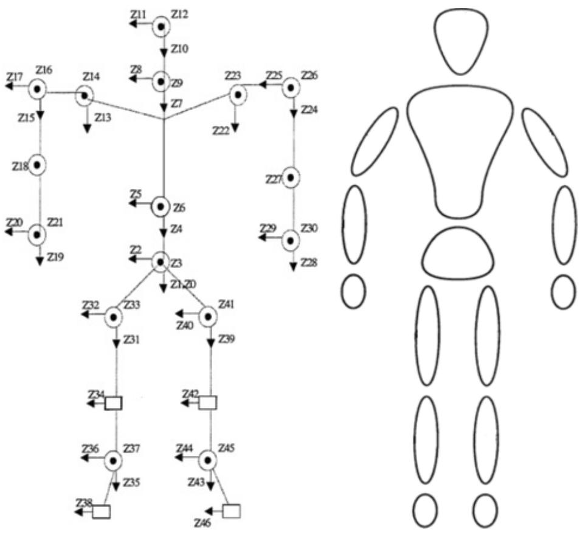  
(a)  
(b)  
Fig. 1. (a) 关节运动学模型。13 (b) 棒状运动学模型。14

第二类基于关节模型，在该模型中人体被视为一个铰接机构。基于这种方法，Zhang et al.18 提出了一种基于人体关节运动学模型13的新方法，以考虑肘部外展/内收约束。在该方法中，采用 Denavit–Hartenberg（DH）法则对身体运动学进行建模。19 该法则提供了一个统一的框架，可同时包含移动关节和旋转关节。该框架可用于表述诸如身体加速度等直线运动量。

由于中风患者对上肢的控制能力较差，康复任务具有高运动动态性的特征，需要更高阶的方向可观测性。此外，这一特征使得身体加速度补偿问题变得更加关键。在上肢康复中，软组织在骨骼上的滑动会干扰内旋/外旋的正确测量，除非上臂和前臂的传感器分别放置在靠近肘部和手腕的位置。由于在这种配置下，传感器位于距离全局参考系原点最远的位置，因此传感器上的身体加速度最大。

通常，惯性技术会受到传感器与肢体段对齐误差（sensor-to-segment misalignment）的影响，而这种问题在光学技术中并不存在。传感器与肢体段对齐误差是由标定和安装误差引起的。传感器与肢体段对齐误差会带来与信号幅度成正比的测量扰动。康复任务的高动态特性加上上肢的灵活性，使得这一问题在该领域中更为关键。

本文针对上肢康复应用，研究了线性化、人体加速度扰动以及传感器与肢体段（sensor-to-segment）对齐偏差问题。通过在运动学模型中描述加速度计的人体加速度测量值，来解决线性化和扰动问题。使用低成本无标记光学传感器来校正传感器与肢体段之间的对齐偏差。在下文中，第 2 节描述了本研究中使用的方法。在该方法中，基于 DH 约定（DH convention）建立了人体上肢的运动学模型。采用扩展卡尔曼滤波（Extended Kalman Filter, EKF）进行非线性估计。测量模型是通过将三维刚体运动学方程应用于上肢 DH 模型建立的。第 3 节包含三个小节的仿真研究。第一小节研究了线性化阶数对估计误差的影响。第二小节检验了位置测量精度对校正传感器与肢体段对齐偏差扰动的影响。在最后一个小节中，将人体加速度补偿与常见的竞争技术进行了对比。第 4 节介绍了对执行上肢康复任务的人体受试者进行的实验。第 5 节的结论包含了对该方法和重要结果的简要总结。

## 2. 方法

## 2.1. 运动学模型

如图 1 所示，关节运动学模型通常用肩部的 3 自由度（DOF）旋转关节和肘部的 2 自由度旋转关节来描述人体上肢。在本节中，基于 DH 约定19给出了该模型的数学描述。图 2 描绘了所有关节角均为零构型下的 DH 描述。$\theta _ { 1 } , \theta _ { 2 }$ 和 $\theta _ { 3 }$ 代表肩部的 3 个自由度。

$\theta _ { 1 }$ 反映屈曲/伸展自由度，$\theta _ { 2 }$ 反映外展/内收自由度，$\theta _ { 3 }$ 反映肩部的内旋/外旋。类似地，$\theta _ { 4 }$ 和 $\theta _ { 5 }$ 分别反映肘部的屈曲/伸展和内旋/外旋。肘部不考虑外展/内收自由度。$l _ { 3 }$ 和 $l _ { 6 }$ 分别指定上臂和前臂的连杆尺寸。使用了两个 IMU。

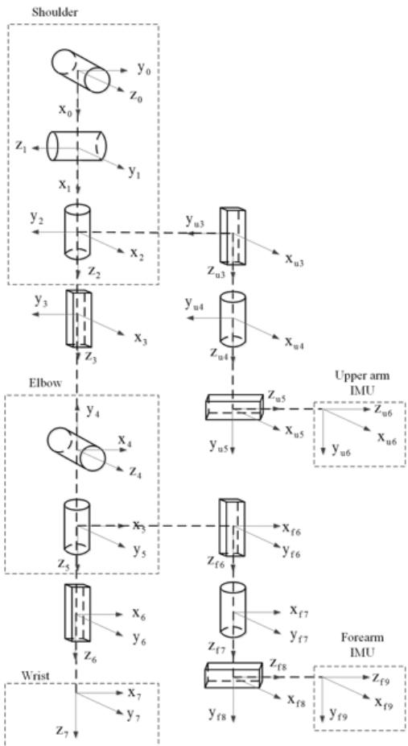  
Fig. 2. 上肢 DH 运动学模型。

一个放置在上臂，另一个放置在前臂。Kinect 用于测量全局参考系中肘部和腕部相对于肩部的位置。描述上臂和前臂 IMU 安装位置与朝向的自由度分别用下标 和 f 表示。例如，上臂和前臂绑带沿内旋/外旋轴距肩部和肘部的距离分别用 $l _ { u 3 }$ 和 $l _ { f 6 }$ 表示。上臂和前臂绑带的有效半径分别用 $l _ { u 5 }$ 和 $l _ { f 8 }$ 表示。绑带允许绕内旋/外旋轴存在旋转自由度（DOF）。该自由度在上臂和前臂绑带上分别用 $\theta _ { u 4 }$ 和 $\theta _ { f 7 }$ 表示。基于该模型，表 1–4 给出了为每个传感器推导的 DH 表。

在 DH 表中，$\gamma _ { i }$ 表示绕 z 轴的旋转，$\lambda _ { i }$ 表示沿 z 轴的平移，$\beta _ { i }$ 表示绕 轴的旋转，$\delta _ { i }$ 表示沿 x 轴的平移。x 轴和 z 轴指每次运动后的当前轴。

Table 1. 上臂 IMU DH 表。

<table><tr><td>i</td><td> $\gamma_i$ </td><td> $\lambda_i$ </td><td> $\beta_i$ </td><td> $\delta_i$ </td></tr><tr><td>1</td><td> $\theta_0$ </td><td>0</td><td> $\pi/2$ </td><td>0</td></tr><tr><td>2</td><td> $\theta_1 + \pi/2$ </td><td>0</td><td> $\pi/2$ </td><td>0</td></tr><tr><td>3</td><td> $\theta_2$ </td><td>0</td><td>0</td><td>0</td></tr><tr><td>4</td><td>0</td><td> $l_{u3}$ </td><td>0</td><td>0</td></tr><tr><td>5</td><td> $\theta_{u4}$ </td><td>0</td><td> $\pi/2$ </td><td>0</td></tr><tr><td>6</td><td>0</td><td> $l_{u5}$ </td><td>0</td><td>0</td></tr></table>

Table 2. 肘部位置传感器 DH 表。

<table><tr><td>i</td><td> $\gamma_i$ </td><td> $\lambda_i$ </td><td> $\beta_i$ </td><td> $\delta_i$ </td></tr><tr><td>1</td><td> $\theta_0$ </td><td>0</td><td> $\pi/2$ </td><td>0</td></tr><tr><td>2</td><td> $\theta_1 + \pi/2$ </td><td>0</td><td> $\pi/2$ </td><td>0</td></tr><tr><td>3</td><td> $\theta_2$ </td><td>0</td><td>0</td><td>0</td></tr><tr><td>4</td><td> $\pi/2$ </td><td> $l_3$ </td><td> $-\pi/2$ </td><td>0</td></tr><tr><td>5</td><td> $\theta_4$ </td><td>0</td><td> $\pi/2$ </td><td>0</td></tr></table>

Table 3. 前臂 IMU DH 表。

<table><tr><td>i</td><td> $\gamma_i$ </td><td> $\lambda_i$ </td><td> $\beta_i$ </td><td> $\delta_i$ </td></tr><tr><td>1</td><td> $\theta_0$ </td><td>0</td><td> $\pi/2$ </td><td>0</td></tr><tr><td>2</td><td> $\theta_1 + \pi/2$ </td><td>0</td><td> $\pi/2$ </td><td>0</td></tr><tr><td>3</td><td> $\theta_2$ </td><td>0</td><td>0</td><td>0</td></tr><tr><td>4</td><td> $\pi/2$ </td><td> $l_3$ </td><td> $-\pi/2$ </td><td>0</td></tr><tr><td>5</td><td> $\theta_4$ </td><td>0</td><td> $\pi/2$ </td><td>0</td></tr><tr><td>6</td><td> $\theta_5$ </td><td>0</td><td>0</td><td>0</td></tr><tr><td>7</td><td>0</td><td> $l_{f6}$ </td><td>0</td><td>0</td></tr><tr><td>8</td><td> $\theta_{f7} + \pi/2$ </td><td>0</td><td> $\pi/2$ </td><td>0</td></tr><tr><td>9</td><td>0</td><td> $l_{f8}$ </td><td>0</td><td>0</td></tr></table>

Table 4. 腕部位置传感器 DH 表。

<table><tr><td>i</td><td> $\gamma_i$ </td><td> $\lambda_i$ </td><td> $\beta_i$ </td><td> $\delta_i$ </td></tr><tr><td>1</td><td> $\theta_0$ </td><td>0</td><td> $\pi/2$ </td><td>0</td></tr><tr><td>2</td><td> $\theta_1 + \pi/2$ </td><td>0</td><td> $\pi/2$ </td><td>0</td></tr><tr><td>3</td><td> $\theta_2$ </td><td>0</td><td>0</td><td>0</td></tr><tr><td>4</td><td> $\pi/2$ </td><td> $l_3$ </td><td> $-\pi/2$ </td><td>0</td></tr><tr><td>5</td><td> $\theta_4$ </td><td>0</td><td> $\pi/2$ </td><td>0</td></tr><tr><td>6</td><td> $\theta_5$ </td><td>0</td><td>0</td><td>0</td></tr><tr><td>7</td><td>0</td><td> $l_6$ </td><td>0</td><td>0</td></tr></table>

## 2.2. 卡尔曼滤波

状态向量定义为：

$$
\boldsymbol {x} = [ \begin{array}{c c c} \ddot {\boldsymbol {\theta}} & \dot {\boldsymbol {\theta}} & \boldsymbol {\theta} \end{array} ].\tag{1}
$$

在 (1) 中，µ 是定义如下的关节向量：

$$
\pmb {\theta} = [ \begin{array}{c c c c c} \theta_ {0} & \theta_ {1} & \theta_ {2} & \theta_ {4} & \theta_ {5} \end{array} ] ^ {T}.\tag{2}
$$

关节角动力学采用二阶线性化建模。一阶高斯-马尔可夫过程（Gauss–Markov process，GM-1）用于描述关节向量的二阶导数（ µ ）。关节向量的一阶导数 $( \dot { \pmb \theta } )$ 和关节向量本身（µ）分别通过对关节加速度进行一次积分和二次积分获得。该模型的离散时间过程矩阵可以写为：

$$
\pmb {F} = \left[ \begin{array}{c c c} {\bf I} _ {5} & {\bf 0} _ {5} & {\bf 0} _ {5} \\ t _ {s} {\bf I} _ {5} & {\bf I} _ {5} & {\bf 0} _ {5} \\ 0. 5 t _ {s} ^ {2} {\bf I} _ {5} & t _ {s} {\bf I} _ {5} & {\bf I} _ {5} \end{array} \right].\tag{3}
$$

在上式中，$t _ { s }$ 为采样时间步长，${ \mathbf I } _ { n }$ 和 ${ \bf 0 } _ { n }$ 分别为维度为 n 的单位矩阵和零矩阵。过程噪声协方差矩阵定义为：

$$
\boldsymbol {Q} = \left[ \begin{array}{c c} \sigma_ {\ddot {\theta}} ^ {2} \mathbf {I} _ {5} & \mathbf {0} _ {5 \times 1 0} \\ \mathbf {0} _ {1 0 \times 5} & \mathbf {0} _ {1 0} \end{array} \right].\tag{4}
$$

在 (4) 中，$\boldsymbol { \sigma } _ { \ddot { \boldsymbol { \mu } } } ^ { 2 }$ 是描述关节角动力学的过程噪声方差。测量模型是基于将 DH 参数法（DH convention）应用于 3D 刚体运动学方程建立的。在本文中，假设肩部旋转中心是静止的。该假设基于许多上肢康复任务都是在躯干保持静止的状态下完成的这一事实。该坐标系在 DH 参数法中被设定为全局参考系。以下方程组描述了全局参考系。

$$
{ } ^ { 0 } \pmb { p } _ { 0 } = \mathbf { 0 } _ { 3 \times 1 } ,\tag{5}
$$

$$
{ } ^ { 0 } \pmb { \omega } _ { 0 } = \mathbf { 0 } _ { 3 \times 1 } ,\tag{6}
$$

$$
{ } ^ { 0 } \dot { \pmb { \omega } } _ { 0 } = \mathbf { 0 } _ { 3 \times 1 } ,\tag{7}
$$

$$
{ } ^ { 0 } \ddot { \pmb { p } } _ { 0 } = \mathbf { 0 } _ { 3 \times 1 } ,\tag{8}
$$

$$
{ } ^ { 0 } \boldsymbol { g } = g \hat { \mathbf { k } } .\tag{9}
$$

考虑 DH 参数法中的第 $(i-1)$ 个和第 $i$ 个参考系。第 $i$ 个参考系相对于第 $(i-1)$ 个参考系的相对旋转矩阵 $( \underset { i - 1 } { \overset { i } { R } } { } )$ 和位移向量 $\left( { \bf \zeta } ^ { i - 1 } { \bf p } _ { i } \right)$ 构成了齐次变换，该齐次变换根据 DH 参数 $\gamma _ { i } , \lambda _ { i } , \beta _ { i }$ 和 $\delta _ { i }$ 获得 (10)：

$$
{ } _ { i } ^ { i - 1 } \boldsymbol { H } = \left[ \begin{array} { c c } { } _ { i } ^ { i - 1 } \boldsymbol { R } & { } ^ { i - 1 } \boldsymbol { p } _ { i } \\ 0 _ { 1 \times 3 } & 1 \end{array} \right] = \boldsymbol { R } _ { z } ( \gamma _ { i } )   \boldsymbol { T } _ { Z } ( \lambda _ { i } )   \boldsymbol { R } _ { x } ( \beta _ { i } )   \boldsymbol { T } _ { x } ( \delta _ { i } ) .\tag{10}
$$

基于相对旋转矩阵和位移向量，递推正向运动学方程可表示为：

$$
{ } ^ { 0 } \boldsymbol { p } _ { i } = { } ^ { 0 } \boldsymbol { p } _ { i - 1 } = \Pi _ { 1 } ^ { i - 1   j - 1 } { } _ { j } \boldsymbol { R } ^ { i - 1 } \boldsymbol { p } _ { i } ,\tag{11}
$$

$$
{ } ^ { i } \pmb { \omega } _ { i } = { } ^ { i - 1 } { } _ { i } \pmb { R } ^ { T } [ { } ^ { i - 1 } \pmb { \omega } _ { i - 1 } + \dot { \gamma } _ { i } \hat { \mathbf { k } } ] ,\tag{12}
$$

$$
{ } ^ { i } \dot { \boldsymbol { \omega } } _ { i } = { } ^ { i - 1 } { } _ { i } \boldsymbol { R } ^ { T } [ { } ^ { i - 1 } \dot { \boldsymbol { \omega } } _ { i - 1 } + { } ^ { i - 1 } \boldsymbol { \omega } _ { i - 1 } \times \dot { \gamma } _ { i } \hat { \mathbf { k } } + \ddot { \gamma } _ { i } \hat { \mathbf { k } } ] ,\tag{13}
$$

$$
{ } ^ { i } \ddot { \boldsymbol { p } } _ { i } = { } ^ { i - 1 } { } _ { i } \boldsymbol { R } ^ { T } [ { } ^ { i - 1 } \dot { \boldsymbol { \omega } } _ { i - 1 } \times { } ^ { i - 1 } \boldsymbol { p } _ { i } + { } ^ { i - 1 } \boldsymbol { \omega } _ { i - 1 } \times ( { } ^ { i - 1 } \boldsymbol { \omega } _ { i - 1 } \times { } ^ { i - 1 } \boldsymbol { p } _ { i } ) + { } ^ { i - 1 } \ddot { \boldsymbol { p } } _ { i - 1 } ] ,\tag{14}
$$

$$
{ } ^ { i } \boldsymbol { g } = { } _ { i - 1 } ^ { i } \boldsymbol { R } ^ { i - 1 } \boldsymbol { g } .\tag{15}
$$

在上述方程中，$\pmb { p }$ 为参考坐标系原点的位置，! 为参考坐标系的角速度，$\pmb { g }$ 为重力。k^ 为 z 轴的单位向量，且 为叉乘。方程 (14) 为机体加速度的描述。如图所示，关节角度的二阶导数 ( - 出现在该方程中。由于机体加速度由加速度计测得，该公式化表述不仅改进了测量模型，还为关节向量的二阶导数提供了可观测性。因此，过程模型的线性化阶数可以增加一阶。基于该公式化表述，测量向量定义为：

$$
\boldsymbol {z} = \left[ \begin{array}{c c c c c c} u ^ {6} \boldsymbol {\omega} _ {u 6} & ^ {f 9} \boldsymbol {\omega} _ {f 9} & ^ {u 6} \boldsymbol {a} _ {u 6} & ^ {f 9} \boldsymbol {a} _ {f 9} & ^ {0} \boldsymbol {p} _ {5} & ^ {0} \boldsymbol {p} _ {7} \end{array} \right] ^ {T}.\tag{16}
$$

在上述方程中，$^ 6 \omega _ { u 6 }$ 和 $^ 9 \omega _ { f 9 }$ 分别为上臂和前臂的陀螺仪测量值。类似地，${ } ^ { 6 } { \pmb a } _ { u 6 }$ 和 $^ 9 a _ { f 9 }$ 分别为上臂和前臂加速度计的总加速度测量值。总加速度为重力加速度与机体加速度之和，即：

$$
{ } ^ { u 6 } \pmb { a } _ { u 6 } = { } ^ { u 6 } \pmb { g } + { } ^ { u 6 } \ddot { \pmb { p } } _ { u 6 } ,\tag{17}
$$

$$
{ } ^ { f 9 } \boldsymbol { a } _ { f 9 } = { } ^ { f 9 } \boldsymbol { g } + { } ^ { f 9 } \ddot { \boldsymbol { p } } _ { f 9 } .\tag{18}
$$

${ } ^ { 0 } { \pmb p } _ { 5 }$ 和 ${ } ^ { 0 } { \pmb p } _ { 7 }$ 分别为位置传感器测得的肘部和腕部位置。

测量噪声协方差矩阵定义为：

$$
\boldsymbol {R} = \left[ \begin{array}{c c c} \sigma_ {\omega} ^ {2} \mathbf {I} _ {6} & \mathbf {0} _ {6} & \mathbf {0} _ {6} \\ \mathbf {0} _ {6} & \sigma_ {a} ^ {2} \mathbf {I} _ {6} & \mathbf {0} _ {6} \\ \mathbf {0} _ {6} & \mathbf {0} _ {6} & \sigma_ {p} ^ {2} \mathbf {I} _ {6} \end{array} \right].\tag{19}
$$

在该方程中，角速度、加速度和位置的测量噪声方差分别表示为 $\sigma _ { \omega } ^ { 2 } , \sigma _ { a } ^ { 2 }$ 和 $\sigma _ { p } ^ { 2 }$。

## 3. 仿真

进行仿真研究是为了在合理的环境下定量分析各误差源对关节角度误差的贡献。随后应用所提出的方法，以量化它们在减小误差方面的有效性。

Table 5 展示了滤波器设计参数。

传感器噪声方差是根据 Shimmer2RTM 运动学模块 (http://www.shimmer-research.com/) 和 $\mathrm { K i n e c t ^ { T M } }$ (http://www.xbox.com/en-US/kinect) 的台架测试样本确定的。$\mathrm { S h i m m e r 2 R ^ { T M } }$ 是惯性测量单元（IMU），$\mathrm { K i n e c t ^ { T M } }$ 是本工作中使用的位置测量传感器。图 3 展示了传感器的台架测试数据样本与为仿真生成的合成数据样本的对比。如图 3(a) 所示，由于缺乏角速度的参考矢量，制造商的陀螺仪校准程序容易产生偏差。

过程噪声方差通过试错法选择。方差的增大能够带来更快的滤波器响应，并弥补建模误差问题。20 另一方面，在平稳跟踪条件下，过大的方差会导致滤波器不稳定以及较高的误差方差。由于在康复过程中预计会出现较高的加速度，因此 $\boldsymbol { \sigma } _ { \ddot { \boldsymbol { \theta } } } ^ { 2 }$ 应选择得比其他应用相对更高。采样时间步长选择为 1 ms，这与文献中的常用选择一致。21 滤波器在配备 3.20 GHz CPU 和 32.0 GB RAM 的计算机上实现。

Table 5. 滤波器设计参数。

<table><tr><td>参数</td><td>数值</td><td>参数</td><td>数值</td></tr><tr><td> $\sigma_{\dot{\theta}}^{2}$ </td><td> $1(^{\circ}/s^{2})^{2}$ </td><td> $\sigma_{p}^{2}$ </td><td> $10^{-4}(m)^{2}$ </td></tr><tr><td> $\sigma_{\omega}^{2}$ </td><td> $10^{-1(^{\circ}/s)^{2}}$ </td><td> $\sigma_{a}^{2}$ </td><td> $10^{-2}(m/s)^{2}$ </td></tr></table>

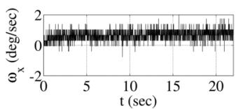  
(a)

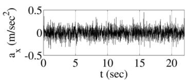  
(b)

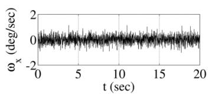  
(c)

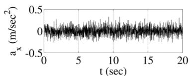  
(d)  
Fig. 3. 静止传感器数据样本。(a) 陀螺仪实验数据，(b) 加速度计实验数据，(c) 陀螺仪仿真数据，以及 (d) 加速度计仿真数据。

通过考虑单个肢体节段（肩部和上臂）来进行仿真。将正弦轨迹施加于肩部屈曲/伸展角（图 2 中的 $( \theta _ { 0 }$），幅值为 $9 0 ^ { \circ }$，并采用不同的频率以代表运动速度。仿真研究分为三个部分，分别研究线性化误差、传感器到肢体节段的对准误差（sensor-to-segment misalignment error）以及身体加速度扰动。针对各小节的具体仿真方案将在对应小节中给出。

## 3.1. 线性化误差

本仿真在考虑三种测量模型的情况下量化线性化误差：倾角计模型（Inclinometer Model）、倾角计/陀螺仪模型（Inclinometer/Gyroscope Model）以及加速度计/陀螺仪模型（Accelerometer/Gyroscope Model）。此外，还针对每种测量模型对比了 EKF 与 UKF 的性能。为了排除身体加速度扰动对关节角误差的影响，将传感器置于肩部旋转中心，从而使身体加速度为零。随后基于这三种测量模型对合成测量值进行滤波：倾角计模型、倾角计/陀螺仪模型和加速度计/陀螺仪模型。图 4 显示了频率为 1 Hz 的正弦运动的仿真结果。倾角计模型对倾角具有零阶可观测性。换言之，它包含有关倾角的信息，但不包含其高阶导数的信息。如图所示，在更高阶导数显著的动态应用中，仅基于倾角计信息的倾角估计存在相当大的误差。通过测量角速度，陀螺仪提供了一阶可观测性并改善了线性化误差。因此，陀螺仪如今已成为所有姿态跟踪系统中不可或缺的组成部分。类似地，本文利用加速度计的身体加速度测量来提供二阶可观测性。如图所示，对于康复应用中典型的运动，二阶可观测性足以消除线性化误差。

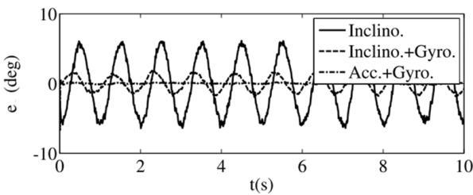  
Fig. 4. 频率为 1 Hz 的正弦运动下倾角误差的比较。实线：零阶线性化（倾角计模型），虚线：一阶线性化（倾角计/陀螺仪模型），点划线：二阶线性化（加速度计/陀螺仪模型）。

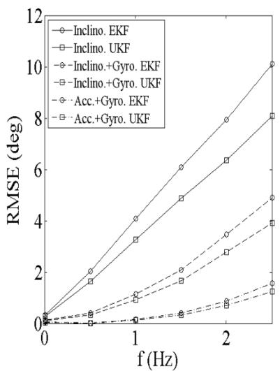

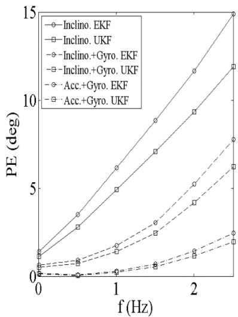  
Fig. 5. 过程模型线性化阶数对关节变量误差的影响及其对频率的敏感性。

为了研究各测量模型对参考运动动力学特性的灵敏度，在 0 至 2.5 Hz 的频率范围内重复了先前的仿真。如图 5 所示，所提出方法中的线性化误差及其对运动动力学特性的灵敏度均显著更低。EKF（扩展卡尔曼滤波）是最常用的非线性滤波器，这是因为其算法简单，在特定计算资源下能够实现更快的速度并占用更少的内存。在该算法中，其应用仅仅受到线性化的限制，尤其是在高动态运动和大采样间隔的情况下。22 在其他方面，相比于无迹卡尔曼滤波（UKF）等更复杂的滤波器，EKF 更受青睐，因为它更简单、能提供更快的运行速度并且所需内存更少，尤其适用于实时应用。因此，所提出的方法通过消除这一限制，能够拓展 EKF 在实时康复应用中的适用范围。

## 3.2. 传感器至肢体段对准误差

在本节中，我们表征了关节角度误差对传感器至肢体段对准误差的灵敏度。为了考虑模型的非线性，我们在静态和动态条件下使用不同速度的参考运动进行了仿真。该速度由参考正弦波的频率来表征。文中对利用位置测量来校正此类误差的有效性进行了量化和讨论。

在图 6 中，实线和点划线分别展示了在加速度计和陀螺仪上施加单位扰动、且带有 $+ 1 0 ^ { \circ }$ 初始误差的静态测试中的稳态误差。如图所示，在存在陀螺仪偏置的情况下，融合加速度计与陀螺仪的信息可以防止漂移误差。如图所示，通过将位置测量噪声方差的估计值设为无穷大 $( 1 0 ^ { 8 } )$，停用了位置测量的校正效果。在静态仿真中，加速度计和陀螺仪中的单位扰动分别导致了 $5 . 7 ^ { \circ }$ 和 $1 . 3 ^ { \circ }$ 的稳态倾斜角误差。虚线和点线则显示了启用位置测量时的误差。通过引入位置测量，加速度计扰动引起的稳态误差降低了 15%（从 $5 . 7 ^ { \circ }$ 降至 4.8），陀螺仪扰动引起的稳态误差降低了 30%（从 $1 . 3 ^ { \circ }$ 降至 0.9）。

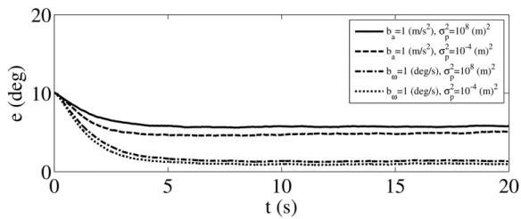  
Fig. 6. 静态仿真；有无位置测量校正作用下 IMU 单位扰动对应的倾斜角误差

为了探究位置测量精度对减轻 IMU 传感器与肢体节段间对准误差（sensor-to-segment misalignment error）的影响，使用精度从 1 mm $( \sigma _ { p } ^ { 2 } = 1 0 ^ { - 6 } \mathrm { m } ^ { 2 } )$ 到 1 m $( \sigma _ { p } ^ { 2 } = 1 \mathrm { m } ^ { 2 } )$ 的合成位置测量重复进行了仿真。如图 Fig. 7 所示，Kinect 的精度 $( \sigma _ { p } ^ { 2 } = 1 0 ^ { - 4 } \mathrm { m } ^ { 2 } )$ 勉强足以带来一些改善；然而，未来在超越 Kinect 精度的低成本无标记位置测量技术方面取得的成果，可能会对该方法的有效性产生重要影响。

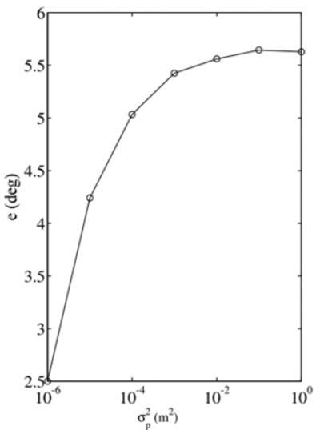  
(a)

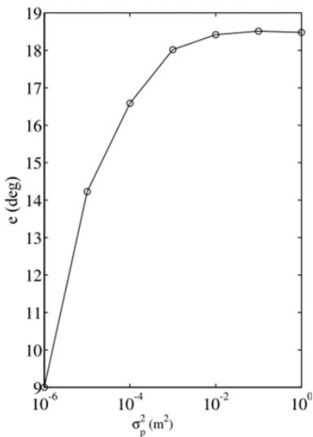  
(b)  
Fig. 7. 位置测量精度对惯性测量摄动校正的影响。

本部分的动态仿真旨在表征传感器与肢体节段对准误差随运动动力学的变化特性。这种特性源于测量模型的非线性。在该仿真中，在肩部屈/伸运动中对加速度计和陀螺仪施加单位摄动。该运动是一条幅值为 $9 0 ^ { \circ }$、频率范围为 0 Hz 至 3 Hz 的正弦轨迹。

在第一次仿真中，通过将位置测量噪声方差的估计值设为无穷大 $( 1 0 ^ { 8 } )$ 来停用位置测量的校正作用。该仿真的结果在 Fig. 8 中以实线显示。如图所示，动态误差低于静态误差，并且在 1 Hz 之前持续减小。超过该频率后，误差再次增大。将这些曲线与“无摄动”（No Perturbation）曲线进行对比表明，在高频时，误差主要是由过程模型线性化引起的。“无摄动”曲线与 Fig. 5 中的加速度计/陀螺仪模型（Accelerometer/Gyroscope Model）情况相同。在低频时，过程模型线性化误差可以忽略不计，而单位测量摄动的影响较大。随着频率增加，由单位测量摄动引起的倾角误差减小；然而，过程模型线性化误差占据主导地位并增大了总误差。由单位测量摄动引起的倾角误差随频率的减小，是由于卡尔曼增益与局部测量矩阵的逆成正比。相反，线性化效应变得显著。基于该仿真，该算法的最佳工作点为 1 Hz 频率。

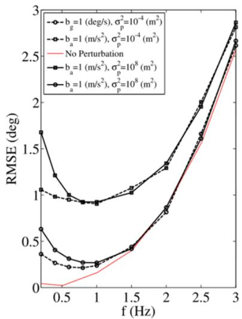  
(a)

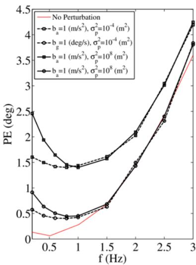  
(b)  
Fig. 8. 动态仿真；倾角误差随频率变化的特性。

图 8 中的虚线表示激活位置测量 $( \sigma _ { p } ^ { 2 } = 1 0 ^ { - 4 } \mathrm { m } ^ { 2 } )$ 后的校正效果结果。仿真结果表明，当运动频率增加时，位置测量在校正 IMU 的传感器-肢体段对准误差方面的有效性会降低；然而，典型的上肢康复任务都在其有效范围内。该仿真表明，低成本的无标记光学位置传感技术有潜力缓解惯性方法唯一突出的实际局限性，即传感器-肢体段对准误差。

## 3.3. 身体加速度误差

本节致力于身体加速度误差的量化，并将所提出的补偿方法与常见的竞争补偿技术进行对比。为了考虑身体加速度，传感器放置在远离肩部旋转中心且靠近肘部的位置。典型的肩部屈/伸康复任务由振幅为 90°、频率为 1 Hz 的正弦轨迹表示。

在身体加速度补偿方面，将所提出的方法（方法 A）与一种常见的竞争技术（方法 B）以及不对身体加速度进行补偿的情况（方法 C）进行比较。方法 B 和方法 C 均基于倾角计/陀螺仪模型（Inclinometer/Gyroscope Model），其中未考虑传感器相对于关节旋转中心的位置。方法 B 使用状态扩维技术执行身体加速度补偿。在该方法中，身体加速度作为一个状态变量被添加到状态向量中，其动力学特性被建模为 GM-1 过程。17

图 9 显示了这三种方法的倾角误差。每种方法的平均误差和峰值误差列于表 6 中。

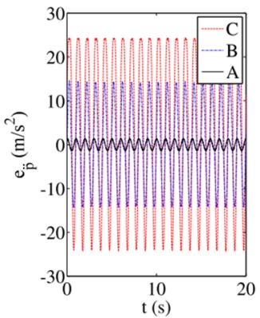  
(a)

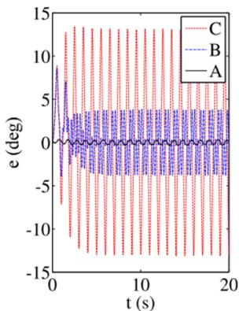  
(b)  
Fig. 9. (a) 身体加速度补偿误差。(b) 倾角误差。

Table 6. 仿真中的身体加速度补偿性能。

<table><tr><td rowspan="2">方法</td><td colspan="2">RMSE</td><td colspan="2">PE</td></tr><tr><td>均值</td><td>标准差</td><td>均值</td><td>标准差</td></tr><tr><td>A</td><td> $0.20^{\circ}$ </td><td> $0.02^{\circ}$ </td><td> $0.35^{\circ}$ </td><td> $0.02^{\circ}$ </td></tr><tr><td>B</td><td> $2.51^{\circ}$ </td><td> $0.51^{\circ}$ </td><td> $8.48^{\circ}$ </td><td> $0.74^{\circ}$ </td></tr><tr><td>C</td><td> $7.39^{\circ}$ </td><td> $0.23^{\circ}$ </td><td> $13.43^{\circ}$ </td><td> $0.62^{\circ}$ </td></tr></table>

如方法 C 所示，若不进行补偿，身体加速度扰动会在典型任务中带来显著误差。该误差比线性化误差大一个数量级。更定量地看，表 6 显示，对于典型任务，身体加速度扰动对均方根误差（Root Mean Square Error, RMSE）和峰值误差（Peak Error, PE）的贡献分别约为 $7 ^ { \circ }$ 和 $1 3 ^ { \circ }$。将所提出方法（方法 A）与方法 B 的结果进行对比，仿真表明在身体加速度补偿方面有所改善。如表 6 所示，对于典型任务，该改善约为 $2 ^ { \circ }$ RMSE 和 8 PE。这种改善源于所提出的方法在对身体加速度建模时考虑了其与关节角变量的关系，而另一方面，方法 B 将身体加速度建模为独立的状态变量。尽管所提出的方法相比方法 B 具有这种根本优势，但需要指出的是，所提出的方法仅适用于躯干保持静止的任务。这在上肢康复任务中相当常见，但在一般的自由活动任务中，该方法并不直接适用。另一方面，方法 B 没有此类要求，可应用于更一般的运动。这意味着可以利用关于运动类型的先验信息来提高跟踪器的精度和性能。

## 4. 实验

实验部分在真实环境中验证了仿真中获得的定量结果。实验在一种机械式上肢中风康复设备（也称为肩关节旋转轮，shoulder wheel）上进行。该设备由一个带有手柄的木质旋转轮组成，手柄到轮中心的径向距离可以调节。轴的旋转角度经过编码测量。图 10(a) 展示了旋转轮以及测试过程中受试者的姿态配置。该实验的思路是推导该特定配置的逆运动学，并将其作为量化精度的参考基准。本节包含两个小节。第一小节给出了逆运动学的推导，第二小节给出了结果与讨论。

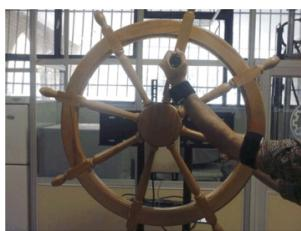  
(a)

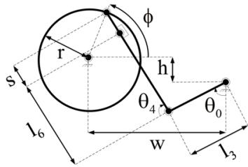  
(b)  
Fig. 10. (a) 肩关节旋转轮测试装置。(b) 肩关节旋转轮测试装置的运动学模型。

## 4.1. 逆运动学

图 10(b) 展示了测试装置的运动学模型。该模型用于进行逆运动学分析。更具体而言，逆运动学分析涉及推导肩部和肘部的屈曲/伸展关节角作为轴旋转角函数的解析关系式。公式 (20) 和 (21) 给出了这些方程：

$$
\begin{array}{r} \theta_ {0} ^ {*} = 2 \pi - [ a \tan 2 (r \sin \phi + h, r \cos \phi - w) - a \tan 2 ((s + l _ {6}) \sin \theta_ {4} ^ {*}, l _ {3} \\ + (s + l _ {6}) \cos \theta_ {4} ^ {*}) ], \end{array}\tag{20}
$$

$$
\theta_ {4} ^ {*} = \frac {3 \pi}{2} - a \cos \left[ \frac {(r \cos \phi - w) ^ {2} + (r \sin \phi + h) ^ {2} - l _ {3} ^ {2} - (s + l _ {6}) ^ {2}}{2 l _ {3} (s + l _ {6})} \right].\tag{21}
$$

在实验设置中，公式 (20) 和 (21) 成立的前提条件是受试者的腕关节固定，且肩部没有外展/内收运动。通过将肘部搁置在轮盘上来满足这一约束。

将上肢运动学模型（Fig. 2）与测试装置运动学模型（Fig. 10）进行对比，参考关节向量为：

$$
\pmb {\theta} ^ {*} = [ \theta_ {0} ^ {*} 0 0 \theta_ {4} ^ {*} \pi / 2 ] ^ {T}.\tag{22}
$$

受试者及传感器安装的几何参数列于 Table 7。w 和 h 的数值是通过对肩部和轮盘中心的位置数据取平均值获得的。其他几何参数通过游标卡尺测量。上臂 IMU 的 z 轴与肘关节屈曲/伸展轴 $\theta _ { u 4 } = \pi / 2$ 对齐。前臂 IMU 的 x 轴与腕关节屈曲/伸展轴 $\theta _ { f 7 } = \pi / 2$ 对齐。

Table 7. 几何参数。

<table><tr><td>参数</td><td>数值</td><td>参数</td><td>数值</td></tr><tr><td> $l_{u3}$ </td><td>11 cm</td><td> $l_{f6}$ </td><td>20 cm</td></tr><tr><td> $\theta_{u4}$ </td><td> $\pi/2$ </td><td> $\theta_{f7}$ </td><td> $\pi/2$ </td></tr><tr><td> $l_{u5}$ </td><td>2 cm</td><td> $l_{f8}$ </td><td>1 cm</td></tr><tr><td> $l_3$ </td><td>22 cm</td><td> $l_6$ </td><td>20 cm</td></tr><tr><td>w</td><td>25 cm</td><td>h</td><td>5 cm</td></tr><tr><td>r</td><td>15 cm</td><td>s</td><td>4 cm</td></tr></table>

## 4.2. 结果与讨论

在本小节中，首先验证了肢体加速度补偿的改进效果。接着，通过实验测试了 Kinect 传感器的有效性。最后，对 EKF 和 UKF 的性能进行了对比和讨论。

在 Fig. 11 中，实线表示作为参考的逆运动学解。基于该参考值计算了方法 A、B 和 C 的关节角误差，并进行了相互比较。

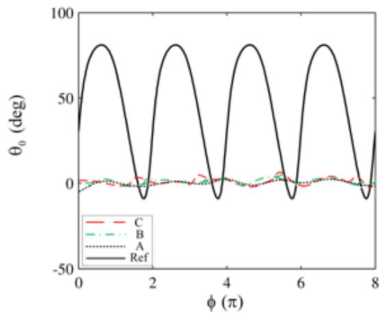  
(a)

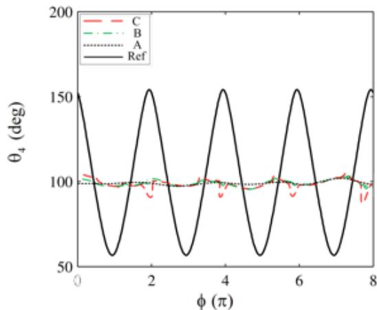  
(b)  
Fig. 11. 肩关节和肘关节屈曲/伸展角误差。实线：参考值。点线：方法 A 的误差。点划线：方法 B 的误差。虚线：方法 C 的误差。

Table 8. 肩关节屈曲/伸展角误差。

<table><tr><td rowspan="2">方法</td><td colspan="2">RMSE</td><td colspan="2">PE</td></tr><tr><td>均值</td><td>标准差</td><td>均值</td><td>标准差</td></tr><tr><td>A ( $\sigma_p^2 = \infty$ )</td><td>4.9°</td><td>1.0°</td><td>6.0°</td><td>1.1°</td></tr><tr><td>A ( $\sigma_p^2 = 10^{-4}$ )</td><td>4.8°</td><td>1.3°</td><td>6.1°</td><td>0.9°</td></tr><tr><td>B</td><td>5.5°</td><td>1.3°</td><td>6.8°</td><td>1.5°</td></tr><tr><td>C</td><td>7.1°</td><td>2.3°</td><td>13.8°</td><td>1.0°</td></tr></table>

Table 8 统计性地展示了基于三次试验所得的各对比方法的均值和峰值误差。实验结果证实了与方法 B 相比，在身体加速度补偿方面的改进。与仿真相比，实验中的改进幅度较小。这在一定程度上可归因于参考运动并非理想的正弦波。如图所示，肘关节屈曲/伸展误差显著大于肩关节屈曲/伸展误差。肘关节角度的估计基于前臂 IMU 的测量值。由于前臂 IMU 相比上臂 IMU 距离全局参考坐标系更远，建模误差会在其测量模型中传播。此外，前臂 IMU 测得的主要信号幅值大于上臂 IMU；因此，对于肘关节角度而言，传感器与肢体段的对准误差更大。

为了评估在真实条件下使用 Kinect 的效果，方法 A 分别在忽略 Kinect 测量值 $( \sigma _ { p } ^ { 2 } = \infty )$ 和考虑其测量值 $( \sigma _ { p } ^ { 2 } = 1 0 ^ { - 4 } )$ 的情况下各应用了一次。该实验的结果如 Table 8 的第二行所示。与仿真不同，实验结果并未显示出 RMSE 的显著改善；然而，正如始终较低的标准差所表明的那样，估计的置信度有所提高。在真实条件下 Kinect 的表现不如仿真中有效，这一事实可归因于其在动态条件下的精度可能低于静态条件。尽管如此，低成本无标记传感技术的未来发展将提升该方法在提高精度方面的有效性。

Table 8 和 Table 9 中第一行和第二行的结果分别对应于方法 A $( \sigma _ { p } ^ { 2 } = \infty )$。为了比较 EKF 与 UKF 的性能，使用相同的滤波参数通过 UKF 对实验测量值进行了滤波。

Table 9. 肘关节屈曲/伸展角度误差。

<table><tr><td rowspan="2">方法</td><td colspan="2">RMSE</td><td colspan="2">PE</td></tr><tr><td>均值</td><td>标准差</td><td>均值</td><td>标准差</td></tr><tr><td>A ( $\sigma_{p}^{2} = \infty$ )</td><td> $5.9^{\circ}$ </td><td> $1.1^{\circ}$ </td><td> $7.2^{\circ}$ </td><td> $1.7^{\circ}$ </td></tr><tr><td>A ( $\sigma_{p}^{2} = 10^{-4}$ )</td><td> $6.1^{\circ}$ </td><td> $0.9^{\circ}$ </td><td> $7.1^{\circ}$ </td><td> $1.3^{\circ}$ </td></tr><tr><td>B</td><td> $7.4^{\circ}$ </td><td> $2.8^{\circ}$ </td><td> $10.3^{\circ}$ </td><td> $2.5^{\circ}$ </td></tr><tr><td>C</td><td> $10.2^{\circ}$ </td><td> $2.3^{\circ}$ </td><td> $19.1^{\circ}$ </td><td> $3.1^{\circ}$ </td></tr></table>

Table 10. 使用 UKF 的方法 A 的角度误差。

<table><tr><td rowspan="2">关节</td><td colspan="2">RMSE</td><td colspan="2">PE</td></tr><tr><td>均值</td><td>标准差</td><td>均值</td><td>标准差</td></tr><tr><td>肩关节</td><td>4.7°</td><td>0.9°</td><td>5.9°</td><td>0.8°</td></tr><tr><td>肘关节</td><td>5.9°</td><td>1.0°</td><td>6.9°</td><td>1.4°</td></tr></table>

Table 10 展示了基于三次试验由 UKF 获取的均值和峰值误差。如图所示，其性能略有提升；然而，这种轻微的改进是以更复杂的滤波器、更慢的速度和更高的内存需求为代价的，这在实时应用中可能并不理想。

## 5. 结论

本研究旨在通过聚焦于线性化误差、肢体加速度扰动误差以及传感器与肢体段对准误差，改进中风患者康复等动态任务中的上肢关节角度估计。线性化误差和肢体加速度扰动误差通过对肢体加速度进行建模来处理。采用低成本无标记光学位置测量尝试校正传感器与肢体段的对准误差。

肢体加速度是基于 DH 参数法（DH convention）与 3D 刚体运动学方程相结合进行建模的。结果表明，所提出的建模方法通过补偿肢体加速度显著提高了精度。根据仿真结果，与常见的竞争方法相比，通过补偿肢体加速度所实现的改善在 RMSE 上可超过 2，在 PE 上可超过 8。在实验中，肩关节的改善为 $0 . 6 ^ { \circ }$ RMSE 和 0.8 PE，肘关节的改善为 1.5 RMSE 和 3.1 PE。此外，肢体加速度模型利用了加速度计的肢体加速度测量值，从而提高了线性化阶数。改进后的线性化为采用更简单、更快速的常见非线性滤波器（如 EKF）提供了更好的契机，进而提高了算法的实时性能。尽管在仿真中效果显著，但实验证据表明，使用 Kinect 仅能提高结果的确定性（即在统计上具有更高置信度的估计值），而对精度的影响并不显著。

## 参考文献

1. Zhou H, Hu H, 康复人体运动跟踪综述, Biomed Signal Process Control 3(1):1–18, 2008.

2. Roux E et al., 上肢运动学分析中全局优化方法的评估, J Biomech 35(9):1279–1283, 2002.

3. Welch G, Foxlin E, 运动跟踪：虽无万灵药，但有可靠武器库, IEEE Comput Graphics Appl 22(6):24–38, 2002.

4. Fang L et al., 无线辅助行人航位推算系统的设计——Nav-Mote经验, IEEE Trans Instrum Meas 54(6):2342–2358, 2005.

5. Bouten CVC et al., 用于日常身体活动评估的三轴加速度计和便携式数据处理单元, IEEE Trans Biomed Eng 44(3):136–147, 1997.

6. Liu K et al., 穿戴式传感器系统动态评估人体环节方向的新方法, J Biomech 42(16):2747–2752, 2009.

7. Bagala F et al., 单轴加速度计校准的二维角运动学：从倒立摆到连杆链, IEEE Sens J 12(3):479–486, 2012.

8. Veltink PH et al., 使用单轴加速度计检测静态和动态活动, IEEE Trans Rehabil Eng 4(4):375–385, 1996.

9. Roetenberg D, 人体运动的惯性与磁传感, University of Twente, 2006.

10. Peng C, Oelmann B, 基于加速度计和陀螺仪的关节角度测量综述, IEEE Trans Instrum Meas 59(2):404–414, 2010.

11. Dejnabadi H, Jolles BM, Aminian K, 基于加速度计与陀螺仪组合精确测量单轴关节角度的新方法, IEEE Trans Biomed Eng 52(8):1478–1484, 2005.

12. Bergmann JH, Mayagoitia RE, Smith IC, 上楼梯过程中采集解剖关节角度的便携式系统：与光学跟踪设备的对比, Dyn Med 8(1):3, 2009.

13. Usta UY, 人体模型关节角度动画中四元数与欧拉角方法的比较, DTIC Document, 1999.

14. Frey W, 惯性传感器和磁通门磁力计在实时人体动作捕捉中的应用, Thesis, Naval Postgraduate School, Monterey, California. 1996.

15. Rehbinder H, Hu X, 加速刚体的无漂移姿态估计, Automatica 40(4):653–659, 2004.

16. Ladetto Q, Merminod B, 与INS同行：盲人导航与应急人员跟踪, GPS World 13(10):30–38, 2002.

17. Sabatini AM, 基于四元数的扩展卡尔曼滤波用于惯性和磁传感确定方向, IEEE Trans Biomed Eng 53(7):1346–1356, 2006.

18. Zhang Z, Wong WC, Wu J, 用于3D上肢运动建模和普适估计的可穿戴传感器, J Control Theo Appl 9(1):10–17, 2011.

19. Craig JJ, 操作臂运动学, 载于 Introduction to Robotics: Mechanics and Control, Addison-Wesley, 2004, pp. 75–83.

20. Maybeck PS, Stochastic Models, Estimation, and Control（随机模型、估计与控制）, Academic Press, 1982.

21. Sabatini AM, 基于惯性/磁传感器的卡尔曼滤波方向确定：可观测性分析与性能评估 (Kalman-filter-based orientation determination using inertial/magnetic sensors: Observability analysis and performance evaluation), Sensors 11(10):9182–9206, 2011.

22. Crassidis JL, Markley FL, 用于航天器姿态估计的无迹滤波 (Unscented filtering for spacecraft attitude estimation), J Guid Control Dyn 26(4):536–542, 2003.