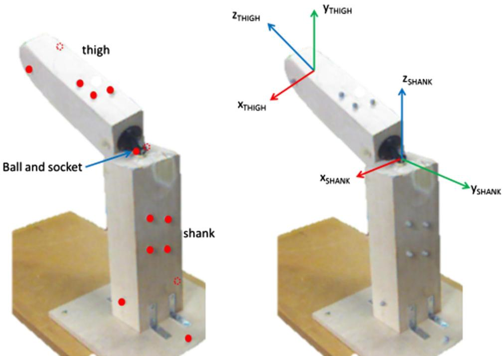
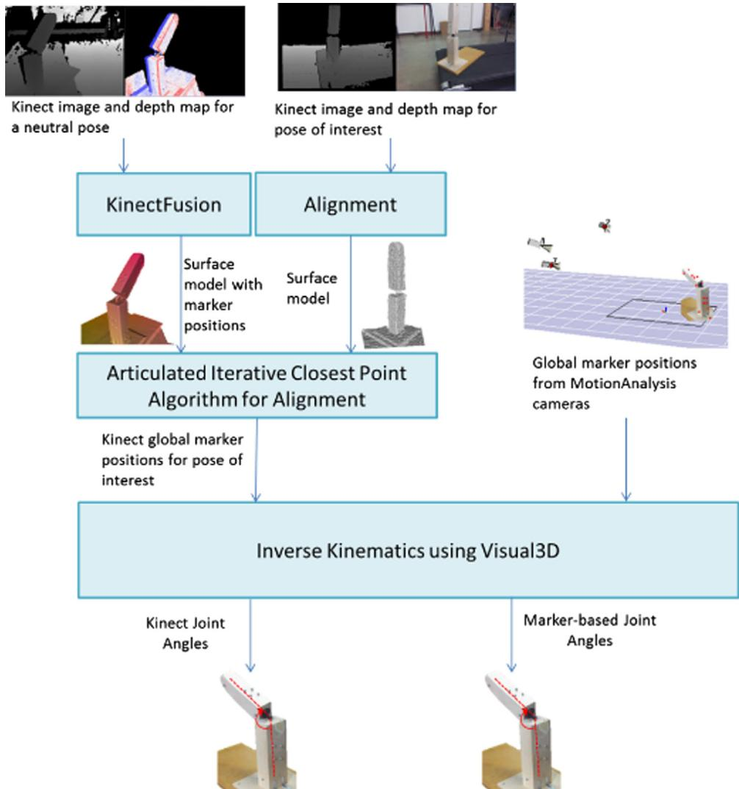

# 基于单相机无标记动作捕捉系统测量关节角度的精度与重复性

Anne Schmitz a, Mao Ye b, Robert Shapiro c, Ruigang Yang b, Brian Noehren a,n

a 物理治疗学部，肯塔基大学（University of Kentucky），美国

b 计算机科学系，肯塔基大学（University of Kentucky），美国

c 运动机能学与健康促进系，肯塔基大学（University of Kentucky），美国

## 文章信息（a r t i c l e i n f o）

文章历史：2013年11月18日接收

关键词：Microsoft Kinect 动作捕捉 精度与可靠性 关节角度

## 摘要

无标记动作捕捉系统的发展旨在评估自然环境中的人体运动。然而，这些系统的精度和可靠性仍缺乏深入研究。因此，本研究的目标是量化使用单相机无标记动作捕捉系统测量关节角度的精度与重复性，并将该无标记系统的性能与基于标记的系统进行比较。本研究将一个机械夹具置于多种静态姿势下，使用包含十台相机的动作分析系统采集标记轨迹。同时，从单台 Microsoft Kinect 相机采集深度和彩色图像数据，随后用于计算虚拟标记轨迹。数字倾角仪提供了矢状面和额状面关节角度的真实基准值（ground-truth）。利用两个动作捕捉系统的标记数据，通过连续的连体坐标系旋转（body-fixed rotations）计算关节角度。基于标记系统和无标记系统计算出的矢状面与额状面关节角度与倾角仪测量值的一致性误差小于 0.5°。两系统之间在矢状面和额状面关节角度上的一致性误差小于 0.5°，在横断面旋转上的一致性误差小于 2°。两个系统在所有角度上的可靠性系数均小于 0.5°。这些结果表明了使用单相机无标记动作捕捉系统精确测量下肢运动学的可行性，并为应用该技术识别患者群体关节运动学中具有临床相关性的差异迈出了第一步。

© 2013 Elsevier Ltd. 保留所有权利。

## 1. 引言

基于标记的动作捕捉技术作为研究工具和临床评估手段的应用呈指数级增长，其广泛应用便是明证（例如 McGinley 等人，2009）。然而，其数据采集方式固有的诸多局限性阻碍了其在某些场合和环境中的应用。例如，由于需要使用相机阵列，基于标记的动作捕捉难以在患者家中、运动场或公共场所等环境中进行。已提出的一种潜在解决方案是使用无标记动作捕捉系统（Mundermann 等人，2006）。

无标记动作捕捉技术（Markerless motion capture）在评估步态和姿势控制方面展现出了良好的应用前景（Clark et al., 2012, 2013; Corazza et al., 2006; Mentiplay et al., 2013; Stone and Skubic, 2011）。基于标记的系统（marker-based systems）的精度已得到广泛分析（Holden et al., 1997; Kiran et al., 2010; Miranda et al., 2013; Richards, 1999），而无标记动作捕捉技术的精度尚未得到同样深入的研究。无标记系统的精度通常以基于标记的测量作为基准真值（ground-truth）来进行评估（Clark et al., 2012, 2013; Mentiplay et al., 2013; Mündermann et al., 2005; Steele et al., 2009; Stone and Skubic, 2011）。尽管这些研究为两种系统之间的比较提供了重要见解，但它们并没有提供关于无标记系统与基于标记的系统相比究竟精度更高还是更低的信息。也有研究采用了其他基准真值测量方法：用于下肢运动学的虚拟行走模型（Corazza et al., 2006）以及用于手部运动学的解剖标志识别方法（Metcalf et al., 2013）。然而，采用基准真值测量来评估单相机无标记动作捕捉系统的精度，以及将其与传统基于标记的动作捕捉在测量下肢运动学方面的性能进行对比的研究仍然不足。

基于标记的系统的可重复性也已得到了广泛研究（Ferber et al., 2002; Leardini et al., 2007; McGinley et al., 2009; Miller et al., 2002; Schwartz et al., 2004; Vander Linden et al., 1992）。相比之下，关于无标记动作捕捉可重复性的报道较少（Clark et al., 2012;

Mentiplay et al., 2013）。在这些研究中，可重复性是通过相关系数来评估的，虽然这能提供一定信息，但其单位与实际测量值的单位并不一致。这导致它们很难直接与测量值本身（例如关节角度）联系起来（Keating and Matyas, 1998）。

确立无标记动作捕捉固有的可重复性和精度，是衡量患者内部和患者之间能够检测到的最小差异的重要第一步。迄今为止，鲜有研究尝试使用与测量本身相符的单位来确定其可靠性，并基于相同的基准真值评估无标记与基于标记的动作捕捉的精度。因此，本研究的目标是使用单台 Kinect 相机（Microsoft）无标记动作捕捉系统对关节角度的精度和可重复性进行量化，并将该无标记系统的性能与基于标记的系统进行对比。

## 2. 方法

在七次测试采集期中确定了一个测试夹具（testing jig，Fig. 1）的多个位置：其中一次用于收集数据以评估准确性，六次用于积累数据以评估重测信度（test–retest reliability）。为了评估准确性，将夹具置于六个静态姿势中，其中每个旋转自由度被分别单独调整，而其他自由度大致为零。为了测量重测信度，将夹具置于某一静态构型，采集数据，重新校准系统，然后再次采集数据。这一过程针对三种静态构型进行：夹具屈曲、内收和内旋。

针对每种构型，同时使用 Kinect (Microsoft) 和基于标记点的动作捕捉系统采集运动数据（Fig. 2）。首先，使用一台 Kinect 相机结合 KinectFusion 软件 (Microsoft, Redmond, WA, USA) 构建夹具的表面模型模板，其中包含了 14 个逆反射标记点（retroreflective markers）的位置（Fig. 1）。然后，针对每个感兴趣的姿态，使用 Kinect 以 30 Hz 的频率采集深度图和二维图像。采用假设膝关节为球窝关节的关节迭代最近点算法（articulated iterative closest point algorithm，Pellegrini et al., 2008）将这些采集到的数据与模板进行对准。接着，导出每次测试的虚拟标记点轨迹。同时，使用 10 台相机的动作分析系统 (Motion Analysis Corp, Santa Rosa, USA) 以 200 Hz 的频率采集标记点位置。

为了提供真值（ground-truth）测量基准，使用数字倾角仪 (Craftsman, Model 320.48295, accuracy of 0.11) 测量每种构型中主要调整的角度。由于该倾角仪利用重力原理工作，因此未用于测量轴向旋转。

来自两个系统的标记点数据均使用 Visual3D (C-Motion, Germantown, MD, USA) 进行处理（Fig. 2）。首先，使用位于各链段末端的标记点构建随体参考系（body-fixed reference frames）（Fig. 1）。接下来，使用四阶零相位滞后巴特沃斯（Butterworth）滤波器对标记点轨迹进行 8 Hz 的低通滤波。该截止频率是根据数据的功率谱分析结果选择的。然后，将膝关节建模为六自由度关节，利用标记点群滤波后的轨迹，采用 Cardan 角 (Grood and Suntay, 1983) 计算远端链段相对于近端链段的取向。

对于每个静态姿势记录的每次试验，使用 30 帧计算测量角度的均值和标准差。准确度基于一次测试会话中六种构型的数据，并针对每个系统（无标记和基于标记）量化为系统计算的平均角度与倾角仪测量的角度之间的差异。采用配对 t 检验对两个系统的准确度进行统计学比较，显著性定义为 $\begin{array} { r } { p < 0 . 0 5 . } \end{array}$ 。在进行 t 检验之前，通过绘制数据直方图对数据的正态性进行了定性验证。基于标记系统与无标记系统之间的准确度差异也被量化为两个系统计算的平均角度之间的差异。使用跨六个会话收集的三种构型评估了重测信度。对于每种构型，分别为每个系统计算了重复性系数、偏倚以及一致性界限（Bland and Altman, 2010）。使用 Bland–Altman 图对同方差性假设进行了定性评估（Bland and Altman, 2010）。

## 3. 结果

基于标记和无标记系统计算的屈–伸以及外展–内收角度与倾角仪测量值的偏差小于 0.51°（Table 1）。基于标记的系统在估计外展方面显著更准确，而无标记系统在内收方面更准确（Table 1）。两个系统的准确度在屈–伸和外展–内收方面相互一致在 $\pm 0 . 5 ^ { \circ }$ 或更小范围内，在轴向旋转方面一致在 $\pm 2 ^ { \circ }$ 或更小范围内（Table 1）。基于标记的系统具有更低的重复性系数和更低的偏倚，但内旋除外，其中无标记系统表现出更小的偏倚（Table 2）。

  
Fig. 1. 构建了一个带有球窝关节的夹具以模拟腿部。（左）使用 14 个逆反射标记记录大腿和小腿节段的运动。（右）用于计算关节角度的节段固定坐标系。

  
Fig. 2. 用于比较由 Microsoft Kinect 和基于标记的动作分析系统计算的关节角度的方法流程图。

动作捕捉系统的准确度。具有显著性的 p 值以粗体和斜体显示。

<table><tr><td>自由度</td><td>基于标记点系统的准确度 (deg.)</td><td>无标记点系统的准确度 (deg.)</td><td>p 值</td><td>标记点-无标记点系统 (deg.)</td></tr><tr><td>屈曲</td><td> $-0.2 \pm 0.1$ </td><td> $-0.2 \pm 0.0$ </td><td>0.351</td><td> $-0.0$ </td></tr><tr><td>伸展</td><td> $-0.2 \pm 0.1$ </td><td> $-0.2 \pm 0.0$ </td><td>0.415</td><td> $-0.0$ </td></tr><tr><td>外展</td><td> $0.0 \pm 0.1$ </td><td> $0.4 \pm 0.0$ </td><td> $<\mathbf{0.001}$ </td><td>0.3</td></tr><tr><td>内收</td><td> $0.4 \pm 0.1$ </td><td> $0.3 \pm 0.0$ </td><td> $<\mathbf{0.001}$ </td><td> $-0.1$ </td></tr><tr><td>外旋</td><td>–</td><td>–</td><td>–</td><td> $-2.0$ </td></tr><tr><td>内旋</td><td>–</td><td>–</td><td>–</td><td>1.5</td></tr></table>

## 4. 讨论

相机技术的进步使得使用单相机 3D 动作捕捉系统成为可能。我们旨在评估单相机无标记点动作捕捉系统在评估关节角度时相比于基于标记点系统的准确度和可靠性。基于标记点和无标记点系统之间的准确度与可靠性差异较小，这表明 Kinect 相机及用于重建肢体节段的相关算法的性能可能是计算下肢关节角度的可行工具。

Table 2  
动作捕捉系统的 95% 一致性界限（LOA）、偏倚和重复性系数。

<table><tr><td>系统</td><td>LOA 下限 (deg.)</td><td>LOA 上限 (deg.)</td><td>偏倚 (deg.)</td><td>重复性系数 (deg.)</td></tr><tr><td colspan="5">屈曲</td></tr><tr><td>Marker</td><td>0.2</td><td>0.2</td><td>0.2</td><td>0.0</td></tr><tr><td>Kinect</td><td>0.5</td><td>1.1</td><td>0.8</td><td>0.3</td></tr><tr><td colspan="5">内收</td></tr><tr><td>Marker</td><td>-0.2</td><td>-0.2</td><td>-0.2</td><td>0.0</td></tr><tr><td>Kinect</td><td>-0.4</td><td>-0.2</td><td>-0.3</td><td>0.1</td></tr><tr><td colspan="5">内旋</td></tr><tr><td>Marker</td><td>0.8</td><td>0.9</td><td>0.8</td><td>0.0</td></tr><tr><td>Kinect</td><td>0.1</td><td>0.8</td><td>0.4</td><td>0.4</td></tr></table>

使用无标记点动作捕捉系统测得的关节角度与我们作为真实标准的倾角仪测得的值一致，误差在 21 或更小以内。这一准确度低于我们在患者群体中预期的运动学改变，例如髋关节和膝关节运动学中的 3–5 (Butler et al., 2011; Noehren et al., 2012, 2013)。尽管仍需在人群中开展进一步研究，但我们的结果确实表明，基于无标记点的系统可能足够灵敏，能够检测到具有临床意义的差异。

使用多种指标（Table 2）来评估重复性有助于全面描述系统的精度。两种系统的偏差（即平均重测差异）均小于 11，这是符合预期的，因为在考察每个系统的重复性时，两次测试均采用了相同的测量方法（即基于标记或无标记）（Bland and Altman, 2010）。两种系统的重复性系数均小于 0.51，这反映了每个系统两次测试之间 95% 的差异预期所在的区间（Bland and Altman, 2010）。综合考虑所有运动平面，无标记系统的一致性界限（即重测差异的区间，0.41 至 1.11）与基于标记系统的一致性界限 $\left( - 0 . 2 ^ { \circ } \ \mathrm { t o } \ 0 . 9 ^ { \circ } \right)$ 相当。这些结果在其他研究报道的范围内，这些研究发现无标记与基于标记系统在侧向伸展过程中的躯干角度上具有 8.21 至 0.21 的相互重复性（Clark et al., 2012），在跟骨内翻–外翻上在 01 至 2.51 之间（Mentiplay et al., 2013）。在我们无标记系统中发现的最大 1.11 可靠性也符合 McGinley et al. (2009) 的建议，即 21 或更低的可靠性对于具备临床可行性的工具而言是可以接受的。

以基于标记的系统作为真实基准（ground-truth）来评估无标记系统的相对精度，是确定无标记系统所得数值是否与基于标记系统具有可比性的一个重要考量特征。在本研究中，我们发现单台 Kinect 与基于标记的系统在屈–伸角度上的一致性在 0.01 以内（p40.3），在展–收角度上的一致性在 0.31 以内 $( p < 0 . 0 0 1 )$。尽管额状面运动学的差异具有统计学显著性，但这些差异很小，且低于许多临床人群研究试图界定的变异阈值（Butler et al., 2011; Noehren et al., 2012, 2013）。此外，这些结果处于先前其他评估相对精度的研究所发表的数值范围之内（屈–伸和展–收为 0.01–9.11）（Corazza et al., 2006; Mündermann et al., 2005）。

本研究存在一些需要考虑的局限性。首先，Kinect 深度传感器的精度是距离相机远近的函数。随着距相机距离的增加，深度测量的随机误差增加且分辨率降低，在相机视场边缘处的深度测量误差可达 4 cm（Khoshelham and Elberink, 2012）。因此，我们将分析限制在仅一个关节，以便将夹具放置在距相机 1–3 m 的范围内，这是为了满足误差小于 2.5 cm（Khoshelham and Elberink, 2012）的建议。捕捉整条腿的运动可能会更加困难，因为受试者在运动过程中可能会靠近或远离相机，从而改变数据的精度。其次，Kinect 的采样率为 30 Hz，而基于标记点系统的采样率为 200 Hz。由于本研究仅考虑了静态姿态，预计这不会对结果产生影响。然而，在捕捉行走或跑步等运动时，这可能会成为一个问题，因为较低的采样率可能会给数据带来模糊或混叠。第三，用于真实基准（ground-truth）测量的倾角仪并非通过连续体固定坐标系旋转（successive body-fixed rotation）来测量角度，而关节角度计算中使用了该方法。然而，在每个姿态中仅改变一个旋转自由度最大限度地减小了这种差异。

总之，单个 Microsoft Kinect 能够捕获运动数据，从而在实验夹具中准确（21）且可靠（1.11）地计算关节角度。尽管尚不清楚 Kinect 在更复杂的运动模式和多关节的活体（in vivo）应用中表现如何，但这些结果说明了单相机无标记运动捕捉系统准确测量下肢运动学的可行性，并为利用该技术识别患者群体关节运动学中具有临床相关性的差异迈出了第一步。

## 利益冲突声明

未声明。

## 致谢

本研究部分由 National Science Foundation（美国国家科学基金会）信息与智能系统部门资助，项目号为 1231545。

## 参考文献

Bland, J.M., Altman, D.G., 2010. Statistical methods for assessing agreement between two methods of clinical measurement. Int. J. Nurs. Stud. 47, 931–936.

Butler, R.J., Barrios, J.A., Royer, T., Davis, I.S., 2011. Frontal-plane gait mechanics in people with medial knee osteoarthritis are different from those in people with lateral knee osteoarthritis. Phys. Ther. 91, 1235–1243.

Clark, R.A., Pua, Y.-H., Fortin, K., Ritchie, C., Webster, K.E., Denehy, L., Bryant, A.L., 2012. Validity of the Microsoft Kinect for assessment of postural control. Gait Posture 36. 372-377.

Clark, R.A., Pua, Y.H., Bryant, A.L., Hunt, M.A. Validity of the Microsoft Kinect for providing lateral trunk lean feedback during gait retraining. Gait Posture, 38(4), 2013, 1064–1066.

Corazza, S., Mündermann, L., Andriacchi, T., 2006. 用于人体运动学估计的无标记动作捕捉方法（Markerless motion capture methods for the estimation of human body kinematics）. In: 9th International Symposium on the 3D Analysis of Human Movement. Valenciennes, France.

Ferber, R., McClay Davis, I., Williams, D., Laughton, C., 2002. 跑步者离散三维下肢变量日内与日间信度的比较（A comparison of within‐and between‐day reliability of discrete 3D lower extremity variables in runners）. J. Orthop. Res. 20, 1139–1145.

Grood, E.S., Suntay, W.J., 1983. 用于临床描述三维运动的关节坐标系统：在膝关节中的应用（A joint coordinate system for the clinical description of three-dimensional motions: application to the knee）. J. Biomech. Eng. 105, 136-144.

Holden, J.P., Orsini, J.A., Siegel, K.L., Kepple, T.M., Gerber, L.H., Stanhope, S.J., 1997. 步态过程中小腿运动学与膝关节动力学中的表面运动误差（Surface movement errors in shank kinematics and knee kinetics during gait）. Gait Posture 5, 217–227.

Keating, J., Matyas, T., 1998. 来自可靠测量的不可靠推论（Unreliable inferences from reliable measurements）. Aust. J. Physiol. 44, 5.

Khoshelham, K., Elberink, S.O., 2012. 室内测绘应用中 Kinect 深度数据的精度与分辨率（Accuracy and resolution of kinect depth data for indoor mapping applications）. Sensors 12, 1437–1454.

Kiran, D., Carlson, M., Medrano, D., Smith, D.R., 2010. 三种不同膝关节位置觉测量方法的相关性（Correlation of three different knee joint position sense measures）. Phys. Ther. Sport 11, 81–85.

Leardini, A., Sawacha, Z., Paolini, G., Ingrosso, S., Nativo, R., Benedetti, M.G., 2007. 一种基于解剖学的新型儿童步态分析方案（A new anatomically based protocol for gait analysis in children）. Gait Posture 26, 560–571.

McGinley, J.L., Baker, R., Wolfe, R., Morris, M.E., 2009. 三维运动学步态测量的信度：系统评价（The reliability of threedimensional kinematic gait measurements: a systematic review）. Gait Posture 29, 360–369.

Mentiplay, B.F., Clark, R.A., Mullins, A., Bryant, A.L., Bartold, S., Paterson, K., 2013. Microsoft Kinect 用于评估静态足部姿态的信度与效度（Reliability and validity of the Microsoft Kinect for evaluating static foot posture）. I. Foot Ank, Res, 6 14

Metcalf, C.D., Robinson, R., Malpass, A.J., Bogle, T.P., Dell, T.A., Harris, C., Demain, S.H., 2013. 无标记动作捕捉与手部运动学测量：验证及其在家庭上肢康复中的应用（Markerless motion capture and measurement of hand kinematics: validation and application to home-based upper limb rehabilitation）. IEEE Trans. Biomed. Eng, 60 2184-2192

Microsoft. 〈http://www.microsoft.com/en-us/kinectforwindows/〉.

Miller, C., Mulavara, A., Bloomberg, J., 2002. 确定“分割体积”配置下动作捕捉相机系统特性的准静态方法（A quasi-static method for determining the characteristics of a motion capture camera system in a “split-volume' configuration）. Gait Posture 16. 283-287.

Miranda, D.L., Rainbow, M.J., Crisco, J.J., Fleming, B.C., 2013. 跳跃-变向动作中光学动作捕捉与双平面视频放射摄影术之间的运动学差异（Kinematic differences between optical motion capture and biplanar videoradiography during a jump– cut maneuver）. J. Biomech. 46, 567–573.

Mündermann, L., Anguelov, D., Corazza, S., Chaudhari, A.M., Andriacchi, T.P., 2005 用于计算下肢运动学的无标记动作捕捉系统的验证（Validation of a Markerless Motion Capture System for the Calculation of Lower Extremity Kinematics）. American Society of Biomechanics, Cleveland, Ohio.

Mundermann, L., Corazza, S., Andriacchi, T., 2006. 人体运动捕捉方法的发展演变：通往生物力学应用的无标记动作捕捉（The evolution of methods for the capture of human movement leading to markerless motion capture for biomechanical applications）. J. Neuroeng. Rehab. 3.

Noehren, B., Pohl, M.B., Sanchez, Z., Cunningham, T., Lattermann, C., 2012. 伴有髌股关节疼痛女性跑步者的近端与远端运动学. Clin. Biomech. 27. 366–371

Noehren, B., Wilson, H., Miller, C., Lattermann, C. 前交叉韧带重建女性患者的长期步态偏差. Med. Sci. Sports Exerc., 45(7), 2013, p. 1340–1347.

Pellegrini, S., Schindler, K., Nardi, D., 2008 用于铰接体的 ICP 算法推广. 载于：British Machine Vision Conference（英国机器视觉会议）. 英国利兹.

Richards, J.G., 1999. 人体运动的测量：市售系统的比较. Human Move Sci. 18, 589–602.

Schwartz, M.H., Trost, J.P., Wervey, R.A., 2004. 定量步态数据中误差的测量与管理. Gait Posture 20, 196–203.

Steele, K., Johnson, A., Kelley, A., Johnson, T., Andriacchi, T., 2009 无标记与基于标记的动作捕捉：测量关节中心的对比. 载于：North American Congress on Biomechanics Annual Meeting（北美生物力学大会年会）. 密歇根州安娜堡.

Stone, E., Skubic, M., 2011. 用于家庭步态评估的低成本深度相机的评估. I. Ambient Intell. Smart Environ. 3. 349–361.

Vander Linden, D.W., Carlson, S.J., Hubbard, R.L., 1992. 利用 Motion Analysis 视频系统在静态条件下获得的角度测量的可重复性与准确性. Phys. Ther. 72, 300–305.