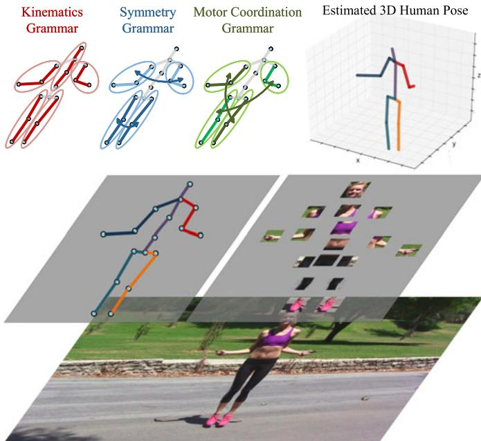
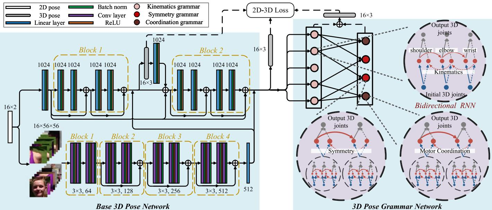
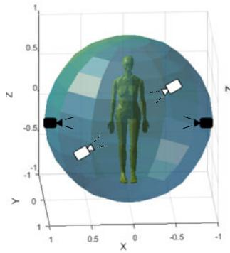
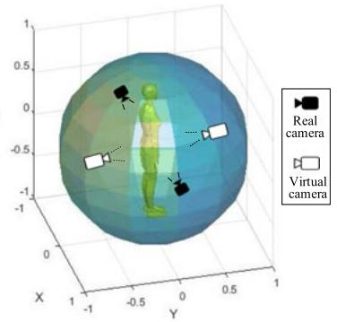
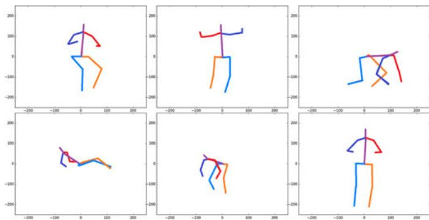
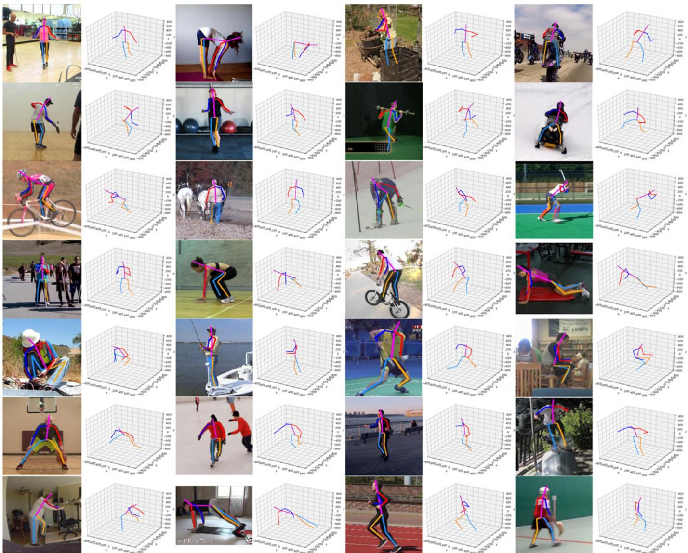
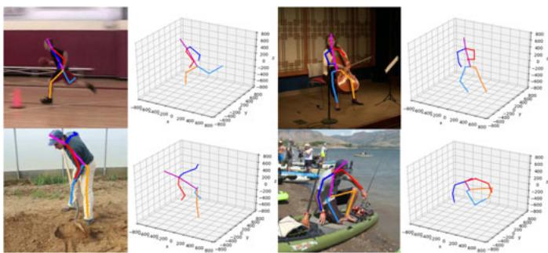
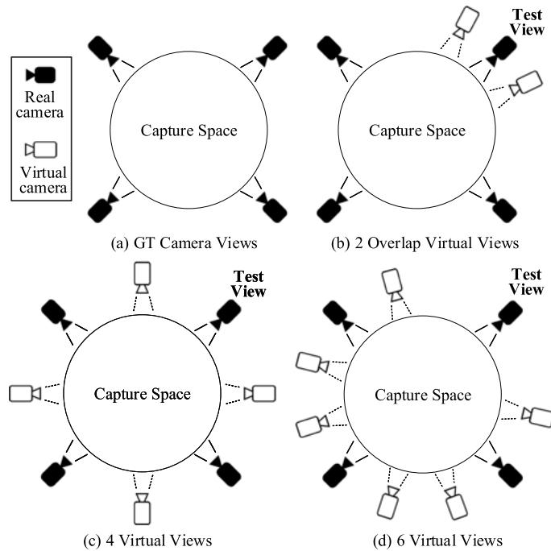
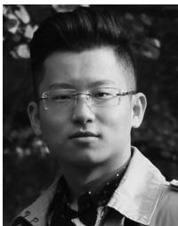
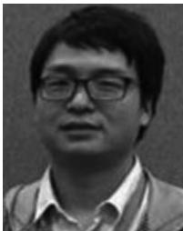

# Monocular 3D Pose Estimation via Pose Grammar and Data Augmentation

Yuanlu Xu , Wenguan Wang , Tengyu Liu , Xiaobai Liu , Jianwen Xie , and Song-Chun Zhu

Abstract—In this paper, we propose a pose grammar to tackle the problem of 3D human pose estimation from a monocular RGB image. Our model takes estimated 2D pose as the input and learns a generalized 2D-3D mapping function to leverage into 3D pose. The proposed model consists of a base network which efficiently captures pose-aligned features and a hierarchy of Bi-directional RNNs (BRNNs) on the top to explicitly incorporate a set of knowledge regarding human body configuration (i.e., kinematics, symmetry, motor coordination). The proposed model thus enforces high-level constraints over human poses. In learning, we develop a data augmentation algorithm to further improve model robustness against appearance variations and cross-view generalization ability. We validate our method on public 3D human pose benchmarks and propose a new evaluation protocol working on cross-view setting to verify the generalization capability of different methods. We empirically observe that most state-of-the-art methods encounter difficult under such setting while our method can well handle such challenges.

Index Terms—3D pose estimation, dependency grammar, data augmentation, deep neural network, recurrent neural network, evaluatior protocol, learning-by-synthesis

## 1 INTRODUCTION

wide applications in robotics, autonomous vehicles, intelligent drones, etc. This is a challenging inverse task since it aims to reconstruct 3D spaces from 2D data and the inherent ambiguity is further amplified by other factors, e.g., clothes, occlusions, background clutters. With the availability of large-scale pose datasets, e.g., Human3.6M [1], deep learning based methods have obtained encouraging success. These methods can be roughly divided into two categories: i) learning end-to-end networks that recover 2D input images to 3D poses directly, ii) extracting 2D human poses from input images and then lifting 2D poses to 3D spaces.

There are some advantages to decouple 3D human pose estimation into two stages. i) For 2D pose estimation, existing large-scale pose estimation datasets [2], [3] have provided sufficient annotations; whereas pre-trained 2D pose estimators [4] are also generalized and mature enough to be deployed elsewhere. ii) For 2D to 3D reconstruction, infinite 2D-3D pose pairs can be generated by projecting each 3D pose into 2D poses under different camera views. Recent work [5], [6] have shown that well-designed deep networks can achieve state-of-the-art performance on Human3.6M dataset using only 2D pose detections as system inputs.

However, despite their promising results, few previous methods explored the problem of encoding domain-specific knowledge into current deep learning based detectors.

In this paper, we develop a deep grammar network to encode low-level appearance and geometry features as well as high-level knowledge over human body dependencies and relations, as illustrated in Fig. 1. Such knowledge explicitly expresses the composition process of joint-part-pose, including kinematics, symmetry and motor coordination, and serve as knowledge bases for reconstructing 3D poses. We ground such knowledge in a multi-level RNN network which can be end-to-end trained with back-propagation. The composed hierarchical structure describes composition, context and high-order relations among human body parts.

Additionally, we empirically find that previous methods are restricted to their poor generalization capabilities while performing cross-view pose estimation, i.e., being tested on human images from unseen camera views. Notably, on the Human3.6M dataset, the largest publicly available human pose benchmark, we find that the performance of state-ofthe-art methods heavily relies on the camera viewpoints. As shown in Table 1, once we change the split of training and testing set, using three cameras for training and testing on the forth camera (new Protocol #4), performance of state-ofthe-art methods drops dramatically and is much worse than image-based deep learning methods. These empirical studies suggested that existing methods might over-fit to sparse camera settings and bear poor generalization capabilities.

To handle the issue, we propose to augment the learning process in two aspects: i) enriching the appearance model with in-the-wild scenarios, and ii) incorporating 2D poses under more camera views. The proposed data augmentation algorithm explores a more robust and generalized mapping from 2D poses to 3D poses. More specifically, we develop a pose simulator to augment training samples with virtual camera views, which can further improve system robustness. Our method is motivated by the previous work on learning by synthesis. In contrast, we focus on sampling of 2D pose instances re-projected from a given 3D pose configuration, following the basic geometry principles. In particular, we develop a pose simulator to effectively generate training samples from unseen camera views. These samples can greatly reduce the risk of over-fitting and thus improve generalization capabilities of the developed pose estimation system.

  
Fig. 1. Illustration of human pose grammar, which expresses the knowledge of human body configuration. We consider three kinds of human body dependencies and relations in this paper, i.e., kinematics (red), symmetry (blue) and motor coordination (green).

We conduct quantitative experiments on three public 3D human pose benchmarks, namely Human3.6M [1], HumanEva [7], and HHOI [8] to evaluate the proposed method for crossview human pose estimation. Additionally, qualitative experiments in MPII [2] dataset, using our model learned on Human3.6M, demonstrate compelling results and good generalization capability on in-the-wild images. Furthermore, to gain a complete and comprehensive understanding of its various aspects, we implement three variants of our method and conduct ablative studies. Results show that our method can significantly reduce pose estimation errors and outperform the alternative methods to a large extend.

Contributions. To summarize, our method has the following contributions:

A deep grammar network that incorporates both powerful encoding capabilities of deep neural networks and high-level dependencies and relations of human body.

A data augmentation algorithm that improves model robustness against appearance variations and crossview generalization ability.

A new evaluation protocol for validating model crossview generalization abilities on Human3.6M dataset.

This paper builds upon two earlier conference paper [9], [10]. In [9], we proposed a pose grammar that mainly accounts kinematic structure encoded in human body and is learned by a tree-LSTM scheme. Then, in [10], we consolidated our pose estimator as an amalgamation of three dependency grammar: kinematics, symmetry, and motor coordination, and presented a BRNN-based learning framework for efficiently capturing the bi-directional relations in such dependency grammar. The present work significantly extends previous studies with integration of both appearance and geometry feature encoders, an improved data augmentation algorithm for the new model, and in-depth discussions and more enclosed details about the proposed framework. Additionally, it presents a more comprehensive analysis of the proposed testing protocol, which provides an essential way for evaluating the overfitting with camera. It also offers a more inclusive and insightful overview of the recent work of 3D human pose estimation. Last but not least, it reports extensive experimental results with deeper analysis.

The remainder of the paper is organized as follows. An overview of the related work is presented in Section 2. Section 3 explains dependency grammar based 3D human pose modeling. The learning process with the proposed pose sample simulator is described in Section 5. In Section 6, we offer detailed experimental analyses on robustness, effectiveness, and efficiency. Finally, we draw conclusions in Section 7.

## 2 RELATED WORK

The proposed method is closely related to two streams of research in the literature, i.e., monocular 3D pose estimation (Section 2.1), and grammar model (Section 2.2), which we will briefly in the following.

## 2.1 Monocular 3D Pose Estimation

Estimating 3D human poses [11], [12] has been extensively studied for the past few years, as surveyed in [13]. Among which, people tackle this tasks under different settings, such as multi-view estimation [14], [15], [16], [16], video based estimation [17], [18], [19] and single image based estimation [20], [21], [22].

Our method falls into the third setting. Unlike multiview and video settings which could utilize large amount of complementary information from different camera views and motion in the temporal domain, our method, as well as other single image based estimators solely rely on leveraging 2D image features into the 3D space. Thanks to powerful deep neural networks developed recently, lots of deep learning based methods have been proposed recently. Methods in the literature can be generally classified into two categories: i) directly learning 3D pose structures from 2D images [23], [24], [25], [26], [27], ii) a cascaded framework of first performing 2D pose estimation and then reconstructing 3D pose from the estimated 2D joints.

Specifically, for the first class, Li et al. [28] regressed 3D pose directly from images using convolutional network. Then, in [29], they exploited an image-pose embedding network to regularize the 3D pose structures, which is trained using a maximum-margin cost function. Tekin et al. [30] first learned an auto-encoder that describes 3D pose in high dimensional space and then mapped the input image to that space using CNN. Pavlakos et al. [31] represented 3D joints as points in a discretized 3D space and proposed a coarse-to-fine approach for iterative refinement. More recently, Sun et al. [32] proposed a structure-aware network that regresses bones instead of joint as pose representations and exploits a compositional loss function that encodes interactions between the bones. Their training and testing are restricted to the 3D Motion Capture data in constrained environments, since it is difficult to obtain large-scale 3D data for arbitrary pose and the collection relies on professional tools for 3D marker tracking.

To alleviate above limitations, some work [5], [6], [33], [34], [35], [36], [37] tried to address this problem in a two step manner that reasons 3D pose through intermediate 2D joints predictions from other off-the-shelf methods. The advantage lies on modular training, where 2D datasets (typically larger and more diverse due to the ease of annotation) can be used to train the initial visual analysis module, while 3D motion capture data (difficult to obtain and limited to controlled lab environments) can be used to train the subsequent 3D reasoning module. More specially, in [5], the authors proposed an exemplar-based method to retrieve the nearest 3D candidate from a 3D pose library using the estimated 2D landmarks. Zhou et al. [17] predicted 3D poses from a video sequence by using temporal information. The estimation process is conducted via an EM type algorithm over the entire sequence and 2D joint uncertainties are also marginalized out during inference. In [33], they mixed 2D and 3D data and trained a two-stage cascaded network via considering extra 3D geometric constrains. Martinez et al. [6] proposed an efficient network architecture that directly regresses 3D keypoints from 2D joint detections and demonstrates most of the error of current deep 3D pose estimators stems from visual analysis module. More recently, people also tried to model the ambiguities of lifting 2D to 3D, using Multiple Hypothesis Learning [35] and Generative Adversarial Network [38]. In [36], authors proposed to disentangle feature encodings of explicit 2D and 3D features and thus enabled them to perform joint training on both supervised and unsupervised data.

In this paper, we propose a unified 2D-to-3D reconstruction network that integrates the learning power of deep learning and the domain-specific knowledge represented by hierarchical grammar model. Different from [37] which learns semantic relationships using Graph Convolution Network (GCN) in an unsupervised way, our grammar rules are designed based on heuristics. This significantly reduces model ambiguities and overfitting to dataset bias.

## 2.2 Grammar Model

Grammar models, originated in neural language [39], have received long-lasting endorsement [40], [41] in computer vision and robotics, due to its expressive power in modeling structures and relations, which are ubiquitous in above research areas. The grammar models can be categorized into two principal variations [39]: phrase structure grammar and dependency grammar.

down a node (e.g., parent node) into its constituent parts (e.g., child nodes). In other words, each node must geometrically contain all of its constituents [42], [43]. Phrase structure grammar were introduced in syntactic pattern recognition by K.S. Fu in the early 1980s [44], and rejuvenated into compositional models by Geman [45], and stochastic and-or grammar by Zhu and Mumford [46]. The advantage of the phrase structure grammar lies in its coarse-to-fine summarization ability, thus it has been widely used for modeling the compositional structures in object recognition [42], [47], [48], [49], [50], scene parsing [51], [52], [53] and event understanding [54], [55].

In this work we focus on dependency grammar, where constituent parts do not need to be contained within their parents, but instead are constrained by an adjacency relation [56]. Thus the dependency grammar is well suited for representing articulated relations among human parts [57]. In computer vision, the pictorial model [58] and the flexible mixture of parts model [59] can be viewed as dependency grammar. Our work extends dependency grammar with deep learning for monocular 3D pose estimation, where the dependency grammar acted as global constraints for more reasonable 3D layout estimation. More specially, in our early version [9], we represented human body as a set of simplified dependency grammar based on kinematic relations and learn the grammar with tree-LSTM. Then, in [10], we presented a more general and unified dependency grammar model that learns kinematic, symmetric, and coordinating relations within hierarchical human configuration using Bidirectional RNNs.

## 3 METHOD OVERVIEW

In this section, we first introduce the problem formulation of the task of monocular 3D pose estimation (Section 3.1) and then briefly overview the concept of pose grammar used in our framework (Section 3.2).

## 3.1 Problem Formulation

Given an image I, with some off-the-shelf 2D pose estimators, we can obtain the detected 2D human pose U, represented as a set of $N _ { v }$ joint locations,

$$
\mathbf {U} = \{u _ {i}: i = 1, \dots , N _ {v}, u _ {i} \in \mathbb {R} ^ {2} \}.\tag{1}
$$

Our task is to estimate the corresponding 3D human pose V in the world reference frame,

$$
\mathbf {V} = \left\{v _ {i}: i = 1, \dots , N _ {v}, v _ {i} \in \mathbb {R} ^ {3} \right\}.\tag{2}
$$

Suppose the coordinate of 2D joint $u _ { i } = [ x _ { i } , y _ { i } ]$ and the coordinate of 3D joint $v _ { i } = [ X _ { i } , Y _ { i } , Z _ { i } ]$ , we can describe the relation between 2D and 3D as a perspective projection, that is,

$$
\left[ \begin{array}{c} x _ {i} \\ y _ {i} \\ w _ {i} \end{array} \right] = K [ R | R T ] \left[ \begin{array}{c} X _ {i} \\ Y _ {i} \\ Z _ {i} \\ 1 \end{array} \right], K = \left[ \begin{array}{c c c} \alpha_ {x} & 0 & x _ {0} \\ 0 & \alpha_ {y} & y _ {0} \\ 0 & 0 & 1 \end{array} \right], T = \left[ \begin{array}{c} T _ {x} \\ T _ {y} \\ T _ {z} \end{array} \right],\tag{3}
$$

The phrase structure grammar is based on the constituency where $w _ { i }$ is the depth w.r.t. the camera reference frame, K is relation. The constituency relation defines the rule to break the camera intrinsic parameter (e.g., focal length $\alpha _ { x }$ and $\alpha _ { y } ,$ Authorized licensed use limited to: South-Central Minzu University. Downloaded on October 01,2026 at 12:38:56 UTC from IEEE Xplore. Restrictions apply.

principal point $x _ { 0 }$ and $y _ { 0 } )$ , R and $T$ are camera extrinsic parameters of rotation and translation, respectively. Notably, we omit camera distortion to simplify the imaging principals.

There exist two sub-problems in estimating 3D pose from 2D pose: i) calibrating camera parameters, and ii) estimating 3D human joint positions. Noticing that these two sub-problems are entangled and cannot be solved without ambiguity, we propose a deep neural network to learn the generalized 2D to 3D mapping

$$
\mathbf {V} = f (\mathbf {I}, \mathbf {U}; \theta),\tag{4}
$$

where $f ( \cdot )$ denotes a multi-to-multi mapping function from 2D image space to 3D space, taken both image appearance and 2D geometry as input and parameterized by u.

In this paper, we regard the 2D pose estimation results as the weakly-supervised geometry information in localizing and aligning the articulated human body. The given 2D poses can be obtained from any off-the-shelf 2D pose estimation methods. The major benefit of such formulation lies in that we could plug-in and make full usage of advances from state-of-the-arts 2D pose estimators and there is no need to re-train the whole framework.

In this paper, we follow the pipeline proposed in [9] which takes images and 2D poses as joint inputs, instead of the framework proposed in [10] which isolates image input from 3D pose estimation. Specifically, we extract image patches $\mathbf { I } _ { U } = \{ \mathbf { I } _ { u _ { i } } , i = 1 , . . . , N _ { v } \}$ given the 2D pose estimation results. $\mathbf { I } _ { U }$ is regarded as additional inputs, which offers complementary visual information besides the detected 2D joints U. To align 3D poses V, we consider the pelvis joint as the origin in the 3D coordinate system and thus transform absolute 3D coordinates for each joints into relative 3D coordinates by subtracting the absolute 3D coordinates of the pelvis joint.

## 3.2 Pose Grammar

The human body nature which involves rich inherent structures motivates us to reason the 3D structure of the whole person in a high-level, structural manner. Before going deep into our grammar based 3D pose estimator, we first detail three essential kinds of human body structures, namely kinematics, symmetry, and motor coordination grammar, which reflect interpretable and high-level knowledge of human body configuration.

Kinematics grammar $\mathcal { G } ^ { k i n }$ describes human body movements without considering forces. Such structures represent motion properties of human in a topological manner. Kinematics grammar focuses on connected body parts and works both forward and backward. Forward kinematics takes the last joint in a kinematic chain into account while backward kinematics reversely influences a joint in a kinematics chain from the next joint.

Symmetry grammar ${ \mathcal { G } } ^ { s y m }$ measures mirror symmetry of human body, as human body can be divided into matching halves by drawing a line down the center; the left and right sides are roughly mirror images of each other. Actually, such mirror symmetry, also named bilateral symmetry, is an important principle in nature; vast majority of animals (more than 99 percent) are bilaterally symmetric, including humans [60].

Motor coordination grammar ${ \mathcal { G } } ^ { c r d }$ represents movements of several limbs combined in a certain manner. More specially, motor coordination can be thought as each physiological process created with the kinematic and kinetic parameters that must be performed in order to achieve intended actions. It can be seen everywhere, involved in moving a limb to picking up a ball to shooting the ball.

## 4 NETWORK ARCHITECTURE

As illustrated in Fig. 2, our model follows the line that esti mating 3D human keypoints from both input RGB image and intermediate 2D joint detections, which renders our model highly applicable. More specifically, we extend several human pose grammar rules into the deep neural network, where a base 3D pose estimation network is first used for extracting pose-aligned features, and a hierarchy of RNNs is built for encoding high-level 3D pose grammar for generating final reasonable 3D pose estimations. Above two networks work in a cascaded way, resulting in a strong 3D pose estimator that inherits the representation power of neural network and high-level knowledge of human body configuration.

## 4.1 Base 3D Pose Network

To build a solid foundation for high-level grammar model, we first use a base network for capturing both 2D and 3D well pose-aligned features. In this paper, we mainly encode two types of features from the input: appearance features from input images and geometry features from 2D poses.

## 4.1.1 Appearance Feature Encoding

Given an input image I and 2D poses U, we first sample 56  56 image patches $\mathbf { I } _ { U }$ centered around each 2D joints and extract appearance features by feeding them into a convolutional neural network. Our appearance feature encoder is mainly inspired by ResNet [61]. The convolutional layers mostly have $\bar { 3 } \times 3$ filters and the network follows two rules in design: i) the layers share the same number of filters for the same output feature map size; (ii) the number of filters will double if the feature map shrinks by half, in order to preserve the per-layer time complexity. The feature map shrinking is obtained by having a stride of 2 in the convolutional layers.

As illustrated in Fig. 2 bottom left, each image patch goes through 4 cascaded blocks. Each block consists of stacks of convolutional layers, Batch Normalization and ReLU activation. We keep the same size of the output feature map as the input for block 1 and downsample that to half in each of the last three blocks by setting the stride as 2 in the first convolutional layer. Therefore, feature maps obtained by each blocks are with size of $5 6 \times 5 6 \times 6 4$ , 28  28  128, 14  14  256 and $7 \times 7 \times 5 1 2$ , respectively. The network ends with a global average pooling layer and outputs a 512-d feature vector. Note layer weights are shared across all $N _ { v }$ joints in the encoder and all extracted features are concatenated together into a long vector.

  
Fig. 2. The proposed deep grammar network, Our model consists of two major components: i) a base network constituted by two submodules encod ing appearance and geometry features given the input image and the detected 2D pose, ii) a pose grammar network encoding human body dependencies and relations w.r.t. kinematics, symmetry and motor coordination. Each grammar is represented as a Bi-directional RNN among certain joints. The current state of a joint is composed of the hidden states of its related joints and the encoded input feature from itself. See text for detailed explanations.

## 4.1.2 GeometryFeature Encoding

The geometry feature encoder is inspired by [6], which has been demonstrated to be effective in encoding the information of 2D and 3D poses. As illustrated in Fig. 2, our base network consists of two cascaded blocks. For each block, several linear (fully connected) layers, interleaved with Batch Normalization, ReLU activation and Dropout layers, are stacked for efficiently mapping the 2D pose features to higher-dimensions.

As illustrated in Fig. 2 top left, the input 2D pose detections U (obtained as ground-truth 2D joint locations under known camera parameters, or from other 2D pose detectors) are first projected into a 1024-d features, with a fully connected layer. Then the first block takes this high-dimensional features as input and an extra linear layer is applied at the end of it to obtain an explicit 3D pose representation. In order to have a coherent understanding of the full body in 3D space, we re-project the 3D estimation into a 1024-d space and further feed it into the second block. With the initial 3D pose estimation from the first block, the second block is able to reconstruct a more reasonable 3D pose.

To make full use of the information from initial 2D pose detections, we utilize residual connections between the two blocks. Such technique is able to encourage the information flow and facilitate our training. Additionally, each block in our base network is able to directly access to the gradients backpropagated from the loss function (detailed in Section 5), leading to an implicit deep supervision [62]. With the refined 3D pose estimated from base network, we again re-projected it into a 1024-d features. We combine the 1024-d features from the 3D pose and the original 1024-d feature of 2D pose together, which leads to a final 1024-d feature representation that has wellaligned 3D pose information and preserves the original 2D pose information.

Finally, we concatenate appearance and geometry feature representations together and feed this long vector into our 3D pose grammar network.

## 4.2 3D Pose Grammar Network

So far, our base network directly estimated the depth of each joint from the 2D pose detections. However, such endto-end estimation ignores the rich inherent structures within the human body. Motivated by this, we propose to incorporate reasoning of the 3D human body structure in a global manner. Here we use Recurrent Neural Network (RNN) to model high-level knowledge of 3D human pose grammar, which towards a more reasonable and powerful 3D pose estimator that is capable of satisfying human anatomical and anthropomorphic constraints. Before going deep into our grammar network, we first detail our grammar formulations that reflect interpretable and high-level knowledge of human body configuration. Basically, given a human body, we consider the following three types of grammar in our network.

In this paper, we derive pose grammar on a human skeleton structure of 17 joints defined in Human3.6M [1], i.e., head, neck, thorax, spine, pelvis, shoulders, elbows, wrists, hips, knees, and ankles. As we mentioned in Section 3.1, we shift all other joints to a relative coordinate system centered by the pelvis and thus only 16 joints are represented in the proposed pose grammar. The used skeleton structure can be easily adapted to other skeleton structures (e.g., LSP for mat 14 joints [63], MPII format 15 joints [64], Kinect format 13 joints) by skipping unused joints.

Kinematics Grammar Gkin. Kinematic constraints are an essential factor for building a human body representation. There are numerous human body simulators [65], human dynamics tracking systems [66], [67] and tree-based pose estimation methods [68], [69] are built upon kinematic structures. In this paper, we represent the kinematics within the human body as a tree structure. The articulated relation are better represented and the correlation of features at parent joint and child joint are better captured within tree structure than the flat or sequential structure. Similar to the framework of [70], we adapt the tree-structured recurrent neural network for modeling human pose and integrating local and global features. The aggregated contextual information are propagated efficiently through the edges between joints.

To simplify the representation, we decompose the human body tree structure into multiple chains with overlapping nodes. As illustrated in Fig. 1 the red skeleton, five chains (i.e., kinematics grammar) are defined to represent the kinematic constraints within different body parts

$$
\mathcal {G} _ {v e r t} ^ {k i n}: h e a d \leftrightarrow n e c k \leftrightarrow t h o r a x \leftrightarrow s p i n e,\tag{5}
$$

$$
\mathcal {G} _ {l. a r m} ^ {k i n}: t h o r a x \leftrightarrow l. s h o u l d e r \leftrightarrow l. e l b o w \leftrightarrow l. w r i s t,\tag{6}
$$

$$
\mathcal {G} _ {r. a r m} ^ {k i n}: t h o r a x \leftrightarrow r. s h o u l d e r \leftrightarrow r. e l b o w \leftrightarrow r. w r i s t,\tag{7}
$$

$$
\mathcal {G} _ {l. l e g} ^ {k i n}: s p i n e \leftrightarrow l. h i p \leftrightarrow l. k n e e \leftrightarrow l. f o o t,\tag{8}
$$

$$
\mathcal {G} _ {r. l e g} ^ {k i n}: s p i n e \leftrightarrow r. h i p \leftrightarrow r. k n e e \leftrightarrow r. f o o t.\tag{9}
$$

Our kinematic tree model is powerful as it captures the most important source of constraint on human body pose. However, this model is also limited by the fact that it does not represent information about relations between limbs that are not physically connected by bones. Therefore, we further incorporate two advanced relations, i.e., symmetry and motor coordination, into the pose grammar. We organize these two advanced grammar on top of the kinematics grammar; that is, symmetry and motor coordination grammar network takes outputs from the kinematics grammar network as inputs and further optimizes 3D pose configurations.

Symmetry Grammar ${ \mathcal { G } } ^ { s y m }$ . Human body has a symmetrical appearance when viewed externally, i.e., the two halves of human body are nearly mirror images of each other, when a line is drawn in the center. For decades, people explore various computational models [71], [72], [73], analytical or biological basis, proving the effectiveness in computer vision and graphics.

As illustrated in Fig. 1 the blue skeleton, we build two symmetry grammar for describing such bilateral symmetrical properties of human body

$$
\mathcal {G} _ {a r m} ^ {s y m}: \mathcal {G} _ {l. a r m} ^ {k i n} \leftrightarrow \mathcal {G} _ {r. a r m} ^ {k i n},\tag{10}
$$

$$
\mathcal {G} _ {l e g} ^ {s y m}: \mathcal {G} _ {l. l e g} ^ {k i n} \leftrightarrow \mathcal {G} _ {r. l e g} ^ {k i n}.\tag{11}
$$

As described in above grammar, humans usually have two symmetrical arms and two symmetrical legs.

Motor Coordination Grammar ${ \mathcal { G } } ^ { c r d }$ . Motor coordination is the ability to coordinate muscle synergies or movement primitives [74], which characterizes the coordinated involvement of different body parts in different actions. Studies [75], [76] show that there exist mutual couplings between the involved components and it can be used to reduce the degree of freedom in the model. Here we mainly consider simplified left-right motor coordination, i.e., the rhythmic alternating left and right limb movement, during the locomotion. Motor coordination grammar is complementary to the symmetry grammar in describing the relations between upper body and lower body.

As illustrated in Fig. 1 the green skeleton, we define two motor coordination grammar to represent constraints on people coordinated movements

$$
\mathcal {G} _ {l r} ^ {c r d}: \mathcal {G} _ {l. a r m} ^ {k i n} \leftrightarrow \mathcal {G} _ {r. l e g} ^ {k i n},\tag{12}
$$

$$
\mathcal {G} _ {r l} ^ {c r d}: \mathcal {G} _ {r. a r m} ^ {k i n} \leftrightarrow \mathcal {G} _ {l. l e g} ^ {k i n}.\tag{13}
$$

In this paper, we extend Bi-directional RNN [77] (BRNN) to represent our pose grammar, which formulates the sequential data into a hidden Markov Chain model and describes relations among neighboring nodes with sharing weights. Unlike standard RNN which can only work in one direction, BRNN encodes messages passing from two directions, i.e., forward and backward, which simulates the undirected relations between two neighboring joints in the pose grammar.

For a node t in the grammar, we use t 1 and t þ 1 to denote the previous node and the next node, respectively. For example, in Equation (5), node representing thorax is neighbored with the previous node for neck and the next node for spine. Given an input feature encoding $a _ { t }$ for node $t ,$ the output $y _ { t }$ is jointly determined by the bi-directional states $h _ { t } ^ { f }$ and $h _ { t } ^ { b }$

$$
y _ {t} = \phi (W _ {y} ^ {f} h _ {t} ^ {f} + W _ {y} ^ {b} h _ {t} ^ {b} + b _ {y}),\tag{14}
$$

where $\phi ( \cdot )$ is the softmax function, $h _ { t } ^ { f }$ and $h _ { t } ^ { b }$ the forward and backward hidden states, respectively. $h _ { t } ^ { f }$ and $h _ { t } ^ { b }$ are computed recursively, that is,

$$
\begin{array}{l} h _ {t} ^ {f} = \tanh (W _ {h} ^ {f} h _ {t - 1} ^ {f} + W _ {a} ^ {f} a _ {t} + b _ {h} ^ {f}), \\ h _ {t} ^ {b} = \tanh (W _ {h} ^ {b} h _ {t + 1} ^ {b} + W _ {a} ^ {b} a _ {t} + b _ {h} ^ {b}), \end{array}\tag{15}
$$

where W indicates the linear weights and b denotes the bias term.

As shown in Fig. 2, we build a two-layer hierarchy of BRNNs for modeling our three kinds of pose grammar, where all BRNNs shares the same cell size 1024 $( \mathrm { i . e . , }$ 512 cells passing forward and 512 cells passing backward) and the same equation in Equation (14). The three pose grammar is represented by the edges between BRNNs nodes or implicitly encoded into BRNN architecture.

For the bottom layer, five BRNNs are built for modeling the five relations defined in kinematics grammar. More specifically, they accept the pose-aligned features from our base network as input, and generate estimation for a 3D joint at each time step. The information is forward/backward propagated efficiently over the two states with BRNN, thus the five Kinematics relations are implicitly modeled by the bi-directional chain structure of corresponding BRNN. Note that we take the advantages of recurrent natures of RNN for capturing our chain-like grammar, instead of using RNN for modeling the temporal dependency of sequential data.

For the top layer, four BRNN nodes are derived in total, two for symmetry relations and two for motor coordination relations. For the symmetry BRNN nodes, taking $\mathcal { G } _ { a r m } ^ { s y m }$ node as an example, it takes the concatenated 3D-joints (totally 6 joints) from the $\mathcal { G } _ { l , a r s } ^ { k i n }$ and $\mathcal { G } _ { r a r r } ^ { k i n }$ BRNNs in the bottom layer in all times as inputs, and produces estimations for the six 3Djoints taking their symmetry relations into account. Similarly, for the coordination nodes, such as $\mathcal { G } _ { l  r } ^ { c r d }$ , it leverages the estimations from $\mathcal { G } _ { l . a r m } ^ { k i n }$ and $\mathcal { G } _ { r . l e g } ^ { k i n }$ BRNNs and refines the 3D joint estimations according to motor coordination grammar.

Note a joint could appear multiple times in the pose grammar. We apply mean-pooling on outputs from all nodes in all BRNNs representing this joint and regard it as the jointly optimized configuration for this joint.

In this way, we organize three kinds of human pose grammar as a hierarchical BRNN model and the outputs from the top layer is considered as the final 3D pose estimations.

## 5 LEARNING

In this section, we first discuss the loss functions and learning algorithm overview and then propose a data augmentation technique to enhance the model robustness and generalization ability.

## 5.1 Loss Function

We first construct the training set V to train our model,

$$
\Omega = \{(\mathbf {I} ^ {k}, \hat {\mathbf {U}} ^ {k}, \hat {\mathbf {V}} ^ {k}): k = 1, \dots , N _ {\Omega} \},\tag{16}
$$

$$
\hat {\mathbf {U}} ^ {k} = \{\hat {u} _ {i} ^ {k}: i = 1, \dots , N _ {v} \},\tag{17}
$$

$$
\hat {\mathbf {V}} ^ {k} = \{\hat {v} _ {i} ^ {k}: i = 1, \dots , N _ {v} \},\tag{18}
$$

where $\hat { \mathbf { U } } ^ { k }$ and ${ \hat { \mathbf { V } } } ^ { k }$ denote ground-truth 2D and 3D poses for the kth training sample, respectively. The mapping function $f ( \mathbf { I } , \mathbf { U } ; \theta )$ is learned via Maximum Likelihood Estimation (MLE), that is,

$$
\begin{array}{l} \theta^ {*} = \underset {\theta} {\arg \max} \mathcal {L} (\theta ; \Omega) = \underset {\theta} {\arg \min} \ell (\theta ; \Omega) \\ = \underset {\theta} {\arg \min} \frac {1}{N _ {\Omega}} \sum_ {k = 1} ^ {N _ {\Omega}} \ell (\theta ; \mathbf {I} ^ {k}, \hat {\mathbf {U}} ^ {k}, \hat {\mathbf {V}} ^ {k}). \end{array}\tag{19}
$$

In this paper, we define the loss function $\ell ( \theta ; \mathbf { I } ^ { k } , \hat { \mathbf { U } } ^ { k } , \hat { \mathbf { V } } ^ { k } )$ to penalize both joint-wise and bone-wise errors between predicted 3D pose and true 3D pose, that is,

$$
\ell (\theta ; \mathbf {I} ^ {k}, \hat {\mathbf {U}} ^ {k}, \hat {\mathbf {V}} ^ {k}) = \sum_ {i = 1} ^ {N _ {v}} \frac {\| v _ {i} ^ {k} - \hat {v} _ {i} ^ {k} \| _ {2}}{N _ {v}} + \sum_ {(i, j) \in E} \frac {\| e _ {i j} ^ {k} - \hat {e} _ {i j} ^ {k} \| _ {2}}{N _ {e}},\tag{20}
$$

where $e _ { i j } = { v _ { i } } - { v _ { j } }$ denotes the bone between joint i and ${ \mathrm { ~ \it ~ { ~ j ~ } ~ } } ,$ E denotes the set of bones in the skeleton and $\dot { N } _ { e }$ denotes the number of bones. Instead of considering all pairwise relations among joints, we only regard physically-connected neighboring joints as bones, as defined in the kinematics grammar $\mathcal { G } ^ { k i n }$ . The first loss term enforces the absolute locations at each joint to be accurate and the second loss term penalizes the bone displacement in the human skeleton, similar to [37].

## 5.2 Algorithm

The model parameters u that need to be learned include weights from the geometry feature encoder, the appearance feature encoder and the 3D pose grammar network. Since the whole model could easily overfit with a simple end-toend training, we divide the entire learning process into three phases:

i) Learning geometry feature encoder from Mocap datasets using ground-truth 2D-3D pose pairs with loss function defined in Equation (19). Weights for other modules are frozen and input RGB images are not needed in this phase. The training set is augmented with virtual 2D poses by projecting each 3D pose into 2D poses under different camera viewpoints, as elaborated in Section 5.3.1.

ii) Learning appearance feature encoder from both MoCap and in-the-wild datasets with loss function defined in Equation (19). Weights for other modules are frozen as the first phase. We propose a label propagation algorithm for augmenting unpaired in-the-wild samples and train our appearance model on hybrid datasets to improve model robustness and mitigate overfitting, as discussed in Section 5.3.2.

iii) Attaching pose grammar network on the top of the trained base network, and fine-tuning the whole network in an end-to-end manner with Mocap datasets and augmented data from the first two phases.

## 5.3 Data Augmentation

We develop two data augmentation techniques to improve the model robustness and generalization ability for the corresponding learning phases.

## 5.3.1 2D Pose Augmentation

We conduct an empirical study on popular 3D pose estimation datasets $( \mathrm { e . g . , }$ , Human3.6M, HumanEva) and notice that there are usually limited number of cameras (3-4 on average) recording the human subject. This raises the doubt whether learning on such dataset can lead to a generalized 3D pose estimator applicable in other scenes with different camera positions. We believe that augmenting 2D poses from unseen camera views will improve the model performance and generalization ability. For this, we propose a novel Pose Sample Simulator (PSS) to generate additional training samples. The generation process consists of two steps: i) projecting ground-truth 3D pose V^ onto virtual camera planes to obtain ground-truth 2D pose U^ , ii) simulating 2D pose detections U by sampling conditional probability distribution pðUjU^ Þ.

In the first step, we first specify a series of virtual camera calibrations. Namely, a virtual camera calibration is specified by quoting intrinsic parameters $K ^ { \prime }$ from other real cameras and simulating reasonable extrinsic parameters (i.e., camera locations $T ^ { \breve { \prime } }$ and orientations R0). As illustrated in Fig. 3, two white virtual camera calibrations are determined by the other two real cameras. Given a specified virtual camera, we can perform a perspective projection of a ground-truth 3D pose V^ onto the virtual camera plane and obtain the corresponding ground-truth 2D pose U^ .

In the second step, we first model the conditional probability distribution $p ( \mathbf { U } | \hat { \mathbf { U } } )$ to mitigate the discrepancy between 2D pose detections U and 2D pose ground-truth U^ . Assuming $p \mathbf { ( \hat { U } | \hat { U } ) }$ follows a mixture of Gaussian distribution, that is,

  
Fig. 3. Illustration of virtual camera simulation. The black camera icons stand for real camera settings while the white camera icons simulated virtual camera settings.

$$
p (\mathbf {U} | \hat {\mathbf {U}}) = p (\epsilon) = \sum_ {j = 1} ^ {N _ {G}} \omega_ {j} \mathbb {N} (\epsilon ; \mu_ {j}, \Sigma_ {j}),\tag{21}
$$

where $\boldsymbol { \epsilon } = \mathbf { U } - \hat { \mathbf { U } } , N _ { G }$ denotes the number of Gaussian distributions, $\omega _ { j }$ denotes a combination weight for the jth component, $\mathbb { N } ( \epsilon ; \mu _ { j } , \Sigma _ { j } )$ denotes the jth multivariate Gaussian distribution with mean $\mu _ { j }$ and covariance $\Sigma _ { j }$ . As suggested in [2], we set $N _ { G } = 4 2$ . For efficiency issues, the covariance matrix $\Sigma _ { j }$ is assumed to be in the form

$$
\Sigma_ {j} = \left[ \begin{array}{c c c} \sigma_ {j, 1} & 0 & 0 \\ 0 & \ddots & 0 \\ 0 & 0 & \sigma_ {j, i} \end{array} \right], \sigma_ {j, i} \in \mathbb {R} ^ {2 \times 2},\tag{22}
$$

where $\sigma _ { j , i }$ is the covariance matrix for joint $u _ { i }$ at jth multivariate Gaussian distribution. This constraint enforces independence among each joint $u _ { i }$ in 2D pose U.

The probability distribution pðUjU^ Þ can be efficiently learned using an EM algorithm, with E-step estimating combination weights v and M-step updating Gaussian parameters $\mu$ and S. We utilizes K-means clustering to initialize parameters as a warm start. The learned mean $\mu _ { j }$ of each Gaussian can be considered as an atomic pose representing a group of similar 2D poses. We visualize some atomic poses in Fig. 4.

Given a 2D pose ground-truth $\hat { \mathbf { U } } ,$ we sample pðUjU^ Þ to generate simulated detections U, which reduces the discrepancy between training and testing data. Only 2D and 3D pose pairs are needed in the first learning phase, while black masks and simulated detections are combined together in the third learning phase for end-to-end joint training of the whole framework. The appearance feature encoder is essentially frozen for the augmented training samples, as it is not a trivial task to synthesize realistic images from arbitrarily unseen camera views.

## 5.3.2 Image Augmentation

To train the appearance feature encoder, we need 2D images with 2D and 3D pose annotations which are only available in constrained environments with motion capture systems. The appearance model is likely to overfit with training on those images alone, due to poor generalization to complex scenarios in the wild.

We propose a label propagation algorithm for unpaired in-the-wild images $( \mathrm { e . g . , \mathrm { L S P } }$ [63], MPII [64]), using paired

  
Fig. 4. Examples of learned 2D atomic poses in probability distribution pðUjU^ Þ.

2D and 3D poses from Mocap datasets and the trained geometry feature encoder from the first phase. The proposed label propagation algorithm consists of two steps: i) matching unpaired 2D poses with paired 2D poses from Mocap datasets, ii) verifying matched candidates using the early-stage model.

First, we match each 2D pose of in-the-wild images with 2D poses in the MoCap dataset and return a set of 3D poses associated with the matched 2D poses. We rotate 2D poses with different angles because the diverse poses (e.g., doing sports) in common pose datasets can hardly be observed under constrained conditions in MoCap datasets. We measure the matching of 2D poses by the mean distance per joints and keep top 10 matched 3D poses with distances below a certain threshold as candidates for the next step

Second, we apply the trained geometry feature encoder on the 2D pose ground-truth to obtain an initial estimation of the 3D pose. We further compare the kept 3D pose candidates with the estimated 3D pose and pick the one with the minimum distance as the ground-truth 3D pose for this sample. Namely, the label from a paired sample (i.e., in-thewild data) is propagated to a unpaired sample (i.e., Mocap data). We then browser through all the obtained 3D poses to filter out those bad matches.

Augmented image samples are first used to train the appearance feature encoder alone in the second learning phase and then used to augment the training set V in the third joint learning phase.

## 6 EXPERIMENTS

In this section, we first introduce datasets and settings for evaluation, and then report our results and comparisons with state-of-the-art methods, and finally conduct an ablation study on components in our method.

## 6.1 Datasets

We evaluate our method quantitatively and qualitatively on four popular 3D pose estimation datasets.

Human3.6M [1], [90] is the current largest dataset for human 3D pose estimation, which consists of 3.6 million 3D human poses and corresponding video frames recorded from 4 different cameras. Cameras are located at the front back, left and right of the recorded subject, with around 5 meters away and 1.5 meter height. In this dataset, there are 11 actors in total and 15 different actions performed (e.g., d on October 01,2026 at 12:38:56 UTC from IEEE Xplore. Restrictions apply.

TABLE 1  
Quantitative Comparisons of Average euclidean Distance (in mm) Between the Estimated Pose and the Ground-Truth on Human3.6M Under Protocol #1, Protocol #2, Protocol #3, and the Proposed Protocol #4/4\*

<table><tr><td>Protocol #1</td><td>Direct.</td><td>Discuss</td><td>Eating</td><td>Greet</td><td>Phone</td><td>Photo</td><td>Pose</td><td>Purch.</td><td>Sitting</td><td>SittingD.</td><td>Smoke</td><td>Wait</td><td>WalkD.</td><td>Walk</td><td>WalkT.</td><td>Avg.</td></tr><tr><td>Tekin et al.(CVPR&#x27;16) [78]</td><td>102.4</td><td>147.2</td><td>88.8</td><td>125.3</td><td>118.0</td><td>182.7</td><td>112.4</td><td>129.2</td><td>138.9</td><td>224.9</td><td>118.4</td><td>138.8</td><td>126.3</td><td>55.1</td><td>65.8</td><td>125.0</td></tr><tr><td>Zhou et al.(CVPR&#x27;16) [17]</td><td>87.3</td><td>109.3</td><td>87.0</td><td>103.1</td><td>116.1</td><td>143.3</td><td>106.8</td><td>99.7</td><td>124.5</td><td>199.2</td><td>107.4</td><td>118.0</td><td>114.2</td><td>79.3</td><td>97.7</td><td>113.0</td></tr><tr><td>Du et al.(ECCV&#x27;16) [79]</td><td>85.1</td><td>112.7</td><td>104.9</td><td>122.1</td><td>139.1</td><td>135.9</td><td>105.9</td><td>166.2</td><td>117.5</td><td>226.9</td><td>120.0</td><td>117.7</td><td>137.4</td><td>99.3</td><td>106.5</td><td>126.5</td></tr><tr><td>Sanzari et al.(ECCV&#x27;16) [80]</td><td>48.8</td><td>56.3</td><td>95.9</td><td>84.7</td><td>96.4</td><td>105.5</td><td>66.3</td><td>107.4</td><td>116.8</td><td>129.6</td><td>97.8</td><td>65.9</td><td>130.4</td><td>92.5</td><td>102.2</td><td>93.1</td></tr><tr><td>Chen et al.(CVPR&#x27;17) [81]</td><td>89.9</td><td>97.6</td><td>89.9</td><td>107.9</td><td>107.3</td><td>139.2</td><td>93.6</td><td>136.0</td><td>133.1</td><td>240.1</td><td>106.6</td><td>106.2</td><td>87.0</td><td>114.0</td><td>90.5</td><td>114.1</td></tr><tr><td>Pavlakos et al.(CVPR&#x27;17) [31]</td><td>67.4</td><td>71.9</td><td>66.7</td><td>69.1</td><td>72.0</td><td>77.0</td><td>65.0</td><td>68.3</td><td>83.7</td><td>96.5</td><td>71.7</td><td>65.8</td><td>74.9</td><td>59.1</td><td>63.2</td><td>71.9</td></tr><tr><td>Moreno et al.(CVPR&#x27;17) [82]</td><td>69.5</td><td>80.1</td><td>78.2</td><td>87.0</td><td>100.7</td><td>76.0</td><td>69.6</td><td>104.7</td><td>113.9</td><td>89.6</td><td>102.7</td><td>98.4</td><td>79.1</td><td>82.4</td><td>77.1</td><td>87.3</td></tr><tr><td>Tome et al.(CVPR&#x27;17) [83]</td><td>64.9</td><td>73.4</td><td>76.8</td><td>86.4</td><td>86.2</td><td>110.6</td><td>68.9</td><td>74.7</td><td>110.1</td><td>173.9</td><td>84.9</td><td>85.7</td><td>86.2</td><td>71.3</td><td>73.1</td><td>88.3</td></tr><tr><td>Tekin et al.(ICCV&#x27;17) [84]</td><td>85.0</td><td>108.7</td><td>84.3</td><td>98.9</td><td>119.3</td><td>95.6</td><td>98.4</td><td>93.7</td><td>73.7</td><td>170.4</td><td>85.0</td><td>116.9</td><td>113.7</td><td>62.0</td><td>94.8</td><td>100.0</td></tr><tr><td>Zhou et al.(ICCV&#x27;17) [33]</td><td>54.8</td><td>60.7</td><td>58.2</td><td>71.4</td><td>62.0</td><td>65.5</td><td>53.8</td><td>55.6</td><td>75.2</td><td>111.6</td><td>64.1</td><td>66.0</td><td>51.4</td><td>63.2</td><td>55.3</td><td>64.9</td></tr><tr><td>Martinez et al.(ICCV&#x27;17) [6]</td><td>51.8</td><td>56.2</td><td>58.1</td><td>59.0</td><td>69.5</td><td>78.4</td><td>55.2</td><td>58.1</td><td>74.0</td><td>94.6</td><td>62.3</td><td>59.1</td><td>65.1</td><td>49.5</td><td>52.4</td><td>62.9</td></tr><tr><td>Yang et al.(CVPR&#x27;18) [23]</td><td>51.5</td><td>58.9</td><td>50.4</td><td>57.0</td><td>62.1</td><td>65.4</td><td>49.8</td><td>52.7</td><td>69.2</td><td>85.2</td><td>57.4</td><td>58.4</td><td>43.6</td><td>60.1</td><td>47.7</td><td>58.6</td></tr><tr><td>Hossain et al.(ECCV&#x27;18) [25]</td><td>48.4</td><td>50.7</td><td>57.2</td><td>55.2</td><td>63.1</td><td>72.6</td><td>53.0</td><td>51.7</td><td>66.1</td><td>80.9</td><td>59.0</td><td>57.3</td><td>62.4</td><td>46.6</td><td>49.6</td><td>58.3</td></tr><tr><td>Habibie et al.(CVPR&#x27;19) [36]</td><td>54.0</td><td>65.1</td><td>58.5</td><td>62.9</td><td>67.9</td><td>75.0</td><td>54.0</td><td>60.6</td><td>82.7</td><td>98.2</td><td>63.3</td><td>61.2</td><td>66.9</td><td>50.0</td><td>56.5</td><td>65.7</td></tr><tr><td>Zhao et al.(CVPR&#x27;19) [37]</td><td>47.3</td><td>60.7</td><td>51.4</td><td>60.5</td><td>61.1</td><td>49.9</td><td>47.3</td><td>68.1</td><td>86.2</td><td>55.0</td><td>67.8</td><td>61.0</td><td>42.1</td><td>60.6</td><td>45.3</td><td>57.6</td></tr><tr><td>Ours (ICCV&#x27;17) [9]</td><td>90.1</td><td>88.2</td><td>85.7</td><td>95.6</td><td>103.9</td><td>92.4</td><td>90.4</td><td>117.9</td><td>136.4</td><td>98.5</td><td>103.0</td><td>94.4</td><td>86.0</td><td>90.6</td><td>89.5</td><td>97.5</td></tr><tr><td>Ours (AAAI&#x27;18) [10]</td><td>50.1</td><td>54.3</td><td>57.0</td><td>57.1</td><td>66.6</td><td>73.3</td><td>53.4</td><td>55.7</td><td>72.8</td><td>88.6</td><td>60.3</td><td>57.7</td><td>62.7</td><td>47.5</td><td>50.6</td><td>60.4</td></tr><tr><td>Ours Full</td><td>47.1</td><td>52.8</td><td>54.2</td><td>54.9</td><td>63.8</td><td>72.5</td><td>51.7</td><td>54.3</td><td>70.9</td><td>85.0</td><td>58.7</td><td>54.9</td><td>59.7</td><td>43.8</td><td>47.1</td><td>58.1</td></tr><tr><td>Protocol #2</td><td>Direct.</td><td>Discuss</td><td>Eating</td><td>Greet</td><td>Phone</td><td>Photo</td><td>Pose</td><td>Purch.</td><td>Sitting</td><td>SittingD.</td><td>Smoke</td><td>Wait</td><td>WalkD.</td><td>Walk</td><td>WalkT.</td><td>Avg.</td></tr><tr><td>Akhter et al.(CVPR&#x27;15) [85]</td><td>199.2</td><td>177.6</td><td>161.8</td><td>197.8</td><td>176.2</td><td>195.4</td><td>167.3</td><td>160.7</td><td>173.7</td><td>177.8</td><td>186.5</td><td>181.9</td><td>198.6</td><td>176.2</td><td>192.7</td><td>181.5</td></tr><tr><td>Zhou et al.(PAMI&#x27;16) [86]</td><td>99.7</td><td>95.8</td><td>87.9</td><td>116.8</td><td>108.3</td><td>93.5</td><td>95.3</td><td>109.1</td><td>137.5</td><td>106.0</td><td>107.3</td><td>102.2</td><td>110.4</td><td>106.5</td><td>115.2</td><td>106.1</td></tr><tr><td>Bogo et al.(ECCV&#x27;16) [87]</td><td>62.0</td><td>60.2</td><td>67.8</td><td>76.5</td><td>92.1</td><td>77.0</td><td>73.0</td><td>75.3</td><td>100.3</td><td>137.3</td><td>83.4</td><td>77.3</td><td>86.8</td><td>79.7</td><td>87.7</td><td>82.3</td></tr><tr><td>Sanzari et al.(ECCV&#x27;16) [80]</td><td>-</td><td>-</td><td>-</td><td>-</td><td>-</td><td>-</td><td>-</td><td>-</td><td>-</td><td>-</td><td>-</td><td>-</td><td>-</td><td>-</td><td>-</td><td>93.1</td></tr><tr><td>Moreno et al.(CVPR&#x27;17) [82]</td><td>66.1</td><td>61.7</td><td>84.5</td><td>73.7</td><td>65.2</td><td>67.2</td><td>60.9</td><td>67.3</td><td>103.5</td><td>74.6</td><td>92.6</td><td>69.6</td><td>71.5</td><td>78.0</td><td>73.2</td><td>74.0</td></tr><tr><td>Pavlakos et al.(CVPR&#x27;17) [31]</td><td>-</td><td>-</td><td>-</td><td>-</td><td>-</td><td>-</td><td>-</td><td>-</td><td>-</td><td>-</td><td>-</td><td>-</td><td>-</td><td>-</td><td>-</td><td>51.9</td></tr><tr><td>Tome et al.(CVPR&#x27;17) [83]</td><td>-</td><td>-</td><td>-</td><td>-</td><td>-</td><td>-</td><td>-</td><td>-</td><td>-</td><td>-</td><td>-</td><td>-</td><td>-</td><td>-</td><td>-</td><td>79.6</td></tr><tr><td>Tekin et al.(ICCV&#x27;17) [84]</td><td>-</td><td>-</td><td>-</td><td>-</td><td>-</td><td>-</td><td>-</td><td>-</td><td>-</td><td>-</td><td>-</td><td>-</td><td>-</td><td>-</td><td>-</td><td>50.1</td></tr><tr><td>Martinez et al.(ICCV&#x27;17) [6]</td><td>39.5</td><td>43.2</td><td>46.4</td><td>47.0</td><td>51.0</td><td>56.0</td><td>41.4</td><td>40.6</td><td>56.5</td><td>69.4</td><td>49.2</td><td>45.0</td><td>49.5</td><td>38.0</td><td>43.1</td><td>47.7</td></tr><tr><td>Yang et al.(CVPR&#x27;18) [23]</td><td>26.9</td><td>30.9</td><td>36.3</td><td>39.9</td><td>43.9</td><td>47.4</td><td>28.8</td><td>29.4</td><td>36.9</td><td>58.4</td><td>41.5</td><td>30.5</td><td>29.5</td><td>42.5</td><td>32.2</td><td>37.7</td></tr><tr><td>Hossain et al.(ECCV&#x27;18) [25]</td><td>35.7</td><td>39.3</td><td>44.6</td><td>43.0</td><td>47.2</td><td>54.0</td><td>38.3</td><td>37.5</td><td>51.6</td><td>61.3</td><td>46.5</td><td>41.4</td><td>47.3</td><td>34.2</td><td>39.4</td><td>44.1</td></tr><tr><td>Habibie et al.(CVPR&#x27;19) [36]</td><td>43.7</td><td>46.9</td><td>45.4</td><td>48.0</td><td>50.2</td><td>54.6</td><td>40.6</td><td>41.6</td><td>60.7</td><td>75.6</td><td>48.8</td><td>46.8</td><td>47.5</td><td>36.9</td><td>43.9</td><td>49.2</td></tr><tr><td>Ours (ICCV&#x27;17) [9]</td><td>72.5</td><td>69.9</td><td>69.2</td><td>78.3</td><td>80.0</td><td>71.7</td><td>70.8</td><td>83.1</td><td>105.7</td><td>76.0</td><td>83.5</td><td>76.4</td><td>69.0</td><td>75.2</td><td>79.6</td><td>77.4</td></tr><tr><td>Ours (AAAI&#x27;18) [10]</td><td>38.2</td><td>41.7</td><td>43.7</td><td>44.9</td><td>48.5</td><td>55.3</td><td>40.2</td><td>38.2</td><td>54.5</td><td>64.4</td><td>47.2</td><td>44.3</td><td>47.3</td><td>36.7</td><td>41.7</td><td>45.7</td></tr><tr><td>Ours Full</td><td>36.7</td><td>39.5</td><td>41.5</td><td>42.6</td><td>46.9</td><td>53.5</td><td>38.2</td><td>36.5</td><td>52.1</td><td>61.5</td><td>45.0</td><td>42.7</td><td>45.2</td><td>35.3</td><td>40.2</td><td>43.8</td></tr><tr><td>Protocol #3</td><td>Direct.</td><td>Discuss</td><td>Eating</td><td>Greet</td><td>Phone</td><td>Photo</td><td>Pose</td><td>Purch.</td><td>Sitting</td><td>SittingD.</td><td>Smoke</td><td>Wait</td><td>WalkD.</td><td>Walk</td><td>WalkT.</td><td>Avg.</td></tr><tr><td>Kostrikov et al.(BMVC&#x27;14) [88]</td><td>-</td><td>-</td><td>-</td><td>-</td><td>-</td><td>-</td><td>-</td><td>-</td><td>-</td><td>-</td><td>-</td><td>-</td><td>-</td><td>-</td><td>-</td><td>115.7</td></tr><tr><td>Rogez et al.(NIPS&#x27;14) [89]</td><td>-</td><td>-</td><td>-</td><td>-</td><td>-</td><td>-</td><td>-</td><td>-</td><td>-</td><td>-</td><td>-</td><td>-</td><td>-</td><td>-</td><td>-</td><td>88.1</td></tr><tr><td>Yasin et al.(CVPR&#x27;16) [5]</td><td>88.4</td><td>72.5</td><td>108.5</td><td>110.2</td><td>97.1</td><td>81.6</td><td>107.2</td><td>119.0</td><td>170.8</td><td>108.2</td><td>142.5</td><td>86.9</td><td>92.1</td><td>165.7</td><td>102.0</td><td>110.2</td></tr><tr><td>Tome et al.(CVPR&#x27;17) [83]</td><td>-</td><td>-</td><td>-</td><td>-</td><td>-</td><td>-</td><td>-</td><td>-</td><td>-</td><td>-</td><td>-</td><td>-</td><td>-</td><td>-</td><td>-</td><td>70.7</td></tr><tr><td>Ours (ICCV&#x27;17) [9]</td><td>62.8</td><td>69.2</td><td>79.6</td><td>78.8</td><td>80.8</td><td>72.5</td><td>73.9</td><td>96.1</td><td>106.9</td><td>88.0</td><td>86.9</td><td>70.7</td><td>71.9</td><td>76.5</td><td>73.2</td><td>79.5</td></tr><tr><td>Ours (AAAI&#x27;18) [10]</td><td>32.9</td><td>43.7</td><td>52.1</td><td>46.1</td><td>51.0</td><td>57.1</td><td>43.3</td><td>46.5</td><td>60.1</td><td>73.2</td><td>52.1</td><td>42.6</td><td>50.7</td><td>38.6</td><td>40.8</td><td>48.7</td></tr><tr><td>Ours Full</td><td>31.8</td><td>42.0</td><td>49.9</td><td>44.6</td><td>48.9</td><td>54.7</td><td>42.2</td><td>45.1</td><td>58.2</td><td>71.3</td><td>50.6</td><td>41.2</td><td>48.9</td><td>37.2</td><td>39.3</td><td>47.1</td></tr><tr><td>Protocol #4</td><td>Direct.</td><td>Discuss</td><td>Eating</td><td>Greet</td><td>Phone</td><td>Photo</td><td>Pose</td><td>Purch.</td><td>Sitting</td><td>SittingD.</td><td>Smoke</td><td>Wait</td><td>WalkD.</td><td>Walk</td><td>WalkT.</td><td>Avg.</td></tr><tr><td>Pavlakos et al.(CVPR&#x27;17) [31]</td><td>79.2</td><td>85.2</td><td>78.3</td><td>89.9</td><td>86.3</td><td>87.9</td><td>75.8</td><td>81.8</td><td>106.4</td><td>137.6</td><td>86.2</td><td>92.3</td><td>72.9</td><td>82.3</td><td>77.5</td><td>88.6</td></tr><tr><td>Zhou et al.(ICCV&#x27;17) [33]</td><td>61.4</td><td>70.7</td><td>62.2</td><td>76.9</td><td>71.0</td><td>81.2</td><td>67.3</td><td>71.6</td><td>96.7</td><td>126.1</td><td>68.1</td><td>76.7</td><td>63.3</td><td>72.1</td><td>68.9</td><td>75.6</td></tr><tr><td>Martinez et al.(ICCV&#x27;17) [6]</td><td>65.7</td><td>68.8</td><td>92.6</td><td>79.9</td><td>84.5</td><td>100.4</td><td>72.3</td><td>88.2</td><td>109.5</td><td>130.8</td><td>76.9</td><td>81.4</td><td>85.5</td><td>69.1</td><td>68.2</td><td>84.9</td></tr><tr><td>Ours (ICCV&#x27;17) [9]</td><td>103.9</td><td>103.6</td><td>101.1</td><td>111.0</td><td>118.6</td><td>105.2</td><td>105.1</td><td>133.5</td><td>150.9</td><td>113.5</td><td>117.7</td><td>108.1</td><td>100.3</td><td>103.8</td><td>104.4</td><td>112.1</td></tr><tr><td>Ours (AAAI&#x27;18) [10]</td><td>57.5</td><td>57.8</td><td>81.6</td><td>68.8</td><td>75.1</td><td>85.8</td><td>61.6</td><td>70.4</td><td>95.8</td><td>106.9</td><td>68.5</td><td>70.4</td><td>73.8</td><td>58.5</td><td>59.6</td><td>72.8</td></tr><tr><td>Ours Full</td><td>59.5</td><td>65.6</td><td>66.7</td><td>65.7</td><td>78.3</td><td>72.2</td><td>64.6</td><td>71.3</td><td>89.3</td><td>105.4</td><td>71.9</td><td>64.6</td><td>64.0</td><td>52.2</td><td>57.4</td><td>69.9</td></tr><tr><td>Protocol #4*</td><td>Direct.</td><td>Discuss</td><td>Eating</td><td>Greet</td><td>Phone</td><td>Photo</td><td>Pose</td><td>Purch.</td><td>Sitting</td><td>SittingD.</td><td>Smoke</td><td>Wait</td><td>WalkD.</td><td>Walk</td><td>WalkT.</td><td>Avg.</td></tr><tr><td>Pavlakos et al.(CVPR&#x27;17) [31]</td><td>76.9</td><td>84.3</td><td>74.0</td><td>88.0</td><td>90.0</td><td>88.7</td><td>74.8</td><td>77.4</td><td>107.2</td><td>140.6</td><td>88.4</td><td>87.7</td><td>69.9</td><td>73.4</td><td>74.2</td><td>86.4</td></tr><tr><td>Zhou et al.(ICCV&#x27;17) [33]</td><td>58.7</td><td>70.1</td><td>57.8</td><td>75.7</td><td>74.2</td><td>82.8</td><td>66.1</td><td>68.3</td><td>95.8</td><td>128.3</td><td>69.5</td><td>72.7</td><td>60.7</td><td>64.6</td><td>65.5</td><td>74.1</td></tr><tr><td>Martinez et al.(ICCV&#x27;17) [6]</td><td>63.8</td><td>68.4</td><td>86.0</td><td>78.2</td><td>88.2</td><td>102.0</td><td>71.8</td><td>85.5</td><td>109.7</td><td>134.8</td><td>78.9</td><td>75.2</td><td>80.3</td><td>62.2</td><td>65.1</td><td>83.3</td></tr><tr><td colspan="17"></td></tr></table>

‘-’ indicates that the results were not reported for the respective action class in the original paper. Lower values are better. The best score is marked in bold. Authorized licensed use limited to: South-Central Minzu University. Downloaded on October 01,2026 at 12:38:56 UTC from IEEE Xplore. Restrictions apply

greeting, eating and walking, etc.). The 3D pose groundtruth is captured by a motion capture (Mocap) system and all camera parameters (intrinsic and extrinsic parameters) are provided. This dataset is captured in a controlled indoor environment.

HumanEva [7] is another widely used dataset for human 3D pose estimation, which is also collected in a controlled indoor environment using a Mocap system. In this paper, we use HumanEva-I dataset for experimental validation, which consists of 4 subjects performing 6 predefined actions (e.g., jog, gesture and combo) under 7 cameras (3 color cameras and 4 grayscale cameras).

Human-Human-Object Interaction Dataset (HHOI) [8] is a newly released dataset that contains 3D human interactions captured by MS Kinect v2 sensor. It includes 3 types of human-human interactions: shake hands, high five and pull up and 2 types of human-object-human interactions: throw and catch, hand over a cup. There are 8 actors performing 23.6 instances per interaction on average. The data is collected in a common office with clutter background.

MPII [2] is a challenging benchmark for 2D human pose estimation in the wild, containing a large amount of human images in the wild. We only validate our method on this dataset qualitatively since no 3D pose ground-truth is provided.

## 6.2 Evaluation Protocols

## 6.2.1 Human3.6M

For Human3.6M [1], there are mainly three evaluation protocols used to measure the performance.

Protocol #1, the most standard evaluation protocol on Human3.6M, is widely used in the literature [1], [17], [29], [84]. The original frame rate of 50fps is down-sampled to 10fps and the evaluation is on sequences coming from all 4 cameras and all trials. The first 5 subjects (S1, S5, S6, S7 and S8) are used for training and the last 2 subjects (S9 and S11) are used for testing. The reported 3D error metric is computed as the euclidean distance from the estimated 3D joints to the ground-truth, averaged over all 17 joints of the Human3.6M skeletal model.

Protocol #2, followed by [85], [86], [87], [91], selects the same subjects for training and testing as Protocol #1. However, evaluation is only on sequences captured from the frontal camera ("cam 3") from trial 1 and all the frames are used. The predictions are post-processed via a rigid transformation (i.e.each estimated 3D pose is aligned with the ground-truth pose, on a per-frame basis, using Procrustes analysis) before comparing to the ground-truth.

Protocol #3 was used in [5], [83], [88], [89]. The training set consists of 6 subjects (S1, S5, S6, S7, S8 and S9) while the testing set only contains 1 subject (S11). The testing data is subsampled from S11 with an interval of 64 frames. The evaluation is performed on sequences from all 4 cameras and all trials. Some poses without synchronized images are omitted and the total testing set has 3,612 poses. Similar to Protocol #2, the estimated skeleton was first aligned to the groundtruth one by Procrustes transformation before measuring the joint distances.

In above three protocols, the same 4 camera views are both used for training and testing. This raises the question whether the learned estimator over-fits to training camera parameters. To validate the generalization ability of different models, we propose a new protocol based on different camera view partitions for training and testing.

Proposed Protocol #4 and #4\*. In [10], we propose to use subjects S1, S5, S6, S7 and S8 in the first 3 camera views for training and subjects S9 and S11 in the last camera view for testing, which is referred as Protocol #4. In this paper, we further extend the cross-view training/testing data partition in Protocol #4 to a Leave-One-Out setting. Specifically, we keep the same subject partitions for the training and testing set, but conduct four experiments on four corresponding cross-view training/testing data partitions, i.e., {view0, view1, view2} {view3}, {view0, view1, view3}/{view2}, {view0, view2, view3} {view1}, {view1, view2, view3}/{view0}. The mean errors are computed over all four experiment settings. The new protocol is referred as Protocol #4\*. This Leave-One-Out cross validation scheme is more robust compared with the original fixed camera view partition. Compared with other evaluation protocols, the suggested protocols guarantee that not only subjects but also camera views are different for training and testing, eliminating over-fitting of subject appearance and camera parameters, respectively.

## 6.2.2 HumanEva

For HumanEva-I [2] dataset, we follow the standard protocol described in [5], [31], [88], [92] for a fair comparison. The training sequences are used for training and the validation sequences for evaluation. The performance is evaluated on the jogging and walking sequences from 3 subjects (S1, S2, S3) and the first RGB camera. A rigid transformation is performed before computing the mean reconstruction error.

## 6.2.3 HHOI

To evaluate how our method can be generalized to data from a totally different environment, we train model on Human3.6M dataset and test it on HHOI dataset which is captured with Kinect sensor in a casual environment. We pick 13 joints defined by Kinect and also use mean per joint error as the eval uation metric. Each action instance is down-sampled at 10fps for efficient computation and both persons in each action are evaluated. We still use the focal length from Human3.6M to recover 3D poses and the poses are compared up to a rigid transformation and also scale transformation.

## 6.3 Implementation Details

We implement our method using Tensorflow and Keras as back-end. We first train our base network for 200 epoch. In the first step, the learning rate is set as $1 0 ^ { - 4 }$ . We use all training samples from each dataset and all images from MPII-LSPextended dataset [62] for the joint training of the appearance feature encoder. In the second step, the learning rate is set as 0.001 with an exponential decay rate 0.96 and decay step 100000 and the dropout rate is set as 0.5. In the third step, the learning rate is set as $1 0 ^ { - 5 }$ to guarantee model stability in the final training phase. The batch size is set to 64 and we adopt Adam optimizer for the mini-batch gradient descent in all steps.

We perform 2D pose detections using a state-of-the-art 2D pose estimator [4]. We fine-tuned the model on Human3.6M on October 01,2026 at 12:38:56 UTC from IEEE Xplore. Restrictions apply.

and use the pre-trained model on HumanEva and MPII. Our deep grammar network is trained with images and 2D pose detections as inputs and 3D pose ground-truth as outputs. For Protocol #1, Protocol #2, and Protocol #3, the data augmentation is omitted due to neglected performance change (0:2 mm) and tripled training time. We refer the readers to Section 6.5.3 for more details and analysis on data augmentation. For Protocol #4 and Protocol #4\*, in addition to the original 3 camera views, we further augment the training set with 6 virtual camera views on the same horizontal plane. Consider the circle which is centered at the human subject and locates all cameras is evenly segmented into 12 sectors with 30 degree angles each, and 4 cameras occupy 4 sectors. We generate training samples on 6 out of 8 unoccupied sectors and leave 2 closest to the testing camera unused to avoid overfitting. The 2D poses generated from virtual camera views are augmented by our PSS. During each epoch, we will sample our learned distribution once and generate a new batch of synthesized data.

Empirically, one forward and backward pass takes 35 ms on a Titan X GPU and a forward pass takes 20 ms only, allowing us to train and test our network efficiently.

## 6.4 Results and Comparisons

Human3.6M. We evaluate our method under all three protocols. We compare our method with 14 state-of-the-art methods [6], [17], [23], [25], [31], [33], [36], [37], [78], [79], [80], [81], [82], [85], [86], [87], [91] and report quantitative comparisons in Table 1. From the results, our method achieves state-of-theart results across the vast majority of actions and obtains superior performance over other competing methods on average.

To verify our claims, we re-train three previous methods [6], [31], [33], which obtain top performance under Protocol #1, with the new dataset partitions under Protocol #4 and Protocol #4\*. The quantitative results are reported in Table 1. The large performance drop of previous 2D-3D reconstruction models [6], [9], [31], [33], which demonstrates the blind spot of previous evaluation protocols and the over-fitting problem of those models.

Notably, our method outperforms previous methods in all evaluation protocols and shows a huge improvement under under cross-view evaluation in Protocol #4 and Protocol #4\*. Additionally, the large performance gap of [6] under Protocol #1 and Protocol #4 (62:9mm vs 84:9mm) demonstrates that previous 2D-to-3D reconstruction networks easily over-fit to camera views. Our general improvements over different settings demonstrate our superior performance and good generalization.

HumanEva. We compare our method with 18 state-ofthe-art methods [5], [6], [25], [31], [82], [85], [86], [87], [88], [91], [92], [93], [94], [95], [96], [97], [98], [99], [100]. The quantitative comparisons on HumanEva-I are reported in Table 2. As seen, our 3D pose estimator outperforms previous methods across the vast majority of subjects and on average.

HHOI. We implement a baseline ‘Nearest’ which matches the predicted 2D pose with 2D poses from Human3.6M and selects the depth from the 3D pose paired with the nearest 2D pose as the predicted depth. Note that the Kinect may produce unreasonable 3D poses because of occlusions and the evaluation with those poses cannot reflect true performance of compared methods, thus we go through each action video and select visually good sequences for quantitative comparisons. Specifically, we keep all videos from 'PullUp' and 'HandOver', and a few videos from ‘HighFive’ and ‘ShakeHands’. We select the smaller error calculated among the predicted pose and its flipped one due to the left-right confusion of Kinect. The quantitative results are summarized in Table 3. The action ‘PullUp gets the biggest error among all actions due to the large pose variation.

TABLE 2  
Quantitative Comparisons of the Mean Reconstruction Error (mm) on HumanEva-I

<table><tr><td rowspan="2">Method</td><td colspan="3">Walking (Act 2, Cam 1)</td><td colspan="3">Jogging (Act 1, Cam 1)</td><td rowspan="2">Avg.</td></tr><tr><td>S1</td><td>S2</td><td>S3</td><td>S1</td><td>S2</td><td>S3</td></tr><tr><td>Taylor et al.(CVPR&#x27;10) [93]</td><td>48.8</td><td>47.4</td><td>49.8</td><td>75.4</td><td>-</td><td>-</td><td>-</td></tr><tr><td>Bo et al.(IJCV&#x27;10) [94]</td><td>46.4</td><td>30.3</td><td>64.9</td><td>64.5</td><td>48.0</td><td>38.2</td><td>48.7</td></tr><tr><td>Sigal et al.(IJCV&#x27;12) [95]</td><td>66.0</td><td>69.0</td><td>-</td><td>-</td><td>-</td><td>-</td><td>-</td></tr><tr><td>Varun et al.(ECCV&#x27;12) [91]</td><td>161.8</td><td>182.0</td><td>188.6</td><td>-</td><td>-</td><td>-</td><td>-</td></tr><tr><td>Simo-Serra et al. (CVPR&#x27;12) [92]</td><td>99.6</td><td>108.3</td><td>127.4</td><td>109.2</td><td>93.1</td><td>115.8</td><td>108.9</td></tr><tr><td>Simo-Serra et al. (CVPR&#x27;13) [96]</td><td>65.1</td><td>48.6</td><td>73.5</td><td>74.2</td><td>46.6</td><td>32.2</td><td>56.7</td></tr><tr><td>Radwan et al.(ICCV&#x27;13) [97]</td><td>75.1</td><td>99.8</td><td>93.8</td><td>79.2</td><td>89.8</td><td>99.4</td><td>89.5</td></tr><tr><td>Wang et al.(CVPR&#x27;14) [98]</td><td>71.9</td><td>75.7</td><td>85.3</td><td>62.6</td><td>77.7</td><td>54.4</td><td>71.2</td></tr><tr><td>Belagiannis et al. (CVPR&#x27;14) [99]</td><td>68.3</td><td>-</td><td>-</td><td>-</td><td>-</td><td>-</td><td>-</td></tr><tr><td>Kostrikov et al.(BMVC&#x27;14) [88]</td><td>44.0</td><td>30.9</td><td>41.7</td><td>57.2</td><td>35.0</td><td>33.3</td><td>40.3</td></tr><tr><td>Elhayek et al.(CVPR&#x27;15) [100]</td><td>66.5</td><td>-</td><td>-</td><td>-</td><td>-</td><td>-</td><td>-</td></tr><tr><td>Akhter et al.(CVPR&#x27;15) [85]</td><td>186.1</td><td>197.8</td><td>209.4</td><td>-</td><td>-</td><td>-</td><td>-</td></tr><tr><td>Yasin et al.(CVPR&#x27;16) [5]</td><td>35.8</td><td>32.4</td><td>41.6</td><td>46.6</td><td>41.4</td><td>35.4</td><td>38.9</td></tr><tr><td>Tekin et al.(CVPR&#x27;16) [78]</td><td>37.5</td><td>25.1</td><td>49.2</td><td>-</td><td>-</td><td>-</td><td>-</td></tr><tr><td>Zhou et al.(CVPR&#x27;16) [17]</td><td>34.2</td><td>30.9</td><td>49.1</td><td>-</td><td>-</td><td>-</td><td>-</td></tr><tr><td>Zhou et al.(PAMI&#x27;16) [86]</td><td>100.0</td><td>98.9</td><td>123.1</td><td>-</td><td>-</td><td>-</td><td>-</td></tr><tr><td>Bogo et al.(ECCV&#x27;16) [87]</td><td>73.3</td><td>59.0</td><td>99.4</td><td>-</td><td>-</td><td>-</td><td>-</td></tr><tr><td>Noguer et al.(CVPR&#x27;17) [82]</td><td>19.7</td><td>13.0</td><td>24.9</td><td>39.7</td><td>20.0</td><td>21.0</td><td>26.9</td></tr><tr><td>Pavlakos et al.(CVPR&#x27;17) [31]</td><td>22.3</td><td>19.5</td><td>29.7</td><td>28.9</td><td>21.9</td><td>23.8</td><td>24.3</td></tr><tr><td>Tekin et al.(ICCV&#x27;17) [84]</td><td>27.2</td><td>14.2</td><td>31.7</td><td>-</td><td>-</td><td>-</td><td>-</td></tr><tr><td>Martinez et al.(ICCV&#x27;17) [6]</td><td>19.7</td><td>17.4</td><td>46.8</td><td>26.9</td><td>18.2</td><td>18.6</td><td>24.6</td></tr><tr><td>Hossain et al.(ECCV&#x27;18) [25]</td><td>19.1</td><td>13.6</td><td>43.9</td><td>23.2</td><td>16.9</td><td>15.5</td><td>22.0</td></tr><tr><td>Ours (ICCV&#x27;17) [9]</td><td>32.2</td><td>18.3</td><td>32.5</td><td>42.4</td><td>36.6</td><td>34.3</td><td>32.7</td></tr><tr><td>Ours (AAAI&#x27;18) [10]</td><td>19.4</td><td>16.8</td><td>37.4</td><td>30.4</td><td>17.6</td><td>16.3</td><td>22.9</td></tr><tr><td>Ours Full</td><td>18.7</td><td>16.0</td><td>35.7</td><td>28.9</td><td>16.9</td><td>15.6</td><td>21.9</td></tr></table>

The best score is marked in bold.

For all three above datasets, we set up three baselines for our ICCV’17 framework [9], our AAAI’18 framework [10] and our new model. As reported in Tables 1, 2 and 3, the new method outperforms our previous frameworks, which validates the effectiveness of incorporating appearance features.

TABLE 3  
Quantitative Comparisons of Average euclidean Distance (in mm) Between the Estimated Pose and the Ground-Truth on HHOI

<table><tr><td>Method</td><td>PullUp</td><td>HandOver</td><td>HighFive</td><td>Shake Hands</td><td>Avg.</td></tr><tr><td>Nearest</td><td>161.2</td><td>126.2</td><td>117.3</td><td>129.6</td><td>133.6</td></tr><tr><td>Ours (ICCV&#x27;17) [9]</td><td>124.8</td><td>101.9</td><td>96.1</td><td>118.6</td><td>110.4</td></tr><tr><td>Ours (AAAI&#x27;18) [10]</td><td>60.9</td><td>63.3</td><td>61.5</td><td>72.1</td><td>64.5</td></tr><tr><td>Ours Full</td><td>58.3</td><td>60.6</td><td>58.8</td><td>69.2</td><td>61.7</td></tr></table>

Lower values are better. The best score is marked in bold

  
Fig. 5. Qualitative results of our method on MPII dataset. For each sample pair, we show the input image overlayed with the estimated 2D pose (left) and the estimated 3D pose from a novel view (right). Best viewed in color.

TABLE 4  
Ablation Studies of Features and Loss Terms on Human3.6M Under Protocol #1, #2 and #4\*

<table><tr><td>Component</td><td>Variants</td><td>Proto #1</td><td>Proto #2</td><td>Proto #4*</td></tr><tr><td rowspan="2">Appearance</td><td>Ours w/o.</td><td>60.4</td><td>45.7</td><td>70.6</td></tr><tr><td>Ours Full</td><td>58.1</td><td>43.8</td><td>67.9</td></tr><tr><td rowspan="5">Geometry</td><td>Ours w/o.</td><td>85.1</td><td>67.6</td><td>95.0</td></tr><tr><td>1 block</td><td>85.1</td><td>67.6</td><td>74.6</td></tr><tr><td>2 blocks (Ours Full)</td><td>58.1</td><td>43.8</td><td>67.9</td></tr><tr><td>4 blocks</td><td>60.3</td><td>45.6</td><td>69.7</td></tr><tr><td>8 blocks</td><td>61.0</td><td>46.0</td><td>70.3</td></tr><tr><td rowspan="2">Bone Loss</td><td>Ours w/o.</td><td>58.6</td><td>44.2</td><td>68.8</td></tr><tr><td>Ours Full</td><td>58.1</td><td>43.8</td><td>67.9</td></tr></table>

Numbers represent Average euclidean Distance (in mm) between estimation and ground-truth and lower values are better. See text for detailed explanations.

MPII. We apply the pre-trained model from Human3.6M to natural images to see how well the learned model could be generalized to unseen images. We visualize sampled results generated by our method on MPII as well as Human3.6M in Fig. 5. As seen, our method is able to accurately predict 3D pose for both indoor and in-the-wild images.

## 6.5 Ablation studies

In this section, we study different components of our model on Human 3.6M dataset under different protocols.

## 6.5.1 Effectiveness ofFeatures andLoss Terms

Features. We study the effectiveness of two feature encoders. As reported in Table 4, we observe the error increases by 4% on all protocols when dropping off the appearance feature. We then validate how the geometry feature works by either dropping it off (i.e., appearance feature only) or changing to different number of building blocks. It can be observed adding geometry features can lead to huge performance improvements on all protocols and 2 blocks seem to be a fairly good choice in the proposed network architecture. This ablative d on October 01,2026 at 12:38:56 UTC from IEEE Xplore. Restrictions apply.

TABLE 5  
Ablation Studies of Pose Grammar on Human3.6M Under Protocol #1, #2 and #4\*

<table><tr><td>Methods</td><td>Components</td><td>Proto #1</td><td>Proto #2</td><td>Proto #4*</td></tr><tr><td rowspan="5">Ours (AAAI&#x27;18) [10] w/o. extra data</td><td>w/o.</td><td>69.4</td><td>53.8</td><td>92.0</td></tr><tr><td>w. kin.</td><td>63.7</td><td>49.1</td><td>85.9</td></tr><tr><td>w. kin. +sym.</td><td>61.8</td><td>46.8</td><td>83.4</td></tr><tr><td>w. kin.+crd.</td><td>62.7</td><td>47.9</td><td>84.9</td></tr><tr><td>w. all</td><td>60.4</td><td>45.7</td><td>82.6</td></tr><tr><td rowspan="5">Ours (AAAI&#x27;18) [10]</td><td>w/o.</td><td>65.2</td><td>50.3</td><td>75.1</td></tr><tr><td>w. kin.</td><td>62.0</td><td>47.5</td><td>72.9</td></tr><tr><td>w. kin. +sym.</td><td>60.9</td><td>46.2</td><td>71.4</td></tr><tr><td>w. kin.+crd.</td><td>61.3</td><td>46.9</td><td>72.0</td></tr><tr><td>w. all</td><td>60.3</td><td>45.6</td><td>70.6</td></tr><tr><td rowspan="5">Ours w/o. extra data</td><td>w/o.</td><td>67.3</td><td>52.4</td><td>88.1</td></tr><tr><td>w. kin.</td><td>62.3</td><td>46.9</td><td>81.7</td></tr><tr><td>w. kin. +sym.</td><td>59.7</td><td>44.8</td><td>79.5</td></tr><tr><td>w. kin.+crd.</td><td>61.0</td><td>45.4</td><td>80.6</td></tr><tr><td>w. all</td><td>58.1</td><td>43.8</td><td>78.5</td></tr><tr><td rowspan="5">Ours Full</td><td>w/o.</td><td>61.0</td><td>46.6</td><td>70.7</td></tr><tr><td>w. kin.</td><td>59.3</td><td>45.1</td><td>68.5</td></tr><tr><td>w. kin. +sym.</td><td>58.3</td><td>44.0</td><td>68.4</td></tr><tr><td>w. kin.+crd.</td><td>58.7</td><td>44.5</td><td>68.8</td></tr><tr><td>w. all</td><td>57.9</td><td>43.7</td><td>67.9</td></tr></table>

Numbers represent Average euclidean Distance (in mm) between estimation and ground-truth. Lower values are better. See text for detailed explanations.

study also indicates geometry features are more expressive than appearance features in the task of 3D human pose estimation.

Loss Terms. We study the effectiveness of the newly added bone displacement loss. Comparing with the baseline which does not use the bone loss, we can observe that adding bone displacement constrains could lead to 1:5% performance improvement across different evaluation protocols (see Table 4). Essentially, this loss serves as a binary loss on the bone 3D orientations, analogy to Part Affinity Field [101] used in 2d human pose estimation.

## 6.5.2 Effectiveness ofPose Grammar

We study the effectiveness of our pose grammar model, which injects high-level grammar constraints into our network. We first set up four baselines: 1) the base network without data augmentation from [10], 2) the base network with data augmentation from [10], 3) the proposed base network without data augmentation, and 4) the proposed base network with data augmentation. For all four methods, we examine the performance of different grammar rules: 1) without pose grammar, 2) kinematics grammar only, 3) kinematics and symmetry grammar, 4) kinematics and coordination, 5) all three grammar. As reported in Table 5, each pose grammar rule indeed helps constraint 3D pose configurations and improves the performance. Comparing the results among different methods, pose grammar shows good performance improvement on baselines (simple network architecture, no extra training data). When the model is fed with rich data, contribution of pose grammar decreases. Comparing results among all three pose grammar, we can also find that kinematics grammar plays a major rule in constraining the 3D human pose, then symmetry grammar, then the motor coordination grammar.

  
Fig. 6. Illustration of how symmetry constraints help pose estimation. Even when certain body parts are occluded/mis-detected in the inpu image, our model could still predict reasonable 3D pose configurations.

Noticed the marginally improvement reported in Fig. 5 might not fully illustrate how each grammar constrains the pose configuration, this could be potentially due to the relatively simple poses in Human3.6M dataset and the 3D supervisions dominates in training. We further dive deep to analyze how specifically each grammar contributes on challenging examples from in-the-wild datasets. As shown in Fig. 5, quantitative results on various challenging poses from MPII indicates our learned model generalizes well and generates reasonable 3D poses on the in-the-wild images, especially considering the challenging poses and heavy occlusions in those testing images, as well as lack of paired 3D groundtruth on the in-the-wild datasets for training.

Our vanilla model without grammar model represents each joint independently and relies on the neural network to implicitly learn the joint-wise relations, which could introduce undesired priors due to the data bias, e.g., most of the subjects in training set are in upright poses. Kinematic grammar, defined as chains among kinematically-connected body parts, helps reduce the state space between joints with parent-child relations. This is particularly beneficial for cases with partial occlusions, e.g., a joint is occluded and its parent/child joint is visible. Symmetry grammar, together with kinematic grammar, plays a key role in handling challenging poses and occlusions. As shown in Fig. 6, when some body parts are occluded/mis-detected from the input image, our model still produces reasonable estimations for those occluded body parts. Empirically, our learned model could utilize i) the estimated locations of their parent/child joints and ii) the configuration from its symmetric body parts to infer positions of the occluded joints.

We conduct an ablative study on MPII dataset to check if the symmetrical body parts have similar lengths at the end of the pose estimation process. Specially, we compute the bone length differences between left and right limbs (i.e., forearm, arm, thigh, leg) and average over all the MPII dataset. Estimated 3D poses from i) model without any pose grammar, ii) model with kinematic grammar only, iii)

  
Fig. 7. Illustration of four different viewpoint augmentation strategies. See text for detailed explanations.

model with kinematic and symmetry grammar yield mean bone length differences of 13:3mm, 11:7mm and 9:1mm, respectively. This further validates kinematic and symmetry grammar enforce constraints to preserve the plausibility of human body pose configuration. It is worth noting even human performs poorly to provide the groundtruth for those challenging examples due to depth ambiguity.

## 6.5.3 Effectiveness ofData Augmentation

Viewpoint Augmentation. We study different strategies for selecting virtual viewpoints. It worth noting that the proposed data augmentation method aims to improve the model robustness against unseen views. Yet it can hardly be evaluated fairly using existing 3D pose datasets, where they use very few cameras (less than 10) and with Mocap stage setup bias. As illustrated in Fig. 7, we conduct our study on Human 3.6M data and explore four viewpoint selection strategies:

a) Directly using the ground-truth test camera view. This does not introduce any redundant viewpoints and serves as the upper bound for data augmentation.

b) Simulating two camera views locating 30 degrees next to the ground-truth camera view for testing. This serves as an overfitted viewpoint augmentation.

c) Simulating four camera views evenly distributed around all the cameras, where each virtual camera is 45 degree away from the two neighboring real cameras.

d) Simulating eight camera views, together with the 4 real cameras to segment the circle centering the human subject into 12 sectors with 30 degrees each. We ignore the two cameras which fall into 30 degrees of the testing camera view to avoid overfitting and keep the rest six camera views.

As shown in Table 6, our strategy is inferior to selecting ground-truth and the overfitting setting by a small margin. Since we expect the viewpoint augmentation should be agnostic to the testing scenario, our augmentation strategy provides people a general sense about how much improvement we could expect from using our data augmentation. Even though performance could be better if we select a viewpoint close to the one for testing, such strategy violates our dataset assumption and cannot be generalized to other 3D pose datasets or in-the-wild images.

TABLE 6  
Ablation Studies of Viewpoint Augmentation, Pose Sampling and Augmentation for Other Methods on Human3.6M Under Protocol #1, #2, and #4\*

<table><tr><td>Components</td><td>Variants</td><td>Proto #1</td><td>Proto #2</td><td>Proto #4*</td></tr><tr><td rowspan="4">Virtual View</td><td>GT (upper bound)</td><td>57.5</td><td>43.4</td><td>65.7</td></tr><tr><td>2 overlap views</td><td>57.9</td><td>43.6</td><td>66.7</td></tr><tr><td>4 views</td><td>58.0</td><td>43.8</td><td>69.8</td></tr><tr><td>6 views (Ours Full)</td><td>57.9</td><td>43.7</td><td>67.9</td></tr><tr><td rowspan="4">Sampling</td><td>w/o.</td><td>58.1</td><td>43.8</td><td>78.5</td></tr><tr><td>w. GT</td><td>58.4</td><td>44.0</td><td>72.1</td></tr><tr><td>w. simple</td><td>58.9</td><td>44.2</td><td>73.3</td></tr><tr><td>w. PSS (Ours Full)</td><td>57.9</td><td>43.7</td><td>67.9</td></tr><tr><td>Methods</td><td>Components</td><td>Proto #1</td><td>Proto #2</td><td>Proto #4*</td></tr><tr><td rowspan="2">Pavlakos et al.(CVPR&#x27;17) [31]</td><td>w/o. extra data</td><td>71.9</td><td>51.9</td><td>86.4</td></tr><tr><td>w. extra data</td><td>71.5</td><td>51.6</td><td>78.5</td></tr><tr><td rowspan="2">Zhou et al.(ICCV&#x27;17) [33]</td><td>w/o. extra data</td><td>64.9</td><td>-</td><td>74.1</td></tr><tr><td>w. extra data</td><td>64.9</td><td>-</td><td>72.4</td></tr><tr><td rowspan="2">Martinez et al.(ICCV&#x27;17) [6]</td><td>w/o. extra data</td><td>62.9</td><td>47.7</td><td>83.3</td></tr><tr><td>w. extra data</td><td>62.8</td><td>47.7</td><td>73.9</td></tr><tr><td rowspan="2">Ours Full</td><td>w/o. extra data</td><td>58.1</td><td>43.8</td><td>78.5</td></tr><tr><td>w. extra data</td><td>57.9</td><td>43.7</td><td>67.9</td></tr></table>

Numbers represent Average euclidean Distance (in mm) between estimation and ground-truth. Lower values are better. See text for detailed explanations

Sampling. We then evaluate the effects of our 2D pose sample simulator. As shown in Table 6, comparing the results of only using the data from original 3 camera views in Human 3.6M and the results of adding samples by generating ground-truth 2D-3D pairs from 6 extra camera views, we see error drops on all protocols, showing that extra training data indeed expand the generalization ability. Next, we compare our Pose Sample Simulator to a simple baseline, i.e., generating samples by adding random noises to each joint, say an arbitrary Gaussian distribution or a white noise. Unsurprisingly, we observe error drops on all protocols yet it is worse than using the ground-truth 2D pose. This suggests that the conditional distribution $p ( E | \tilde { E } )$ helps bridge the gap between detection results and ground-truth.

Augmentation for Other Methods. Finally, we re-train models proposed in [6], [31], [33] with the augmented data to validate when such data provides complementary information about 3D human pose in unseen views. As reported in Table 6, We can observe performance boosts for all these methods given the extra training data. This study also serves as a fair comparisons between our method and other competitive methods.

We also find that data augmentation from unseen views cannot benefit model performance much on protocol #1 and #2 for all methods and variants. This indicates that unseen views barely provide any complementary information for the model to learn 3D human body configuration if the training and testing camera views are highly overlapped. Due to the limitations of existing Mocap datasets, benefits from data augmentation could be underestimated. As shown in Fig. 5, qualitative results on in-the-wild images indicates our method generalizes well on unseen human poses and camera views.

## 7 CONCLUSION

In this paper, we propose a pose grammar model for the task of human 3D pose estimation, which encode appearance and geometry features of 2D human poses implicitly, and a set of knowledge over 3D human poses explicitly. The proposed pose grammar expresses the composition process of jointspart-pose following various principles (i.e., kinematics, symmetry, and coordination). The network can be trained end-toend with back-propagation. For alleviating the limitation that previous 3D pose estimators easily overfit in appearance and camera views, we develop a data augmentation algorithm to enrich the appearance model with in-the-wild scenarios and the geometry model with virtual 2D poses under unseen camera views. The proposed algorithm efficiently improves model robustness against appearance variations and cross-view generalization ability. Additionally, we propose a new experimental protocol on Human3.6M that follows a cross-view setting. This evaluation protocol focuses on the model robustness against camera view variance and has been long-time ignored by previous protocols. We conducted exhaustive experiments on public human pose benchmarks, including Human3.6M, HumanEva, HHOI and MPII, to verify the generalization issues of existing methods, and evaluate the proposed method for cross-view human pose estimation. Results show that our method can significantly reduce pose estimation errors and clearly outperform the alternative methods. We will explore more expressive and interpretable pose grammar representations, more effective and efficient network architectures and better data augmentation strategies in the future.

## ACKNOWLEDGMENTS

The authors would like to thank Bruce Xiaohan Nie, Ping Wei and Hao-Shu Fang for their prior efforts and supports. This work was supported in part by DARPA XAI Project under Grants N66001-17-2-4029 and N66001-17-2-3602, in part by ONR MURI Project under Grant N00014-16-1-2007, in part by JUMP CRISP center, in part by NSF under Grants IIS 1423305 and 1657600, and in part by ARO under Grant W911NF1810296.

## REFERENCES

[1] C. Ionescu, D. Papava, V. Olaru, and C. Sminchisescu, “Human3.6M: Large scale datasets and predictive methods for 3D human sensing in natural environments,” IEEE Trans. Pattern Anal. Mach. Intell., vol. 36, no. 7, pp. 1325–1339, Jul. 2014.

[2] M. Andriluka, L. Pishchulin, P. Gehler, and B. Schiele, “2D human pose estimation: New benchmark and state of the art analysis,” in Proc. IEEE Conf. Comput. Vis. Pattern Recognit., 2014, pp. 3686–3693.

[3] J. Charles, T. Pfister, D. Magee, D. Hogg, and A. Zisserman, “Personalizing human video pose estimation,” in Proc. IEEE Conf Comput. Vis. Pattern Recognit., 2016, pp. 3063–3072.

[4] A. Newell, K. Yang, and J. Deng, “Stacked hourglass networks for human pose estimation,” in Proc. Eur. Conf. Comput. Vis., 2016, pp. 483–499.

[5] H. Yasin, U. Iqbal, B. Kruger, A. Weber, and J. Gall, “A dual-source approach for 3D pose estimation from a single image,” in Proc. IEEE Conf. Comput. Vis. Pattern Recognit., 2016, pp. 4948–4956.

[6] J. Martinez, R. Hossain, J. Romero, and J. J. Little, “A simple yet effective baseline for 3D human pose estimation,” in Proc. IEEE Int. Conf. Comput. Vis., 2017, pp. 2659–2668.

[7] L. Sigal, A. O. Balan, and M. J. Black, “Humaneva: Synchronized video and motion capture dataset and baseline algorithm for evaluation of articulated human motion,” Int. J. Comput. Vis., vol. 87, no. 1, pp. 4–27, 2010.

[8] T. Shu, M. S. Ryoo, and S. Zhu, “Learning social affordance for human-robot interaction,” in Proc. Int. Joint Conf. Artif. Intell., 2016, pp. 3454–3461.

[9] B. X. Nie, P. Wei, and S.-C. Zhu, “Monocular 3D human pose estimation by predicting depth on joints,” in Proc. IEEE Int. Conf. Comput. Vis., 2017, pp. 3467–3475.

[10] H.-S. Fang, Y. Xu, W. Wang, and S.-C. Zhu, “Learning pose grammar to encode human body configuration for 3D pose estimation,” in Proc. AAAI Conf. Artif. Intell., 2018, arXiv:1710.06513.

[11] G. S. Paul, P. Viola, and T. Darrell, “Fast pose estimation with parameter-sensitive hashing,” in Proc. IEEE Int. Conf. Comput. Vis., 2003, pp. 750–757.

[12] H. Jiang, “3D human pose reconstruction using millions of exemplars,” in Proc. IEEE Int. Conf. Pattern Recognit., 2010, pp. 1674–1677.

[13] N. Sarafianos, B. Boteanu, B. Ionescu, and I. A. Kakadiaris, “3D human pose estimation: A review of the literature and analysis of covariates,” Comput. Vis. Image Understanding, vol. 152, pp. 1–20, 2016

[14] H. Rhodin et al., “Learning monocular 3D human pose estimation from multi-view images,” in Proc. IEEE Conf. Comput. Vis. Pattern Recognit., 2018, pp. 8437–8446.

[15] M. Kocabas, S. Karagoz, and E. Akbas, “Self-supervised learning of 3D human pose using multi-view geometry,” in Proc. IEEE Conf. Comput. Vis. Pattern Recognit., 2019, pp. 1077–1086.

[16] K. Iskakov, E. Burkov, V. Lempitsky, and Y. Malkov, “Learnable triangulation of human pose,” in Proc. IEEE Int. Conf. Comput. Vis., 2019, pp. 7718–7727.

[17] X. Zhou, M. Zhu, S. Leonardos, K. G. Derpanis, and K. Daniilidis, “Sparseness meets deepness: 3D human pose estimation from monocular video,” in Proc. IEEE Conf. Comput. Vis. Pattern Recognit., 2016, pp. 4966–4975.

[18] D. Pavllo, C. Feichtenhofer, D. Grangier, and M. Auli, “3D human pose estimation in video with temporal convolutions and semi-supervised training,” in Proc. IEEE Conf. Comput. Vis. Pattern Recognit., 2019, pp. 7753–7762.

[19] Y. Cheng, B. Yang, B. Wang, W. Yan, and R. T. Tan, “Occlusionaware networks for 3D human pose estimation in video,” in Proc. IEEE Int. Conf. Comput. Vis., 2019, pp. 723–732.

[20] A. Kanazawa, M. J. Black, D. W. Jacobs, and J. Malik, “End-toend recovery of human shape and pose,” in Proc. IEEE Conf. Comput. Vis. Pattern Recognit., 2018, pp. 7122–7131.

[21] Y. Xu, S.-C. Zhu, and T. Tung, “DenseRaC: Joint 3D pose and shape estimation by dense render-and-compare,” in Proc. IEEE Int. Conf. Comput. Vis., 2019, pp. 7759–7769.

[22] N. Kolotouros, G. Pavlakos, M. J. Black, and K. Daniilidis, “Learning to reconstruct 3D human pose and shape via model-fitting in the loop,” in Proc. IEEE Int. Conf. Comput. Vis., 2019, pp. 2252–2261.

[23] W. Yang, W. Ouyang, X. Wang, J. Ren, H. Li, and X. Wang, “3D human pose estimation in the wild by adversarial learning,” in Proc. IEEE Conf. Comput. Vis. Pattern Recognit., 2018, pp. 5255–5264.

[24] D. C. Luvizon, D. Picard, and H. Tabia, “2D/3D pose estimation and action recognition using multitask deep learning,” in Proc. IEEE Conf. Comput. Vis. Pattern Recognit., 2018, pp. 5137–5146.

[25] M. R. I. Hossain and J. J. Little, “Exploiting temporal information for 3D human pose estimation,” in Proc. Eur. Conf. Comput. Vis., 2018, pp. 68–84.

[26] H. Rhodin, M. Salzmann, and P. Fua, “Unsupervised geometryaware representation for 3D human pose estimation,” in Proc. Eur. Conf. Comput. Vis., 2018, pp. 750–767.

[27] A. Nibali, Z. He, S. Morgan, and L. Prendergast, “3D human pose Proc. IEEE Winter Conf. Appl. Comput. Vis., 2019, pp. 1477–1485.

[28] S. Li and A. B. Chan, “3D human pose estimation from monocular images with deep convolutional neural network,” in Proc. Asian Conf. Comput. Vis., 2014, pp. 332–347.

[29] S. Li, W. Zhang, and A. B. Chan, “Maximum-margin structured learning with deep networks for 3D human pose estimation,” in Proc. IEEE Int. Conf. Comput. Vis., 2015, pp. 2848–2856.

[30] B. Tekin, I. Katircioglu, M. Salzmann, V. Lepetit, and P. Fua, “Structured prediction of 3D human pose with deep neural networks,” in Proc. Brit. Mach. Vis. Conf., 2016, pp. 1–11.

[31] G. Pavlakos, X. Zhou, K. G. Derpanis, and K. Daniilidis, “Coarse-to-fine volumetric prediction for single-image 3D human pose,” in Proc. IEEE Conf. Comput. Vis. Pattern Recognit., 2017, pp. 1263–1272.

[32] X. Sun, J. Shang, S. Liang, and Y. Wei, “Compositional human pose regression,” in Proc. IEEE Int. Conf. Comput. Vis., 2017, pp. 2621–2630.

[33] X. Zhou, Q. Huang, X. Sun, X. Xue, and Y. Wei, “Towards 3D human pose estimation in the wild: A weakly-supervised approach,” in Proc. IEEE Int. Conf. Comput. Vis., 2017, pp. 398–407.

[34] M. Veges, V. Varga, and A. Lorincz, “3D human pose estimation with siamese equivariant embedding,” Neurocomputing, vol. 339, pp. 194–201, 2019.

[35] C. Li and G. H. Lee, “Generating multiple hypotheses for 3D human pose estimation with mixture density network,” in Proc. IEEE Conf. Comput. Vis. Pattern Recognit., 2019, pp. 9879-9887.

[36] I. Habibie, W. Xu, D. Mehta, G. Pons-Moll , and C. Theobalt, "In the wild human pose estimation using explicit 2D features and intermediate 3D representations,” in Proc. IEEE Conf. Comput. Vis. Pattern Recognit., 2019, pp. 10905–10914.

[37] L. Zhao, X. Peng, Y. Tian, M. Kapadia, and D. N. Metaxas, “Semantic graph convolutional networks for 3D human pose regression,” in Proc. IEEE Conf. Comput. Vis. Pattern Recognit., 2019, pp. 3425–3435.

[38] B. Wandt and B. Rosenhahn, “RepNet: Weakly supervised training of an adversarial reprojection network for 3D human pose estimation,” in Proc. IEEE Conf. Comput. Vis. Pattern Recognit., 2019, pp. 7774–7783.

[39] H. Gaifman, “Dependency systems and phrase-structure systems,” Inf. Control, vol. 8, no. 3, pp. 304–337, 1965.

[40] T. Liu et al., “Creating consistent scene graphs using a probabilistic grammar,” ACM Trans. Graph., vol. 33, pp. 1–12, 2014.

[41] Y. Xu, X. Liu, L. Qin, and S.-C. Zhu, “Cross-view people tracking by scene-centered spatio-temporal parsing,” in Proc. AAAI Conf. Artif. Intell., 2017, pp. 4299–4305.

[42] S. Fidler, G. Berginc, and A. Leonardis, “Hierarchical statistica learning of generic parts of object structure,” in Proc. IEEE Conf. Comput. Vis. Pattern Recognit., 2006, pp. 182–189.

[43] G. Gazdar, Generalized Phrase Structure Grammar. Cambridge, MA, USA: Harvard Univ. Press, 1985.

[44] O. Firschein, “Syntactic pattern recognition and applications,” Proc. IEEE, vol. 71, no. 10, pp. 1231–1231, Oct. 1983.

[45] S. Geman, D. F. Potter, and Z. Chi, “Composition systems,” Quart. Appl. Math., vol. 60, no. 4, pp. 707–736, 2002

[46] S.-C. Zhu, D. Mumford et al., “A stochastic grammar of images,” Foundations Trends Comput. Graph. Vis., vol. 2, no. 4, pp. 259–362, 2006.

[47] P. F. Felzenszwalb, R. B. Girshick, D. McAllester, and D. Ramanan, “Object detection with discriminatively trained part-based models,” IEEE Trans. Pattern Anal. Mach. Intell., vol. 32, no. 9, pp. 1627–1645, Sep. 2010.

[48] B. Rothrock, S. Park, and S.-C. Zhu, “Integrating grammar and segmentation for human pose estimation,” in Proc. IEEE Conf. Comput. Vis. Pattern Recognit., 2013, pp. 3214–3221.

[49] S. Park, X. Nie, and S.-C. Zhu, “Attributed and-or grammar for joint parsing of human pose, parts and attributes,” IEEE Trans. Pattern Anal. Mach. Intell., vol. 40, no. 7, pp. 1555–1569, Jul. 2018.

[50] W. Wang, Y. Xu, J. Shen, and S.-C. Zhu, “Attentive fashion grammar network for fashion landmark detection and clothing category classification,” in Proc. IEEE Conf. Comput. Vis. Pattern Recognit., 2018, pp. 4271–4280.

[51] X. Liu, Y. Zhao, and S.-C. Zhu, “Single-view 3D scene reconstruction and parsing by attribute grammar,” IEEE Trans. Pattern Anal. Mach. Intell., vol. 40, no. 3, pp. 710–725, Mar. 2018.

[52] H. Qi, Y. Xu, T. Yuan, T. Wu, and S.-C. Zhu, “Scene-centric joint parsing of cross-view videos,” in Proc. AAAI Conf. Artif. Intell., 2018, pp. 7292–7299.

[53] S. Huang, S. Qi, Y. Zhu, Y. Xiao, Y. Xu, and S.-C. Zhu, “Holistic 3D scene parsing and reconstruction from a single RGB image,” in Proc. Eur. Conf. Comput. Vis., 2018, arXiv:1808.02201.

[54] P. Wei, Y. Zhao, N. Zheng, and S.-C. Zhu, “Modeling 4D human object interactions for joint event segmentation, recognition, and object localization,” IEEE Trans. Pattern Anal. Mach. Intell., vol. 39, no. 6, pp. 1165–1179, Jun. 2017.

[55] Y. Xu, L. Qin, X. Liu, J. Xie, and S.-C. Zhu, “A causal and-or graph model for visibility fluent reasoning in tracking interacting objects,” in Proc. IEEE Conf. Comput. Vis. Pattern Recognit., 2018, pp. 2178–2187.

[56] D. G. Hays, “Dependency theory: A formalism and some observations,” Language, vol. 40, no. 4, pp. 511–525, 1964.

[57] S. Park, X. Nie, and S.-C. Zhu, “Attributed and-or grammar for joint parsing of human pose, parts and attributes,” in Proc. IEEE Int. Conf. Comput. Vis., 2015, pp. 1555–1569.

[58] P. F. Felzenszwalb and D. P. Huttenlocher, “Pictorial structures for object recognition,” Int. J. Comput. Vis., vol. 61, no. 1, pp. 55–79, 2005.

[59] Y. Yang and D. Ramanan, "Articulated human detection with flexible mixtures of parts,” IEEE Trans. Pattern Anal. Mach. Intell., vol. 35, no. 12, pp. 2878–2890, Dec. 2013.

[60] A. Collins and J. Valentine, “Defining phyla: Evolutionary pathways to metazoan body plans,” Evol. Develop., vol. 3, no. 6, pp. 432–442, 2001.

[61] K. He, X. Zhang, S. Ren, and J. Sun, “Deep residual learning for image recognition,” in Proc. IEEE Conf. Comput. Vis. Pattern Recognit., 2016, pp. 770–778.

[62] C.-Y. Lee, S. Xie, P. Gallagher, Z. Zhang, and Z. Tu, “Deeplysupervised Nets,” in Proc. Artif. Intell. Statist., 2015, pp. 562–570.

[63] S. Johnson and M. Everingham, “Clustered pose and nonlinear appearance models for human pose estimation,” in Proc. Brit. Mach. Vis. Conf., 2010, pp. 1–12.

[64] M. Andriluka, L. Pishchulin, P. Gehler, and B. Schiele, “2D human pose estimation: New benchmark and state of the art analysis,” in Proc. IEEE Conf. Comput. Vis. Pattern Recognit., 2014, pp. 3686–3693.

[65] F. P. J. van der Hulst, S. Sch€atzle, C. Preusche, and A. Schiele, “A functional anatomy based kinematic human hand model with simple size adaptation,” in Proc. IEEE Int. Conf. Robot. Automat., 2012, pp. 5123–5129.

[66] K. Yamane and Y. Nakamura, “Robot kinematics and dynamics for modeling the human body,” in Proc. Robot. Res., 2011, pp. 49–60.

[67] D. Lura, M. Wernke, S. Carey, R. Alqasemi, and R. Dubey, “Inverse kinematics of a bilateral robotic human upper body model based on motion analysis data,” in Proc. IEEE Int. Conf. Robot. Automat., 2013, pp. 5303–5308

[68] X. Lan and D. P. Huttenlocher, “Beyond trees: Common-factor models for 2D human pose recovery,” in Proc. IEEE Int. Conf. Comput. Vis., 2005, pp. 470–477.

[69] P. F. Felzenszwalb and D. P. Huttenlocher, “Efficient matching of pictorial structures,” in Proc. IEEE Conf. Comput. Vis. Pattern Recognit., 2000, pp. 66–73.

[70] K. Tai, R. Socher, and C. D. Manning, “Improved semantic representations from tree-structured long short-term memory networks,” in Proc. Assoc. Comput. Linguistics, 2015, pp. 1556–1566.

[71] Y. Liu, H. Hel-Or , C. S. Kaplan, and L. Van Gool , “Computationa symmetry in computer vision and computer graphics: A survey,” Foundations Trends Comput. Graph. Vis., vol. 5, no. 1–2, pp. 1–199, 2010.

[72] L. Bazzani, M. Cristani, and V. Murino, “Symmetry-driven accumulation of local features for human characterization and reidentification,” Comput. Vis. Image Understanding, vol. 117, no. 2, pp. 130–144, 2010.

[73] D. Eigen, C. Puhrsch, and R. Fergus, “Beyond planar symmetry: Modeling human perception of reflection and rotation symmetries in the wild,” in Proc. IEEE Int. Conf. Comput. Vis., 2017, pp. 793–803.

[74] T. Flash and B. Hochner, “Motor primitives in vertebrates and invertebrates,” Curr. Opinion Neurobiol., vol. 15, no. 6, pp. 660–666, 2005.

[75] T. Flash, Y. Meirovitch, and A. Barliya, “Defining phyla: Evolutionary pathways to metazoan body plans,” J. Robot. Auton. Syst., vol. 61, no. 4, pp. 330–339, 2013.

[76] E. Chiovetto and M. A. Giese, “Kinematics of the coordination of pointing during locomotion,” PLOS One, vol. 8, no. 11, 2013, Art. no. e79555.

[77] M. Schuster and K. K. Paliwal, “Bidirectional recurrent neura networks,” IEEE Trans. Signal Process., vol. 45, no. 11, pp. 2673–2681, Nov. 1997.

[78] B. Tekin, A. Rozantsev, V. Lepetit, and P. Fua, “Direct prediction of 3D body poses from motion compensated sequences,” in Proc. IEEE Conf. Comput. Vis. Pattern Recognit., 2016, pp. 991–1000.

[79] Y. Du et al., “Marker-less 3D human motion capture with monocular image sequence and height-maps,” in Proc. Eur. Conf. Comput. Vis., 2016, pp. 20–36.

[80] M. Sanzari, V. Ntouskos, and F. Pirri, “Bayesian image based 3D pose estimation,” in Proc. Eur. Conf. Comput. Vis., 2016, pp. 566–582.

[81] C.-H. Chen and D. Ramanan, “3D human pose estimation = 2D pose estimation+ matching,” in Proc. IEEE Conf. Comput. Vis. Pattern Recognit., 2017, pp. 5759–5767.

[82] F. Moreno-Noguer , “3D human pose estimation from a single image via distance matrix regression,” in Proc. IEEE Conf. Comput. Vis. Pattern Recognit., 2017, pp. 1561–1570.

[83] D. Tome, C. Russell, and L. Agapito, “Lifting from the deep: Convolutional 3D pose estimation from a single image,” in Proc. IEEE Conf. Comput. Vis. Pattern Recognit., 2017, pp. 5689–5698.

[84] B. Tekin, P. Marquez Neila , M. Salzmann, and P. Fua, “Learning to fuse 2D and 3D image cues for monocular body pose estimation,” in Proc. IEEE Int. Conf. Comput. Vis., 2017, pp. 3961–3970.

[85] I. Akhter and M. J. Black, “Pose-conditioned joint angle limits for 3D human pose reconstruction,” in Proc. IEEE Conf. Comput. Vis. Pattern Recognit., 2015, pp. 1446–1455.

[86] X. Zhou, M. Zhu, S. Leonardos, and K. Daniilidis, “Sparse representation for 3D shape estimation: A convex relaxation approach,” IEEE Trans. Pattern Anal. Mach. Intell., vol. 39, no. 8, pp. 1648–1661, Sep. 2017.

[87] F. Bogo, A. Kanazawa, C. Lassner, P. Gehler, J. Romero, and M. J. Black, “Keep it SMPL: Automatic estimation of 3D human pose and shape from a single image,” in Proc. Eur. Conf. Comput. Vis., 2016, pp. 561–578.

[88] I. Kostrikov and J. Gall, “Depth sweep regression forests for estimating 3D human pose from images,” in Proc. Brit. Mach. Vis. Conf., 2014.

[89] G. Rogez and C. Schmid, “Mocap-guided data augmentation for 3D pose estimation in the wild,” in Proc. Annu. Conf. Neural Inf. Process. Syst., 2016, pp. 3108–3116.

[90] C. Ionescu, F. Li, and C. Sminchisescu, “Latent structured models for human pose estimation,” in Proc. IEEE Int. Conf. Comput. Vis., 2011, pp. 2220–2227.

[91] V. Ramakrishna, T. Kanade, and Y. Sheikh, “Reconstructing 3D human pose from 2D image landmarks,” in Eur. Conf. Comput. Vis., 2012, pp. 573–586.

[92] E. Simo-Serra, A. Ramisa, G. Aleny-a, C. Torras, and F. Moreno Noguer , “Single image 3D human pose estimation from noisy observations,” in Proc. IEEE Conf. Comput. Vis. Pattern Recognit., 2012, pp. 2673–2680.

[93] G. W. Taylor, L. Sigal, D. J. Fleet, and G. E. Hinton, “Dynamical binary latent variable models for 3D human pose tracking,” in Proc. IEEE Conf. Comput. Vis. Pattern Recognit., 2010, pp. 631–638.

[94] L. Bo and C. Sminchisescu, “Twin gaussian processes for structured prediction,” Int. J. Comput. Vis., vol. 87, no. 1, pp. 28–52, 2010.

[95] L. Sigal, M. Isard, H. Haussecker, and M. J. Black, “Loose-limbed people: Estimating 3D human pose and motion using nonparametric belief propagation,” Int. J. Comput. Vis., vol. 98, no. 1, pp. 15–48, 2012.

[96] E. Simo-Serra , A. Quattoni, C. Torras, and F. Moreno-Noguer , “A joint model for 2D and 3D pose estimation from a single image,” in Proc. IEEE Conf. Comput. Vis. Pattern Recognit., 2013, pp. 3634–3641.

[97] I. Radwan, A. Dhall, and R. Goecke, “Monocular image 3D human pose estimation under self-occlusion,” in Proc. IEEE Int. Conf. Comput. Vis., 2013, pp. 1888–1895.

[98] C. Wang, Y. Wang, Z. Lin, A. L. Yuille, and W. Gao, “Robust estimation of 3D human poses from a single image,” in IEEE Conf. Comput. Vis. Pattern Recognit., 2014, pp. 2361–2368.

[99] V. Belagiannis, S. Amin, M. Andriluka, B. Schiele, N. Navab, and S. Ilic, “3D pictorial structures for multiple human pose estimation,” in Proc. IEEE Conf. Comput. Vis. Pattern Recognit., 2014, pp. 1669–1676.

[100] A. Elhayek et al., “Efficient convnet-based marker-less motion capture in general scenes with a low number of cameras,” in Proc. IEEE Conf. Comput. Vis. Pattern Recognit., 2015, pp. 3810–3818.

[101] Z. Cao, T. Simon, S.-E. Wei, and Y. Sheikh, “Realtime multi-person 2D pose estimation using part affinity fields,” in Proc. IEEE Conf. Comput. Vis. Pattern Recognit., 2017, pp. 1302–1310.

Yuanlu Xu received the BE (Hons.) degree from the School of Software, Sun Yat-sen University, Guangzhou, China, the master’s degree from the School of Information Science and Technology, Sun Yat-sen University, and the PhD degree from the University of California, Los Angeles, USA, advised by Prof. Song-Chun Zhu. He is currently a research scientist with Facebook Reality Labs Research, Sausalito, USA. His research interests include computer vision, 3D vision and graphics, machine learning, and statistical modeling.

Wenguan Wang received the PhD degree from the Beijing Institute of Technology, in 2018. He is currently a postdoc researcher at ETH Zurich, Switzerland. From 2016 to 2018, he was a visiting PhD student with the University of California, Los Angeles. From 2018 to 2019, he was a senior scientist with the Inception Institute of Artificial Intelligence, UAE. His current research interests include computer vision, image processing, and deep learning.

Tengyu Liu received the bachelor’s degree from the University of Illinois at Urbana-Champaign and the master’s degree from the University of California with Los Angeles, USA. He is currently working toward the PhD degree at the University of California, Los Angeles, USA. His current advisor is Prof. Song-Chun Zhu. His research interests include computer vision and deep learning.

Xiaobai Liu received the PhD degree from the Huazhong University of Science and Technology, China. He was with the National University of Singapore and the University of California, Los Angeles. He is currently an associate professor of computer science at the San Diego State University, San Diego, USA. He has authored or coauthored 70 peer-reviewed articles in top-tier conferences, including the ICCV, CVPR, and leading journals, including the IEEETransactionsonPatternAnalysis and Machine Intelligence and the IEEE Transac-

tions on Image Processing. His research interests include development o theories, algorithms, and models for the core computer vision problems.

Jianwen Xie received the PhD degree in statistics from the University of California, Los Angeles (UCLA), in 2016. From 2016 to 2017, he was a staff research associate and a postdoctoral researcher with the Center for Vision, Cognition, Learning, and Autonomy, UCLA, and from 2017 to 2020, he was a senior research scientist with Hikvision Research Institute, USA. He is currently a senior research scientist with Baidu Research, USA. His research interests include generative modeling and learning with applications in computer vision.

Song-Chun Zhu (Fellow, IEEE) received the PhD degree from Harvard University in 1996. In 2002, before joining UCLA, he was with Brown University, Stanford University, and Ohio State University. In 2006, he became a professor of statistics and computer science with UCLA and directed the UCLA Center for Vision, Cognition, Learning and Autonomy. In 2020, he returned to China to establish the Beijing Institute for General Artificial Intelligence as the founding director and was appointed as the chair professor with Tsinghua University and jointly

the chair professor and the dean of the AI Institute, Peking University. He has authored or coauthored more than 300 papers in computer vision, sta tistical modeling and learning, cognitive science, natural language and situated dialogue, and robot autonomy, and commonsense reasoning. He was the general co-chair of the CVPR 2012 and the CVPR 2019. He was the recipient of a number of honors, including the Helmholtz Test-of-time Award in ICCV 2013, the Aggarwal Prize from the Int’l Association of Pattern Recognition in 2008, the David Marr Prize in 2003 for image parsing with Z. Tu et al., twice Marr Prize honorary nominations with Y. Wu et al. in 1999 for texture modeling and 2007 for object modeling, the Sloan Fellowship in 2001, the US NSF Career Award in 2001, and an US ONR Young Investigator Award in 2001.

" For more information on this or any other computing topic please visit our Digital Library at www.computer.org/csdl.