Article

# A Comparative Study of Markerless Systems Based on Color-Depth Cameras, Polymer Optical Fiber Curvature Sensors, and Inertial Measurement Units: Towards Increasing the Accuracy in Joint Angle Estimation

Nicolas Valencia-Jimenez 1,† , Arnaldo Leal-Junior 1,∗,†, , Leticia Avellar 1,†, Laura Vargas-Valencia 1, Pablo Caicedo-Rodríguez 2 , Andrés A. Ramírez-Duque 1 , Mariana Lyra 1 , Carlos Marques 3 , Teodiano Bastos 1 and Anselmo Frizera D

Graduate Program in Electrical Engineering, Universidade Federal do Espírito Santo, 29075-910 Vitoria, Brazil; valenciaj@ieee.org (N.V.-J.); leticia.avellar@aluno.ufes.br (L.A.); laura.valencia@aluno.ufes.br (L.V.-V.); andres.duque@aluno.ufes.br (A.A.R.-D.); mariana.silveira@aluno.ufes.br (M.L.); teodiano.bastos@ufes.br (T.B.); frizera@ieee.org (A.F.)

2 Grupo de Investigación en Tecnologías y Ambiente, Corporación Universitaria Autónoma del Cauca, 190001-19 Popayán, Colombia; pablo.caicedo.r@uniautonoma.edu.co

3 Instituto de Telecomunicações and I3N & Physics Department, University of Aveiro, Campus Universitário de Santiago, 3810-193 Aveiro, Portugal; carlos.marques@ua.pt

Correspondence: leal-junior.arnaldo@ieee.org

† These authors contributed equally to this work.

Received: 15 December 2018; Accepted: 30 January 2019; Published: 2 February 2019

Abstract: This paper presents a comparison between a multiple red green blue-depth (RGB-D) vision system, an intensity variation-based polymer optical fiber (POF) sensor, and inertial measurement units (IMUs) for human joint angle estimation and movement analysis. This systematic comparison aims to study the trade-off between the non-invasive feature of a vision system and its accuracy with wearable technologies for joint angle measurements. The multiple RGB-D vision system is composed of two camera-based sensors, in which a sensor fusion algorithm is employed to mitigate occlusion and out-range issues commonly reported in such systems. Two wearable sensors were employed for the comparison of angle estimation: (i) a POF curvature sensor to measure 1-DOF angle; and (ii) a commercially available IMUs MTw Awinda from Xsens. A protocol to evaluate elbow joints of 11 healthy volunteers was implemented and the comparison of the three systems was presented using the correlation coefficient and the root mean squared error (RMSE). Moreover, a novel approach for angle correction of markerless camera-based systems is proposed here to minimize the errors on the sagittal plane. Results show a correlation coefficient up to 0.99 between the sensors with a RMSE of 4.90◦, which represents a two-fold reduction when compared with the uncompensated results (10.42◦). Thus, the RGB-D system with the proposed technique is an attractive non-invasive and low-cost option for joint angle assessment. The authors envisage the proposed vision system as a valuable tool for the development of game-based interactive environments and for assistance of healthcare professionals on the generation of functional parameters during motion analysis in physical training and therapy.

Keywords: joint angular kinematics; human motion analysis; RGB-D cameras; polymer optical fiber; inertial measurement units

## 1. Introduction

There is a clear and growing interest in developing technological-based tools that systematically analyze human movement. Notably, there are many advantages to implement automated systems to detect human motion for applications associated with children in a healthcare context or to assess mobility impairment of ill and elderly people [1]. Automated quantification of body motion to support specialists in the decision-making process such as stability, duration, coordination, and posture control is the desired result for those technological-based approaches [2,3]. Despite recent advances in this area, automated quantification of the human movement for children with sensory processing and cognitive impairments, and adults with mobility disabilities presents multiple challenges due to factors such as accessibility barriers, attached to the body requirements, and the high cost of the system.

Automated analysis of body movements typically involves obtaining 3D joint data such as position and orientation, which are estimated in two different ways using an intrusive or a non-intrusive approach, also known as wearable and non-wearable technologies [4]. Wearable systems are portable and can be used by people with movement impairments in unstructured scenarios [5]. However, advances in non-wearable sensing technologies and processing techniques have appeared to measure with high accuracy human biomechanics in highly structured environments [6]. For instance, camera-based markerless systems can be used in scenarios when the user does not admit a wearable device to capture data [4].

Commonly, analysis of joint angles is conducted through portable wearable sensors, which include electrogoniometers and potentiometers mounted in a single axis; however, they are bulky and limit natural patterns of movement [7]. Flexible goniometers adapt better to body parts and are not sensitive to misalignments due to movements of polycentric joints. In addition, they employ strain gauges, which must be carefully attached to the skin due to their high sensitivity [8]. Advancements in micro-electro-mechanical systems (MEMs) have enabled the growth of new wearable sensors.

Despite the wide range of applications, inertial measurement units (IMUs) present high sensitivity to the magnetic field and need frequent calibration [9]. New sensor technologies, such as optical sensors (with advantages such as compactness, lightweight, flexibility, and insensitivity to electromagnetic interference [10]), are employed for joint angle measurements using different approaches. Those approaches include intensity variation [11], fiber Bragg gratings [12] and interferometers [13]. Considering their advantages such as low cost, simplicity on the signal processing, and portability [14], intensity variation-based sensors emerge as a feasible alternative for joint angle assessment in movement analysis and robotic applications [15]. However, to date, POF-based curvature sensors share the same limitations of the aforementioned goniometers, since angle assessment is limited to a single plane.

Non-wearable human motion analysis systems use either multiple image sensors or multiple motion sensors [16]. The latter can be classified as either marker-based or markerless capture [17]. Although commercial marker-based systems can track human motion with high accuracy, markerless systems have many advantages [18]. Markerless systems can eliminate the difficulty of applying markers to users with physical or cognitive limitations [19].

However, most of the markerless systems require a surface model. Therefore, 3D surface reconstruction is a prerequisite to markerless capture [17,20]. The advent of off-the-shelf depth sensors, such as Microsoft Kinect [21], makes it easy to acquire depth data. Such depth data are beneficial for gesture recognition [22]. However, motion capture with depth sensors is a challenging issue due to the limitations of accuracy and range [23].

To build an efficient system, it is necessary to identify its functionalities and requirements to effectively contribute to the user’s necessities [24]. For example, people with disabilities that harm the use of wearable sensors impose difficulties on the acquisition of mobility parameters by clinical staff. Consequently, it is necessary to propose valid and straightforward methods for acquiring such parameters.

The main assumption of the proposed technique for accuracy enhancement is the correlation between the measurement errors with the anthropometric parameters of the user. Thus, a compensation equation was obtained, which correlates the errors with the user’s anthropometric parameters. Although the proposed approach requires a longer calibration step prior to the sensor system application, it results in lower errors when compared to conventional approaches for angle analysis using markerless systems. The novel approach proposed here is capable of enhancing the accuracy of non-wearable systems. In addition, it is important to emphasize that such an approach can be applied in different systems (even the more accurate ones) for the enhancement of their accuracy. Furthermore, this technique can, with a few adjustments on the calibration step, be applied on the assessment of 3D dynamics.

This paper presents the analysis and comparison among a multi-red green blue-depth (RGB-D) vision system, an intensity variation-based POF sensor, and IMUs, which are intended for human joint elbow angles assessment. These wearable sensors were chosen due to their compactness, which would not cause occlusions for the markerless camera system. In addition, a marker-based camera system was not used in this comparison, since the markers can aid or harm the joint detection by the markerless system, which would not represent the condition for a practical application. This systematic comparison aims to study the trade-off between the markerless feature of the vision system and its accuracy by comparing it with wearable technologies for joint angle measurements. Thus, a compensation technique based on anthropomorphic measurements of the participants was proposed and validated using the POF curvature sensor measures.

## 2. Materials and Methods

## 2.1. RGB-D Fusion System

This system was designed as a distributed and modular architecture using the open source project Robot Operating System (ROS). The architecture developed here was built using a node graph approach. This system consists of several nodes to local video processing, distributed around several different hosts and connected at runtime in a peer-to-peer topology. The inter-node connection is implemented as a hand-shaking and occurs in XML-RPC protocol (Remote Procedure Call protocol which uses XML to encode its calls). The node structure is flexible, scalable, and can be dynamically modified, i.e., each node can be started and left running along an experimental session or resumed and connected to each other at runtime.

A computer vision framework composed of an unstructured and scalable network of RGB-D cameras is used to automatically estimate joint position, this visual sensor network counteracts typical problem as occlusion and narrow field of view. Consequently, the system uses a distributed architecture for processing the videos of each sensor independently. In this structure, a human body analysis algorithm is executed for each camera. Subsequently, the data from each sensor are transformed and represented respect to a shared reference to fusion them and generate the global joint position.

The vision system is composed of two RGB-D cameras, as shown in Figure 1, which each camera is connected to a workstation equipped with a processor Intel Core i5 and a GeForce GTX GPU board (GTX960 board, and GTX580 board) to execute local data processing. All workstations are connected through a local area network synchronized using Network Time Protocol (NTP) and managed through ROS. The data fusion estimation is sent for a third-party software interaction, which are executed on the highest processing capacity workstation.

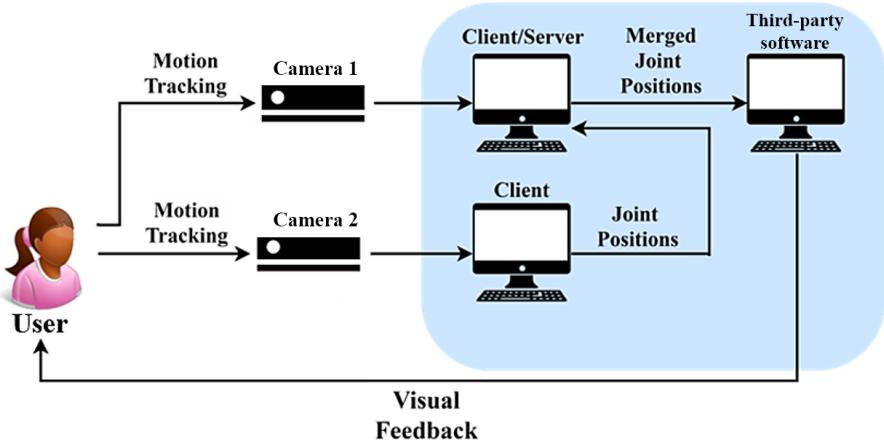  
Figure 1. Configuration of the RGB-D system.

Each workstation has two primary processes: user detection and position/orientation estimation of 15 joints. The detection process targets the candidate points to be people in the scenario, using the software NiTE, which does the client task, sending the movement estimation to the server over the network. The extrinsic (transformation from 3-D world coordinate system to the 3-D camera’s coordinate system) and intrinsic (transformation from the 3-D camera’s coordinates into the 2-D image coordinates) calibration of each RGB-D camera is performed using both the OpenCV package and the multi-camera network calibration tool provided by OpenPTrack (see Figure 2).

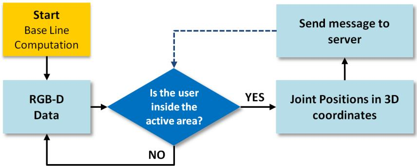  
Figure 2. Client flowchart.

The workstation with the highest processing capacity is also used as the system server, which is responsible for the vision fusion process, using a Kalman filter. When the server receives a message with the position data of a client, it checks the time interval between the last received message and the current message. If this interval is greater than 33 ms, the system discards the received measurement and resumes counting the intervals from the next measure to receive. This is made to do not use the merging data with a very discrepant time. If the data is within the time interval, the system transforms the client coordinate system into the global coordinate system defined in the extrinsic calibration process. Then, the data is inserted into the Kalman filter. The saved data is processed through a low-pass Butterworth filter used to eliminate noise and to achieve a smoother estimate (see Figure 3).

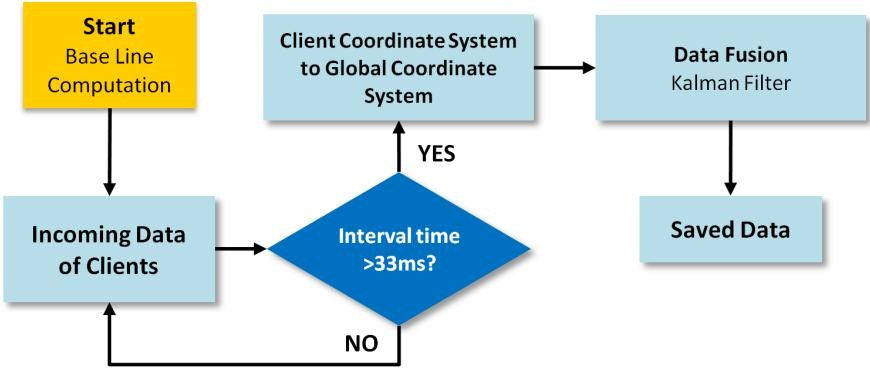  
Figure 3. Server flowchart.

The RGB-D fusion process is executed to obtain kinematic parameters and corporal patterns to be shown in an assessment interface that detects and quantifies the user’s movements. The system can produce parameters such as range of motion and positions of the tracked body articulations in three dimensions. In the same way, the system can be configured to show specific articulation angles. We use the law of cosine to calculate the elbow angle, as suggested by different authors [25–28]. Equation (1) shows the relation between the forearm $d _ { 1 }$ and upper arm $d _ { 2 }$ lengths as shown in Figure 4. The blue dots shown in Figure 4 are identified using the software NiTE, The blue dots shown in Figure 4 are identified using the software NiTE, such as aforementioned, where three points are identified (on the shoulder, elbow and hand), with $( \mathsf { X } , \mathsf { Y } , \mathsf { Z } )$ coordinates represented at each point.

$$
\theta = \cos^ {- 1} (\frac {- d _ {3} + d _ {1} + d _ {2}}{2 * d _ {1} * d _ {2}})\tag{1}
$$

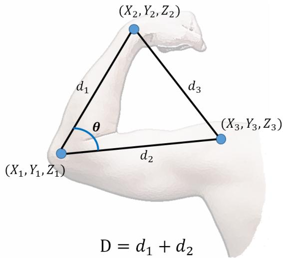  
Figure 4. Parameters to calculate the articulation angle of any joint.

## 2.2. POF Sensor

The POF curvature sensor used in this work is based on the intensity variation principle in which, considering the fiber input connected to a light source and the output to a photodetector, there is a power variation on the POF output when it is subjected to curvature. Such power variation is proportional to the curvature angle and occurs due to some effects on the fiber such as radiation losses, light scattering, and stress-optic effects, as thoroughly discussed in Leal-Junior et al. [29]. To increase the sensor linearity and sensitivity as well as the hysteresis reduction, a lateral section is made on the fiber, removing the fiber cladding and part of its core (considering the core-cladding structure of conventional solid-core optical fibers [30]). This material removal on the fiber creates a so-called sensitive zone, where the fiber is more sensitive to curvature variations.

The POF employed in this work, multimode HFBR-EUS100Z POF (Broadcom Limited, Singapore), has its core made of Polymethyl Methacrylate (PMMA) with 980 µm, whereas the cladding thickness is 10 µm. In addition, the fiber also has a polyethylene coating for mechanical protection, which results in a total diameter of 2.2 mm for this fiber. The lateral section is made on the fiber through abrasive removal of material, where the depth and length of the sensitive zone are about 14 mm and 0.6 mm, respectively. The sensitive zone length and depth were chosen as the ones that result in high sensitivity, linearity with low hysteresis, as experimentally demonstrated in Leal-Junior et al. [31]. The POF with the lateral section has one end connected to a light emitting diode (LED) IF-E97 (Industrial Fiber Optics, Tempe, AZ, USA) with central wavelength at 660 nm, whereas the other end (output) is connected to the photodiode IF-D91 (Industrial Fiber Optics, Tempe, AZ, USA). The POF curvature sensor needs a characterization step prior to its application in movement analysis, where this characterization is performed by positioned the POF sensor on the experimental setup shown in Figure 5. In this setup, a DC motor with controlled position and angular velocity performs flexion and extension movements on the POF sensitive zone on an angular range of 0–90◦. Then, the power attenuation is compared with the angle measured by the potentiometer (also shown in Figure 5) and a linear regression is made.

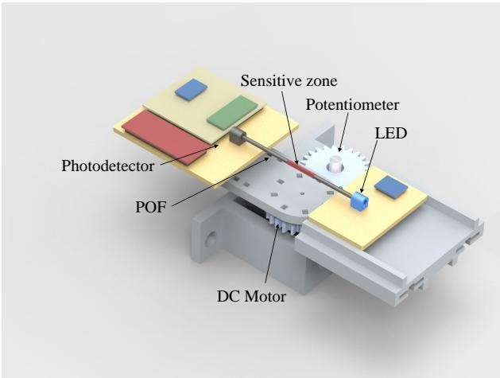  
Figure 5. Experimental setup for POF curvature sensor characterization.

To get user movement parameters, the sensor is positioned on their elbow joints. Since the mounting conditions of the POF curvature sensor has direct influence on its response (as discussed in Leal-Junior et al. [31]), each user is asked to perform a 90◦ angle in the sagittal plane (in both cases, i.e., sensor at elbow and knee joints). Thus, the 90◦ movement on the sagittal plane is used to calibrate the sensor as a function of its positioning on each subject.

## 2.3. IMU

Two wireless MTw IMU sensors (Xsens, Enschede, The Netherlands) are used, which are placed on the users’ body segments, (weight: 10 g, size: $4 7 \times 3 0 \times 1 3 \mathrm { m m } )$ . Each MTw sensor comprises a 3D gyroscope, a 3D accelerometer and a 3D magnetometer. IMUs sends its data to a station (Awinda, Xsens) via a proprietary wireless communication protocol at 100 Hz of sampling frequency. The orientation data, in quaternion format, was estimated with a customized Kalman filter developed by the manufacturer (XKF3-hm) [32].

We implemented a method using two IMU units to estimate the elbow flexion-extension angle. The IMU on the proximal body limb (i.e., upper arm) was used as a reference, hereafter referred to as $S _ { 1 }$ The second IMU, which was located on the distal body limb, will be referred as $S _ { 2 }$ . The algorithm uses five coordinate systems for its operation. $S _ { 1 }$ and $S _ { 2 }$ are the local coordinate system of the IMU sensors, these are embedded in each sensor. The technical-anatomical coordinate systems $( B _ { 1 }$ and $B _ { 2 } )$ correspond to the body limbs’ orientation [33]. Finally, the global coordinate system, $G ,$ is a frame formed by gravity acceleration vector and Earth’s magnetic north. The reference IMU sensor $\left( S _ { 1 } \right)$ ) was carefully aligned with the body limb, in such a way, during calibration moment, with a neutral standing posture and after applying a gravity alignment, $B _ { 1 } \left( B _ { 2 } \right)$ coordinate system is estimated from $S _ { 1 } \left( S _ { 2 } \right)$

The algorithm aims the estimation of the angle between the orientation of the proximal and distal limb. Therefore, the limbs’ orientations should be projected to a common coordinate system (i.e., global coordinate system). This is done through the orientation quaternions, ${ { G } _ { { \mathbf { q } } { { B } _ { 1 } } } } ( t )$ and ${ { \bf \Pi } ^ { G } } { \bf { q } } _ { B _ { 2 } } ( t )$ . The estimation process presupposes that x-axis of both technical-anatomical coordinate system are aligned with gravity vector at the calibration moment in a straight neutral posture, as proposed in previous works [33–35]. Besides the elbow joint is simplified as a 1-DOF hinge joint. The flexion-extension angle (α) is calculated following the steps below:

• To calculate the rotation quaternion, $\mathbf { q } _ { c } ,$ that aligns the x-axis of the $S _ { 1 }$ coordinate system, $\mathbf { \boldsymbol { x } } _ { S _ { 1 } }$ , with the gravity vector is expressed in the global coordinate system $( \mathbf { z } _ { G } )$ at the calibration moment, as proposed in [33].

To define the technical-anatomical coordinate systems ${ { \bf \Lambda } ^ { G } } { \bf q } _ { B _ { 1 } } ( 0 )$ and ${ { \bf \Sigma } ^ { G } } { \bf q } _ { B _ { 2 } } ( 0 )$ , at the calibration moment, applying Equations (2) and (3).

$$
{ } ^ { G } \mathbf { q } _ { B _ { 1 } } ( 0 ) = \mathbf { q } _ { c } \otimes { } ^ { G } \bar { \mathbf { q } } _ { S _ { 1 } } ( 0 )\tag{2}
$$

$$
{ } ^ { G } \mathbf { q } _ { B _ { 1 } } ( 0 ) = { } ^ { G } \mathbf { q } _ { B _ { 2 } } ( 0 )\tag{3}
$$

where $\otimes$ denotes the Hamilton product. Please note that due to the assumptions mentioned above, at the calibration moment, ${ { \bf \Lambda } ^ { G } } { \bf q } _ { B _ { 1 } } ( 0 )$ and ${ { \bf \Lambda } ^ { G } } { \bf q } _ { B _ { 2 } } ( 0 )$ are equals. Which means that the initial angle in a straight neutral posture is zero.

• To calculate sensor orientation $S _ { 1 } ~ ( S _ { 2 } )$ with respect to its associated body segment $B _ { 1 } \ ( B _ { 2 } )$ using Equation (4). Please note that $B _ { 1 } { \bf { q } } _ { S _ { 1 } }$ and $B _ { ^ 2 { \bf q } S _ { 2 } }$ are constant at all time instants.

$$
{ } ^ { B _ { 1 } } \mathbf { q } _ { S _ { 1 } } = \left( ^ { G } \mathbf { q } _ { B _ { 1 } } ( 0 ) \right) ^ { - 1 } \otimes ^ { G } \bar { \mathbf { q } } _ { S _ { 1 } } ( 0 )\tag{4}
$$

• To estimate the body segments’ orientation ${ { G } _ { { \mathbf { q } } { { B } _ { 1 } } } } ( t )$ and ${ { \bf \Pi } ^ { G } } { \bf { q } } _ { B _ { 2 } } ( t )$ using Equation (5). Please note that Equations (4) and (5) are expressed in terms of $B _ { 1 }$ and $S _ { 1 . }$ , but they are also applicable to $B _ { 2 }$ and $S _ { 2 }$ .

$$
{ } ^ { G } \mathbf { q } _ { B _ { 1 } } ( t ) = { } ^ { G } \mathbf { q } _ { S _ { 1 } } ( t ) \otimes \left( { } ^ { B _ { 1 } } \mathbf { q } _ { S _ { 1 } } \right) ^ { - 1 }\tag{5}
$$

• To calculate the relative orientation between ${ { G } _ { { \mathbf { q } } { { B } _ { 1 } } } } ( t )$ and ${ { \bf \Pi } ^ { G } } { \bf { q } } _ { B _ { 2 } } ( t )$ . In that way, $\mathbf { \nabla } B _ { 1 } { } _ { \mathbf { q } _ { B _ { 2 } } } ( t )$ is then decomposed into ’ZXY’ Euler angles. The rotation about z-axis represents the elbow flexion-extension angle, $\alpha ,$ consistent with the ISB recommendations [16,36].

$$
{ } ^ { B _ { 1 } } \mathbf { q } _ { B _ { 2 } } ( t ) = \left( { } ^ { G } \mathbf { q } _ { B _ { 1 } } ( t ) \right) ^ { - 1 } \otimes { } ^ { G } \mathbf { q } _ { B _ { 2 } } ( t )\tag{6}
$$

## 2.4. Sensors Characterization

To validate the measurements of the camera-based and IMU-based systems a goniometer as a standard reference is used. This reference has two adjustable lever locks, which are positioned to limit the flexion-extension motion between 20◦ (lower bound) and 90◦ (upper bound). The goniometer was placed and aligned with the elbow joint of the subject M1, then, this was asked to perform flexion-extension movements on the sagittal plane in such a way to reach both locks. Lastly, the data was acquired by the camera-based system and the IMUs. The POF curvature sensor is characterized using the procedure mentioned in Section 2.2.

## 2.5. Experimental Protocol

Eleven participants without motor impairments were enrolled in this study. Six females, referred as F1, F2, F3, F4, F5, and F6, age: 27.3 ± 4.9 years old, corporal weight 56.8 ± 16.3 kg, and five males, referred as M1, M2, M3, M4, and M5, age: 27.4 ± 3.3 years old, corporal weight 70.2 ± 3.8 kg, as shown in Table 1. This research was approved by the Ethical Committee of UFES (Research Project CAAE: 64797816.7.0000.5542). As shown in Table 1, there is a variability not only in gender, but also on subjects weight and height, which provides evidence for a further generalization of the proposed study.

Table 1. Characteristics of the participants of this research.

<table><tr><td>Subject</td><td>Age (Years)</td><td>Height (cm)</td><td>Weight (Kg)</td></tr><tr><td>M1</td><td>30</td><td>163</td><td>67</td></tr><tr><td>M2</td><td>22</td><td>176</td><td>66</td></tr><tr><td>M3</td><td>30</td><td>173</td><td>73</td></tr><tr><td>M4</td><td>27</td><td>183</td><td>75</td></tr><tr><td>M5</td><td>28</td><td>170</td><td>70</td></tr><tr><td>F1</td><td>30</td><td>156</td><td>57</td></tr><tr><td>F2</td><td>32</td><td>158</td><td>46</td></tr><tr><td>F3</td><td>22</td><td>160</td><td>48</td></tr><tr><td>F4</td><td>23</td><td>163</td><td>53</td></tr><tr><td>F5</td><td>24</td><td>158</td><td>48</td></tr><tr><td>F6</td><td>33</td><td>176</td><td>89</td></tr></table>

Two IMU sensors, one POF curvature sensor and two RGB-D cameras were used to estimate elbow joint angles. The IMU reference sensor was placed on the superior third of the right upper arm, and the second IMU was attached dorso-distally on the right forearm, as shown in Figure 6e. In a standing neutral posture, both sensors were positioned with x-axis pointing cranially, z-axis laterally and y-axis an orthogonal axis to x and z axes. These positions have been suggested by different authors [9,35,37]. Moreover, the POF curvature sensor was carefully aligned with the elbow joint in such a way that the sensitive zone of the optical fiber is located on the axis of rotation (flexion-extension axis).

In this test, the 11 participants (see Table 1) perform, a comfortable self-velocity, flexion-extension movements on three planes: sagittal, transverse, and frontal. Each participant was standing at the center of the room, observing the middle point between the two RGB-D cameras, see Figure 6d. All trials start with a synchronization movement, which consists of keeping the elbow in maximum extension on standing posture, then performing an elbow flexion of 90◦ and returning to the extended elbow position, where each transition last 5 s. Then, the subject was asked to perform three repetitions of flexion-extension on a specific plane. In the sagittal plane, the shoulder is in a neutral position and the participant performs elbow flexion-extension to get the maximum angle as possible (see in Figure 6a). In the transverse plane, the shoulder is in abduction (at max 90◦) and kept in that position for 5 s before the elbow flexion-extension movements (Figure 6b). In the frontal plane, the shoulder is in abduction (at max 90◦) and external rotation, so the palm of the hand is facing forward as shown in Figure 6c. These described steps can be summarized in Figure 7.

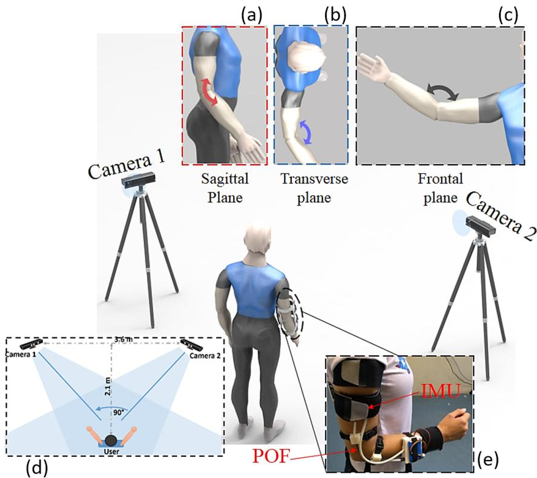  
Figure 6. Sensors’ placement on the human upper limb, and movements performed during the experimental protocol. (a) User movement representation in sagittal plane, (b) transverse plane, and (c) frontal plane. (d) Top view of RGB-D system arrangement. (e) User using the IMU system and POF sensor.

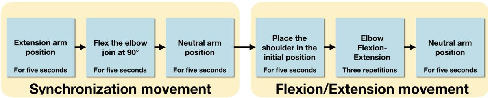  
Figure 7. Summary of the protocol’s phases.

## 3. Results and Discussion

The comparison variables of the three systems were: (i) the correlation coefficient and (ii) the root mean squared error (RMSE) between the RGB-D cameras, IMUs, and POF. After the comparison among the sensors, a novel approach for angle correction on the markerless camera-based system was proposed and validated for the correction of angular errors on the sagittal plane. The proposed technique is based on anthropometric measurements of each subject, where the errors of the camera-based system compared with the POF curvature sensor and IMU system are corrected through a correlation between the measured errors and the length of the arm of each subject $( d _ { 1 } , d _ { 2 }$ and $d _ { 3 }$ of Equation (1)). In this way, an equation for error correction considering the length d3 of each subject was obtained.

## 3.1. Sensors Characterization

## 3.1.1. IMUs and RGB-D Cameras

Figure 8 presents the results for RGB-D camera system and IMUs for the characterization phase using a goniometer as a reference for upper and lower bounds. The performed movement was divided into three cycles, and each cycle presents correlation between cameras and IMUs higher than 0.98.

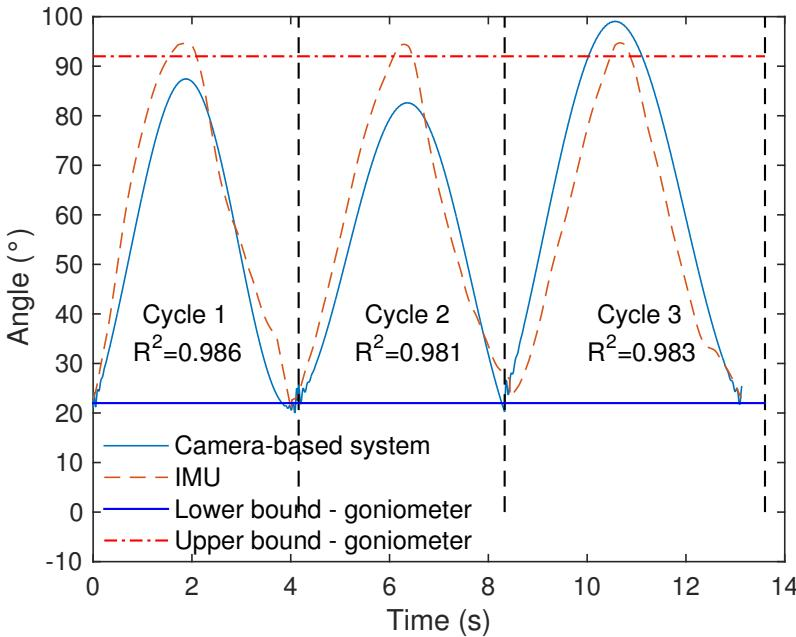  
Figure 8. Camera-based system and IMU angles of the first test.

Table 2 shows the maximum and minimum angles for cameras system and IMUs, compared to upper and lower bounds, respectively. The average error for the cameras system was $4 . 9 ^ { \circ }$ , with a maximum error of 9◦, when compared with the goniometer for two values $( 9 0 ^ { \circ } \mathrm { ~ e ~ } 2 0 ^ { \circ } )$ , which is lower than the mean error presented in Tannous et al. [38] (14, 6◦). However, in Tannous et al. [38] only one camera was used, carrying a higher self-occlusion leading to errors on the angle assessment. Since our system consists of two cameras, the self-occlusion decreases, consequently, reducing the errors. Compared to the goniometer, the IMUs average error was 3.7 , which is lower than the camera-based system.

Table 2. Maximum and minimum angles of camera-based system and IMU of each cycle for the first test.

<table><tr><td></td><td colspan="2">Cycle 1</td><td colspan="2">Cycle 2</td><td colspan="2">Cycle 3</td></tr><tr><td></td><td>Max [°]</td><td>Min [°]</td><td>Max [°]</td><td>Min [°]</td><td>Max [°]</td><td>Min [°]</td></tr><tr><td>Camera</td><td>87.4</td><td>21.0</td><td>82.6</td><td>12.8</td><td>99.0</td><td>22.2</td></tr><tr><td>IMU</td><td>94.6</td><td>22.9</td><td>94.4</td><td>22.7</td><td>94.7</td><td>23.0</td></tr><tr><td>Goniometer</td><td>90.0</td><td>20.0</td><td>90.0</td><td>20.0</td><td>90.0</td><td>20.0</td></tr></table>

## 3.1.2. POF

Figure 9 presents the normalized POF power attenuation as a function of the angle on the experimental setup shown in Figure 6, where a high correlation with the measured angle was obtained, since the determination coefficient $( \mathbb { R } ^ { 2 } )$ between the POF power variation and the angle was 0.996.

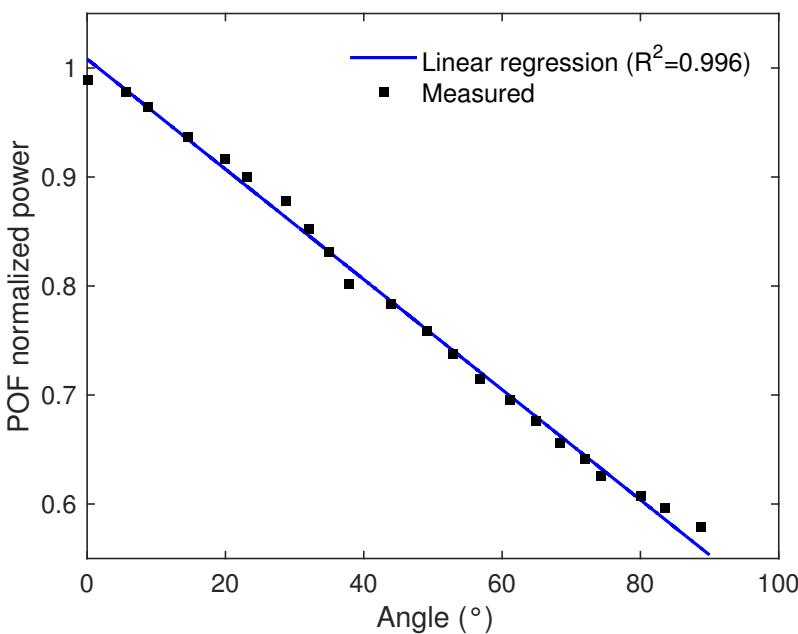  
Figure 9. Sensors’ placement on the human upper limb and the movements performed.

Thereafter, the POF curvature sensor is positioned on the subject’s elbow joint as previously described (see Section 2.5). The data of the elbow movement at each plane (sagittal, frontal and transverse) were recorded, which are presented in Figure 10 for subject M3. The initial movement of $9 0 ^ { \circ }$ in the sagittal plane was used to adjust the sensor response with respect to the differences aroused from the positioning on the subject elbow.

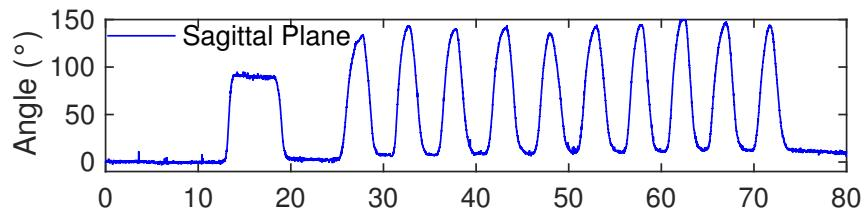

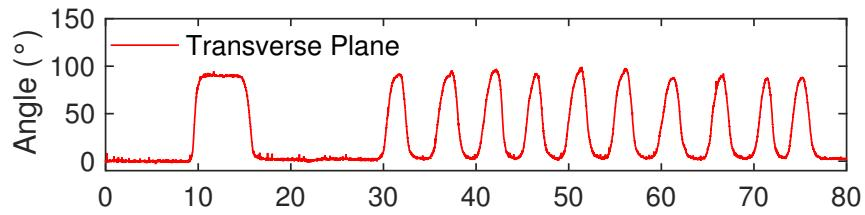

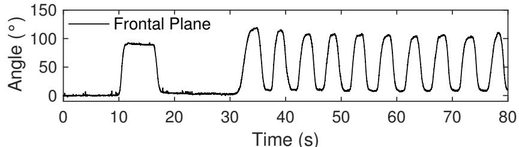  
Time (s)  
Figure 10. Sensors’ placement on the human upper limb and the movements performed.

The sensor response has the pattern of the flexion/extension movements performed by the subject. Furthermore, the angles estimated by the POF curvature sensor are within the range of movement described by the literature for elbow (0–145◦) [39]. Thus, the results presented in Figure 10 in conjunction with the high correlation of 0.996 (obtained on the sensor characterization as a function of the angle measured by a potentiometer) shows the feasibility of the POF sensor on the angle assessment, which makes it a suitable option for the comparison with angles estimated by the camera-based system.

## 3.2. Comparison among the Sensors

After the first evaluation of the sensors and the POF curvature sensor characterization, the sensors used in this work were compared using the experimental protocol depicted in Section 2.5. In this case, the camera-based system was compared with both IMU and POF. The comparison was made with respect to the correlation coefficient and RMSE (as also performed in the previous sections). Figure 11 shows the results obtained for all sensors in different planes, i.e., sagittal, transverse, and frontal planes, for subject M1.

Transverse plane  
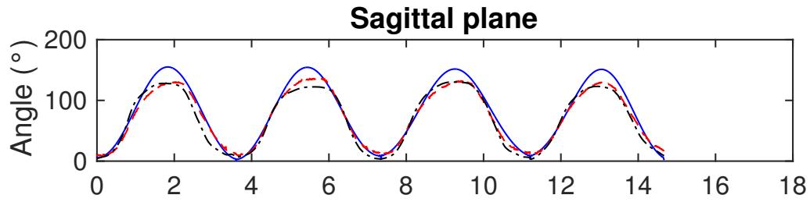

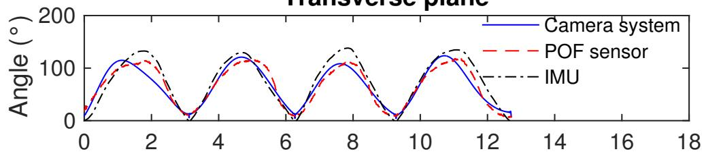  
Frontal plane

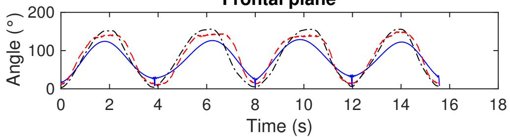  
Figure 11. Comparison among camera-based system, POF curvature sensor and IMU in the sagittal, frontal, and transverse planes, for subject M1.

The results presented in Figure 11 show a good correlation between the errors of the POF curvature sensor and IMU, especially on sagittal and frontal planes. Although we used the same number of cycles to compare the sensors, the period of each movement is different, due to the fact that each subject was allowed to perform the movements at a comfortable self-velocity.

Furthermore, the range of movement at each plane is different, i.e., the movement at the sagittal plane occurs in a range of about 0–145◦, whereas the one at the transverse plane reaches angles lower than

$1 3 0 ^ { \circ } .$ . Similarly, the angles at the frontal plane can be as high as $1 4 5 ^ { \circ }$ (as in the sagittal plane). From the tests, the mean deviation between POF curvature sensor and IMUs was about 6.5% on the tests in the sagittal plane. However, such deviation increased to about 10% on the transverse and frontal planes. The reason for this increase can be related to the POF positioning on the tests, since it is a critical factor on the angle assessment using such technology. In addition, it can be also related to the increase of the errors of the IMUs when the test was performed in planes different from the sagittal one, as reported in Vargas-Valencia et al. [33]. Regarding the camera-based system, the results at the sagittal plane show an overestimation of the angle, when compared to IMU and POF curvature sensor. In this case, the angles estimated by the markerless camera system had a maximum value of about 160◦, which is higher than the elbow range of motion [39]. In contrast, the camera-based system underestimates the angles at the frontal plane when compared with the other two systems for angle assessment.

Such as aforementioned, the errors on the markerless camera system for angle assessment are related to issues, such as frame errors, exploitation of multiple image streams and, especially, due to self-occlusions. To further evaluate the errors obtained by the camera-based system, Table 3 presents the correlation coefficient and RMSE between the markerless system and the IMUs for each of the 11 participants in all three planes tested, whereas Table 4 presents the correlation and RMSE between the markerless system and the POF curvature sensor.

Table 3. RMSE and correlation coefficient for Cameras and IMU.

<table><tr><td></td><td colspan="2">Sagittal</td><td colspan="2">Frontal</td><td colspan="2">Transverse</td></tr><tr><td></td><td> $R^2$ </td><td>RMSE</td><td> $R^2$ </td><td>RMSE</td><td> $R^2$ </td><td>RMSE</td></tr><tr><td>M1</td><td>0.994 ± 0.0041</td><td>13.53° ± 2.87°</td><td>0.955 ± 0.0164</td><td>14.31° ± 6.37°</td><td>0.988 ± 0.0043</td><td>18.62° ± 1.32°</td></tr><tr><td>M2</td><td>0.994 ± 0.0023</td><td>10.21° ± 1.86°</td><td>0.983 ± 0.0213</td><td>11.96° ± 4.67°</td><td>0.991 ± 0.0052</td><td>14.48° ± 4.53°</td></tr><tr><td>M3</td><td>0.986 ± 0.0052</td><td>7.42° ± 2.51°</td><td>0.993 ± 0.0063</td><td>15.03° ± 1.55°</td><td>0.984 ± 0.0060</td><td>18.84° ± 7.23°</td></tr><tr><td>M4</td><td>0.984 ± 0.0058</td><td>13.02° ± 3.12°</td><td>0.982 ± 0.0026</td><td>9.99° ± 3.94°</td><td>0.992 ± 0.0031</td><td>15.89° ± 6.59°</td></tr><tr><td>M5</td><td>0.991 ± 0.0025</td><td>9.60° ± 3.08°</td><td>0.989 ± 0.0095</td><td>14.34° ± 3.85°</td><td>0.978 ± 0.0230</td><td>11.21° ± 2.90°</td></tr><tr><td>F1</td><td>0.993 ± 0.0011</td><td>11.83° ± 2.93°</td><td>0.976 ± 0.0098</td><td>16.42° ± 2.41°</td><td>0.991 ± 0.0077</td><td>17.61° ± 3.67°</td></tr><tr><td>F2</td><td>0.990 ± 0.0043</td><td>11.26° ± 2.89°</td><td>0.986 ± 0.0045</td><td>8.49° ± 5.61°</td><td>0.921 ± 0.0833</td><td>15.28° ± 4.31°</td></tr><tr><td>F3</td><td>0.974 ± 0.0136</td><td>12.04° ± 5.39°</td><td>0.990 ± 0.0046</td><td>14.89° ± 1.90°</td><td>0.956 ± 0.0543</td><td>16.73° ± 2.89°</td></tr><tr><td>F4</td><td>0.996 ± 0.0019</td><td>11.90° ± 3.53°</td><td>0.989 ± 0.0057</td><td>15.98° ± 6.78°</td><td>0.990 ± 0.0052</td><td>16.29° ± 5.98°</td></tr><tr><td>F5</td><td>0.993 ± 0.0079</td><td>9.89° ± 0.77°</td><td>0.994 ± 0.0020</td><td>12.56° ± 3.74°</td><td>0.987 ± 0.0037</td><td>19.42° ± 5.03°</td></tr><tr><td>F6</td><td>0.995 ± 0.0042</td><td>11.81° ± 0.52°</td><td>0.989 ± 0.0034</td><td>17.31° ± 4.04°</td><td>0.992 ± 0.0006</td><td>19.98° ± 6.52°</td></tr></table>

Table 4. RMSE and correlation coefficient for Cameras and POF.

<table><tr><td></td><td colspan="2">Sagittal</td><td colspan="2">Frontal</td><td colspan="2">Transverse</td></tr><tr><td></td><td> $R^2$ </td><td>RMSE</td><td> $R^2$ </td><td>RMSE</td><td> $R^2$ </td><td>RMSE</td></tr><tr><td>M1</td><td>0.988 ± 0.0066</td><td>10.01° ± 2.12°</td><td>0.972 ± 0.0175</td><td>15.32° ± 6.92°</td><td>0.994 ± 0.0033</td><td>19.32° ± 3.30°</td></tr><tr><td>M2</td><td>0.977 ± 0.0055</td><td>10.90° ± 1.67°</td><td>0.985 ± 0.0065</td><td>11.28° ± 0.97°</td><td>0.985 ± 0.0080</td><td>14.98° ± 4.83°</td></tr><tr><td>M3</td><td>0.978 ± 0.0110</td><td>6.90° ± 2.25°</td><td>0.967 ± 0.0025</td><td>16.14° ± 2.74°</td><td>0.981 ± 0.0123</td><td>19.83° ± 3.80°</td></tr><tr><td>M4</td><td>0.955 ± 0.0208</td><td>12.00° ± 2.83°</td><td>0.916 ± 0.0106</td><td>13.35° ± 4.23°</td><td>0.965 ± 0.0165</td><td>13.53° ± 5.28°</td></tr><tr><td>M5</td><td>0.994 ± 0.0017</td><td>10.87° ± 0.15°</td><td>0.973 ± 0.0069</td><td>13.26° ± 3.39°</td><td>0.954 ± 0.0289</td><td>11.60° ± 1.17°</td></tr><tr><td>F1</td><td>0.975 ± 0.0178</td><td>11.52° ± 3.24°</td><td>0.978 ± 0.0196</td><td>14.84° ± 1.09°</td><td>0.970 ± 0.0205</td><td>17.84° ± 3.44°</td></tr><tr><td>F2</td><td>0.983 ± 0.0120</td><td>10.35° ± 0.60°</td><td>0.987 ± 0.0051</td><td>9.42° ± 4.27°</td><td>0.945 ± 0.0375</td><td>17.44° ± 4.77°</td></tr><tr><td>F3</td><td>0.982 ± 0.0085</td><td>7.72° ± 1.59°</td><td>0.978 ± 0.0070</td><td>17.17° ± 1.80°</td><td>0.982 ± 0.0083</td><td>17.86° ± 5.20°</td></tr><tr><td>F4</td><td>0.978 ± 0.0098</td><td>12.76° ± 1.63°</td><td>0.975 ± 0.0076</td><td>16.95° ± 4.46°</td><td>0.987 ± 0.0001</td><td>17.71° ± 6.52°</td></tr><tr><td>F5</td><td>0.989 ± 0.0097</td><td>8.11° ± 0.81°</td><td>0.977 ± 0.0070</td><td>13.56° ± 4.30°</td><td>0.979 ± 0.0131</td><td>19.28° ± 5.49°</td></tr><tr><td>F6</td><td>0.964 ± 0.0076</td><td>13.52° ± 0.95°</td><td>0.892 ± 0.0165</td><td>19.13° ± 4.53°</td><td>0.979 ± 0.0047</td><td>18.92° ± 5.36°</td></tr></table>

Tables 3 and 4 show a correlation coefficient higher than 0.9 in all analyzed cases, which indicates a high correlation between the responses of the sensors. In addition, the standard deviation of the correlation coefficient was below 0.01 in all the analyzed cases. Thus, it is possible to verify not only a high correlation between the data of the camera-based system compared to the wearable ones, but also that the results present a promising evidence of repeatability of such systems. The mean of correlation coefficients between the camera-based system and the IMUs were 0.990, 0.984 and 0.979 on the sagittal, transverse, and frontal planes, respectively. It is noteworthy that higher correlations were obtained between the camera-based system and the IMUs than the ones comparing the markerless system with the POF curvature sensor. The mean of the correlation coefficients considering the later comparison was 0.978, 0.964 and 0.975 for sagittal, transverse, and frontal planes, respectively.

Even though the proposed camera-based system presented high correlation with the wearable sensors in all scenarios, the errors of such system are generally high. Such as can be observed in Figure 11, there are deviations on the angle estimation of the camera-based system when compared with the wearable sensors, where, considering all the performed tests, these errors can be as high as $1 5 ^ { \circ }$ on the worst case. In addition, the mean errors are about $1 0 ^ { \circ }$ when compared with the wearable sensors. It is noteworthy that these errors are lower than the ones reported on the literature [40], which is mainly due to the use of two cameras to reduce the errors related to occlusions. However, errors of about $1 0 ^ { \circ }$ are still not sufficient when a reliable system for movement analysis is concerned. Nevertheless, the high correlations obtained in all tests for the comparison with the wearable sensors (see Tables 3 and 4) indicate that the proposed markerless camera-based system can be a feasible solution for angle estimation if a post-processing technique for the correction of the angular errors is applied, as also discussed in Schmitz et al. [40].

## 3.3. Technique for Angle Correction in Markerless Camera-Based Systems

The primary assumption for the proposed compensation technique for angle errors in markerless camera-based systems is that the errors mainly occur due to occlusions, or errors on computer vision algorithm for the tracking of the anatomical points used to calculate the parameters $d _ { 1 }$ and $d _ { 2 }$ in Figure 4. If these parameters are incorrectly estimated, errors on the angle assessment will occur. Thus, it is possible to assume that these angular errors have a correlation with the anthropometric measurements of each participant. To verify this assumption and develop the compensation technique for the markerless system, each participant performed 3 flexion/extension cycles only on the sagittal plane (see Section 2.5), and the angles estimated with the markerless camera-based system were compared with the ones measured by the POF curvature sensor. We used the POF curvature sensor for the development of the compensation technique, since it was already evaluated with respect to the potentiometer, presenting low errors in this characterization. However, we must emphasize that other sensor systems can be used as reference for the proposed compensation technique, including IMUs, marker-based camera systems and goniometers. The technique proposed here is based on the basic premise that the errors are mainly related to the detection of the parameters $d _ { 1 } , d _ { 2 }$ and $d _ { 3 }$ (due to self-occlusions, numerical errors on the computer vision algorithm, among other reasons). Therefore, the errors can be correlated (and then compensated) by considering the actual value of the anthropometric measurements $( d _ { 1 }$ and $d _ { 2 } )$ used on the angle estimation, which can be measured on each subject or estimated using the subject’s height [41].

For the first characterization of the technique, the flexion/extension cycles of five subjects (M1, M3, M5, F2 and F5) are analyzed, and a polynomial regression between the angles estimated by the camera-based system and the POF curvature sensor is performed for each of the five subjects, where each equation has the type shown in Equation (7):

$$
a n g _ {r e f} = a \cdot a n g _ {c a m} ^ {3} + b \cdot a n g _ {c a m} ^ {2} + c \cdot a n g _ {c a m} + d,\tag{7}
$$

where $a n g _ { c a m }$ is the angle estimated by the camera, $a n g _ { r e f }$ is the angle measured by the POF curvature sensor. In addition, a, b, c and d are polynomial regression coefficients experimentally obtained through the regression between the angular responses of both sensor systems, i.e., markerless camera-based and POF sensor, using the least squares method. The coefficient d is the offset on the sensor response (in ◦). Therefore, if the sensors responses are normalized in the beginning of the test, the offset will be null. For this reason, the coefficient d is not employed on the analysis of correlation between the coefficients of the angular error correction and the anthropometric measurements of the subjects.

Figure 12 shows the regression between the angle measured by the camera-based system and the POF curvature sensor for the third flexion cycle (as an example) of subject F5. The results show a high correlation (0.998) between the responses using a third-order polynomial regression. Actually, such high correlation occurs for all the cycles of the five subjects analyzed, where the correlation coefficient was higher than 0.9 in all cases. Hence, the assumption of correlation between the errors of both sensor systems holds true (based on the analyses performed). Then, the next step is to correlate the polynomial coefficients (a, b and c) with the anthropometric measurements of each participant.

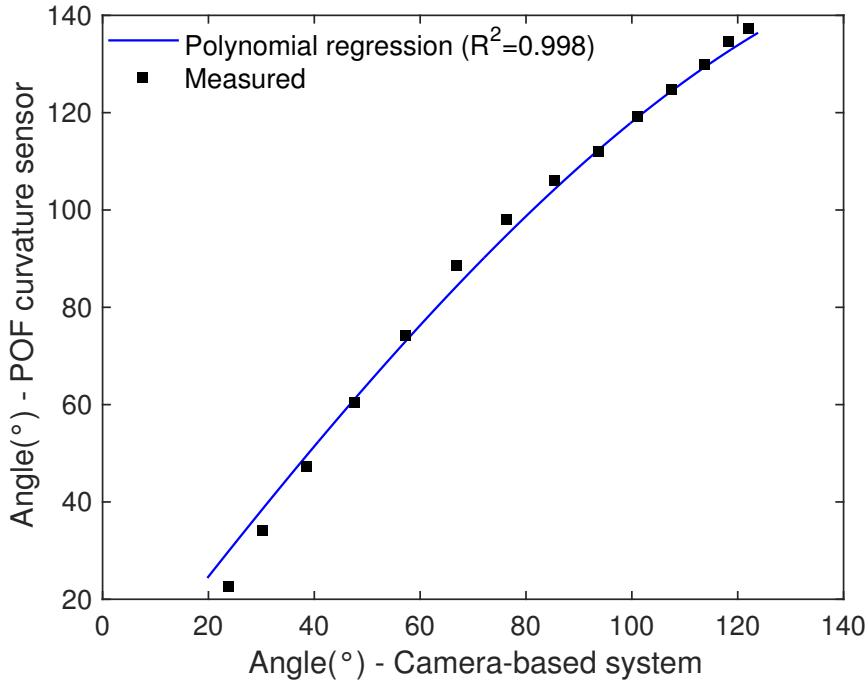  
Figure 12. Polynomial regression between camera-based system and POF curvature sensor angular responses for the third flexion cycle of subject F5.

As discussed in Section 2.1, the parameters used on the angle estimation by the camera-based system are the anthropometric distances $( d _ { 1 }$ and $d _ { 2 } )$ , which are detected through computer vision algorithms. Thus, errors on the detection of such points will lead to errors on angle estimation, where such errors can be related to those anthropometric distances. However, these parameters $( d _ { 1 }$ and $d _ { 2 } )$ are intrinsic of each subject and can be easily measured. In addition, it is possible to use the height of each subject (as showed in Table 1) in conjunction with anthropometric data for males and females to correlate the arm length with the subject’s height. Figure 13 shows the correlation of the polynomial regression coefficients (a, b and c) with the subjects’ arm lengths (D).

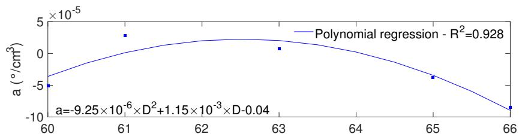

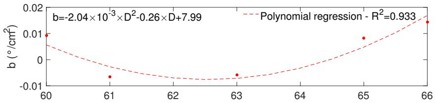

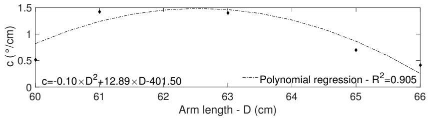  
Figure 13. Polynomial regression between the subjects’ arm length (parameter D) and the coefficients of angular error correction.

The results as well as the equations presented in Figure 13 indicate the feasibility of using the anthropometric measurements of each subject on equations for angular errors corrections in camera-based systems. The correlation coefficient is higher than 0.9 for all analyzed coefficients, indicating the possibility of using the proposed compensation technique for angle correction. Then, by substituting the equations shown in Figure 13 in Equation (7), it is possible to obtain a corrected angle as depicted in Figure 14 for three flexion/extension cycles for subject F1. In addition, the uncompensated response, i.e., the response of the camera-based system without applying the equations for angle correction, is also presented for comparison purposes. The RMSE for the compensated response is also presented in order to verify the accuracy enhancement provided by the proposed technique. Compared to the uncompensated responses, where the RMSE was 15.04◦, 9.25◦ and 10.23◦ for cycles 1, 2, and 3, respectively, the proposed angular error compensation was able to reduce the errors substantially in all three cycles. To further verify the performance of the proposed technique, the aforementioned compensation equations were applied for the responses in the sagittal plane for all subjects. The comparison between the RMSEs for the cases with and without the compensation technique is presented in Table 5 for each subject in all three flexion/extension cycles analyzed, where the mean and standard deviation of the three cycles are presented for each participant.

The results presented in Table 5 show the feasibility of the proposed technique, where the RMSE was reduced for all 11 subjects analyzed. The highest reduction occurred in Subject F1, in which the RMSE reduced from 11.52◦ to 3.52◦ after applying the correction equations. The mean of the RMSEs for the compensated responses is about 4.90◦, whereas the uncompensated one is 10.42◦, which means a two-fold reduction of the RMSE when the proposed compensation is applied. It is also worth to mention that the lowest RMSE reduction for the compensated case occurred in subject M3, where the RMSE reduced 2.11◦. However, one should note that the RMSE of the uncompensated response of this subject was already low (6.90◦) when compared to the ones of the other subjects and even when compared to the errors presented in the literature for similar systems [40].

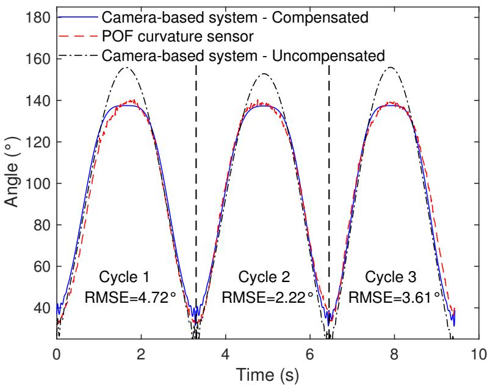  
Figure 14. Polynomial regression between the subjects’ arm length (parameter $d _ { 3 } )$ and the coefficients of angular error correction.

Table 5. Comparison between RMSEs of the compensated and uncompensated responses for each subject.

<table><tr><td>Subject</td><td>RMSE-Compensated</td><td>RMSE-Uncompensated</td></tr><tr><td>M1</td><td> $3.52^{\circ} \pm 0.84^{\circ}$ </td><td> $10.01^{\circ} \pm 2.12^{\circ}$ </td></tr><tr><td>M2</td><td> $3.99^{\circ} \pm 1.15^{\circ}$ </td><td> $10.90^{\circ} \pm 1.67^{\circ}$ </td></tr><tr><td>M3</td><td> $4.79^{\circ} \pm 0.74^{\circ}$ </td><td> $6.90^{\circ} \pm 2.25^{\circ}$ </td></tr><tr><td>M4</td><td> $6.24^{\circ} \pm 1.66^{\circ}$ </td><td> $12.00^{\circ} \pm 2.83^{\circ}$ </td></tr><tr><td>M5</td><td> $4.64^{\circ} \pm 1.23^{\circ}$ </td><td> $10.87^{\circ} \pm 0.15^{\circ}$ </td></tr><tr><td>F1</td><td> $3.52^{\circ} \pm 1.25^{\circ}$ </td><td> $11.52^{\circ} \pm 3.24^{\circ}$ </td></tr><tr><td>F2</td><td> $4.22^{\circ} \pm 2.25^{\circ}$ </td><td> $10.35^{\circ} \pm 0.60^{\circ}$ </td></tr><tr><td>F3</td><td> $4.11^{\circ} \pm 1.31^{\circ}$ </td><td> $7.72^{\circ} \pm 1.59^{\circ}$ </td></tr><tr><td>F4</td><td> $5.36^{\circ} \pm 2.05^{\circ}$ </td><td> $12.76^{\circ} \pm 1.63^{\circ}$ </td></tr><tr><td>F5</td><td> $5.74^{\circ} \pm 0.77^{\circ}$ </td><td> $8.11^{\circ} \pm 0.81^{\circ}$ </td></tr><tr><td>F6</td><td> $4.79^{\circ} \pm 1.06^{\circ}$ </td><td> $13.52^{\circ} \pm 0.95^{\circ}$ </td></tr></table>

The proposed technique for angular errors correction in markerless camera-based system is a feasible and straightforward option to enhance the angular accuracy in such systems. There is a calibration step in which the response of the camera-based system has to be compared with the one of a reference sensor system, e.g., wearable or marker-based camera systems. Then, the errors obtained on the markerless camera-based system are compared with the subject’s anthropomorphic parameters (arm length in this case) in order to obtain an equation that relates the angle correction with the parameters of each subject. Therefore, an important caveat should be mentioned: the calibration routine must be performed with respect to a reliable reference, and the movements should be performed at one plane, i.e., sagittal, frontal, or transverse planes movements. In addition, the calibration has to be performed on the same range at which the angle analysis will be performed, $\mathrm { i . e . , }$ if an angular interval of 0 to $1 6 0 ^ { \circ }$ will be analyzed, the calibration has to be made at this same angular range (0 to 160◦). By following these steps, it is possible to obtain accurate single plane angle measurements with a markerless camera-based system. Therefore, the main limitation of this approach is the necessity of a calibration stage prior to the application of the proposed sensor system in the same range and planes of movement envisaged on the proposed application. However, it is worth noting that the proposed approach can be extended for movement analysis of different degrees of freedom by adjusting the calibration stage accordingly and correlating the errors with the anthropometric parameters of each subject.

## 4. Conclusions

This paper presented the analysis and comparison of a markerless camera-based system for elbow angles assessment. The proposed markerless system uses two RGB-D cameras to reduce errors and inaccuracies related to self-occlusion issues. The non-wearable system performance was compared with two wearable solutions, namely POF curvature sensor and IMUs, in flexion/extension movements performed in different planes (sagittal, transverse, and frontal planes). Even though the proposed markerless camera-based system showed lower errors than some similar systems proposed in the literature, the errors are still high for movement analysis applications. To tackle this limitation, a comprehensive analysis of the system showed that despite the high errors, the markerless camera-based system response has a high correlation with the response of the wearable sensors. This also indicated the possibility of applying post-processing techniques aimed at error reduction in those systems. Thus, a compensation technique based on anthropometric measurements of the subjects was proposed and validated using the POF curvature sensor measures, resulting in a significant decrease of the RMSE.

The proposed RGB-D vision system and the novel compensation technique proposed here indicate the suitability of the system on the movement analysis, since the mean error obtained is about 4◦ for the angles tested, i.e., up to 120◦ in the sagittal plane, which is in agreement with the errors obtained in some sensing approaches for movement analysis [42]. Thus, this work can pave the way for movement analysis applications with markerless camera-based system. Future works include the further investigation of this technique in the other motion planes (frontal and transverse plane) and also in 3D movement scenarios. In addition, further evaluation and new sensor fusion techniques of markerless camera-based systems and optical fiber sensors will also be developed. Currently, to decrease the error, this work can be understood as the foundation of such developments.

Author Contributions: N.V.-J., L.V.-V., P.C.-R. implemented the assessment protocol and perform all the tests. N.V.-J., L.A., A.A.R.-D., M.L. implemented the RGB-D system proposed, analyzed the data, contributed in paper writing and revisions. A.L.-J. implemented the proposed POF curvature sensor system, analyzed the data, conceived and implemented the angle correction technique, contributed in paper writing and revisions. L.V.-V., P.C.-R. implemented the IMUs system proposed, contributed in paper writing and revisions. C.M., A.F., T.B. assisted in careful reviewing of the paper and proposed various refinements to the draft proposal made.

Funding: This research is financed by CAPES (88887.095626/2015-01)—financing code 001, FAPES (72982608), CNPq (304192/2016-3) and Innovaccion Cauca Research Project-02-2014 Doctorados Nacionales. This research is also financed by FCT through the program UID/EEA/50008/2019 by the National Funds through the Fundação para a Ciência e a Tecnologia / Ministério da Educação e Ciência, and the European Regional Development Fund under the PT2020 Partnership Agreement. This work is also funded by national funds (OE), through FCT – Fundação para a Ciência e a Tecnologia, I.P., in the scope of the framework contract foreseen in the numbers 4, 5 and 6 of the article 23, of the Decree-Law 57/2016, of August 29, changed by Law 57/2017, of July 19

Conflicts of Interest: The authors declare no conflict of interest.

## Abbreviations

The following abbreviations are used in this manuscript:

RGB-D Red-Blue-Green-and-Depth information

IMU Inertial Measurement Unit

POF Polymer Optical Fiber

DOF Degree of Freedom

MEM Micro-Electro-Mechanical

ROS Robot Operating System

XML eXtensible Markup Language

RPC Remote Procedure Call

NTP Network Time Protocol

## References

1. Hashimoto, K.; Higuchi, K.; Nakayama, Y.; Abo, M. Ability for basic movement as an early predictor of functioning related to activities of daily living in stroke patients. Neurorehabilit. Neural Repair 2007, 21, 353–357. [CrossRef] [PubMed]

2. Casamassima, F.; Ferrari, A.; Milosevic, B.; Ginis, P.; Farella, E.; Rocchi, L. A wearable system for gait training in subjects with Parkinson’s disease. Sensors 2014, 14, 6229–6246. [CrossRef] [PubMed]

3. Van Den Noort, J.C.; Ferrari, A.; Cutti, A.G.; Becher, J.G.; Harlaar, J. Gait analysis in children with cerebral palsy via inertial and magnetic sensors. Med. Biol. Eng. Comput. 2013, 51, 377–386. [CrossRef] [PubMed]

4. Muro-de-la Herran, A.; García-Zapirain, B.; Méndez-Zorrilla, A. Gait analysis methods: An overview of wearable and non-wearable systems, highlighting clinical applications. Sensors 2014, 14, 3362–3394. [CrossRef] [PubMed]

5. Shull, P.B.; Jirattigalachote, W.; Hunt, M.A.; Cutkosky, M.R.; Delp, S.L. Quantified self and human movement: A review on the clinical impact of wearable sensing and feedback for gait analysis and intervention. Gait Posture 2014, 40, 11–19. [CrossRef] [PubMed]

6. Wong, C.; Zhang, Z.Q.; Lo, B.; Yang, G.Z. Wearable Sensing for Solid Biomechanics: A Review. IEEE Sens. J. 2015, 15, 2747–2760. [CrossRef]

7. Hawkins, D. A new instrumentation system for training rowers. J. Biomech. 2000, 33, 241–245. [CrossRef]

8. Wang, P.T.; King, C.E.; Do, A.H.; Nenadic, Z. A durable, low-cost electrogoniometer for dynamic measurement of joint trajectories. Med. Eng. Phys. 2011, 33, 546–552. [CrossRef]

9. El-Gohary, M.; McNames, J. Shoulder and Elbow Joint Angle Tracking with Inertial Sensors. IEEE Trans. Biomed. Eng. 2012, 59, 2635–2641. [CrossRef]

10. Peters, K. Polymer optical fiber sensors—A review. Smart Mater. Struct. 2011, 20, 013002. [CrossRef]

11. Leal-Junior, A.G.; Frizera, A.; Vargas-Valencia, L.; Dos Santos, W.M.; Bo, A.P.; Siqueira, A.A.; Pontes, M.J. Polymer Optical Fiber Sensors in Wearable Devices: Toward Novel Instrumentation Approaches for Gait Assistance Devices. IEEE Sens. J. 2018, 18, 7085–7092. [CrossRef]

12. Leal-Junior, A.; Theodosiou, A.; Díaz, C.; Marques, C.; Pontes, M.J.; Kalli, K.; Frizera-Neto, A. Polymer optical fiber Bragg Gratings in CYTOP Fibers for angle measurement with dynamic compensation. Polymers 2018, 10, 674. [CrossRef]

13. Gong, Y.; Zhao, T.; Rao, Y.J.; Wu, Y. All-fiber curvature sensor based on multimode interference. IEEE Photonics Technol. Lett. 2011, 23, 679–681. [CrossRef]

14. Bilro, L.; Alberto, N.; Pinto, J.L.; Nogueira, R. Optical sensors based on plastic fibers. Sensors 2012, 12, 12184–12207. [CrossRef] [PubMed]

15. Leal-Junior, A.; Frizera, A.; Marques, C.; José Pontes, M. Polymer-optical-fiber-based sensor system for simultaneous measurement of angle and temperature. Appl. Opt. 2018, 57, 1717–1723. [CrossRef] [PubMed]

16. Wu, G.; Van Der Helm, F.C.; Veeger, H.E.; Makhsous, M.; Van Roy, P.; Anglin, C.; Nagels, J.; Karduna, A.R.; McQuade, K.; Wang, X.; et al. ISB recommendation on definitions of joint coordinate systems of various joints for the reporting of human joint motion—Part II: Shoulder, elbow, wrist and hand. J. Biomech. 2005, 38, 981–992. [CrossRef]

17. Menezes, R.C.; Batista, P.K.; Ramos, A.Q.; Medeiros, A.F. Development of a complete game based system for physical therapy with kinect. In Proceedings of the 2014 IEEE 3nd International Conference on Serious Games and Applications for Health (SeGAH), Rio de Janeiro, Brazil, 14–16 May 2014; pp. 1–6.

18. Svendsen, J.; Albu, A.B.; Virji-Babul, N. Analysis of patterns of motor behavior in gamers with down syndrome. In Proceedings of the IEEE Computer Society Conference on Computer Vision and Pattern Recognition Workshops, Colorado Springs, CO, USA, 20–25 June 2011; doi:10.1109/CVPRW.2011.5981673.

19. Cameirao, M.S.; Bermudez i Badia, S.; Duarte Oller, E.; Verschure, P.F. Neurorehabilitation using the virtual reality based Rehabilitation Gaming System: Methodology, design, psychometrics, usability and validation. J. Neuroeng. Rehabil. 2010, 7, 48. [CrossRef]

20. Müller, B.; Ilg, W.; Giese, M.A.; Ludolph, N. Validation of enhanced Kinect sensor based motion capturing system for gait assessment. PLoS ONE 2017, 12, e0175813. [CrossRef]

21. Konstantinidis, E.I.; Billis, A.S.; Paraskevopoulos, I.T.; Bamidis, P.D. The interplay between IoT and serious games towards personalised healthcare. In Proceedings of the 9th International Conference on Virtual Worlds and Games for Serious Applications (VS-Games), Athens, Greece, 6–8 September 2017; pp. 249–252. [CrossRef]

22. Covaci, A.; Kramer, D.; Augusto, J.C.; Rus, S.; Braun, A. Assessing Real World Imagery in Virtual Environments for People with Cognitive Disabilities. In Proceedings of the 2015 International Conference on Intelligent Environments, Prague, Czech Republic, 15–17 July 2015; pp. 41–48.

23. Abellard, A.; Abellard, P.; Applications, A.H. Serious Games Adapted to Children with Profound Intellectual and Multiple Disabilities. In Proceedings of the 9th International Conference on Virtual Worlds and Games for Serious Applications (VS-Games), Athens, Greece, 6–8 September 2017; pp. 183–184.

24. Brandão, A.; Trevisan, D.G.; Brandão, L.; Moreira, B.; Nascimento, G.; Vasconcelos, C.N.; Clua, E.; Mourão, P.T. Semiotic inspection of a game for children with Down syndrome. In Proceedings of the 2010 Brazilian Symposium on Games and Digital Entertainment, Florianopolis, Brazil, 8–10 November 2010; pp. 199–210. [CrossRef]

25. Chen, P.J.; Du, Y.C.; Shih, C.B.; Yang, L.C.; Lin, H.T.; Fan, S.C. Development of an upper limb rehabilitation system using inertial movement units and kinect device. In Proceedings of the 2016 International Conference on Advanced Materials for Science and Engineering (ICAMSE), Tainan, Taiwan, 12–13 November 2016; pp. 275–278.

26. Lee, J.H.; Nguyen, V.V. Full-body imitation of human motions with kinect and heterogeneous kinematic structure of humanoid robot. In Proceedings of the 2012 IEEE/SICE International Symposium on System Integration (SII), Fukuoka, Japan, 16–18 December 2012; pp. 93–98.

27. Qi, Y.; Soh, C.B.; Gunawan, E.; Low, K.S.; Maskooki, A. A novel approach to joint flexion/extension angles measurement based on wearable UWB radios. IEEE J. Biomed. Health Inform. 2014, 18, 300–308.

28. Xu, Y.; Yang, C.; Zhong, J.; Wang, N.; Zhao, L. Robot teaching by teleoperation based on visual interaction and extreme learning machine. Neurocomputing 2018, 275, 2093–2103. [CrossRef]

29. Leal Junior, A.G.; Frizera, A.; Pontes, M.J. Analytical model for a polymer optical fiber under dynamic bending. Opt. Laser Technol. 2017, 93, 92–98. [CrossRef]

30. Zubia, J.; Arrue, J. Plastic optical fibers: An introduction to their technological processes and applications. Opt. Fiber Technol. 2001, 7, 101–140. [CrossRef]

31. Leal-Junior, A.G.; Frizera, A.; José Pontes, M. Sensitive zone parameters and curvature radius evaluation for polymer optical fiber curvature sensors. Opt. Laser Technol. 2018, 100, 272–281. [CrossRef]

32. Paulich, M.; Schepers, H.M.; Rudigkeit, N.; Bellusci, G. Xsens MTw Awinda: Miniature Wireless Inertial-Magnetic Motion Tracker for Highly Accurate 3D Kinematic Applications; Technical Report; XSens Technologies: Enschede, The Netherlands, 2018.

33. Vargas-Valencia, L.S.; Elias, A.; Rocon, E.; Bastos-Filho, T.; Frizera, A. An IMU-to-Body Alignment Method Applied to Human Gait Analysis. Sensors 2016, 16, 2090. [CrossRef] [PubMed]

c 2019 by the authors. Licensee MDPI, Basel, Switzerland. This article is an open access article distributed under the terms and conditions of the Creative Commons Attribution (CC BY) license (http://creativecommons.org/licenses/by/4.0/).