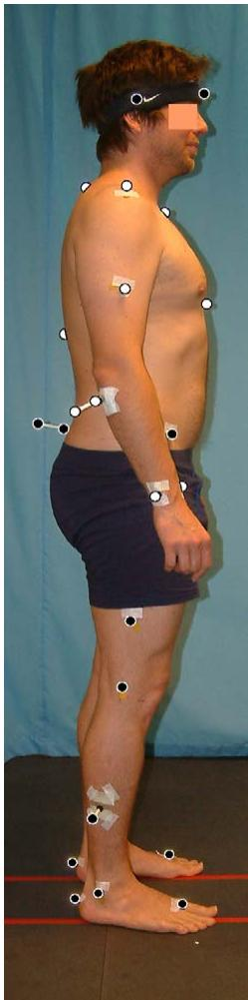
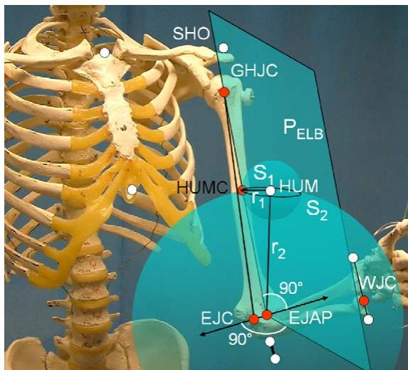
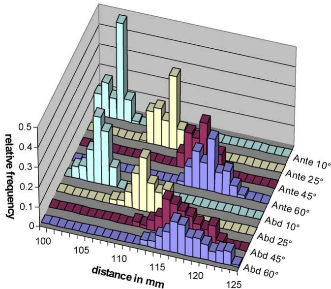

# A new kinematic model of the upper extremity based on functional joint parameter determination for shoulder and elbow

Oliver Rettig, Laetitia Fradet, Philip Kasten, Patric Raiss, Sebastian I. Wolf\*

Department of Orthopaedic Surgery, University of Heidelberg, Schlierbacher Landstr. 200a, 69118 Heidelberg, Germany

## A R T I C L E I N F O

Article history: Received 1 October 2008 Received in revised form 3 July 2009 Accepted 8 July 2009

Keywords: Upper extremity mode Arm mode Shoulder joint Elbow joint Motion analysis Universal goniometer measurements Functional method

## A B S T R A C T

A new upper extremity model is introduced for clinical application. It combines the advantages of functional methods to determine the joint parameters for the shoulder joint centre and the elbow axis location with the ease of a minimal skin mounted marker set. Soft tissue artefacts at the shoulder and upper arm are reduced via a coordinate transfer between dynamic calibration and the actual motion analyzed. A unique technical frame linked to markers on the forearm is defined for the humerus. The protocol has been applied to 50 subjects over a wide age range (5–85 years) and with varying physical status, proving clinical feasibility. Variability in joint centre localization in repeated measures was typically below 1 cm. Based on these estimated joint centre locations for shoulder and elbow, three shoulder joint angles together with elbow flexion and forearm pro-/supination were determined in a large set of static arm postures in 5 subjects. These were compared to synchronous universal goniometer measurements to analyse intra-tester, inter-tester, and inter-subject repeatability. Differences between the computed angles and the angles obtained directly with the goniometer remained below -58 for joint angles up to 1208 and -108 above 1208.

\- 2009 Elsevier B.V. All rights reserved.

## 1. Introduction

Upper extremity modelling is gaining increased clinical interest as full body motion analysis becomes routine. Difficulties arise, however, from the biomechanical complexity of the shoulder joint and from the fact that bony motion is heavily masked by soft tissue artefacts (STA). This is especially critical at the shoulder in overhead reaching movements. Two main methodologies are reported to measure joint motion with skin mounted markers. Predictive methods determine elbow and shoulder joint parameters from skin mounted markers placed at specific anatomical positions using empirical regressions [1–7]. The disadvantages of this kind of approach are that the individual shoulder anatomy is not taken into account and that results are greatly sensitive to markers placed on anatomical landmarks. The estimation of the upper extremity joint centres and axes based on functional methods [8–11] does not require any anthropometric assumptions and, as a consequence is more tolerant of the individual anatomy. The principle of these methods is to determine the joint centres and axes in well-defined technical frames (TFs) during calibration movements. The results are then used to predict the position ofthejoint centres and axes relative to a TF for monitoringjoint motion. In both approaches however, STA critically limit the accuracy for larger ROMs. For the promising functional methods, the choice ofthe TF, the calibration movements and the algorithm used to compute the joint parameters all might strongly influence the results. Especially in case of the humerus the definition of a stable TF is a challenge [12]. It is therefore often estimated from a cluster of markers fixed to the skin with a cuff [10,11]. The shortcomings are that a cuffinfluences the subject’s arm motion and induces uncontrolled coupling of marker motion. It has been shown for the thigh that a carefully chosen small set of skin mounted markers may be a better choice than a cuff with a rigid cluster of markers [13]. Nonetheless, even with individually skin mounted markers the definition ofa stable TF linked to the humerus is difficult. The large range ofmotion (ROM) ofthe shoulder results in STA especially appearing as tangential movement of the skin markers around the longitudinal axis of the humerus which cannot be neglected [1,14]. Further, markers at the scapula and at the clavicle are significantly influenced by subject specific skin motion with little reproducibility. A marker placed at the acromion generally tends to move medially with the skin in abduction movements [3] but within a very limited ROM its position is relatively stable. Williams et al. [11] partly avoid these problems by proposing a gleno-humeral joint centre (GHJC) estimation based solely on TFs for the thorax and the humerus but any possible clavicle motion in calibration movements thereby is neglected. This procedure almost certainly is biasing the result since in practice there is always clavicula and scapula motion present when abducting the arm. Hence, the definition of good TFs for the computation of shoulder and elbow joint parameters is crucial for improving motion analysis of the upper extremity using skin mounted markers.

The aim of this work was therefore to establish a kinematic UX model for shoulder and elbow joint motion analysis of satisfactory accuracy also for critical overhead movements. Designated applications were angular reproduction tests as well as monitoring of everyday movements in the context of ergonomics some of which already have been published with this method [15,16]. For this purpose, the method should rely on a small set of markers feasible for a routine clinical procedure and specifically it should not make use of any stabilizing aids such as cuffs. The model which we would like to introduce as Heidelberg Upper Extremity (HUX) model is tested for robustness and repeatability of joint centre determination. Additionally, subsequent joint angle determination is tested in series of successive static arm positions and compared to ‘‘classical’’ angle determination by universal goniometry [17] as a rough counter measure. This method which in the past six decades may not have improved in accuracy above -(5–10)8 [18] is still unbeatable in flexibility and ideal for a direct and intuitive reference especially in a clinical context.

## 2. Measurement protocol

With the marker set and procedure presented here, arm motions of 50 subjects (86 sides) in a large age range (5–85 years) were recorded using a Vicon 612 motion capture system with 10 cameras working at 120 Hz. The subjects were either healthy volunteers or patients of the local orthopaedic hospital without any symptomatic pathology of the shoulder and elbow joints. The participants all volunteered with written and informed consent according to the local ethics committee’s regulations.

14 retro-reflective markers including a ‘‘twin marker’’ at the elbow were placed on the skin according to Table 1 and illustrated in Fig. 1.

After a static calibration trial for assessing thorax position and for determining parameters of the humerus TF (see Appendix A), three independent functional trials were performed, each starting with the arm in neutral position of the shoulder: shoulder abduction/adduction; shoulder ante/retroversion (both performed with zero elbow flexion) and elbow flexion/extension. During these calibration trials, the wrists were kept in neutral position to avoid any secondary movement of the markers placed on the forearms. Each movement was repeated three times bilaterally over the full accessible ROM.

## 3. Model

The HUX model consists of7 segments: thorax, clavicles, upperand forearms. The sterno-clavicular joint is treated as universal (cardan) joint with 2 degrees of freedom (DOF) [19] and is used for calibration purposes only [20]; axial rotation is not considered. The gleno-humeral joint is regarded as ball and socket joint with 3 DOFs. The elbow is treated as hinge joint with one DOF. Translational DOFs are not considered in any of the joints.

Table 1  
Marker placement on thorax, clavicle, humerus and forearm.

<table><tr><td>Marker</td><td>Location</td><td>Segment</td></tr><tr><td>CLAV</td><td>Jugular notch</td><td>Thorax</td></tr><tr><td>STRN</td><td>Xiphoid process,</td><td>Thorax</td></tr><tr><td>C7</td><td>Spinous process of C7</td><td>Thorax</td></tr><tr><td>T10</td><td>Spinous process of T10</td><td>Thorax</td></tr><tr><td>SHO</td><td>On top of acromion</td><td>Shoulder girdle/clavicle</td></tr><tr><td>ELB-ELBW</td><td>Ulna distally to the olecranon</td><td>Forearm/ulna</td></tr><tr><td>ULN</td><td>Processus styloideus ulnae</td><td>Forearm/ulna</td></tr><tr><td>RAD</td><td>Processus styloideus radii</td><td>Forearm/radius</td></tr><tr><td>HUM</td><td>Tuberositas deltoidea</td><td>Humerus</td></tr></table>

  
Fig. 1. Full body marker set. White markers refer to the HUX model.

TFs for the ulna/forearm, humerus, clavicle, and thorax are not deduced by optimization methods as was done for marker clusters [21]. Rather, they are defined directly via cross products of (time dependent) vectors between markers as reviewed in Chiari et al. [22]. The TF for the thorax is defined by the markers C7, T10, CLAV and STRN.

## 3.1. The wrist joint

The wrist joint centre (WJC) is defined as a virtual point located between the markers ULN and RAD placed on the styloid processes at a distance of 4/5th towards the ulna marker. During isolated pro-/supination movements with the joints of shoulder, elbow and wrist held as still as possible without external support, this position was found in several subjects to be the centroid of the motion of markers RAD and ULN.

## 3.2. The elbow joint

The TF of the forearm segment is defined by the twin marker ELB–ELBW and the WJC (see Appendix A for the complete description). In elbow flexion/extension calibration trials, the movement of the humerus marker (HUM) is monitored relative to this forearm TF, unlike typical approaches which monitor the movement of the WJC relative to a TF linked to the humerus. This has been done based on the consideration that markers placed at the forearm should be less influenced by STA then those placed at the upper arm which is covered by more muscle tissue. The elbow joint axis (EJA) is then determined via an estimation method proposed by Gamage and Lasenby [23]. Further, the elbow joint centre (EJC) is defined as the point on the EJA nearest to the marker ELB.

## 3.3. The shoulder joint

It was mentioned in the introduction that it is difficult to define stable TFs for the clavicle and humerus. Therefore it was decided to use a TF linked to the clavicle (see Appendix A for the definition) only and specifically in dynamic shoulder calibration movements, and this, over a very limited ROM. The method by Gamage and Lasenby was again applied using the movement of the HUM marker relative to the clavicle TF for the estimation of the GHJC position during the calibration trials. For localizing the GHJC in further dynamic trials, the TF is switched to a special humerus TF defined by the single marker at the humerus and further markers at the forearm. This humerus TF is very stable since the proximal ulna markers are little influenced by skin motion and the critical tangential skin motion of the humerus marker in internal/external rotation movements is accounted for via a geometric definition of the humerus TF described in the following section.

## 3.4. Geometric definition of the humerus TF

Assuming that the single humerus marker is influenced mainly by tangential skin motion its motion can be modelled by the following three geometric considerations during dynamic trials (Fig. 2):

(1) The humerus marker (HUM) moves approximately on a circle with radius $r _ { 1 }$ around a virtual point HUMC on the humerus long axis. Conversely, the virtual point HUMC, a position which is not yet known, can be regarded as moving around the marker HUM.

(2) HUM moves approximately around the EJC with radius $r _ { 2 } .$

(3) Since the elbow is modelled as a hinge joint, HUMC performs approximately a planar motion in the TF of the forearm (with little motion in elbow joint axis direction). This plane of motion PELB is normal to the EJA and passes through the point EJAP which is defined as a projection of the GHJC onto the EJA and deduced via the static calibration (see Appendix A). Further, $r _ { 1 }$ and $r _ { 2 }$ are determined in this calibration. Hence, the definition of EJAP takes into account the varus/valgus position of the forearm relative to the humerus.

  
Fig. 2. Geometric determination of the point HUMC.

Consequently, during shoulder motion, the point HUMC can be found by intersecting the sphere $S _ { 1 }$ centred at the HUM marker with radius $r _ { 1 } ,$ the sphere $S _ { 2 }$ centred at EJAP with radius $r _ { 2 }$ and the plane PELB. The origin of the humerus TF is defined by the unique parameterization:

$$
\mathrm{HUMC} = f \left(r _ {1}, r _ {2}, \text { EJAP }, \text { EJA }, \text { HUM }\right)
$$

This parameterization is independent of any markers placed on thorax or shoulder (SHO). In particular it is not influenced by tangential skin movement of the marker at the humerus. The axes of the humerus TF then are defined by cross products of the humerus’ longitudinal axis and the EJA with the virtual point HUMC as origin of the humerus TF (Appendix $\mathsf { A } )$

## 4. Model tests

## 4.1. Robustness ofjoint centre determination

To test robustness ofjoint centre determination, the calibration movements of 86 shoulders have been processed using 5 different ROMs obtained by sequentially cutting these trials. Three different optimization algorithms, namely the least squares method (LS) of Gamage and Lasenby [23], the normalization method (NM) of Chang and Pollard [24] and the additional bias compensation (BC) proposed by Halvorsen [25] were applied. Depending on the algorithm and the ROM of the calibration movement taken into account for computation, Table 2 lists the number of measurements in which the estimated location of the GHJC was found in a reasonable distance below the acromion marker. Based on model considerations in [6] the expected distance was limited between 20 and 80 mm.

The LS algorithm appears more robust than the NM algorithm since the number of outliers with the LS algorithm in all ROMs is smaller. However, the disadvantage with the LS algorithm is that despite an overall smaller number of outliers (right column in Table 2) a relatively high number of cases displays small variations in distance (<3 mm) across the calibration movement and thereby falsely indicates a good convergence and a ‘‘valid’’ result. The additional bias compensation (BC) tends to result in smaller distances between GHJC and SHO and hence to more cases with distances smaller than 20 mm to the SHO marker.

The number of outliers strongly decreases with increasing ROM of the calibration movements. When cutting off of the first 108 ROM in the abduction and ante-/retroversion calibration movements, the number of outliers is strongly reduced. The optimization is more stable due to a more even distribution ofshoulderjoint positions with time. ROMs beyond $4 0 ^ { \circ }$ do not improve the calibration significantly probably due to increasing STA. These artefacts can be detected in the value distribution of the distance between the estimated GHJC and the HUM marker. Fig. 3 illustrates such a distribution for an individual subject performing abduction and ante-/retroversion movements with different ROMs when using the LS algorithm.

The distribution becomes broader with increasing ROM for the ante-/retroversion movement as well as for the abduction movement. Furthermore, the median rises to larger values, In fact. two opposite mechanisms influence the stability of the result: with a large ROM the optimization in theory is more stable but skin motion becomes increasingly relevant. A ROM of 408 turned out to be a good compromise for most measurements. With this ROM, the values are almost normally distributed such that least squares methods can be applied. With the present procedure, the LS algorithm with ROMs in the calibration movements of 408 appeared therefore most appropriate. Similar procedures were performed with the elbow, leading to best results when using the LS algorithm with an elbow flexion range of 10–1208.

Table 2  
Incidence in 86 shoulders to find the GHJC in a vertical distance z of 20–80 mm to the SHO marker and further classification into those cases in which the variation in distance across the calibration movement stays below/above 3 mm.

<table><tr><td>Method</td><td>ROM</td><td>z&gt;80 mm below SHO</td><td>z&lt;20 mm below SHO</td><td>z in limits (20-80)</td><td>Outliers</td><td>z in limits with std &lt; 3 mm</td><td>z in limits with std &gt;3 mm</td><td>Outliers with std &lt; 3 mm</td><td>Outliers with std &gt;3 mm</td></tr><tr><td>NM</td><td>10-20</td><td>26</td><td>8</td><td>52</td><td>40%</td><td>52</td><td>0</td><td>9</td><td>25</td></tr><tr><td>NM</td><td>0-30</td><td>12</td><td>2</td><td>72</td><td>16%</td><td>71</td><td>1</td><td>2</td><td>12</td></tr><tr><td>NM</td><td>10-30</td><td>6</td><td>4</td><td>76</td><td>12%</td><td>76</td><td>0</td><td>4</td><td>6</td></tr><tr><td>NM</td><td>10-40</td><td>1</td><td>3</td><td>82</td><td>5%</td><td>81</td><td>1</td><td>3</td><td>1</td></tr><tr><td>NM</td><td>10-50</td><td>0</td><td>3</td><td>83</td><td>3%</td><td>81</td><td>2</td><td>3</td><td>0</td></tr><tr><td>LS</td><td>10-20</td><td>24</td><td>0</td><td>62</td><td>28%</td><td>62</td><td>0</td><td>17</td><td>7</td></tr><tr><td>LS</td><td>0-30</td><td>12</td><td>1</td><td>73</td><td>15%</td><td>70</td><td>3</td><td>11</td><td>2</td></tr><tr><td>LS</td><td>10-30</td><td>4</td><td>2</td><td>80</td><td>7%</td><td>80</td><td>0</td><td>5</td><td>1</td></tr><tr><td>LS</td><td>10-40</td><td>0</td><td>1</td><td>85</td><td>1%</td><td>84</td><td>1</td><td>1</td><td>0</td></tr><tr><td>LS</td><td>10-50</td><td>0</td><td>2</td><td>84</td><td>2%</td><td>82</td><td>2</td><td>2</td><td>0</td></tr><tr><td>BC</td><td>10-20</td><td>17</td><td>10</td><td>59</td><td>31%</td><td>59</td><td>0</td><td>27</td><td>0</td></tr><tr><td>BC</td><td>0-30</td><td>5</td><td>2</td><td>79</td><td>8%</td><td>77</td><td>2</td><td>7</td><td>0</td></tr><tr><td>BC</td><td>10-30</td><td>2</td><td>4</td><td>80</td><td>7%</td><td>80</td><td>0</td><td>6</td><td>0</td></tr><tr><td>BC</td><td>10-40</td><td>0</td><td>3</td><td>83</td><td>3%</td><td>82</td><td>1</td><td>3</td><td>0</td></tr><tr><td>BC</td><td>10-50</td><td>0</td><td>3</td><td>83</td><td>3%</td><td>81</td><td>2</td><td>3</td><td>0</td></tr></table>

  
Fig. 3. Value distribution for the distance GHJC-HUM for one sample subject performing abduction and ante-/retroversion movements of different ROMs based on method LS

## 4.2. Repeatability ofjoint parameter determination

In order to check the repeatability in marker placement and the subsequent joint centre optimization, a single subject was tested bilaterally by 5 different testers. Vertical distances between the acromion marker SHO and GHJC and the distance between left and right GHJC were calculated by the three algorithms mentioned above (comp. Table 3). The average distance between SHO and GHJC of about 45 mm varied less than 2 mm between algorithms with a standard deviation between sessions of 5–8 mm. The distance of about 400 mm between both GHJCs showed a standard deviation between sessions of 7 mm. Furthermore, 16 healthy subjects were monitored twice at two different days by two different testers to check the test–retest reliability with which joint centres were localized relative to each other. Resulting upper and forearm lengths (i.e. distances between joint centres) on average differed between sessions by 7.7 and 8.6 mm, respectively. Elbow varus/valgus positions were evaluated in static trials with the elbow extended. Direction cosine angles between the EJA and the long axes of humerus and forearm led to average session differences of 3.68 and 4.38, respectively.

## 4.3. Joint angle comparisons

In addition to the regular calibration protocol required for the determination of the joint centres, 5 subjects in the age range between 25 and 35 years were asked to adopt a pre-defined set of 36 different arm positions first for one and then for the other arm while sitting on a chair with the thorax upright. Each joint position was checked and adjusted if necessary by a clinician as tester using a universal goniometer, later referred to as clinical measurement. Synchronously, an optical capture of this posture was taken. The shoulder joint positions consisted of 7 positions for ab-/adduction (170–08), 11 for ante-/retroversion (170–0– 758), and 5 for ext/internal rotation (100–0–608) in 908 shoulder abduction. Next to these positions, six elbow joint positions in the range 0–1408 with the shoulder in slight anteversion and seven pro-/supination positions of the forearm in the range (80–0–808) with the elbow in 908 flexion were tested. In order to resemble the clinical measurement, projection angles were calculated for abduction and ante-/retroversion with respect to the thorax. Elbow flexion was determined as the angle between the longitudinal axes of humerus and forearm projected into the plane perpendicular to the elbow joint axis. Forearm pro-/supination was calculated as the angle between the elbow joint axis and the line between the two wrist joint markers projected into the plane perpendicular to the long axis of the forearm. Differences between these angles and the clinical measurements were determined and given as mean and standard deviation between subjects (i.e. 10 shoulders) in Table 4 (right column). To check intra-tester and inter-tester reliability, one out of the five subjects (subject 1; male; 26 years)

Vertical distance z between SHO and GHJC determined by different least-squares methods (LS, NM, BC) and the distance between the left and right GHJC (LS) for a sample subject tested by five different testers.

<table><tr><td rowspan="2">Tester</td><td colspan="3">z (left shoulder)</td><td colspan="3">z (right shoulder)</td><td>Shoulder distance</td></tr><tr><td>LS (mm)</td><td>NM (mm)</td><td>BC (mm)</td><td>LS (mm)</td><td>NM (mm)</td><td>BC (mm)</td><td>LS (mm)</td></tr><tr><td>1</td><td>57.8</td><td>57.0</td><td>56.9</td><td>39.8</td><td>39.1</td><td>39.1</td><td>397.8</td></tr><tr><td>2</td><td>52.7</td><td>51.5</td><td>51.5</td><td>46.5</td><td>45.7</td><td>45.7</td><td>411.7</td></tr><tr><td>3</td><td>42.5</td><td>40.1</td><td>40.1</td><td>41.5</td><td>40.0</td><td>40.0</td><td>393.6</td></tr><tr><td>4</td><td>52.0</td><td>49.7</td><td>49.7</td><td>43.1</td><td>49.1</td><td>49.1</td><td>404.6</td></tr><tr><td>5</td><td>39.6</td><td>38.2</td><td>38.2</td><td>47.5</td><td>47.9</td><td>47.9</td><td>401.2</td></tr><tr><td>Mean</td><td>48.9</td><td>47.3</td><td>42.7</td><td>42.7</td><td>44.4</td><td>44.4</td><td>401.8</td></tr><tr><td>Std</td><td>7.6</td><td>7.9</td><td>2.9</td><td>2.9</td><td>4.7</td><td>4.6</td><td>6.9</td></tr></table>

Table 4  
Mean difference in degree (std) between static joint angle positions determined clinically and optically via projection angles.

<table><tr><td rowspan="2">Abduction</td><td colspan="2">Intra-tester (subject 1)</td><td colspan="2">Inter-tester (subject 2)</td><td>Inter-subject</td></tr><tr><td>Left</td><td>Right</td><td>Left</td><td>Right</td><td>10 sides</td></tr><tr><td> $0^{\circ}$ </td><td>2.1 (9.1)</td><td>5.4 (2.3)</td><td>11.0 (1.0)</td><td>11.0 (1.2)</td><td>9.6 (4.2)</td></tr><tr><td> $30^{\circ}$ </td><td>-0.4 (2.4)</td><td>-1.1 (3.3)</td><td>3.1 (1.8)</td><td>0.8 (3.8)</td><td>-0.4 (4.1)</td></tr><tr><td> $60^{\circ}$ </td><td>-0.4 (2.2)</td><td>-3.3 (3.5)</td><td>0.3 (2.2)</td><td>-2.5 (0.6)</td><td>-0.4 (2.6)</td></tr><tr><td> $90^{\circ}$ </td><td>-1.9 (2.0)</td><td>-2.4 (2.2)</td><td>-0.2 (4.1)</td><td>-1.5 (1.7)</td><td>-2.0 (4.1)</td></tr><tr><td> $120^{\circ}$ </td><td>-3.2 (2.3)</td><td>-6.8 (2.2)</td><td>-5.3 (3.5)</td><td>-4.6 (2.3)</td><td>-5.5 (6.3)</td></tr><tr><td> $150^{\circ}$ </td><td>-5.9 (2.8)</td><td>-8.8 (2.8)</td><td>-11.4 (2.2)</td><td>-8.1 (1.7)</td><td>-7.3 (5.6)</td></tr><tr><td> $170^{\circ}$ </td><td>-10.7 (2.8)</td><td>-10.4 (2.1)</td><td>-19.7 (13.7)</td><td>-7.2 (10.4)</td><td>-8.8 (1.3)</td></tr><tr><td colspan="6">Ante-/retroversion</td></tr><tr><td> $-75^{\circ}$ </td><td></td><td></td><td></td><td></td><td>1.7 (3.2)</td></tr><tr><td> $-60^{\circ}$ </td><td>-2.8 (1.4)</td><td>0.2 (5.1)</td><td></td><td></td><td>1.1 (4.2)</td></tr><tr><td> $-40^{\circ}$ </td><td>-5 (2.3)</td><td>-4.0 (3.0)</td><td>-2.0 (2.4)</td><td>-2.5 (4.3)</td><td>-0.3 (4.7)</td></tr><tr><td> $-20^{\circ}$ </td><td>-8.1 (3.2)</td><td>-8.6 (3.8)</td><td>-3.2 (2.9)</td><td>-1.1 (6.0)</td><td>-3.3 (5.3)</td></tr><tr><td> $0^{\circ}$ </td><td>-10.9 (3.0)</td><td>-11.3 (2.4)</td><td>0.7 (2.8)</td><td>1.5 (1.4)</td><td>-2.3 (4.5)</td></tr><tr><td> $30^{\circ}$ </td><td>-4.8 (3.5)</td><td>-6.4 (0.9)</td><td>-5.9 (3.7)</td><td>-7.9 (2.4)</td><td>-4.8 (3.2)</td></tr><tr><td> $60^{\circ}$ </td><td>-3.3 (2.5)</td><td>-8.4 (2.7)</td><td>-10.8 (2.1)</td><td>-7.7 (2.9)</td><td>-4.8 (5.0)</td></tr><tr><td> $90^{\circ}$ </td><td>-5.0 (1.9)</td><td>-8.3 (1.5)</td><td>-6.1 (2.2)</td><td>-5.8 (3.0)</td><td>-5.3 (3.7)</td></tr><tr><td> $120^{\circ}$ </td><td>-7.3 (1.8)</td><td>-8.9 (3.2)</td><td>-4.4 (3.1)</td><td>-5.7 (1.5)</td><td>-5.7 (4.6)</td></tr><tr><td> $150^{\circ}$ </td><td>-13.5 (1.8)</td><td>-12 (2.2)</td><td>-5.6 (4.0)</td><td>-7.1 (1.4)</td><td>-10.4 (3.4)</td></tr><tr><td> $170^{\circ}$ </td><td>-5.5 (4.2)</td><td>-7.1 (3.4)</td><td>-7.4 (3.7)</td><td>-6.8 (2.1)</td><td>-11.7 (2.2)</td></tr><tr><td colspan="6">Ext-/internal rotation</td></tr><tr><td> $-60^{\circ}$ </td><td>5.9 (5.7)</td><td>8.3 (4.3)</td><td>0.2 (3.1)</td><td>3.3 (3.7)</td><td></td></tr><tr><td> $-30^{\circ}$ </td><td>8.3 (5.8)</td><td>6.4 (2.1)</td><td>3.7 (3.2)</td><td>0.8 (2.7)</td><td></td></tr><tr><td> $0^{\circ}$ </td><td>3.2 (5.2)</td><td>3.4 (5.8)</td><td>2.9 (3.5)</td><td>3.0 (3.9)</td><td>-2.4 (5.5)</td></tr><tr><td> $30^{\circ}$ </td><td>5.2 (3.0)</td><td>5.6 (2.5)</td><td>3.1 (4.3)</td><td>-0.6 (3.3)</td><td>2.0 (2.3)</td></tr><tr><td> $60^{\circ}$ </td><td>1.7 (2.0)</td><td>2.7 (2.6)</td><td>-0.8 (1.5)</td><td>-2.2 (2.7)</td><td>-0.4 (3.7)</td></tr><tr><td> $90^{\circ}$ </td><td>2.8 (2.7)</td><td>2.2 (0.8)</td><td>0.3 (2.9)</td><td>2.3 (1.9)</td><td>-0.4 (2.8)</td></tr><tr><td> $100^{\circ}$ </td><td>5.7 (2.8)</td><td>2.9 (1.7)</td><td>0.4 (1.8)</td><td>-4.2 (15.8)</td><td>-0.9 (6.4)</td></tr><tr><td colspan="6">Elbow flexion</td></tr><tr><td> $0^{\circ}$ </td><td>11.9 (4.1)</td><td>10.4 (4.4)</td><td>8.4 (2.5)</td><td>11.3 (1.4)</td><td>6.4 (5)</td></tr><tr><td> $30^{\circ}$ </td><td>11.5 (4.2)</td><td>8.3 (3.9)</td><td>4.2 (0.7)</td><td>6.4 (1.3)</td><td>3.6 (4.8)</td></tr><tr><td> $60^{\circ}$ </td><td>3.4 (2.0)</td><td>5.9 (2.8)</td><td>0.8 (2.6)</td><td>3.4 (4.5)</td><td>-0.3 (4.3)</td></tr><tr><td> $90^{\circ}$ </td><td>3.0 (1.8)</td><td>5.2 (2.4)</td><td>-0.5 (2.7)</td><td>3.8 (5.9)</td><td>2.0 (4.3)</td></tr><tr><td> $120^{\circ}$ </td><td>4.6 (2.0)</td><td>7.2 (5.8)</td><td>0.7 (1.3)</td><td>-1.3 (3.7)</td><td>1.2 (3.0)</td></tr><tr><td> $140^{\circ}$ </td><td>-1.9 (1.8)</td><td>0.0 (3.3)</td><td>-2.3 (3.6)</td><td>-5.3 (2.5)</td><td>-1.7 (2.3)</td></tr><tr><td colspan="6">Pro-/supination</td></tr><tr><td> $-80^{\circ}$ </td><td>9.2 (4.4)</td><td>12.1 (4.3)</td><td>8.5 (4.7)</td><td>8.8 (5.2)</td><td>7.0 (8.4)</td></tr><tr><td> $-60^{\circ}$ </td><td>5.7 (3.7)</td><td>15.2 (4.4)</td><td>8.7 (7.2)</td><td>10.8 (9.7)</td><td>4.6 (4.2)</td></tr><tr><td> $-30^{\circ}$ </td><td>-5.0 (3.4)</td><td>-0.3 (3.0)</td><td>-4.7 (8.5)</td><td>2.2 (4.8)</td><td>-4.7 (4.4)</td></tr><tr><td> $0^{\circ}$ </td><td>-3.1 (3.6)</td><td>-3.0 (4.6)</td><td>6.0 (2.8)</td><td>5.2 (2.2)</td><td>-2.5 (6.9)</td></tr><tr><td> $30^{\circ}$ </td><td>10.9 (1.4)</td><td>10.7 (7.7)</td><td>-4.4 (6.4)</td><td>-0.6 (5.0)</td><td>5.6 (7.2)</td></tr><tr><td> $60^{\circ}$ </td><td>0.4 (4.5)</td><td>-1.8 (6.5)</td><td>-10.7 (3.9)</td><td>-7.6 (6.0)</td><td>-9.1 (6.6)</td></tr><tr><td> $80^{\circ}$ </td><td>-6.4 (5.8)</td><td>-9.1 (4.3)</td><td>-20.0 (6.1)</td><td>-13 (7.1)</td><td>-13.5 (7.3)</td></tr></table>

was tested five times by the same experienced tester on different days and another one (subject 2; male; 34 years) was tested by five different testers without much experience. The results also are given in Table 4. Due to the history of the protocol, unfortunately, a few arm postures were not measured in each subject and therefore left out in the table.

For shoulder abduction, the differences between optical and clinical measurement for intra- and inter-tester as well as intersubject comparison typically remain below 58 with a slight clinical underestimation (or optical overestimation) of abduction angles (negative sign). However, for large abductions above 1508, the difference between measures increases to values around 108. Interestingly, also close to the neutral position larger deviations of typically 108 were found.

For shoulder ante-/retroversion, the deviations between optical and clinical measures were in general a little bit larger compared to the data for shoulder abduction and exceeded 108 for extreme anteversion angles (1708). Again, the values obtained optically were slightly larger then the clinical measurements. Here, consistently a discrepancy between measures was found in the neutral position for subject 1 whereas deviations in all other subjects were small. Finally, shoulder ext-/internal rotation showed a very good accordance between measures with angle deviations of 58 and below. Elbow flexion also shows small deviations below 58 between optical and clinical measurement with the same peculiarity regarding the neutral position at ‘‘full extension’’ (08 flexion) where deviations are larger than for the other elbow positions. However, it has to be mentioned that for the calculation of the elbow flexion angles, the reference axis of the forearm was chosen to meet the centre point between the two styloid markers at the wrist joint to cope with the clinical perception. This was done in contrast to the model definition ofthe technical frame for the forearm where the wrist joint was determined at a distance of 4/5th towards the ulna marker. When using the latter definition of the wrist joint also for determination of the elbow flexion angle, the differences are typically above 108.

## 5. Discussion

## 5.1. Soft tissue artefacts

In the course of modelling human motion via skin mounted markers, there are two major approaches to be recognized: The first is to place markers at specific anatomical positions and to deduce joint parameters using empirical relations [3,4,6,7]. The advantage in this approach is that typically only small numbers of markers are needed and the mathematical routines are simple. The disadvantages related to STA and the input of average anthropometric reference data were mentioned in the introduction. The second approach is to use a set of at least 3 markers defining a TF for each rigid segment to be modelled and to deduce joint parameters via functional trials ofjoint motion [8–11]. Despite the increased complexity of this approach, the individual determination of joint parameters and hence the relative independence of specific marker locations is promising. Nonetheless, the challenge ofSTA remains. The solution to significantly increase the number of markers does not guarantee for more accurate results and further burdens any clinical measurement protocol. In this context there are two specific improvements obtained by the special definition for the humerus TF in the approach presented here: The method becomes robust against tangential skin motion at the humerus which has been described as a deterring factor by Cutti et al. [14] who used marker clusters at humerus and forearm and reported errors with respect to int-/external shoulder rotation of 35 - 78. Here, clinical and optical measures largely coincide also in extreme int-/external shoulder joint positions with discrepancies typically smaller than $5 ^ { \circ }$ (comp. Table 4). Hence, questionable post hoc recalibrations as applied in [7] become obsolete. Furthermore, the humerus TF allows for determining the shoulder joint position independent of any marker at the shoulder once the shoulder joint position has been calibrated. Hence overhead shoulder joint positions become reliable with discrepancies between clinical and optical measures typically below 108 (comp. Table 4) which in other approaches typically are poorly accessible. These two improvements with respect to previous models could be obtained by still keeping marker set and calibration movements simple.

The price to pay for these improvements is the increased importance of the stability of the forearm markers. For clinical applications such as the monitoring of everyday movements with moderate segment accelerations as stated above (i.e. small inertial effects) some confirmative tests have been performed. An erroneous dynamic tilt of the twin marker against the forearm’s longitudinal axis during full ROM (1408) elbow flexion typically does not exceed $3 ^ { \circ }$ and furthermore should not influence the calculation of elbow flexion. More critical are isolated forearm pro/supination movements in the full ROM (1608) showing typically towards the extreme positions a dynamic tilt of the twin marker of up to $6 ^ { \circ }$ against the plane given by the long axes of forearm and humerus. Since we did not find any reference in the literature specifying explicitly STA related errors at the forearm a more systematic investigation of STA for the upper extremity in general would be highly desirable, possibly also including inertial effects of the markers. However, the STA influence for the proposed applications seems to be lower on the forearm markers than on the upper-arm marker, justifying thus the actual method.

## 5.2. Calibration movements and optimization algorithm

The selection and performance ofcalibration movements in this kind of functional approach is essential since next to the choice of optimization algorithm they may significantly influence results. The choice of calibration movements was driven by two requirements: First, the movements had to be simple and easy to perform preferably also in pathological cases which has already been demonstrated in two applications of this model [15,16]. Further, the calibration movements should consist of isolated joint motions of limited ROM to avoid secondary movements of other joints and therefore to reduce possible STA. Several calibration movements were tested during the development of the HUX model. Transverse abduction after 908 abduction of the shoulder [11] was excluded due to large motion artefacts at the acromion marker and the fact that many patients such as those with shoulder osteoarthrosis are limited in their active ROM. Despite good results in the hip [26], circumduction movements were also ruled out since it appeared to be difficult to control the ROM and since all three DOFs were partially involved.

Best results were obtained by isolated joint movements of limited ROM as mentioned above. It turned out to be most feasible to ask the subjects to perform large ROMs in moderate joint angle velocities and to cut the shoulder calibration trials post hoc to joint angles of 10–408 for shoulder calibration and 10–1208 for elbow calibration. Hence, inertial effects should be largely excluded and the post hoc ‘‘cut’’ of functional trials guaranteed that joint positions at start and end of trials were not over represented in the joint centre optimization. The repeatability of joint centre calibration as monitored by segment lengths and orientation supports this kind of approach.

Many mathematical methods have been proposed for the estimation joint centres in case of spherical joints [27] and joint axes in case of hinge joints [28], using kinematic data from the adjacent segments involved. These best-fit methods typically optimise centres and radii to fit the positions of several markers. It has been shown with the presented protocol that the method becomes rather independent of the choice of algorithm. The least squares method (LS) of Gamage and Lasenby [23], the normalization method (NM) of Chang and Pollard [24] and the additional bias compensation (BC) proposed by Halvorsen [25] almost led to the same results (comp. Table 4). This was not to be expected since for the hip and knee joint MacWilliams [29] found noticeable differences between algorithms for data obtained from a deformable mechanical analog of the lower extremity. It turned out that rather the performance of the calibration trials is an important contributing factor as was illustrated in Fig. 3. Further systematic work in this respect like MacWilliams [29] would be desirable since investigations typically rely exclusively on data simulations rather than on experimental data.

## 5.3. Joint angle comparisons

When introducing a kinematic model for clinical use it has to replicate clinical expectations driven by the experience to use a handheld ‘‘universal’’ goniometer. The ‘‘clinical’’ joint angle measurement was therefore regarded as a necessary confirmative test of model and measurement procedure. This seemingly intuitive tool has its difficulties when assessing 3D joint angles and their proper representation is repeatedly being discussed [30,31]. When applying projection angles the average discrepancy between optical and clinical measurement remained below 58 for intra-tester, inter-tester and inter-subject repeatability in all three DOFs of the shoulder and also for elbow flexion (see Table 3). In large ROMs, the HUX model can therefore be considered a good representation of the clinical measurement. Essentially there were no differences between inter-tester, intra-tester and inter-subject test series. Hence the method is rather independent of the tester and his level of experience and leads to similar results in different subjects.

For anteversion and abduction angles larger than 1208 mean differences between measurements become larger but stay within a range of typically 108, an error which might be acceptable in many applications. At this point however, it cannot be differentiated if this is really a shortcoming of the model due to STA or if it is simply the increasing difficulty in the clinical evaluation to properly determine the humerus head position for joint angle measurement.

Occasional discrepancies larger than 108 especially at ‘‘neutral’’ shoulder positions may lead to the conclusion that the anatomic reference is inadequately defined in the model but then the almost exclusive occurrence at neutral positions is not explained. A much simpler explanation for the discrepancy is that the condition of a loosely hanging arm which is slightly in contact with thorax and pelvis in many subjects does not mean a parallel alignment of humerus and thorax. This might have been taken for granted ‘‘clinically’’ without further check. Similar is the situation in the elbow: The deviations between optical and clinical measurements are typically as small as 58. Only for the fully extended arm the agreement is rather poor (comp Table 4). The elbow wand marker has been monitored in dynamic trials as mentioned above and appeared stable especially in flexion/extension trials.

More critical might be a possible cross talk between elbow flex-/extension and forearm pro-/supination. Despite the protocol to keep the forearm position constant in flexion/extension trials, whereas normally the forearm tends to pronate with elbow extension, the extended elbow was systematically captured with the forearm more supinated as opposed to all other elbow joint positions. This might have influenced the clinical perception of the long axis of the forearm and hence the manual measurement of elbow flexion.

In the model definition the wrist joint centre was placed at $4 / 5$ the distance towards the ulna marker a position which admittedly was not based on independent findings of functional anatomy but rather on experimental data of the wrist markers which are subject to STA. However, post hoc tests monitoring the correlation between the WJC position (by varying it along the direction between the two styloid markers) and the stability of the humerus TF in dynamic pro-/supination trials led to a similar result. This WJC position might be corroborated or modified by further research on functional forearm anatomy such as by Weinberg et al. [32]. However, for marker oriented motion analysis the anatomical problem to define the location of the WJC remains entangled with STA (as reported in [7]) of the markers defining it. The relatively poor agreement in pro-/supination measurements with occasional deviations as large as $4 0 ^ { \circ }$ when testing the full ROM we address mainly to STA at the styloid markers since once again the elbow wand marker is rather stable. Several tests with other markers close to the wrist joint unfortunately did not improve this situation.

## 6. Conclusion

The model presented has been proven a reliable method to determine joint parameters for the shoulder and elbow joint. The protocol has been applied to a large number of subjects in a wide age range and with varying physical status. Due to the minimal marker set and the ease of functional trials, this measurement approach can be used in a clinical setting. Further, the method enables to monitor shoulder and elbow joint motion in a large ROM. Deviations to the results obtained by universal goniometry remain as small as $5 ^ { \circ }$ for abduction and ante-retroversion movements up to 1208. For larger angles the discrepancy becomes as large as 108.

## Appendix A

Thorax TF (identical to Thorax $\mathsf { A F } ) \mathrm { : }$ :

$$
\Sigma_ {\mathrm{thorax}} (t) = \{\vec {o} _ {\mathrm{thorax}} (t), \vec {x} _ {\mathrm{thorax}} (t), \vec {y} _ {\mathrm{throax}} (t), \vec {z} _ {\mathrm{thorax}} (t) \}
$$

with

$$
\vec {o} _ {\text { thorax }} = \frac {1}{2} (\mathrm{CLAV} + C 7)
$$

$$
\vec {x} _ {\text { thorax }} (t) = \frac {\mathrm{CLAV} - C 7}{| \mathrm{CLAV} - C 7 |}
$$

$$
\vec {y} _ {\text { thorax }} (t) = \frac {(\mathrm{CLAV} + C 7) - (\mathrm{STRN} + T 1 0)}{| (\mathrm{CLAV} + C 7) - (\mathrm{STRN} + T 1 0) |} \times \vec {x} _ {\text { thorax }} (t)
$$

$$
\vec {z} _ {\mathrm{thorax}} (t) = \vec {x} _ {\mathrm{thorax}} (t) \times \vec {y} _ {\mathrm{throax}} (t)
$$

Clavicle TF:

$$
\begin{array}{l} \Sigma_ {\text { clavicle }} = \{\vec {o} _ {\text { clavicle }}, \vec {x} _ {\text { clavicle }}, \vec {y} _ {\text { clavicle }}, \vec {z} _ {\text { clavicle }} \} \\ \text { with } \\ \vec {o} _ {\text { clavicle }} (t) = \text { SHO } \\ \vec {x} _ {\text { clavicle }} (t) = \frac {\text { SHO   -   CLAV }}{| \text { SHO   -   CLAV } |} \\ \vec {y} _ {\text { clavicle }} (t) = \vec {y} _ {\text { thorax }} (t) \times \vec {x} _ {\text { clavicle }} (t) \\ \vec {z} _ {\text { clavicle }} (t) = \vec {x} _ {\text { clavicle }} (t) \times \vec {y} _ {\text { clavicle }} (t) \end{array}
$$

Clavicle AF:

$$
\Sigma_ {\text { clavicle   AF }} = \{\vec {o} _ {\text { clavicle   AF }}, \vec {x} _ {\text { clavicle   AF }}, \vec {y} _ {\text { clavicle   AF }}, \vec {z} _ {\text { clavicle   AF }} \}
$$

with

$$
\begin{array}{l} \vec {o} _ {\text { clavicle   AF}} (t) = \text { CLAV } - \vec {x} _ {\text { thorax }} (t) \frac {d}{2} \\ \vec {z} _ {\text { clavicle   AF}} (t) = \frac {\text { SHO } + (d / 2) \vec {y} _ {\text { clavicle }} (t) - \vec {o} _ {\text { clavicle   AF }} (t)}{| \text { SHO } + (d / 2) \vec {y} _ {\text { clavicle }} (t) - \text { CLAV } |} \\ \vec {x} _ {\text { clavicle   AF}} (t) = \vec {z} _ {\text { thorax }} (t) \times \vec {z} _ {\text { clavicleAF}} (t) \\ \vec {y} _ {\text { clavicle   AF }} (t) = \vec {x} _ {\text { clavicle   AF }} (t) \times \vec {z} _ {\text { clavicle   AF }} (t) \end{array}
$$

This takes into account the marker diameter d and follows the recommendations of the ISB.1

Forearm/Ulna TF

$$
\begin{array}{l} \Sigma_ {R u l n a} (t) = \{\vec {o} _ {R u l n a} (t), \vec {x} _ {R u l n a} (t), \vec {y} _ {R u l n a} (t), \vec {z} _ {R u l n a} (t) \} \\ \text {with} \\ \vec {o} _ {u l n a} (t) = E L B \\ \vec {P} _ {W J C} (t) = U L N + \left(0. 2 \cdot (| R A D - U L N | - d) + \frac {d}{2}\right) \cdot \frac {R A D - U L N}{| R A D - U L N |} \\ \vec {x} _ {u l n a} = \frac {\vec {P} _ {W J C} (t) - E L B}{| \vec {P} _ {W J C} (t) - E L B |} \\ \vec {y} _ {u l n a} (t) = \frac {E L B W ^ {\prime} - E L B}{| E L B W - E L B |} \times \vec {x} (t) \\ \vec {z} _ {u l n a} (t) = \vec {x} _ {R u l n a} (t) \times \vec {y} _ {u l n a} (t) \\ \text {Forearm AF:} \\ \Sigma_ {\text {forearm}} (t) = \{\vec {o} _ {\text {forearm}} (t), \vec {x} _ {\text {forearm}} (t), \vec {y} _ {\text {forearm}} (t), \vec {z} _ {\text {forearm}} (t) \} \\ \text {with} \\ \vec {o} _ {\text {forearm}} (t) = U L N + \frac {d}{2} \frac {R A D - U L N}{| R A D - U L N |} \\ \vec {y} _ {\text {forearm}} (t) = \frac {\vec {P} _ {\text {EJC}} (t) - \vec {o} _ {\text {forearm}} (t)}{| \vec {P} _ {\text {EJC}} (t) - \vec {o} _ {\text {forearm}} (t) |} \\ \vec {x} _ {\text {forearm}} = \vec {y} _ {\text {forearm}} (t) \times \frac {R A D - U L N}{| R A D - U L N |} \\ \vec {z} _ {\text {forearm}} (t) = \vec {x} _ {\text {forearm}} (t) \times \vec {y} _ {\text {forearm}} (t) \end{array}
$$

Corresponding to the ISB recommendations $\vec { x } _ { \mathrm { f o r e a r m } }$ is pointing forward, $\scriptstyle { \vec { y } } _ { \mathrm { f o r e a r m } }$ is pointing proximally and $\vec { z } _ { \mathrm { f o r e a r m } }$ is pointing to the right in neutral position (hanging arm, hand fully supinated).

Humerus TF:

$$
\vec {P} _ {\mathrm{HUMC}} (t) = f (r _ {1}, r _ {2}, \vec {P} _ {\mathrm{EJAP}}, H U M, \vec {n} _ {\mathrm{Elbow}})
$$

$\vec { P } _ { \mathtt { E J A P } } , r _ { 1 } , r _ { 2 }$ are mean values determined from a static calibration trial:

$\vec { P } _ { \mathtt { E J A P } } :$ Projection of GHJC onto the elbow joint axis EJA in the static calibration trial with the patient sitting, shoulders slightly abducted, elbow in 908 flexion, palms facing each other (‘‘skiing position’’) $( \vec { P } _ { \mathrm { E J A P } }$ is not identical to EJC due to varus/valgus condition of the elbow); $r _ { 1 } :$ distance between HUM and the line from GHJC to EJAP. $r _ { 2 } \colon$ distance between HUM and EJAP. $\vec { P } _ { \mathrm { E J A P } }$ and $\vec { n } _ { \mathrm { E l b o w } }$ are given in coordinates of the forearm/ulna TF. $\vec { P } _ { \mathrm { H U M C } } ( t )$ is calculated as intersection of two spheres and a plane. In practice this results in two intersection points due to STA. For the decision which of these two points is the correct solution for the point $\vec { P } _ { \mathrm { H U M C } } ( t )$ on the humerus’ long axis, the internal/external rotation of the humerus in the calibration trial must be taken into account.

$$
\Sigma_ {\text { humerus }} (t) = \{\vec {o} _ {\text { humerus }} (t), \vec {x} _ {\text { humerus }} (t), \vec {y} _ {\text { humerus }} (t), \vec {z} _ {\text { humerus }} (t) \}
$$

with

$$
\vec {o} _ {\text { humerus }} (t) = \vec {P} _ {\text { HUMC }} (t)
$$

$$
\vec {y} _ {\text { humerus }} (t) = \frac {\vec {P} _ {\text { HUMC }} (t) - \vec {P} _ {\text { EJAP }} (t)}{| \vec {P} _ {\text { HUMC }} (t) - \vec {P} _ {\text { EJAP }} (t) |}
$$

$$
\vec {x} _ {\text { humerus }} (t) = \vec {n} _ {\text { elbow }} \times \vec {y} _ {\text { humerus }} (t)
$$

$$
\vec {z} _ {\text { humerus }} (t) = \vec {x} _ {\text { humerus }} (t) \times \vec {y} _ {\text { humerus }} (t)
$$

Humerus AF:

$$
\begin{array}{l} \Sigma_ {\text { humerus   AF }} (t) \\ = \{\vec {o} _ {\text { humerus   AF }} (t), \vec {x} _ {\text { humerus   AF }} (t), \vec {y} _ {\text { humerus   AF }} (t), \vec {z} _ {\text { humerus   AF }} (t) \} \end{array}
$$

with

$$
\vec {o} _ {\text { humerus   AF }} (t) = \vec {P} _ {\text { GH }} (t)
$$

$$
\vec {y} _ {\text { humerus   AF }} (t) = \frac {\vec {P} _ {\mathrm{GH}} (t) - \vec {P} _ {\mathrm{EJC}} (t)}{| \vec {P} _ {\mathrm{GH}} (t) - \vec {P} _ {\mathrm{EJC}} (t) |}
$$

$$
\vec {z} _ {\text { humerus   AF }} (t) = \vec {y} _ {\text { humerus }} (t) \times \vec {y} _ {\text { forearm }} (t)
$$

$$
\vec {x} _ {\text { humerus   AF }} (t) = \vec {z} _ {\text { humerus   AF }} (t) \times \vec {y} _ {\text { humerus   AF }} (t)
$$

## References

[1] Fitoussi F, Diop A, Maurel N, Laassel eM, Pennecot GF. Kinematic analysis ofthe upper limb: a useful tool in children with cerebral palsy. J Pediatr Orthop B 2006;15(4):247–56.

[2] Hingtgen B, McGuire JR, Wang M, Harris GF. An upper extremity kinematic model for evaluation of hemiparetic stroke. I Biomech 2006:39(4):681–8.

[3] Klopcar N, LenarcicJ. Bilateral and unilateral shoulder girdle kinematics during humeral elevation. Clin Biomech 2006;21(Suppl 1):S20–6.

[4] Mackey AH, Walt SE, Lobb GA, Stott NS. Reliability of upper and lower limb three-dimensional kinematics in children with hemiplegia. Gait Posture 2005;22(1):1–9.

[5] Mitchell K, Banks S, Morgan D, Sugaya H. Shoulder motions during the golf swing in male amateur golfers. J Orthop Sports Phys Ther 2003;33(4): 196–203.

[6] Rab G, Petuskey K, Bagley A. A method for determination of upper extremity kinematics. Gait Posture 2002;15(2):113–9.

[7] Schmidt R, Disselhorst-Klug C, Silny J, Rau G. A marker-based measurement procedure for unconstrained wrist and elbow motions. J Biomech 1999;32(6): 615–21.

[8] Bao H, Willems PY. On the kinematic modelling and the parameter estimation of the human shoulder. J Biomech 1999;32(9):943–50.

[9] Biryukova EV, Roby-Brami A, Frolov AA, Mokhtari M. Kinematics ofhuman arm reconstructed from spatial tracking system recordings. J Biomech 2000;33(8): 985–95.

[10] Schmidt R. Modellbasierte Erfassung der dreidimensionalen Auge-Hand-Koor dination. Dissertation Helmholtz-Institut RWTH Aachen: 2000

[11] Williams S, Schmidt R, Disselhorst-Klug C, Rau G. An upper body model for the kinematical analysis of the joint chain of the human arm. J Biomech 2006;39(13):2419–29.

[12] Campbell AC, Lloyd DG, Alderson JA, Elliot BC. Quantification of the effects of technical coordinate system location on glenohumeral joint centre representation during dynamic three-dimensional motion analysis. In: Proceeding International Shoulder Group 2008; 2008. p. 144–5.

[13] Schache AG, Baker R, Lamoreux LW. Influence of thigh cluster configuration on the estimation of hip axial rotation. Gait Posture 2008;27(1):60–9.

[14] Cutti AG, Paolini G, Troncossi M, Cappello A, Davalli A. Soft tissue artefact assessment in humeral axial rotation. Gait Posture 2005;21(3):341–9.

[15] Kasten P, Maier M, Rettig O, Raiss P, Wolf S, Loew M. Proprioception in total, hemi- and reverse shoulder arthroplasty in 3D motion analyses: a prospective study. Int Orthop; in press.

[16] Kasten P, Rettig O, Loew M, Wolf SI, Raiss P. 3-D motion analysis of compensatory movements in patients with radioulnarsynostosis performing activities of daily living. J Orthop Sci 2009;14(3):307–12.

[17] Moore ML. The measurement of joint motion; the technic of goniometry. Phys Ther Rev 1949;29(6):256–64.

[18] Heelbrandt FA, Duvall EN, Moore ML. The measurement of joint motion: Part III - Reliability of Goniometry. Phys Ther Rev 1949;29(7):302–7.

[19] An KN, Chao EY. Kinematic analysis of human movement. Ann Biomed Eng 1984;12(6):585–97.

[20] Kinzel GL, Gutkowski LJ. Joint models, degrees of freedom, and anatomical motion measurement. J Biomech Eng 1983;105(1):55–62

[21] Carman AB, Milburn PD. Determining rigid body transformation parameters from ill-conditioned spatial marker co-ordinates. J Biomech 2006;39(10): 1778-86.

[22] Chiari L, Croce UD, Leardini A, Cappozzo A. Human movement analysis using stereophotogrammetry; Part 2: Instrumental errors. Gait Posture 2005;21(2): 197–211.

[23] Gamage SS, Lasenby J. New least squares solutions for estimating the average centre of rotation and the axis of rotation. J Biomech 2002;35(1):87–93.

[24] Chang LY, Pollard NS. Robust estimation of dominant axis of rotation. J Biomech 2007;40(12):2707–15.

[25] Halvorsen K. Bias compensated least squares estimate ofthe center ofrotation. J Biomech 2003;36(7):999–1008.

[26] Begon M, Monnet T, Lacouture P. Effects of movement for estimating the hip joint centre. Gait Posture 2007;25(3):353–9.

[27] Ehrig RM, Taylor WR, Duda GN, Heller MO. A survey of formal methods for determining the centre of rotation of ball joints. J Biomech 2006;39(15): 2798–809.

[28] Ehrig RM, Taylor WR, Duda GN, Heller MO. A survey of formal methods for determining functional joint axes. J Biomech 2007;40(10):2150–7.

[29] MacWilliams BA. A comparison of four functional methods to determine centers and axes of rotations. Gait Posture 2008;28(4):673–9.

[30] Baker R. Pelvic angles: a mathematically rigorous definition which is consistent with a conventional clinical understanding of the terms. Gait Posture 2001;13(1):1–6.

[31] Wren TA, Mitiguy PC. A simple method to obtain consistent and clinically meaningful pelvic angles from euler angles during gait analysis. J Appl Biomech 2007;23(3):218–23.

[32] Weinberg AM, Pietsch IT, Helm MB, Hesselbach J, Tscherne H. A new kinematic model of pro- and supination of the human forearm. J Biomech 2000;33(4): 487–91.