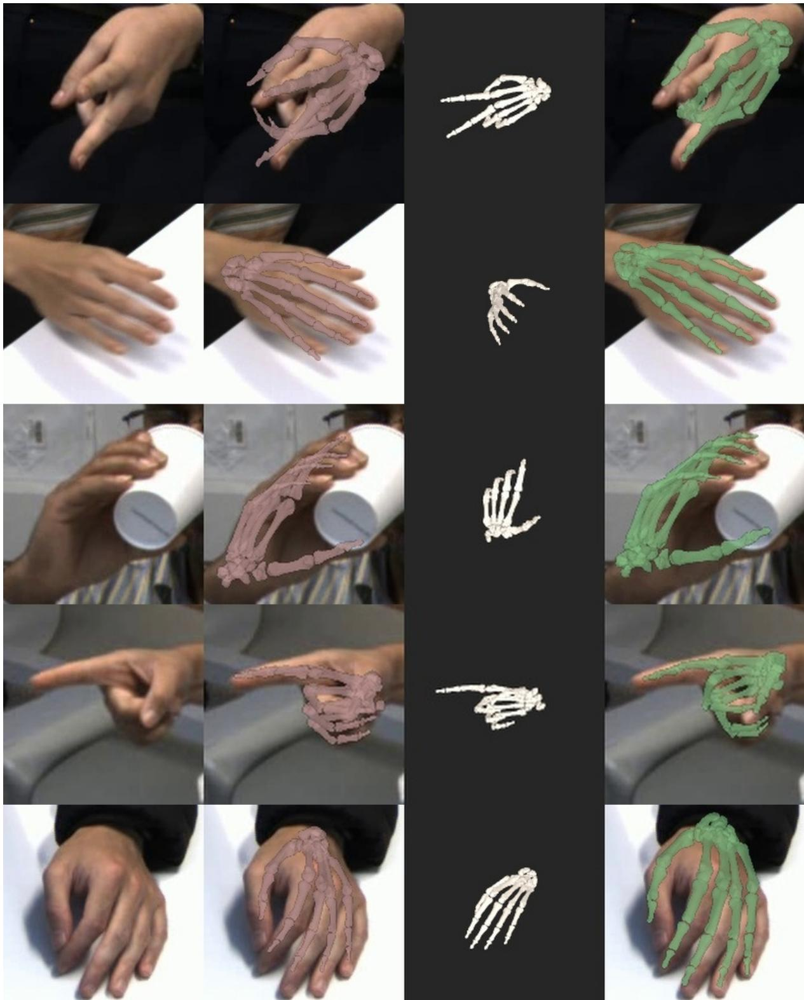
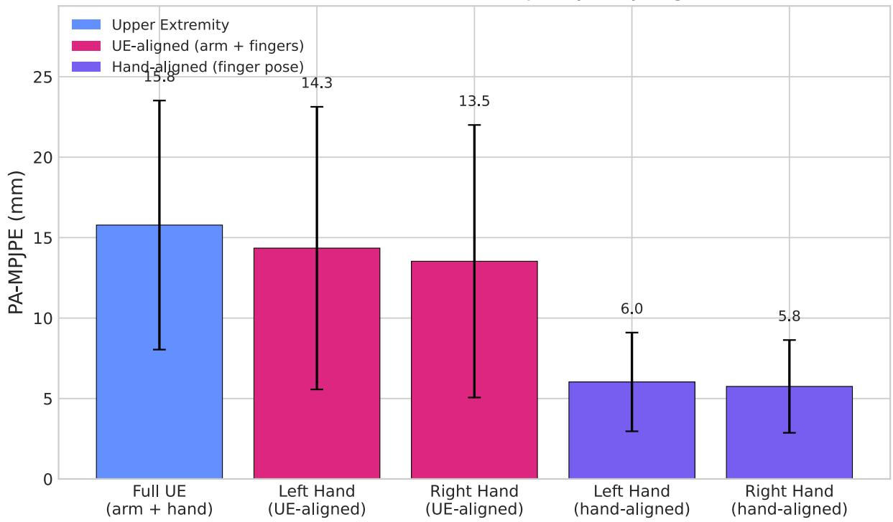
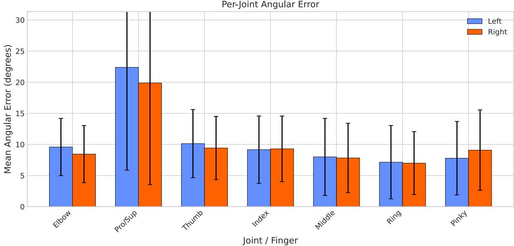
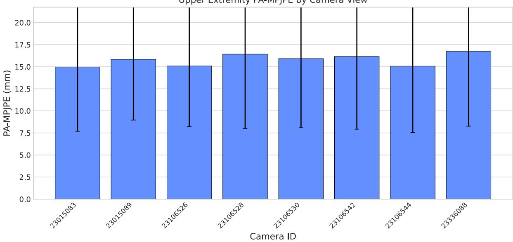

# 基于逆运动学与基础模型的手指单目生物力学追踪

R. James Cotton 1,2, Pouyan Firouzabadi1,3, Wendy Murray1,3

1Shirley Ryan AbilityLab

2Department of Physical Medicine and Rehabilitation, Northwestern University 3Department of Biomedical Engineering, Northwestern University

基于视频的精准手部及手指追踪在监测日常生活活动和测量关节活动度方面具有重要的临床应用价值，然而用于获取手部生物力学的单目视频方法仍不够成熟。我们提出了一种将 SAM 3D Body 基础模型与全身生物力学模型中的逆运动学优化相结合的方法，用于从单视角视频中提取受解剖学约束的手指关节角度。我们将 SAM 3D Body 从 PyTorch 移植到 JAX 以便与 MuJoCo-MJX 集成，从而实现 GPU 加速优化，并开发了一种在 Momentum Human Rig (MHR) 输出与生物力学模型标记点之间的新型映射方法。通过 7 名参与者执行各种手部姿势和物体操控任务的 4,590 帧数据，与 8 摄像机多视角重构进行验证，结果显示在经过 Procrustes 对齐后，手指关节角度误差约为 10 度，手部位置误差约为 6 mm。结果在不同摄像机视角下保持一致，并且对从多视角视频生成参考值的不同方法表现出鲁棒性。本研究将单目生物力学分析扩展到了精细的手指追踪，拓宽了从易于获取的视频中对手部运动进行定量表征的途径。

日期：2026年5月 通信作者：rcotton@sralab.org SR Intelligence Sensing and Rehabilitation

## 1 引言

无标记运动捕捉（Markerless Motion Capture, MMC）正在许多不同维度上迅速发展。除了大量研究表明多视角 MMC 在步态分析中与基于标记的方法具有高度一致性外，它在肩部和肘部也表现出极高的一致性（Unger et al., 2025），甚至能够在数毫米的精度内追踪手指关节（Firouzabadi et al., 2024）。与此同时，单目 MMC 也在快速进步，特别是在步态分析和上肢近端关节方面（Peifer et al., 2025; Koleini et al., 2025; Xia et al., 2025）。尽管在使用网格表征追踪手部的人体姿态估计领域也取得了显著进展，但这些进展尚未转化为用于获取手部生物力学的单目方法。本研究的目的在于测试是否能够从最先进的人体姿态估计模型（特别是最近发布的 Sam3d Body 模型（Yang et al., 2025））中获得生物力学拟合，并评估其在手部生物力学分析中的准确性。

精准的手部和手腕追踪具有重要的临床应用价值。它能够实现对日常生活活动（ADLs）的持续监测，为各类病症提供关节活动度的客观测量，并允许在功能性任务期间对手部抓握模式进行详细分析。这有望为众多广泛的疾病病症提供强有力的生物标志物。

参数化人体模型（例如 SMPL (Loper et al., 2015)）在人体姿态估计中发挥了巨大作用。SMPL 及其衍生模型的一个关键局限性在于，骨骼关节位置是从表面顶点推导而来的，这使得骨骼与体型相互纠缠，从而限制了对骨骼属性的直接控制。Momentum Human Rig (MHR) (Ferguson et al., 2025) 通过显式解耦外部体型与内部骨骼解决了这一问题。MHR 提供了一个由 204 个参数（136 个姿态参数和 68 个骨骼变换参数）控制的 127 个关节的运动学树、多种分辨率的网格顶点（标准细节级别最高可达 18,439 个），以及用于预测对应于 Sapiens (Khirodkar et al., 2024) 中 Goliath 集合的 308 个关键点位置的习得回归器。SAM 3D Body (Yang et al., 2025) 是一种最先进的推理模型，经训练可从单张图像中预测 MHR 参数。它采用了一种双解码器架构，包含一个共享的图像编码器以及针对身体和手部的独立解码器，其中专门的手部解码器处理高分辨率的手部裁剪图像，以实现精准的手指姿态估计。

尽管 SMPL 和 MHR 是旨在兼容计算机视觉研究的参数化人体模型，但在人体运动生物力学模型方面也存在一条重要的并行研究脉络。由 Holzbaur 及其同事开发的上肢模型 (Holzbaur et al., 2005) 建立了涵盖肩部、肘部、前臂和手腕的全面肌肉骨骼表征。随后，(McFarland et al., 2023) 对其进行了扩展，纳入了包含 43 个 Hill 型肌腱促动器的手部全部五指，构建了首个能够模拟诸如握力和捏力产生等功能性任务的开源模型。此外，还存在许多下肢生物力学模型，例如 Hamner 等人的跑步模型 (Hamner et al., 2010)。该模型已在 LocoMuJoCo 模型 (Al-Hafez et al., 2023) 中移植至高性能 GPU 加速框架 MuJoCo。在本工作中，我们将上肢及手部模型的双侧版本与 LocoMuJoCo 下肢模型相结合，构建了包含铰接手部的全身生物力学模型，从而实现了从头部到指尖的逆运动学优化。

然而，目前尚不存在像 SAM 3D Body 这样能够直接从图像中预测生物力学模型精确手部关节角度的强大模型。此外，这些模型在关节角度方面的精度尚未得到表征。而且，目前也没有直接将 MHR 模型的关键点和顶点映射到我们生物力学模型上标记点位置的对应字典。在本研究中，我们建立了这样一种映射，利用它从单目 SAM 3D Body 的输出中计算生物力学模型的逆向运动学（IK），并将这些结果与多种多视角重建进行了比较。

## 2 方法

概述：我们用于获取包含手部的全身生物力学流程首先将图像输入 SAM 3D Body 算法以回归出 Momentum Human Rig（MHR）人体构型，随后通过多阶段由粗到细的优化，利用生物力学模型求解该人体构型的逆向运动学（IK）。然后，我们将单目拟合结果与多种多视角参考标准进行比较，以评估各个单独视角的误差。接下来我们将详细阐述每个组件。

## 2.1 SAM 3D Body 与 MHR 的 JAX 实现

我们近期的生物力学建模得益于基于 Jax（Bradbury et al., 2018）运行的 MuJoCo-MJX 框架（Todorov et al., 2012）的大规模并行性和 GPU 加速。然而，SAM 3D Body 是在 PyTorch（Yang et al., 2025）中实现的。这将导致我们的流程需要分配两倍的 GPU 内存以同时容纳 Jax 和 PyTorch。为了避免这种情况，我们首先使用 Equinox 框架（Kidger and Garcia, 2021）将 SAM 3D Body 架构和模型权重移植到 Jax 中，使我们的整个流程能够在单一机器学习框架中运行。

关于这些模型的大多数细节，我们建议参考 SAM 3D Body 和 MHR 的相关文献（Yang et al., 2025; Ferguson et al., 2025），但在此处对几个相关的细节进行详细说明。MHR 骨架（rig）建立在 ATLAS 模型（Park et al., 2025）之上，并与广泛使用的 SMPL 模型（Bogo et al., 2016）存在一个与生物力学密切相关的重要架构差异。具体而言，SMPL 模型在进行关节旋转之前根据缩放后的网格构建关节中心位置，而 MHR 则将运动学树（即伪骨骼）的缩放与姿态解耦。这更紧密地遵循了生物力学中先缩放后摆姿态的方法。

MHR 包含沿运动学树分布的 127 个关节，由 136 个姿态参数（旋转和平移）以及张成 68 维缩放空间的 28 个 PCA 骨骼缩放系数所控制。虽然底层骨骼在每个关节处的自由度比人体更多（具体为 7 个自由度，包括 3 个角自由度 DOF、缩放以及平移偏移量），但这 204 个参数体现了一个更具生理学意义的稀疏子集，包括可解释的骨骼长度缩放和关节角度旋转，这也与 SMPL 形成了对比。在对骨骼进行姿态配置后，结合额外的身体缩放参数计算表面网格的顶点位置。表面网格支持不同的细节层次，我们选择了具有 18,439 个顶点的模型。从这些表面顶点出发，额外的回归器会生成 308 个 3D 关键点位置，对应于 Sapiens 中的 Goliath 关键点集 (Khirodkar et al., 2024)；其中前 70 个关键点（身体、脚部和手部关键点）构成了本研究下游使用的子集。回归器允许预测不在运动学树上、也可能不在身体表面的关键点位置，例如计算机视觉中使用的各种“髋部”定义。

SAM 3D Body 是一个在海量数据上训练的模型，用于从图像中预测 MHR 参数 (Yang et al., 2025)。它在两个表现相近的主干网络上进行了训练，我们移植了基于 DINOv3 主干网络 (Siméoni et al., 2025) 的模型变体。它支持多种用于细化预测的可选输入，包括掩码或 2D 关键点。在本研究中，我们并未探索使用这些附加组件。它也是一个“自顶向下”的模型，需要接收经过裁剪且居中的人体图像。我们在多相机框架中使用了来自 PosePipe 的边界框来提供这些裁剪且居中的图像 (Cotton, 2022; Cotton, 2025)。SAM 3D 还具有一个手部专用编码器，并可以采用由粗到精的方式运行：首先使用全身图像提供姿态的初度估计模型，然后放大至手部以获得手部的细化 MHR 估计，最终将其合并以提供精细化的估计。我们对 SAM 3D Body 的 Equinox 移植版本支持这种递归推理和手部细化，并在本研究中得到了应用。

## 2.2 带有手部标记点的全身生物力学模型

我们之前的大部分工作主要集中在不包含手指关节活动的全身大动作上（Peifer et al., 2025; Cotton, 2025），使用的是基于 Hamner OpenSim 模型构建的 LocoMuJoCo 模型（Al-Hafez et al., 2023; Hamner et al., 2010; Delp et al., 2007）。一个例外是我们的另一项工作，该工作表明我们可以通过多视角相机采集系统以数毫米以内的精度重建手指运动（Firouzabadi et al., 2024）。为此，我们使用了 MOBL-ARMS 模型，这是首个能够模拟功能性任务的上肢神经肌肉生物力学模型（McFarland et al., 2023）。MOBL-ARMS 模型包含了胸腔和右臂。在本工作中，我们使用了一个组合模型，该模型将双侧完全关节连接的手臂和手部模型与 LocoMuJoCo 腿部模型相结合，在 83 个刚体和 105 个关节上总共包含 111 个广义坐标（nq）。这使我们能够将来自 SAM 3D Body 的全身及手部 MHR 输出与全身及手部生物力学模型进行对齐。

一个关键障碍是缺少这两种不同模型之间的映射，以用于优化它们的相似度。在我们先前的研究中，我们优化了 LocoMuJoCo 模型上对应于 MoVI 关键点（Ghorbani et al., 2021; Cotton, 2025）的 87 个标记点（marker）的位置，以便将我们的生物力学模型与最先进的关键点检测算法 MeTRAbs（Sárándi et al., 2023）对齐。在本项研究中，我们采取了相反的方法：寻找来自 SAM 3D Body 的一组输出，使其对应于定义在我们生物力学模型上的解剖学标志点位点（anatomical landmark sites）。具体而言，我们从数据库中获取了经由 MeTRAbs 和 SAM 3D 共同处理的人体行走视频，并找到了与 MoVI 关键点位置最为匹配的 MHR 网格顶点（mesh vertices）或回归关键点（regressed keypoints）的映射。这产生了 73 个身体标记点对应关系，其中每个 MHR 输出（网格顶点或预测关键点）均与生物力学骨骼上的一个位点配对。手部的映射更为直接，因为在两种模型架构的手指关节中心之间存在直接的解剖学对应关系。MCP、PIP 和 DIP 关节在 MHR 与生物力学模型之间在语义上是等价的，因此这些标记点被放置在两侧相应的关节中心处（或在其数毫米范围内）。指尖作为位点标记放置在最后一个关节之外的远端指骨上——它们不在运动学树上，但为手指姿态提供了关键约束。每只手在手腕处增加一个额外标记点即可补全该集合，总共产生 42 个手部标记点（每只手 21 个：手腕、拇指 CMC 和 IP、手指 MCP/PIP/DIP 关节中心以及 5 个指尖）。所有 42 个手部标记点均与 MHR 的回归手部关键点匹配，而非网格顶点，因为这些位点位于网格表面内部。相同的解剖学原理也适用于身体标记点：膝关节标记点（LKnee、RKnee）基本位于胫骨关节中心，并且与 LAnkle 和 Neck 一同与 MHR 的回归身体关键点相匹配，而非网格顶点。5 个面部标志点（鼻、眼、耳）同样提取自 MHR 的回归面部关键点。总体而言，完整映射包含 MHR 输出与生物力学模型位点之间的 120 个对应关系：69 个网格顶点对应关系和 51 个回归关键点对应关系（42 个手部 + 5 个面部 + 4 个身体关节中心）。骨骼上的身体标记点位点位置通过 EM 优化（EM-optimization）过程进一步微调，两个系统之间的残差用于确定应用于每个标记点的置信度权重。

## 2.3 Levenberg-Marquardt IK 优化

全身 MuJoCo 模型与 MHR 模型之间的映射使我们能够衡量 MuJoCo 模型的 IK 拟合与 MHR 目标姿态之间的损失函数。该损失为：

$$
\mathcal {L} = \sum_ {i} w _ {i} \| \mathbf {p} _ {i} ^ {\mathrm{pred}} - \mathbf {p} _ {i} ^ {\mathrm{model}} (\mathbf {q}) \| ^ {2} + \lambda_ {\mathrm{reg}} \| \boldsymbol {\delta} \| ^ {2}\tag{1}
$$

其中 $\mathbf{q}$ 表示关节角度，${ \bf p } _ { i } ^ { \mathrm { p r e d } }$ 是 Sam3D 顶点和回归的关键点位置，$\mathbf { p } _ { i } ^ { \mathrm { m o d e l } } ( \mathbf { q } )$ 是通过正向运动学计算出的标记点位置，而 $\pmb { \delta }$ 是通过 $\lambda _ { \mathrm { r e g } }$ 进行正则化以防止过拟合的逐标记点偏移量。除了在每次 LM（Levenberg-Marquardt）步长之后对解剖学范围进行硬截断（hard clamping）之外，关节角度还会针对球关节限制的违背受到软惩罚。

我们使用 Levenberg-Marquardt 算法通过多阶段由粗到细的优化来最小化该损失。求解器从 MHR 预测的身体根姿态进行热启动，然后将根平移替换为投影的 MHR 标记点目标的质心。阶段 1 仅使用核心身体标记点子集（骨盆、脊柱、肩膀、上臂、肘部和前臂标志点）优化骨盆位置和朝向。阶段 2 在保持身体各环节缩放比例固定的情况下，优化包括手指 DOF（自由度）在内的所有关节角度。阶段 3 联合优化姿态、身体各环节缩放比例以及逐标记点偏移量，其中偏移量用于补偿 MHR 与生物力学模型之间标记点放置的差异。JAX 对 MuJoCo 正向运动学模型进行自动微分，以高效求解该二阶优化问题。

单目 IK 求解器使用的阻尼因子为 $\lambda = 3 . 0$，总共 400 次迭代平均分配在三个活动阶段中。逐标记点偏移正则化使用 $\lambda _ { \mathrm { r e g } } = 2 0 . 0$。

## 2.4 用于参考姿态的多视角重建

对于我们的参考值，我们使用了三个版本。其中一个已在先前进行了描述（Firouzabadi et al., 2024）。简而言之，它是一种直接优化使重投影误差最小化的姿态的端到端算法。它包含对全身的初始检测，随后使用专门的手部检测器检测手部关键点。该优化涉及联合缩放骨骼，同时在所有试验的时间跨度上拟合运动学。采用该方法是为了保持代表受试者的肌肉骨骼模型具有一致的缩放比例，从而进行生物力学上更准确的分析。

我们还与其他两种多视角重建方法进行了对比。这是为了比较更新式的关键点检测器，以观察它们是否能提供更强的参考值，并确保我们的结果对参考值具有鲁棒性。通过双平面透视检查（biplanar fluoroscopy）获取真实的真实值（ground truth）极具挑战性。对于这些方法，我们从每个视角提取了 SAM 3D Body 表征，随后在 2D 图像平面参考系中使用了其中的每个关键点。接着，我们以最小化跨相机重投影误差为目标，对姿态进行了 LM 优化：

$$
\mathbf {q} ^ {*} = \arg \min _ {\mathbf {q}} \sum_ {c = 1} ^ {C} \sum_ {k = 1} ^ {K} w _ {c, k} \left\| \pi_ {c} (\mathrm{FK} (\mathbf {q}) _ {k}) - \mathbf {y} _ {c, k} \right\| ^ {2}\tag{2}
$$

其中 $\pi _ { c }$ 是相机 $c$ 的投影函数，$\mathrm { F K } ( \mathbf { q } ) _ { k }$ 是来自正向运动学（forward kinematics）的标记点 $k$ 的 3D 位置，${ \bf y } _ { c , k }$ 是检测到的 2D 关键点，而 $w _ { c , k }$ 是每个关键点在每个相机下的权重。多视角优化器采用阻尼 $\lambda = 1 . 0$，在三个阶段中进行 500 次 LM 迭代（30% 根节点定位，50% 全身姿态，20% 带尺度优化的姿态），随后是一个包含 20 次迭代的最终阶段，仅在 $\lambda _ { \mathrm { r e g } } = 1 0 ^ { 4 }$ 下细化每帧标记点偏移量（姿态和尺度保持固定）。这一过程分别使用来自 Sam3D Body 的标记点以及来自 Sapiens 模型（Khirodkar et al., 2024）的标记点进行了计算。

遮挡处理 我们使用了几种机制使多视角优化对遮挡和异常值具有鲁棒性。首先，每个标记点都带有源自映射过程的静态置信度权重，任何置信度低于 0.25 或超出图像画面的关键点都将被置零。其次，我们针对每个单独的关键点在各个视角之间使用鲁棒三角测量来衡量跨相机的几何一致性；对于给定关键点不一致的相机，会以每个关键点-每个相机的细粒度通过高斯核降低其权重（Cotton et al., 2023）。这隐式地处理了自遮挡问题，因为在一个视角中被遮挡的关键点会产生不一致的 2D 检测，该检测会被三角测量一致性机制自动降低权重。

在所有情况下，我们都计算了 $G C _ { 1 0 }$ 作为指示高质量拟合的指标（Cotton et al., 2023），即骨骼上由标记点重建出的 3D 位置在原始图像上的重投影误差在 10 像素以内的视角数量。

## 2.5 评估指标

我们使用普氏对齐的每关节平均位置误差（Procrustes-aligned mean per-joint position error，PA-MPJPE）将单目重建结果与多视角参考基准进行比较，该方法在计算 3D 欧氏距离之前消除了全局旋转、平移和尺度差异。对于上肢，我们联合对齐所有上肢部位（肩部、上臂、肘部、前臂、手腕和手/手指标记点）。对于手部，我们仅对手部标记点执行单独的普氏对齐，从而将手指姿态精度与手臂定位误差隔离开来。我们还将角度误差报告为关节角度的平均绝对差值。

主要对比表报告了：(1) 以毫米为单位的上肢 PA-MPJPE，(2) 左右手平均的手部对齐 PA-MPJPE，以及 (3) 几何一致性（GC@10px）——即多视角重投影误差低于 10 像素的关键点百分比，它反映了多视角参考基准的可靠性。

补充分析包括每个手指的角度和位置误差分解、上肢对齐的手部误差（反映手臂和手指的综合误差），以及用于衡量跨相机视角的单目关节角度估计标准差的跨视角一致性。

## 2.6 评估数据集

我们在来自多视角手部动作捕捉集合的数据集上进行评估，该数据集专为细粒度手指追踪验证而设计（Firouzabadi et al., 2024）：

• 参与者：7 人

• 记录：221 次多视角采集会话

• 相机：每次采集配备 8 个同步且标定的视角

• 活动：美式手语（ASL）指拼、数字计数手势、单指独立运动（外展、PIP/MCP 屈曲、手腕运动、蚓状肌运动）、精细动作任务（钥匙操作、大头针移位、书写、球体和圆盘抓握）以及自然物体操作（瓶子抓握、箱子搬运、饮水）

• 采样帧数：4,590 个视频帧（步长为 30 帧）

• 相机帧总数：36,720（视频帧 $\times$ 8 台相机）

该数据集捕获了不同手部尺寸和运动风格的参与者的多样化手部姿态。每次采集都提供多视角覆盖，从而能够通过三角测量和重投影优化实现稳健的 3D 参考基准重建。

## 3 结果

## 3.1 重建示例

Figure 1 展示了对比单目和多视角结果的代表性手部重建。每一行显示了一位不同参与者执行的各种手势。四个窗格分别展示：(1) 原始裁剪手部图像，(2) 叠加为红色的单目 Sam3D + IK 重建，(3) 骨架渲染图，以及 (4) 叠加为绿色的多视角参考重建。单目重建捕获了手部的整体结构，但与受几何约束的多视角拟合结果相比，手指屈曲角度存在可见的细微差异。

## 3.2 参考目标对比

我们将单目预测结果与三种不同的多视角参考基准进行了对比，以评估我们测量结果的准确性并确保其在不同方法间的一致性：1) 基于 (Firouzabadi et al., 2024) 的端到端重建（End-to-end Reconstruction），应用于整个时间序列。2) Sam3D (Yang et al., 2025) 多视角方法，通过直接利用 2D 图像平面中的身体和手部关键点来优化生物力学模型，该方法仅在选定帧上独立执行。3) Sapiens（1B 模型）多视角方法，利用来自 (Khirodkar et al., 2024) 的手部关键点，其余设置与方法 2 相同。

总体而言，单目 MHR 结果的 IK 拟合结果（Table 1）在不同的参考目标间表现出相当相似的数值，这支持了单目结果的鲁棒性。多视角重建在 10 像素处的几何一致性 $\left( G C _ { 1 0 } \right)$ 略高于我们之前的方法 (Firouzabadi et al., 2024)。这可能是由于端到端优化具有略微更严格的约束条件，该优化要求来自同一受试者的所有视频中每一帧都保持一致的单一骨骼尺度。这可能也反映了过去一年中人体姿态估计算法的一些改进。

  
Figure 1: 不同受试者的手部重建示例。每一行代表一名受试者，各图块分别为：原始图像、单目叠加（红色）、俯视图以及多视角参考叠加（绿色）。

Table 1: 单目准确率与不同多视角参考方法的对比。

<table><tr><td>Reference</td><td>UE PA (mm)</td><td>Hand PA (mm)</td><td>Hand Angle (°)</td><td>GC@10px</td></tr><tr><td>End-to-end</td><td>23.8 ± 13.3</td><td>8.5 ± 4.3</td><td>11.4 ± 5.6</td><td>47.6%</td></tr><tr><td>Sam3D MV</td><td>14.3 ± 6.4</td><td>4.8 ± 2.4</td><td>7.8 ± 3.2</td><td>55.6%</td></tr><tr><td>Sapiens MV</td><td>15.8 ± 7.7</td><td>5.9 ± 3.0</td><td>8.3 ± 3.9</td><td>56.0%</td></tr></table>

以 Sapiens 作为多视角参考值，我们可以看到整个手臂和手部的平均误差低于 25 mm，而在专门对手部应用普氏分析（Procrustes alignment）对齐时，误差约为 6 mm。整个手部的关节角度误差约为 8 度。

Sam3D 与 Sapiens 之间结果的相似性也令人欣慰，因为关键点检测往往比网格回归（mesh regression）能更精确地追踪图像中的精细细节。Sapiens 多视角参考在方法论上还具有更独立于单目 IK 管线的优势，而后者是由 Sam3D 的输出驱动的。这两个参考基准高度一致（在 UE PA-MPJPE 上相差约 1.5 mm 以内），因此在实际中来自 Sam3D 端的系统偏差很小，但在接下来的分析中，我们仍使用 Sapiens 多视角作为主要参考基准。

## 3.3 详细分析（Sapiens 多视角参考值）

以下分析使用 Sapiens 多视角重建作为基准真值。该多视角系统通过对 8 个同步摄像机视角的观测结果进行三角测量，提供 3D 关键点位置和关节角度。

## 3.3.1 总体精度

我们使用普氏对齐的平均每关节位置误差（Procrustes-Aligned Mean Per-Joint Position Error, PA-MPJPE）评估了单目跟踪精度，该指标在进行最佳对齐以消除全局位置和方向差异后测量 3D 关节位置精度。Figure 2 展示了各个身体部位的精度。Full UE（全上肢）柱状图在对完整标记点集进行单一普氏对齐的情况下，对所有上肢标记点——包括近端手臂/躯干标记点（肩部、肩胛骨、肘部、前臂、手腕）以及 42 个手部标记点——进行平均。纯手部柱状图是该测量的子集：UE-aligned 保持相同的上肢对齐，但仅报告手部标记点的误差；而 hand-aligned 仅使用手部标记点执行单独的普氏对齐（将手指关节运动精度与手臂定位误差隔离开来）。

## 3.3.2 单关节分析

Figure 3 展示了左右两侧按关节细分的角度误差。最大的误差来自于旋前/旋后关节，而手部各关节的平均误差均在 10 度以下。

## 3.3.3 单相机分析

Figure 4 展示了按相机视点细分的精度。这些相机跨越了广泛的视点和角度，不过相机被遮挡的视角和帧已被排除。结果表明视点依赖性的证据极少。

单目 vs 多视角：按身体部位划分的 PA-MPJPE  
  
Figure 2: 跨身体部位的 PA-MPJPE 比较。Full UE 柱状图对所有上肢标记点（手臂 + 手部）进行平均。纯手部柱状图是此项的子集：UE-aligned 保持上肢普氏对齐，但仅报告手部标记点（\~14 mm）；hand-aligned 使用仅针对手部的对齐来隔离手指关节运动精度（\~6 mm）。手部标记点比近端手臂/躯干标记点贴合对齐得更紧密，因此 Full UE 总误差超过了 UE-aligned 手部误差。

  
Figure 3: 左侧和右侧上肢的单关节平均角度误差，计算为单目 IK 关节角度与对应的 Sapiens 多视角 IK 关节角度（在 8 个视角下拟合相同生物力学模型的 Sapiens 替换手部关键点）之间的绝对差值。包括肘部屈曲、前臂旋前/旋后以及各个手指的误差。

  
Figure 4: 按相机视点划分的上肢 PA-MPJPE。

## 4 讨论

本研究展示了如何将用于人体网格重建（human mesh reconstruction）的基础模型与生物力学逆向运动学（biomechanical inverse kinematics）相结合，以实现基于单目视频的精细手指追踪。我们提出的多阶段 Levenberg-Marquardt（LM）优化方法（根节点定位、带缩放的完整姿态估计以及标记点偏移微调）提供了稳健的收敛性和精确的关节角度估计。此外，将 SAM 3D Body 移植到 Equinox 和 JAX 使整个处理流程能够在单块 GPU 上高效运行。来自 MuJoCo-MJX 的自动微分也使得实现 LM 优化变得简单直接。

我们针对多视角重建的验证表明，与多视角参考数据相比，单目预测达到了合理的精度。我们做出了一项重要区分，将其称为参考数据而非真实值（ground truth），因为无标记点动作捕捉确实存在误差。然而，在实际操作中，为手部的每个关节获取基于标记点的数据既不切实际，又会在视觉上改变外观，使得此类对比难以反映对无标记场景的泛化能力。单目拟合结果针对不同多视角方法（针对整个时间序列数据的端到端优化对比采用不同关键点集的单帧多视角优化）的稳定性进一步表明，这至少为单目结果的精度设定了边界。

我们所描述的精度是否充分，在很大程度上取决于具体的临床问题和应用领域。例如，手指约 10 度的误差（在前臂旋前/旋后处误差较大，接近 20 度）对于随时间纵向追踪关节活动度（range of motion）可能是不够的。相反，与几年前相比，这也要比单目视频所能达到的精度高得多。同样需要注意的是，我们误差的标准差相当大，且在许多试验中，精度明显差于平均水平。除提高精度外，一个重要的未来方向是引入可靠的质量信号，用以指示结果何时是值得信赖的（Cotton and Sinz, 2025; Donahue et al., 2026）。

本研究的一个重要局限在于，它未包含任何来自手部功能存在运动障碍或肢体有明显差异的受试者的数据。对于前者，对于运动障碍人群可能很常见但在 SAM 3D Body 的训练数据中属于非典型的手部姿态，其表现极有可能有所不同。此外，对于手指缺失或使用

假肢的人群，不太可能达到这种水平的性能表现。

最后，基于单目视频的手部运动生物力学分析变得更加易于获取，这开启了一系列全新课题。人们用手进行的活动范围极其广泛，理解这些数据以指导医疗护理是一个具有挑战性的问题。此外，除了手部姿态之外，理解人们正在与什么物体进行交互也是一个重要的额外问题。虽然我们的一些活动涉及手部与物体的交互（例如饮水任务），但我们并未系统地评估其对手部跟踪精度的影响。未来的一个重要方向是将从视频中拟合手-物交互的模型与生物力学建模相结合（例如 (Fan et al., 2023; Wu et al., 2024)）。

## 5 结论

我们提出了一种用于单目生物力学手指跟踪的方法，该方法结合了 Sam3D 基础模型关键点与 MuJoCo-MJX 中的逆运动学优化。JAX 实现实现了高效的 GPU 加速处理，且针对多视角重建的验证表明了其具有准确的关节角度估计能力。该方法将单目生物力学分析扩展到了详细的手部和手指跟踪，可应用于临床评估和婴儿运动分析。

## 致谢

本研究得到了 Shirley Ryan AbilityLab 研究加速器计划（research accelerator program）的支持。

## 参考文献

Bogo, Federica, Angjoo Kanazawa, Christoph Lassner, Peter Gehler, Javier Romero, and Michael J. Black (2016). “Keep It SMPL: Automatic Estimation of 3D Human Pose and Shape from a Single Image”. In: ECCV 2016: Computer Vision – ECCV 2016. Springer, Cham, pp. 561–578.

Bradbury, James, Roy Frostig, Peter Hawkins, Matthew James Johnson, Chris Leary, Dougal Maclaurin, George Necula, Adam Paszke, Jake VanderPlas, Skye Wanderman-Milne, and Qiao Zhang (2018). JAX: Composable Transformations of Python+NumPy Programs.

Cotton, R. James (2022). “PosePipe: Open-Source Human Pose Estimation Pipeline for Clinical Research”. In: arXiv preprint arXiv:2203.08792.

(2025). “Diferentiable Biomechanics Unlocks Opportunities for Markerless Motion Capture”. In: 2025 International Conference On Rehabilitation Robotics (ICORR), pp. 44–51.

Cotton, R. James, Anthony Cimorelli, Kunal Shah, Shawana Anarwala, Scott Uhlrich, and Tasos Karakostas (2023). “Improved Trajectory Reconstruction for Markerless Pose Estimation”. In: 45th Annual International Conference of the IEEE Engineering in Medicine and Biology Society.

Cotton, R. James and Fabian Sinz (2025). “Biomechanical Reconstruction with Confidence Intervals from Multiview Markerless Motion Capture”. In: 2025 47th Annual International Conference of the IEEE Engineering in Medicine & Biology Society (EMBC).

Delp, Scott L., Frank C. Anderson, Allison S. Arnold, Peter Loan, Ayman Habib, Chand T. John, Eran Guendelman, and Darryl G. Thelen (2007). “OpenSim: Open-Source Software to Create and Analyze Dynamic Simulations of Movement”. In: IEEE Transactions on Biomedical Engineering 54.11, pp. 1940–1950.

Donahue, Seth, Irina Djuraskovic, Kunal Shah, Fabian Sinz, Ross Chafetz, and R. James Cotton (2026). EMBC Special Issue: Calibrated Uncertainty for Trustworthy Clinical Gait Analysis Using Probabilistic Multiview Markerless Motion Capture.

Fan, Zicong, Maria Parelli, Maria Eleni Kadoglou, Muhammed Kocabas, Xu Chen, Michael J. Black, and Otmar Hilliges (2023). HOLD: Category-agnostic 3D Reconstruction of Interacting Hands and Objects from Video.

Ferguson, Aaron, Ahmed A. A. Osman, Berta Bescos, Carsten Stoll, Chris Twigg, Christoph Lassner, David Otte, Eric Vignola, Fabian Prada, Federica Bogo, Igor Santesteban, Javier Romero, Jenna Zarate, Jeongseok Lee, Jinhyung Park, Jinlong Yang, John Doublestein, Kishore Venkateshan, Kris Kitani, Ladislav Kavan, Marco Dal Farra, Matthew Hu, Matthew Ciofi, Michael Fabris, Michael Ranieri, Mohammad Modarres, Petr Kadlecek, Rawal Khirodkar, Rinat Abdrashitov, Romain Prevost, Roman Rajbhandari, Ronald Mallet, Russel Pearsall, Sandy Kao, Sanjeev Kumar, Scott Parrish, Shoou-I. Yu, Shunsuke Saito, Takaaki Shiratori, Te-Li Wang, Tony Tung, Yichen Xu, Yuan Dong, Yuhua Chen, Yuanlu Xu, Yuting Ye, and Zhongshi Jiang (2025). MHR: Momentum Human Rig.

Firouzabadi, Pouyan, Wendy Murray, Anton R Sobinov, J.D. Peifer, Kunal Shah, Lee E Miller, and R. James Cotton (2024). “Biomechanical Arm and Hand Tracking with Multiview Markerless Motion Capture”. In: IEEE International Conference on Biomedical Robotics and Biomechatronics (BioRob).

Ghorbani, Saeed, Kimia Mahdaviani, Anne Thaler, Konrad Kording, Douglas James Cook, Gunnar Blohm, and Nikolaus F. Troje (2021). “MoVi: A Large Multi-Purpose Human Motion and Video Dataset”. In: PLOS ONE 16.6, e0253157.

Al-Hafez, Firas, Guoping Zhao, Jan Peters, and Davide Tateo (2023). LocoMuJoCo: A Comprehensive Imitation Learning Benchmark for Locomotion.

Hamner, Samuel R., Ajay Seth, and Scott L. Delp (2010). “Muscle contributions to propulsion and support during running”. In: Journal of Biomechanics 43.14, pp. 2709–2716.

Holzbaur, Katherine R. S., Wendy M. Murray, and Scott L. Delp (2005). “A model of the upper extremity for simulating musculoskeletal surgery and analyzing neuromuscular control”. In: Annals of Biomedical Engineering 33.6, pp. 829–840.

Khirodkar, Rawal, Timur Bagautdinov, Julieta Martinez, Su Zhaoen, Austin James, Peter Selednik, Stuart Anderson, and Shunsuke Saito (2024). Sapiens: Foundation for Human Vision Models.

Kidger, Patrick and Cristian Garcia (2021). “Equinox: neural networks in JAX via callable PyTrees and filtered transformations”. In: Diferentiable Programming workshop at Neural Information Processing Systems 2021.

Koleini, Farnoosh, Muhammad Usama Saleem, Pu Wang, Hongfei Xue, Ahmed Helmy, and Abbey Fenwick (2025). BioPose: 基于单目视频的生物力学精确 3D 姿态估计。

Loper, Matthew, Naureen Mahmood, Javier Romero, Gerard Pons-Moll, and Michael J. Black (2015). “SMPL: 蒙皮多人线性模型”. In: ACM Transactions on Graphics (Proc. SIGGRAPH Asia).

McFarland, Daniel C., Benjamin I. Binder-Markey, Jennifer A. Nichols, Sarah J. Wohlman, Marije de Bruin, and Wendy M. Murray (2023). “能够模拟功能性任务的手部和腕部肌肉骨骼模型”. In: IEEE transactions on bio-medical engineering 70.5, pp. 1424–1435.

Park, Jinhyung, Javier Romero, Shunsuke Saito, Fabian Prada, Takaaki Shiratori, Yichen Xu, Federica Bogo, Shoou-I. Yu, Kris Kitani, and Rawal Khirodkar (2025). ATLAS: 解耦骨骼与形状参数以实现高表现力参数化人体建模。

Peifer, J. D., Kunal Shah, Irina Djuraskovic, Shawana Anarwala, Kayan Abdou, Rujvee Patel, Prakash Jayabalan, Brenton Pennicooke, and R. James Cotton (2025). 便携式生物力学实验室：基于手持智能手机的临床可用运动分析。

Sárándi, István, Alexander Hermans, and Bastian Leibe (2023). “利用几何感知自编码器桥接骨骼格式从数十个数据集中学习 3D 人体姿态估计”. In: IEEE/CVF Winter Conference on Applications of Computer Vision (WACV).

Siméoni, Oriane, Huy V. Vo, Maximilian Seitzer, Federico Baldassarre, Maxime Oquab, Cijo Jose, Vasil Khalidov, Marc Szafraniec, Seungeun Yi, Michaël Ramamonjisoa, Francisco Massa, Daniel Haziza, Luca Wehrstedt, Jianyuan Wang, Timothée Darcet, Théo Moutakanni, Leonel Sentana, Claire Roberts, Andrea Vedaldi, Jamie Tolan, John Brandt, Camille Couprie, Julien Mairal, Hervé Jégou, Patrick Labatut, and Piotr Bojanowski (2025). DINOv3.

Todorov, Emanuel, Tom Erez, and Yuval Tassa (2012). “MuJoCo: 用于基于模型控制的物理引擎”. In: IEEE/RSJ International Conference on Intelligent Robots and Systems.

Unger, Tim, Arash Sal Moslehian, J.D. Peifer, Johann Ullrich, Roger Gassert, Olivier Lambercy, R. James Cotton, and Chris Awai Easthope (2025). “用于上肢中风康复中无标记动作捕捉的可微生物力学：与光学动作捕捉的比较”. In: IEEE Transactions on Medical Robotics and Bionics, pp. 1–1.

Wu, Jane, Georgios Pavlakos, Georgia Gkioxari, and Jitendra Malik (2024). 3D 手持物体重建。

Xia, Yan, Xiaowei Zhou, Etienne Vouga, Qixing Huang, and Georgios Pavlakos (2025). “利用生物力学精确骨骼重建人体”. In: CVPR.

Yang, Xitong, Devansh Kukreja, Don Pinkus, Anushka Sagar, Taosha Fan, Jinhyung Park, Jinkun Cao, Jiawe Liu, Nicolas Ugrinovic, Matt Feiszli, Jitendra Malik, Piotr Dollar, and Kris Kitani (2025). SAM 3D Body: 鲁棒的全身人体网格恢复。