# 将动作转化为记谱：用于直观且全面记录手部动作的手部拉班记谱法

Ling Li 清华大学深圳国际研究生院，深圳市普适数据使能重点实验室 深圳，中国 liling22@mails.tsinghua.edu.cn

WenRui Yang 清华大学深圳国际研究生院，深圳市普适数据使能重点实验室 深圳，中国 ywr22@mails.tsinghua.edu.cn

Junliang Xing 清华大学计算机科学与技术系 北京，中国 jlxing@tsinghua.edu.cn

Xinchun Yu 清华大学深圳国际研究生院，深圳市普适数据使能重点实验室 深圳，中国 yuxinchun@sz.tsinghua.edu.cn

Xiao-Ping Zhang∗ 清华大学深圳国际研究生院，深圳市普适数据使能重点实验室 深圳，中国 xpzhang@ieee.org

## 摘要

符号在艺术的记录与传播中发挥着举足轻重的作用。例如，我们使用乐谱和舞蹈记谱法来记录音乐创作和编舞动作。现有的手部表示方式并不适用于手部动作的记录，原因在于：(1) 面向数据的表示方式（如手部关键点坐标）不够直观且易受噪声影响；(2) 手语作为另一种广泛采用的手部动作表示，仅仅侧重于语义交互，而非动作编码。为了兼顾直观性与精确性，我们提出了一种用于手部动作记录的新型记谱系统，称为手部拉班记谱法（Hand Labanotation，简称 HL）。我们首先引入了一个包含 400 万张带标注图像的新 HL 数据集。在此基础上，我们提出了一种新颖的多视角 Transformer 架构，用于将手部动作自动转化为 HL。大量实验证明了我们的方法在表示手部动作方面的优异能力。这使得我们的方法成为手部动作记录的通用工具，推动了各种下游应用，例如使用 HL 来控制机械手。

## CCS 概念

• 算计算用 → 媒体艺术。

## 关键词

手部拉班记谱法（Hand Labanotation），动作记录（Movement Documentation）

∗通讯作者。电子邮箱：xpzhang@ieee.org

ACM 引用格式：Ling Li, WenRui Yang, Xinchun Yu, Junliang Xing, and Xiao-Ping Zhang. 2024. Translating Motion to Notation: Hand Labanotation for Intuitive and Comprehensive Hand Movement Documentation. In Proceedings of Proceedings of the 32nd ACM International Conference on Multimedia (MM ’24). ACM, New York, NY, USA, 9 pages. https://doi.org/10.1145/3664647.3680568

## 1 引言

在音乐中，人们将频率符号化为各种音符，从而创造了用于音乐记录与传播的五线谱 [4]。在舞蹈领域，舞蹈动作被符号化，产生了用于记录舞蹈动作的人体拉班舞谱（Human Labanotation）[8, 14, 28]。一种直观、准确且全面的方法应当能够切实记录相关内容。如图 Figure 1 所示，符号替代了基于数据的方法来记录音乐与舞蹈动作。

手部动作是人类日常交流与人机交互的重要组成部分 [21]，这使得其记录与传播同样至关重要。然而，现有的方法并不能充分满足手部动作记录的需求。诸如 Skeleton（骨骼）[7, 26, 31]、Mesh（网格）[16, 17] 和 MANO [2, 24] 等基于数据的记录方法虽然能够相对精确地捕捉手部动作，但在直观性方面有所欠缺。手语（Sign Language, SL）作为一套用于手势交流的符号系统，同样不适合用于记录手部动作。手语作为一种语言，更侧重于传达语义信息而非动作本身，这限制了其覆盖手部全方位动作的能力。此外，手语的表达有时需要上肢动作和面部表情的参与。因此，手语记号并不适合用于记录手部动作。

受到人体拉班舞谱的启发，本文提出了一种用于记录手部动作的新方法，称为手部拉班舞谱（Hand Labanotation）。它采用简单的符号来表示手部各个部位的运动状态，从而记录手部动作。手部动作围绕关节展开，基于手部的生理结构，我们在手部骨骼模型的基础上定义了 20 个区域向量，以表示手部各部位的空间状态。如图 Figure 2 所示，我们的框架根据手指的活动特征设计了空间划分方法，最终形成了总计 26 个基础 Hand Labanotation 符号。为了实现手部动作到 Hand Labanotation 谱的自动转换，我们构建了一个包含超过 400 万张标注手部动作图像的大规模多视角 Hand Labanotation 数据集（HLD）。我们还提出了一种采用新型多视角 Transformer（MHLFormer）架构的学习模型，用于将图像自动翻译为拉班舞谱。为了评估 MHLFormer 在 HLD 上的性能，我们引入了三项评估指标。此外，我们提出了拉班舞谱分层（Labanotation Hierarchical, LH）损失函数，以促进模型的精确翻译。大量的实验结果验证了我们的方法在记录手部动作方面的准确性。我们还可以将其作为中间表示来控制机械手。

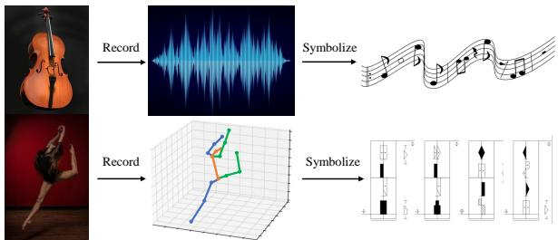  
(a) 音乐与舞蹈艺术 (b) 基于数据的记录 (c) 符号化记录 Figure 1: 记录音乐和舞蹈动作的方法。(a) 音乐家演奏的音乐作品和人类执行的舞蹈动作等艺术创作需要被记录和传播。(b) 基于形式的数据允许精确记录结果，例如对音乐使用频率，对舞蹈动作使用关键点的 3D 坐标。(c) 符号化形式代表了基于数据结果的离散化，虽然损失了少量精度，但更直观且更易于传播。现有的音乐和舞蹈动作记录通常采用符号化记录。

综上所述，我们的贡献如下：

• 我们引入了手部拉班舞谱（Hand Labanotation），这是一种用于手部动作的新颖符号系统，促进了符号化记录和分析，简化了手部动作分析，并将其应用于机械手控制。

• 我们创建了 HLD 数据集，该数据集源自标注的 Interhand2.6M [19] 和 Freihand [33] 数据，代表了首个用于手部拉班舞谱的大规模多视角数据集，标志着手部动作记录领域的一次飞跃。

• 我们提出并训练了 MHLFormer 模型，该模型使用了创新的 LH 损失函数，在将手部动作转化为 HL 谱方面取得了优异的性能。

## 2 相关工作

现有的手部动作记录表示方法。我们大致可以将可行的方法分为三类。(1) 使用视频记录动作。虽然视频记录具有直观的优势，但它无法有效解决遮挡问题 [7, 22]。此外，需要大量的存储空间是视频记录的另一个缺点 [23, 25]。(2) 利用基于数据的手部表示方法进行记录。在计算机视觉研究中，3D 手部动作记录依赖于骨架（Skeleton）[31, 32]、网格（Mesh）[16, 17] 和 MANO [2, 24] 等方法。尽管这些方法可以相对精确地记录手部动作，但它们严重缺乏直观性。观察者仅根据坐标数据很难复现手部动作。此外，捕获精确的手部姿态数据也是困难的。(3) 采用符号化方法进行记录。符号化记录方法同样具有直观的优势，因此更易于复现。现有的手语（Sign Language）方法 [15] 已经开发了其独特的符号系统。然而，由于手语侧重于语义信息，我们无法使用手语符号记录许多非语义的手部动作。因此，设计一个直观且可靠的符号系统至关重要。

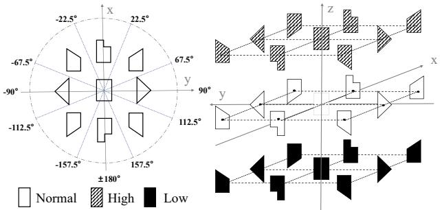  
(a) 基本符号 (b) 拉班舞谱符号的空间映射 Figure 2: 手部拉班舞谱的基本符号及其对应的空间表示。

人体拉班舞谱（Labanotation for Human Body）。人体拉班舞谱历史悠久。拉班舞谱开发于20世纪初，是一种用于记录身体动作的符号化方法 [8]。随着拉班舞谱的不断发展，它最终演变为一个由四个基本要素构成的系统：身体、空间、时间和动力学（dynamics）[10]。身体代表身体的运动部位，例如“左腿”、“右手”等，通常包含 11 个身体部位。空间代表通过方向、水平、距离和程度来表征动作的方法。时间表示每个动作的持续时长，而动力学则表示动作中所包含的情感成分。在拉班舞谱中，我们使用两个维度来描述动作：身体和时间 [13, 28]。垂直轴代表动作序列的时间进程，时间自底向上流动。水平轴上的每一列代表身体的一个部位。符号的形状和颜色代表每个身体部位的空间位置 [8]。随着人体拉班舞谱的发展，使用各种拉班舞谱符号对人体区域的划分变得越来越精细 [14, 28]。这种精细化为记录手部动作提供了一种可行的方法。

动作到拉班舞谱翻译（Motion-to-Labanotation Translation）。拉班舞谱翻译的目标是快速且准确。最初，专家们在观察舞蹈时通过人工方式记录拉班舞谱 [8]。为了简化这一过程，诸如 Genlaban [6]、Laban 等计算机辅助工具

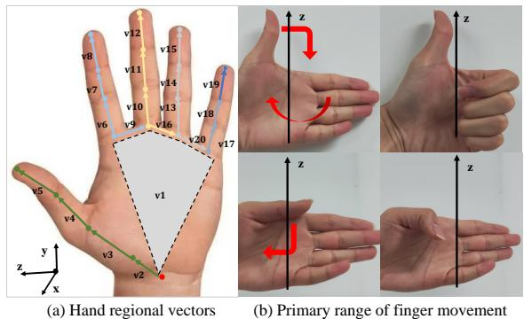

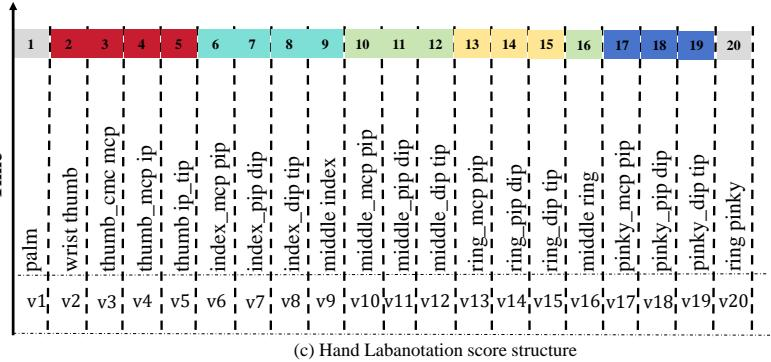

Figure 3: 手部拉班舞谱的结构组成。(a) 人手坐标定义与区域向量分布的描绘。(b) 在我们定义的坐标系中，拇指沿 -axis 方向具有较大的运动范围，在  平面内的运动范围较小。相反，其余四指在  平面内具有较大的运动范围，沿 -axis 的运动范围较小。(c) 单手拉班舞谱的结构，水平条目记录了由拉班舞谱符号表示的 20 个区域向量，垂直向上的方向表示时间。我们将水平记录扩展为包含双手情况下另一只手的区域向量。  
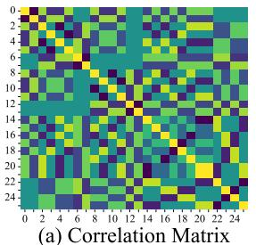

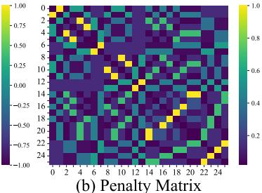  
Figure 4: 基本 HL 符号的相关性与惩罚矩阵可视化。图像的横坐标和纵坐标分别对应 26 个符号。我们通过计算两个符号方向向量的点积来获得它们的相关矩阵。

Writer [3] 和 Led&Lintel [11] 相继问世，简化了符号创建并加快了记谱速度。尽管这些工具有助于拉班舞谱（Labanotation）符号编辑和记谱，但它们需要大量的拉班舞谱专业知识，为许多用户带来了障碍 [13, 28]。计算机科学的最新进展实现了从 3D 运动数据到拉班舞谱的自动转换，提高了效率 [28]。该方法依赖于 3D 姿态估计的准确性。然而，在姿态估计过程中，由于频繁的遮挡，标注的准确性可能会受到影响。后续的人工校对工作量仍然十分庞大。为此，研究人员开发了端到端的方法和数据集，例如 Laban16 [13] 和 Laban48 [28]。然而，这些数据集仅涵盖基本的上肢动作。下肢和手部动作往往更为复杂。现有数据集仍然较为匮乏。

## 3 方法

## 3.1 手部拉班舞谱谱表

Figure 3 展示了手部拉班舞谱与手部不同部位的相关性。在下文中，我们将详细阐述手部拉班舞谱谱表的构建过程。

手部建模。基于人手的骨骼结构，每只人手的骨骼模型由 21 个关键点组成，我们将其称为节点。如图 3 (a) 所示，每只手上的红色节点位于手腕处，代表手部关节的原点。

坐标设置。基于骨骼模型，我们可以定义手部的坐标系。我们将根节点设置为坐标原点，令  轴为从根节点指向中指根部的方向，令  轴为在手掌平面上垂直于  轴且向左的方向，并令  为  和  的叉积。21 个节点之间的层级关系取决于节点之间的边以及距离关节根节点和手部模型的距离。对于一条边两端的每对节点，距离关节根节点更近的节点被视为另一个节点的父节点。

区域向量（Regional Vectors）。根据节点的坐标信息，我们获得了 20 个向量 $\vec { v _ { i } } , i \in \ [ 1 , 2 0 ]$，我们将其称为区域向量。每个向量对应一个非根节点状态，以其父节点作为参考，代表该节点相对于其父节点的相对位置。这些向量表示手部特定部分的状态。因此，手部动作由集合 $V = ( \vec { \upsilon _ { 1 } } , \ldots , \vec { \upsilon _ { 2 0 } } )$ 表示，如图 3 (a) 所示。最后，根据空间位置，每个区域向量 ® 都可以转换为手部拉班舞谱（Hand Labanotation）记谱系统中的一个符号。通过这种方式，单手的当前手部动作可以用 20 个手部拉班舞谱符号来表示，双手则为 40 个。由于整个手掌接近刚性结构，我们使用一个平行于  轴的区域向量来表示整个手掌部分。

基础手部拉班舞谱符号（Basic Hand Labanotation Symbol）。在一个长方体表面上，我们选取 8 个顶点、6 个面的中心以及 12 条棱的中点。由此，我们获得 26 个点，每个点对应手部拉班舞谱符号中的一个。如图 2 所示，我们选择长方体的中心作为坐标原点，水平面作为  平面，垂直方向作为  轴方向。对于给定的空间区域向量 $\vec { v _ { i } } , i \in [ 1 , 2 0 ]$，我们根据 ® 在  平面上的投影确定符号的形状，并根据 ® 与  轴之间的夹角确定符号的纹理。这样，我们就可以将任意空间区域向量映射为一个手部拉班舞谱符号。如图 3 (b) 所示，拇指的运动范围主要沿  轴。

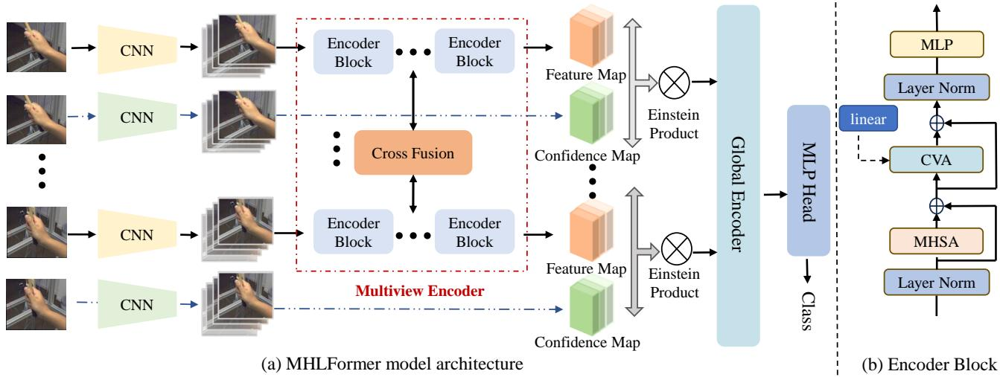  
Figure 5: MHLFormer 模型的架构。(a) 模型整体结构的展示。我们以来自不同视角的一系列手部动作图像作为输入。这些图像首先通过卷积神经网络（CNN）进行特征提取以获得特征图。随后将这些特征图映射形成 token 序列，并通过多视角 Transformer（Multiview Transformer）的编码器块（Encoder Block）进一步处理以进行信息交互。相邻视角之间的信息通过线性层使用跨视角融合（Cross View Fusion）模型进行融合。由简单的 ResNet-50 [9] 网络构成的置信度图（Confidence Map, CMP）模块与该模型并行运行，以监督注意力聚焦的特征，最后在特征图上应用爱因斯坦积（Einstein product）。(b) 编码器块结构的细节。来自前一视角的输出通过线性层连接到当前视角的编码器块。此处 CVA 代表跨视角注意力（Cross View Attention），MHSA 代表多头自注意力（Multi-Head Self-Attention），MLP 代表多层感知机（multilayer perceptron）。更多细节参见 [20]。

我们将  轴方向划分为 3 个区间。在  平面内，除大拇指外的其余四指主要绕  轴旋转，因此我们对  平面内的区域进行了更精细的划分，将其分为 9 个区间。

## 3.2 HL 翻译的形式化定义

由于手动起草手部拉班舞谱（Hand Labanotation）既昂贵又繁琐，因此有必要开发一个基于数据集训练的端到端模型，能够针对任意手部动作自主翻译手部拉班舞谱。我们将该任务形式化表述如下。给定的输入数据首先被形式化表示为 $\mathbf { V } \in \mathbb { R } ^ { T \times N \times \mathbf { \breve { H } } \times W \times C } . \mathbf { V } = \{ \mathbf { V } _ { 1 } , \mathbf { V } _ { 2 } , . . . \mathbf { \breve { V } _ { T } } \}$，其中  表示数据的帧数。对于 ∀ ∈ $[ 1 , T ] , \mathbf { V _ { i } } \in \mathbf { \sigma } _ { \mathbb { R } } ^ { \bullet } N { \times } H { \times } W { \times } C$，其采集自位于同一实验场地的  个摄像机。$\mathbf { V _ { i } } = \{ \mathbf { V _ { i } ^ { 1 } } , \mathbf { V _ { i } ^ { 2 } } , \ldots , \mathbf { V _ { i } ^ { N } } \}$，对于 $\forall j \in [ 1 , N ] , \mathbf { V _ { i } ^ { j } } \in \mathbb { R } ^ { H \times W \times C }$ 表示数据中第  个时刻来自第  个视角的手部动作信息。然后，我们使用函数 T 来表示系统从图像数据到翻译后的 Hand Labanotation 序列的转换过程。

$$
\mathbf {f}: \mathcal {T} (\mathbf {V _ {i}} ^ {1}, \mathbf {V _ {i}} ^ {2}, \ldots , \mathbf {V _ {i}} ^ {N}, \Phi) = \mathbf {L},\tag{1}
$$

其中 $\mathbf { L } = \{ p _ { r } ^ { 1 } , p _ { r } ^ { 2 } , . . . , p _ { r } ^ { 2 0 } ; p _ { l } ^ { 1 } , p _ { l } ^ { 2 } , . . . , p _ { l } ^ { 2 0 } \}$。对于 $\forall k \in [ 1 , 2 0 ] , p _ { r } ^ { k }$ 表示右手部分，而 $p _ { l } ^ { k }$ 表示左手部分。$p _ { r } ^ { i } , p _ { l } ^ { i } \in \mathbb { R } ^ { 1 \times c l s }$，其中  = 26，表示所有可用于表示完整 Hand Labanotation 空间的手部拉班舞谱符号类别。

## 3.3 Hand Labanotation 数据集

为了促进拉班舞谱（Labanotation）分谱的自动翻译，我们基于 InterHand2.6M 数据集 [19] 和 Freihand 数据集 [33] 构建了一个名为手部拉班舞谱数据集（Hand Labanotation Dataset，HLD）的数据集。据我们所知，这是首个涵盖多视角和单视角手部动作的综合数据集。我们的大数据集包含超过 400 万张手部动作图像，涵盖了广泛的手部动作。具体而言，它包含 200 多种不同类型的手部动作，并涉及 26 位以上不同的男女参与者。每个条目均具有高分辨率的空间和时间标注细节，捕捉了手部动作的细微差别。该数据集采用算法与人工相结合的方法对手部拉班舞谱进行标注。在此，我们简要介绍 HLD 的标注过程。首先，我们使用第 3.1 节中展示的规则计算每只手的所有区域向量 $( \vec { v _ { 1 } } , \dotsc , \vec { v _ { 2 0 } } )$。随后，通过以下规则将每个区域向量 $\vec { v } = ( x , y , z )$ 从笛卡尔坐标系转换为球坐标系：

$$
\begin{array}{l} r = \sqrt {x ^ {2} + y ^ {2} + z ^ {2}}, \\ \theta = \arccos \frac {z}{r}, \theta \in [ 0, 1 8 0 ], \\ \Phi = \arctan (\frac {y}{x}), \Phi \in [ - 1 8 0, 1 8 0 ]. \end{array}\tag{2}
$$

确定旋转角 (, Φ) 所在的区域，即可对应到相应的手部拉班舞谱符号。在我们的数据集中，标注是通过混合方法进行的。有 19.85% 的关节点帧存在信息不完整的情况。我们对这些关节点帧的所有关节点进行了人工标注。对于这些关节点，当具有现有信息的人工标注关节点与算法计算结果相匹配时，我们认为缺失关节点信息的标注是正确的。标注完这些帧后，我们使用算法获取其余帧的结果。最终的标注以文本形式保存。所得数据集被划分为 3 个子集：训练集、验证集和测试集。Figure 6 展示了从多个视角捕获的“握拳”手势的六帧序列及其对应的 HL 符号。

## 3.4 多视角手部拉班舞谱 Transformer

3.4.1 交叉融合机制。用于融合来自不同视角信息的交叉融合（Cross Fusion）机制如 Figure 5 所示。整体融合策略的设计灵感来源于 MVT [29] 中的线性融合方法。这需要在单个视角上联合执行自注意力机制。我们依次混合每两个相邻视角对之间的信息，以便在节省计算资源的同时高效地融合信息。由于编码后每个视角的 token 数量相同，因此不存在与尺寸匹配相关的问题。两个相邻视角之间的交叉融合处理过程如下所示

$$
\mathbf {z} ^ {(i + 1)} = \operatorname{CVA} \left(\mathbf {z} ^ {(i + 1)}, \mathbf {W} ^ {\text { proj }} \mathbf {z} ^ {(i)}\right),\tag{3}
$$

其中，CVA 表示跨视角注意力（cross-view attention）机制，可通过以下公式表示。

$$
\operatorname{CVA} (\mathbf {x}, \mathbf {y}) = \operatorname{Softmax} \left(\frac {\left(\mathbf {W} ^ {Q} \mathbf {x}\right) \left(\mathbf {W} ^ {K} \mathbf {y}\right) ^ {\top}}{\sqrt {d _ {k}}}\right) \left(\mathbf {W} ^ {V} \mathbf {y}\right).\tag{4}
$$

其中，$\mathbf { W } ^ { Q } , \mathbf { W } ^ { K }$ 和 $\mathbf { W } ^ { V }$ 分别表示注意力机制 [27] 中使用的查询（query）、键（key）和值（value）投影矩阵。如图 Figure 5 (b) 所示，Wproj 是相邻视角融合过程中经过线性层后的权重矩阵。在跨视角注意力（CVA）模块中，虚线表示前一视角经过编码器块（Encoder Block）后的特征。此外，我们在跨视角注意力机制周围引入了残差连接。

3.4.2 多视角编码器（Multiview Encoder）。来自不同视角的编码器块模块构成了多视角编码器，如图 Figure 5 (b) 所示。对于单帧手部动作，输入数据表示为 $\dot { \mathbf { V } } \in \mathbb { R } ^ { N \times H \times W \times C }$，其中  表示输入图像的视角数量。我们采用 ResNet-50 [9] 来获取特征图。Figure 5 (a) 表明，编码器块通过从不同视角的图像中提取特征图来获取词元序列（token sequences）。在通过多视角编码器块后，这些词元序列会生成来自不同视角的特征图与置信度图。它们具有相同的大小，因此可以表示为 $\forall i \in [ 1 , N ] , \mathbf { z _ { i } } \in \mathbb { R } ^ { d \times c l s }$。这里， 表示与手部动作相关的区域向量总数，而  则表示手部拉班记谱（Hand Labanotation）符号分类法中的基本类别数量。在全局编码器（Global Encoder）模块中，我们将它们进行拼接，然后通过多头自注意力（Multi-Head Self-Attention, MHSA）[27] 进行处理。最后，我们通过线性分类器将编码后的分类映射到输出。

## 3.5 拉班舞谱层级损失（Labanotation Hierarchical Loss）

由于手部结构可以被视为从根节点发出的树状结构，因此不同关键点之间存在依赖关系。我们可以基于关键点的结构差异执行分层监督。据此，我们引入了拉班记谱分层（Labanotation Hierarchical, LH）损失来训练我们的模型，该损失由 HXE 损失 [1] 和惩罚损失组成。我们根据空间中不同 HL 符号的方向 ® 计算相关性矩阵。由于每个符号对应于空间区域的一部分，我们使用从坐标原点到空间区域中心的方向作为符号的方向。相关性的计算过程如下

$$
C o r [ i - 1, j - 1 ] = \vec {d} _ {i} \cdot \vec {d} _ {j}, \forall i, j \in [ 1, 2 6 ].\tag{5}
$$

基于 Figure 4 中不同类别之间的相关程度，我们提出了一种惩罚矩阵来生成惩罚损失，该矩阵为各种错误翻译分配权重。惩罚矩阵定义如下

$$
M _ {p} = e ^ {- \alpha (C o r + 1)},\tag{6}
$$

其中  是不同类别之间的相关性矩阵， 是一个正缩放因子，用于控制惩罚系数随相关系数变化的速度。惩罚损失的表达式为

$$
\begin{array}{r} \mathcal {L} _ {p e n a l t y} (\hat {y}, y) = - \sum_ {i = 1} ^ {c l s} (m _ {p} y _ {i} \cdot \log (m _ {p} \hat {y _ {i}}) + \\ (1 - m _ {p} y _ {i}) \cdot \log (1 - m _ {p} \hat {y _ {i}})). \end{array}\tag{7}
$$

在上述表达式中， 是真实标签（ground truth），ˆ 是原始翻译值， 表示基本手部拉班记谱（Hand Labanotation）符号类别的数量。$m _ {  { p } }$ 是真实与预测拉班记谱符号之间惩罚矩阵 $M _ { p }$ 的权重值。最后，我们将模型的 LH 损失函数定义为

$$
\mathcal {L} _ {L H} = \beta \mathcal {L} _ {p e n a l t y} + (1 - \beta) \mathcal {L} _ {\mathrm{HXE}},\tag{8}
$$

其中 $\beta$ 是介于 0 和 1 之间的超参数。

## 4 实验

## 4.1 数据集

HLD 是基于 Interhand2.6M [19] 和 Freihand [33] 数据集构建的。HLD 数据集由 4, 243, 136 张图像组成，包括包含 2, 525, 049 张图像的训练集、852, 343 张图像的验证集以及 865, 744 张图像的测试集。我们对左手、右手和双手的全部训练数据子集中拉班记谱在各个空间中的分布进行了统计分析。结果如 Figure 7 所示。我们发现手部拉班记谱在空间中的分布相对均匀。Figure 6 提供了数据集的可视化展示，呈现了手部运动序列的照片及其对应的 HL 谱表。

## 4.2 评估指标

为了评估我们网络在 Hand Labanotation（手部拉班舞谱）自动翻译结果上的有效性，采用距离度量来量化翻译后的 Hand Labanotation 谱与真实 Hand Labanotation 之间的差异是有益的。为了提供全面的评估，本工作提出了三个指标：

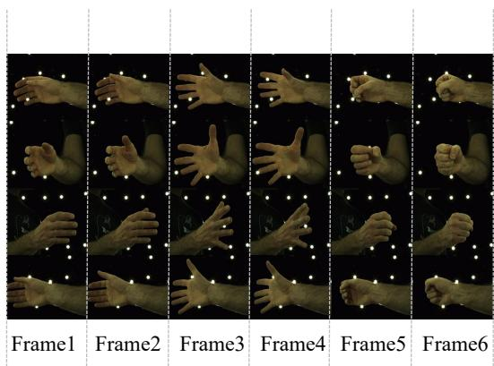  
(a) 多视角手部动作序列

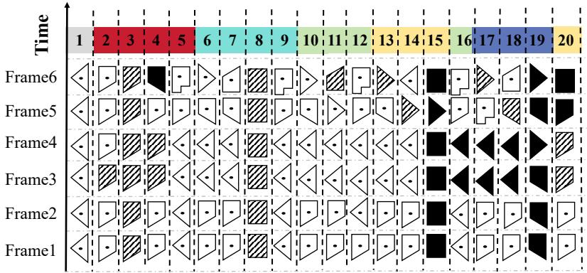  
(b) Hand Labanotation 谱

Figure 6: 数据集数据的部分展示，其中一帧手部动作对应一行 Hand Labanotation 谱。随着时间的推移，HL 谱自底向上逐步生成。

<table><tr><td>方法</td><td> $Laban_{acc}@1 \uparrow$ </td><td> $Hor_{acc}@1 \uparrow$ </td><td> $Ver_{acc}@1 \uparrow$ </td><td>Para. (MB)</td><td>FLOPs (Giga)</td></tr><tr><td>OpenPose [5]</td><td>46.43%</td><td>54.41%</td><td>75.37%</td><td>36.83</td><td>50.02</td></tr><tr><td>InterNet [30]</td><td>64.72%</td><td>68.89%</td><td>85.44%</td><td>143.37</td><td>32.81</td></tr><tr><td>IntagHand [12]</td><td>59.48%</td><td>65.42%</td><td>76.34%</td><td>39.04</td><td>17.88</td></tr><tr><td>Ours</td><td>78.75%</td><td>81.86%</td><td>89.35%</td><td>58.20</td><td>15.15</td></tr></table>

Table 1: 不同方法的比较。为了公平起见，我们将 MHLFormer 的输入限制为一个视角。

$H o r _ { a c c } , V e r _ { a c c } ,$ 以及 $L a b a n _ { a c c } .$。每个指标分别在水平、垂直和整体维度上评估性能。

拉班舞谱（Labanotation）符号的翻译结果可以用矩阵 L 来表示，如第 3.2 节所示。列对应两只手的不同区域向量，行与各个单帧相关联。矩阵中的每个元素表示一个区域向量的方向。这些方向被划分为 26 个不同的类别，每个类别对应一个特定的 Hand Labanotation 符号。对于  帧数据，来自 Hand Labanotation 网络的翻译结果表示为

$$
\mathbf {L} = \left[ \begin{array}{c c c c c c} p _ {\{t, r _ {1} \}} & \dots & p _ {\{t, r _ {2 0} \}} & p _ {\{t, l _ {1} \}} & \dots & p _ {\{t, l _ {2 0} \}} \\ \vdots & \vdots & \vdots & \vdots & \vdots & \vdots \\ p _ {\{2, r _ {1} \}} & \dots & p _ {\{2, r _ {2 0} \}} & p _ {\{2, l _ {1} \}} & \dots & p _ {\{2, l _ {2 0} \}} \\ p _ {\{1, r _ {1} \}} & \dots & p _ {\{1, r _ {2 0} \}} & p _ {\{1, l _ {1} \}} & \dots & p _ {\{1, l _ {2 0} \}} \end{array} \right],
$$

对于 $\forall i ~ \in ~ [ 1 , 2 0 ]$，$p \{ t , r _ { i } \}$ 和 $\boldsymbol { p } \{ t , l _ { i } \}$ 分别表示第 $t$ 帧手部动作中右手和左手第 $i$ 个区域向量所对应的手部拉班舞谱（Hand Labanotation）符号的变换结果。在我们的数据集中，每个样本包含三个不同的组成部分：左手、右手以及它们之间的交互。在测试阶段，应用掩码矩阵（表示为 M）是必不可少的。该矩阵可以通过使用二进制数表示的掩码权重来过滤掉非必要元素。为了评估水平和垂直方向手部拉班舞谱的翻译准确率，我们引入了两个特定的映射矩阵：水平映射矩阵 H 和垂直映射矩阵 V。这些矩阵有助于将每个拉班舞谱转换为仅包含水平或垂直元素的形式。基于上述讨论的要素，拉班舞谱翻译的总体准确率公式化如下：$\begin{array} { r } { \mathrm { \Lambda } _ { : a c c } = \frac { 1 } { K } \sum _ { i = 1 } ^ { T } \sum _ { j = 1 } ^ { M } \delta ( \mathbf { L } ^ { i j } , \mathbf { L } ^ { \prime i j } ) } \end{array}$ · M。类似地，水平拉班舞谱翻译的准确率计算公式为 $\begin{array} { r } { \dot { H o r } _ { a c c } = \frac { 1 } { K } \sum _ { i = 1 } ^ { T } \sum _ { j = 1 } ^ { M } \delta ( ( \mathbf { L } \cdot \mathbf { H } ) _ { p r e d } ^ { i j } , ( \mathbf { L } ^ { \prime } \cdot \mathbf { H } ) _ { g t } ^ { i j } ) \cdot \mathbf { M } ^ { i j } } \end{array}$。最后，垂直拉班舞谱翻译的准确率由 $\begin{array} { r } { { V e r } _ { a c c } = \frac { 1 } { K } \sum _ { i = 1 } ^ { T } \sum _ { j = 1 } ^ { M } \delta ( ( \mathbf { L } \cdot \mathbf { V } ) _ { p r e d } ^ { i j } , ( \mathbf { L } ^ { \prime } \cdot \mathbf { V } ) _ { g t } ^ { i j } ) \cdot \mathbf { M } ^ { i j } } \end{array}$ 确定。在这些公式中，$\begin{array} { r } { K = \sum _ { i = 1 } ^ { T } \sum _ { j = 1 } ^ { M } \mathbf { M } ^ { i j } } \end{array}$，$T$ 表示样本总帧数，$M = 4 0$ 表示单帧内的所有手部部位，L 和 L′ 分别表示每个区域向量上的预测和真实拉班舞谱符号，$\delta ( x , y )$ 是一个

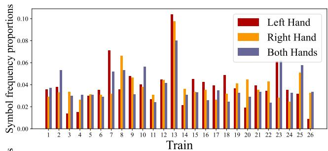

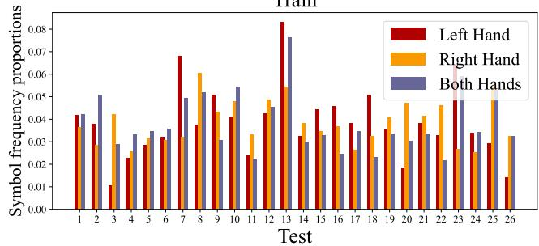  
Figure 7: 训练集和测试集中左手、右手以及双手26个手部拉班舞谱符号的统计分布。可视化结果展示了不同数据类型下各种拉班舞谱符号相对均衡的数量分布。

用于直观且全面记录手部动作的手部拉班舞谱

<table><tr><td>主干网络</td><td>方法</td><td>损失函数</td><td> $Laban_{acc}@2 \uparrow$ </td><td> $Hor_{acc}@2 \uparrow$ </td><td> $Ver_{acc}@2 \uparrow$ </td><td> $Laban_{acc}@4 \uparrow$ </td><td> $Hor_{acc}@4 \uparrow$ </td><td> $Ver_{acc}@4 \uparrow$ </td></tr><tr><td>ResNet-50</td><td>-</td><td> $\mathcal{L}_{CE}$ </td><td>73.85%</td><td>77.34%</td><td>88.59%</td><td>76.66%</td><td>81.01%</td><td>90.10%</td></tr><tr><td>ResNet-50</td><td>-</td><td> $\mathcal{L}_{HXE}$ </td><td>74.23%</td><td>77.36%</td><td>89.95%</td><td>79.89%</td><td>82.13%</td><td>90.33%</td></tr><tr><td>ResNet-50</td><td>-</td><td> $\mathcal{L}_{LH}$ </td><td>75.13%</td><td>79.50%</td><td>91.78%</td><td>82.14%</td><td>86.53%</td><td>92.46%</td></tr><tr><td>ResNet-50</td><td>Cross Fusion</td><td> $\mathcal{L}_{CE}$ </td><td>79.09%</td><td>82.86%</td><td>91.30%</td><td>83.47%</td><td>86.77%</td><td>92.69%</td></tr><tr><td>ResNet-50</td><td>Cross Fusion</td><td> $\mathcal{L}_{HXE}$ </td><td>80.11%</td><td>82.90%</td><td>92.49%</td><td>85.89%</td><td>87.20%</td><td>94.21%</td></tr><tr><td>ResNet-50</td><td>Cross Fusion</td><td> $\mathcal{L}_{LH}$ </td><td>83.46%</td><td>85.79%</td><td>92.09%</td><td>87.71%</td><td>89.48%</td><td>95.27%</td></tr><tr><td>ResNet-152</td><td>-</td><td> $\mathcal{L}_{CE}$ </td><td>76.38%</td><td>80.15%</td><td>89.68%</td><td>77.45%</td><td>82.57%</td><td>90.64%</td></tr><tr><td>ResNet-152</td><td>-</td><td> $\mathcal{L}_{HXE}$ </td><td>76.82%</td><td>79.30%</td><td>90.28%</td><td>77.90%</td><td>82.68%</td><td>90.86%</td></tr><tr><td>ResNet-152</td><td>-</td><td> $\mathcal{L}_{LH}$ </td><td>78.92%</td><td>84.14%</td><td>91.94%</td><td>85.16%</td><td>87.30%</td><td>94.73%</td></tr><tr><td>ResNet-152</td><td>Cross Fusion</td><td> $\mathcal{L}_{CE}$ </td><td>80.98%</td><td>83.71%</td><td>91.51%</td><td>84.88%</td><td>87.72%</td><td>92.79%</td></tr><tr><td>ResNet-152</td><td>Cross Fusion</td><td> $\mathcal{L}_{HXE}$ </td><td>82.64%</td><td>84.22%</td><td>93.76%</td><td>87.45%</td><td>89.63%</td><td>94.94%</td></tr><tr><td>ResNet-152</td><td>Cross Fusion</td><td> $\mathcal{L}_{LH}$ </td><td>84.17%</td><td>86.36%</td><td>94.43%</td><td>88.04%</td><td>89.99%</td><td>95.31%</td></tr></table>

Table 2: 使用不同主干网络、包含与不包含 Cross Fusion（交叉融合）机制以及采用各种损失函数时 MHLFormer 的结果汇总。我们分别在 2 视角和 4 视角下进行了实验。

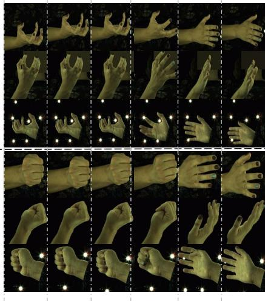  
(a) 多视角手势序列

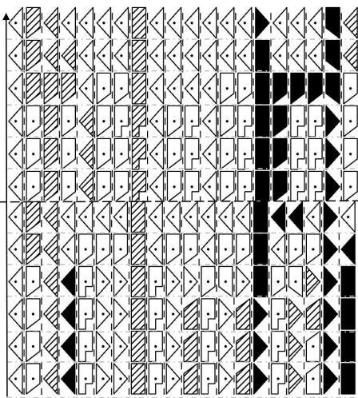  
(b) 手部拉班舞谱（Labanotation scores）

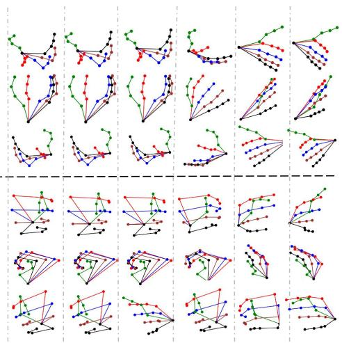  
(c) 从手部拉班舞谱（Hand Labanotation score）重建的手部运动骨骼  
Figure 8: 从手部运动到手部拉班舞谱、再到手部运动骨骼重建的测试流程。(a) 两个手部运动多视角序列的展示。(b) 使用 MHLFormer 翻译手部拉班舞谱的结果。(c) 从翻译出的 HL 舞谱重建的手部运动骨骼的可视化。

指示函数

$$
\delta (x, y) = \left\{ \begin{array}{l l} 1 & \text { if } x = y \\ 0 & \text { otherwise } \end{array} \right..\tag{9}
$$

## 4.3 与现有方法的比较

手部动作记录是一项新颖的任务，类似于 3D 手势姿态估计（3D hand pose estimation）。我们可以将 3D 手势姿态估计的方法应用于我们的任务，并与我们的方法进行比较。由于我们的数据集是基于 Interhand2.6M [19] 和 Freihand [33] 数据集构建的，因此我们选择在 Interhand 数据集上训练的模型并在 Freihand 数据集上对其进行微调。模型训练完成后，我们可以根据 3D 姿态估计方法得出的 3D 坐标进行计算，从而获得 HL 结果。我们将我们的方法与 OpenPose [5]、InterNet [30] 和 IntagHand [12] 等方法进行了比较。为了公平起见，我们将输入图像视角的数量统一定为一个。这样，我们就可以将我们的方法与现有的 3D 手势姿态估计方法进行比较。如 Table 1 所示，我们模型的性能显著优于基于现有手势姿态估计模型生成 HL 的方法。此外，我们模型的体积和计算需求也极具竞争力。

## 4.4 消融实验

在我们的实验中，我们比较了各种损失函数。Table 2 表明，我们提出的损失函数显著优于传统的交叉熵（Cross-Entropy, CE）损失和 HXE 损失，这表明它在不同的骨干网络（backbone）下均具有卓越的有效性。此外，Table 2 突出了交叉融合模块在提升模型性能方面的有效性，表明它促进了跨视角的更好信息整合。值得注意的是，表中的 @2 表示实验中使用了 2 个视角。

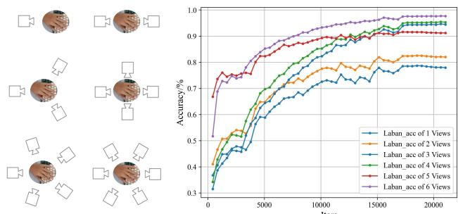  
(a) 视角选择  
(b) 不同视角下的翻译准确率  
Figure 9: 视角的采样方法以及在不同输入视角数量下手部拉班舞谱（HL）的翻译准确率。实验结果表明，选择四个视角作为 MHLFormer 的输入可以实现高效的性能。

## 4.5 实现细节

Interhand2.6M [19] 数据集提供了许多从多视角拍摄的图像，我们从中选择了不同的视点。在实验中，我们选择了围绕手部的 1 到 6 个视角的 6 种多视角方案。详细信息见图 9 (a)。针对每种方案，计算了每次迭代时手部拉班舞谱（Hand Labanotation）翻译的准确率 $L a b a n _ { a c c }$。图 9 (b) 展示了对应这 6 种不同方案的 $L a b a n _ { a c c }$ 曲线。结果表明，4 视角方案能够以相对较少的资源实现准确的手部拉班舞谱翻译。相应地，在 Freihand [33] 数据集中，我们也从这些相同位置选择了 4 个视点。我们在 2 张 Nvidia RTX 3090 GPU 上进行了实验。总共训练了 50 个 epoch，学习率为 $1 \times { 1 0 } ^ { - 4 }$。由于模型的骨干网络（Backbone）对实验结果没有显著影响，我们在 CNN 模块中主要使用 ResNet [9] 模型。

## 5 讨论与应用

手部拉班舞谱（Hand Labanotation）可以作为下游任务的中间表征，并取得令人满意的结果。在此，我们将展示 HL 的一些潜在应用。

## 5.1 机械手的控制信号

手部拉班舞谱作为一种符号系统，可有效应用于记录手部动作和控制机械手。我们提出的手部拉班舞谱符号在极坐标系中量化了单个人手向量的旋转角度，这与当前使用密集旋转角度参数控制机械手的方法具有相似之处。手部拉班舞谱可以直接作为非高精度机械手动作模仿的中间表征，高效地实现从记录到模拟手部动作的一体化过程。虽然 HL 在角度方面损失了一定的精度，但它也起到了对角度的自然滤波作用，可以防止严重的抖动。实验结果表明，HL 作为控制机械手动作的语言，能够相对准确地复现人手的动作。与通过光学相机捕获图像然后使用 3D 手部姿态估计模型估计手部坐标以控制机械手相比，我们的方法更快速、更高效。

## 5.2 ASL 的高效表征

Sahand [18] 是一个包含 64, 000 张美式手语（American Sign Language，ASL）图像的数据集，涵盖 10 个数字和 26 个英文字母。该任务的本质是一个包含 36 个类别的手势分类问题。首先，在 Interhand2.6M 数据集 [19] 上预训练 IntagHand 模型 [12] 后，我们从输入图像中预测 3D 手势表征，包括 Skeleton、MANO 和 Mesh。随后，我们通过 Linear 层直接将结果连接到最终输出。类似地，我们采用在 HL 数据集上预训练的 MHLFormer 模型来预测 HL 表征。基于 HL，我们同样使用 Linear 层进行手势分类。

## 5.3 用于手势近似恢复的符号系统

为了进一步探讨手部拉班舞谱（Hand Labanotation）的合理性，我们将预测出的拉班舞谱转换回手部骨骼。在初始化根节点坐标后，根据每个骨段的手部拉班舞谱符号恢复手部的旋转信息。我们使用与 HL 符号相对应的空间中心轴来表示空间朝向。通过按成人手部比例分配指骨长度，我们得到了如图 Figure 8 所示的骨骼结果。与原始输入图像的对比表明，尽管并非完全精确，但根据手部拉班舞谱重建的骨骼结构仍然相对较好地准确记录了手部动作。例如，Figure 8 中展示的两个动作都是张手动作，重建后的结果仍然能够直观地理解相应的动作。

基于上述功能以及 HL 符号在形状和纹理上的显著差异，HL 可以作为盲文来编码手势，从而进一步拓展其应用场景。

## 6 结论

本文介绍了手部拉班舞谱（Hand Labanotation），这是一种旨在直观记录手部动作序列的符号系统。伴随这一新型记谱系统的是庞大的手部拉班舞谱数据集（HLD），该数据集是一个包含超过 400 万帧、捕捉单视角和多视角手部动作的综合库。此外，我们提出了 MHLFormer 方法，这是一种专门设计用于将手部动作自动转化为 HL 符号的开创性网络。实验结果表明，我们的方法取得了优异的性能。我们利用预测的 HL 进行手部动作再现取得了相对良好的效果。HL 还可以直接作为控制机械手的中间表征，从而将记录与传播统一起来。

局限性：由于符号化过程中存在部分信息的损失，当我们使用 HL 存储手部动作并随后进行恢复时，会存在少量不可避免的误差。

致谢：本手部拉班舞谱（Hand Labanotation）研究得到了深圳市泛在数据赋能重点实验室专项基金（资助号：ZDSYS20220527171406015）以及深圳市鹏瑞基金会清华大学深圳国际研究生院-深圳鹏瑞讲席教授计划的部分资助。

## 参考文献

[1] Luca Bertinetto, Romain Mueller, Konstantinos Tertikas, Sina Samangooei, and Nicholas A Lord. 2020. Making Better Mistakes: Leveraging Class Hierarchies With Deep Networks. In Proceedings ofthe IEEE/CVF Conference on Computer Vision and Pattern Recognition. 12506–12515.

[2] Adnane Boukhayma, Rodrigo de Bem, and Philip HS Torr. 2019. 3D Hand Shape and Pose From Images in the Wild. In Proceedings ofthe IEEE/CVF Conference on Computer Vision and Pattern Recognition. 10843–10852.

[3] Tom Calvert. 2007. Animating Dance. In Proceedings of Graphics Interface. 1–2.

[4] Jorge Calvo-Zaragoza, Jan Hajič Jr, and Alexander Pacha. 2020. Understanding Optical Music Recognition. Comput. Surveys 53 (2020), 1–35. https://doi.org/10. 1145/3397499

[5] Zhe Cao, Tomas Simon, Shih-En Wei, and Yaser Sheikh. 2017. Realtime Multi Person 2D Pose Estimation Using Part Afinity Fields. In Proceedings ofthe IEEE Conference on Computer Vision and Pattern Recognition. 7291–7299.

[6] Worawat Choensawat, Minako Nakamura, and Kozaburo Hachimura. 2015. Gen Laban: A Tool for Generating Labanotation from Motion Capture Data. Multimedia Tools and Applications 74 (2015), 10823–10846. https://doi.org/10.1007/s11042- 014-2209-6

[7] Liuhao Ge, Yujun Cai, Junwu Weng, and Junsong Yuan. 2018. Hand PointNet: 3D Hand Pose Estimation Using Point Sets. In Proceedings of the IEEE Conference on Computer Vision and Pattern Recognition. 8417–8426.

[8] Ann Hutchinson Guest. 2013. Labanotation: The System of Analyzing and Recording Movement. Routledge, New York.

[9] Kaiming He, Xiangyu Zhang, Shaoqing Ren, and Jian Sun. 2016. Deep Residual Learning for Image Recognition. In Proceedings ofthe IEEE Conference on Computer Vision and Pattern Recognition. 770–778.

[10] Katsushi Ikeuchi, Zhaoyuan Ma, Zengqiang Yan, Shunsuke Kudoh, and Minako Nakamura. 2018. Describing Upper-Body Motions Based on Labanotation for Learning-from-Observation Robots. International Journal of Computer Vision 126 (2018), 1415–1429. https://doi.org/10.1007/s11263-018-1123-1

[11] Kazuya Kojima, Kozaburo Hachimura, and Minako Nakamura. 2002. LabanEditor: Graphical Editor for Dance Notation. In IEEE International Workshop on Robot and Human Interactive Communication. 59–64.

[12] Mengcheng Li, Liang An, Hongwen Zhang, Lianpeng Wu, Feng Chen, Tao Yu, and Yebin Liu. 2022. Interacting Attention Graph for Single Image Two-Hand Re construction. In Proceedings ofthe IEEE/CVFInternational Conference on Computer Vision. 2761–2770

[13] Min Li, Zhenjiang Miao, and Cong Ma. 2020. 基于动作捕捉数据的序列到序列拉班舞谱生成. In IEEE International Conference on Acoustics, Speech and Signal Processing. 4517–4521.

[14] Min Li, Zhenjiang Miao, and Wanru Xu. 2021. 用于自动拉班舞谱生成的基于 CRNN 的融合特征 Attention-seq2seq 模型. Neurocomputing 454 (2021), 430–440. https://doi.org/10.1016/j.neucom.2021.05.036

[15] Scott K Liddell. 2021. 美国手语语法. Walter de Gruyter GmbH & Co KG, Berlin.

[16] Kevin Lin, Lijuan Wang, and Zicheng Liu. 2021. 基于 Transformer 的端到端人体姿态与网格重建. In Proceedings ofthe IEEE/CVF Conference on Computer Vision and Pattern Recognition. 1954–1963.

[17] Yang Liu, Wenping Wang, Bruno Lévy, Feng Sun, Dong-Ming Yan, Lin Lu, and Chenglei Yang. 2009. 论质心沃罗诺伊镶嵌——能量光滑度与快速计算. ACM Transactions on Graphics 28 (2009), 1–17. https://doi.org/10.1145/1559755.1559758

[18] Khadijeh Mahdikhanlou and Hossein Ebrahimnezhad. 2020. 利用手部关节和形状编码的静态字母与数字多模态 3D 美国手语识别. Multimedia Tools and Applications 79 (2020),

22235–22259. https://doi.org/10.1007/s11042-020-08982-8

[19] Gyeongsik Moon, Shoou-I Yu, He Wen, Takaaki Shiratori, and Kyoung Mu Lee. 2020. InterHand2.6M：用于单张 RGB 图像 3D 交互手部姿态估计的数据集与基线. In Proceedings of the IEEE European Conference on Computer Vision. 548–564.

[20] Arsha Nagrani, Shan Yang, Anurag Arnab, Aren Jansen, Cordelia Schmid, and Chen Sun. 2021. 用于多模态融合的注意力瓶颈. In Advances in Neural Information Processing Systems. 14200–14213.

[21] V.I. Pavlovic, R. Sharma, and T.S. Huang. 1997. 用于人机交互的手势视觉解译：综述. IEEE Transactions on Pattern Analysis and Machine Intelligence 19 (1997), 677–695. https://doi.org/10.1109/34.598226

[22] Pramod Kumar Pisharady and Martin Saerbeck. 2015. 基于视觉的手势识别最新方法与数据库：综述. Computer Vision and Image Understanding 141 (2015), 152–165. https://doi.org/10.1016/j.cviu.2015.08.004

[23] Oren Rippel, Sanjay Nair, Carissa Lew, Steve Branson, Alexander G Anderson, and Lubomir Bourdev. 2019. 基于学习的视频压缩. In Proceedings ofthe IEEE/CVF International Conference on Computer Vision. 3454–3463.

[24] Javier Romero, Dimitrios Tzionas, and Michael J Black. 2022. 具身之手：手部与身体的协同建模与捕捉. ArXiv Preprint (2022). https://doi.org/10.48550/arXiv.2201.02610

[25] Gary J Sullivan and Thomas Wiegand. 2005. 视频压缩——从概念到 H.264/AVC 标准. Proc. IEEE 93 (2005), 18–31. https://doi.org/10.1109/JPROC.2004.839617

[26] Alexander Toshev and Christian Szegedy. 2014. DeepPose: Human Pose Estimation via Deep Neural Networks. In Proceedings ofthe IEEE Conference on Computer Vision and Pattern Recognition. 1653–1660.

[27] Ashish Vaswani, Noam Shazeer, Niki Parmar, Jakob Uszkoreit, Llion Jones, Aidan N Gomez, Łukasz Kaiser, and Illia Polosukhin. 2017. Attention is All you Need. In Advances in Neural Information Processing Systems. 30–40.

[28] Ningwei Xie, Zhenjiang Miao, Xiao-Ping Zhang, Wanru Xu, Min Li, and Jiaji Wang. 2022. Sequential Gesture Learning for Continuous Labanotation Generation Based on the Fusion of Graph Neural Networks. IEEE Transactions on Circuits and Systems for Video Technology 32 (2022), 3722–3734. https://doi.org/10.1109/TCSVT.2021.3109892

[29] Shen Yan, Xuehan Xiong, Anurag Arnab, Zhichao Lu, Mi Zhang, Chen Sun, and Cordelia Schmid. 2022. Multiview Transformers for Video Recognition. In Proceedings ofthe IEEE/CVFConference on ComputerVision andPattern Recognition. 3333–3343.

[30] Baowen Zhang, Yangang Wang, Xiaoming Deng, Yinda Zhang, Ping Tan, Cuixia Ma, and Hongan Wang. 2021. Interacting Two-Hand 3D Pose and Shape Reconstruction from Single Color Image. In Proceedings of the IEEE/CVF International Conference on Computer Vision. 11354–11363.

[31] Fan Zhang, Valentin Bazarevsky, Andrey Vakunov, Andrei Tkachenka, George Sung, Chuo-Ling Chang, and Matthias Grundmann. 2020. MediaPipe Hands: On-device Real-time Hand Tracking. ArXiv Preprint (2020). https://doi.org/10.48550/arXiv.2006.10214

[32] Xueyan Zhang, Zhenjiang Miao, Qiang Zhang, and Jiaji Wang. 2019. Skeletonbased Automatic Generation of Labanotation with Neural Networks. Journal ofElectronic Imaging 28 (2019), 23026–23026. https://doi.org/10.1117/1.JEI.28.2.023026

[33] Christian Zimmermann, Duygu Ceylan, Jimei Yang, Bryan Russell, Max Argus, and Thomas Brox. 2019. FreiHAND: A Dataset for Markerless Capture of Hand Pose and Shape From Single RGB Images. In Proceedings of the IEEE/CVF International Conference on Computer Vision. 813–822.