# 用于临床与康复生物力学的基于视频的无标记动作捕捉：已验证架构、临床就绪度及新兴方法的 PRISMA-ScR 范围综述

Florian Delaplace¹, Elodie Piche¹ ², Frédéric Chorin², Raphael Zory¹ ³

¹ LAMHESS, Université Côte d'Azur, Nice, France · ² Plateforme Fragilité, Centre Hospitalier Universitaire de Nice, Clinique Gériatrique de Soins Ambulatoires, Nice, France · ³ Institut Universitaire de France (IUF), France

通讯作者：Florian Delaplace, florian.delaplace@unice.fr

## 摘要

背景。基于视频的无标记动作捕捉有望摆脱光电系统在成本、空间和皮肤标记物方面的限制来进行运动分析，在临床和康复环境中具有独特的应用潜力。目前已验证的流程是否已能提供临床可接受的生物力学数据，以及它们与底层计算机视觉研究之间的关联，仍不明确。

方法。我们遵循范围综述的 PRISMA 拓展指南（PRISMA-ScR）开展了一项范围综述，并进行了方案注册，检索了 PubMed、Scopus 和 IEEE Xplore 数据库（2015年1月至2026年2月；计算机视觉领域的检索更新至2026年7月）。采用双层设计，将已验证生物力学研究的主要文献库与用于定性分析的新兴计算机视觉研究的补充、精选且有意非穷尽的文献库相结合。我们梳理了研究特征、流程架构、验证方法以及关节角度准确性。

结果。共纳入 117 项研究，大多数发表于 2024 年及以后，且在实验室环境下针对健康成年人步行展开。流程涵盖单目和多相机模态，构成了五大架构家族；大多数研究报告了未经生物力学优化的原始关节角度。矢状面下肢一致性集中在 5 至 6° 左右，通常达不到临床可接受标准，而面外运动学、动力学以及病理或老年人群则很少得到验证。新兴的计算机视觉基础模块（如基础模型网格恢复、可微逆运动学、基于视频的动力学）在已验证的研究中几乎处于空白状态。

结论。对于临床关节运动学而言，基于视频的无标记动作捕捉尚无法完全替代基于标记物的系统；并且在康复领域最迫切需要的方向上——老年及病理人群、面外运动学和动力学——其有效性仍几乎未被验证。结合这一证据空白与新兴的计算机视觉进展，我们提出了具有假设生成性质的设计指南（而非一种已验证的方法），以引导下一代流程走向易于获取且具有临床意义的运动分析。

关键词：无标记动作捕捉；姿态估计；生物力学；步态分析；深度学习；范围综述；临床转化；OpenSim

## 1. 背景

三维动作捕捉三十多年来一直是生物力学研究和临床步态分析的基石。光电式基于标记点的动作捕捉（marker-based motion capture, MBMC）系统（Vicon、Qualisys 和 OptiTrack）仍然是关节运动学测量事实上的黄金标准，在受控实验室条件下具有文献记载的亚毫米级空间精度和亚度级关节角度精度 [1]。然而，除高预算的学术和临床研究实验室外，它们的普及受到了三个障碍的限制：资金成本（每套系统数万至数十万欧元）、空间需求（具有受控照明的专用采集空间）以及操作开销（标记点粘贴、软组织伪影、后处理人工）。即便是配置良好的光电系统，其精度的瓶颈与其说是硬件本身，不如说是软组织伪影——即皮肤标记点相对于骨骼的位移 [2-3]；因此，摆脱皮肤标记点正是基于视频的方法的吸引力所在。

与此同时，在过去十年中，仅通过 RGB 视频进行人体姿态估计的计算机视觉（computer vision, CV）技术取得了快速发展，即所谓的“无标记动作捕捉”（markerless motion capture, MMC）范式 [4]。从基础的 2D 姿态估计器（OpenPose [5]、BlazePose [6]、HRNet [7]）到多视角三角测量管线（Pose2Sim [8]、OpenCap [9]），再到近期基于深度神经网络的单目 3D 重建（MotionBERT [10]、BioPose [11]、OpenCap Monocular [12]），该领域已发展出广泛的算法体系。其潜在优势包括将设备成本降低一到三个数量级、可部署于临床或家庭环境，以及兼顾科研与常规临床应用的工作流程。

然而，这种技术前景尚未转化为清晰一致的临床现实。当前关于 MMC 在生物力学中应用的文献表现出极大的异质性：不同算法族并存，对于针对特定临床或研究问题哪种架构更为优选尚未达成共识；各研究所报告的精度指标跨越了一个数量级；与矢状面相比，具有临床相关性的关节平面（额状面、横断面）被系统性地低频报告；且针对病理人群的验证仍然匮乏。这些缺陷具有直接的临床影响。最少被报告的额状面和横断面偏异常态，如膝外翻、髋内旋、骨盆倾斜、划圈步态和剪刀步态，恰恰是定义常见神经性步态障碍的关键特征 [13]，因此，一个仅能在五到六度误差范围内解析矢状面的处理流程，可能会遗漏康复临床医生需要追踪的关键体征。此外，大量前沿的计算机视觉研究几乎仅发表在预印本库（arXiv）和计算机视觉会议论文集中。将这些最新发表的算法构建模块整合到流程中、针对参考标准进行验证并发表结果都需要时间，因此在最新的计算机视觉进展进入经过验证的生物医学文献之前，存在不可忽视的延迟是可以预期的。本综述旨在对这一预期进行检验。

该证据库的广度、异质性和快速演变使得进行荟萃分析（Meta-analysis）综合变得不切实际且可能产生误导：各研究在研究设计、报告指标、金标准设备以及目标人群方面的变异性阻碍了推断性荟萃分析（加权效应量估计）；因此，我们通过中位数、范围和比例对证据进行描述性总结，而不是合并效应量。因此，遵循 PRISMA-ScR（系统评价和荟萃分析优先报告条目范围综述拓展版）和 Joanna Briggs Institute（JBI）方法学框架开展的范围综述（Scoping review），是梳理该领域证据更为合适的工具。

以往关于无标记生物力学的综述主要对系统架构进行了归类并报告了准确性 [4, 14]；目前仍缺乏两方面内容：一是阐明经临床验证的领域如何与塑造其下一代发展的快速演进的计算机视觉前沿相衔接，二是超越纯粹的描述性总结，迈向具体且有证据支持的设计方向。我们通过刻意弥合临床生物力学与计算机视觉这两个极少交集的文献领域，来解决这两个问题。除了常规的范围综述（scoping review）之外，我们提出了一种双层设计。MACRO（宏观）层面构成了对生物医学数据库（PubMed、Scopus、IEEE Xplore）的正式 PRISMA 筛选，并生成了针对外部生物力学金标准对 MMC（无标记运动捕捉）流程进行实证验证的研究语料库。MICRO（微观）层面则构成了一个互补的、精选的语料库，其来源有二：一是在系统检索中被筛选掉的已发表文献记录，因为它们仅针对单一流程组件而非完整的已验证流程；二是对近期 arXiv 预印本和计算机视觉会议论文集的针对性扫描，用于发掘支撑下一代 MMC 流程的技术构件。MICRO 在设计上是非穷尽性的，并用于定性分析，以识别和表征新兴的技术类别，而非估计发表体量，但它明确弥补了预印本时代 CV（计算机视觉）研究与其最终在生物医学数据库中被索引之间的结构性延迟。

本范围综述探讨两个研究问题：

RQ1 (MACRO)：目前已发表的用于生物力学分析的基于视频的无标记运动捕捉流程的架构、验证结果和临床适用性是什么？
RQ2 (MICRO)：在计算机视觉文献（2024-2026年）中，通过刻意的非系统性前瞻扫描所表征的新兴技术构件有哪些可能塑造下一代 MMC 流程，但尚未转化为经同行评审的生物医学出版物？

综合两者，我们随后提炼出一套适用于临床部署的无标记流程的循证设计指南，涵盖两种部署模式（单目、单摄像头且适用于临床或现场部署；以及多摄像头、实验室级部署），将来自已验证 MACRO 研究的经验教训与来自 MICRO 的技术现状相结合。这第三条主线具有明确的前瞻性：它作为一种视角和研究议程提出，提供基于本综述所记录差距的、具有假设生成性质的方向，而非一种已验证的方法。

## 2. 方法

## 2.1 研究设计与方案

本范围综述是根据 PRISMA-ScR 指南 [15] 和 JBI 范围综述方法学框架 [16] 进行的。综述方案已在前瞻性地注册于开放科学框架（Open Science Framework，OSF，doi: 10.17605/OSF.IO/TBYPC）；完整的 PRISMA-ScR 检查清单见附加文件 1。选择范围综述而非系统评价的设计基于两个原因：首先，纳入文献在研究设计、验证方法学和报告指标方面存在显著的异质性，无法进行有意义的荟萃分析合并；其次，我们的明确目标是绘制并表征一个快速发展的证据图景（包括其新兴的技术前沿），而非评估合并效应。

## 2.2 信息来源与检索策略

我们检索了三个生物医学和工程数据库（PubMed、Scopus 和 IEEE Xplore），检索时间跨度为 2015 年 1 月至 2026 年 2 月，最后一次数据库检索执行于 2026 年 2 月 4 日。检索策略结合了受控词表（PubMed 使用 MeSH）和自由文本词，涵盖无标记动作捕捉、基于视频的姿态估计以及生物力学验证。完整的检索式见附加文件 2（附录 A）。

为了补充正式的生物医学检索，我们将系统检索与算法视野扫描（algorithmic horizon scan）相结合：即建立第二个特意非穷尽的语料库（MICRO 语料库），用于收集新兴的计算机视觉工作。它来自两个来源：系统检索中仅涉及单一流程组件的筛选记录，以及对近期计算机视觉文献的针对性扫描，即 arXiv（主要是 cs.CV 类别）和主要视觉与学习会议论文集（CVPR、ICCV、ECCV、WACV、NeurIPS），时间限制在 2024–2026 年，以捕获尚未被生物医学数据库收录的方法。其构建细节见第 2.6 节。MICRO 语料库仅作定性使用，旨在呈现技术构建模块和新兴门类，而非估计其流行度。计算机视觉扫描与系统检索分开运行，并更新至 2026 年 7 月，晚于 2026 年 2 月的生物医学检索截止日期，因此少数近期预印本的发布时间晚于 MACRO 检索。

## 2.3 资格标准

资格标准使用研究对象-概念-情境（Population-Concept-Context, PCC）框架进行表述，并明确了 MACRO 语料库的纳入和排除标准。

## 纳入标准

符合以下条件的研究予以纳入：(i) 评估了基于视频输入（单相机或多相机）的无标记点运动捕捉（markerless motion capture）流程；(ii) 报告了针对外部生物力学参考标准（Vicon、Qualisys、OptiTrack、BTS/MIQUS、Motion Analysis、Nokov 或同类光电系统；用于动力学的测力台；或在少数情况下为仪器化惯性测量单元 [IMU] 系统）的定量验证；(iii) 报告了经验性的关节角度、时空或动力学精度指标（RMSE、MAE、相关系数或 ICC）；(iv) 侧重于生物力学运动分析，而非通用的姿态检测或动作识别。

## 排除标准

应用了八项预先指定的排除标准（A-H）：

A. 黑箱系统（Black-box system）：姿态估计模型未明确或未公开的商业或专有流程，例如 Theia3D、Captury 和 KinaTrax。此类系统被排除是因为其姿态估计模型无法被表征或复现，尽管 Theia3D 尤其是临床应用最广泛的无标记点系统之一；此处排除了 11 项研究。

B. 无现代计算机视觉（No modern computer vision）：仅采用手动数字化或经典（非深度学习）计算机视觉（CV）。

C. 深度传感器通道（Depth-sensor channel）：使用深度或 RGB-D 模态（如 Kinect）作为主要三维机制的研究，此类研究被排除是因为本综述关注 RGB 视频流程，尽管这些设备在康复诊所中仍很常见。

D. 无原始数据的综述（Review without primary data）。

E. 非无标记点（Not markerless）：使用物理身体标记点作为流程的输入。

F. 仅有人工金标准（Manual gold standard only）：针对 Kinovea、角度计、视频手动标注或同类手动参考进行的验证。

G. 无生物力学输出（No biomechanical output）：仅报告中间指标（每关节平均位置误差，MPJPE，其评估的是关键点位置而非关节角度），未报告关节角度、时空参数或动力学指标。

H. 无外部金标准（No external gold standard）：仅报告内部重测信度，未与独立参考系统进行比较。

无论验证状态如何，只要研究涉及至少一个流程处理组件（2D 姿态估计、3D 提升、三角测量、网格恢复、逆运动学、步态事件检测、时域建模、物理信息方法或信号处理），就会被考虑纳入 MICRO 语料库。

## 2.4 研究筛选过程

标题与摘要筛选以及根据合格标准进行的全文评估均由两名评审员使用 Covidence 系统评价软件独立完成。任一阶段的分歧均由第三位资深评审员裁决。全文排除被编码归入宽泛的原因类别（技术不符、验证不符、结局指标不符、文献类型不符、研究人群不符，或未获取到报告），而通过了全文筛选但在数据提取核验阶段未满足预设 A-H 标准的研究则在该后续阶段被排除（Fig. 1）。

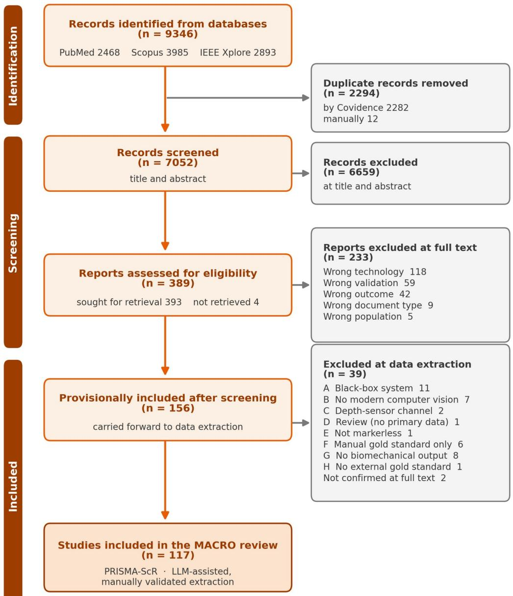

Figure 1. 研究识别、筛选和纳入的 PRISMA-ScR 流程图。

## 2.5 数据提取

我们在 Microsoft Excel 中开发了一个结构化提取模板，包含 7 个工作表和 90 多个数据字段，涵盖六个领域：

基本特征（研究 ID、完整标题、第一作者、年份、论文类型、样本量、参与者人口统计学特征、目标人群、运动任务、服装）。

视频输入规格（摄像机数量、摆放位置、摄像机类型、分辨率、采集频率、校准程序、同步方式、环境）。

计算机视觉处理（2D 姿态算法、骨干网络架构、训练机制、训练数据集、3D 重建方法、流程名称、遮挡处理、滤波、标记点增强、实时处理能力）。

生物力学处理（生物力学软件、运动学方法、骨骼模型、缩放程序、动力学/力的计算）。

全局与时空验证（金标准系统、已验证的结果类别、报告的指标、全局运动学误差与相关性、时空误差、作者结论）。

关节级验证（每个关节 × 每个平面的 RMSE 和相关性：骨盆、髋关节、膝关节、踝关节 × 矢状面、额状面、水平面）。

第七个工作表将每项研究的架构分类汇总为分析中使用的 5 大类别分类体系。

## LLM 辅助的数据提取

数据提取由作者完成，大语言模型（LLM）仅作为辅助及发现错误的步骤，而非权威数据记录来源。第一作者定义了结构化模板

（117项研究共约90个字段）。为了加快从异构来源（自由文本、表格、图表、扫描PDF）对模板进行初次填充的速度，每项研究均由大型语言模型（Claude Opus 4.7）进行处理。随后，该表格由来自不同厂商的第二个模型（Google Gemini）进行独立重新提取和交叉核对，两位作者依据原始PDF对两者之间的每一个分歧进行了裁定。在裁定之前，两个模型在约10,500个字段中的156个字段上存在分歧（跨117项研究约90个字段），原始一致率约为98.5%。由于模板混合了数值型、类别型和自由文本字段，因此未计算单一的机会校正一致性系数。在所有验证轮次中，共应用了385处单元格级别的修正（多于156处模型分歧，因为某些错误是两个模型共有的，仅在对照原始PDF核对时才显现出来），这些主要是数值转录错误以及逐关节或逐平面的对齐偏差，较少部分为架构或金标准的类别误分类。还识别并修正了两处模型报告了引用的先前研究中的数值而非论文本身数值的情况。作为最终的内部一致性检查，第一作者直接从原始文档中手动重新提取了纳入研究中随机抽取的20%（使用计算机随机数生成器选取）；该样本中的所有字段均与表格完全一致（具有相同的数值和类别标签）。这一最终轮次并非独立于初始提取；独立性依赖于上述跨厂商的双模型裁定。因此，这些数值是机器辅助但经人工验证的，作者对提取的数据集负责。

## 2.6 数据综合

综合过程跨越三个层级展开。

## 描述性分析

首先从时间趋势、人群特征、样本量、运动任务和采集环境方面对 MACRO 语料库进行了表征。

架构映射。将117项 MACRO 研究归类为五大家族架构分类体系（2D 单目、多视角三角测量、单目提升 2D→3D、人体网格恢复/SMPL、端到端直接法），并带有五种非互斥的叠加变体（+IK/MSK、+标记点增强、+时序深度学习、+物理约束、仅几何法）。对于每个家族，我们报告了技术组件（骨干网络、姿态估计器、生物力学软件）的分布以及每个关节和解剖平面的验证结果。关节角度误差对照 McGinley 的误差区间（2° 或以下可接受，2° 至 5° 合理，5° 以上可能产生误导）进行总结，以此作为临床相关的基准。

技术解构。MICRO 语料库的构建分为两步。首先，在数据库初筛期间识别出的仅描述单个流程组件、而非经过金标准验证的完整流程的文献（排除标准 F 和 G），予以保留并归入 17 个流程步骤模块（3D 提升、网格恢复、2D 姿态、物理融合方法、三角化、步态事件、深度估计、IK 求解器、滤波、运动预测、标记增强、跟踪、肌肉骨骼建模、时间平滑、基础模型、动力学以及校准；图 6，第 3.4 节）。其次，我们在每个模块内展开进一步检索，针对近期（2024–2026 年）的 arXiv 预印本和计算机视觉会议论文，以捕获生物医学文献初筛中遗漏的新兴最先进（SOTA）方法；随后将每种新兴方法追溯至其可进行升级的 MACRO 架构族。因此，MICRO 语料库经过了人工精选，且刻意保持非穷尽性。针对 arXiv (cs.CV) 及会议论文的检索截止至 2026 年 7 月；完整记录清单、每条记录的来源以及各模块的文献计数（附加文件 6）均在附加文件 5 中提供。该 MICRO 检索不在 PRISMA-ScR 的管辖范围内，PRISMA-ScR 仅规范系统性的 MACRO 语料库。完整的构建方案和各模块的可复现检索式见附加文件 7。

最后，MACRO-MICRO 桥接分析针对五大架构族中的每一个，阐明了 MICRO 语料库中对应的技术构建模块，以及经过验证的生物医学文献与新兴 CV 前沿技术之间的主要分歧点（第 3.5 节）。

## 3. 结果

## 3.1 纳入语料库描述

在三大数据库检索到的 9,346 条记录中，剔除 2,294 条重复记录，对 7,052 篇文献的标题和摘要进行了初筛；排除了 6,659 篇文献，对 393 篇全文报告进行了评估，其中 237 篇在全文阶段被排除，另有 39 篇在对照标准 A–H 进行数据提取核对时被排除，最终纳入 117 项研究（图 1）。这 117 项纳入的研究时间跨度为 2015 年 1 月至 2026 年 2 月；各项研究的具体特征详见附加文件 3。文献发表量在近期呈加速趋势：约有十分之六的研究发表于 2024 年及以后（图 2a）。

证据库较为狭窄。参与者绝大多数为健康成年人。临床或病理人群（中风、帕金森病、脑瘫、脊髓损伤）仅出现在少数研究中（约 19%），而儿童或老年人群体则更为罕见（Fig. 2b）。步态是主要的运动任务，存在于超过一半的文献库中；跑步、起立、跳跃落地和深蹲占据了剩余的大部分（Fig. 2c）。样本量较小，中位数为 17 名参与者（Fig. 2d）。人口统计学偏差和小样本量限制了单个验证研究的泛化能力。验证几乎总是采用基于光电标记的系统作为参考（约 83% 的研究；Fig. 2e）。仪器化步道、测力板和公开数据集构成了其余部分。数据采集仍以实验室为基础：117 项研究中有 100 项在实验室进行，16 项在临床运动分析室进行，而在家庭或户外采集的研究几乎不存在（分别为 1 项和 0 项）。因此，缺乏在光学实验室之外进行分析的有效验证证据。

技术配置证实了其仍处于研究原型阶段（Table 1）。在采集方面，45% 的研究使用单相机，29% 使用双相机，主要采用机器视觉相机（40%）或消费级智能手机（26%）。略低于一半的研究（53 项）没有进行标定，其余研究则使用棋盘格。二维姿态估计在大约一半的研究中依赖于 OpenPose 系列，该统计包括了通常未报告其 2D 后端（默认为 OpenPose，或可选 HRNet）的 OpenCap 部署。其次是 MediaPipe 和 BlazePose [6]。三维重建在多视角三角测量与纯二维分析之间几乎平分秋色。单目升维、网格拟合和端到端回归各占较小比例。生物力学处理在 63% 的研究中使用自定义代码（Python 或 Matlab），在略超四分之一的研究（33 项）中使用基于 OpenSim 的建模，其中 13 项使用了开箱即用的 OpenCap 智能手机流程，20 项直接使用了 OpenSim。117 项研究中仅有 8 项（7%）报告了实时运行。离线后处理是常态。

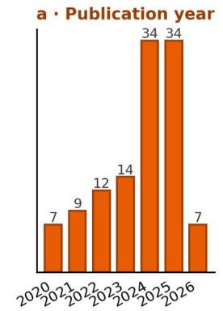

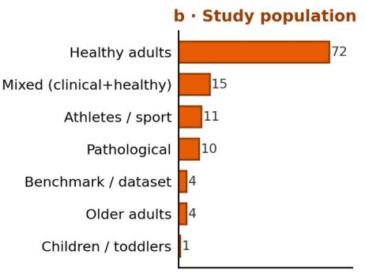

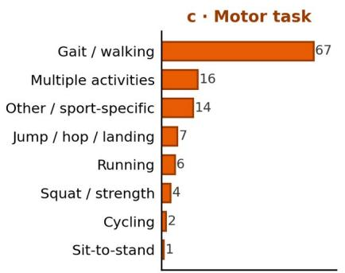

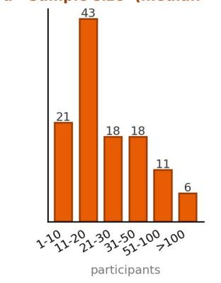

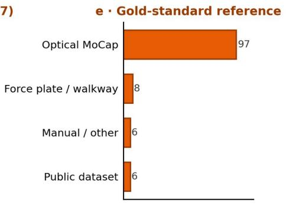

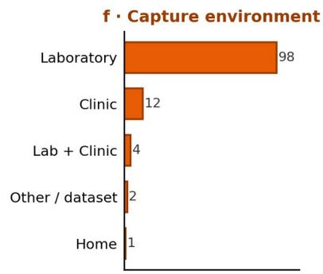  
Figure 2. 纳入文献库概览（n = 117）：a，发表年份；$\mathbf { b } ,$ 研究人群；$\pmb { c } ,$ 运动任务；$d ,$ 样本量；e，金标准参考；f，采集环境。

Table 1. 纳入文献库的技术配置（n = 117）。

<table><tr><td>变量 / 类别</td><td>n (%)</td></tr><tr><td>相机数量</td><td></td></tr><tr><td>1</td><td>53 (45%)</td></tr><tr><td>2</td><td>34 (29%)</td></tr><tr><td>3-4</td><td>13 (11%)</td></tr><tr><td>5-9</td><td>11 (9%)</td></tr><tr><td>&gt;=10</td><td>4 (3%)</td></tr><tr><td>基准测试 / 可变</td><td>2 (2%)</td></tr><tr><td>相机类型</td><td></td></tr><tr><td>工业 / 机器视觉相机</td><td>47 (40%)</td></tr><tr><td>智能手机</td><td>30 (26%)</td></tr><tr><td>网络摄像头</td><td>14 (12%)</td></tr><tr><td>运动相机 / 单反 / RGB 相机</td><td>16 (14%)</td></tr><tr><td>其他 / 未报告</td><td>5 (4%)</td></tr><tr><td>平板电脑</td><td>5 (4%)</td></tr><tr><td>标定</td><td></td></tr><tr><td>无（单目）</td><td>53 (45%)</td></tr><tr><td>棋盘格</td><td>38 (32%)</td></tr><tr><td>其他 / 未指定</td><td>20 (17%)</td></tr><tr><td>光束法平差 / 点阵</td><td>3 (3%)</td></tr><tr><td>标定棒</td><td>3 (3%)</td></tr><tr><td>2D 姿态估计器</td><td></td></tr><tr><td>OpenPose / OpenCap 系列</td><td>57 (49%)</td></tr><tr><td>MediaPipe / BlazePose</td><td>17 (15%)</td></tr><tr><td>其他具名深度学习检测器 (AlphaPose, YOLO, PifPaf, HRNet, MMPose, Detectron2, ViTPose...)</td><td>17 (15%)</td></tr><tr><td>自定义 / 未指定的深度学习模型</td><td>7 (6%)</td></tr><tr><td>DeepLabCut</td><td>6 (5%)</td></tr><tr><td>无 / 端到端</td><td>5 (4%)</td></tr><tr><td>专有软件 / SDK</td><td>5 (4%)</td></tr><tr><td>多估计器基准测试</td><td>3 (3%)</td></tr><tr><td>架构（3D 重建）</td><td></td></tr><tr><td>2D 单目（无显式 3D）</td><td>47 (40%)</td></tr><tr><td>多视角三角测量</td><td>44 (38%)</td></tr><tr><td>单目提升（2D-&gt;3D）</td><td>19 (16%)</td></tr><tr><td>人体网格 / SMPL</td><td>4 (3%)</td></tr><tr><td>端到端 / 直接</td><td>3 (3%)</td></tr><tr><td>生物力学软件</td><td></td></tr><tr><td>自定义代码 (Python/Matlab)</td><td>74 (63%)</td></tr><tr><td>基于 OpenSim 的建模</td><td>33 (28%)</td></tr><tr><td>通过 OpenCap（智能手机应用）</td><td>13 (11%)</td></tr><tr><td>直接使用 OpenSim</td><td>20 (17%)</td></tr><tr><td>无（2D 角度）</td><td>8 (7%)</td></tr><tr><td>其他肌肉骨骼模型（MSK）(Visual3D, CusToM, AnyBody)</td><td>2 (2%)</td></tr><tr><td>实时处理能力</td><td></td></tr><tr><td>否（后处理）</td><td>107 (92%)</td></tr><tr><td>是 / 近实时</td><td>8 (7%)</td></tr><tr><td>未指定</td><td>2 (2%)</td></tr></table>

## 3.2 核心流程架构

每个流程管线均属于按部署模态（Fig. 3）划分的五种互斥架构族之一。全文严格区分了三个术语：模态（modality，指从单视角/单目重建，或从多个同步视角重建）、族（family，五种架构之一）以及叠加层（overlay，任何架构族均可添加的可选细化模块）。单目模态包含四个架构族，它们的主要区别在于如何升至三维：2D 单目（2D Monocular）直接从二维关键点计算关节角度（47 项研究，40%）[17-63]；单目升维（Monocular Lifting）从这些检测结果中回归 3D 姿态（19 项，16%）[64-81, 86]；人体网格恢复（Body Mesh Recovery）拟合参数化全身网格而非稀疏骨架（4 项，3%）[11, 82-84]，其代表作 BioPose [11] 是通过 IEEE Xplore 检索到的同行评审 WACV 2025 论文；端到端直接回归（End-to-End Direct）直接从图像回归关节角度（3 项，3%）[85, 87-88]。多相机模态以多视角三角测量（Multi-view Triangulation）为主，它通过相交来自多台校准相机的光线来重建 3D 关节位置（44 项，38%）[8-9, 89-130]。这两种模态在研究数量上存在差异（73 项对比 44 项），更重要的是在能力上存在差异（Section 3.3）。模态并不等同于物理相机数量。许多单视角管线使用额外的相机仅用于对比或校准，且有一项端到端研究使用了多视角输入，因此架构族是按架构而非相机数量划分的（Table 1）。

2D 单目和三角测量技术已相当成熟且仍在持续增长（2024 年及以后分别有 27 项和 30 项研究）。单目升维在 2021 年之后出现并不断扩展。网格恢复是最新的进入者：所有基于 SMPL 的研究均出现在 2024 年或更晚。端到端回归曾短暂出现，但未能持续发展。近期三角测量研究的激增，得益于 Pose2Sim 和 OpenCap 等开箱即用多视角工具的发布。

架构是一个共享的管线骨架，其上可以添加可选的细化模块，而非一种固定的方法。文中对五种非互斥的叠加层进行了编码：结合肌肉骨骼建模的逆运动学、虚拟标记点增强、深度学习时序平滑、基于物理的优化以及动力学输出（地面反作用力或关节力矩）。大多数管线几乎不添加细化处理。近三分之二（117 项中的 73 项）未使用任何叠加层并直接报告原始几何角度，且仅有

28 项研究结合了两种或更多方法。精炼优化主要集中在多视角类别中。结合肌肉骨骼建模的逆向运动学是最常见的叠加方法（36 项研究，31%），并在 44 项三角测量研究中的 27 项中得到应用，这些研究几乎涵盖了所有虚拟标记点增强流水线（即 OpenCap 模式）。相比之下，47 项 2D 单目研究中有 46 项仍仅停留在纯几何层面，而基于 OpenSim 的应用（包括 OpenCap）几乎仅限于三角测量。因此，深入的肌肉骨骼建模集中在多相机阵营，而具有最大部署潜力的单目阵营大多仅停留在原始的二维角度。

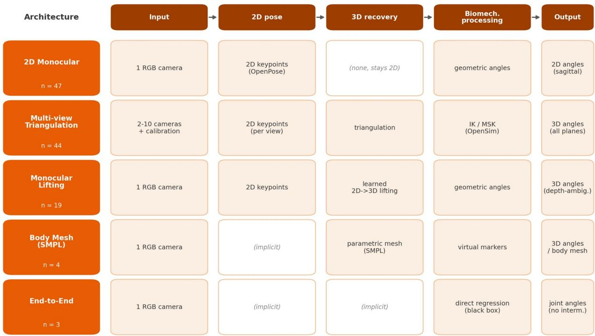  
Figure 3. 五种无标记动作捕捉架构及其共享的流水线阶段。

## 3.3 计量学验证

## 3.3.1 参考标准

约 83% 的研究对照基于标记点的光电系统进行了验证，最常见的是 Vicon、Qualisys、OptiTrack、BTS 或 Nokov。少数研究使用了步态分析跑道（GAITRite、Zeno/PKMAS）、测力台、公开动作捕捉数据集，或者极少数使用了平面 X 射线成像。这些参考系统本身并非毫无误差：它们存在软组织伪影（soft-tissue artefact），即皮肤标记点相对于骨骼的运动 [2]，这为任何无标记系统与其对比时所能展现的一致性设定了上限。

尽管如此，光电动作捕捉仍是生物力学领域事实上的参考标准。最近的一项无标记研究甚至发现其自身的不一致性至少与该伪影相当 [117]，因此这两种范式在精度上并不能被完全清晰地区分开来。

## 3.3.2 关节角度精度与临床阈值

矢状面下肢一致性在髋关节、膝关节、踝关节和骨盆的中位绝对误差集中在约 5 到 ${ \boldsymbol { 6 } } ^ { \circ }$ 之间，所有四个关节彼此之间的差异均在大约 1 度以内（Table 2）。研究间的离散度较大（四分位距约为 3 到 8°）。我们将一致性与 McGinley et al. 针对三维步态运动学提出的误差范围进行了基准对比，其中 $2 ^ { \circ }$ 或更小的误差被广泛认为是可接受的，$^ 2$ 到 $5 ^ { \circ }$ 的误差是合理的但在解释时需要加以考虑，而超过 $5 ^ { \circ }$ 的误差可能会误导临床解释 [131]。这些是基于标记点的可靠性数据。由于参考系统本身具有重复性误差（在矢状面外其自身即可接近 $5 ^ { \circ }$），接近该水平的一致性在一定程度上受到参考系统自身噪声的限制，更好地理解方式是其尚未达到基于标记点的可靠性，而非在临床上不可用。可接受误差并非单一常数，因为它取决于临床问题以及所测偏差的大小，因此我们报告的是一个区间而非单一截断值。在所有矢状面下肢估计中，仅有约 6% 落在 $2 ^ { \circ }$ 的可接受区间内，约 37% 落在 2 到 $5 ^ { \circ }$ 的合理区间内；而分别来看，仅在均方根误差指标下，就有约一半的矢状面下肢估计超过 $5 ^ { \circ }$（中位数 5.0°），在平均绝对误差指标下也有约一半超过 $5 ^ { \circ }$（中位数 5.0°）。汇总所有报告的指标得出了类似的数据（约 57%）。这一水平正是 McGinley et al. 认为可能误导临床解释的阈值（Fig. 5）。这一规律模式才是真正的发现，而非精确的比例。大多数已发表的流水线即使在其表现最佳之处，也超过了引起关注的 $5 ^ { \circ }$ 水平。在康复方面，五到六度的误差与临床医生在康复或治疗调整过程中试图追踪的运动学变化属于同一量级，例如脑瘫患者

屈膝蹲伏姿势（crouch posture）的逐渐减轻，或卒中后僵膝与划圈步态模式的改善，因此处于该误差水平的仪器可能会掩盖真实的临床变化。

## 3.3.3 按架构划分的准确性

我们按架构类别绘制了矢状面误差图（Fig. 4）。代表性最强的两类架构，即 2D 单目（2D Monocular，n = 47）和多视角三角测量（Multi-view Triangulation，n = 44），表现相似，下肢中位误差大约为 4 到 ${ \boldsymbol { 6 } } ^ { \circ }$。单目升维（Monocular Lifting，n = 19）的表现稍逊，下肢中位误差约为 $^ { 6 }$ 到 $7 ^ { \circ }$，且研究间离散度最大。这与深度模糊性相吻合：单个摄像头无法完全分辨朝向或远离摄像头的运动，因此从单个视角回归三维姿态本质上比通过多个标定视角进行三角测量更为困难。人体网格恢复（Body Mesh Recovery）和端到端直接法（End-to-End Direct）各自的研究数量均少于或等于 4 项，因数量过少而无法比较，仅进行了描述性绘图。没有哪一类架构的中位数能达到 $2 ^ { \circ }$ 的可接受范围，因此临床精度差距是整个领域的普遍特征，而非单一薄弱架构所致。

## 3.3.4 平面覆盖与矢状面报告偏差

主要局限性一部分在于报告了什么，另一部分在于到底能测量什么。面外运动学数据几乎仅来自多视角类别，原因有两点：2D 单目类别根本无法恢复面外旋转，因为它不生成三维估计；而单目三维类别和三角测量虽能恢复它，但大多并未予以报告。在架构 × 关节 × 平面图（Additional file 4）中，额状面和横截面单元格主要由三角测量填充（例如髋关节额状面 n = 13，髋关节横截面 n = 10），而每个单目类别都仅填满了一列矢状面。报告不平衡性非常显著。对于膝关节，有 65 项研究报告了矢状面误差，而额状面仅 5 项、横截面仅 3 项；髋关节（57 / 17 / 12）和踝关节（49 / 4 / 1）也遵循相同模式。即便存在额状面和横截面的数值，它们不仅更为稀缺，而且误差更大（例如踝关节额状面约为 9°）。与诸多临床问题（包括膝外翻和膝内翻、髋关节旋转以及足部行进角）最相关的平面，反而是验证最少的。

## 3.3.5 时空与动力学验证

时空参数（步行速度、步长、步时）在约三分之一的研究中（34%）得到了验证，且相比关节角度吻合度更高，这反映了它们对关键点噪声的敏感度较低。针对地面反作用力或关节力矩的测力台动力学验证仅见于九项研究。该领域主要验证矢状面的下肢运动学。正如第 3.4 节和第 3.5 节将展开讨论的，面外运动学和动力学在很大程度上仍未经深入检验。

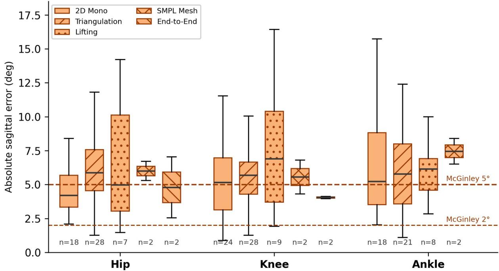  
Figure 4. 核心架构分类下的矢状面下肢关节误差。

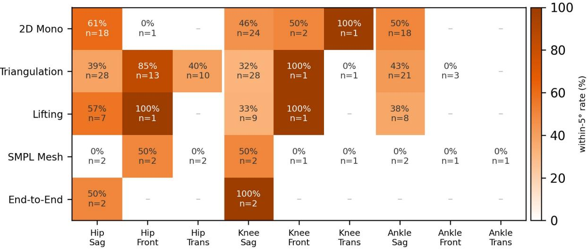  
Figure 5. 处于 $5 ^ { \circ }$ 误差水平（McGinley 可接受至合理范围）内的研究比例，按架构、关节和平面划分。每个单元格均根据贡献该架构、关节和平面的研究进行计算。

Table 2. 按解剖平面划分的关节角度验证（绝对一致性与光电参考对比）。

<table><tr><td>关节</td><td>平面</td><td>研究数量 (n)</td><td>中位数 |误差| (°)</td><td>IQR (°)</td><td>≤ 5° (%)</td></tr><tr><td>骨盆</td><td>矢状面</td><td>5</td><td>5.2</td><td>3.4-6.1</td><td>40</td></tr><tr><td>骨盆</td><td>额状面</td><td>3</td><td>4.0</td><td>2.0-4.9</td><td>—</td></tr><tr><td>骨盆</td><td>横断面</td><td>3</td><td>3.1</td><td>2.0-3.3</td><td>—</td></tr><tr><td>髋</td><td>矢状面</td><td>57</td><td>5.5</td><td>3.6-7.1</td><td>47</td></tr><tr><td>髋</td><td>额状面</td><td>17</td><td>4.3</td><td>3.0-5.2</td><td>76</td></tr><tr><td>髋</td><td>横断面</td><td>12</td><td>5.7</td><td>4.4-7.0</td><td>33</td></tr><tr><td>膝</td><td>矢状面</td><td>65</td><td>5.6</td><td>3.7-7.0</td><td>40</td></tr><tr><td>膝</td><td>额状面</td><td>5</td><td>4.8</td><td>3.1-12.8</td><td>60</td></tr><tr><td>膝</td><td>横断面</td><td>3</td><td>5.9</td><td>2.4-9.5</td><td>—</td></tr><tr><td>踝</td><td>矢状面</td><td>49</td><td>5.9</td><td>3.6-8.4</td><td>43</td></tr><tr><td>踝</td><td>额状面</td><td>4</td><td>9.0</td><td>5.9-10.3</td><td>—</td></tr><tr><td>踝</td><td>横断面</td><td>1</td><td>11.1</td><td>n/a</td><td>—</td></tr></table>

注：矢状面以外的报告明显不足（例如，膝关节：矢状面 65 项 vs 额状面 5 项 vs 横断面 3 项）。最后一列报告了处于 5° 误差水平（McGinley 可接受至合理范围；参见第 3.3.2 节）内的比例。基于少于五项研究的单元格仅供参考。由于报告普遍存在异质性，报告的一致性指标合并了均方根误差和平均绝对误差；每个指标的分项细目见 Additional file 3。仅限于这两个主要指标时，这一不足仍然存在：在仅考虑均方根误差（中位数 5.0°）以及仅考虑平均绝对误差（中位数 5.0°）的情况下，约有一半的矢状面下肢估计值超过 $5 ^ { \circ }$。

## 3.4 技术解构（MICRO）

为了确定下一代流水线背后的计算机视觉构建模块，我们收集了包含 572 篇 arXiv 和会议记录的补充 MICRO 语料库，并将它们归类为 17 个流水线步骤模块。由于该语料库是人工整理而非系统检索的（方法），Figure 6 通过各模块的相对活跃度（低、中或高）而非原始计数来进行表征，并且我们未计算 MACRO 与 MICRO 的比率。

有一个定性信号值得谨慎注意。我们筛选的文献记录集中在 2024 年和 2025 年，而基础模型（foundation model）模块几乎全部在 2024 年之后。由于该语料库是通过反向引用进行策展和播种的，这种时效性在一定程度上反映的是我们的抽样而非整个领域，因此我们仅将其解读为新兴计算机视觉方法与其在经过验证的生物力学工作中被采纳之间存在时间延迟的粗略、定性提示，而不是一个精确测量的间隔。支持这种差距更明确的证据是，这些新兴模块在经过验证的语料库中几乎完全缺席（第 3.5 节）。

将其视为映射到流水线各阶段的工具箱（图 7；方法的完整列表、各自针对的阶段、其贡献及成熟度见附加文件 5），当前最先进的技术为几乎每个模块都提供了候选升级方案 [132-150]。在输入阶段，单目度量深度与三维几何模型以及无靶标多相机自标定正在走向成熟 [174-176]，而通过相机运动、重力或学习到的视场角线索进行世界坐标系对齐（world grounding），有助于在单相机条件下按度量尺度放置受试者，这一问题目前仍仅得到部分解决 [133, 177]。对于二维姿态，实时和基于 Transformer 的主干网络 [151-153] 正在取代主导 MACRO 语料库的 OpenPose 一代。对于三维恢复，存在若干并存的技术流派：单目提升（monocular lifting）[10, 154]；基于 SMPL 系列的基础模型网格恢复 [155-157, 172]，它围绕稠密参数化网格重构了流水线，并允许访问解剖标记点 [158]；全身网格到角度的逆向运动学 [171]；多人与多视角网格拟合 [169, 173]；以及到 OpenSim 的经典三角测量 [8]。对于生物力学桥梁，虚拟标记点增强 [159] 以及可微或神经逆向运动学 [160-162] 伴随着骨骼缩放和逆向动力学 [168] 正在兴起。动力学模块在姿态下游利用结合物理先验的模型或学习模型估计地面反作用力和关节力矩 [163]，其目标输出在 MACRO 文献中很少得到验证。在重建层之上，包含多模态生物力学基础模型 [146] 和按每个自由度进行不确定度量化 [164] 的分析层开始出现，满足了临床部署的可靠性要求。若干接近完整的流水线整合了这些模块，而不是引入单一新模块：BioPose [11]、OpenCap Monocular [12] 以及便携式生物力学实验室（Portable Biomechanics Laboratory）[170]，后者报告了其作者称从手持视频中获得的临床可接受的一致性。

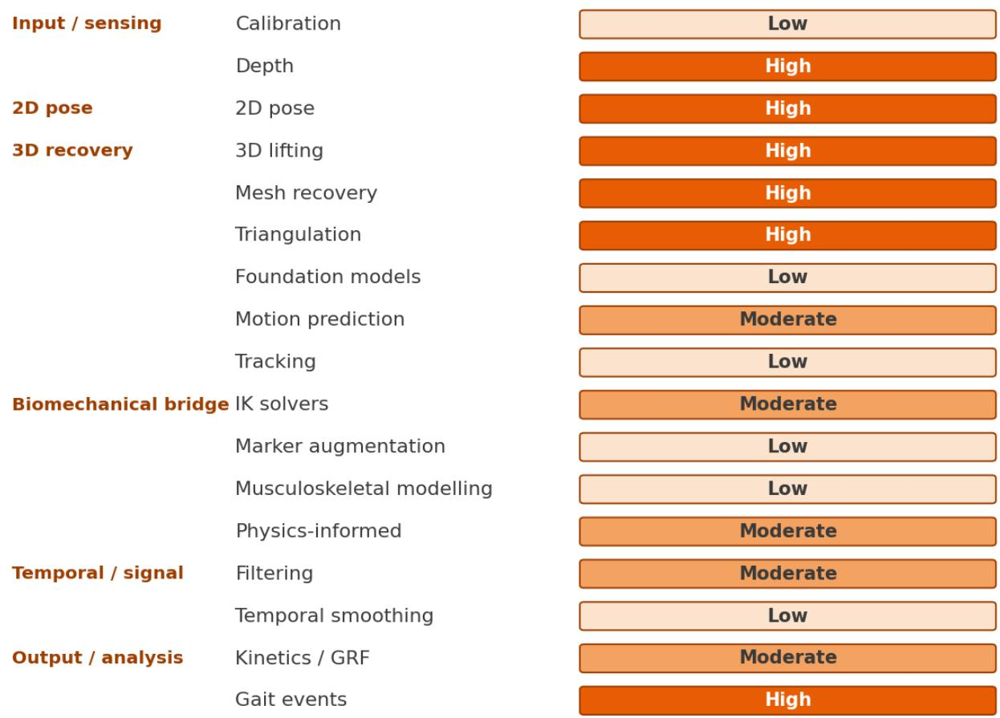  
Figure 6. 策展的 MICRO 样本池在 17 个流水线步骤模块中的定性活跃度。阴影表示非系统性、策展样本池中的相对代表水平（低、中、高）；它反映的是筛选和策展工作量，而非领域规模或生物力学重要性，不应被视为测量量。

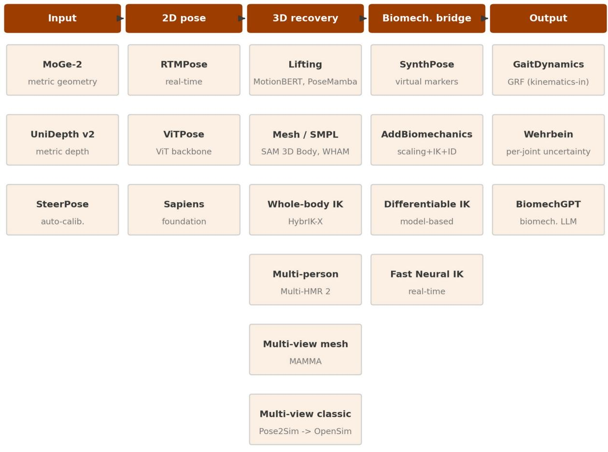  
Figure 7. 前沿技术工具箱：每个流程阶段的候选升级方案（每个阶段仅展示一种代表性选择，非详尽列举）。集成式流程（BioPose、OpenCap Monocular、Portable Biomechanics Laboratory）整合了其中的若干模块，并在正文中进行了讨论。

## 3.5 MACRO-MICRO 桥接

将五种经过验证的架构族映射到新兴模块上（图 8），逐个族系描绘了转化前沿。只有多视角三角测量正在积极引入新兴模块：通过 OpenCap 谱系，它采用了虚拟标记点增强以及结合肌肉骨骼建模的逆向运动学，少数研究正在探索视频动力学。而四种单目族系除了 2D 姿态估计和直接几何角度计算之外，几乎没有采用任何其他技术。在这所有五个族系中，网格恢复（mesh recovery）、可微逆向运动学、视频动力学以及以人为中心的基座模型基本上处于空白状态。因此，该图右侧几乎是一片空白：那些最能改变临床能力的模块，采纳度反而最低。

四个模块构成了这一差距。首先，能够为单目流程提供稠密且符合解剖学定位表征的基座模型网格恢复，在已验证的研究中依然缺席。其次，能够替代脆弱的事后逆向运动学（post-hoc IK）的可微及神经逆向运动学，仅存在于 MICRO 中。第三，基于视频的动力学——MACRO 中覆盖最少的输出（第 3.3.5 节）——是一个活跃的 MICRO 模块。第四，以人为中心的基座模型尚未在已验证的工作中得到应用。这些模块构成了单一的以网格为中心流程的组件，并为第 5 节提出的框架界定了设计空间。

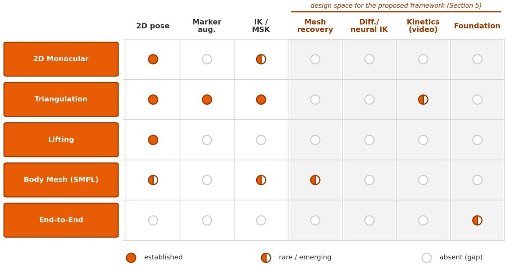  
Figure 8. 已验证的架构（MACRO）与新兴构建模块（MICRO）之间的映射。

## 4. 讨论

## 4.1 主要发现总结

本范围综述（scoping review）将生物力学领域基于视频的无标记动作捕捉已验证文献（MACRO 语料库）与新兴的计算机视觉前沿技术（精选的 MICRO 语料库）进行了对比。其中有五项发现尤为突出。该领域尚处于起步阶段且发展迅速，纳入的大多数研究均发表于近两年。其实证基础较为狭窄：受试者大多为健康成年人

多见于步态研究、实验室环境、小样本量，且极少进行实时或实验室外的实际应用。这些方法跨越单目和多相机两种模态，可归纳为五种架构体系；然而，大多数处理流程并未进行生物力学精细化处理，仅报告了原始的几何角度。其计量学性能未达到该领域所声称的与光学标记系统等效的水平：矢状面下肢运动学的一致性误差通常超过了 McGinley et al. 认为可能导致临床误判的误差阈值，而平面外运动学和动力学指标则极少得到验证。最有可能改变这一现状的核心构件——即基础模型网格重建、可微逆运动学以及视频动力学估算——虽然在计算机视觉领域非常活跃，但在经过验证的生物力学领域中却几乎空白，这符合计算机视觉技术创新与经过验证的生物医学落地之间预期的滞后性。

## 4.2 各模态成熟度与临床转化

这两种模态在可部署性与计量学完整性之间进行了权衡。多视角三角测量是通向完整三维生物力学的更成熟路径。它是唯一常规报告额状面和横断面运动学的体系，并且集成了使关节角度具备可解释性的逆运动学和肌肉骨骼处理流程（尤其是 OpenCap 系列）。但它仍局限于实验室环境，且需要多台同步并校准过的相机。单目模态使用无需校准的单台相机，在床旁护理/现场端（point of care）具有更高的可部署性。然而，大多数二维单目研究仅止步于原始几何角度（第 3.2 节），而单目 2D 升 3D（monocular lifting）表现出的误差最大（下肢中位误差约为 6° 至 7°）。因此，临床可接受性差距存在于整个领域，而非仅源于某一种薄弱的架构。尽管步行速度等时空参数与参考系统高度吻合，但更关键的问题在于：对于大多数流程而言，声称其与基于标记的关节运动学具有可互换性仍为时过早。

## 4.3 动力学：下一个前沿

在经过验证的文献中，研究最少的输出指标是动力学（kinetics）。地面反作用力（ground-reaction forces）和关节力矩（joint moments）与关节负荷、平衡能力及跌倒风险的关联最为直接，然而仅有九项研究对照测力台（force plates）对其进行了验证。可以说，与单纯的运动学（kinematics）相比，它们更具临床指导价值。一个新兴的 MICRO 模块正是针对这一差距：利用物理融合（physics-informed）和学习型方法从视频中估计力和力矩；生成式基座模型（generative foundation models）现在能以接近实验室级别的精度从运动学数据中估计地面反作用力 [163]。首批从单摄像头到肌肉骨骼动力学的流水线（pipelines）已经出现 [12]。因此，无测力台动力学（force-plate-free kinetics）仍处于早期阶段，是一项尚未被充分证实的构想。与矢状面关节角度精度的边际提升相比，它具有更高的潜在临床价值，但验证成本显著增加，因为它在运动学误差之上又叠加了逆向动力学（inverse-dynamics）建模误差，且在非稳态步态之外极难进行验证。

## 4.4 已验证文献中的研究空白

转化应用前沿主要存在三大空白。第一是平面覆盖范围。面外运动学（out-of-plane kinematics）鲜有报道（对于膝关节，矢状面为 65 项 vs 冠状面 5 项 vs 横断面 3 项），因此与诸多临床问题最相关的测量指标反而最缺乏验证，且在有报道的研究中其误差更大。第二是人群覆盖。临床和病理人群队列十分罕见，老年人和儿科队列更为稀缺，尽管这些群体本应是从普适易用的动作分析中获益最多的对象。第三是运行条件。实时分析（仅占研究的 7%）以及居家或现场动作捕捉（几乎缺失）在很大程度上仍未得到解决，尽管两者都是实验室外分析的先决条件。填补这些空白比进一步对健康成人的矢状面步态进行基准测试具有更高的优先级。

## 4.5 本篇综述的优势与局限性

本综述具有两个主要优势。它将已注册的 PRISMA-ScR 方案与广泛的三数据库检索相结合，并采用双层设计，将经过验证的文献置于底层计算机视觉研究的发展轨迹之中。同时存在若干局限性。根据设计，本综述排除了黑盒商业系统（第 2.3 节），包括临床应用最广泛的 Theia3D，以及在康复领域仍然常见的 RGB-D 深度传感器；因此，研究结果反映的是经过验证的开放架构证据基础，而非完整的临床应用现状。MICRO 语料库经过筛选且非详尽无遗，因此其区块计数反映的是筛选量和发表量，而非生物力学重要性，我们仅对其进行了定性使用。数据提取采用了大语言模型辅助流程，并进行了跨供应商核对和裁决，通过对纳入研究中随机抽取的 20% 进行人工重新提取来验证，我们仅报告清洗后的数值，排除了带符号偏差、速度衍生以及错误指标的条目。作为一项范围综述，本综合分析采用结构化和叙述性形式，而非元分析，且我们未对偏倚风险进行正式评估。我们以 McGinley 等人的误差范围为基准：$2 ^ { \circ }$ 或以下为可接受，2 至 $5 ^ { \circ }$ 为合理，超过 $5 ^ { \circ }$ 可能产生误导 [131]；可接受的误差最终取决于具体应用，因此该范围分析是一个参考点，而非绝对截断值。

## 4.6 对临床实践和康复研究的启示

如今可用的输出结果取决于具体的测量指标（Table 3）。时空参数（如步行速度、步长和步时）与参考系统高度一致，适用于监测、筛查和远程评估；尤其是步行速度，被描述为老年人的第六生命体征 [165]。矢状面关节角可用于粗略的定性趋势，但不能用于需要分辨率低于 3 至 $5 ^ { \circ } ,$ 的决策，例如追踪微小的康复变化。额状面和横断面的角度以及所有动力学参数仍处于研究级别，尚未经过临床应用验证。

Table 3. 无标记动作捕捉输出的临床就绪度。

<table><tr><td>就绪度层级</td><td>输出指标</td><td>适用场景</td></tr><tr><td>达到临床应用标准</td><td>时空参数（步行速度、步长、步时）</td><td>监测、筛查和远程评估</td></tr><tr><td>适用于筛查与趋势分析</td><td>矢状面关节角（粗略屈曲-伸展）</td><td>定性趋势追踪；不适用于需要分辨率低于3至5度的决策</td></tr><tr><td>仅达研究级</td><td>额状面和横断面关节角；无测力台动力学；病理步态特征分析</td><td>不得用于临床决策</td></tr></table>

该领域的结构引出了一个安全性问题。最易部署的工具，即单摄像头

单目流程也是最不够完善的，因为47项研究中有46项报告的是原始几何角度。因此，可部署性与验证就绪度呈反比关系：廉价的单目工具可能恰恰因其易于获取而在尚未针对其拟支持的决策进行验证之前，就已进入临床应用。

健康成人的验证结果无法直接推广至患者。病理步态打破了这些流程所依赖的假设：助行器、矫形器和拐杖等辅助器具；非典型形态；震颤、痉挛和运动障碍等不自主运动；以及划圈步态和剪刀步态等严重的平面外偏离。健康成人中5°的误差对于偏瘫或屈膝步态（crouch gait）患者而言并非安全的先验。需要的是针对特定人群的验证，而不仅仅是增加参与者数量。上述每一种情况都会破坏特定的假设。辅助器具和矫形器会遮挡或移位姿态估计器所依赖的地标点。不自主运动破坏了用于轨迹去噪的时间平滑先验。最大的病理偏离发生在冠状面和横断面，而这些系统在这些平面上的估计效果最差，导致临床信号与测量误差落在了同一个平面上。

有三个实际风险值得关注。姿态估计的训练和验证数据偏向于年轻、苗条、浅色皮肤的成年人，这一偏差与本次综述记录的偏差一致，因此在代表性最弱的人群中性能可能会更差，这是一个公平性问题。临床和家庭视频引发了标记点实验室中不存在的隐私和知情同意问题。此外，监管治理必须确保验证先于部署。

5. 临床可部署无标记点生物力学的未来设计指南 本节实现第三个目标：将经过验证的 MACRO 经验和新兴的 MICRO 模块转化为临床可部署流程的设计指南。这些是具有假设生成性的方向，而非已验证的方法，每一项都与第 3 节和第 4 节中记录的不足直接挂钩，而非在此赘述。一个核心原则贯穿始终：对于临床目标人群（老年人和病理队列），泛化性必须来源于普遍适用的要素——解剖学、力学和受试者特异性模型，而不是来源于在排除这些人群的群体上所学到的先验。因此，该方向结合了

成熟组件（特定于受试者的 OpenSim 缩放和逆运动学，以及基于物理的精炼）与新兴组件（稠密网格恢复；可微、基于模型的逆运动学；每个自由度的不确定度）以及一些在经生物力学验证领域未经测试的组件（多视角网格融合和两级网格到解剖结构的对应关系）相结合。任何学习得到的先验都保留在可以通过图像检查其误差且组件可替换的阶段，从而使最终的保真度取决于特定于受试者的解剖结构和力学特性。所有组件均取自已发表的文献，并通过公开代码完全开放可用。本视角未提出任何专有系统。我们提炼了五条指导原则（图 9）。

首先，我们提出了一个稠密参数化网格前端，逐帧恢复稠密参数化人体网格而非稀疏关键点，并使用在经生物力学验证的文献库中尚未出现的人体网格基础模型（例如基于 Sapiens 系列 [153] 的 SAM 3D Body [155] 及其实时变体 [166]，以及 MedSapiens [167] 所展示的临床解剖标志迁移）。稠密网格承载了体段方向和平面外旋转，这恰恰是经生物力学验证的单目方法系列极少报告的内容。其估计器继承了健全人群的偏差，但这种风险是有界的：估计器是一个可替换的组件，随着模型的多样化而改进，而且网格误差是局部的且可对照图像进行检查，这与学习型运动学模型内部的隐式回归不同。这解决了第 3.5 节指出的第一个差距：网格恢复存在于 MICRO 中，但在所有经生物力学验证的 MACRO 研究中均缺失。其次，我们解决了从网格到临床定义解剖结构的步骤。参数化网格没有临床定义的关节中心，从固定的网格位置读取虚拟标记会将通用的、可校准的网格到解剖结构偏移量与微小的个体变异混为一谈。因为一到两厘米的不精确配准可能会引起五到十度的关节角度误差，这对于非典型人群最为关键，因为他们具有临床意义的偏差本身就很小。我们提出了一个两级对应关系：在带标注的参考上校准一次然后冻结的通用网格到解剖标志映射，加上一个较小的、受到强正则化的特定于受试者的残差，骨骼标志比软组织标志受到更严格的约束。Neural Localizer Fields [158] 允许在网格上查询任意解剖点，从而使这成为可能。这解决了 MICRO 遗留的一个差距：虚拟标记是从固定位置读取的，缺乏非典型人群所需的校准。

第三，运动学推断应该是特定于受试者的、基于模型的，而不是基于学习的。这可以说是临床转化中影响最深远的抉择。存在三种选择。基于学习的神经逆运动学通过在人群上训练的网络预测角度（BioPose [11]、Fast Neural IK [162]）；其

泛化能力受限于训练分布。可微逆运动学（differentiable inverse kinematics）是同一种基于模型的求解方式被赋予了可微性，因此缩放、配准和逆运动学可以通过梯度下降进行联合优化（Differentiable Biomechanics [160]、JAX-IK [161] 以及同时求解逆动力学的 AddBiomechanics [168]）；可微并不意味着是通过学习得到的。经典的基于模型的求解（OpenSim）在解剖学约束下逐个受试者拟合关节角度，无需群体训练。对于老年和病理群体，这一区别可能是决定性的：在健全人运动上学习得到的逆运动学可能会回归到其训练模式，从而掩盖测量本应捕捉到的病理偏差。因此，我们建议运动学推断应基于特定受试者的、基于模型的逆运动学（可选择性地使其可微），而非基于学习得到的映射。这解决了第 3.5 节的第二个空白，即在该节中，可微和神经逆运动学仅出现在 MICRO 中，而基于学习的求解是否能迁移到目标群体仍是一个悬而未决的问题。

第四，我们区分了两种部署方式。在单目情况下（单相机，最易部署），通过固定肢体段长度的时间形状锁定（temporal shape-lock），将每帧的网格整合为每次试验单一的形态；由于软组织伪影也会改变基于标记点的肢体段长度，形状锁定估计在这一维度上可能接近基于标记点采集的一致性，这是一个可检验的假设 [117]。随后，沿袭 OpenCap Monocular [12] 的思路，采用基于物理的精细化阶段（足部接触、抗漂移、平滑处理）来对抗单目漂移。在多相机情况下，不同于对稀疏关键点进行三角测量，而是通过可见性加权重投影将单个网格联合拟合到所有标定视角；固定的拓扑结构使视角间的对应关系具有内在性，并允许若干视角直接观测肢体段长度。这种受到 MAMMA [169] 启发的网格融合路线在经过验证的生物力学领域基本上未被探索，其假设的增益（遮挡鲁棒性、平面外恢复）仍有待测试（第 3.3.4 节和第 4.2 节的空白）。

第五，我们转向输出、动力学（kinetics）与不确定度（uncertainty）。两种模态的目标均为全自由度的关节运动学（kinematics）。无需测力台的动力学估计是该领域验证最少的输出（第 3.3.5 节），且目前仍是一个遥远的前景：生成式基础模型（generative foundation models）已经能够从运动学中估计地面反作用力 [163]，但它们在非典型临床队列中的泛化能力尚未经过测试，且与基于学习的逆向运动学（learned inverse kinematics）一样，需要包含老年人和病理人群的训练数据才能在这些场景中具备可靠性。每个自由度的不确定度在已验证的文献中几乎完全缺失，它是一项更为迫切且在临床上至关重要的补充，因为测量结果是否可靠直接决定了临床决策；基于归一化流（normalizing flows）的概率姿态估计（Wehrbein 等人 [164]）提供了一条可行路径。两者均属于第 3.3.5 节中指出的验证最少的输出之一。

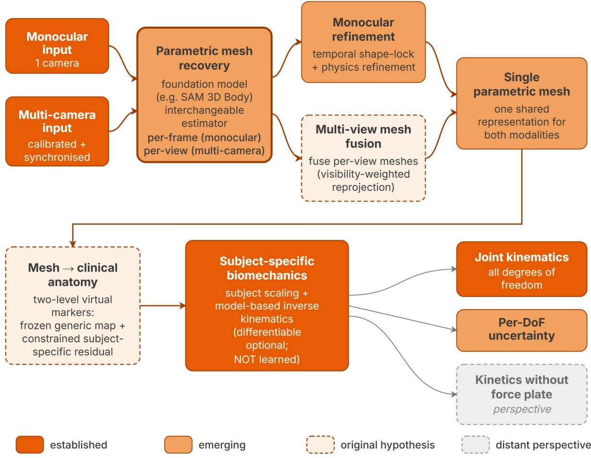  
Figure 9. 可临床部署的无标记生物力学研究议程（以候选流程图形式展示）。单目和多相机路径共享一个参数化网格（parametric-mesh）引擎，并重新汇合为单个网格，通过虚拟标记映射到临床解剖结构，并由受试者特异性逆向运动学进行求解。输出为带有各自由度不确定度的关节运动学，以及在多相机配置下的测力台动力学。

## 6. 结论

基于视频的无标记动作捕捉发展迅速，但现有的验证证据尚不支持在临床关节运动学测量中与基于标记的系统互换使用。与临床生物力学最相关的能力——即面外运动学（out-of-plane kinematics）、动力学以及在真实世界条件下对病理和老年人群的验证——发展最为滞后，而能够解决这些问题的计算机视觉最新进展尚未进入经过验证的文献中。我们将这些已有文献记录的局限性提炼为基于证据的设计准则，将每个差距映射到相应的新兴模块上，作为有待测试的前瞻性视角而非已验证的方法提出。未来的进展将取决于：以生物力学为基础、报告关节角度而非关键点位置误差的标准化评估；在具有临床意义的人群和场景中进行验证；以及消除计算机视觉创新与生物医学验证之间的滞后。

## 声明

伦理批准与知情同意。不适用（已发表文献的二次分析）。

出版同意。不适用。

数据与材料的可用性。研究方案和完整提取数据集可在 Open Science Framework 存储库中获取（DOI 10.17605/OSF.IO/TBYPC）；提取表作为机器可读的附加文件（Additional file）提供。

利益冲突。作者声明不存在利益冲突。

资助。FD 获得了蔚蓝海岸大学（Université Côte d'Azur）人类运动科学博士研究生院（Doctoral School ED SMH (Sciences du Mouvement Humain)）的博士奖学金资助。本项工作得到了 PRESAGE 项目（法国国家研究署，ANR-23-PAVH-0002）的部分支持，该项目资助了包括 Covidence 系统评价平台在内的综述资源。资助方在本次综述的设计、实施、分析或报告撰写中未参与任何工作。

作者贡献。FD：概念构思、方法论、软件、形式分析、调查研究、数据管理、可视化、撰写——初稿。EP：调查研究（在 Covidence 上进行独立、盲审的研究筛选与选择）、撰写——审阅与编辑。FC：撰写——审阅与编辑。RZ：验证（裁决筛选冲突）、监督指导、经费获取、撰写——审阅与编辑。所有作者均已阅读并批准最终手稿。

致谢。不适用。

## 参考文献

1. Windolf M, Götzen N, Morlock M. Systematic accuracy and precision analysis of video motion capturing systems: exemplified on the Vicon-460 system. J Biomech. 2008;41(12):2776-2780. htps://doi.org/10.1016/j.jbiomech.2008.06.024

2. Leardini A, Chiari L, Della Croce U, Cappozzo A. Human movement analysis using

stereophotogrammetry. Part 3: soft tissue artifact assessment and compensation. Gait Posture.

2005;21(2):212-225. htps://doi.org/10.1016/j.gaitpost.2004.05.002

3. Baker R. Gait analysis methods in rehabilitation. J Neuroeng Rehabil. 2006;3(1):4.

htps://doi.org/10.1186/1743-0003-3-4

4. Colyer SL, Evans M, Cosker DP, Salo AIT. A Review of the Evolution of Vision-Based Motion Analysis

and the Integration of Advanced Computer Vision Methods Towards Developing a Markerless System.

Sports Med Open. 2018;4(1):24. htps://doi.org/10.1186/s40798-018-0139-y

5. Cao Z, Hidalgo G, Simon T, Wei SE, Sheikh Y. OpenPose: realtime multi-person 2D pose estimation

using part afinity fields. IEEE Trans Patern Anal Mach Intell. 2021;43(1):172-186.

htps://doi.org/10.1109/TPAMI.2019.2929257

6. Bazarevsky V, Grishchenko I, Raveendran K, Zhu T, Zhang F, Grundmann M. BlazePose: on-device real-

time body pose tracking. arXiv:2006.10204. 2020.

7. Sun K, Xiao B, Liu D, Wang J. Deep high-resolution representation learning for human pose estimation.

In: Proc IEEE/CVF Conf Comput Vis Patern Recognit (CVPR). 2019. p. 5686-5696.

htps://doi.org/10.1109/CVPR.2019.00584

8. Pagnon D, Domalain M, Reveret L. Pose2Sim: An End-to-End Workflow for 3D Markerless Sports

Kinematics-Part 1: Robustness. Sensors. 2021;21(19):6530. htps://doi.org/10.3390/s21196530

9. Uhlrich SD, Falisse A, Kidzinski L, Muccini J, Ko M, Chaudhari AS, et al. OpenCap: Human movement

dynamics from smartphone videos. PLOS Computational Biology. 2023;19(10):e1011462.

htps://doi.org/10.1371/journal.pcbi.1011462

10. Zhu W, Ma X, Liu Z, Liu L, Wu W, Wang Y. MotionBERT: A Unified Perspective on Learning Human

Motion Representations. In: 2023 IEEE/CVF International Conference on Computer Vision (ICCV). 2023.

p. 15039-15053. htps://doi.org/10.1109/iccv51070.2023.01385

11. Koleini F, Saleem MU, Wang P, Xue H, Helmy A, Fenwick A. BioPose: Biomechanically-Accurate 3D

Pose Estimation from Monocular Videos. In: 2025 IEEE/CVF Winter Conference on Applications of

Computer Vision (WACV). IEEE; 2025. arXiv:2501.07800 [cs.CV].

12. Gilon S, Miller EY, Uhlrich SD. OpenCap Monocular: 3D Human Kinematics and Musculoskeletal

Dynamics from a Single Smartphone Video. arXiv:2603.24733 [cs.CV]. 2026.

13. Balaban B, Tok F. Gait disturbances in patients with stroke. PM R. 2014;6(7):635-642.

htps://doi.org/10.1016/j.pmrj.2013.12.017

14. Lam WWT, Tang YM, Fong KNK. A systematic review of the applications of markerless motion

capture (MMC) technology for clinical measurement in rehabilitation. J Neuroeng Rehabil.

2023;20(1):57. htps://doi.org/10.1186/s12984-023-01186-9

15. Tricco AC, Lillie E, Zarin W, O'Brien KK, Colquhoun H, Levac D, et al. PRISMA Extension for Scoping

Reviews (PRISMA-ScR): Checklist and Explanation. Ann Intern Med. 2018;169(7):467-473.

htps://doi.org/10.7326/M18-0850

16. Peters MDJ, Marnie C, Tricco AC, Pollock D, Munn Z, Alexander L, et al. Updated methodological

guidance for the conduct of scoping reviews. JBI Evid Synth. 2020;18(10):2119-2126.

htps://doi.org/10.11124/jbies-20-00167

17. Young F, Mason R, Morris R, Stuart S, Godfrey A. Internet-of-Things-Enabled Markerless Running Gait

Assessment from a Single Smartphone Camera. Sensors. 2023;23(2):696.

htps://doi.org/10.3390/s23020696

18. Verhoeven M, Zandvoort CS, Dominici N. From marker to markerless: Validating DeepLabCut for 2D

sagital plane gait analysis in adults and newly walking toddlers. Journal of Biomechanics.

2025;186:112708. htps://doi.org/10.1016/j.jbiomech.2025.112708

19. Takeda I, Yamada A, Onodera H. Artificial Intelligence-Assisted motion capture for medical

applications: a comparative study between markerless and passive marker motion capture. Computer

Methods in Biomechanics and Biomedical Engineering. 2020;24(8):864-873.

htps://doi.org/10.1080/10255842.2020.1856372

20. Stenum J, Rossi C, Roemmich RT. Two-dimensional video-based analysis of human gait using pose

estimation. PLOS Computational Biology. 2021;17(4):e1008935.

htps://doi.org/10.1371/journal.pcbi.1008935

21. Molteni LE, Andreoni G. Comparing the Accuracy of Markerless Motion Analysis and Optoelectronic

System for Measuring Gait Kinematics of Lower Limb. Bioengineering. 2025;12(4):424.

htps://doi.org/10.3390/bioengineering12040424

22. Sabo A, Gorodetsky C, Fasano A, Iaboni A, Taati B. Concurrent validity of Zeno instrumented walkway

and video-based gait features in adults with Parkinson's disease. IEEE Journal of Translational

Engineering in Health and Medicine. 2022;10:1-11. htps://doi.org/10.1109/jtehm.2022.3180231

23. Panconi G, Grasso S, Guarducci S, Mucchi L, Minciacchi D, Bravi R. 用于步态分析的 DeepLabCut 自定义训练模型与优化功能. Scientific Reports. 2025;15(1):2364.

htps://doi.org/10.1038/s41598-025-85591-1

24. Ota M, Tateuchi H, Hashiguchi T, Ichihashi N. 基于人体姿态跟踪算法的跑步机行走与跑步步态分析系统有效性验证. Gait & Posture. 2021;85:290-297.

htps://doi.org/10.1016/j.gaitpost.2021.02.006

25. Moro M, Marchesi G, Odone F, Casadio M. 基于计算机视觉和深度学习的中风康复患者无标记步态分析：一项初步研究. Proceedings of the 35th Annual ACM Symposium on

Applied Computing. 2020:2097-2104. htps://doi.org/10.1145/3341105.3373963

26. Menychtas D, Petrou N, Kansizoglou I, Giannakou E, Grekidis A, Gasteratos A, et al. 手工标记、2D 姿态估计算法与基于标记的 3D 系统之间的步态分析对比.

Frontiers in Rehabilitation Sciences. 2023;4:1238134. htps://doi.org/10.3389/fresc.2023.1238134

27. Mehdizadeh S, Nabavi H, Sabo A, Arora T, Iaboni A, Taati B. 视频中人体姿态跟踪用于测量老年人步态参数的同质效度：针对多种跟踪器、视角和行走方向的初步分析. Journal of NeuroEngineering and Rehabilitation.

2021;18(1):139. htps://doi.org/10.1186/s12984-021-00933-0

28. Lonini L, Moon Y, Embry K, Coton RJ, McKenzie K, Jenz S, et al. 临床评估期间中风康复患者步态分析的基于视频的姿态估计：一项概念验证研究. Digital Biomarkers.

2022;6(1):9-18. htps://doi.org/10.1159/000520732

29. Ino T, Samukawa M, Ishida T, Wada N, Koshino Y, Kasahara S, et al. 基于单视频摄像机同时测量双侧下肢运动学的 AI 步态分析的有效性.

Sensors. 2023;23(24):9799. htps://doi.org/10.3390/s23249799

30. Lambricht N, Englebert A, Nguyen AP, Fisete P, Pitance L, Detrembleur C. 跑步服装对使用 OpenPifPaf 进行跑步机跑步期间基于智能手机的 2D 关节运动学评估准确性的影响. Sensors. 2025;25(3):934. htps://doi.org/10.3390/s25030934

31. Lambricht N, Englebert A, Pitance L, Fisete P, Detrembleur C. 使用智能手机视频和姿态检测量化对前交叉韧带康复至关重要的功能性任务中的表现和关节运动学. The Knee. 2025;52:171-178. htps://doi.org/10.1016/j.knee.2024.11.006

32. John K, Stenum J, Chiang CC, French MA, Kim C, Manor J, et al. 脑卒中患者跑步机行走与地面行走中基于姿态估计的视频步态分析的准确性对比.

Physical Therapy. 2023;104(2):pzad121. htps://doi.org/10.1093/ptj/pzad121

33. Ino T, Samukawa M, Ishida T, Wada N, Koshino Y, Kasahara S, et al. 基于 OpenPose 的运动分析在纵跳着地测试中测量膝外翻的有效性和可靠性. Journal of

Sports Science and Medicine. 2024;:515-525. htps://doi.org/10.52082/jssm.2024.515

34. Dunn M, Kennerley A, Murrell-Smith Z, Webster K, Middleton K, Wheat J. 视频帧插值在无标记单相机步态分析中的应用（Application of video frame interpolation to markerless, single-camera gait analysis）. Sports Engineering. 2023;26(1):22. htps://doi.org/10.1007/s12283-023-00419-3

35. Drazan JF, Phillips WT, Seethapathi N, Hullfish TJ, Baxter JR. 走出实验室：无标记动作捕捉精确量化垂直跳跃过程中的矢状面运动学（Moving outside the lab: Markerless motion capture accurately quantifies sagital plane kinematics during the vertical jump）. Journal of Biomechanics. 2021;125:110547. htps://doi.org/10.1016/j.jbiomech.2021.110547

36. Boldo M, Di Marco R, Martini E, Nardon M, Bertucco M, Bombieri N. 用于地面步态监测的单相机无标记系统的可靠性研究（On the reliability of single-camera markerless systems for overground gait monitoring）. Computers in Biology and Medicine. 2024;171:108101. htps://doi.org/10.1016/j.compbiomed.2024.108101

37. Andreoni G, Molteni LE. 用于测量下肢步态运动学的无标记运动分析与光电系统精度的比较（Comparison of the Accuracy of Markerless Motion Analysis and Optoelectronic System for Measuring Lower Limb Gait Kinematics）. Lecture Notes in Computer Science. 2024;:3-15. htps://doi.org/10.1007/978-3-031-61063-9\_1

38. Anderson JT, Stenum J, Roemmich RT, Wilson RB. 基于姿态估计的无标记视频步态分析在患有和未患有神经发育障碍幼儿中的验证（Validation of markerless video-based gait analysis using pose estimation in toddlers with and without neurodevelopmental disorders）. Frontiers in Digital Health. 2025;7. htps://doi.org/10.3389/fdgth.2025.1542012

39. Aleksic J, Kanevsky D, Mesaroš D, Knezevic OM, Cabarkapa D, Bozovic B, et al. 自动化反向动作垂直跳分析的验证：无标记姿态估计与基于3D标记的动作捕捉系统对比（Validation of Automated Countermovement Vertical Jump Analysis: Markerless Pose Estimation vs. 3D Marker-Based Motion Capture System）. Sensors. 2024;24(20):6624. htps://doi.org/10.3390/s24206624

40. Yagi K, Sugiura Y, Hasegawa K, Saito H. 使用单个RGB相机的居家步态测量（Gait Measurement at Home Using A Single RGB Camera）. Gait & Posture. 2020;76:136-140. htps://doi.org/10.1016/j.gaitpost.2019.10.006

41. Tahara AK, Chinaglia AG, Monteiro RLM, Bedo BLS, Cesar GM, Santiago PRP. 使用基于像素的无标记机器学习方法预测步行道时空参数（Predicting walkway spatiotemporal parameters using a markerless, pixel-based machine learning approach）. Brazilian Journal of Motor Behavior. 2025;19(1):e462. htps://doi.org/10.20338/bjmb.v19i1.462

42. Francia C, Donno L, Chiosso S, Paloti G, Tarabini M, Galli M. 用于人工智能无标记3D下肢运动分析的双相机系统（Dual-Camera System for AI Markerless 3D Lower Limb Motion Analysis）. Lecture Notes in Computer Science. 2025;:303-312. htps://doi.org/10.1007/978-3-031-97781-7\_22

43. Yamamoto M, Shimatani K, Hasegawa M, Kurita Y, Ishige Y, Takemura H. 使用OpenPose针对佩戴矫形器的各种步态模式的时空及下肢关节运动学参数精度的研究（Accuracy of Temporo-Spatial and Lower Limb Joint Kinematics Parameters Using OpenPose for Various Gait Paterns With Orthosis）. IEEE Transactions on Neural Systems and Rehabilitation Engineering. 2021;29:2666-2675. htps://doi.org/10.1109/tnsre.2021.3135879

44. Wade L, Needham L, Evans M, McGuigan P, Colyer S, Cosker D, et al. 二维额状面和矢状面无标记动作捕捉的检验：对无标记应用的启示（Examination of 2D frontal and sagital markerless motion capture: Implications for markerless applications）. PLOS ONE. 2023;18(11):e0293917. htps://doi.org/10.1371/journal.pone.0293917

45. Kim J, Kim R, Byun K, Kang N, Park K. 基于人体姿态估计评估帕金森病（Parkinson’s disease）患者的时空和运动学步态参数：近正视与侧视视角的比较. PLOS ONE. 2025;20(1):e0317933. htps://doi.org/10.1371/journal.pone.0317933

46. Balci IC, Sayin I, Salturk S, Gursoy R, Ozsoy U, Dogru HC, et al. 生物力学运动分析中无标记技术的可靠性评估：性能比较. Frontiers in Sports and Active Living. 2026;7. htps://doi.org/10.3389/fspor.2025.1712332

47. Hii CST, Gan KB, Zainal N, Mohamed Ibrahim N, Azmin S, Mat Desa SH, et al. 基于无标记姿态估计模型的自动步态分析. Sensors. 2023;23(14):6489.

htps://doi.org/10.3390/s23146489

48. Ge F, Wu C, Ge F, Xu S, Xiao J. OpenPose 在测量膝骨关节炎患者动态行走视频中 HKA 角的可靠性与有效性. Scientific Reports. 2025;15(1).

htps://doi.org/10.1038/s41598-025-09627-2

49. Asaeda M, Onishi T, Ito H, Miyahara S, Mikami Y. 利用机器学习姿态估计计算单腿下落着地时膝外翻角的可靠性与有效性. Heliyon.

2024;10(17):e36338. htps://doi.org/10.1016/j.heliyon.2024.e36338

50. Haberkamp LD, Garcia MC, Bazet-Jones DM. 用于测量单腿深蹲运动学的人工智能人体姿态估计模型的有效性. Journal of Biomechanics. 2022;144:111333.

htps://doi.org/10.1016/j.jbiomech.2022.111333

51. Washabaugh EP, Shanmugam TA, Ranganathan R, Krishnan C. 比较开源姿态估计方法测量步态运动学的准确性. Gait & Posture. 2022;97:188-195.

htps://doi.org/10.1016/j.gaitpost.2022.08.008

52. Gao X, Cheng X, Jiao Y, Reading S, Zhang Y. 能否通过基于视频的步态分析识别步态异常？BlazePose 姿态估计算法的验证. 2025 47th Annual International

Conference of the IEEE Engineering in Medicine and Biology Society (EMBC). 2025:1-5.

htps://doi.org/10log/embc58623.2025.11254531

53. Kumthekar PS, Sharma A, Malla S, Richardson RT, Morales AW, Nguyen H, et al. 开发用于上肢运动分析的移动应用与云计算的初步研究. 2024 IEEE Cloud

Summit. 2024:24-27. htps://doi.org/10.1109/cloud-summit61220.2024.00011

54. Nishizawa K, Oba Y, Yamada K, Tanaka I, Tsumugiwa T, Yokogawa R, Watanabe T. 在物理治疗中评估基于姿态估计技术的步态分析系统的临床实用性. In: 2024

SICE International Symposium on Control Systems (SICE ISCS). Higashi-Hiroshima, Japan; 2024. p. 107-10.

55. Hii CST, Gan KB, You HW, Zainal N, Ibrahim NM, Azmin S, et al. 基于姿态估计模型的额状面步态分析. 2023 IEEE 2nd National Biomedical Engineering Conference (NBEC). 2023:1-6.

htps://doi.org/10.1109/nbec58134.2023.10352623

56. Irfan M, Suryadevara NK. Reliable Gait Measurements Using Smartphone Vision Sensor. IEEE Sensors

Journal. 2025;25(1):1487-1494. htps://doi.org/10.1109/jsen.2024.3487541

57. Ceriola L, Taborri J, Donati M, Rossi S, Patanè F, Mileti I. Comparative Analysis of Markerless Motion

Capture Systems for Measuring Human Kinematics. IEEE Sensors Journal. 2024;24(17):28135-28144.

htps://doi.org/10.1109/jsen.2024.3431873

58. Kidziński Ł, Yang B, Hicks JL, Rajagopal A, Delp SL, Schwartz MH. Deep neural networks enable

quantitative movement analysis using single-camera videos. Nature Communications. 2020;11(1).

htps://doi.org/10.1038/s41467-020-17807-z

59. Hwang W, Shim D, Kim J, Oh KR, Chung SG, Beom J, et al. Sit-to-Stand Power From 2D Pose

Estimation as an Indicator of Muscle Strength in Older Adults. Journal of Cachexia, Sarcopenia and

Muscle. 2026;17(1):e70208. htps://doi.org/10.1002/jcsm.70208

60. Irfan M, Suryadevara NK, Biswas R, Gaddam A. Kinematic Gait Analysis Using Markerless System to

Determine Joint Angles. Lecture Notes in Networks and Systems. 2024;:551-559.

htps://doi.org/10.1007/978-981-97-2671-4\_42

61. Talaa S, Jilbab A, El Yousfi Alaoui MH, Ihssane K. Markerless Knee Angle Measurement:

Advancements in Gait Analysis Using Computer Vision. Lecture Notes in Networks and Systems.

2025;:103-112. htps://doi.org/10.1007/978-3-031-94623-3\_9

62. Ang YH, Chan CK, Yap SC, Toa CK, Tran P, Goh SK. Markerless Human Motion Analysis for

Telerehabilitation: A Case Study on Squat. Advances in Science, Technology & Innovation. 2024;:249-

259. htps://doi.org/10.1007/978-3-031-52303-8\_18

63. Tsintzira K, Smyrli A, Mastrogeorgiou A, Papadopoulos E. Low-Cost Markerless Gait Analysis Using a

Minimal Human Model. 2025 IEEE 25th International Conference on Bioinformatics and Bioengineering

(BIBE). 2025:558-562. htps://doi.org/10.1109/BIBE66822.2025.00099

64. Natraj S, Messmer T, Fujii Y, Suzuki K, Riener R, Eriks-Hoogland I, et al. 3D pose estimation for

scalable remote gait kinematics assessment. npj Digital Medicine. 2025;9(1):37.

htps://doi.org/10.1038/s41746-025-02211-y

65. Zhu X, Boukhennoufa I, Liew B, Gao C, Yu W, McDonald-Maier KD, et al. Monocular 3D Human Pose

Markerless Systems for Gait Assessment. Bioengineering. 2023;10(6):653.

htps://doi.org/10.3390/bioengineering10060653

66. Mercadal-Baudart C, Liu CJ, Farrell G, Boyne M, Gonzalez Escribano J, Smolic A, et al. Exercise

quantification from single camera view markerless 3D pose estimation. Heliyon. 2024;10(6):e27596.

htps://doi.org/10.1016/j.heliyon.2024.e27596

67. Lagomarsino B, Massone A, Odone F, Casadio M, Moro M. Video-based markerless assessment of

bilateral upper limb motor activity following cervical spinal cord injury. Computers in Biology and

Medicine. 2025;196:110908. htps://doi.org/10.1016/j.compbiomed.2025.110908

68. Carrasco-Plaza J, Cerda M. Evaluation of Human Pose Estimation in 3D with Monocular Camera for

临床应用 (Clinical Application). Communications in Computer and Information Science. 2022;:121-134.

htps://doi.org/10.1007/978-3-030-98457-1\_10

69. Barzyk P, Zimmermann P, Stein M, Keim D, Gruber M. 下蹲跳过程中髋、膝和踝关节运动学的AI智能手机无标记动作捕捉. European Journal of Sport Science. 2024;24(10):1452-1462. htps://doi.org/10.1002/ejsc.12186

70. Barzyk P, Boden AS, Howaldt J, Stürner J, Zimmermann P, Seebacher D, et al. 促进脑卒中患者临床步态分析应用的步骤：基于单台2D RGB智能手机视频的步态分析系统的验证. Sensors. 2024;24(23):7819. htps://doi.org/10.3390/s24237819

71. Azhand A, Rabe S, Müller S, Satler I, Heimann-Steinert A. 基于单目视频的算法可提供高度有效且可靠的步态参数. Scientific Reports. 2021;11(1). htps://doi.org/10.1038/s41598-021-93530-z

72. Wang H, Su B, Lu L, Jung S, Qing L, Xie Z, et al. 通过单目相机和计算机视觉进行无标记步态分析. Journal of Biomechanics. 2024;165:112027. htps://doi.org/10.1016/j.jbiomech.2024.112027

73. Ueno R. 步态过程中无需标定的单目视觉肌肉骨骼模拟. Heliyon. 2024;10(11):e32078. htps://doi.org/10.1016/j.heliyon.2024.e32078

74. Hulleck AA, AlShehhi A, El Rich M, Khan R, Katmah R, Mohseni M, et al. BlazePose-Seq2Seq：利用常规RGB相机进行稳健的步态评估. IEEE Transactions on Neural Systems and Rehabilitation Engineering. 2024;32:1715-1724. htps://doi.org/10.1109/tnsre.2024.3391908

75. Wang XM, Smith DT, Zhu Q. 用于三维活动度评估的基于网络摄像头的机器学习方法. PLOS ONE. 2023;18(10):e0293178. htps://doi.org/10.1371/journal.pone.0293178

76. He R, You Z, Zhou Y, Chen G, Diao Y, Jiang X, et al. 一种用于帕金森病单目视频步态检测的新型多层级3D姿态估计框架. Frontiers in Bioengineering and Biotechnology. 2024;12. htps://doi.org/10.3389/fbioe.2024.1520831

77. Liang S, Zhang Y, Diao Y, Li G, Zhao G. 基于3D无标记姿态估计算法的步态分析系统的信度与效度. Frontiers in Bioengineering and Biotechnology. 2022;10. htps://doi.org/10.3389/fbioe.2022.857975

78. Lin ZY, Lyu B, Fernandez JC, van der Kruk E, Seth A, Zhang X. 结合生物力学模型和合成训练数据从视频中估计3D运动学. 2024 IEEE/CVF Conference on Computer Vision and Patern Recognition Workshops (CVPRW). 2024;:1441-1450. htps://doi.org/10.1109/cvprw63382.2024.00151

79. Pappas MC, Boughanem DJ, Baudendistel ST, Chen S, Liu S, Acevedo GT, et al. 帕金森病中基于视频的临床步态分析：一种利用额状面视频和机器学习的新方法. 2024 46th Annual International Conference of the IEEE Engineering in Medicine and Biology Society (EMBC). 2024:1-4. htps://doi.org/10.1109/embc53108.2024.10781504

80. Rode D, Dunkel A, Willi R, Wolf P, Xiloyannis M, Riener R. Assessment of monocular human pose

estimation models for clinical movement analysis. Scientific Reports. 2025;15(1):38767.

htps://doi.org/10.1038/s41598-025-22626-7

81. Athama A, Srivastava A, Huang S, Wang K, Li Y, Zhai X. Wireless Single-Camera Markerless Motion

Capture System for Healthcare Applications. 2025 IEEE International Conference on High Performance

Computing and Communications (HPCC). 2025;:694-700.

htps://doi.org/10.1109/hpcc67675.2025.00106

82. Huang T, Ruan M, Huang S, Fan L, Wu X. Comparison of kinematics and joint moments calculations

for lower limbs during gait using markerless and marker-based motion capture. Frontiers in

Bioengineering and Biotechnology. 2024;12:1280363. htps://doi.org/10.3389/fbioe.2024.1280363

83. Horsak B, Simonlehner M, Quehenberger V, Dumphart B, Wegscheider P, Kranzl A, et al. Validity and

reliability of monocular 3D markerless gait analysis in simulated pathological gait: A comparative study

with OpenCap. Journal of Biomechanics. 2025;193:112986.

htps://doi.org/10.1016/j.jbiomech.2025.112986

84. Hou H, Zhao S, Fan Z, Jin W, Zhu J, Ruan L, et al. A Marker-Free Motion Capture System Built on

Unsynchronized Cameras. Lecture Notes in Computer Science. 2025;:567-578.

htps://doi.org/10.1007/978-981-95-2098-5\_48

85. Nguyen KX, Zheng L, Hawke AL, Carey RE, Brelof SP, Li K, et al. Deep learning-based estimation of

whole-body kinematics from multi-view images. Computer Vision and Image Understanding.

2023;235:103780. htps://doi.org/10.1016/j.cviu.2023.103780

86. Li J, Wang Z, Wang C, Su W. GaitFormer: Leveraging dual-stream spatial-temporal Vision Transformer

via a single low-cost RGB camera for clinical gait analysis. Knowledge-Based Systems. 2024;295:111810.

htps://doi.org/10.1016/j.knosys.2024.111810

87. Kumar KS, Jamsrandorj A, Kim J, Mun KR. Prediction of lower limb kinematics from vision-based

system using deep learning approaches. 2022 44th Annual International Conference of the IEEE

Engineering in Medicine & Biology Society (EMBC). 2022;:177-181.

htps://doi.org/10.1109/embc48229.2022.9871577

88. Bitner M, Yang WT, Zhang X, Seth A, van Gemert J, van der Helm FCT. Towards Single Camera

Human 3D-Kinematics. Sensors. 2023;23(1):341. htps://doi.org/10.3390/s23010341

89. Salehi M, Taheri A, Choi S, Kim JH. Evaluation of a markerless motion capture to measure 3D joint

kinematics during occupational lifting tasks using mobile devices. Applied Ergonomics. 2026;134:104743.

htps://doi.org/10.1016/j.apergo.2026.104743

90. Verheul J, Hughes O, Hitchens L, Atherton T, Sauter T, Radwan A, et al. Markerless motion capture

for running: validity and reliability of whole-body, joint, and muscle kinematics. Journal of Biomechanics.

2026;195:113133. htps://doi.org/10.1016/j.jbiomech.2025.113133

91. Zago M, Luzzago M, Marangoni T, De Cecco M, Tarabini M, Galli M. 3D Tracking of Human Motion

Using Visual Skeletonization and Stereoscopic Vision. Frontiers in Bioengineering and Biotechnology.

2020;8:181. htps://doi.org/10.3389/fbioe.2020.00181

92. Turner JA, Chaaban CR, Padua DA. Validation of OpenCap: A low-cost markerless motion capture

system for lower-extremity kinematics during return-to-sport tasks. Journal of Biomechanics.

2024;171:112200. htps://doi.org/10.1016/j.jbiomech.2024.112200

93. Torvinen P, Ruotsalainen KS, Zhao S, Cronin N, Ohtonen O, Linnamo V. Evaluation of 3D Markerless

Motion Capture System Accuracy during Skate Skiing on a Treadmill. Bioengineering. 2024;11(2):136.

htps://doi.org/10.3390/bioengineering11020136

94. Pagnon D, Domalain M, Reveret L. Pose2Sim: An End-to-End Workflow for 3D Markerless Sports

Kinematics-Part 2: Accuracy. Sensors. 2022;22(7):2712. htps://doi.org/10.3390/s22072712

95. Needham L, Evans M, Cosker DP, Colyer SL. Development, evaluation and application of a novel

markerless motion analysis system to understand push-start technique in elite skeleton athletes. PLOS

ONE. 2021;16(11):e0259624. htps://doi.org/10.1371/journal.pone.0259624

96. Martis P, Kosutska Z, Kranzl A. A Step Forward Understanding Directional Limitations in Markerless

Smartphone-Based Gait Analysis: A Pilot Study. Sensors. 2024;24(10):3091.

htps://doi.org/10.3390/s24103091

97. Needham L, Evans M, Wade L, Cosker DP, McGuigan MP, Bilzon JL, et al. The development and

evaluation of a fully automated markerless motion capture workflow. Journal of Biomechanics.

2022;144:111338. htps://doi.org/10.1016/j.jbiomech.2022.111338

98. Moro M, Marchesi G, Hesse F, Odone F, Casadio M. Markerless vs. Marker-Based Gait Analysis: A

Proof of Concept Study. Sensors. 2022;22(5):2011. htps://doi.org/10.3390/s22052011

99. Lim W. Markerless Motion Capture System Based on Webcams Using OpenPose. International

Journal of Human Movement and Sports Sciences. 2022;10(5):900-905.

htps://doi.org/10.13189/saj.2022.100505

100. Lima YL, Collings T, Hall M, Bourne MN, Diamond LE. Validity and reliability of trunk and lower-limb

kinematics during squating, hopping, jumping and side-stepping using OpenCap markerless motion

capture application. Journal of Sports Sciences. 2024;42(19):1847-1858.

htps://doi.org/10.1080/02640414.2024.2415233

101. Kakavand R, Ahmadi R, Parsaei A, Edwards WB, Komeili A. Comparison of kinematics and kinetics

between OpenCap and a marker-based motion capture system in cycling. Computers in Biology and

Medicine. 2025;192:110295. htps://doi.org/10.1016/j.compbiomed.2025.110295

102. Horsak B, Prock K, Krondorfer P, Siragy T, Simonlehner M, Dumphart B. Inter-trial variability is

higher in 3D markerless compared to marker-based motion capture: Implications for data post-

processing and analysis. Journal of Biomechanics. 2024;166:112049.

htps://doi.org/10.1016/j.jbiomech.2024.112049

103. Horsak B, Eichmann A, Lauer K, Prock K, Krondorfer P, Siragy T, et al. Concurrent validity of

基于智能手机的无标记动作捕捉用于量化健康与病理步态中的下肢关节运动学。Journal of Biomechanics. 2023;159:111801.

htps://doi.org/10.1016/j.jbiomech.2023.111801

104. Harrison SM, Cohen RCZ, Starkey SC, Greenwood J, Cheong E, Nguyen K, et al. 站立、深蹲和行走过程中用于下半身运动学的 Ergomechanic 无标记动作捕捉系统评估。Journal of Biomechanical Engineering. 2025;147(12):121003.

htps://doi.org/10.1115/1.4069821

105. Emmerson J, Needham L, Williams S, Colyer S. 用于测量网球击球过程中机械功的无标记动作捕捉系统评估。Journal of Sports Sciences. 2025;44(10):1348-

1360. htps://doi.org/10.1080/02640414.2025.2555096

106. D'Haene M, Chorin F, Colson SS, Guérin O, Zory R, Piche E. 使用多重姿态和深度估计进行定量步态分析的三维无标记动作捕捉工具验证。Sensors.

2024;24(22):7105. htps://doi.org/10.3390/s24227105

107. de Borba EF, Storniolo JL, Cerfoglio S, Capodaglio P, Cimolin V, Peyré-Tartaruga LA, et al. 步行速度对基于智能手机的无标记步态分析系统可靠性的影响。Sensors.

2025;25(20):6474. htps://doi.org/10.3390/s25206474

108. D'Antonio E, Taborri J, Palermo E, Rossi S, Patane F. 一种基于 OpenPose 库的步态分析无标记系统。2020 IEEE International Instrumentation and Measurement Technology Conference

(I2MTC). 2020;:1-6. htps://doi.org/10.1109/i2mtc43012.2020.9128918

109. D'Antonio E, Taborri J, Mileti I, Rossi S, Patane F. 基于 OpenPose 和两台 RGB 网络摄像头的步态分析三维无标记系统验证。IEEE Sensors Journal. 2021;21(15):17064-17075.

htps://doi.org/10.1109/jsen.2021.3081188

110. D'Antonio E, Taborri J, Palermo E, Rossi S, Patane F. 用于三维步态分析的低成本无标记系统特性表征。2020 IEEE International Symposium on Medical Measurements and

Applications (MeMeA). 2020;:1-6. htps://doi.org/10.1109/memea49120.2020.9137236

111. Bertozzi F, Bruneti C, Maver P, Palombi M, Santini M, Galli M, et al. 认知挑战性着陆任务中下肢运动学 IMU 与基于手机的无标记系统的同时效度。

Journal of Biomechanics. 2025;191:112883. htps://doi.org/10.1016/j.jbiomech.2025.112883

112. Bak SY, Ahn J, Choi H, Lee S, Lim W, Kim HD. 用于髋关节活动度测量的无标记动作捕捉系统的有效性及其与身体特征的相关性：一项初步研究。Sensors

and Materials. 2025;37(3):965. htps://doi.org/10.18494/sam5489

113. Bae K, Lee S, Bak SY, Kim HS, Ha Y, You JH. 过顶深蹲过程中深度学习无标记动作捕捉系统的同时效度与测试可靠性。Scientific Reports. 2024;14(1).

htps://doi.org/10.1038/s41598-024-79707-2

114. Ahn J, Choi H, Lee H, Kim SW, Lee J, Kim HD. 关节的同时效度与测试内信度

基于新型多 RGB 传感器的三关节连续运动分析的角度测量：一项初步研究（Angle Measurement through Novel Multi-RGB Sensor-Based Three-Joint-Continuous-Motion Analysis: A

Pilot Study）. Applied Sciences. 2023;14(1):73. htps://doi.org/10.3390/app14010073

115. Verheul J, Robinson MA, Burton S. 迈向使用 OpenCap 进行基于现场的地面反作用力估计与评估（Jumping towards field-based ground reaction force estimation

and assessment with OpenCap）. Journal of Biomechanics. 2024;166:112044.

htps://doi.org/10.1016/j.jbiomech.2024.112044

116. Wang J, Xu W, Wu Z, Zhang H, Wang B, Zhou Z, et al. 用于测量膝骨关节炎患者下肢运动学的基于智能手机的无标记系统的评估（Evaluation of a smartphone-based markerless

system to measure lower-limb kinematics in patients with knee osteoarthritis）. Journal of Biomechanics.

2025;181:112529. htps://doi.org/10.1016/j.jbiomech.2025.112529

117. Bousigues S, Naaim A, Robert T, Muller A, Dumas R. 无标记不一致性的影响至少与基于标记的软组织伪影的影响一样大（The efects of markerless inconsistencies are at

least as large as the efects of the marker-based soft tissue artefact）. Journal of Biomechanics.

2025;182:112566. htps://doi.org/10.1016/j.jbiomech.2025.112566

118. Templin T, Riehm CD, Eliason T, Hulburt TC, Kwak ST, Medjaouri O, et al. 在大队列中使用 3D 无标记动作捕捉评估下落垂直跳跃运动学和动力学（Evaluation of drop vertical

jump kinematics and kinetics using 3D markerless motion capture in a large cohort）. Frontiers in

Bioengineering and Biotechnology. 2024;12. htps://doi.org/10.3389/fbioe.2024.1426677

119. Ho MY, Kuo MC, Chen CS, Wu RM, Chuang CC, Shih CS, et al. 利用半监督学习支持的开源云平台进行病理步态分析——PathoOpenGait（Pathological Gait Analysis With an

Open-Source Cloud-Enabled Platform Empowered by Semi-Supervised Learning-PathoOpenGait）. IEEE

Journal of Biomedical and Health Informatics. 2024;28(2):1066-1077.

htps://doi.org/10.1109/jbhi.2023.3340716

120. Chen L, Zheng Y, Gong Z, Wang D. 基于视频衍生 3D 姿态估计的步态异常检测（Gait anomaly detection based on video-derived 3D pose

estimation）. Medical & Biological Engineering & Computing. 2025;63(9):2651-2663.

htps://doi.org/10.1007/s11517-025-03339-5

121. Fukushima T, Blauberger P, Guedes Russomanno T, Lames M. 人体姿态估计在体育动作捕捉中的潜力：一项验证研究（The potential of human pose

estimation for motion capture in sports: a validation study）. Sports Engineering. 2024;27(1).

htps://doi.org/10.1007/s12283-024-00460-w

122. Svetek A, Morgan K, Burland J, Glaviano NR. OpenCap 在功能任务期间下肢运动学中的验证（Validation of OpenCap on lower extremity kinematics

during functional tasks）. Journal of Biomechanics. 2025;183:112602.

htps://doi.org/10.1016/j.jbiomech.2025.112602

123. Hu B, Wang J, Xu W, Li T, Nie Y, Li K. 用于骨关节炎精确下肢运动学分析的双摄像头无标记动作捕捉系统（Dual-Camera Markerless Motion Capture System for Precise

Lower-Limb Kinematic Analysis in Osteoarthritis）. Annals of Biomedical Engineering. 2025;53(11):2949-

2965. htps://doi.org/10.1007/s10439-025-03859-z

124. Vafadar S, Skalli W, Bonnet-Lebrun A, Assi A, Gajny L. 一种用于步态研究的新型基于深度学习的无标记动作捕捉系统的评估（Assessment of a novel deep learning-based

marker-less motion capture system for gait study）. Gait & Posture. 2022;94:138-143.

htps://doi.org/10.1016/j.gaitpost.2022.03.008

125. Yeom S, Jeong B, Lee J, Hyung SK, Kim H, Chang E, et al. 无标记动作捕捉系统（OpenCap）在过顶深蹲运动学中的验证（Validation of Markerless Motion Capture

System (OpenCap) for Overhead Squat Kinematics）. Measurement in Physical Education and Exercise

Science. 2025;30(1):49-62. htps://doi.org/10.1080/1091367x.2025.2512361

126. Todesca D, Fabiocchi D, Farías Fuentes J, Giulieti N, Carnevale M, Giberti H. Comparison of Real-

Time Marker-Less and Optoelectronic 3D Human Pose Estimation Systems for Cyclist Pose Analysis. 2025

IEEE International Conference on Metrology for eXtended Reality, Artificial Intelligence and Neural

Engineering (MetroXRAINE). 2025:417-422. htps://doi.org/10.1109/metroxraine66377.2025.11340187

127. Zhang C, Li Y, Ye W, Huang G. Human Kinematics Analysis by Markerless Vision Based on OpenSim.

2024 IEEE 5th International Conference on Patern Recognition and Machine Learning (PRML). 2024:443-

450. htps://doi.org/10.1109/prml62565.2024.10779779

128. Liang Y, Qi S, Xu T, Hu Y. 3D Gait Analysis for the Elderly Mobility Based on Multiple RGB Cameras.

2023 29th International Conference on Mechatronics and Machine Vision in Practice (M2VIP). 2023;:1-5.

htps://doi.org/10.1109/m2vip58386.2023.10413409

129. Zhang L, Sidarta A, Wu TL, Jatesiktat P, Wang H, Li L, et al. Towards Clinical Application of Enhanced

Timed Up and Go with Markerless Motion Capture and Machine Learning for Balance and Gait

Assessment. IEEE Journal of Biomedical and Health Informatics. 2025:1-9.

htps://doi.org/10.1109/JBHI.2025.3543095

130. Shah EEZ, Mustansar Z. Biomechanics of Knee Kinematics During Sit-Ups Using MoCap Technology.

2025 27th International Multitopic Conference (INMIC). 2025;:1-4.

htps://doi.org/10.1109/inmic65900.2025.11348465

131. McGinley JL, Baker R, Wolfe R, Morris ME. The reliability of three-dimensional kinematic gait

measurements: A systematic review. Gait Posture. 2009;29(3):360-369.

htps://doi.org/10.1016/j.gaitpost.2008.09.003

132. Soesilo TH, Gunaratne PN, Tamura H. Development of a Real-Time Multi-Person 3D Keypoint

Detection System Using Stereoscopic Cameras and RTMPose. In: Proceedings of the 2025 International

Conference on Artificial Life and Robotics (ICAROB2025). Oita, Japan: ALife Robotics; 2025. p. 593-596.

133. Wang Y, Wang Z, Liu L, Daniilidis K. TRAM: Global Trajectory and Motion of 3D Humans from in-thewild Videos. arXiv:2403.17346 [cs.CV]. 2024.

134. Bermuth D, Poeppel A, Reif W. RapidPoseTriangulation: Multi-view Multi-person Whole-body Human Pose Triangulation in a Millisecond. arXiv:2503.21692 [cs.CV]. 2025.

135. Janampa S, Patichis M. DETRPose: Real-time end-to-end transformer model for multi-person pose estimation. arXiv:2506.13027 [cs.CV]. 2025.

136. Mehraban S, Iaboni A, Taati B. FastHMR: Accelerating Human Mesh Recovery via Token and Layer Merging with Difusion Decoding. arXiv:2510.10868 [cs.CV]. 2025.

137. Cho H, Choi G, Choi J. AJAHR: Amputated Joint Aware 3D Human Mesh Recovery. arXiv:2509.19939 [cs.CV]. 2025.

138. Zheng Z, Yang L, Pan J, Zhu H. Mamba-Driven Topology Fusion for Monocular 3D Human Pose Estimation. arXiv:2505.20611 [cs.CV]. 2025.

139. Bright J, Chen Y, Zelek JS. DreamPose3D: Hallucinative Difusion with Prompt Learning for 3D Human Pose Estimation. arXiv:2511.09502 [cs.CV]. 2025.

140. Han B, Huang Y, Gao P. HyperDif: 用于 3D 人体姿态估计的超图引导扩散模型（Hypergraph Guided Difusion Model for 3D Human Pose Estimation）. arXiv:2508.14431 [cs.CV]. 2025.

141. Armstrong K, Rodrigues A, Willmot AP, Zhang L, Ye X. 用于从视频中提取临床相关运动数据的人体姿态估计与人体网格恢复的验证. arXiv:2503.14760 [cs.CV]. 2025.

142. Pemasiri A, Goan E, Lichtwark G, Schuster R, Kelly L, Fookes C. 生物力学精准步态分析：用于无标记步态参数估计的 3D 人体重建框架. arXiv:2603.02499 [cs.CV]. 2026.

143. Guo C, L'Erario G, Romualdi G, Leonori M, Lorenzini M, Ajoudani A, et al. 物理知情学习（Physics-Informed Learning）

用于通过稀疏 IMU 进行人体全身运动学预测. arXiv:2509.25704 [cs.CV]. 2025.

144. Kinfu KA, Vidal R. 通过 Patch 选择实现的用于人体姿态估计的高效 Vision Transformer.

arXiv:2306.04225 [cs.CV]. 2023.

145. Fang H, Cai J, Wang X, Yang W. 超越静态帧：用于人体姿态估计的时间聚合与恢复 Vision

Transformer. arXiv:2603.05929 [cs.CV]. 2026.

146. Yang R, Kennedy A, Coton RJ. BiomechGPT: 迈向面向临床相关运动任务的具备生物力学理解能力的多模态

基础模型. arXiv:2505.18465 [cs.CV]. 2025.

147. Coton RJ, Leonard T. BiomechAgent: 基于代码生成 Agent 的

AI 辅助生物力学分析. arXiv:2602.06975 [cs.CV]. 2026.

148. Katsu J, et al. GRF-MV: 单目视频的地面反作用力估计. In: BMVC 2024

Workshop (ANIMA). 2024.

149. Han X, Senderling B, To S, Kumar D, Whiting E, Saito J. GroundLink: 统一的人体

运动与地面反作用动力学数据集. arXiv:2310.03930 [cs.CV]. 2023.

150. Hossain MSB, Choi H, Guo Z, Yoo S, Song MK, Shin H, et al. 基于增强关节运动学时空建模

从智能手机视频中估计膝关节力矩和地面反作用力的知识迁移驱动

方法. PLOS One. 2025;20(11):e0335257.

htps://doi.org/10.1371/journal.pone.0335257

151. Jiang T, Lu P, Zhang L, Ma N, Han R, Lyu C, et al. RTMPose: 基于 MMPose 的实时多人姿态估计. arXiv:2303.07399. 2023.

152. Xu Y, Zhang J, Zhang Q, Tao D. ViTPose: 用于人体姿态估计的简捷 Vision Transformer 基线. Adv Neural Inf Process Syst (NeurIPS). 2022. arXiv:2204.12484.

153. Khirodkar R, Bagautdinov T, Martinez J, Zhaoen S, James A, Selednik P, et al. Sapiens: 人体视觉模型的基础模型. arXiv:2408.12569 [cs.CV]. 2024.

154. Huang Y, Liu J, Xian K, Qiu RC. PoseMamba: 采用双向全局-局部时空状态空间模型的

单目 3D 人体姿态估计. arXiv:2408.03540 [cs.CV]. 2024.

155. Yang X, Kukreja D, Pinkus D, Sagar A, Fan T, Park J, et al. SAM 3D Body: 鲁棒的全身人体

网格恢复. arXiv:2602.15989 [cs.CV]. 2026.

156. Shin S, Kim J, Halilaj E, Black MJ. WHAM: 重建具有精准 3D 运动的

以世界坐标系为基准的人体. arXiv:2312.07531 [cs.CV]. 2023.

157. Shen Z, Pi H, Xia Y, Cen Z, Peng S, Hu Z, et al. World-Grounded Human Motion Recovery via Gravity-View Coordinates. arXiv:2409.06662 [cs.CV]. 2024.

158. Sárándi I, Pons-Moll G. Neural Localizer Fields for Continuous 3D Human Pose and Shape Estimation. arXiv:2407.07532 [cs.CV]. 2024.

159. Gozlan Y, Falisse A, Uhlrich S, Gati A, Black M, Chaudhari A. OpenCapBench: A Benchmark to Bridge Pose Estimation and Biomechanics. arXiv:2406.09788 [cs.CV]. 2024.

160. Unger T, Sal Moslehian A, Peifer JD, Ullrich J, Gassert R, Lambercy O, et al. Diferentiable Biomechanics for Markerless Motion Capture in Upper Limb Stroke Rehabilitation: A Comparison with Optical Motion Capture. arXiv:2411.14992 [cs.CV]. 2024.

161. Voss H, Kopp S. JAX-IK: Real-Time Inverse Kinematics for Generating Multi-Constrained Movements of Virtual Human Characters. arXiv:2507.00792 [cs.CV]. 2025.

162. Tolpin D, Kagarlitsky S. Fast Neural Inverse Kinematics on Human Body Motions. arXiv:2506.17996 [cs.CV]. 2025.

163. Tan T, Van Wouwe T, Werling K, Liu CK, Delp S, Hicks J, et al. GaitDynamics: a generative foundation model for analyzing human walking and running. Nat Biomed Eng. 2026. htps://doi.org/10.1038/s41551-025-01565-8

164. Wehrbein T, Rudolph M, Rosenhahn B, Wandt B. Probabilistic Monocular 3D Human Pose Estimation with Normalizing Flows. In: Proceedings of the IEEE/CVF International Conference on Computer Vision (ICCV). 2021. arXiv:2107.13788 [cs.CV].

165. Fritz S, Lusardi M. White Paper: "Walking Speed: the Sixth Vital Sign". J Geriatr Phys Ther. 2009;32(2):2-5. htps://doi.org/10.1519/00139143-200932020-00002

166. Yang T, He S, Jing H, Yang J, Liu Z, Zou C, et al. Fast SAM 3D Body: Accelerating SAM 3D Body for Real-Time Full-Body Human Mesh Recovery. arXiv:2603.15603 [cs.CV]. 2026.

167. Elbatel M, Wang A, Liu K, Mouheb K, Almar-Munoz E, Lin L, et al. MedSapiens: Taking a Pose to Rethink Medical Imaging Landmark Detection. arXiv:2511.04255 [cs.CV]. 2025.

168. Werling K, Bianco NA, Raitor M, Stingel J, Hicks JL, Collins SH, et al. AddBiomechanics: Automating model scaling, inverse kinematics, and inverse dynamics from human motion data through sequential optimization. PLOS ONE. 2023;18(11):e0295152. htps://doi.org/10.1371/journal.pone.0295152

169. Cuevas-Velasquez H, Yiannakidis A, Shin S, Becherini G, Höschle M, Tesch J, et al. MAMMA: Markerless & Automatic Multi-Person Motion Action Capture. arXiv:2506.13040 [cs.CV]. 2025.

170. Peifer JD, Shah K, Djuraskovic I, Anarwala S, Abdou K, Patel R, et al. Portable Biomechanics Laboratory: Clinically Accessible Movement Analysis from a Handheld Smartphone. arXiv:2507.08268 [cs.CV]. 2025.

171. Li J, Bian S, Xu C, Chen Z, Yang L, Lu C. HybrIK-X: Hybrid Analytical-Neural Inverse Kinematics for Whole-body Mesh Recovery. arXiv:2304.05690 [cs.CV]. 2023.

172. Wang Y, Sun Y, Patel P, Daniilidis K, Black MJ, Kocabas M. PromptHMR: Promptable Human Mesh Recovery. arXiv:2504.06397 [cs.CV]. 2025.

173. Fiche G, Weinzaepfel P, Bregier R, Baradel F. Multi-HMR 2: Multi-Person Camera-Centric Human Detection, Mesh Recovery and Tracking. arXiv:2606.14841 [cs.CV]. 2026.

174. Wang R, Xu S, Dong Y, Deng Y, Xiang J, Lv Z, et al. MoGe-2: Accurate Monocular Geometry with Metric Scale and Sharp Details. arXiv:2507.02546 [cs.CV]. 2025.

175. Piccinelli L, Sakaridis C, Yang Y-H, Segu M, Li S, Abbeloos W, Van Gool L. UniDepthV2: Universal Monocular Metric Depth Estimation Made Simpler. arXiv:2502.20110 [cs.CV]. 2025.

176. Lee SE, Nishino K, Nobuhara S. SteerPose: Simultaneous Extrinsic Camera Calibration and Matching from Articulation. arXiv:2506.01691 [cs.CV]. 2025.

177. Patel P, Black MJ. CameraHMR: Aligning People with Perspective. arXiv:2411.08128 [cs.CV]. 2024.

## 附加文件

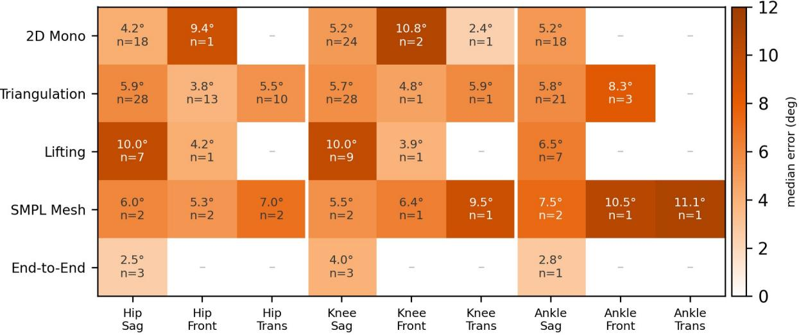

附加文件 1：PRISMA-ScR 报告清单。

附加文件 2：附录 A，各数据库的完整检索式。

附加文件 3：完整提取表（117 项研究，约 90 个字段），机器可读。

附加文件 4：按架构、关节和平面划分的下肢中位误差（图）。

<table><tr><td>方法 [参考文献]</td><td>流水线阶段</td><td>所增添的功能/贡献</td><td>成熟度</td></tr><tr><td>MoGe-2 [174]</td><td>输入 / 场景几何</td><td>单张图像度量深度与 3D 几何（场景尺度）</td><td>新兴（Emerging）</td></tr><tr><td>UniDepth v2 [175]</td><td>输入 / 场景几何</td><td>度量单目深度</td><td>新兴（Emerging）</td></tr><tr><td>SteerPose [176]</td><td>输入 / 标定</td><td>基于运动人体的无标定物多相机自标定</td><td>新兴（Emerging）</td></tr><tr><td>TRAM [133]</td><td>输入 / 世界坐标系对齐</td><td>世界坐标系中的相机运动与重力对齐</td><td>新兴（Emerging）</td></tr><tr><td>CameraHMR [177]</td><td>输入 / 世界坐标系对齐</td><td>用于度量放置的学习视场角</td><td>新兴（Emerging）</td></tr><tr><td>RTMPose [151]</td><td>2D 姿态</td><td>实时 2D 关键点主干网络</td><td>成熟（计算机视觉）</td></tr><tr><td>ViTPose [152]</td><td>2D 姿态</td><td>Transformer 2D 关键点主干网络</td><td>成熟（计算机视觉）</td></tr><tr><td>Sapiens [153]</td><td>2D 姿态 / 特征</td><td>以人为中心的基础主干网络</td><td>新兴（Emerging）</td></tr><tr><td>MotionBERT [10]</td><td>3D 提升</td><td>单目 2D 到 3D 姿态提升</td><td>成熟（计算机视觉）</td></tr><tr><td>PoseMamba [154]</td><td>3D 提升</td><td>状态空间 2D 到 3D 提升</td><td>新兴（Emerging）</td></tr><tr><td>SAM 3D Body [155]</td><td>网格恢复</td><td>基础参数化网格（SMPL）恢复</td><td>新兴（Emerging）</td></tr><tr><td>WHAM [156]</td><td>网格恢复</td><td>基于视频的世界坐标系人体网格</td><td>新兴（Emerging）</td></tr><tr><td>GVHMR [157]</td><td>网格恢复</td><td>重力视角人体网格恢复</td><td>新兴（Emerging）</td></tr><tr><td>PromptHMR [172]</td><td>网格恢复</td><td>可提示人体网格恢复</td><td>新兴（Emerging）</td></tr><tr><td>Neural Localizer Fields [158]</td><td>网格到解剖结构</td><td>查询网格上的任意解剖点</td><td>新兴（Emerging）</td></tr><tr><td>HybrIK-X [171]</td><td>网格到角度</td><td>基于网格的解析-神经逆向运动学</td><td>新兴（Emerging）</td></tr><tr><td>Multi-HMR 2 [173]</td><td>网格恢复</td><td>带跟踪的多人以相机为中心的 SMPL-X</td><td>新兴（Emerging）</td></tr><tr><td>MAMMA [169]</td><td>多视角网格</td><td>模型空间多视角网格拟合</td><td>新兴（Emerging）</td></tr><tr><td>Pose2Sim [8]</td><td>三角剖分到 OpenSim</td><td>传统多视角三角剖分到肌肉骨骼求解</td><td>成熟（Established）</td></tr><tr><td>SynthPose / OpenCapBench [159]</td><td>生物力学桥梁</td><td>带有关节角度评估的虚拟标记点增强</td><td>新兴（Emerging）</td></tr><tr><td>Differentiable</td><td>生物力学桥梁</td><td>可微、基于模型的</td><td>新兴（Emerging）</td></tr><tr><td>Biomechanics [160]</td><td></td><td>逆向运动学</td><td></td></tr><tr><td>JAX-IK [161]</td><td>生物力学桥梁</td><td>实时可微逆向运动学</td><td>新兴（Emerging）</td></tr><tr><td>Fast Neural IK [162]</td><td>生物力学桥梁</td><td>学习型（神经）逆向运动学</td><td>新兴（Emerging）</td></tr><tr><td>AddBiomechanics [168]</td><td>生物力学桥梁</td><td>离线缩放、逆向运动学与逆向动力学</td><td>新兴（Emerging）</td></tr><tr><td>GaitDynamics [163]</td><td>动力学</td><td>从运动学中生成式估计地面反作用力</td><td>新兴（Emerging）</td></tr><tr><td>BiomechGPT [146]</td><td>分析层</td><td>用于运动查询的多模态生物力学基础模型</td><td>新兴（Emerging）</td></tr><tr><td>Wehrbein et al. [164]</td><td>不确定性</td><td>基于归一化流的分布姿态估计</td><td>新兴（Emerging）</td></tr><tr><td>BioPose [11]</td><td>近乎完整的流水线</td><td>网格恢复加上神经逆向运动学求解</td><td>新兴（Emerging）</td></tr><tr><td>OpenCap Monocular [12]</td><td>近乎完整的流水线</td><td>WHAM 网格 + 物理细化 + OpenSim（含动力学）</td><td>新兴（Emerging）</td></tr><tr><td>Portable Biomechanics Laboratory [170]</td><td>近乎完整的流水线</td><td>具有临床可接受一致性的手持视频到 OpenSim</td><td>新兴（Emerging）</td></tr></table>

附加文件 6：按流程步骤块划分的 MICRO 语料库规模（图）。

附加文件 7：MICRO 语料库构建与可复现的 arXiv 筛选方案。