# Progressive Direction-Aware Pose Grammar for Human Pose Estimation

Lu Zhou , Yingying Chen , and Jinqiao Wang , Member, IEEE

Abstract—Human pose estimation is challenged by lots of factors such as complex articulation, occlusion and so on. Generally, message passing among human joints plays an important role in rectifying the wrong detection caused by referred challenges. In this paper, we propose a progressive direction-aware pose grammar model which performs message passing by building the pose grammar in a novel fashion. Firstly, a multi-scale Bi-C3D pose grammar module is proposed to promote message passing among human joints within a local range. We propose to conduct message passing by means of 3D convolution (C3D) which proves to be more effective compared with other sequential modeling techniques. To facilitate the message passing, we devise a novel adaptive direction guidance module where explicit direction information is embedded. Besides, we propose to fuse final results with attention maps to make full use of the bidirectional information and the fusion can be regarded as an ensemble process. Secondly, a more economic global regional grammar is introduced to build the relationships among human joints globally. The local-to-global modeling scheme promotes the message passing in a progressive manner and boosts the performance by a large margin. Promising results are achieved on MPII, LSP and COCO benchmarks.

Index Terms—Human pose estimation, pose grammar, C3D, direction-aware, message passing.

## I. INTRODUCTION

UMAN pose estimation serves as a fundamental comjoints given a specific human person image. It has been applied to various vision tasks such as skeleton-based action recognition [1], [2], [3], person re-identification [4], etc.

Remarkable progress has been achieved due to the development of Convolutional Neural Networks (CNN). Nevertheless, performance is still challenged by several obstacles such as severe occlusions, complex articulation and cluttered background. The network fails to locate the positions of human joints correctly due to context ambiguity caused by the mentioned challenges. Relation modeling which promotes message passing among human joints proves to be effective when dealing with these dilemmas. Through message passing, the inherent hierarchical structure of a human body can be captured. Moreover, suboptimal human joint predictions can be rectified with the assistance of learned structure information. From this point of view, we propose a progressive directionaware Bi-C3D pose grammar model to conduct message passing in a novel way which shows great advantages over existing frameworks. Our innovation is to design reasonable grammar modules to improve the performance of relation modeling.

Firstly, we propose a multi-scale direction-aware Bi-C3D kinematics pose grammar module to perform message passing within a local range. Secondly, we propose a direction-aware Bi-C3D regional pose grammar module to perform the message passing globally. Integration of the above grammars conducts message passing progressively where both local and global joint relations are built. Besides, an attentionbased results fusion mechanism is incorporated into these two grammar modules to combine results from two directions dynamically. Moreover, an adaptive direction guidance module is tailored to provide explicit direction information for grammar module, which facilitates the message passing process.

To perform relation modeling within a local range, we develop a Bi-C3D kinematics pose grammar to capture the kinematics relationships among human joints. For instance, we can build a grammar submodule which is related to the wrist, elbow, shoulder and conduct message passing among them. Instead of adopting Bi-LSTM (bidirectional LSTM) where more parameters are involved, we take use of Bi-C3D which shows great advantages in spatial-temporal feature learning to improve the effectiveness of relation modeling.

As indicated in previous work [5], message passing among human joints not only transmits the high-level semantic information, but also plays the role of spatial shift and geometric transformation in a certain extent. Nevertheless, the effectiveness of message passing may be weakened due to the lack of direction information. The prime feature map contains more context information while neglect the position and direction information. In this paper, we propose a direction guidance mechanism where CoordConv [6] is introduced to address this issue. CoordConv attaches extra coordinate channels to the input image which allows convolution filters to get access to the input coordinates, and the gradually changed coordinate maps encode explicit direction information. Here, we consider appending coordinate channels to the joint features to provide direction information for 3D convolution filters. Though the appending of coordinate channels accelerates the convergence and learning of the grammar module, however, performance is not that satisfactory. One challenge is that the performance is not optimal even though the appending mechanism can accelerate the convergence and the learning process. This may come from that fixed coordinate channels which provide constant direction guidance are not suitable for the grammar learning. Besides, to make the guidance more adaptive, we reweigh the coordinates channels via generated weight maps which can adjust the status of these coordinates channels dynamically.

Bi-C3D pose grammar module conducts message passing in two different directions respectively. Nevertheless, plain combination of bidirectional features leads to minor improvement. To overcome the mentioned challenge, we consider fusing the bidirectional heatmaps via attention mechanism. Attention maps can choose useful information from these two branches selectively. Additionally, fusion over the final heatmaps can exclude massive noise in deep features automatically.

Features of different scales encode different levels of information. Intrinsically, low-resolution features encode more global contextual information of human body structure, and high-resolution features include more spatial details which are important for accurate localization. How to enhance the robustness of multi-scale features is important for pose estimation. To achieve this, we propose a multi-scale direction-aware Bi-C3D kinematics pose grammar module to perform message passing at different levels and improve the feature quality of each scale.

To further model long-range dependencies among different human joints, we develop a Bi-C3D regional pose grammar to enlarge the scope of message passing. In detail, instead of performing message passing across all the human joints, we build the global regional grammar inside the upper human body and the lower human body separately. The tradeoff saves the overall parameters and computations with only a little decrease in accuracy.

All the above mentioned modules form our progressive direction-aware pose grammar network. Our contributions can be summarized as follows:

• A multi-scale direction-aware Bi-C3D kinematics pose grammar module is proposed to build the relationships among human joints within a local range at various scales. 3D convolution demonstrates great advantages in message passing and leads to a large improvement of final accuracy.

• A direction guidance mechanism is incorporated into the pose grammar to facilitate message passing process. The modified CoordConv provides adaptive direction information for message passing and improves the effectiveness of pose grammar.

• An attention-based results fusion mechanism is put forward to combine results from different directions selectively. Besides, it is the first attempt to merge bidirectional grammar information on heatmap level, which can be viewed as an ensemble process.

• A direction-aware Bi-C3D regional pose grammar module which constructs joints relationships within a larger scope is proposed to conduct the message passing globally.

A preliminary conference version of this paper can be found in [7]. Compared with the conference version, this paper differs mainly in the following aspects: (a) A direction guidance mechanism which provides adaptive direction information is proposed to guide the learning of the pose grammar module. (b) An attention-based results fusion mechanism is proposed to fuse bidirectional information in a more effective way. (c) A more economic Bi-C3D regional pose grammar module is built to construct the relationships of human joints, and computations are greatly reduced compared with previous version. (d) We extend the experiments on three widely used pose benchmarks, i.e, MPII, LSP and COCO where promising results are achieved.

## II. RELATED WORK

## A. Single Person Pose Estimation

Human detection serves as the first step to perform the subsequent pose estimation. Human detectors proposed in [8], [9] are commonly utilized in this pipeline. Convolution neural network has achieved great progress on a variety of vision tasks. For human pose estimation, Deeppose [10] made the first attempt to exploit ConvNets to regress the coordinates of human joints. Geometric transformation kernels were introduced in [5] to conduct message passing among human joints. [11], [12] were some typical works using the hourglass as backbone. HRNet [13] proposed to keep the high resolution features across all the stages and achieved promising results. [14] proposed a Lite-HRNet to improve the efficiency of human pose estimation model. Reference [15] proposed an online distillation scheme and obtained a less-parameterized student model. TokenPose [16] employed token representation to learn the constraints and appearance information. TransPose [17] employed self-attention mechanism to learn non-local relations. HRFormer [18] followed the multi-resolution design and local-window self-attention was employed at each resolution branch. Countering the underlying bias in integral human pose estimation was proposed in [19]. PoseTrans [20] proposed a new data augmentation method to increase the diversity of the rare poses and relieved the long-tailed problem. Work [21] devised a fast and effective transformer framework for human pose estimation. SimCC [22] reformulated the prediction of human keypoints as a classification task and thus reduced the quantization error. HDM [23] solved the distribution matching problem to avoid the construction of Gaussian-smoothed heatmaps. Among these methods, there existed some methods focusing on capturing body structure.

Nevertheless, large convolution kernels were difficult to learn in MRF-based model [24], [25]. For structured feature learning [5], only local geometric constraints were explored.

For the composition model [12], no explicit message passing among human joints was executed. In our method, we build Bi-C3D pose grammar to learn the structural priors. Firstly, no large convolution kernels are involved. Besides, both local and global message passing modules are built to promote the information flow in a progressive manner.

## B. Grammar Building

The grammar-based model has shown its effectiveness in various domains. Reference [26] proposed a stochastic grammar model to solve the image parsing problem. A hierarchical attributed grammar network was proposed in [27] to encode high-order relations among human joints. Reference [28] leveraged two fashion grammars to encode high-level human knowledge for fashion landmark detection. Work [29] adopted the grammar design in [27] and proposed a data augmentation scheme to improve the generalization of 3D human pose estimation. GWN [30] proposed a Grammarinduced Wavelet Network to exploit the human structure information for human parsing tasks. Different from the approaches above, we propose a progressive direction-aware pose grammar learning network equipped with C3D instead of largely memory-consumed LSTM. Additionally, we advance to fuse heatmaps from two reverse directions with attention mechanism.

## C. CoordConv

Learning the mapping from coordinates (x,y) in Cartesian space to coordinates in one-hot pixel space was proved a hard task via CNN (convolutional neural network). Reference [6] proposed CoordConv by virtue of appending extra coordinates channels to the input image and resolved the mapping problem in an elegant way. The three channels encoded the coordinate information (x, y) and centerness information (r). Concatenating the coordinate channels and input image formulated the final inputs. The CoordConv layer proposed boosted the performance on various tasks such as Generative Adversarial Networks (GANs), Variational Autoencoders (VAEs) and object detection. Reference [31] employed the CoordConv on facial landmark detection task and achieved promising results. In this paper, we attach additional modified coordinate channels to the pose grammar input feature instead of the input image. The gradually changed coordinates provide explicit direction information for the pose grammar module.

## III. METHODS

In this section, we will give a brief introduction of whole architecture of our progressive direction-aware pose grammar network firstly. Afterwards, elaborations on each component will be introduced to demonstrate how these modules collaborate and work on this task.

## A. Network Structure

In this paper, we take the stacked hourglass model as backbone to extract representative features for subsequent grammar modules. An illustration of the framework can be found in Fig. 1. We append the progressive directionaware pose grammar module at the tail of the backbone. The appended pose grammar module mainly consists of the following components: a) A multi-scale direction-aware Bi-C3D kinematics pose grammar (multi-scale DAKPG) module. b) A direction-aware Bi-C3D regional pose grammar (DARPG) module. The local-global modeling scheme can effectively build different ranges of relations in a progressive paradigm.

## B. Multi-Scale Direction-Aware Bi-C3D Kinematics Pose Grammar

The proposed multi-scale direction-aware Bi-C3D kinematics pose grammar (multi-scale DAKPG) depicts constraints of the kinematically connected human joints.

Grammar formulation: Pose grammar serves as an effective way to build the relations of various human parts. To capture the kinematic rule of human structure, in this section, we define 5 kinematics sub-grammars on MPII, LSP dataset where local refinement is carried on:

GK : r.ankle ←→ r.knee ←→ r.hip,

GK2 : l.ankle ←→ l.knee ←→ l.hip,

GK : r.wrist ←→ r.elbow ←→ r.shoulder,

$$
G _ {4} ^ {K}: l. w r i s t \longleftrightarrow l. e l b o w \longleftrightarrow l. s h o u l d e r,
$$

$$
G _ {5} ^ {K}: \text {   head   } \longleftrightarrow \text {   neck   } \longleftrightarrow \text {   thorax   } \longleftrightarrow \text {   pelvis.   }
$$

For COCO benchmark, $G _ { 5 } ^ { K }$ is replaced with $G _ { 5 } ^ { K } : r . e a r \longleftrightarrow$ $r . e y e \quad \longleftrightarrow \quad n o s e \quad \longleftrightarrow \quad l . e y e \quad \longleftrightarrow \quad l . e a r .$ The grammar described above establishes the relationships of human joints in a kinematic chain, which reflects human anthropomorphic and anatomical constraints. Concrete illustration can be found in Fig. 2(a)(b).

In the domain of video understanding, C3D takes temporal feature F as input where $F \in R ^ { C \times T \times H \times W }$ . Different from 2D convolution, C3D can encode both the spatial and temporal information simultaneously. For grammar modules, temporal sequence can be formed by concatenating different kinds of joint features along the temporal dimension. Therefore, obtaining joint-aware features shows great significance in message passing among various human joints. We will take grammar building of one scale for illustration at first. Herein, we split the one scale feature $F _ { 1 }$ (shown in Fig. 1) into Q groups, where Q represents the number of human joints. We apply Q groups of $1 \times 1$ convolutions to Q groups of split features separately to obtain final heatmaps. In this case, each split feature corresponds to one specific human joint and becomes joint-aware. Afterwards, pose grammar module takes these Q groups features as input, and message passing process is implemented by bidirectional (forward/backward) C3D (Bi-C3D), which naturally supports chain-like structures. Take $G _ { 1 } ^ { K }$ for example, the feature tensors of right ankle, right knee, right hip are defined as $\begin{array} { r c l c r c l } { X _ { r a n k } } & { \in } & { R ^ { N \times C _ { i n } ^ { \bf \bar { \nu } } \times H \times W } , X _ { r k n e e } } & { \in } & { R ^ { N \times \bar { C } _ { i n } \times H \times W } , X _ { r h i p } } & { \in } \end{array}$ $R ^ { N \times C _ { i n } \times H \times W }$ , where N represents the batch size, $C _ { i n } , H , W$ represent the channel number, height, width of the corresponding feature tensor. For the forward pass, we concatenate $X _ { r a n k } , X _ { r k n e e } , X _ { r h i p }$ along depth dimension sequentially and for the backward pass, we concatenate $X _ { r a n k } , X _ { r k n e e } , X _ { r h i p }$ along depth dimension in a reverse order. The concatenated feature serves as the input source of grammar module where two groups of 3D convolutions are involved.

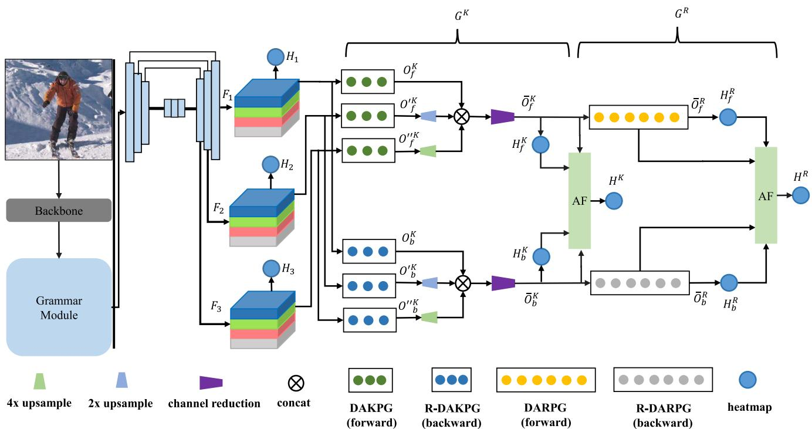  
Fig. 1. The proposed progressive direction-aware pose grammar network. ‘DAKPG’ and ‘R-DAKPG’ mean the direction-aware Bi-C3D kinematics pose grammar module of forward and backward directions respectively. ‘DARPG’ and ‘R-DARPG’ mean the direction-aware Bi-C3D regional pose grammar module of forward and backward directions respectively. ${ \mathrm { { } } } \cdot { \dot { G } } ^ { K } \cdot$ means the multi-scale direction-aware Bi-C3D kinematics pose grammar module. ${ \bf \nabla } ^ { \cdot } G ^ { { \bf \vec { R } } { \bf \vec { , } } }$ means the direction-aware Bi-C3D regional pose grammar module. ‘AF’ is the attention-based results fusion module.

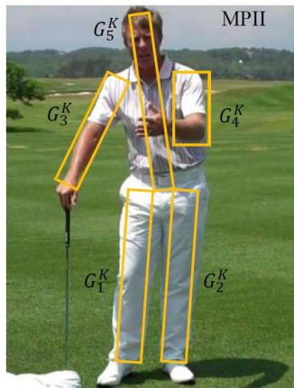  
(a)

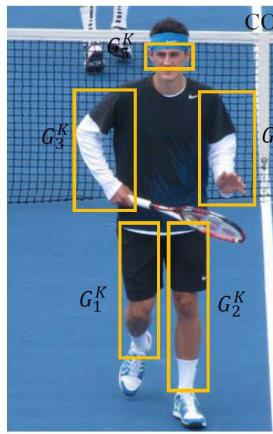  
(b)

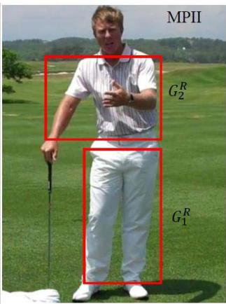  
(c)

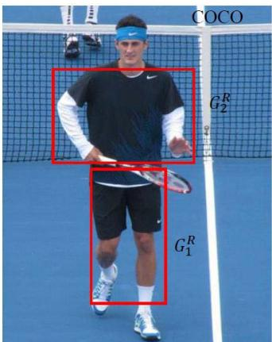  
(d)  
Fig. 2. Illustration of the kinematics, regional pose grammars across different datasets.

Direction guidance mechanism: Generally, message passing over features can be regarded as the operation of spatial shift. Consecutive 3D convolution kernels with ample spatial coverage shift feature maps from one joint to another human joint, and it is significant to provide explicit direction information for shift operation. To achieve this goal, we employ CoordConv operation which encodes the coordinate information to improve the performance of message passing. Concretely, we concatenate extra coordinate channels to input features along depth dimension. As shown in Fig. 3(a), Co represents extra coordinate channels which take the same form with [6]. $C o _ { i } , C o _ { j } , C o _ { i }$ r represent the $i , j ,$ r channel of Co. For the i-th channel $C o _ { i }$ , the first row is filled with 0, the second row is filled with 1, the third row is filled with 2 and the other rows follow the same filling procedure; For the j channel $C o _ { j } .$ , the first column is 0, the second column is 1, the third column is 2 and the other columns follow the same filling technique; In addition, r coordinate channel $C o _ { r }$ where $r = \sqrt { ( i - w / 2 ) ^ { 2 } + ( j - h / 2 ) ^ { 2 } }$ is introduced as well. Concrete illustration of the appended channels can be found in Fig. 3(b). The coordinate channels Co with obvious tendency of variation provide explicit direction information.

To make the guidance more adaptive, we design an adaptive mask generator (AMG) to weigh the coordinate channels and provide adaptive direction information. We take sequential $3 \times$

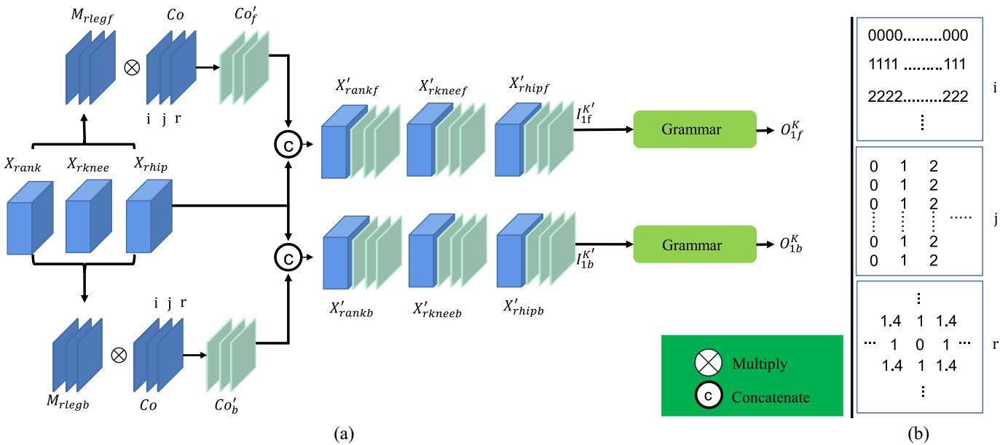  
Fig. 3. Illustration of direction-aware Bi-C3D kinematics pose grammar module (right leg). (a) Structure of direction-aware Bi-C3D kinematics pose grammar module. There are two branches where each branch performs message passing individually. (b) Illustration of the $i , j , r$ coordinate channels which are used in CoordConv.

3 convolution-batch normalization-ReLU-1 × 1 convolution as the basic structure of AMG. The number of output channels of these two convolutions is 32 and 3 separately. Configurations can be found in Fig. 4.

For the forward pass, take right ankle, right knee, right hip for example, we concatenate these three groups of features along channel dimension and the resulted feature $X _ { r l e g }$ is fed into AMG to obtain the adaptive mask:

$$
M _ {r l e g f} = A M G _ {r l e g f} \big (X _ {r l e g} \big),\tag{1}
$$

where $A M G _ { r l e g f }$ denotes the adaptive mask generator of right leg, and $M _ { r l e g f }$ represents the generated adaptive mask of the forward pass. Then we modify the coordinate channels with the generated mask via

$$
C o _ {f} ^ {\prime} = M _ {r l e g f} * C o.\tag{2}
$$

The modified coordinate channels $C o _ { f } ^ { \prime }$ can adjust themselves according to the training status and provide adaptive direction information. Here, we concatenate the modified coordinates channels $C o _ { f } ^ { \prime }$ to the input features $X _ { r a n k } , X _ { r k n e e } , X _ { r h i p }$ along channel dimension, and the resulting input features are represented as $\begin{array} { r l } { X _ { r a n k f } ^ { \prime } } & { { } \in } \end{array}$ N×(Cin+3) ×H×W $\begin{array} { r l r } { X _ { r k n e e f } ^ { \prime } } & { { } \in } & { R ^ { N \times ( C _ { i n } + 3 ) } } \end{array}$ ×H×W $X _ { r h i p f } ^ { \prime } \in$ $R ^ { N \times ( C _ { i n } + 3 ) } \times H \times W . ~ X _ { r a n k b } ^ { \prime } , X _ { r k n e e b } ^ { \prime } , X _ { r h i p b } ^ { \prime }$ can be obtained following the same procedure as described above. Afterwards, for the forward pass, we concatenate $X _ { r a n k f } ^ { \prime } , X _ { r k n e e f } ^ { \prime } , X _ { r h i p f } ^ { \prime }$ along depth dimension sequentially and for the backward pass, we concatenate $X _ { r a n k b } ^ { \prime } , X _ { r k n e e b } ^ { \prime } , X _ { r h i p b } ^ { \prime }$ along depth dimension in a reverse order, that is, $I _ { 1 f } ^ { K ^ { \prime } } \ \in \ ^ { \prime } R ^ { N \times 3 \times ( C _ { i n } + 3 ) \times H \times W } , I _ { 1 b } ^ { K ^ { \prime } } \ \in$ $R ^ { N \times 3 \times ( C _ { i n } + 3 ) \times H \times W }$ . Afterwards, the modified bidirectional leg features are convolved with two groups of 3D convolutions to execute the refinement, and the output features can be denoted as $O _ { 1 f } ^ { K } \in R ^ { N \times 3 \times C _ { o u t } \times H \times W } , O _ { 1 b } ^ { K } \in R ^ { N \times 3 \times C _ { o u t } \times H \times W }$

We acquire the bidirectional context-enriched features by splitting the output features $O _ { 1 f } ^ { K } , O _ { 1 b } ^ { K }$ along depth dimension. Afterwards, we concatenate all the human joint features along channel dimension and obtain the features $O _ { f } ^ { K } \in R ^ { N \times ( C _ { o u t } \times K ) }$ ×H×W $O _ { b } ^ { K } \in R ^ { N \times ( C _ { o u t } \times K ) } \times H \times W$ , where K denotes the number of human joints.

Multi-scale formulation: Multi-scale feature maps encode contextual information of various levels. Aggregating different scales features can enrich the contextual information of deep features. To enhance the feature robustness across various scales, message passing across multi-scale features is conduct as well. Following the same procedure with grammar building of 1 scale, we can obtain the final bidirectional features $O _ { f } ^ { \prime \breve { K } } , O _ { b } ^ { \prime K }$ of 1/2 scale and $O _ { f } ^ { \prime \prime K } , O _ { b } ^ { \prime \prime K }$ of 1/4 scale consequently. After multi-scale message passing, we simply aggregate multi-scale features from two directions by concatenation as follows:

$$
\begin{array}{l} \overline {{O}} _ {f} ^ {K} = \phi \Big (C a t \big (O _ {f} ^ {K}, U P _ {2} \big (O _ {f} ^ {\prime K} \big), U P _ {4} \big (O _ {f} ^ {\prime \prime K} \big) \big) \Big), \\ \overline {{O}} _ {b} ^ {K} = \phi \big (C a t \big (O _ {b} ^ {K}, U P _ {2} \big (O _ {b} ^ {\prime K} \big), U P _ {4} \big (O _ {b} ^ {\prime \prime K} \big) \big) \big), \end{array}\tag{3}
$$

where $\phi$ represents the $1 \times 1$ convolution which reduces channel number correspondingly, Cat represents the concatenation operation, $U P _ { 2 } , U P _ { 4 }$ represent the 2x, 4x upsampling operations respectively. The final features $\mathit { \Pi } \overline { { O } } _ { f } ^ { K } , \overline { { O } } _ { b } ^ { \vec { K } }$ are sent to attention-based results fusion module mentioned above to obtain final results.

Attention-based results fusion mechanism: Compared with bidirectional features, the heatmaps embedd more clear and informative information. Taking this into consideration, instead of summing up the forward features and backward features directly as in previous works, we propose to aggregate the final heatmaps from these two branches. Besides, we propose an attention mechanism to assign different weights to separate branches and extract more valuable information. Concrete demonstration of this process can be found in Fig. 5. Firstly, heatmaps $H _ { f } , H _ { b }$ are obtained via convolving $\bar { \overline { { O } } } _ { f } ^ { K } , \overline { { O } } _ { b } ^ { K }$ with $1 \times 1$ convolution kernels. Here, group convolution is adopted where group number is set to Q as well,

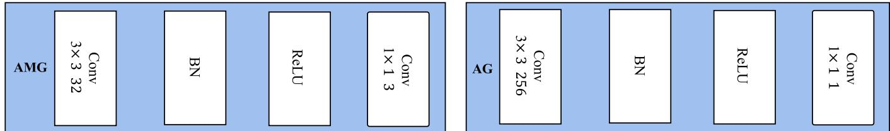

Fig. 4. Concrete structure of adaptive mask generator and attention generator.  
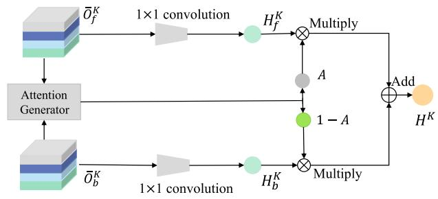  
Fig. 5. Illustration of the heatmap fusion process.

$$
\begin{array}{l} H _ {f} ^ {K} = \phi \Big (\overline {{O}} _ {f} ^ {K} \Big), \\ H _ {b} ^ {K} = \phi \Big (\overline {{O}} _ {b} ^ {K} \Big), \end{array}\tag{4}
$$

where $\phi$ indicates the $1 \times 1$ group convolution operation. To fuse these two branches selectively and make the network to assign these two branches with adequate weights, an attention generator is tailored to generate the attention map as follows:

$$
A = A G \Big (\overline {{O}} _ {f} ^ {K}, \overline {{O}} _ {b} ^ {K} \Big),\tag{5}
$$

where $A G$ represents the attention generator which takes features $\overline { o } _ { f } ^ { K } , \overline { o } _ { b } ^ { K }$ as input. To simplify the architecture design of the attention generator, we adopt the same structure with the adaptive mask generator which can be found in Fig. 4. The only difference is the channel dimension of the convolution kernel which has been marked in the figure. The number of output channels of these two convolutions is 256 and 1 separately. The final heatmaps are fused as follows:

$$
H ^ {K} = A \odot H _ {f i} ^ {K} + (1 - A) \odot H _ {b i} ^ {K}, i = 1, \ldots , K,\tag{6}
$$

where  represents the Hadamard product. Though directly summing up features from two reverse directions improves the performance due to the enrichment of contextual information, the improvement is limited. In contrast, merging on heatmaps is more effective. Heatmaps which represent final predictions encode much cleaner contextual information. Additionally, attention-based results fusion strategy can make a better choice from these two branches for final fusion. From another aspect, the fusion which can be regarded as an ensemble process can overcome the prediction noise obtained from only one regressor.

Parameter settings: In practice, we adjust the parameter settings at different scales to ensure proper spatial coverage. We perform three successive 3D convolutions where $3 \times 3 \times 3$ C3D kernels are exploited. Instead of applying large convolution kernels to expand the search region of adjacent joints, we take advantage of successive spatially dilated 3D convolutions to achieve the same goal. Respective field of neighboring human joints is enlarged to ensure ample spatial coverage among them. Additionally, the sparse dilated kernel saves total parameters and calculations with comparable performance. We set the dilation rates on spatial (height and width) dimension of three successive kernels as {2, 4, 4} at scale 1, {1, 2, 2} at scale $1 / 2 ,$ {1, 1, 1} at scale $1 / 4$ . We set the dilation rates on depth dimension as 1 in all situations. The choice of dilation rates on spatial dimension can be regarded as a problem of permutations and combinations and it’s not the main concern of our work.

## C. Direction-Aware Bi-C3D Regional Pose Grammar

To explore long-range dependencies among human joints, we propose a direction-aware Bi-C3D regional pose grammar (DARPG) to correlate human joints globally. We divide the whole human skeleton into two individual regions: upper body and lower body, which forms our hierarchical version of regional pose grammar. Herein, two regional sub-grammars are defined as:

$$
\begin{array}{c} G _ {1} ^ {R}: \text { rankle } \longleftrightarrow \text { rknee } \longleftrightarrow \text { rhip } \longleftrightarrow \text { lhip } \longleftrightarrow \\ \text { lknee } \longleftrightarrow \text { lankle }, \end{array}
$$

$$
\begin{array}{c} G _ {2} ^ {R}: r w r i s t \longleftrightarrow r e l b o w \longleftrightarrow r s h o \longleftrightarrow l s h o \longleftrightarrow \\ l e l b o w \longleftrightarrow l w r i s t. \end{array}
$$

Concrete illustration can be found in Fig. 2(c)(d).

Compared with kinematics grammar, regional grammar takes longer joint sequence as input and C3D can effectively build joint relations globally. Take the lower body for example, for the forward pass, we concatenate the features of lower body joints along depth dimension. For the backward pass, we concatenate the features of lower body joints along depth dimension in a reverse order, that is, $I _ { 1 f } ^ { \check { R } } \overset { ^ { \circ } } { \in } R ^ { N \times M ^ { \prime } \times } \overset { \smile } { C } _ { i n } { \times } \check { H } { \times } W , I _ { 1 b } ^ { R } \ \in$ $R ^ { N \times M ^ { \prime } \times C _ { i n } \times H \times W }$ , where $M ^ { \prime }$ represents the joint number of regional pose grammar. After attaching adaptive coordinate channels to sequential features $R _ { 1 f } ^ { R } , R _ { 1 b } ^ { R } ,$ we can attain $I _ { 1 f } ^ { R ^ { \prime } } \in$ $R ^ { N \times M ^ { \prime } \times ( C _ { i n } + 3 ) \times H \times W } .$ $I _ { 1 b } ^ { R ^ { \prime } } \in R ^ { N \times \dot { M ^ { \prime } } \times ( C _ { i n } + 3 ) \times H \times W }$ , where both $I _ { 1 f } ^ { R ^ { \prime } }$ and $I _ { 1 b } ^ { R ^ { \prime } }$ encode the coordinate information. We feed these two groups of features into direction-aware Bi-C3D regional pose grammar module to perform the refinement. To ensure enough spatial coverage here, dilation rates are changed correspondingly. Formally, 3D convolutions are repeated three times where dilation rates are set as 4, 1 at spatial and depth dimensions across all the iterations. We adopt the same kernel sizes as kinematics pose grammar module which are set to $3 \times 3 \times 3$ . To the end, we fuse the heatmaps obtained from bidirectional refined features using attention-based results fusion mechanism as described in kinematics pose grammar.

TABLE I  
EVALUATION RESULTS USING PCKH@0.5 AS MEASUREMENT ON THE MPII VALIDATION SET. PCKH SCORES ACROSS SIX HUMAN JOINTS AND OVERALL MEAN SCORE ARE REPORTED. SYMBOL ‘\*’ INDICATES THAT THE WORK IS RE-IMPLEMENTED TAKING THE HOURGLASS AS BACKBONE

<table><tr><td>Method</td><td>Head</td><td>Sho.</td><td>Elb.</td><td>Wri.</td><td>Hip</td><td>Knee</td><td>Ank.</td><td>Mean</td></tr><tr><td>Sun et al. [13]</td><td>96.9</td><td>96.0</td><td>90.6</td><td>85.8</td><td>88.7</td><td>86.6</td><td>82.6</td><td>90.1</td></tr><tr><td>Yu et al. [14]</td><td>-</td><td>-</td><td>-</td><td>-</td><td>-</td><td>-</td><td>-</td><td>87.0</td></tr><tr><td>Li et al. [16]</td><td>97.1</td><td>95.9</td><td>90.4</td><td>86.0</td><td>89.3</td><td>87.1</td><td>82.5</td><td>90.2</td></tr><tr><td>Yang et al. [17]</td><td>-</td><td>-</td><td>-</td><td>-</td><td>-</td><td>-</td><td>-</td><td>90.3</td></tr><tr><td>Mao et al. [33]</td><td>-</td><td>-</td><td>-</td><td>-</td><td>-</td><td>-</td><td>-</td><td>90.5</td></tr><tr><td>Li et al. [34]</td><td>97.3</td><td>96.0</td><td>90.6</td><td>84.5</td><td>89.7</td><td>85.5</td><td>79.0</td><td>89.5</td></tr><tr><td>Li et al. [15]</td><td>97.3</td><td>96.1</td><td>91.2</td><td>86.8</td><td>89.9</td><td>86.9</td><td>83.1</td><td>90.6</td></tr><tr><td>Huang et al. [35]*</td><td>97.1</td><td>96.0</td><td>90.5</td><td>85.3</td><td>89.4</td><td>86.3</td><td>82.5</td><td>90.1</td></tr><tr><td>Zhang et al. [36]*</td><td>97.0</td><td>96.3</td><td>90.3</td><td>85.9</td><td>89.9</td><td>86.5</td><td>82.8</td><td>90.3</td></tr><tr><td>ours</td><td>97.1</td><td>96.4</td><td>91.4</td><td>87.8</td><td>90.4</td><td>88.1</td><td>84.3</td><td>90.9</td></tr></table>

Grammar building of upper body follows the same procedure as lower body. With the regional pose grammar, long-range interactions can be realized which enhances the features of individual human joint. Intrinsically the relationships among lower and upper human body joints are weak and we ignore the corresponding correlation building when constructing our regional pose grammar. The proposed two sub-grammars achieve a tradeoff between the computations and performance.

## IV. EXPERIMENTS

## A. MPII Human Pose Estimation

Dataset and settings: MPII human pose dataset is one of the most popular human pose estimation benchmarks which contains various articulated poses. There are around 25k images and 40k people included in the dataset. We report the final results on both the validation set which contains 3k people and test set where around 11k instances are involved in all. During the experiment, we use RMSprop optimizer to update the parameters of whole network. The learning rate is set to 1e − 4 initially and dropped by 10 at the epoch of 150, 170 and 200. We train the network for a total of 220 epochs. Input resolution is $2 5 6 \times 2 5 6$ . During testing, we adopt the six-scale pyramid scheme [11], [32] which takes the multi-scale results fusion into consideration.

Evaluation metric: PCKh (head-normalized probability of correct keypoint) score, proposed in [35] is adopted as final evaluation metric for MPII dataset. A joint is correctly predicted when the distance between the predicted joint and the ground-truth joint falls within a threshold defined as 0.6α of the diagonal length of head bounding box. Eventually, PCKh@0.5 where α is set to 0.5 is adopted.

Quantitative results: Quantitative results on MPII dataset can be found in Table I and Table II. From Table I we can find that our approach achieves the best performance on the MPII validation set. Mean PCKh@0.5 score reaches up to 90.9%. Besides, we re-implement the work [35], [36] where 8-stack hourglass model is adopted. From the table we can find that the grammar model can achieve better performance when same backone is applied. For test set, our mean PCKh@0.5 score reaches 92.6% which is comparable to the state-of-the-art methods [43]. Compared with the baseline, i.e, hourglass, our method achieves 1.7% PCKh@0.5 score improvement which is an obvious progress. Progresses over hard human joints, e.g, ankle and knee, contribute mainly to the improvement. In addition, our method surpasses published algorithms [11], [32] which adopted hourglass model as their backbone consistently. Finally, compared with HRNet [13], our pose grammar model achieves better performance as well. Compared with the conference version, the main improvement comes from the hard joints such as knee, ankle, etc.

TABLE II  
EVALUATION RESULTS ON THE MPII TEST SET. \* REPRESENTS THE CONFERENCE VERSION

<table><tr><td>Method</td><td>Head</td><td>Sho.</td><td>Elb.</td><td>Wri.</td><td>Hip</td><td>Knee</td><td>Ank.</td><td>Mean</td></tr><tr><td>Newell et al. [37]</td><td>98.2</td><td>96.3</td><td>91.2</td><td>87.1</td><td>90.1</td><td>87.4</td><td>83.6</td><td>90.9</td></tr><tr><td>Nie et al. [38]</td><td>98.4</td><td>96.3</td><td>91.7</td><td>87.7</td><td>90.6</td><td>87.4</td><td>83.3</td><td>91.2</td></tr><tr><td>Chu et al. [32]</td><td>98.5</td><td>96.3</td><td>91.9</td><td>88.1</td><td>90.6</td><td>88.0</td><td>85.0</td><td>91.5</td></tr><tr><td>Liu et al. [39]</td><td>98.4</td><td>96.4</td><td>92.0</td><td>87.9</td><td>90.7</td><td>88.3</td><td>85.3</td><td>91.6</td></tr><tr><td>Chou et al. [40]</td><td>98.2</td><td>96.8</td><td>92.2</td><td>88.0</td><td>91.3</td><td>89.1</td><td>84.9</td><td>91.8</td></tr><tr><td>Yang et al. [11]</td><td>98.5</td><td>96.7</td><td>92.5</td><td>88.7</td><td>91.1</td><td>88.6</td><td>86.0</td><td>92.0</td></tr><tr><td>Ke et al. [41]</td><td>98.5</td><td>96.8</td><td>92.7</td><td>88.4</td><td>90.6</td><td>89.3</td><td>86.3</td><td>92.1</td></tr><tr><td>Tang et al. [12]</td><td>98.4</td><td>96.9</td><td>92.6</td><td>88.7</td><td>91.8</td><td>89.4</td><td>86.2</td><td>92.3</td></tr><tr><td>Sun et al. [13]</td><td>98.6</td><td>96.9</td><td>92.8</td><td>89.0</td><td>91.5</td><td>89.0</td><td>85.7</td><td>92.3</td></tr><tr><td>Nie et al. [42]</td><td>98.6</td><td>96.9</td><td>93.0</td><td>89.1</td><td>91.7</td><td>89.0</td><td>86.2</td><td>92.4</td></tr><tr><td>Tang et al. [43]</td><td>98.7</td><td>97.1</td><td>93.1</td><td>89.4</td><td>91.9</td><td>90.1</td><td>86.7</td><td>92.7</td></tr><tr><td>Cai et al. [43]</td><td>98.5</td><td>97.3</td><td>93.9</td><td>89.9</td><td>92.0</td><td>90.6</td><td>86.8</td><td>93.0</td></tr><tr><td>Mao et al. [44]</td><td>98.0</td><td>95.9</td><td>91.0</td><td>86.0</td><td>89.8</td><td>86.6</td><td>82.6</td><td>90.4</td></tr><tr><td>Zhou et al. [7]*</td><td>98.5</td><td>96.9</td><td>92.8</td><td>89.3</td><td>91.8</td><td>89.5</td><td>86.4</td><td>92.5</td></tr><tr><td>ours</td><td>98.6</td><td>97.0</td><td>92.9</td><td>89.3</td><td>91.8</td><td>90.1</td><td>86.5</td><td>92.6</td></tr></table>

## B. LSP Human Pose Estimation

Dataset and settings: LSP dataset is also a popular dataset used for single person pose estimation. The whole dataset which combines the prime and extended versions contains about 11000 images for training and 1000 images for testing. In practice, MPII training split is also involved in the training process of LSP which has been widely adopted in previous works [11], [32]. All the experiments settings are the same with the MPII human pose dataset.

Evaluation metric: PCK (Percentage of Correct Keypoints) is adopted as the final evaluation metric for LSP dataset. A joint is correctly predicted if the distance between predicted position and ground-truth position falls within a predefined threshold defined as α length of the torso segment. PCK@0.2 where α is set to 0.2 is adopted finally.

Quantitative results: Quantitative results over LSP dataset can be found in Table III. We achieve state-of-the-art performance on testing split and PCK@0.2 score reaches up to 94.9%. Compared with previous works and the conference version, progresses over hard human joints make major contributions to the improvement.

TABLE III  
EVALUATION RESULTS ON THE LSP DATASET. \* REPRESENTS THE CONFERENCE VERSION

<table><tr><td>Method</td><td>Head</td><td>Sho.</td><td>Elb.</td><td>Wri.</td><td>Hip</td><td>Knee</td><td>Ank.</td><td>Mean</td></tr><tr><td>Lifshitz et al. [45]</td><td>96.8</td><td>89.0</td><td>82.7</td><td>79.1</td><td>90.9</td><td>86.0</td><td>82.5</td><td>86.7</td></tr><tr><td>Liu et al. [39]</td><td>98.1</td><td>94.0</td><td>91.0</td><td>89.0</td><td>93.4</td><td>95.2</td><td>94.4</td><td>93.6</td></tr><tr><td>Yang et al. [11]</td><td>98.3</td><td>94.5</td><td>92.2</td><td>88.9</td><td>94.4</td><td>95.0</td><td>93.7</td><td>93.9</td></tr><tr><td>Chou et al. [40]</td><td>98.2</td><td>94.9</td><td>92.2</td><td>89.5</td><td>94.2</td><td>95.0</td><td>94.1</td><td>94.0</td></tr><tr><td>Peng et al. [46]</td><td>98.6</td><td>95.3</td><td>92.8</td><td>90.0</td><td>94.8</td><td>95.3</td><td>94.5</td><td>94.5</td></tr><tr><td>Tang et al. [43]</td><td>98.6</td><td>95.4</td><td>93.3</td><td>89.8</td><td>94.3</td><td>95.7</td><td>94.4</td><td>94.5</td></tr><tr><td>Artacho et al. [47]</td><td>-</td><td>-</td><td>-</td><td>-</td><td>-</td><td>-</td><td>-</td><td>94.5</td></tr><tr><td>Bin et al. [48]</td><td>98.8</td><td>95.2</td><td>92.5</td><td>90.2</td><td>94.7</td><td>95.8</td><td>94.8</td><td>94.6</td></tr><tr><td>Zhou et al. [7]*</td><td>98.7</td><td>95.7</td><td>93.2</td><td>90.5</td><td>95.2</td><td>95.5</td><td>94.6</td><td>94.8</td></tr><tr><td>ours</td><td>98.6</td><td>95.4</td><td>93.3</td><td>90.7</td><td>95.1</td><td>95.8</td><td>95.0</td><td>94.9</td></tr></table>

## C. COCO Dataset

Dataset: The COCO dataset has been applied in multiple fields such as object detection, image segmentation, and so on. For human pose estimation, it serves as one of the biggest and influential multi-person pose estimation benchmarks. COCO train2017 is used for the training process where 57K images and 150K person instances are available. We test our model on COCO val2017 and test-dev 2017 where 5000 images and 2k images are involved respectively.

Evaluation metric: Object Keypoint Similarity (OKS) is the standard evaluation metric for COCO dataset where the OKS is denoted as $\frac { \sum _ { i } e x p ( - d _ { i } ^ { 2 } / 2 s ^ { 2 } k _ { i } ^ { 2 } ) \delta ( \nu _ { i } > 0 ) } { \sum _ { i } \delta ( \nu _ { i } > 0 ) }$ $d _ { i }$ represents the distance between predicted human joints and ground-truth joints, s represents the instance scale factor, $k _ { i }$ is a constant which determines falloffs and varies across different human joints. Follow the previous works, mean average precision (AP) is reported as the main judgement which averages the OKS score across 10 thresholds (0.5, 0.55, . . . , 0.95). $\mathsf { A P } ^ { 5 0 }$ $\mathbf { A P } ^ { 7 5 }$ where average precision computed at threshold 0.50 and 0.75 are reported as well. Besides, $\mathbf { A P } ^ { M }$ $\mathsf { A P } ^ { L }$ computing the average precision for medium and large objects can also be found. At last, average recall (AR) is reported.

Experiment settings: We set the input resolution to 256×192 when conducting experiments on COCO dataset. We adopt random rotation, random scale, flipping and half body augmentation as our data augmentation strategy. We set the initial learning rate to 1e-4 and drop it by 10 at the epochs of 170 and 190. RMSprop optimizer is utilized to update the network. We end the training at the 210th epoch. During testing, only flipping operation is involved to make fair comparison with previous methods. We utilize the same bounding boxes as [13] to perform the single person pose estimation on val2017 and test-dev 2017.

Quantitative results: Quantitative results on COCO val2017 dataset can be found in Table IV and our grammar model achieves 76.2 AP. Compared with SimpleBaseline which takes ResNet-152 as baseline, our method achieves much better performance. Compared with HRNet-W48, our model can also achieve competitive performance. When input resolution is $3 8 4 \times 2 8 8$ , our model achieves almost the same performance with HRNet-W48. Compared with the transformer-based approaches, the performance is still comparable. Besides, we can observe that our grammar model is a parameter-efficient model which utilizes much less parameters to achieve more competitive results. Results on test-dev set can be found in Table V. We can find that hourglass model equipped with grammar module achieves competitive results compared with other prevalent models. Though massive algorithms arise, hourglass can still serve as an effective architecture in this community.

TABLE IV RESULTS ON THE COCO VALIDATION SET

<table><tr><td>Method</td><td>Input Size</td><td>GFLOPs</td><td>AP</td></tr><tr><td>8-stage Hourglass [37]</td><td>256 × 192</td><td>14.3</td><td>66.9</td></tr><tr><td>SimpleBaseline [49]</td><td>256 × 192</td><td>15.7</td><td>72.0</td></tr><tr><td>HRNet-W32 [13]</td><td>256 × 192</td><td>7.10</td><td></td></tr><tr><td>HRNet-W48 [13]</td><td>256 × 192</td><td>14.6</td><td>75.1</td></tr><tr><td>TransPose [17]</td><td>256 × 192</td><td>21.8</td><td>75.8</td></tr><tr><td>TokenPose [16]</td><td>256 × 192</td><td>11.0</td><td>75.8</td></tr><tr><td>RBIPR [19]</td><td>256 × 192</td><td>-</td><td>75.8</td></tr><tr><td>SimpleBaseline [49]</td><td>384 × 288</td><td>35.6</td><td>74.3</td></tr><tr><td>HRNet-W32 [13]</td><td>384 × 288</td><td>16.0</td><td>75.8</td></tr><tr><td>HRNet-W48 [13]</td><td>384 × 288</td><td>32.9</td><td>76.3</td></tr><tr><td>MIPNet [50]</td><td>384 × 288</td><td>-</td><td>76.3</td></tr><tr><td>PRTR [34]</td><td>512 × 384</td><td>37.8</td><td>73.3</td></tr><tr><td>HDM [23]</td><td>384 × 288</td><td>-</td><td>78.9</td></tr><tr><td>PoseTrans [20]</td><td>384 × 288</td><td>-</td><td>76.8</td></tr><tr><td>Ours</td><td>384 × 288</td><td>37.1</td><td>76.2</td></tr></table>

TABLE V

RESULTS ON THE COCO TEST-DEV SET

<table><tr><td>Method</td><td>Input Size</td><td>GFLOPs</td><td>AP</td></tr><tr><td colspan="4">Bottom-up methods</td></tr><tr><td>OpenPose [51]</td><td>-</td><td>-</td><td>61.8</td></tr><tr><td>Associative Embedding [52]</td><td>-</td><td>-</td><td>65.5</td></tr><tr><td>OpenPifPaf [53]</td><td>-</td><td>-</td><td>66.7</td></tr><tr><td>HigherHRNet [54]</td><td>-</td><td>-</td><td>70.5</td></tr><tr><td>DEKR [55]</td><td>-</td><td>-</td><td>71.0</td></tr><tr><td colspan="4">Top-down methods</td></tr><tr><td>Mask-RCNN [8]</td><td>-</td><td>-</td><td>63.1</td></tr><tr><td>CPN [56]</td><td>256 × 192</td><td>6.20</td><td>68.6</td></tr><tr><td>RMPE [57]</td><td>320 × 256</td><td>26.7</td><td>72.3</td></tr><tr><td>CFN [58]</td><td>-</td><td>-</td><td>72.6</td></tr><tr><td>SimpleBaseline [49]</td><td>384 × 288</td><td>35.6</td><td>73.7</td></tr><tr><td>HRNet-W32 [13]</td><td>384 × 288</td><td>16.0</td><td>74.9</td></tr><tr><td>HRNet-W48 [13]</td><td>384 × 288</td><td>32.9</td><td>75.5</td></tr><tr><td>TransPose [17]</td><td>256 × 192</td><td>21.8</td><td>75.0</td></tr><tr><td>MIPNet [50]</td><td>384 × 288</td><td>-</td><td>75.7</td></tr><tr><td>PRTR [34]</td><td>512 × 384</td><td>37.8</td><td>72.1</td></tr><tr><td>HDM [23]</td><td>384 × 288</td><td>-</td><td>77.2</td></tr><tr><td>PoseTrans [20]</td><td>384 × 288</td><td>-</td><td>75.7</td></tr><tr><td>RBIPR [19]</td><td>384 × 288</td><td>-</td><td>75.7</td></tr><tr><td>Ours</td><td>384 × 288</td><td>37.1</td><td>75.4</td></tr></table>

## D. Ablation Study

In this section, ablation studies are detailed to demonstrate the effectiveness of each module. All the experiments are conduct on MPII dataset based on the 2-stack hourglass model. Besides, we take use of single scale testing schedule to evaluate the performance of each module.

Effectiveness of multi-scale direction-aware Bi-C3D kinematics pose grammar: In this section, we firstly discuss the effectiveness of single-scale version of direction-aware Bi-C3D kinematics pose grammar. Effectiveness of the proposed single-scale version of direction-aware Bi-C3D kinematics pose grammar can be found in Fig. 6(a). Single direction C3D kinematics pose grammar (‘k-s’) achieves 88.03% PCKh score while the Bi-C3D kinematics pose grammar (‘k-b’) which summarizes the bidirectional features achieves 88.15% PCKh score. When incorporating the direction guidance mechanism (‘k-b-d’), PCKh score is 88.29% and surpasses (‘k-b’) by 0.14%. When utilizing the attention mechanism to fuse final results (‘k-b-a’), our model surpasses the previous version by 0.17% PCKh score and reaches 88.32% PCKh score eventually. When encoding the adaptive direction information (‘k-b-a-d’), our model can further boost the performance by 0.05% PCKh score and reaches 88.37% PCKh score eventually. Just as demonstrated in Fig. 6(a), the enhanced multi-scale version of direction-aware Bi-C3D kinematics pose grammar (‘m’) achieves 88.37% PCKh score and surpasses the single-scale Bi-C3D kinematics pose grammar by 0.34% PCKh score. When combining results from two different branches via attention-based results fusion mechanism (‘m-a’) our model obtains 88.44% PCKh score and achieves further progress over the prime version. When direction guidance mechanism is involved, performance of the multi-scale Bi-C3D kinematics pose grammar (‘m-a-d’) boosts further and 88.65% PCKh score is achieved. Compared with the baseline, our multi-scale Bi-C3D pose grammar model achieves 1.23% PCKh score promotion.

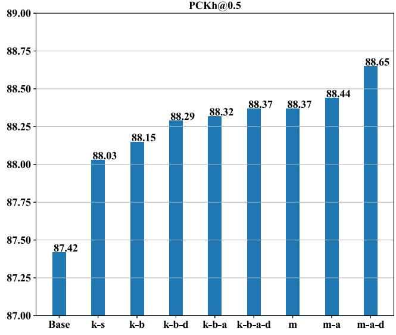  
(a)

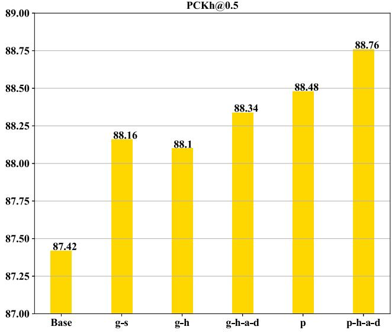  
(b)  
Fig. 6. Ablations for direction-aware Bi-C3D kinematics pose grammar module and direction-aware Bi-C3D regional pose grammar module. ‘Base’ represents the prime 2-stack hourglass model. ‘k-s’ denotes single direction C3D kinematics pose grammar. ‘k-b’ represents bidirectional version of C3D kinematics pose grammar. ‘k-b-d’ denotes bidirectional C3D kinematics pose grammar equipped with direction guidance mechanism. ‘k-b-a’ denotes bidirectional C3D kinematics pose grammar utilizing attention-based results fusion mechanism. ‘k-b-a-d’ means the Bi-C3D kinematics pose grammar utilizing attention-based results fusion and direction guidance mechanisms. ‘m’ means the prime multi-scale Bi-C3D kinematics pose grammar. ‘m-a’ denotes the multi-scale Bi-C3D kinematics pose grammar utilizing attention-based results fusion mechanism. ‘m-a-d’ means the final multi-scale direction-aware Bi-C3D kinematics pose grammar utilizing attention-based results fusion mechanism. ‘g-s’ represents the regional pose grammar where all the human joints are correlated in a single chain. ‘g-h’ denotes our hierarchical version of regional pose grammar. ‘g-h-a-d’ denotes hierarchical version of regional pose grammar which incorporates the direction guidance and attention-based results fusion mechanisms together. ‘p’ is the progressive model which combines multi-scale Bi-C3D kinematics pose grammar ‘m’ and Bi-C3D regional pose grammar ‘g-s’. ‘p-h-a-d’ means the progressive direction-aware pose grammar model which combines ‘m-a-d and ‘g-h-a-d’.

Effectiveness of Direction-Aware Bi-C3D Regional Pose Grammar: Results of our direction-aware Bi-C3D regional pose grammar can be found in Fig. 6(b). When relating all the human joints in a single chain, PCKh score of regional grammar (‘g-s’) reaches 88.16%. If we replace it with our hierarchical version (‘g-h’), PCKh score decreases to 88.10%. Though the performance drops, this sacrifice is acceptable. From Table VI, we can find that computations of hierarchical version drop a lot. When we incorporate direction guidance mechanism and aggregate heatmaps via attention masks (‘gh-a-d’), our model achieves 88.34% PCKh score eventually. Up to now, attention-based results fusion and direction guidance mechanisms achieve consistent improvements on both the kinematics and regional pose grammar, which verifies their effectiveness.

TABLE VI  
COMPARISONS OF DIFFERENT VERSIONS OF GLOBAL REGIONAL GRAMMAR. 2-STACK HOURGLASS MODEL IS USED AS BACKBONE. INPUT RESOLUTION IS 256 × 256

<table><tr><td>Method</td><td>Parameters (M)</td><td>GFLOPs</td><td>PCKh</td></tr><tr><td>g-s</td><td>6.78</td><td>12.1</td><td>88.16</td></tr><tr><td>g-h</td><td>6.78</td><td>8.72</td><td>88.10</td></tr></table>

TABLE VII  
COMPARISONS OF DIFFERENT FEATURE OR HEATMAPS FUSION METHODS

<table><tr><td>Method</td><td>PCKh</td></tr><tr><td>fea-add</td><td>88.15</td></tr><tr><td>fea-cat</td><td>88.09</td></tr><tr><td>heat-cat</td><td>88.25</td></tr><tr><td>heat-add</td><td>88.25</td></tr><tr><td>heat-attention</td><td>88.32</td></tr></table>

Comparisons of different fusion mechanisms: In this section, we investigate the effect of different fusion mechanisms. From Table VII we can observe that 88.09% PCKh score can be obtained when we combine bidirectional features using concatenation (‘heat-cat’). When adding the bidirectional features together (‘fea-add’), we can achieve 88.15% PCKh score. When we concatenate the bidirectional heatmaps (‘heatcat’), we can achieve 88.25% PCKh score. When we add the bidirectional heatmaps (‘heat-add’), we can achieve 88.25% PCKh score. When we incorporate the attention-based results fusion mechanism (‘heat-attention’), PCKh score reaches up to 88.32%. We can notice that fusion of heatmaps achieves much better performance than fusion of features in that heatmaps can exclude the interference of noises. Compared with concatenation of heatmaps, our attention-based results fusion mechanism can make better choices between bidirectional heatmaps and achieves better performance.

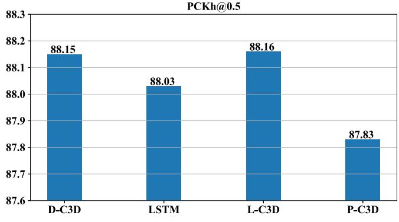  
(a)

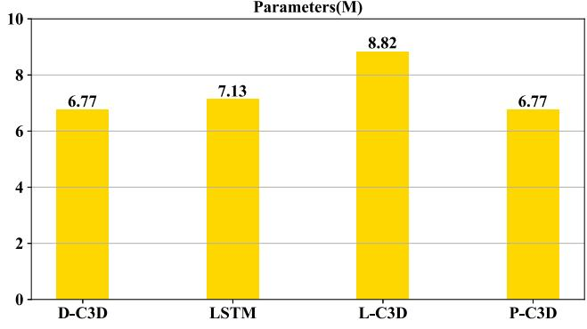  
(b)  
Fig. 7. Component investigations on the MPII validation split. D-C3D (Dilated C3D) means spatially dilated C3D operation where the spatial kernel size is set as $3 \times 3 ,$ , L-C3D (Large kernel C3D) means C3D operation with large spatial kernel size which is set as 7 × 7, P-C3D (Plain C3D) represents plain C3D operation without dilated settings where the spatial kernel size is set as $3 \times 3 .$

TABLE VIII  
COMPARISONS OF DIFFERENT DIRECTION GUIDANCE MECHANISMS. IN $\mathbf { \partial } ^ { \circ } \mathbf { K } \mathbf { - B } \mathbf { - A - D } 2 \mathbf { \partial } ^ { \prime }$ , WE INCREASE THE INTERMEDIATE CHANNEL NUMBER OF THE ADAPTIVE MASK GENERATOR. $\mathrm { ^ { \circ } K \mathrm { - } B \mathrm { - } A \mathrm { - } D S ^ { \prime } }$ MEANS THE DIRECTION MATRIX ARE LEARNED VIA SUPER PARAMETERS

<table><tr><td>Method</td><td>PCKh</td></tr><tr><td>k-b-a-d</td><td>87.37</td></tr><tr><td>k-b-a-d2</td><td>87.29</td></tr><tr><td>k-b-a-ds</td><td>87.30</td></tr></table>

Comparisons of different direction guidance mechanisms: In this section, we compare the effect of different formats of the direction matrix and adaptive mask generator. As shown in Table VIII, PCKh score is 87.37% we adopt the CoorConv. If we increase the intermediate channel number of the adaptive mask generator, we find that the PCKh score is 87.29%. The original design serves as the best choice. If the direction matrix is learned via super parameters, the PCKh score is 87.30% which performs worse than the CoordConv. The CoordConv can embed the direction information more explicitly than the self-learning scheme.

Performance of the whole framework: Performance of our final progressive direction-aware pose grammar model can be found in Fig. 6(b). When combining the prime multiscale Bi-C3D kinematics pose grammar (‘m’) and Bi-C3D regional pose grammar $( ' \mathrm { g } \mathrm { - } \mathrm { s } ^ { \prime } )$ together, our model (‘p’) achieves 88.48% PCKh score. When incorporating both the attention-based results fusion and direction guidance mechanisms (‘p-h-a-d’), whole framework achieves 88.76% PCKh score eventually and outperforms the prime version by 0.28% PCKh score. We can observe that the modification over prime progressive pose grammar model leads to notable improvement. Compared with the baseline, improvement reaches up to 1.34% PCKh score which proves the effectiveness of our method further.

TABLE IX  
PARAMETER STATISTICS OF THE POSE GRAMMAR MODEL BASED ON 2-STACK HOURGLASS MODEL

<table><tr><td>Method</td><td>Parameters (M)</td></tr><tr><td>s0</td><td>6.56</td></tr><tr><td>s1</td><td>7.90</td></tr><tr><td>s2</td><td>8.17</td></tr></table>

Parameter statistics: Besides, we compute the parameters of each module in our framework and the results can be found in Table IX. Parameters of the 2-stack hourglass backbone (‘s0’) are 6.56M. When incorporating the multi-scale direction-aware Bi-C3D kinematics pose grammar module (‘s1’), parameters are 7.90M. If direction-aware Bi-C3D regional pose grammar module is added (‘s2’), the parameters reach up to 8.17M. From the table we can observe that the new modules bring about 1.61M parameter increase.

Comparison with other techniques: In this section, we compare our single-scale C3D kinematics pose grammar implemented by D-C3D with other techniques to prove the feasibility and effectiveness of it. From Fig. 7, we can see that grammar model implemented with D-C3D achieves better results with much less parameters compared with Bi-LSTM pose grammar. Additionally, we investigate the effectiveness of D-C3D by replacing D-C3D operation with L-C3D. Though grammar module implemented with 7 × 7 convolution kernel achieves almost equivalent performance, parameters reach up to 8.82M. Comparison of D-C3D and P-C3D also verifies the effectiveness of spatially dilated C3D operation in relation modeling. P-C3D where dilation is not involved performs poorly owing to insufficient spatial context coverage.

Cross-backbone adaption: To evaluate the effectiveness of pose grammar further, we conduct experiments on various backbones, i.e., HRNet [13], MobileNetv3 [59] and ViTPose [60]. From Table X we can observe that the pose grammar module can improve the location precision over different structures. For transformer, we take advantage of

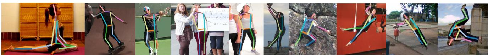  
Fig. 8. Estimated human poses on MPII and LSP dataset.

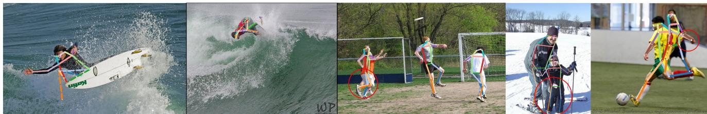  
Fig. 9. Demonstration of some failure cases across different scenes.

TABLE X  
PERFORMANCE OF OUR MODEL BASED ON DIFFERENT BACKBONES

<table><tr><td>Method</td><td>PCKh</td></tr><tr><td>HRNet-W32</td><td>90.33</td></tr><tr><td>HRNet-W32+Ours</td><td>90.61</td></tr><tr><td>MobileNetv3-small</td><td>80.99</td></tr><tr><td>MobileNetv3-small+Ours</td><td>81.76</td></tr><tr><td>ViTPose-t</td><td>87.55</td></tr><tr><td>ViTPose-t+Ours</td><td>87.85</td></tr></table>

ViTPose-tiny as the basic backbone and 87.55% PCKh score is achieved. When adding the grammar module, PCKh reaches 87.85% which verifies the efficacy.

## E. Qualitative Results

Moreover, we provide some pose estimation results for better understanding the effectiveness. Fig. 8 displays some predicted poses on MPII and LSP dataset. We can observe that our approach demonstrates great robustness under some extremely hard cases, e.g., occlusions, cluttered background and complex poses.

Though the grammar model can learn the geometric constraints, it is still difficult to achieve precise localization when extremely complex gestures occur. For instance, poses in the first two sub-figures of Fig. 9 are seldom seen during the training process and these structure priors cannot been well learned. In other cases, prediction of the target person can be influenced by the adjacent persons when highly overlapped human instances occur which can be found in the last three sub-figures of Fig. 9. Joints of the target person can be wrongly located at the other person though the final structure seems reasonable somehow. The main cause may be that different human bodies cannot be well distinguished. Hence, except for the structure information, it is more important to learn both the human appearance information and high-level person-person relations in these cases.

## F. Limitations and Future Work

In the future, we will put more attention on the personperson relation learning when multiple instances appear in the bounding box. Besides, we will devise a more lightweight grammar module to accelerate the inference speed in the edge devices since the computation of current model is a little large.

In addition, directly acquiring the pose grammars from a large language models (LLMs) such as ChatGPT will be considered. The LLMs encode ample open-world knowledge including the human context. Utilizing the expert knowledge from ChatGPT can help develop more grammar types which depicts different levels of human context.

## V. CONCLUSION

In this paper, we propose a progressive direction-aware pose grammar model to conduct message passing among human joints. Firstly, a multi-scale direction-aware Bi-C3D kinematics pose grammar module is proposed to conduct multi-scale message passing among human joints within a local range. Compared with other sequential modeling techniques, C3D achieves more promising results when building the pose grammar. Additionally, direction guidance and attention-based results fusion mechanisms are also incorporated to improve the performance of message passing further. Secondly, a direction-aware Bi-C3D regional pose grammar module is proposed to conduct message passing among human joints globally. Combination of multi-scale direction-aware Bi-C3D kinematics pose grammar module and direction-aware Bi-C3D regional pose grammar module promotes message passing in a progressive manner, and it achieves promising results compared with the state-of-the-art methods.

## REFERENCES

[1] L. Shi, Y. Zhang, J. Cheng, and H. Lu, “Skeleton-based action recognition with directed graph neural networks,” in Proc. IEEE Conf. Comput. Vis. Pattern Recognit., 2019, pp. 7912–7921.

[2] Q. Ke, M. Bennamoun, H. Rahmani, S. An, F. Sohel, and F. Boussaid, “Learning latent global network for skeleton-based action prediction,” IEEE Trans. Image Process., vol. 29, pp. 959–970, 2019.

[3] H. Duan, Y. Zhao, K. Chen, D. Lin, and B. Dai, “Revisiting skeletonbased action recognition,” in Proc. IEEE Conf. Comput. Vis. Pattern Recognit., 2022, pp. 2969–2978.

[4] C. Su, J. Li, S. Zhang, J. Xing, W. Gao, and Q. Tian, “Pose-driven deep convolutional model for person re-identification,” in Proc. IEEE Int. Conf. Comput. Vis., 2017, pp. 3960–3969.

[5] X. Chu, W. Ouyang, H. Li, and X. Wang, “Structured feature learning for pose estimation,” in Proc. IEEE Conf. Comput. Vis. Pattern Recognit., 2016, pp. 4715–4723.

[6] R. Liu et al., “An intriguing failing of convolutional neural networks and the coordconv solution,” in Proc. Adv. Neural Inf. Process. Syst., 2018, pp. 9605–9616.

[7] L. Zhou, Y. Chen, J. Wang, and H. Lu, “Progressive bi-C3D pose grammar for human pose estimation,” in Proc. AAAI, 2020, pp. 13033–13040.

[8] K. He, G. Gkioxari, P. Dollár, and R. Girshick, “Mask R-CNN,” in Proc. IEEE Int. Conf. Comput. Vis., 2017, pp. 2961–2969.

[9] G. Zhang, J. Liu, H. Li, Y. Q. Chen, and L. S. Davis, “Joint human detection and head pose estimation via multistream networks for RGB-D videos,” IEEE Signal Process. Lett., vol. 24, no. 11, pp. 1666–1670, Nov. 2017.

[10] A. Toshev and C. Szegedy, “DeepPose: Human pose estimation via deep neural networks,” in Proc. IEEE Conf. Comput. Vis. Pattern Recognit., 2014, pp. 1653–1660.

[11] W. Yang, S. Li, W. Ouyang, H. Li, and X. Wang, “Learning feature pyramids for human pose estimation,” in Proc. IEEE Int. Conf. Comput. Vis., 2017, pp. 1290–1299.

[12] W. Tang, P. Yu, and Y. Wu, “Deeply learned compositional models for human pose estimation,” in Proc. Eur. Conf. Comput. Vis., 2018, pp. 190–206.

[13] K. Sun, B. Xiao, D. Liu, and J. Wang, “Deep high-resolution representation learning for human pose estimation,” in Proc. IEEE Conf. Comput. Vis. Pattern Recognit., 2019, pp. 5693–5703.

[14] C. Yu et al., “Lite-HRNet: A lightweight high-resolution network,” in Proc. IEEE Conf. Comput. Vis. Pattern Recognit., 2021, pp. 10440–10450.

[15] Z. Li, J. Ye, M. Song, Y. Huang, and Z. Pan, “Online knowledge distillation for efficient pose estimation,” in Proc. IEEE Int. Conf. Comput. Vis., 2021, pp. 11740–11750.

[16] Y. Li et al., “Tokenpose: Learning keypoint tokens for human pose estimation,” in Proc. IEEE Int. Conf. Comput. Vis., 2021, pp. 11313–11322.

[17] S. Yang et al., “TransPose: Keypoint localization via transformer,” in Proc. IEEE Int. Conf. Comput. Vis., 2021, pp. 11802–11812.

[18] Y. Yuan et al., “HRFormer: High-resolution transformer for dense prediction,” 2021, arXiv:2110.09408.

[19] K. Gu, L. Yang, and A. Yao, “Removing the bias of integral pose regression,” in Proc. IEEE Int. Conf. Comput. Vis., 2021, pp. 11047–11056.

[20] W. Jiang, S. Jin, W. Liu, C. Qian, P. Luo, and S. Liu, “PoseTrans: A simple yet effective pose transformation augmentation for human pose estimation,” in Proc. Eur. Conf. Comput. Vis., 2022, pp. 643–659.

[21] D. Wang, W. Xie, Y. Cai, and X. Liu, “A fast and effective transformer for human pose estimation,” IEEE Signal Process. Lett., vol. 29, pp. 992–996, Mar. 2022.

[22] Y. Li et al., “SimCC: A simple coordinate classification perspective for human pose estimation,” in Proc. Eur. Conf. Comput. Vis., 2022, pp. 89–106.

[23] H. Qu, L. Xu, Y. Cai, L. G. Foo, and J. Liu, “Heatmap distribution matching for human pose estimation,” in Proc. Adv. Neural Inf. Process. Syst., 2022, pp. 1–6.

[24] J. J. Tompson, A. Jain, Y. LeCun, and C. Bregler, “Joint training of a convolutional network and a graphical model for human pose estimation,” in Proc. Adv. Neural Inf. Process. Syst., 2014, pp. 1799–1807.

[25] J. Tompson, R. Goroshin, A. Jain, Y. LeCun, and C. Bregler, “Efficient object localization using convolutional networks,” in Proc. IEEE Conf. Comput. Vis. Pattern Recognit., 2015, pp. 648–656.

[26] F. Han and S.-C. Zhu, “Bottom-up/top-down image parsing with attribute grammar,” IEEE Trans. Pattern Anal. Mach. Intell., vol. 31, no. 1, pp. 59–73, Jan. 2009.

[27] H. Fang, Y. Xu, W. Wang, X. Liu, and S.-C. Zhu, “Learning pose grammar to encode human body configuration for 3D pose estimation,” in Proc. AAAI, 2018, pp. 6821–6828.

[28] W. Wang, Y. Xu, J. Shen, and S.-C. Zhu, “Attentive fashion grammar network for fashion landmark detection and clothing category classification,” in Proc. IEEE Conf. Comput. Vis. Pattern Recognit., 2018, pp. 4271–4280.

[29] Y. Xu, W. Wang, T. Liu, X. Liu, J. Xie, and S.-C. Zhu, “Monocular 3d pose estimation via pose grammar and data augmentation,” IEEE Trans. Pattern Anal. Mach. Intell., vol. 44, no. 10, pp. 6327–6344, Oct. 2022.

[30] X. Zhang, Y. Chen, M. Tang, Z. Lei, and J. Wang, “Grammar-induced wavelet network for human parsing,” IEEE Trans. Image Process., vol. 31, pp. 4502–4514, 2022.

[31] X. Wang, L. Bo, and L. Fuxin, “Adaptive wing loss for robust face alignment via heatmap regression,” in Proc. IEEE Int. Conf. Comput. Vis., 2019, pp. 6971–6981.

[32] X. Chu, W. Yang, W. Ouyang, C. Ma, A. L. Yuille, and X. Wang, “Multi-context attention for human pose estimation,” in Proc. IEEE Conf. Comput. Vis. Pattern Recognit., 2017, pp. 1831–1840.

[33] W. Mao et al., “Poseur: Direct human pose regression with transformers,” 2022, arXiv:2201.07412.

[34] K. Li, S. Wang, X. Zhang, Y. Xu, W. Xu, and Z. Tu, “Pose recognition with cascade transformers,” in Proc. IEEE Conf. Comput. Vis. Pattern Recognit., 2021, pp. 1944–1953.

[35] J. Huang, Z. Zhu, F. Guo, and G. Huang, “The devil is in the details: Delving into unbiased data processing for human pose estimation,” in Proc. IEEE Conf. Comput. Vis. Pattern Recognit., 2020, pp. 5700–5709.

[36] F. Zhang, X. Zhu, H. Dai, M. Ye, and C. Zhu, “Distribution-aware coordinate representation for human pose estimation,” in Proc. IEEE Conf. Comput. Vis. Pattern Recognit., 2020, pp. 7093–7102.

[37] A. Newell, K. Yang, and J. Deng, “Stacked hourglass networks for human pose estimation,” in Proc. Eur. Conf. Comput. Vis., 2016, pp. 483–499.

[38] X. Nie, J. Feng, J. Xing, S. Xiao, and S. Yan, “Hierarchical contextual refinement networks for human pose estimation,” IEEE Trans. Image Process., vol. 28, no. 2, pp. 924–936, Feb. 2019.

[39] W. Liu, J. Chen, C. Li, C. Qian, X. Chu, and X. Hu, “A cascaded inception of inception network with attention modulated feature fusion for human pose estimation,” in Proc. AAAI, 2018, pp. 7170–7177.

[40] C.-J. Chou, J.-T. Chien, and H.-T. Chen, “Self adversarial training for human pose estimation,” in Proc. Asia Pac. Signal Inf. Process. Assoc. Annu. Summit Conf., 2018, pp. 17–30.

[41] L. Ke, M.-C. Chang, H. Qi, and S. Lyu, “Multi-scale structure-aware network for human pose estimation,” in Proc. Eur. Conf. Comput. Vis., 2018, pp. 713–728.

[42] X. Nie, J. Feng, Y. Zuo, and S. Yan, “Human pose estimation with parsing induced learner,” in Proc. IEEE Conf. Comput. Vis. Pattern Recognit., 2018, pp. 2100–2108.

[43] W. Tang and Y. Wu, “Does learning specific features for related parts help human pose estimation?” in Proc. IEEE Conf. Comput. Vis. Pattern Recognit., 2019, pp. 1107–1116.

[44] W. Mao, Y. Ge, C. Shen, Z. Tian, X. Wang, and Z. Wang, “TFPose: Direct human pose estimation with transformers,” 2021, arXiv:2103.15320.

[45] I. Lifshitz, E. Fetaya, and S. Ullman, “Human pose estimation using deep consensus voting,” in Proc. Eur. Conf. Comput. Vis., 2016, pp. 246–260.

[46] X. Peng, Z. Tang, F. Yang, R. S. Feris, and D. Metaxas, “Jointly optimize data augmentation and network training: Adversarial data augmentation in human pose estimation,” in Proc. IEEE Conf. Comput. Vis. Pattern Recognit., 2018, pp. 2226–2234.

[47] B. Artacho and A. Savakis, “Unipose: Unified human pose estimation in single images and videos,” in Proc. IEEE Conf. Comput. Vis. Pattern Recognit., 2020, pp. 7035–7044.

[48] Y. Bin et al., “Adversarial semantic data augmentation for human pose estimation,” in Proc. Eur. Conf. Comput. Vis., 2020, pp. 606–622.

[49] B. Xiao, H. Wu, and Y. Wei, “Simple baselines for human pose estimation and tracking,” in Proc. Eur. Conf. Comput. Vis., 2018, pp. 466–481.

[50] R. Khirodkar, V. Chari, A. Agrawal, and A. Tyagi, “Multi-instance pose networks: Rethinking top-down pose estimation,” in Proc. IEEE Int. Conf. Comput. Vis., 2021, pp. 3122–3131.

[51] Z. Cao, T. Simon, S.-E. Wei, and Y. Sheikh, “Realtime multi-person 2D pose estimation using part affinity fields,” in Proc. IEEE Conf. Comput. Vis. Pattern Recognit., 2017, pp. 7291–7299.

[52] A. Newell, Z. Huang, and J. Deng, “Associative embedding: End-toend learning for joint detection and grouping,” in Proc. Adv. Neural Inf. Process. Syst., 2017, pp. 2277–2287.

[53] S. Kreiss, L. Bertoni, and A. Alahi, “PifPaf: Composite fields for human pose estimation,” in Proc. IEEE Conf. Comput. Vis. Pattern Recognit., 2019, pp. 11977–11986.

[54] B. Cheng, B. Xiao, J. Wang, H. Shi, T. S. Huang, and L. Zhang, “HigherHRNet: Scale-aware representation learning for bottom-up human pose estimation,” in Proc. IEEE Conf. Comput. Vis. Pattern Recognit., 2020, pp. 5386–5395.

[55] Z. Geng, K. Sun, B. Xiao, Z. Zhang, and J. Wang, “Bottom-up human pose estimation via disentangled keypoint regression,” in Proc. IEEE Conf. Comput. Vis. Pattern Recognit., 2021, pp. 14676–14686.

[56] Y. Chen, Z. Wang, Y. Peng, Z. Zhang, G. Yu, and J. Sun, “Cascaded pyramid network for multi-person pose estimation,” in Proc. IEEE Conf. Comput. Vis. Pattern Recognit., 2018, pp. 7103–7112.

[57] H.-S. Fang, S. Xie, Y.-W. Tai, and C. Lu, “RMPE: Regional multiperson pose estimation,” in Proc. IEEE Int. Conf. Comput. Vis., 2017, pp. 2334–2343.

[58] S. Huang, M. Gong, and D. Tao, “A coarse-fine network for keypoint localization,” in Proc. IEEE Int. Conf. Comput. Vis., 2017, pp. 3028–3037.

[59] A. Howard et al., “Searching for mobilenetv3,” in Proc. IEEE Int. Conf. Comput. Vis., 2019, pp. 1314–1324.

[60] Y. Xu, J. Zhang, Q. Zhang, and D. Tao, “ViTPose: Simple vision transformer baselines for human pose estimation,” in Proc. Adv. Neural Inf. Process. Syst., vol. 35, 2022, pp. 38571–38584.

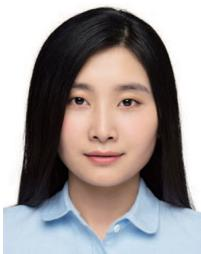

  
Lu Zhou received the B.E. degree from Shandong University, China, in 2016, and the Ph.D. degree from the University of Chinese Academy of Sciences in 2021. He is currently an Assistant Professor of Pattern Recognition and Intelligence Systems with the Foundation Model Research Center, Institute of Automation, Chinese Academy of Sciences. His current research interests include pattern recognition and machine learning, image and video processing, and human pose estimation.

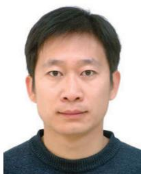

Yingying Chen received the B.S. degree from the Communication University of China in 2013, and the Ph.D. degree from the University of Chinese Academy of Sciences in 2018. She is currently an Assistant Professor of Pattern Recognition and Intelligence Systems with the Foundation Model Research Center, Institute of Automation, Chinese Academy of Sciences. Her current research interests include pattern recognition and machine learning, image and video processing, and intelligent video surveillance.

Jinqiao Wang (Member, IEEE) received the B.E. degree from the Hebei University of Technology, China, in 2001, the M.S. degree from Tianjin University, China, in 2004, and the Ph.D. degree in pattern recognition and intelligence systems from the National Laboratory of Pattern Recognition, Chinese Academy of Sciences in 2008, where he is currently a Professor. His research interests include pattern recognition and machine learning, image and video processing, mobile multimedia, and intelligent video surveillance.