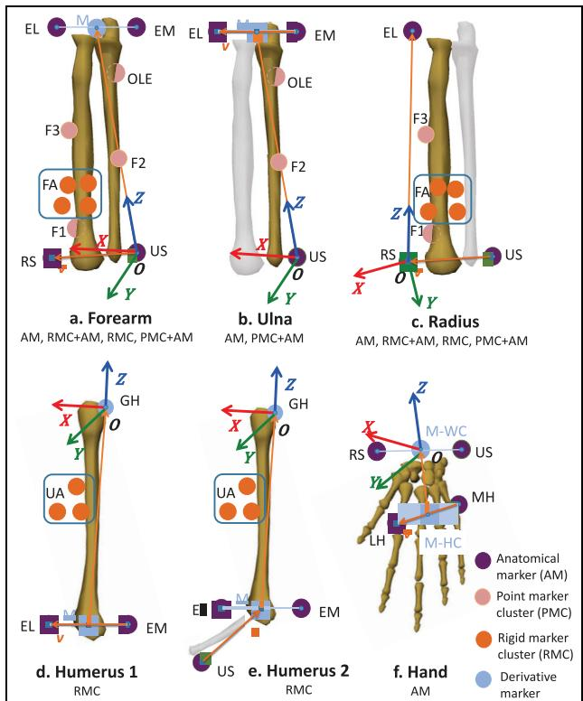
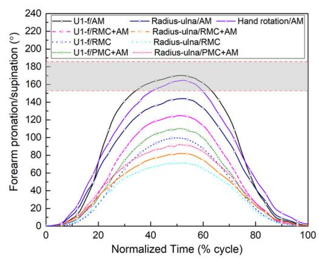
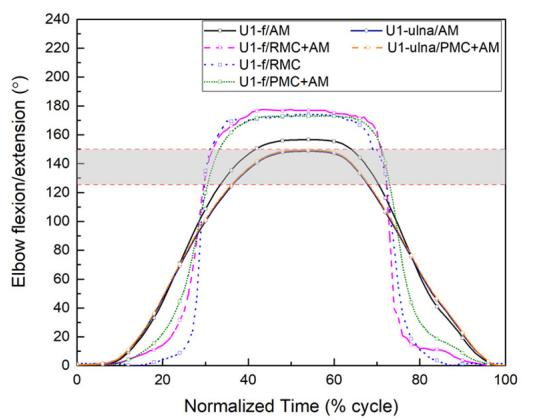

# 用于分析肘关节与前臂运动学的建模和跟踪方法比较

Proc IMechE Part H: J Engineering in Medicine 1–9 - IMechE 2019 Article reuse guidelines: sagepub.com/journals-permissions DOI: 10.1177/0954411919872400 journals.sagepub.com/home/pih SAGE

Wei Wang1,2 , Dongmei Wang1, Mariska Wesseling2, Bin Xue3 and Feiyue Li3

## 摘要

本研究旨在通过不同的建模与跟踪方法，寻找一种测量肘关节和前臂运动学的最佳方案。使用光学动作捕捉系统采集了 12 名健康男性志愿者的肘关节屈/伸（flexion/extension）和前臂旋前/旋后（pronation/supination）的运动学数据。定义了肱骨、前臂、桡骨、尺骨和手部的节段坐标系。采用基于解剖标记点或基于刚性/点标记点集（marker clusters）的不同跟踪方法来计算三维旋转。评估了标记点放置误差以验证刚体假设。多重比较显示各跟踪方法之间存在统计学差异：与仅使用解剖标记点相比，使用标记点集跟踪使估计的旋前/旋后运动范围减少了 14.9%–43.2%，而使估计的屈/伸运动范围增加了 5.3%–9.1%。本研究表明，仅使用解剖标记点能够对肘关节和前臂运动学产生最优估计。分别采用肱骨与前臂坐标系、以及肱骨与尺骨坐标系进行建模，与文献结果表现出良好的一致性，因而被相应地认为是测量旋前/旋后及屈/伸最合适的方法。这些结果对于建立分析肘关节和前臂运动学的测量方案具有重要价值，避免了在交流不同方法所得结果时产生混淆和误解。

## 关键词

前臂运动学（Forearm kinematics），肘关节（elbow），生物力学建模（biomechanical modelling），运动跟踪（motion tracking），活动范围（range of motion），屈/伸（flexion/extension），旋前/旋后（pronation/supination）

收稿日期：2018年12月23日；接受日期：2019年8月1日

## 引言

肘-前臂复合体由四个不同的关节组成：位于肘部的肱尺关节和肱桡关节，以及位于前臂内的近端和远端桡尺关节。对肘部和前臂运动学的研究可为临床应用以及矫形器或假肢设计提供定量评估和数据。1 同时，无创且无辐射的光学动作捕捉技术提供了一种利用基于标记点的肌肉骨骼模型来评估关节运动学的高效方法。2 然而，在大多数使用基于标记点的肘部模型的研究中，前臂被视为一个刚性环节，3,4 且肘部通常被定义为具有两个独立自由度的关节：肘部屈伸（flexion-extension, F/E）和旋前/旋后（pronation/supination, P/S），忽略了尺骨和桡骨之间存在相对运动这一事实。特别是在前臂 P/S 方面，先前的研究主要直接在受试者身上使用测角仪来测量 P/S 过程中手中所握棒状物的整体旋转。5 这种简化可能无法评估主要运动以外的运动特征，而诸如 P/S 期间的桡尺运动等其他运动对于前臂的生物力学分析同样至关重要。6

国际生物力学学会（International Society of Biomechanics, ISB）提出了成熟的 ISB 关节坐标系（coordinate system, CS）推荐标准，7 其中与肘部相关的坐标系包括肱骨的两种不同坐标系、“刚性”前臂坐标系（即假设尺骨和桡骨呈刚性连接）、尺骨坐标系以及桡骨坐标系。部分研究人员主要探讨了两种肱骨推荐坐标系对描述肘部运动学的影响，并未发现差异。1,8 尽管如此，对于评估肘部和前臂运动学最合适的前臂建模方法，目前尚未达成共识。

Table 1. 本研究所使用的标记点及缩写。

<table><tr><td>分类</td><td>标记点名称</td><td>位置</td></tr><tr><td rowspan="8">解剖标记点</td><td>RAC</td><td>右肩峰中心</td></tr><tr><td>LAC</td><td>左肩峰中心</td></tr><tr><td>EL</td><td>肱骨外上髁最尾侧点</td></tr><tr><td>EM</td><td>肱骨内上髁最尾侧点</td></tr><tr><td>RS</td><td>桡骨茎突最尾侧-外侧点</td></tr><tr><td>US</td><td>尺骨茎突最尾侧-内侧点</td></tr><tr><td>LH</td><td>第二掌骨远端头</td></tr><tr><td>MH</td><td>第五掌骨远端头</td></tr><tr><td rowspan="2">刚性标记点阵列</td><td>FA(4 markers)</td><td>靠近前臂前侧远端 $^{a}$ </td></tr><tr><td>UA(3 markers)</td><td>肱骨外侧</td></tr><tr><td rowspan="4">离散标记点阵列</td><td>FI</td><td>靠近桡骨茎突，位于桡骨上</td></tr><tr><td>F2</td><td>尺骨嵴中部</td></tr><tr><td>F3</td><td>桡骨中部</td></tr><tr><td>OLE</td><td>鹰嘴尖端</td></tr><tr><td rowspan="4">衍生标记点</td><td>GH</td><td>盂肱关节旋转中心，通过回归估计 $^{14}$ </td></tr><tr><td>M</td><td>EL 与 EM 的中点</td></tr><tr><td>M-WC</td><td>RS 与 US 的中点</td></tr><tr><td>M-HC</td><td>LH 与 MH 的中点</td></tr></table>

除另有说明外，所有标记点位置均位于受试者的右上肢。  
a刚性标记点阵列尽可能靠近手腕贴附，但保持安全距离以避免标记点伪影

此外，追踪方法，即除解剖骨性标记点外使用反光标记点的方法，在动作捕捉技术中常用于确定肢体节段的位置和方向，同时尽量减少软组织伪影（soft tissue artefact）。刚性标记点阵列（rigid marker cluster, $( \mathbf { R M C } ) ^ { 9 , \breve { 1 } 0 }$）和离散标记点阵列（point marker cluster, PMC）11 是两种广泛使用的追踪方法。RMC 是指通常由三到四个非对称标记点固定在“坚硬”表面上组成的刚性阵列，而 PMC 则是指直接分布在肢体节段皮肤表面的一组独立标记点。这两种阵列方法均独立于解剖骨性标记点。然而，追踪方法具有任务依赖性，且会影响所计算关节运动学的可靠性，12 同时 RMC 和 PMC 主要在下肢进行了验证，鲜有研究评估这些追踪方法对上肢的适用性。Tanaka 等人13 指出，在估计肱骨旋转时，使用 PMC 追踪的精度低于仅使用解剖骨性标记点。然而，RMC 和 PMC 是否适用于追踪前臂运动学仍不明确。

因此，本研究旨在：(1) 比较不同建模方法在使用基于标记点的测量估算肘部和前臂运动学方面的影响；(2) 探究哪种跟踪方法最适用于测量前臂运动学。

## 方法

## 实验

12 名健康的右利手成年男性参与了本实验。平均（标准差（SD））年龄、身高和体重分别为 25.10 岁（2.37 岁）、176.17 cm（4.84 cm）和 68.17 kg（7.49 kg）。本研究经由 Shanghai Jiao Tong University（上海交通大学）机构审查委员会批准。所有参与者在实验开始前均签署了书面知情同意书。

使用包含 7 台相机的光电动作捕捉系统（Qualisys Inc., Sweden）以 100 Hz 的采样频率跟踪参与者的运动。标记点的位置列于 Table 1 并在 Figure 1 中展示。指导参与者执行两项标准动作：肘关节屈曲/伸展（F/E）和前臂旋前/旋后（P/S）。每个动作至少采集 5 次，每次试验均在 8–10 s 内以自选的平稳速度进行。肘关节 F/E：开始时，肱骨自然垂于躯干旁，肘部完全伸展至极限且手掌朝前。参与者首先在矢状面内将前臂朝向固定的肱骨屈曲，然后伸展返回至起始位置。前臂 P/S：前臂在 P/S 中的中立位定义为肘关节在矢状面屈曲 90°，肱骨自然垂于躯干旁，手掌位于躯干矢状面且大拇指朝上。参与者首先将前臂旋前，然后旋后至极限位置，期间保持肘关节屈曲 90° 且手部相对于前臂保持静止。

  
Figure 1. 环节坐标系及相应的跟踪标记点方法（请注意，骨骼的几何形状以及标记点的大小和位置仅用于可视化说明）。标记点的缩写释义见 Table 1。

## 建模与数据处理

运动学模型在 Visual3D（C-Motion Inc., USA）中构建。根据 ISB（国际生物力学学会）推荐标准，7 定义了五个环节坐标系（CS，参见 Table 2 和 Figure 1），包括肱骨（ISB 1 和 ISB 2）、前臂、尺骨和桡骨的 CS。肱骨 CS 仅由肱骨骨性标志定义（ISB 1），或基于肱骨和前臂两者的骨性标志共同定义（ISB 2）。此外，为了能够与使用测角仪追踪手部纵向旋转轴来测量前臂 P/S（旋前/旋后）旋转的研究（称为手部旋转，Hand rotation）进行对比，还添加了手部 CS。基于不同的环节 CS 建立了五个关节，包括肱骨 1 到前臂（U1-f）、肱骨 2 到前臂（U2-f）、肱骨 1 到尺骨（U1-ulna）、肱骨 2 到尺骨（U2-ulna）以及桡骨到尺骨（Radius-ulna），在本研究中统称为建模方法。U1-f 和 U2-f 是指通常意义上的肘关节（“刚性前臂相对于肱骨”）。U1-ulna 和 U2-ulna 关节指肱尺关节，Radius-ulna 指桡尺关节。综上所述，共使用四种建模方法评估 P/S，即 U1-f、U2-f、Radius-ulna 和手部旋转。对于肘部 F/E（屈曲/伸展），同样使用了四种建模方法，即 U1-f、U2-f、U1-ulna 和 U2-ulna。

原始标记点轨迹使用四阶低通巴特沃斯滤波器在 6 Hz 处进行滤波。采用四种追踪方法（参见 Table 2 和 Figure 1）来重建前臂环节的运动：(1) 仅使用解剖标记点（AM）；(2) 使用刚性标记点阵列和解剖标记点（RMC + AM）；(3) 仅使用刚性标记点阵列（RMC）；(4) 使用点状标记点阵列和解剖标记点（PMC + AM）。用于追踪特定环节的 PMC 是指相应环节上的离散标记点，如图 Figure 1 中的粉色标记点所示。由于桡骨和尺骨上缺少放置离散标记点的空间，PMC 追踪与 AM 相结合。由于 RMC 不易贴合在尺骨上，因此未采用 RMC 和 RMC + AM 方法追踪尺骨。对于参考环节，肱骨仅由 RMC 追踪，因为这是先前研究中上臂常用的追踪方法；而由于手背空间有限，手部仅由 AM 进行追踪。

## 分析

对标记点放置的标记点间距变异性进行了分析，以检验刚体假设，15 即观察两个标记点之间的距离随时间是否保持不变。标记点对距离是根据在 F/E 或 P/S 运动周期中用于追踪运动环节的标记点轨迹计算得出的。例如，AM 方法使用四个标记点来追踪 F/E 中的“刚性”前臂，因此会产生六个标记点对。标记点对距离的 SD 是根据每个标记点对的平均距离与其在每个时间帧中的瞬时距离计算得出的。标记点放置误差（MPE）也取决于标记点之间的相对距离，16 因此将该 SD 进一步除以平均标记点对距离，并归一化为平均标记点对距离的百分比（相对 SD）。对追踪组中所有标记点对的 SD 和相对 SD 进行平均，分别作为相应的绝对和相对 MPE。

为了评估不同建模和追踪方法的影响，计算了主轴的关节活动度（ROM）作为定量指标。1 统计分析使用 SAS 9.4 (SAS Institute Inc., USA) 进行。采用事后 Student-Newman-Keuls (SNK) 检验对不同追踪和建模组计算得到的 ROM 进行多重比较。此外，使用配对 t 检验来比较感兴趣的特定配对。使用多重相关系数（CMC）来评估关节角度波形的可重复性和相似性。17 针对建模和追踪方法的每种组合，分别计算了 F/E 和 P/S 角度。

Table 2. 环节坐标系的定义。

<table><tr><td>环节</td><td>定义</td><td></td><td>追踪方法</td></tr><tr><td rowspan="4">肱骨 1(ISB 1)</td><td>原点</td><td>GH</td><td>RMC</td></tr><tr><td>Z轴</td><td>从 M 到 GH（近端为正）</td><td></td></tr><tr><td>Y轴</td><td>Z轴与从 EM 到 EL 的向量 v 的叉积（前向为正）</td><td></td></tr><tr><td>X轴</td><td>Z轴与 Y轴的叉积（外侧为正）</td><td></td></tr><tr><td rowspan="4">肱骨 2(ISB 2)</td><td>原点</td><td>GH</td><td>RMC</td></tr><tr><td>Z轴</td><td>从 M 到 GH（近端为正）</td><td></td></tr><tr><td>X轴</td><td>Z轴与从 US 到 M 的向量 v 的叉积（外侧为正），该轴在肘关节于矢状面屈曲 90 度且前臂完全旋前时确定。</td><td></td></tr><tr><td>Y轴</td><td>Z轴与 Y轴的叉积（前向为正）</td><td></td></tr><tr><td rowspan="4">前臂（'Rigid'）</td><td>原点</td><td>US</td><td>AM</td></tr><tr><td>Z轴</td><td>从 US 到 M（近端为正）</td><td>RMC + AM</td></tr><tr><td>Y轴</td><td>Z轴与从 US 到 RS 的向量 v 的叉积（前向为正）</td><td>RMC</td></tr><tr><td>X轴</td><td>Z轴与 Y轴的叉积（外侧为正）</td><td>PMC + AM</td></tr><tr><td rowspan="4">桡骨</td><td>原点</td><td>RS</td><td>AM</td></tr><tr><td>Z轴</td><td>从 RS 到 EL（近端为正）</td><td>RMC + AM</td></tr><tr><td>Y轴</td><td>Z轴与从 US 到 RS 的向量 v 的叉积（前向为正）</td><td>RMC</td></tr><tr><td>X轴</td><td>Z轴与 Y轴的叉积（外侧为正）</td><td>PMC + AM</td></tr><tr><td rowspan="4">尺骨</td><td>原点</td><td>US</td><td>AM</td></tr><tr><td>Z轴</td><td>从 US 到 M（近端为正）</td><td>PMC + AM</td></tr><tr><td>Y轴</td><td>Z轴与从 EM 到 EL 的向量 v 的叉积（前向为正）</td><td></td></tr><tr><td>X轴</td><td>Z轴与 Y轴的叉积（外侧为正）</td><td></td></tr><tr><td rowspan="4">手部</td><td>原点</td><td>M-WC</td><td>AM</td></tr><tr><td>Z轴</td><td>从 M-HC 到 M-WC（近端为正）</td><td></td></tr><tr><td>Y轴</td><td>Z轴与从 MH 到 LH 的向量 v 的叉积（前向为正）</td><td></td></tr><tr><td>X轴</td><td>Z轴与 Y轴的叉积（外侧为正）</td><td></td></tr></table>

追踪方法：AM、RMC 和 PMC。  
ISB：国际生物力学学会（International Society of Biomechanics）；GH：盂肱关节（glenohumeral）；RMC：刚性标记簇（rigid marker cluster）；US：尺骨茎突（ulnar styloid）；AM：解剖标记点（anatomical markers）；RS：桡骨茎突（radia styloid）；PMC：点标记簇（point marker clusters）。

分别针对每位参与者的重复动作（测试内重复性，within-session repeatability）以及所有参与者的平均关节角度曲线（组内相似性，within-group similarity）计算了 CMC。在计算 CMC 之前，调整了关节角度的偏移量，以确保每条曲线都从相同的零基线开始。

虽然无法评估从光学动作捕捉系统估计的“真实”值，但已有大量研究发表了利用各种建模和测量方法（包括医学成像、角度计、光学动作追踪和惯性测量单元（IMU））估计的肘关节 ROM（关节活动度）的大量数据集1,5,18–29（部分相关文献列于 Supplementary Table 1 中）。我们从 10 项研究1,5,20–28中选择了报道的旋前/旋后（P/S）ROM，其范围在 152.8  至 185.9  之间（见 Figure 2(a)），作为参考范围（仅排除了低于 120  的极端估计值1,29，因为解剖学清楚表明可以达到接近 180  的数值6,20,30），超出此范围的结果被视为不可接受。报道的屈曲/伸展（F/E）在 125  至 150  的相对较小范围内变化（见 Figure 2(b)）。我们选择了一项既往研究19的结果作为参考：“136.5  (9 )”（20 名受试者，男性，年龄 18–50 岁），因为放射摄影常被用作金标准，且其实验受试者的特征与我们的相似。

## 结果

针对建模和追踪方法的全部 25 种组合所计算的 ROM、各组之间的统计学差异以及相应的 MPE（标记点放置误差），分别展示在 Table 3（前臂 P/S）和 Table 4（肘关节 F/E）中。Figure 2 展示了一名代表性受试者在前臂旋前/旋后以及肘关节屈曲/伸展任务期间主轴的典型角位移。

  
(a)

  
(b)  
Figure 2. 一名代表性受试者在前臂旋前/旋后（a，先旋前再旋后）和肘关节屈曲/伸展（b，先屈曲再伸展）任务期间主轴的角位移。每条线均使用不同的建模/追踪方法生成（缩写在“Modelling and data processing”一节中进行了解释），并且每条线的关节角度偏移量均进行了调整以实现零基线。阴影区域代表先前报道的平均最大关节活动度的相应参考范围（详情在“Analysis”一节中进行了解释）。由于使用“U1-”和“U2-”（构建肱骨坐标系的两种 ISB 方法）的建模方法之间的角度变化曲线相似，为保持简明，本图中仅展示了使用“U1-”的结果。

Table 3. 前臂旋前/旋后的关节活动度（ROM）以及运动节段的标记点放置误差（MPE）。

<table><tr><td>追踪方法</td><td></td><td>U1-f</td><td>U2-f</td><td>Radius-ulna</td><td>手部旋转</td><td>p**</td></tr><tr><td rowspan="3">AM</td><td>ROM (°)</td><td>170.9 (8.7)</td><td>171.4 (8.7)</td><td>129.6 (9.9)</td><td>174.5 (8.7)</td><td>0.001</td></tr><tr><td>绝对 MPE (mm)</td><td>2.9 (0.5)</td><td></td><td>2.8 (0.5)</td><td>1.6 (0.5)</td><td></td></tr><tr><td>相对 MPE (%)</td><td>1.9 (0.5)</td><td></td><td>2.1 (0.5)</td><td>2.0 (0.6)</td><td></td></tr><tr><td rowspan="3">RMC + AM</td><td>ROM (°)</td><td>145.5 (21.8)</td><td>146.4 (22.2)</td><td>77.9 (9.7)</td><td>-</td><td>0.018</td></tr><tr><td>绝对 MPE (mm)</td><td>3.5 (0.4)</td><td></td><td>3.0 (0.3)</td><td></td><td></td></tr><tr><td>相对 MPE (%)</td><td>3.2 (0.4)</td><td></td><td>3.4 (0.4)</td><td></td><td></td></tr><tr><td rowspan="3">RMC</td><td>ROM (°)</td><td>137.5 (37.8)</td><td>137.5 (37.8)</td><td>73.7 (23.0)</td><td>-</td><td>0.001</td></tr><tr><td>绝对 MPE (mm)</td><td>1.5 (0.3)</td><td></td><td>1.5 (0.3)</td><td></td><td></td></tr><tr><td>相对 MPE (%)</td><td>3.8 (0.8)</td><td></td><td>3.8 (0.8)</td><td></td><td></td></tr><tr><td rowspan="3">PMC + AM</td><td>ROM (°)</td><td>129.2 (37.2)</td><td>130.0 (38.3)</td><td>78.5 (30.4)</td><td>-</td><td>0.011</td></tr><tr><td>绝对 MPE (mm)</td><td>2.9 (0.4)</td><td></td><td>2.9 (0.5)</td><td></td><td></td></tr><tr><td>相对 MPE (%)</td><td>2.4 (0.4)</td><td></td><td>2.3 (0.4)</td><td></td><td></td></tr><tr><td> $p^*$ </td><td></td><td>0.0089</td><td>0.0094</td><td>0.001</td><td>-</td><td></td></tr></table>

AM：解剖标记点（anatomical markers）；ROM：关节活动度（range of motion）；MPE：标记点放置误差（marker placement error）；RMC：刚性标记点群（rigid marker cluster）；PMC：点状标记点群（point marker cluster）。 1. 手部旋转（Hand rotation）是指手部长轴的旋转。  
2. 建模组（\*）或追踪组（\*\*）内的统计学差异（p）采用 SNK 多重比较检验计算，p < 0.05 表示具有显著统计学差异。  
3. 追踪方法：AM（解剖标记点）、RMC（刚性标记点群）和 PMC（点状标记点群）。

在旋前/旋后（P/S，1.5 (0.3) mm）和屈曲/伸展（F/E，2.8 (1.5) mm）中，RMC 的绝对 MPE 均为最小，而其他 MPE 在 2.8 (0.5) 至 5.1 (0.6) mm 之间变动。然而，对于相对 MPE，RMC 的相对误差最高（P/S 为 3.8%，F/E 为 6.7%），而 AM 的相对误差最小（P/S 为 1.9%，F/E 为 2.6%）。

## 前臂 P/S（旋前/旋后）

如表 3 所示，无论采用何种建模方法，AM 跟踪方法均与其他三种跟踪方法存在显著差异（所有 $\mathrm { ~ p ~ < ~ } 0 . 0 1 )$）。使用 AM 跟踪始终得出最大的 ROM（约 171  (8.7 )），而使用标记点群进行跟踪时，仅使用 RMC 会使 ROM 减少 19.6%–43.2%，使用 RMC + AM 时减少 14.9%–39.9%，使用 PMC + AM 时减少 24.4%–39.4%。基于文献数据库（补充表 1），仅 AM 计算出的 ROM 落在了可接受的范围（152.8 –185.9 ）内。此外，在所有跟踪方法中，使用 AM 跟踪的标准差（SD）最小，表明所测角度的变异性最低。

在比较各种建模方法时，仅考虑了 AM 跟踪。在四种建模方法中，使用 Radiusulna 计算出的 ROM 与其他方法存在差异（SNK，p < 0.001）。其他三种方法的平均 ROM 均在 170 以上，完全处于可接受范围内，而 Radius-ulna 显示出的 ROM 最小。此外，U1-f、U2-f 和 Hand rotation 之间两两比较均未发现统计学差异。

Table 4. 肘关节屈曲-伸展活动度（ROM）及运动节段标记放置误差（MPE）。

<table><tr><td>跟踪方法</td><td></td><td>U1-f</td><td>U2-f</td><td>U1-ulna</td><td>U2-ulna</td><td>p**</td></tr><tr><td rowspan="3">AM</td><td>ROM (°)</td><td>155.0 (10.6)</td><td>155.7 (10.1)</td><td>138.1 (13.7)</td><td>138.1 (13.7)</td><td>0.0005</td></tr><tr><td>绝对 MPE (mm)</td><td>3.5 (0.9)</td><td></td><td>4.3 (0.8)</td><td></td><td>-</td></tr><tr><td>相对 MPE (%)</td><td>2.6 (5.3)</td><td></td><td>3.8 (0.8)</td><td></td><td>-</td></tr><tr><td rowspan="3">RMC + AM</td><td>ROM (°)</td><td>169.2 (9.0)</td><td>169.9 (9.6)</td><td>-</td><td>-</td><td>-</td></tr><tr><td>绝对 MPE (mm)</td><td>3.2 (0.9)</td><td></td><td></td><td></td><td></td></tr><tr><td>相对 MPE (%)</td><td>3.3 (1.1)</td><td></td><td></td><td></td><td></td></tr><tr><td rowspan="3">RMC</td><td>ROM (°)</td><td>168.6 (12.6)</td><td>169.3 (13.2)</td><td>-</td><td>-</td><td>-</td></tr><tr><td>绝对 MPE (mm)</td><td>2.8 (1.5)</td><td></td><td></td><td></td><td></td></tr><tr><td>相对 MPE (%)</td><td>6.7 (3.5)</td><td></td><td></td><td></td><td></td></tr><tr><td rowspan="3">PMC + AM</td><td>ROM (°)</td><td>165.2 (13.1)</td><td>164.0 (13.9)</td><td>135.4 (21.5)</td><td>135.7 (21.6)</td><td>0.0001</td></tr><tr><td>绝对 MPE (mm)</td><td>4.3 (0.5)</td><td></td><td>5.1 (0.6)</td><td></td><td>-</td></tr><tr><td>相对 MPE (%)</td><td>3.9 (0.5)</td><td></td><td>5.2 (0.8)</td><td></td><td>-</td></tr><tr><td>p*</td><td></td><td>0.0715</td><td>0.0549</td><td>-</td><td>-</td><td>-</td></tr></table>

AM：解剖标记（anatomical markers）；ROM：活动度（range of motion）；MPE：标记放置误差（marker placement error）；RMC：刚性标记簇（rigid marker cluster）；PMC：点标记簇（point marker cluster）。1. 建模组（\*）或跟踪组（\*\*）内的统计学差异（p）采用 SNK 多重比较检验进行计算，p \ 0.05 表示具有显著统计学差异。  
2. 跟踪方法：AM、RMC 和 PMC。

## 肘关节屈/伸（Elbow F/E）

如 Table 4 所示，对于不同的跟踪方法，无论采用何种建模方法，跟踪组之间均未发现统计学差异。然而，配对 t 检验显示，在使用 U1-f（p = 0.0072）和 U2-f 建模（p = 0.0068）时，AM 与 RMC + AM 之间存在统计学差异；在使用 U1-f（p = 0.0097）和 U2-f 建模（p = 0.0081）时，AM 与 RMC 之间也存在统计学差异。与仅使用 AM 相比，使用标记簇时 F/E ROM 的增幅为 5.3%–9.1%。

对于四种建模方法，在 ISB U1 和 U2 对应组之间（即 U1-f 对比 U2-f，以及 U1-ulna 对比 U2-ulna）未发现差异。然而，使用“刚性”前臂与使用尺骨计算肘关节 F/E 之间存在差异，前者估计的 F/E 大于后者（SNK，对于 AM 和 PMC + AM 跟踪，均为 p \ 0.001）。无论采用何种跟踪方法，与 U-f 模型（U1-f 和 U2-f 模型）相比，U-ulna 模型（U1-ulna 和 U2-ulna 模型）估计的 ROM 小了 11.0%–18.0%。仅 U-ulna 模型与医学影像参考文献数据19相比无统计学差异（p = 0.71，平均值 138.1 (13.7) 对比 (136.5 (9))）。

对于每名受试者，重复试验的会话内（within-session）CMC 值均在 0.95 以上，表明会话内具有极好的可重复性。对于肘关节 F/E，在不同建模与跟踪方法的每种组合条件下，所有受试者的 CMC 值均在 0.90 以上，表明组内相似度较高。然而，对于 P/S（旋前/旋后），每种建模方法下不同跟踪方法的 CMC 值约为 0.75–0.78，而在每种跟踪方法下不同建模方法的 CMC 值在 0.44 到 0.93 之间变动。P/S 的 CMC 变异以及较低的数值表明各组之间的相似度较差。

## 讨论

## 跟踪方法

在绝对 MPE 的分析中，RMC 在所有追踪条件中表现出受扰动最小的标记点对间距。由于标记点已被固定在“刚性”形态上，可以推断 RMC 的绝对 MPE 主要来源于系统误差或仪器误差。其他追踪条件的主要误差来源不仅包括系统误差，还包括通常大得多的皮肤伪影。12然而，本研究中所有其他的绝对 MPE 都与 RMC 具有相同的数量级和 SD，且完全处于文献报道的平均系统误差范围内（从 0.1 至 5.3 mm）31，并低于软组织伪影引入的报道误差（高达 55.3 mm）。12因此，所有追踪方法都被认为符合刚体假设。15对于相对 MPE，尽管较低的值并不能保证与骨骼之间具有更刚性的连接，但一项综述12指出，旋转标记点之间的最小距离越大，结果就越准确。在本研究中，基于 AM 估计的 ROM 在大多数追踪方法中具有最小的 SD，表明其变异性低于其他方法。这可能是测量误差减少的结果，表明仅使用 AM 能使所追踪的运动学特征对 MPE 不那么敏感。

除了 MPE 之外，追踪方法还影响了 P/S 和 F/E 运动的估计范围，尤其是 P/S。对于 P/S，与仅使用 AM（约 170°）相比，使用标记点群进行追踪导致关节角度被严重低估（从 73.7° 至 146.4°），落在了所参考的文献数据库范围之外。无论使用 RMC 还是 PMC，由于前臂存在大量的皮肤移动，附着在非骨性位置的标记点均未能代表尺骨与桡骨之间的全部相对运动。尤其是由于皮肤移动，前臂 RMC 在追踪 P/S 时对腕部到标记点群的距离也很敏感。Schmidt 等人28建议应将 RMC 固定在距离腕部足够近的位置以记录大部分的 P/S（尽管他们仍发现旋转角度比真实值小 17%–43%）。他们的结论与我们的发现一致（与仅使用 AM 相比，使用 RMC 进行追踪使估计的运动范围减少了 19.6%–43.2%），并有助于解释先前使用动作捕捉的研究中报道的 P/S ROM 的巨大差异。1,26–28当仅使用 RMC 时，Andel 等人26发现的 P/S 范围（161°）大于本研究中的范围（137.5°）。然而，Andel 等人使用的是主动光学系统，允许将标记点群绑在距离尺骨茎突和桡骨茎突足够近的位置，而我们必须将标记点群保持在距离腕部周围 AM 更远的位置（约 3 cm），以避免被动光学系统产生伪影。

对于肘关节 F/E，尽管在整个追踪组中未发现统计学差异，但在两两配对之间存在差异。就 U-f 模型而言，与仅使用 AM 相比，增加标记点阵列（clusters）略微增大了 F/E 关节活动度（range of motion），而后者与医学影像学研究的参考值更为接近。19 这也可以解释为前臂处的阵列对软组织伪影具有较高的敏感性。此外，RMC 和 PMC 表现出相当的追踪效果，因为这些方法之间未发现统计学差异。因此，此处追踪方法对 F/E 的影响小于对 P/S 的影响，同样推荐仅使用 AM 来追踪 F/E。

## 建模方法

首先，肱骨的两种 ISB（国际生物力学学会）定义对肘关节 F/E 和 P/S ROM 的估计相似，这与先前的研究一致。1 Fraysse 和 Thewlis1 提出 ISB2 可能会提高实验者间的重复性，且 ISB 建议在有前臂数据时优先选择 ISB2。然而，根据我们结果中相似的 SD 和 CMC 值，没有迹象表明在本实验方案中 ISB2 的敏感性低于 ISB1。

其次，前臂的建模方法在肘关节运动学计算中至关重要。尽管在 ISB 建议中，U-f 和 U-ulna 的 X 轴旋转均被视为 F/E 的近似值，7 但在本研究中我们发现了这两种模型之间的差异。仅 U-ulna 模型表现出与医学影像文献参考数据相当的结果（p = 0.71，平均值 138.1  (13.7 ) vs 136.5  (9 )）。这是合理的，因为医学影像研究仅将尺骨视为研究肱尺关节 F/E 的运动节段，而非整个前臂。同时，由于量角器测量仍是肘关节 F/E 测量的常用方法，我们还将 F/E 与一项具有代表性的量角器研究22进行了对比，因为该研究包含了与本研究受试者特征相似的大样本。与量角器参考值 145.4 (9.4 )（114 名受试者，男性，年龄 20–44 岁）相比，我们同样发现仅 U-ulna 模型的估算结果相当且无统计学差异（p = 0.11，平均值 138.1  (13.7 ) vs 145.4  (9.4 )），尽管其与量角器测量的相对差异略高于与放射影像学测量的差异。U1-f 和 U2-f 模型的结果与医学影像和量角器测量均不一致。因此，U-ulna 模型与文献18,19的高度一致性是符合预期的，这表明 U-f 模型的“刚性”前臂假设在估算肘关节 F/E 时并不适用。

U-f 模型在 P/S 的估计上表现出优于 Radius-ulna 模型的性能。然而，Tersi 等人20在其单样本 X 射线透视分析中指出，在估计桡尺关节运动学时，“刚性”前臂模型的准确性低于同时包含尺骨和桡骨的模型。在本研究中，使用 Radius-ulna 模型时 ROM 的减小可能与皮肤伪影以及环节坐标系的简化有关，因为该模型假设 P/S 轴与 F/E 轴相交7，尽管这并不符合生理情况。

在本研究中，计算出的 P/S 期间的手部旋转被视为对角度计测量的模拟，并且发现其与 U-f/AM 建模的结果以及文献数据库的参考范围均高度一致。5,21–23 此处需保持谨慎，尽管手部旋转（Hand rotation）模型可能易于实施以近似估计肘部 P/S（因为肱骨和前臂不需要标记点），但其应用受到限制，因为必须对腕部运动进行控制。

## 局限性与未来方向

本研究的结果应在实验方案的局限性范围内进行解释和推广。一个主要局限性主要涉及本研究采用的比较标准。我们没有使用医学成像或骨针直接测量运动，而是通过文献回顾对比了我们的结果。然而，尽管无法评估“真实”值，但不同方法之间的组间差异和相互关系（本研究的重点）仍能为测量方案提供参考。此外，与文献（特别是使用放射学方法的研究）的对比显示出良好的一致性；因此，我们对上述结论充满信心。另一个局限性是本研究中缺乏独立的 PMC 追踪。我们发现很难保证至少三个独立标记点牢固贴附在目标骨骼上并获得良好的追踪效果，因为刚性标记块已经占据了前臂的大量空间，尤其是在进行 P/S 运动时。这一问题同样影响了尺骨的独立 RMC 追踪。

此外，近年来惯性测量单元（IMUs）在人体运动追踪方面展现出广阔前景。一些研究人员32提出，将光学动作捕捉系统与 IMUs 相结合，既可克服光学系统对反光标记点的高度依赖，又可克服 IMUs 的传感器偏差和漂移缺陷。另一项研究33指出，生物力学模型定义对 IMUs 追踪效果（基于 IMU 与光学系统之间的转换矩阵）的影响大于技术误差。因此，本研究及其结果可进一步拓展，以探讨对于此类传感器融合方法，是否同样能够获得对肘关节和前臂运动学的相同最佳估计。

## 结论

总体而言，本研究表明，包括 RMC 和 PMC 在内的标记群追踪方法并不适用于测量肘部和前臂的运动学，特别是前臂的 P/S 运动。我们建议 AM 是前臂追踪的最佳方法。我们认为 ISB U-f 模型是分析前臂 P/S 运动学的合适通用模型，而 U-ulna 模型最适合用于测量肱尺关节或 F/E 运动学。了解不同建模和追踪方法的影响有助于我们理解以往研究中的差异，避免在交流不同方法学的结果时产生误解，从而为研究人员提供可用于分析肘部和前臂运动学的测量方案的清晰见解。

## 利益冲突声明

作者声明就本文的研究、作者身份和/或发表而言，不存在潜在的利益冲突。

## 资助

作者披露收到了以下用于本论文研究、作者身份和/或发表的资助：本工作得到了上海市中医药事业发展三年行动计划（项目编号：ZY3-CCCX-1-1014）以及国家留学基金管理委员会（China Scholarship Council，资助第一作者）的支持。

## ORCID iD

Wei Wang https://orcid.org/0000-0002-1227-6202

## 补充材料

本文的补充材料可在线获取。

## 参考文献

1. Fraysse F and Thewlis D. Comparison of anatomical, functional and regression methods for estimating the rotation axes of the forearm. J Biomech 2014; 47: 3488– 3493.

2. Noble JJ, Fry NR, Bingham CR, et al. A practical clinical kinematic model for the upper limbs. Proc IMechE, Part H: J Engineering in Medicine 2018; 232: 207–212.

3. Guerre E, Laronde P, Cussonneau J, et al. Experimental determination of the elbow’s center of rotation using the VICON  optoelectronic motion capture system. Surg Radiol Anat 2016; 38: 1–7.

4. Baeyens JP, Van GF, Goossens M, et al. In vivo 3D arthrokinematics of the proximal and distal radioulnar joints during active pronation and supination. Clin Biomech (Bristol, Avon) 2006; 21: S9–S12.

5. Rickert M, Burger A, Gunther C, et al. Forearm rotation in healthy adults of all ages and both sexes. J Shoulder Elb Surg 2008; 17: 271–275.

6. Kazama K, Kobayashi K and Sakamoto M. In vivo three-dimensional analysis of distal radioulnar joint kinematics during forearm pronation-supination. J Biomech Sci Eng 2016; 11: 15-00364.

7. Wu G, Van der Helm FC, Veeger HD, et al. ISB recommendation on definitions of joint coordinate systems of various joints for the reporting of human joint motion– Part II: shoulder, elbow, wrist and hand. J Biomech 2005; 38: 981–992.

8. Cutti AG, Garofalo P, Davalli A, et al. How accurate is the estimation of elbow kinematics using ISB recommended joint coordinate systems? Gait Posture 2006; 24: S36–S37.

9. Cappello A, Cappozzo A, Palombara PFL, et al. Multiple anatomical landmark calibration for optimal bone pose estimation. Hum Movement Sci 1997; 16: 259– 274.

10. Wang W, Wang D and Lai C. The three-dimensional movement correlations between elbow and wrist joint and anthropometric determinants. J Mech Med Biol 2018; 18: 1850013.

11. Senesh M and Wolf A. Motion estimation using point cluster method and Kalman filter. J Biomech Eng 2009; 131: 051008.

12. Leardini A, Chiari L, Della Croce U, et al. Human movement analysis using stereophotogrammetry. Part 3: soft tissue artifact assessment and compensation. Gait Posture 2005; 21: 212–225.

13. Tanaka S, Otsubo N, Nakamura Y, et al. The optimum marker set for measurement of upper limbs movement using motion-capture system. Ieice Technical Report Me & Bio Cybernetics 2003; 103: 13–18.

14. Rab G, Petuskey K and Bagley A. A method for determination of upper extremity kinematics. Gait Posture 2002; 15: 113–119.

15. Cheze L, Fregly BJ and Dimnet J. A solidification procedure to facilitate kinematic analyses based on video system data. J Biomech 1995; 28: 879–884.

16. Della Croce U and Cappozzo A. A spot check for estimating stereophotogrammetric errors. Med Biol Eng Comput 2000; 38: 260–266.

17. McGinley JL, Baker R, Wolfe R, et al. The reliability of three-dimensional kinematic gait measurements: a systematic review. Gait Posture 2009; 29: 360–369.

18. Chapleau J, Canet F, Petit Y, et al. Validity of goniometric elbow measurements: comparative study with a radiographic method. Clin Orthop Relat R 2011; 469: 3134–3140.

19. Chapleau J, Canet F, Petit Y, et al. Demographic and anthropometric factors affecting elbow range of motion in healthy adults. J Shoulder Elb Surg 2013; 22: 88–93.

20. Tersi L, Fantozzi S, Stagni R, et al. Fluoroscopic analysis for the estimation of in vivo elbow kinematics: influence of 3D model. J Mech Med Biol 2012; 12: 1250046.

21. Fu E, Li G, Souer JS, et al. Elbow position affects distal radioulnar joint kinematics. J Hand Surg Am 2009; 34: 1261–1268.

22. Soucie JM, Wang C, Forsyth A, et al. Range of motion measurements: reference values and a database for com parison studies. Haemophilia 2011; 17: 500–507.

23. Guˆ nal I, Ko¨ se N, Erdogan O, et al. Normal range of motion of the joints of the upper extremity in male sub jects, with special reference to side. J Bone Joint Surg 1996; 78: 1401–1404.

24. Boone DC and Azen SP. Normal range of motion of joints in male subjects. J Bone Joint Surg 1979; 61: 756– 759.

25. Shaaban H, Pereira C, Williams R, et al. The effect of elbow position on the range of supination and pronation of the forearm. J Hand Surg Eur Vol 2008; 33: 3–8.

26. Andel CJV, Wolterbeek N, Doorenbosch CAM, et al. Complete 3D kinematics of upper extremity functional tasks. Gait Posture 2008; 27: 120–127.

27. Aizawa J, Masuda T, Hyodo K, et al. Ranges of active joint motion for the shoulder, elbow, and wrist in healthy adults. Disabil Rehabil 2013; 35: 1342–1349.

28. Schmidt R, Disselhorst-Klug C, Silny J, et al. A markerbased measurement procedure for unconstrained wrist and elbow motions. J Biomech 1999; 32: 615–621.

29. Ligorio G, Zanotto D, Sabatini AM, et al. A novel functional calibration method for real-time elbow joint angles estimation with magnetic-inertial sensors. J Biomech 2017; 54: 106–110.

30. Soubeyrand M, Assabah B, Be´ gin M, et al. Pronation and supination of the hand: anatomy and biomechanics. Hand Surg Rehabil 2017; 36: 2–11.

31. Chiari L, Della Croce U, Leardini A, et al. Human movement analysis using stereophotogrammetry. Part 2: instrumental errors. Gait Posture 2005; 21: 197–211.

32. He C, Kazanzides P, Sen HT, et al. An inertial and optical sensor fusion approach for six degree-of-freedom pose estimation. Sensors (Basel) 2015; 15: 16448–16465.

33. Robert-Lachaine X, Mecheri H, Larue C, et al. Validation of inertial measurement units with an optoelectronic system for whole-body motion analysis. Med Biol Eng Comput 2017; 55: 609–619.