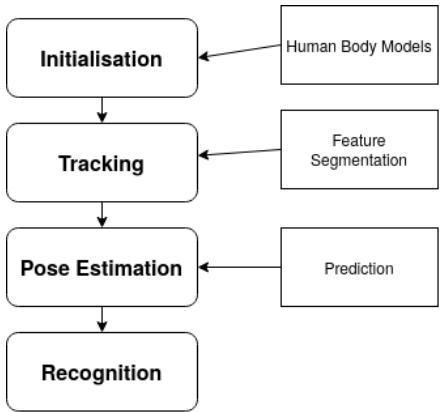
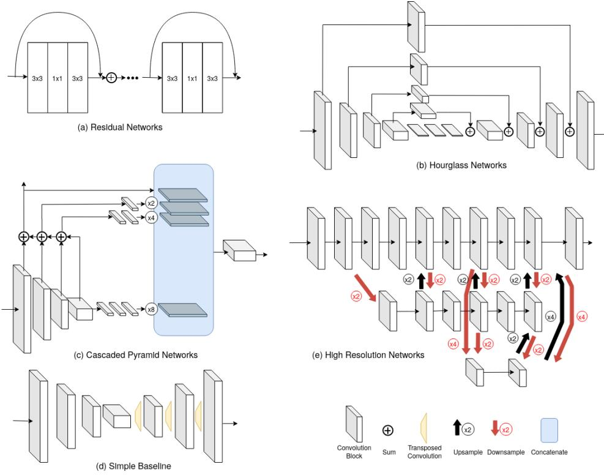
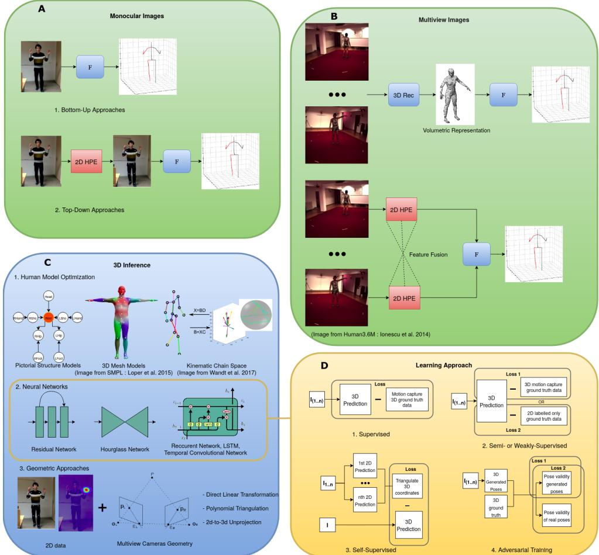

# 用于无标记动作捕捉的 3D 人体姿态估计算法综述

Yann Desmaraisa, Denis Mottetb, Pierre Slangena, Philippe Montesinosa,∗

a EuroMov Digital Health in Motion, Univ Montpellier, IMT Mines Ales, 30100 Ales, France b EuroMov Digital Health in Motion, Univ Montpellier, IMT Mines Ales, 34090 Montpellier, France

## 摘要

人体姿态估计（Human pose estimation）是一个非常活跃的研究领域，受到其在机器人、娱乐、健康与体育科学等领域重要应用的推动。卷积网络（convolutional networks）的进步显著提升了 2D 姿态估计的效果，使得现代 3D 无标记动作捕捉技术达到每个关节平均 20 mm 的误差。然而，随着方法的激增，做出明智的选择变得越来越困难。在此，我们回顾了过去五年中主流的人体姿态估计方法，重点关注评估指标、基准以及方法架构。我们提出了一种基于准确性、速度和鲁棒性的分类法，用于对现有方法进行分类并指明未来的研究方向。

## 1. 引言

人体姿态估计是指从图像或视频中提取身体结构形态。通常，它是指推导关节点坐标并重建人体骨骼表示。在过去几年中，2D 姿态估计在所有不同人体关节点上的检测率达到了 90% 以上 Newell et al. (2016)。这一进展在很大程度上得益于卷积神经网络（CNN）的成功以及易于获取的大规模数据集的出现（Sigal et al. (2010); Ionescu et al. (2014)）。然而，直到最近，这些新架构才被用于解决 3D 中的类似问题。对于这些新的 3D 无标记姿态估计方法而言，挑战在于要与传统技术以及基于标记的动作捕捉系统竞争。其终极目标是从简单的单目图像中完整且准确地重建个人的 3D 运动，并具备对严重遮挡的容忍度。虽然这一理想目标尚不现实，但在类似任务上的成果似乎表明，即使无法全部实现，达到其中部分条件也是可能的。

传统上，商用动作捕捉系统追踪放置在受试者表面的小型反光标记。尽管传统动作捕捉技术精度很高，但受到复杂的传感器和采集环境的严重限制。2010年，Microsoft 发布了 Kinect 传感器，通过 RGB 和深度图像捕捉人体姿态。然而，它主要面向娱乐用途，不适用于户外采集。

然而，仅基于图像特征的姿态与人体检测算法早已存在。早期的范式是将人工定义的特征拟合到复杂的基于部件的人体模型（用圆柱体、火柴人骨架、网格、圆锥体或立方体表示轮廓）。尽管一些现代技术仍在使用该方法，但该过程中的特征提取部分现在是通过卷积神经网络（convolutional neural networks）实现的。

## 1.1. 其他综述

Bray (2000) 基于常执行的子任务对光学无标记方法进行了综述，其分类体系包括：初始化（Initialization）、跟踪（Tracking）、姿态估计（Pose Estimation）和识别（Recognition）（Fig. 1）。基于这种分类，他们描述了为姿态估计过程提取视觉特征的不同方式，以及随后如何在帧与帧之间跟踪这些特征。

Moeslund 和 Granum (2001) 的综述探讨了从 1980 年代到 2000 年代初二十年间基于视觉的人体姿态估计技术，涵盖了基于标记和无标记的方法。在当时，为了便于提取人体轮廓，研究中设立了许多假设：大多数方法在光照不变的室内环境下运行，且近一半的方法采用了均匀的静态背景。该综述对姿态估计的不同类别提供了良好的历史梳理。作者还详尽描述了使用人体姿态估计的应用所需达到的不同性能水平以及如何对其进行量化。然而，他们基于功能的分类体系已不再适用于当今的技术，因为现代方法大多不再需要初始化步骤，而是同时执行姿态估计和跟踪。最后，动作识别（action recognition）如今已成为计算机视觉领域中一个拥有独立研究群体的任务。

Sarafinos et al. (2016) 撰写了一篇关于更新近方法的综述，重点关注输入数据。他们提出了一种分类体系，将姿态估计划分为单目（monocular）与多视角（multi-view）技术，以及静态图像与视频输入。这种划分在我们的综述中依然存在，但我们的分析更侧重于所采用的方法类别（基于学习、基于模型等）。他们还在现代基准上评估了基于部件的方法和基于学习的方法，并提出了一个合成数据集（SynPose300）以评估鲁棒性（错误初始化、视距、困难姿态或动作）。该文重点关注 2008 年至 2016 年间的方法。我们选择从 2017 年开始展开我们的综述，以展示 3D 姿态估计领域的最新进展。

  
Fig. 1. 经典动作捕捉系统

Colyer et al. (2018) 考察了人体运动生物力学研究中使用的历史方法。作者强调，使用基于标记的方法来训练和验证无标记方法并不完全合理，因为反射标记可能会改变结果（对在“自然场景”（in-the-wild）下本可获得的结果产生促进或劣化作用）。他们还指出，基于标记的方法无法提供足够的测量精度来表征某些体育科学和生物力学实验中的真实人体运动。然而，更精确的方法具有侵入性且不切实际，因此大多数研究仍采用光电商业系统进行（这些系统本身也存在一些误差）。此外，他们对比了无标记方法在 HumanEva 基准数据集（Sigal et al. (2010)）上的准确度，指出体育科学中大多数分析所要求的精度目前尚未能通过现有的无标记算法实现。尽管该综述对该领域进行了良好的概述，但并未探讨更新近的方法（Pavllo et al. (2019)；Cheng et al. (2020)），这些方法所产生的精度比其综述中表现最好的方法高出五倍。此外，该综述汇集的是较旧数据集上的结果，而非像 Human3.6M 这样包含更多图像且具有更高分辨率的更新数据集。

最后，Chen et al. (2020) 详细阐述了近期基于深度学习的单目 2D 和 3D 姿态估计技术。他们详细解释了当前存在的不同方法类别，以及针对该任务的评估方案和指标。该文回顾了 2014 年以后的二十多种方法。我们的综述与其不同之处在于：本综述不仅专注于 3D 姿态估计，还考虑了多视角设置以及采用不同传感器（如惯性测量单元，IMU）的技术。

## 1.2. 本文提出的分析方法

Moeslund and Granum (2001) 采用了三个主要标准来评估姿态估计系统：

• 准确度（Accuracy）

• 速度（Speed）

• 鲁棒性（Robustness）

随后研究了这些系统与不同领域（监控、控制或分析）的相关性。尽管这些应用领域的需求已经发生了演变，但该分析框架仍然适用。在本综述中，我们的主要目标是为希望基于所评述算法进行开发的开发人员、工程师和研究人员提供选择指导。我们比较了近期发表的学术方法，考量它们与不同应用领域的相关性。首先，我们在第 2 节中描述了常用于方法评估的指标和基准数据集。接着，我们在第 3 节中详细介绍并解释了用于人体姿态估计的架构家族。随后，我们在第 4 节中重点围绕精选文章，介绍了当前用于 3D 无标记姿态估计的最先进技术。最后，第 5 节提供了关于准确度、鲁棒性和速度性能指标的全面分析。

## 2. 方法评估

本节介绍如何评估三维（3D）无标记姿态估计方法。为了比较这些方法，我们采用了多个基准数据集所提供的评估结果。这些数据集的设计者通常会推荐不同的评估指标。我们首先描述这些指标是如何计算的，并讨论它们在不同语境下的适用性。对于每个基准数据集，其图像数量、环境以及采集方式也将详细阐述。

## 2.1. 评估指标

有多种指标可用于衡量 3D 姿态估计算法的精度。其中一些计算平均误差，另一些计算具有预设阈值的检出率，还有一些则采用感知或结构准则。在本小节中，我们将介绍这些指标，并讨论它们在不同语境下的优缺点和失效情况。

MPJPE：平均每关节位置误差（Mean Per Joint Position Error）。它是文献中最常用的指标之一，有时也被称为平均重建误差或 3D 误差。

MPJPE 是估计坐标与真实坐标（ground truth）之间所有关节点的欧氏距离的平均值：

$$
M P J P E (x, \hat {x}) = \frac {1}{N} \sum_ {i = 1} ^ {N} \| m _ {\hat {x}} (i) - m _ {x} (i) \|\tag{1}
$$

$N$ 表示处理的关节点数量，$m _ { \hat { x } } ( i )$ 是估计第 $i$ 个关节点坐标的函数，$m _ { x }$ 是该关节点的真实位置。公式 1 是针对单个视频帧和单个骨架测量的 MPJPE。为了泛化到视频帧序列，则计算序列中每一帧 MPJPE 的平均值。

MPJPE 是一种良好的基线指标，只要方法旨在估计坐标位置和整体骨架结构，就可以用来评估各种各样的方法。它还可以进行调整，以评估估计关键点数量与常用数据集中标记点数量不一致的方法，以及评估估计相对姿态而非绝对 3D 位置的方法 Sigal et al. (2010)。这是通过使用选定的根关节（如骨盆）进行普氏对齐（Procrustes alignment，调整至真实姿态）来实现的。根据对齐是仅通过缩放，还是同时通过旋转和平移，它有时可被称为 N-MPJPE 或 P-MPJPE。正如 Ionescu et al. (2014) 所指出的，此类指标的主要缺点是对异常值误差的鲁棒性较低，并且容易受到感知上无关紧要的变化的影响。

MPJVE：平均每关节速度误差（Mean Per Joint Velocity Error）。该指标由 Pavllo et al. (2019) 提出，可用于从视频中提取姿态序列的场景。在此类场景中，仅通过 MPJPE 获得的关节点绝对位置是不充分的。因此，作者使用“3D 姿态序列一阶导数的 MPJPE”来“衡量预测随时间变化的平滑度”。该技术对于比较使用时序数据的估计模型非常有用。

角度指标（Angular Metrics）：另一种方法是测量关节肢段的角度误差。Ionescu et al. (2014) 提出了平均每关节角度误差（Mean Per Joint Angle Error, MPJAE），它有时也被称为平均角度误差（Mean Angular Error）Agarwal and Triggs (2006)：

$$
M P J A E (x, \hat {x}) = \frac {1}{3 N} \sum_ {i = 1} ^ {3 N} | (m _ {\hat {x}} (i) - m _ {x} (i) \text { mod } \pm 1 8 0) |
$$

此处 $m _ { x }$ 和 $m _ { \hat { x } } ( i )$ 分别表示真实值和预测值的 3D 角度。

当主要分析针对两个特定肢体之间的角度而非全身时（例如用于康复或体育运动分析），可以使用这些指标。然而，Ionescu et al. (2014) 的作者指出，该指标在感知层面的意义可能较小。它也可能难以解释，因为角度是在局部计算的，即便全身骨架全局不对齐，依赖于某个错误预测关节的后续关节也可能不会产生误差。因此，在近期的计算机视觉文献中，这些指标已较少使用。

阈值指标（Thresholds Metrics）：2D 人体姿态估计（Human Pose Estimation）和其他检测任务中的一种常用方法是定义一个判定关键点被正确检测的阈值。随后，可以统计一组图像中被正确预测的关节。正确部位百分比（Percentage of Correct Parts, PCP）利用真实肢体段长度的一半作为阈值，来确定肢体段的预测是否正确。PCP 的 3D 版本也可以进行相应调整。若满足以下表达式，则认为肢体估计正确：

$$
\frac {\| \alpha - \hat {\alpha} \| + \| \omega - \hat {\omega} \|}{2} \leq \theta \| \alpha - \omega \|
$$

$\alpha$ 和 $\omega$ 为肢体两端点测得的坐标，$\hat{\alpha}$ 和 $\hat{\omega}$ 为其预测值。$\theta$ 是选定的参数，用于控制阈值的精度要求（通常为 0.5）。该指标曾用于评估基于图像结构（pictorial structure）的模型姿态估计，例如 Burenius et al. (2013)。该指标的问题在于，较短的肢体更难被判定为成功检测。

2D 姿态估计中使用的另一种阈值指标是正确关键点百分比（Percentage of Correct Keypoints, PCK）。该指标不存在较短肢体更难检测的问题，因为它对每个单独关节使用针对受试者特定的阈值，而不是针对肢体。它是基于固定肢体长度的一定比例计算的（例如：头部骨骼长度的 0.5 倍，通常称为 PCKh@0.5）。通过这种方式，该指标能够自适应具有不同身体比例的受试者，而不会对个体特定大小的肢体产生偏差。Mehta et al. (2016) 提出了 PCK 的 3D 版本，用作 MPI-INF-3DHP 基准的主要评估指标。当满足以下条件时，关节被判定为成功检测：

$$
\| \alpha - \hat {\alpha} \| \leq \theta \| k - h \|
$$

$\alpha$ 和 $\hat{\alpha}$ 分别表示目标关节及其预测值。$\theta$ 是控制参考肢体长度比例的参数，$k$ 和 $h$ 是该肢体两端（头部、躯干等）的坐标。另一种解决方案是选择一个固定的 150 mm 阈值，但这会丧失受试者的个体特异性。

在比较可能具有良好整体准确率但在特定场景（针对奇异关节或骨架）下会产生误差的方法时，使用这些基于阈值的指标是合理的。然而，这样做的代价是损失了灵敏度，而这种灵敏度在分析精确的局部坐标（毫米级）时可能至关重要，例如在生物力学应用中。

基于体积与表面的指标：人体姿态估计中的某些技术需要跨表面的度量。这类指标可见于密集姿态估计 Densepose（Guler 等人（2018））。该任务旨在恢复整个人体表面，而不仅仅是少数几个关节关键点。在此背景下，基于测地线距离（geodesic distance）的指标常被使用。一个例子是 Guler 等人（2018）中描述的测地点相似度（Geodesic Point Similarity，GPS）：

$$
G P S (j) = \frac {1}{| P _ {j} |} \sum_ {p \in P _ {j}} \exp \left(\frac {- g (i _ {p} , \hat {i} _ {p}) ^ {2}}{2 k ^ {2}}\right)
$$

$P _ { j }$ 是代表第 $j$ 个人体表面的点集。$g ( i _ { p } , \hat { i } _ { p } )$ 是估计点与真实点之间计算得到的测地线距离。0.5 的 GPS 分数表示该距离等于由参数 $k$ 可调的预定义距离的一半（通常设置为某个关节骨段长度的比例）。

3D 人体体型追踪（3D human shape tracking）是该任务的另一种变体，它在视频中逐帧重建并追踪人体体积。一种常用方法是使用迭代最近点（Iterative Closest Point，ICP）算法将图像数据拟合到模型中。Huang 等人（2018）建议使用随机森林和最近邻匹配，并结合基于体素和质心沃罗诺伊镶嵌（centroidal Voronoi tessellation）的两种体积特征来代替 ICP。

最后，另一类流行的方法是利用多视角数据和轮廓重构形状（shape-from-silhouette）技术来创建人体的体积表示。这种形状随后可用于关节位置预测。这些方法在体素网格中生成概率视觉体（Probabilistic Visual Hulls，PVH）（Grauman 等人（2003））。尽管人体体型估计不完全等同于人体姿态估计，但它是一项紧密相关的任务，可用于模块化动作捕捉系统的不同阶段。利用多视角数据集，很容易获得真实的 PVH 基准，进而用于评估 3D 重建的体积（例如 Trumble 等人（2017））。在此，可以基于体素网格计算均方误差（Mean Squared Error）。

<table><tr><td>数据集</td><td>帧数 视频序列数</td><td>受试者数</td><td>视角数</td><td>分辨率</td><td>采样频率</td><td>深度</td><td>IMU</td><td>背景与主要特征</td></tr><tr><td>Human3.6M: Ionescu et al. (2014)</td><td>3.6 百万 1 376</td><td>11</td><td>4</td><td>1000x1000</td><td>50Hz</td><td>是</td><td>否</td><td>实验室环境</td></tr><tr><td>HumanEva: Sigal et al. (2010)</td><td>80 000 56</td><td>4</td><td>7</td><td>660x500</td><td>60Hz</td><td>否</td><td>否</td><td>实验室环境</td></tr><tr><td>Total Capture: Trumble et al. (2017)</td><td>1.9 百万 N/A</td><td>5</td><td>8</td><td>1920x1080</td><td>60Hz</td><td>否</td><td>是</td><td>实验室环境，惯性测量单元（IMU）</td></tr><tr><td>MPI-INF-3DHP: Mehta et al. (2016)</td><td>1.3 百万 64</td><td>8</td><td>14</td><td>N/A</td><td>N/A</td><td>否</td><td>否</td><td>“真实自然场景”（In the wild）与实验室室外/室内绿幕。无标记真值数据</td></tr><tr><td>MuPoTS-3D (2018): Mehta et al. (2018)</td><td>8 000 20</td><td>8</td><td>1</td><td>2048x2048 1920x1080</td><td>30Hz - 60Hz</td><td>否</td><td>否</td><td>多人，“真实自然场景”室内/室外场景。无标记真值数据</td></tr><tr><td>3DPW von Marcard et al. (2018)</td><td>&gt;50000 60</td><td>7</td><td>1</td><td>N/A</td><td>30Hz</td><td>否</td><td>是</td><td>“真实自然场景”室外单移动相机与 IMU，最多包含两名受试者</td></tr><tr><td>Carnegie Mellon University Mocap</td><td>N/A 2 605</td><td>109</td><td>1</td><td>352x240</td><td>30Hz</td><td>否</td><td>否</td><td>室内环境，多样化的动作与受试者</td></tr><tr><td>CMU-MMAC: De la Torre et al. (2008)</td><td>≈450 000 N/A</td><td>25</td><td>5</td><td>1024x768 (x3) 640x480 (x2)</td><td>30Hz (x3) 60Hz (x2)</td><td>否</td><td>是</td><td>实验室环境，受试者烹饪 5 种食谱</td></tr><tr><td>TNT15: von Marcard et al. (2016)</td><td>13 000 20</td><td>4</td><td>8</td><td>800x600</td><td>50Hz</td><td>否</td><td>是</td><td>办公室环境，无基于标记的标注，仅使用 IMU</td></tr><tr><td>AMASS: Mahmood et al. (2019)</td><td>N/A (&gt;40 小时)</td><td>346</td><td>可变</td><td>可变</td><td>可变</td><td>否</td><td>否</td><td>15 个数据集的统一参数化，网格人体模型（Mesh body models）</td></tr><tr><td>MoVi: Ghorbani et al. (2020)</td><td>N/A (17 小时)</td><td>90</td><td>4</td><td>800x600 1920x1080</td><td>30Hz</td><td>否</td><td>是</td><td>同步的动作捕捉（MoCap）形状、视频和 IMU 数据</td></tr></table>

Table 1. 用于比较、训练和测试人体姿态估计模型的常用数据集。视频帧数、受试者数量和动作种类反映了数据集的多样性以及姿态构型的数量。来自 RGB 相机的视角数量、相机的分辨率和采集频率用于评估可利用视频信息的质量和数量。惯性测量单元（Inertial Measurement Units, IMU）有时用于优化动作捕捉或单图像检测的结果。若未特别说明，动作捕捉方法均为基于标记点的方法。

这些指标中的每一项都可用于该任务的特定变体或边缘场景中。对于“经典”人体姿态估计，MPJPE 似乎更受欢迎，因为它计算简单且无需额外参数干预。然而，一些已发表的文献（Ionescu et al. (2014)；Mehta et al. (2016)）认为，阈值指标能更好地识别特定关节的误差，并且不易对感知上不相关的误差施加惩罚。最后，对于评估处理视频并生成 3D 姿态序列的方法，MPJVE 是一个很好的替代方案，能够凸显出生成更逼真人体动作的技术。

此外，上述指标仅以多种方式表示物理准确性，其中基于阈值的指标有时会引入感知参数。然而，根据具体用例的不同，考虑更复杂的感知指标 Marinoiu et al. (2016)、Marinoiu et al. (2013) 或结构指标 Kocabas et al. (2019b) 可能是切合实际的。当纯粹的位置信息对两种不同的预测姿态产生相同的误差分数时，这些指标能够提供帮助。针对人类如何感知何为有效且逼真的人体构型，已有大量研究成果。对于那些不太关注生物学和物理约束、而更关注姿态语义的领域，这些指标会非常有用。

## 2.2. 常用基准数据集

为人体姿态估计采集精确数据是一个漫长而复杂的过程，受到采集技术进步的推动。此外，还需要在传感器模态、数量以及采集协议方面做出若干具体选择。

这项任务的复杂性解释了为什么科学界需要花费很长时间来创建大型基准测试：如今在单目与多视角、实验室受控与真实自然（in-the-wild）环境之间存在着许多差异（见 Table 1）等。随着新的商业解决方案（例如：Theia、The Captury）开始产生与传统动作捕捉类似的结果 Kanko et al. (2020)，一些基准也开始使用无标记标注的真实值（ground truth）。它们的优势在于能够轻松提供真实自然场景中的图像。然而，将此类数据用作真实值可能会受到质疑，因为其本身是通过并非总是公开且透明的方法获取的。尽管存在这种多样性，但包含超过数百万张图像的公开可用学术基准仍然寥寥无几。

数据集起着重要的作用，因为它们不仅用于验证和测试算法，还用于训练和微调深度学习模型。提供带有极佳标注且包含丰富姿态多样性的大规模、高质量数据集是一项重大挑战。在历史上，有三个基准数据集最符合这些标准：HumanEva I 和 II Sigal et al. (2010)、Human3.6M Ionescu et al. (2014) 以及 Total Capture Trumble et al. (2017)。它们包含与真实关节坐标相关联的多视角视频序列。然而，这些大规模基准主要是使用基于标记的系统在受控的实验室环境中采集的，因此背景、姿态和受试者的多样性有限。

其他基准则侧重于姿态和受试者的多样性，或自然环境中的数据采集。虽然这些基准对于人体姿态估计或其子任务的实验很有意义，但它们无法提供用于进行大规模评估的同等数量和多样性。然而，一个引人注目的例外是 MPI-INF-3DHP Mehta et al. (2016)，它正越来越多地被用于算法的基准测试，因为它通过提供大量数据呈现了高度多样化的场景和受试者（使用“绿幕”和室外采集）。

基于标记的动作捕捉是获取接近真实值数据最简便的方法。然而，早期的数据集图像分辨率较低，且某些数据集对部分受试者的标注不够准确（由 Iskakov et al. (2019) 报道）。此外，Colyer et al. (2018) 指出，与更贴近真实人体解剖结构的侵入式方法（例如：皮质骨内穿针）相比，其存在约 10mm 或 $1 0 ^ { \circ }$ 的误差。这是因为关键点是通过放置在受试者皮肤或衣服（即软表面）上的一组标记点重建而来的。

一些数据集提出了基于 3D 网格（mesh）的人体模型（Mahmood et al. (2019)；Ghorbani et al. (2020)）。这些表征可用作估计算法的学习目标，适用于关注比姿态骨架表征和关节点位置更丰富信息的场景。它们对于需要完整绑定骨骼（fully-rigged）模型的应用（例如动画制作）也非常有用。AMASS 数据集 Mahmood et al. (2019) 通过提供受试者的 3D 表征，统一了多个动作捕捉数据集。这是通过使用 SMPL Loper et al. (2015) 模型及其回归方法（MoSh++）计算人体姿态来实现的。此外，Ghorbani et al. (2020) 提供了一个包含动作捕捉（MoCap）和惯性测量单元（inertial motion unit）数据的新数据集，并补充到了 AMASS 中。

## 3. 人体姿态估计架构

在本节中，将介绍主流的 3D 姿态估计方法系列。它们可以分为使用人体模型、学习算法或几何信息的方法。在采用神经网络学习方法的情况下，通常会使用骨干网络（backbone networks）并构建新的损失函数。Table 2 根据这些标准对所有讨论的方法进行了完整的分类整理。在本节的第二部分，我们总结了用于 2D 和 3D 姿态估计的最常用架构。

<table><tr><td colspan="3"></td><td colspan="3">人体模型</td><td colspan="6">神经网络</td></tr><tr><td>方法</td><td>代理表征</td><td>损失函数</td><td>运动学链</td><td>骨架（如 PSM）</td><td>网格（如 SMPL）</td><td>主干网络</td><td>GAN 对抗学习</td><td>RNN LSTM</td><td>TCN</td><td>注意力机制</td><td>GCNN</td></tr><tr><td>Pavlakos et al. (2017)</td><td>2D 热图</td><td>L2</td><td></td><td></td><td></td><td>SHNet</td><td></td><td></td><td></td><td></td><td></td></tr><tr><td>Mehta et al. (2017)</td><td>2D 热图、“位置图”</td><td>L2</td><td>●</td><td></td><td></td><td>Resnet50</td><td></td><td></td><td></td><td></td><td></td></tr><tr><td>Zhou et al. (2017)</td><td>2D 热图</td><td>L2、“几何损失”</td><td></td><td></td><td></td><td>SHNet</td><td></td><td></td><td></td><td></td><td></td></tr><tr><td>Martinez et al. (2017)</td><td>2D 姿态</td><td>L2</td><td></td><td></td><td></td><td>SHNet (2D) + MLP</td><td></td><td></td><td></td><td></td><td></td></tr><tr><td>Sun et al. (2018)</td><td>2D/3D 热图</td><td>任意热图损失</td><td></td><td></td><td></td><td>测试了 Resnet 模型与 SHNet</td><td></td><td></td><td></td><td></td><td></td></tr><tr><td>Omran et al. (2018)</td><td>部件分割图</td><td>3D 与 2D 关节点损失 (L2)、3D 隐参数损失 (L1)</td><td></td><td></td><td>●</td><td>RefineNet Lin et al. (2016) + Resnet50</td><td></td><td></td><td></td><td></td><td></td></tr><tr><td>Mehta et al. (2018)</td><td>“遮挡鲁棒姿态图”、部分亲和场 (Part affinity fields)</td><td>L2</td><td>●</td><td></td><td></td><td>ResNet50</td><td></td><td></td><td></td><td></td><td></td></tr><tr><td>Kolotouros et al. (2019)</td><td>N/A</td><td>L2</td><td></td><td></td><td>●</td><td>ResNet50</td><td></td><td></td><td></td><td></td><td></td></tr><tr><td>Wandt and Rosenhahn (2019)</td><td>N/A</td><td>“重投影损失”、Wasserstein 损失、相机损失</td><td>●</td><td></td><td></td><td>SHNet (2D)</td><td>●</td><td></td><td></td><td></td><td></td></tr><tr><td>Xu et al. (2019)</td><td>像素到表面映射</td><td>“渲染与比较损失”、重建损失 (L2)、参数损失 (L2)</td><td></td><td></td><td>●</td><td>Resnet50</td><td>●</td><td></td><td></td><td></td><td></td></tr><tr><td>Kocabas et al. (2019b)</td><td>2D 姿态</td><td>smooth L1</td><td></td><td></td><td></td><td>Resnet50</td><td></td><td></td><td></td><td></td><td></td></tr><tr><td>Mathis et al. (2018)</td><td>N/A</td><td>L2</td><td></td><td></td><td></td><td>测试了 Resnet50、Resnet101</td><td></td><td></td><td></td><td></td><td></td></tr><tr><td>Mehta et al. (2020)</td><td>“3D 姿态编码”、部分亲和场 (Part affinity fields)</td><td>smooth L1</td><td>●</td><td></td><td></td><td>“SelecSLS Net” 全连接</td><td></td><td></td><td></td><td></td><td></td></tr><tr><td>Hossain and Little (2018)</td><td>2D 姿态序列</td><td>关节点集合上的 L2 导数损失</td><td></td><td></td><td></td><td>SHNet (2D)</td><td></td><td>●</td><td></td><td></td><td></td></tr><tr><td>Cai et al. (2019)</td><td>2D 姿态、时空图 (ST-graph)</td><td>L2、“对称性损失”、关节点集合上的导数损失</td><td></td><td></td><td></td><td>CPN</td><td></td><td></td><td></td><td></td><td>●</td></tr><tr><td>Pavilo et al. (2019)</td><td>2D 姿态</td><td>轨迹与姿态损失、骨骼长度 L2 损失、2D 投影损失</td><td></td><td></td><td></td><td>测试了 SHNet、CPN 与 Mask-RCNN (2D)</td><td></td><td></td><td>●</td><td></td><td></td></tr><tr><td>Cheng et al. (2019)</td><td>2D 姿态</td><td>L2、2D 投影损失</td><td></td><td>●</td><td></td><td>SHNet (2D)</td><td>●</td><td></td><td>●</td><td></td><td></td></tr><tr><td>Cheng et al. (2020)</td><td>2D 热图</td><td>L2、“多视角损失”、2D 投影损失</td><td>●</td><td></td><td></td><td>HRNet (2D)</td><td>●</td><td></td><td>●</td><td></td><td></td></tr><tr><td>Liu et al. (2020)</td><td>N/A</td><td>N/A</td><td></td><td></td><td></td><td>测试了 SHNet 与 CPN (2D)</td><td></td><td></td><td>●</td><td>●</td><td></td></tr><tr><td>Wang et al. (2020)</td><td>2D 姿态、时空图 (ST-graph)</td><td>L2、“运动损失”</td><td></td><td></td><td></td><td>测试了 CPN 与 HRNet (2D)</td><td></td><td></td><td></td><td></td><td>●</td></tr><tr><td>Qiu et al. (2019)</td><td>2D 热图</td><td>L2</td><td></td><td>●</td><td></td><td>SimpleNet</td><td></td><td></td><td></td><td></td><td></td></tr><tr><td>Iskakov et al. (2019)</td><td>2D 热图</td><td>soft L2、L1 正则化</td><td></td><td></td><td></td><td>SimpleNet</td><td></td><td></td><td></td><td></td><td></td></tr><tr><td>He et al. (2020)</td><td>2D 姿态</td><td>L2</td><td></td><td></td><td></td><td>SimpleNet</td><td></td><td></td><td></td><td>●</td><td></td></tr><tr><td>von Marcard et al. (2016)</td><td>多视角剪影、IMU 朝向</td><td>N/A</td><td>●</td><td></td><td>●</td><td>N/A</td><td></td><td></td><td></td><td></td><td></td></tr><tr><td>Trumble et al. (2017)</td><td>PVH、IMU 朝向，随后为 2D 坐标</td><td>L2</td><td></td><td></td><td></td><td>经典 3D CNN</td><td></td><td>●</td><td></td><td></td><td></td></tr><tr><td>von Marcard et al. (2018)</td><td>2D 姿态、IMU 朝向</td><td>N/A</td><td>●</td><td></td><td>●</td><td>Cao et al. (2017)（多人）</td><td></td><td></td><td></td><td></td><td></td></tr><tr><td>Huang et al. (2019)</td><td>“多通道体素”</td><td>L2</td><td></td><td></td><td></td><td>SHNet (3D 卷积)</td><td></td><td></td><td></td><td></td><td></td></tr><tr><td>Zhang et al. (2020)</td><td>2D 热图</td><td>N/A</td><td></td><td>●</td><td></td><td>SimpleNet</td><td></td><td></td><td></td><td></td><td></td></tr></table>

Table 2. 所综述方法的分类体系。对于多阶段方法，我们指出了中间表示。对于学习方法，当存在损失函数和主干网络（backbone）架构时均已标明（对于许多两阶段方法，这些主干网络仅涉及 2D 检测的第一阶段）。主干网络缩写如下：SHNet: Stacked Hourglass（Newell et al. (2016)）、CPN: Cascaded Pyramid（Chen et al. (2018)）、HRNet: High Resolution Network（Sun et al. (2019)）以及 SimpleNet: Simple Baselines（Xiao et al. (2018)）。

## 3.1. 3D Pose Estimation Taxonomy

## Human Body Models

从历史上看，姿态估计算法依赖于人体的基于部件的模型或骨架模型。每个节点代表一个关节，边代表肢体长度和朝向。这类方法的一个例子是由 Fischler and Elschlager (1973) 提出的图像结构模型（Pictorial Structure Model, PSM），并在 Felzenszwalb and Huttenlocher (2005)、Marinoiu et al. (2013) 和 Belagiannis et al. (2014) 中用于姿态估计。最初，该模型被设计为一个能量函数的最小化问题。代价函数结合了关节点定位误差的误差项以及对线段长度形变（即与肢体尺寸不符）的惩罚项。

一些方法采用基于运动学的人体骨架，其中每个相连的关节对都表示为一个向量。利用这种技术，可以应用角度和长度约束来检测姿态。Wandt and Rosenhahn (2019) 提出的运动链空间（Kinematic Chain Space）就是此类技术的一个例子。

网格模型（Mesh models）包含人体表面的完整重建。这些模型提供了比基于骨架的模型更丰富的信息，可用于推断虚拟场景中主体的空间表示，或将捕获的姿态渲染为完全绑定的网格以用于动画制作。SMPL（Loper et al. (2015)）是姿态估计中最常用的人体网格模型。该网格是从大量的 3D 人体扫描中学习得到的，并且可以根据姿态估计算法生成的一组姿态和形状参数进行调整。

## 3.1.1. Geometric Information

当有多个摄像机可用时，多视图几何常用于 3D 姿态估计。推断三维关节点坐标的一种方法是结合其在各个视图中的 2D 图像坐标进行三角测量（triangulation）。根据相机的标定情况以及相机外参和内参的可用性，可以采用不同的重建方案。

另一种方法是在推断姿态之前，沿对极线（epipolar lines）融合来自不同视角的特征。对极线是穿过另一台相机的光心和场景中某一点的光线在当前相机中所成的像。考虑第一个视角中的一个点，其在第二个视角中的对应点必定位于另一幅图像的对极线上。利用不同视角的这种先验信息，可以在估计 3D 姿态本身之前细化 2D 姿态或合并多视角特征。

最后，其他方法使用基于轮廓的形状重建（shape-from-silhouette reconstruction）在关节检测之前获取整个人体形状。这些技术首先从各个视角分割出人体形状，然后重建其体积（此类方法的一个例子是 Grauman et al. (2003) 的概率视觉外壳（probabilistic visual hulls））。随后可以将这些体积用作中间特征。

## 学习方法

自 2014 年 Toshev and Szegedy (2014) 以及 Tompson et al. (2014) 以来，卷积神经网络被广泛应用于人体姿态估计。然而，每年都会涌现出针对其不同构建块的新架构和训练重构方法。这些变体有时会推动 3D 姿态估计达到最先进水平（state-of-the-art）。在此，我们回顾该任务中最常用的网络系列。

首先需要考虑的是关于卷积操作的设计选择。对于 3D 姿态估计，根据所使用的数据表示或作者的假设，采用了许多变体。选择范围从图像数据上的 2D 卷积到表示主体运动的时空图上的卷积。大多数单目方法通常使用经典卷积。对于视频序列、多视角或多模态设置，更丰富的信息催生了不同的技术。由多视角计算出的体积中间特征可以输入到 3D 卷积网络中，以细化或估计姿态。时序卷积可用于对过去和未来的帧进行推理，有助于更好地表征姿态。

有时，姿态的位置和时间轨迹会由时空图进行编码，这可以通过图神经网络（Graph Neural Network, GNN）来计算。随后可以利用拉普拉斯图的特征值在傅里叶域中应用谱卷积 Kipf and Welling (2017)。

循环神经网络（Recurrent Neural Networks, RNN）是处理姿态序列的另一种方式。更具体地说，长短期记忆（Long Short-Term Memory, LSTM）架构已成功应用于 2D 关节点序列 Hossain and Little (2018) 以及其他模态 Trumble et al. (2017)。该技术在文本翻译以及其他处理具有长期依赖关系的序列任务中取得了成功。从一个序列出发，LSTM 能够输出另一个序列，同时保留依次传递的先前输入的信息（序列到序列模型，sequence-to-sequence model）。LSTM 与普通 RNN 的区别在于其单元状态（cell state），该状态通过被称为“门（gates）”的不同线性操作进行更新。这些操作选择并更新有助于记忆的信息（来自 Christopher Olah 的该网站详细介绍了 LSTM 的工作原理）。

注意力机制（Attention mechanism）旨在引导网络关注输入数据或中间特征中对姿态估计最重要的信息。Cai et al. (2019) 利用注意力机制来选择对估计贡献最大的帧，而 He et al. (2020) 则描述了一种“对极变换器（Epipolar Transformer）”模块，该模块利用多视角优势，专注于沿对极线的学习。文中使用了成对图像中沿关节点对应对极线的特征。

最后，另一个有趣的研究方向涉及生成对抗网络和对抗学习（generative adversarial networks and adversarial learning, Goodfellow et al. (2014)）。它在 3D 姿态估计中主要以两种方式应用：2D 到 3D 姿态的无监督映射 Kudo et al. (2018)，以及更常见的作为姿态验证模块（Cheng et al. (2020)；Wandt and Rosenhahn (2019)；Kocabas et al. (2019a)）。在后一种情况下，判别器网络通过训练以区分生成的姿态与直接从真实标注（ground-truths）中提取的姿态，从而提升姿态的一致性。然后，对抗损失分量被传播到生成器网络，该生成器网络从视觉信息或 2D 姿态中估计 3D 人体姿态。由此，与已知构型不一致的姿态将受到惩罚。

## 3.2. 骨干网络架构 (Backbone Architectures)

在回顾最先进的（state-of-the-art）算法之前，有必要先探讨常用于 2D 或 3D 姿态估计的骨干网络架构（backbone architectures）。它们广泛应用于“自顶向下”（top-down）的方法中，位于将问题简化为 2D 到 3D 坐标映射的任何计算之前。它们从低级关节点坐标出发进行推理，以推断关于人体骨架的高级信息（见 Fig. 3）。相反，“自底向上”（bottom-up）的技术则对人体模型进行推理，并在将其拟合到数据后从图像中提取特征。这些骨干网络架构也直接用于 3D 姿态估计。例如，Huang et al. (2019) 在体素表示上使用了包含 3D 卷积的 Hourglass Networks。由于篇幅限制，无法详细解释这些骨干架构方法，但读者可以参考 Xiao et al. (2018)、Newell et al. (2016) 或 Chen et al. (2018)。在本文中，我们仅限于介绍常用骨干网络架构的一般原理，并对其结构和性能进行概述。

  
Fig. 2. 用于 2D 姿态估计的骨干网络架构。(a) 残差块（Residual blocks）是 ResNet 变体（Resnet101、Resnet50、Resnet152）He et al. (2015) 的主要特征。它们也出现在更专门针对“人体姿态估计”的模型中：(b) 堆叠沙漏网络（Stacked Hourglass networks）Newell et al. (2016) 和 (c) 级联金字塔网络（cascaded pyramid networks）Chen et al. (2018)。Xiao et al. (2018) 提出的简单基线（simple baseline）网络 (d) 使用转置卷积来恢复更高的输入分辨率。(e) 高分辨率网络（Higher resolution network, HRNet）Sun et al. (2019) 在共享信息的子网络内并行处理高分辨率和低分辨率特征。

两种常用的架构是沙漏网络（hourglass networks）Newell et al. (2016) 和级联金字塔网络（cascaded pyramid networks）Chen et al. (2018)（Fig. 2, (b) 和 (c)）。它们都在不同分辨率级别上计算图像特征，核心思想是包含全局和局部的判别性特征。沙漏网络由堆叠的沙漏模块组成：模块的第一部分在穿过卷积层时降低分辨率。第二部分对特征进行上采样，同时将其与来自前一阶段相同维度的对应特征相加。在每个模块的末端进行中间监督（intermediate supervision）。级联金字塔网络是一种两步式架构，它从特征金字塔网络预测姿态，随后对难以预测的点进行结果细化。金字塔网络融合不同分辨率的特征以生成关节点位置热图。在第二阶段中，细化过程使用来自金字塔不同层级的中间特征。它们在经过最终的卷积块之前被上采样并求和。

该过程仅针对“难以预测的关键点”（通过金字塔网络的损失进行选择）执行。这两种架构均使用残差连接模块 He et al. (2015) 作为“构建基块”。该技术基于卷积层之间的跳跃连接，被广泛应用于许多计算机视觉任务中的特征提取。一些二维姿态估计系统直接使用该网络的原始变体之一（即：Resnet50、Resnet101 等）。

高分辨率网络（High resolution networks）Sun et al. (2019) 被认为是利用同一图像不同分辨率的另一种架构。在此，它通过“交换模块”在并行处理不同分辨率的同时让卷积层共享权重。

Cao et al. (2017) 提出的高效二维多人检测器有时也会被使用。它采用了“部分亲和场（part affinity fields）”，即“身体部位之间关系的非参数化表示”。基于这些特征和关节定位置信度图，人体姿态得以预测并正确关联到多个目标。该方法的另一优势在于其具备实时运行能力。

最后，Xiao et al. (2018) 提出了一种同样以 Resnet 为基础的基准方法。该技术利用反卷积层从深层图像特征中生成热力图，而没有针对难以预测点的特定处理流程。尽管结构简单，该模型仍以极具效率的计算成本取得了具有竞争力的结果。因此，它常被用于对比评估，有时也作为骨干二维检测器使用。

## 4. 方法综述

本节描述并对比了基于视觉的无标记三维姿态估计中表现最优的方法（参见 Table 3、Table 4 和 Table 5）。筛选流程如下：

• 各主流基准上具有当前最先进水平的顶级方法

• 计算机视觉及三维人体姿态估计应用领域（生物力学、机器人学、运动科学、人机交互等）中被引用最多的方法

• 报告了具有价值的研究结果或提出了可进一步推动研究进展的原创性方法的最新研究

关于现有最先进技术在精度演进方面的首要观察是其提升十分迅速。这项任务正受到广泛关注，且每年都会创下新的纪录。平均误差在 10 年内从约 100mm 下降到了 20mm 以下。未来精度是否还会继续提高尚待观察。然而，鉴于方法和模态的多样性，可以说迄今为止关于采用哪种最佳方法尚未达成共识。

在本综述中，我们重点关注目前可用的性能最佳的无标记（markerless）技术，而不考虑其使用的传感器或算法。首先介绍使用单目图像和视频序列的方法。其次，我们介绍使用多视角的方法。最后，我们纳入了在预处理步骤或预测过程中使用其他模态的方法，特别是惯性测量单元（inertial measurement units）。在接下来的章节中，将对不同类别方法的性能指标进行综合分析。

## 4.1. 单目图像

Pavlakos et al. (2017) 提出了首批使用单阶段端到端卷积神经网络从单张 RGB 图像预测 3D 人体姿态的方法之一。他们通过聚焦于该任务的 3D 本质来实现这一点。其网络架构采用堆叠沙漏（stacked hourglass）模块 Newell et al. (2016)（见 2D 架构 3.2），输出目标周围 3D 离散化空间中每个关节点的体素概率体。他们还受到 2D 人体姿态估计成功的启发，提出了一种新的中间监督方法。这一原创方法不使用 2D 关节点估计步骤。相反，他们采用自粗至精（coarse-to-fine）的方法，利用 2D 热图作为真实值进行中间监督，然后将其与图像特征融合作为后续模块的输出。再往下，网络重建出 3D 体素图。监督同样是通过在给定的 3D 坐标真实值周围构建 3D 高斯分布来进行的。对于完全使用 3D 数据表示的单目方法而言，该深度网络提供了准确的结果（72mm）。然而，近期展现出更佳效果的方法则采用了两阶段自顶向下（top-down）架构，将 2D 预测作为 3D 检测的第一步。这表明图像特征本身不足以丰富到直接进行 3D 推断。

来自 Mehta et al. (2017) 的 VNect 是一个用于实时 3D 相对根关节人体姿态估计的框架。它包含一个类似于 Resnet50 的架构，为每个关节点生成 2D 热图以及新引入的“位置图”（location maps）。这些位置图预测关节点相对于其根关节点的相对 X、Y 和 Z 位置。对于每个关节点，位置根据 2D 热图的峰值进行处理，并在位置图中读取其相对根关节的坐标。

<table><tr><td>方法</td><td>Human3.6M</td><td>MPI-INF-3DHP</td><td>HumanEva</td></tr><tr><td>Pavlakos et al. (2017)</td><td>71.90</td><td>-</td><td>24.3</td></tr><tr><td>Mehta et al. (2017)</td><td>80.5*</td><td>76.6</td><td>-</td></tr><tr><td>Zhou et al. (2017)</td><td>64.9</td><td>69.2</td><td>-</td></tr><tr><td>Martinez et al. (2017)</td><td>62.9/47.7*</td><td>-</td><td>24.6</td></tr><tr><td>Sun et al. (2018)</td><td>64.1/49.6+/40.6*+</td><td>-</td><td>-</td></tr><tr><td>Omran et al. (2018)</td><td>59.9*</td><td>-</td><td>64.0*</td></tr><tr><td>Mehta et al. (2018)</td><td>69.9</td><td>74.1</td><td>-</td></tr><tr><td>Kolotouros et al. (2019)</td><td>41.1</td><td>76.4</td><td>-</td></tr><tr><td>Wandt and Rosenhahn (2019)</td><td>50.9 / 38.2*</td><td>82.5</td><td>-</td></tr><tr><td>Xu et al. (2019)</td><td>82.4 / 53.9* /48.0*+</td><td>73.1 / 76.9+ / 89.0*+</td><td>-</td></tr><tr><td>Kocabas et al. (2019b)</td><td>51.83+/45.04*+</td><td>77.5</td><td>-</td></tr><tr><td>Mathis et al. (2018) (DeepLabCut)</td><td>-</td><td>-</td><td>-</td></tr><tr><td>Mehta et al. (2020)</td><td>63.6</td><td>82.8</td><td>-</td></tr></table>

Table 3. 几种前沿单目方法的精度对比。Human3.6M 和 HumanEva 的结果以绝对 MPJPE 汇报（越低越好）；来自 MPI-INF-3DHP 的结果以 3DPCK 汇报（越高越好）。带有 + 标记的技术使用了额外的训练数据来获得该结果；其他技术则使用基准测试推荐的协议。\* 标记表示在评估前与真实姿态进行了普氏对齐（Procrustes alignment）后公布的结果。

然后，将人体骨骼的运动学模型拟合到预测的姿态上，以提高时间一致性并减少抖动。该方法的优势在于它能够实时运行，并且可以应用于不同的室外场景。然而，作者列举了他们方法的若干局限性，主要是深度估计误差可能会导致错误的 3D 预测。此外，该方法仅能进行相对姿态估计，因此需要对根关节（骨盆）进行精确检测。

Mehta et al. (2018) 延续了 VNect 的工作，该技术同样使用了位置图（location maps），但将其修改为“遮挡鲁棒姿态图”（Occlusion-Robust Pose-Maps, ORPM），用于推断多人的 3D 姿态。这些 ORPM 与位置图类似，但还包含姿态的结构信息。对于每个关节点，3D 图中的位置不仅存储在该关节点所在的位置，还沿着预定义的一组关节点（将身体划分为双臂和双腿）以及根关节点（骨盆和颈部）进行存储。他们还采用了常用于 2D 多人姿态估计的部分亲和场（part affinity fields）Cao et al. (2017)。它们表示“从一个关节点……指向其父节点的 2D 向量场”。因此，从有效的根关节点出发，可以沿着人体的运动学链推断出所有关节点。该方法的显著特点是能够以单阶段（single-shot）方式执行多人检测与姿态估计，中间无需使用现成的 2D 姿态估计器或人体检测器。该工作还引入了两个用于训练和评估的新数据集：MuCo-3DHP（由 MPI-INF-3D 图像合成的大规模带遮挡多人数据集）和 MuPoTS-3D（在各种自然环境中拍摄且具有无标记物真实值（ground truths）的多人数据集）。

Mehta et al. (2020) 最近作为前两种方法的延续，提出了 Xnect 框架。这是一种三阶段方法，结合了用于特征提取的卷积网络、用于姿态估计的全连接网络，以及将先前的结果拟合到运动学模型中以改善姿态一致性。第一阶段通过部分亲和场（part affinity fields，类似于 Cao et al. (2017)）提取 2D 姿态和主体关联，并以与先前方法相同的方式进行 3D 姿态编码。与 Mehta et al. (2018) 的关键区别在于，每个关节点仅编码其相对于父关节点的位置以及其子关节点位置的信息。针对这一阶段，提出了一种用于网络架构的新主干模块以降低计算成本：SelecSLS。它由连续的 $3 \times 3$ 和 $1 \times 1$ 卷积以及模块间和模块内的跳跃连接（skip connections）组成。它在推理速度提升 1.4 倍的同时，达到了与 Resnet50 相似的精度。第二阶段包括通过在包含严重遮挡样本的 MuCo-3DHP 数据集上训练的全连接网络，并行检测每个主体的 3D 姿态。最后，通过最小化由位置（通过 3D 特征的逆运动学和 2D 重投影）、方向和时间一致性组成的能量项来进行运动学骨架拟合。显然，这是一个复杂的框架，涉及许多步骤，并且在最后一个阶段之前需要对每个主体进行重新跟踪。然而，该框架对遮挡具有鲁棒性，且适用于多人场景。它在计算上也十分高效，可以在通用硬件配置上以 30 fps 的速度实时运行。不过，该框架的最后一个阶段似乎在某些关节点上表现更好并产生更平滑的方向估计的同时，降低了整体精度。

Zhou et al. (2017) 发表了一种两阶段方法，采用 Newell et al. (2016) 的沙漏网络（Hourglass network）架构来生成 2D 热图，随后对每个关节点的深度进行回归。此外，他们应用了一种弱监督过程来利用仅标注有 2D 真实标签（ground truths）的图像。深度预测是通过从 Hourglass 网络的多个层级提取的不同分辨率特征实现的。弱监督训练同时使用了 3D 和 2D 标注数据。欧氏损失（Euclidean loss）应用于具有 3D 真实标签图像的预测，而在仅有 2D 标签可用时则使用几何损失（geometric loss）。该损失增加了来自预定义骨骼组之间平均肢体长度比例的约束。这项工作的主要贡献在于弱监督技术：作者评估了 2D 数据的引入究竟是提升了框架中 2D 部分的表现，还是改善了整个 3D 估计任务的效果。他们指出，在 PCKh@0.5（2D 姿态估计的标准度量指标，见 2.1）下，即使不使用 2D 数据，2D 人体姿态估计的结果也相近，但深度估计却得到了大幅改善。然而，采用小于 0.5 的阈值进行分析可能会很有意义，因为仍然可以观察到 2D 精度的微小提升。尽管如此，他们的工作证实了将 2D 检测器作为 3D 检测任务的一部分是可行的，并能取得精确的结果（'65mm MPJPE）。

Martinez et al. (2017) 提出了一种用于 3D 人体姿态估计的简单基准（simple baseline）。该方法与其他方法的不同之处在于，它既不使用图像数据或中间特征图（即关节位置热图），也不使用包含模型拟合的优化步骤。相反，它直接从最先进的 2D 人体姿态估计架构所获取的 2D 坐标中推断 3D 坐标。尽管设计简单，但它取得了与当时一些更复杂技术相当甚至更优的精确结果。该模型的设计选择如下：一个包含批归一化（batch normalization）、ReLU 激活和 dropout 的简单 2 层 CNN。它以 Hourglass Network（Newel et al. (2016)）的 2D 预测结果作为输入。在 Human3.6M 上单张图像的评估结果达到了 62mm 的平均误差。该方法也是最早提出将高效 2D 检测器的 2D 坐标直接升维（lifting）至 3D 的方法之一。在没有图像数据作为输入的情况下，这种简单方法所获得的高精度使得作者推测：当代方法中使用的视觉特征要么对 3D 人体姿态估计没有用处，要么仍未被充分利用。后一种假设似乎得到了证实，因为新方法通过巧妙利用时序特征（Hossain and Little (2018)；Pavllo et al. (2019)；Cheng et al. (2019)；Cheng et al. (2020)）或结合直接回归与模型拟合，获得了越来越高的精度。由于其简单、快速且由 2D 检测器日益提升的性能所驱动，该方法及这种两阶段技术启发了近期的许多研究。

Sun et al. (2018) 引入了“积分回归”（integral regression），用于从 2D 置信度热图中提取 3D 坐标。它是一个类似于分类中常用于归一化输出的 soft-argmax 函数。在此，它被用于从 2D 像素图转换为可微坐标，从而允许在端到端网络中进行直接回归。他们的论文对不同的训练架构、损失函数和骨干网络（Hourglass 和 Residual Networks 3.2）进行了广泛的消融实验，并在 2D 和 3D 人体姿态估计上都展现出了良好的结果。作者还采用了一种训练策略（Sun et al. (2017)），允许使用 2D 标注数据并对 xy 坐标和深度进行分别监督，从而在 Human3.6M 上取得了更高的精度。目前许多方法都在使用带有 soft-argmax 回归的 2D 热图。

Omran et al. (2018) 提出了神经身体拟合（Neural Body Fitting）方法，该方法将部位分割与卷积神经网络（CNN）以及参数化人体模型（SMPL Loper et al. (2015)）相结合。第一阶段使用 RefineNet Lin et al. (2016) CNN 架构预测部位分割图。在第二阶段，这些部位掩膜被直接输入到 ResNet-50 网络中，用于估计 SMPL 模型的姿态和形状参数。整个过程完全可微，并且还可以使用 2D 数据以弱监督的方式进行训练。作者通过将关节点坐标重投影到 2D 图像上证明了这一点，并发现仅使用 20% 包含 3D 真实真值（ground truths）的训练数据，就能达到与使用完整标注相同的准确率。该方法是最早将 CNN 训练以及随后的参数化人体模型拟合统一在单一集成框架中的方法之一。将该方法与其他方法区分开来的另一个特点是，它使用了部位分割图这一中间特征。根据作者的分析，使用 24 个部位的分割作为输入，所取得的效果显著优于直接使用图像数据或关节点坐标。这一结果尤其值得关注，在设计旨在对人体 3D 结构进行推理的架构时应予以考虑。

类似地，Kolotouros et al. (2019) 设计了一个联合使用 CNN 进行直接关键点回归以及使用人体体积模型（SMPL Loper et al. (2015)）进行迭代模型优化技术的系统。神经网络为人体模型的迭代拟合提供了良好的初始化。随后，一旦形状模型位置被细化，它就会被用来计算与初始预测之间的损失，从而提高网络的准确率。该方法的独创性在于兼取了这两种技术的优势。直接回归允许直接在图像数据上无需先验知识即可进行快速初始化；而基于人体模型的迭代优化则能为图像拟合生成更好的形状。系统的这两个部分在每个训练周期中相辅相成、相互改进。该方法在 Human3.6M 上取得的结果是单目非时序方法（在单张孤立 RGB 图像上）中最准确的。其平均误差为 41.1mm，接近时序方法的准确率。这些结果表明，凭借简单的输入数据和合适的方法，就可以实现很高的准确率。产生的问题是：这种仅使用视觉特征的直接回归/模型拟合方法，能否通过补充时序数据来达到更高的准确率得分？

Wandt and Rosenhahn (2019) 在其判别器（或“critic”）网络中使用运动链空间（kinematic chain space）来表示人体 3D 姿态。为了将姿态坐标投影到运动链空间中，肢体（即检测到的关节点之间的骨骼连接）被描述为方向向量。随后可以将这种表示映射回点坐标。运动链表示包含有关肢体长度、角度和身体对称性的信息，同时易于计算。随后，Cheng et al. (2020) 使用了运动链空间的时序版本，用于记录视频中各帧之间的角度和长度变化。

Xu et al. (2019) 提出了 DenseRaC 框架，该框架将人体的像素到表面映射（IUV）转换为统计人体模型的参数。与 Omran et al. (2018) 类似，该框架使用了中间特征，但 DenseRaC 使用的是像素到 3D 表面映射而非部位分割。在该流程的第一阶段，这些映射是通过 Densepose-RCNN 架构计算的（该网络是在手工标注的人体表面数据集 Densepose-COCO 上训练的，Guler et al.¨ (2018)）。为了改进训练，作者提出了一个大规模的合成人体姿态数据集，该数据集也可以轻松生成 IUV。在第二阶段，IUV 被输入到一个回归网络中，该网络用于估计人体体型和姿态参数（类似于 Loper et al. (2015)）以及相机参数。一旦完成重建，3D 网格模型会使用可微渲染器进行重投影，并光栅化为与第一步生成的类似的 IUV。接着，利用判别器网络计算对抗损失，有助于消除不可能的人体构型。

Kocabas et al. (2019b) 利用了每个主要动作捕捉数据集所提供的多视角设置。作者提出通过匹配各个视角中的 2D 检测结果来推断几何关系，进而推导出 3D 坐标。该技术使得利用完全未标注的数据进行自监督成为可能。与许多多视角技术（Iskakov et al. (2019)；He et al. (2020)）不同，该方法不使用相机参数。需要注意的是，该网络的训练部分采用了多视角设置，但在预测期间则转变为单目方法。该架构由两个网络组成，均使用 ResNet50 和反卷积层作为其主干网络（见 2D 架构 3.2）。两者都会为每个视角中的每个关节点生成空间热图。区别在于，在一种情况下它们被转换为 2D 坐标，而在另一种情况下则被转换为 3D 坐标（两者均采用 soft argmax）。3D 网络是用于推理的网络，且具有可学习的权重。2D 网络则被冻结，用于自监督。尽管相机未经过标定，作者建议利用每个视角中检测到的关节关键点来获取相机参数（使用 RANSAC 和 SVD）。然后，可以执行三角测量以获得 3D 坐标，这些坐标随后用于通过平滑绝对损失来监督 3D 网络。在极少或没有标注数据可用的情况下，该方法的准确率得分是目前最好的（在 H3.6M 上平均 MPJPE 为 70mm，在 MPI-INF-3DHP 上 3DPCK 为 64.7）。只要能够获取多视角图像，这种学习方案就极具前景，并且仅需原始数据（不计预训练的 2D 检测器）即可实现高精度。

最后，考虑在多个研究领域中被使用的方法也很重要。其中最主要的是 DeepLabCut Mathis et al. (2018), Mathis and Mathis (2019), Nath et al. (2018)，它是一个通用的无标记关键点跟踪框架，旨在获得与人工标注相近的精度结果。其最初的应用目标是对不同物种的预定义关键点进行视频跟踪。DeepLabCut 仅用少量的训练数据就能取得良好效果，这使其广受欢迎，目前在神经科学和人体运动研究的大量文献中被引用。在人体步态分析方面 Moro et al. (2020)FIKER2020108775，其精度与基于标记的动作捕捉相当。尽管严格来说 DeepLabCut 并不是一个 HPE 模型，但它可以作为此类模型使用。事实上，它基于一种 HPE 架构：由 DeeperCut 网络 DBLP:journals/corr/InsafutdinovPAA16 的前几层（该网络是一个多人 2D 姿态估计模型，在此用于特征提取）以及随后的反卷积层组成。该模型及其灵感来源并不直接属于 3D 人体姿态估计的范畴。然而，DeepLabCut 已被应用于多视角标定相机场景中，并配合简单的三角测量方法 (Nath et al. (2018); Sheshadri et al. (2020))。尽管该方法因其灵活性和在多种不同场景下的出色表现而在不同领域颇受欢迎，但需要指出的是，在特定 2D 关键点检测方面更新的研究成果已经超越了 DeeperCut Newell et al. (2016)。该方法的主要吸引力在于个性化标签的定义及其强大的泛化能力。

## 4.2. 时序与单目图像

Hossain and Little (2018) 将最初应用于机器翻译任务的序列到序列（sequence-to-sequence）架构用于人体姿态估计。其主要思想是利用长期时间上下文来预测新的序列，类似于将文本翻译成另一种语言。在这里，利用长短期记忆单元（LSTM）通过2D坐标序列（由Hourglass Network架构预测得到）来预测3D坐标序列。网络的第一层将序列编码到隐空间中，最后一层利用残差连接（residual connections）将其解码为3D序列。此外，在训练策略上也做出了重要选择。首先，损失函数中包含了3D坐标的一阶导数，通过增强时间一致性来减轻2D预测阶段带来的误差影响。其次，训练结合了层归一化（layer normalization）、循环dropout（recurrent dropout）以及对关节集合的加权，以促使网络更好地预测难度较高的部位。迄今为止，该方法是在利用时序数据的方法中最准确的方法之一。值得注意的是，作者的评估表明其模型的最优序列长度为5帧。超过这一长度后，准确率会缓慢下降，这表明要么长期时间上下文未能提供良好信息，要么模型未能妥善利用过去的图像数据。该架构的一个问题是时序数据输入的长度固定，后来通过使用时间卷积网络（TCN）得到了解决 Pavllo et al. (2019) Cheng et al. (2020)。该文进一步详述并分析了应用于时序姿态数据的其他实用技术，例如残差连接的重要贡献。

Cai et al. (2019) 同样利用了构成目标运动的姿态序列中的时间依赖性。然而，除了时间约束之外，还使用图结构来施加关节位置约束。其中的边不仅用于建模空间连续性和对称性，还用于连接视频中未来帧和过去帧中的相同关节。这些图是从2D骨架计算得出的，随后被输入到一个图

  
Fig. 3. 3D无标记人体姿态估计的不同层次概述。A：单目方法，常用的2D姿态估计骨干网络架构在3.2节中描述。B：3D特征利用以及作为3D检测器输入的多视角2D检测。C：3D姿态估计的不同类别。D：应用于人体姿态估计的学习方法示例。

卷积网络。根据邻域的类型（各种空间约束和时间连接），作者提出了一种不同类型的卷积。接着，类似于 Newell et al. (2016)，采用了一种局部到全局（local-to-global）的架构来获取 3D 预测。图结构通过分层方式利用来自前几层的较低层特征进行池化和上采样。然后，该方法通过由全连接层组成的姿态精炼模块生成 3D 姿态。作者采用了一种结合不同项的损失策略，以约束关节点位置、肢体对称性和时间平滑性。在不同基准数据集上获得的结果表明，其精度优于纯粹基于时间序列的方法。然而，对于大多数动作，该方法可能不适用于少于 7 帧的序列。同样需要注意的是，所选 2D 检测器的影响并未进行测试。

如前文 Pavllo et al. (2019) 所述，该技术是一种利用全卷积网络处理时间数据的单目方法。其主要优势在于，与 RNN 和 LSTM 相比，它们的计算效率更高，且不需要固定的输入尺寸。在本文中，作者提出了一种基于时间空洞卷积（time-dilated convolutions）的架构，该架构还应用半监督学习将未标注数据加入到训练中。空洞卷积不仅能捕获长期依赖关系，而且与序列到序列（sequence-to-sequence）模型 Hossain and Little (2018) 相比，所需的训练参数更少，计算速度更快。作者展示的对比表明，在参数量和 FLOPs 大致相当的情况下，该方法可以获得更高的精度。他们采用的半监督过程被称为“反向投影”（back-projection）：编码器-解码器架构将 2D 关节点预测编码为 3D 姿态，并通过将其投影回 2D 来进行解码。随后计算原始输入与反向投影之间的误差

<table><tr><td>方法</td><td>Human3.6M</td><td>MPI-INF-3DHP</td><td>HumanEva</td></tr><tr><td>Hossain and Little (2018)</td><td>58.5</td><td>-</td><td>22.0</td></tr><tr><td>Cai et al. (2019)</td><td>48.8 / 39.0*</td><td>-</td><td>-</td></tr><tr><td>Pavllo et al. (2019)</td><td>46.8 / 36.5*</td><td>-</td><td>23.1/15.8*</td></tr><tr><td>Cheng et al. (2019)</td><td>42.9/32.8*</td><td>-</td><td>14.3*</td></tr><tr><td>Cheng et al. (2020)</td><td>40.1</td><td>84.1</td><td>13.5*</td></tr><tr><td>Liu et al. (2020)</td><td>45.1 / 35.6*</td><td>-</td><td>15.4*</td></tr><tr><td>Wang et al. (2020)</td><td>42.6 / 32.7*</td><td>86.9(2d GT)</td><td>-</td></tr></table>

Table 4. 几种最先进单目时序方法的精度对比。Human3.6M 和 HumanEva 的结果以绝对 MPJPE 汇报（越低越好）；MPI-INF-3DHP 的结果以 3DPCK 汇报（越高越好）。带有 + 标记的技术使用了额外的训练数据来获得该结果；其他技术则使用基准测试推荐的协议。\* 标记表示在评估前与真实姿态进行普氏对齐（procrustes alignment）后公布的结果。

2D 预测。该方法在两个主要基准上的精度提升了 10%，使得单目方法的平均误差低于 50mm。此后基于视频序列的方法仍然使用时间卷积网络（Temporal Convolutional Networks, TCN）架构（Cheng et al. (2019)、Cheng et al. (2020)、Liu et al. (2020)）。另一个有趣的结果是所使用的 2D 检测器的影响。进行的测试表明，CPN 和 Mask-RCNN 2D 检测器在其模型上最终给出了更好的结果。作者认为“这是由于这些检测器具有更高的热图分辨率和更强的特征组合”。

Cheng et al. (2019) 和 Cheng et al. (2020) 也使用了带有特定遮挡训练的时间卷积网络，以改善对具有挑战性图像的预测。

在 Cheng et al. (2019) 中，他们描述了一种遮挡感知网络，其中使用“圆柱人模型”（cylinder man model）来生成遮挡标签。他们的架构由一个端到端可训练的人体检测器、一个 2D 姿态估计器、一个 3D 姿态估计器以及最后的姿态判别器组成。这两个姿态估计算法分别是 2D 和 3D 时间卷积网络。他们还在训练期间使用仅含 2D 的数据，采用如 Pavllo et al. (2019) 中的重投影损失。遮挡模型在此阶段介入，其中（通过圆柱模型计算得出的）自遮挡点被认为不可靠因而未被计入。

在先前工作的基础上，Cheng et al. (2020) 描述了一种包含多个模块的端到端可训练模型，用于从单目视频中重建 3D 关节点。该模型估计 2D 置信度热图并将其用作 3D 预测的特征。他们使用了融合空间特征的多尺度卷积网络（HRNet）Sun et al. (2019)。因此，他们方法的主要特点如下：

• 学习从这些热图中获得的多尺度嵌入。然后使用时间卷积网络（TCN）通过该嵌入预测 3D 姿态 Pavllo

et al. (2019)。

• 使用基于时空运动学链（Spatio-Temporal Kinematic Chains，强制施加肢体角度和长度约束）的判别模型对姿态序列进行验证。

• 在 TCN 训练期间，使用不同程度的合成遮挡进行数据增强。

与 Pavllo et al. (2019) 类似，该方法采用半监督学习，旨在训练过程中纳入仅包含 2D 标注的数据。最后，且仅在训练阶段，利用来自 Human3.6M 数据集的多视角数据来强化良好的骨骼朝向预测。为此，作者使用了一个损失函数，对比视频中同一时刻来自两对不同视角的推理结果（在应用基于标定数据已知的相机旋转之后）。在本文回顾的方法中，该方法在 HumanEVA 和 MPI-INF-3DHP 上取得了综合最佳结果。它也是 Human3.6M 上单目方法中表现最好的（MPJPE 为 40mm）。然而，这是一种复杂的方法，包含众多用于减少遮挡误差的子模块和参数。它还利用并拓展了 Wandt and Rosenhahn (2019) 中基于运动学链空间（kinematic chain space）的姿态判别器，并将其应用于时序数据。作者探讨了各模块对最终精度的贡献。然而，他们是通过将各模块逐一添加到主干网络（backbone）来进行分析的，这无法洞察某个模块是否改善或弥补了另一模块的误差或性能。进一步的交叉对比有助于确定哪个模块在何种数据或场景下具有更大的影响。

Liu et al. (2020) 为从视频中提取 3D 姿态的时序方法引入了注意力机制。与 Pavllo et al. (2019) 相似，该方法利用时序空洞卷积提取 2D 姿态序列中的信息。新增的注意力机制能够挑选出对检测最有效的帧和张量输出。时序注意力模块是根据每个时间步的张量分布计算得出的。卷积核注意力模块则是根据每层通道输出的分布计算得出的。两个注意力模块均在注意力矩阵内传播至下一层。在该架构之上，采用感受野递增的多尺度空洞卷积（参见前文所述 Pavllo et al. (2019) 方法中的空洞卷积）来缓解梯度消失问题。该方法相比现有最先进方法展现出了进步。消融实验也表明，注意力模块结合多尺度卷积策略能够带来更优的结果，特别是在高难度帧（快速运动或目标局部受遮挡）上。

Wang et al. (2020) 的两项主要贡献是：运动损失（Motion loss），一种基于关键点轨迹的新型损失函数；以及 U 型图卷积网络（U-shaped Graph Convolutional Network, UGCN），一种网络架构。运动损失基于坐标向量。为了使其可微，从而能够应用于学习架构中，任何运动序列都需要使用可微算子进行编码。作者根据经验选择了标量积（在测试的其他算子中）。最终的损失由通过“成对运动编码”计算出的该运动损失与绝对位置重构损失组成。UGCN 使用时空图来表示运动 Cai et al. (2019)。接着，在对图中每个关节点的时域维度应用时序卷积之前，先对每一帧中的每个骨架应用空间卷积。该网络架构类似于语义分割中成功的架构（例如 Ronneberger et al. (2015)）。它由三个阶段组成：下采样、上采样和融合。该架构在不同尺度上捕获特征，这意味着 UGCN 在不同尺度上探索了时间和空间信息。该架构通过逐一添加上采样和下采样进行了测试，展示出不断提升的准确率。运动损失的加入还在两个基准数据集（Human3.6M 和 MPI-INF3DHP）上显著改善了结果，超越了现有的最先进结果。

## 4.3. 多视图

Qiu et al. (2019) 采用了类似于 Zhang et al. (2020) 的两阶段预测过程，但没有使用 IMU 数据作为输入。相反，他们选择利用投影几何约束来融合来自多视图图像的数据。该过程是通过一个卷积层完成的，该卷积层使用权重矩阵沿对极线融合来自每个视角的像素数据。在此步骤之后，生成融合后的 2D 关节点热图，并通过带有骨架模型的图结构模型（Pictorial Structure Model）推断出 3D 姿态。该模型的一个递归变体通过采用针对空间离散化的分治方案，用于减少量化误差和复杂度。与提供绝对坐标的方法的结果相比，该跨视图方法改进了当时最先进的结果，并在训练期间通过使用额外的 2D 数据进一步提升了性能。它还在没有预训练且不使用 IMU 数据的情况下，在 TotalCapture 数据集上取得了具有竞争力的结果。它还可以利用来自 2D 姿态估计器的伪标签应用于不同的相机设置。该方法可以应用于新环境下的 3D 人体姿态估计，而无需使用

3D 真实真值（ground truths）进行训练。该方法很好地体现了主流的研究思路，即利用 2D HPE 中改进的结果并将其转化为 3D。在此处，精细化是通过添加多视图以改善 2D 预测来实现的。

Iskakov et al. (2019) 提出了一种可学习的人体姿态三角测量方法。该文提出了两种通过多视角关节点热图三角测量三维关节点坐标的几何方法。第一种是基于求解带有三维坐标的向量方程组的代数方法。第二种方法是通过在体素网格中对二维热图的重投影进行体素聚合来实现三角测量。这两种方法都使用可学习的系数对来自不同视角的信息进行加权。在体素方法中，来自每个不同视角的与某个关节点相对应的热图都被采样到一个体素立方体中。然后，这些体素图（针对特定关节点）根据来自不同视角的影响进行加权聚合，并输入到 3D CNN 中进行细化。最后一步是对生成的三维热图执行 soft-argmax 操作，从而得出可计算的三维坐标。这些步骤中的每一步都是可微的，并且每个阶段不同卷积层的权重都使用绝对损失进行更新。在 Human3.6M 数据集上针对多视角输入的评估结果达到了迄今为止的最佳水平，MPJPE 精度为 17.7mm（即采用上述体素方法和学习阶段的 softmax 聚合）。该方法的一个局限性在于它需要人体骨架周围准确裁剪的体积才能良好运行。因此，至少需要两台相机检测到骨盆关节点。由于 Human3.6M 上的标注错误，给出的绝对 MPJPE 分数也是在移除了若干动作后计算得出的。尽管如此，该方法在我们评述的所有方法中取得了最高的相对姿态估计精度。

<table><tr><td>方法</td><td>Human3.6M</td><td>Total Capture</td><td>输入</td></tr><tr><td>Qiu et al. (2019)</td><td>31.17 / 26.21+</td><td>29</td><td>多视角</td></tr><tr><td>Iskakov et al. (2019)</td><td>17.7+/20.80*+</td><td>-</td><td>多视角</td></tr><tr><td>He et al. (2020)</td><td>26.9/19.0+</td><td>-</td><td>多视角</td></tr><tr><td>von Marcard et al. (2016)</td><td>-</td><td>-</td><td>多视角, IMU</td></tr><tr><td>Trumble et al. (2017)</td><td>87.3</td><td>77.0</td><td>多视角, 时序, IMU</td></tr><tr><td>von Marcard et al. (2018)</td><td>-</td><td>26.0</td><td>单目, IMU</td></tr><tr><td>Huang et al. (2019)</td><td>37.5/13.4*</td><td>28.9</td><td>多视角, IMU</td></tr><tr><td>Zhang et al. (2020)</td><td>-</td><td>24.6</td><td>多视角, IMU</td></tr></table>

Table 5. 几种最先进的多视角和多模态方法的精度对比。Human3.6M 和 TotalCapture 的结果以绝对 MPJPE 汇报（越低越好）。带有 + 标注的技术使用了额外的训练数据来获取该结果；其余技术则使用基准推荐的协议。\* 标注表示在评估前使用普氏分析（Procrustes alignment）与真实姿态对齐后公布的结果。

He et al. (2020) 提出的对极变换器（Epipolar Transformers）是一种结合注意力机制与对极几何知识的模块。作者指出，大多数 2D 关键点检测完全没有利用 3D 特征：这正是他们提出“对极变换器”的动机。其目标是在 2D 推理过程中利用射影几何约束融合来自多个视角的中介特征（Qiu et al. (2019)）。首先，基于源视图中检测到的点，该模块会在另一视图中对应的极线上对所有点进行采样。然后，根据计算出的与源点的加权相似度，对沿该极线的特征进行融合。最终，得到的特征图与输入尺寸相同，这使得该模块能与任何两阶段多视图系统兼容。随后即可应用任何三角测量算法。在 Human3.6M 数据集上，作者使用其对极变换器，并结合 Qiu et al. (2019) 的递归图结构模型计算 3D 坐标：在未利用外部训练数据的情况下，取得了现有技术（SOTA）中的最佳 MPJPE 得分。他们还将结果与在 MPII 2D 数据集上进行预训练的模型进行了对比，以减少 10% 的参数量和计算操作量获得了接近最优方法的效果（19mm 对比 Iskakov et al. (2019) 的 17.7mm）。该方法的主要局限在于其仅适用于完全标定的多相机系统，因为计算极线需要相机参数。

## 4.4. 多模态方法

von Marcard et al. (2016) 提出了最早结合多视图视频和 IMU 数据进行姿态估计的方法之一。作者声称，由于仅需在受试者身上放置少量传感器，他们的方法比基于标记的动作捕捉（MoCap）侵入性更小。他们采用了一种基于运动学链的人体约束表示。利用通过背景减除提取的多视图轮廓以及来自 IMU 的肢体朝向，他们最小化了一个由朝向和轮廓一致性与人体网格模型（Loper et al. (2015)）共同构建的混合能量项。他们对该方法进行了详尽的分析（包含同篇论文中提出的 TNT15 数据集以及 HumanEva 上的若干评估指标），证明了视频与朝向传感器之间具有互补性。其核心思想在于：IMU 能够精确测量关节角度，但在实验过程中往往会发生漂移；而视频则更适合用于获取位置信息。

Trumble et al. (2017) 提出了首个同时包含 IMU 数据的大规模动作捕捉数据集。该论文介绍了一种 3D 姿态估计技术，该技术融合了来自多视角的 3D 数据与来自 IMU 的肢体朝向，同时利用过去 5 帧上的长短期记忆（Long Short-Term Memory, LSTM）层来保持时序上下文信息。从多视角视频中计算出 PVH（Grauman et al., 2003），并将其输入到一个输出 26 个 3D 关节点坐标的 3D 卷积网络中。与此同时，运动学求解从 IMU 数据中提供相同的关节点坐标。随后，来自这两个数据源的向量被送入 LSTM 层，并融合为表示 3D 姿态的嵌入（embedding）。通过这种方式，作者证明了学习“两个数据源预测的关节估计值与实际关节位置之间的映射”是可行的。他们在最新提出的 TotalCapture 数据集上评估了该方法。此外，他们还在 Human3.6M 数据集上评估了其流程中不含 IMU 的多视角部分。

继其在惯性测量单元方面的工作之后，von Marcard et al. (2018) 提出了一种适用于野外移动相机及多个佩戴 IMU 受试者的单目方法。该方法采用了一种 2D 多人姿态估计算法（Cao et al., 2017）以及一个将 SMPL（Loper et al., 2015）模型拟合到 IMU 数据的模块。接着，利用图优化将每个 2D 骨架与 3D 姿态和体型进行配对。随后，利用所获得的关联模型参数对相机姿态和朝向进行优化，并将其反馈用于进一步的迭代。在 TotalCapture 数据集上进行评估时，该方法的表现优于以往方法 44mm。该技术使得在室外环境且无标记真值的情况下捕获新数据集成为可能，即 3D Poses in the Wild Dataset。

Huang et al. (2019) 开发了一种端到端可训练的 3D 卷积网络，该网络包含一个基于 IMU（惯性测量单元）数据的细化模块。其核心思想是在不做任何变换的情况下直接处理来自多视角画面的原始 3D 数据。由分割出的人体轮廓和相机参数构建的多通道体素（multi-channel volume）被用作网络的输入。在该阶段会计算 3D 体素置信度热图，且这些热图已可用于人体姿态估计预测。细化阶段融合了由 IMU 构建的体素、由热图构建的体素以及多通道体素。IMU 体素通过四元数方向和先前预测的关节点位置被处理为“骨骼圆柱体”（bone cylinder）。随后，所有这些 3D 信息被送入另一个 3D 卷积网络中。该架构采用沙漏网络（hourglass networks）和残差网络模块（参见 2D 架构 3.2），并使用 3D soft-argmax 来提取坐标。MSE（均方误差）损失在架构的不同层级上进行计算。通过随机中断来自某一相机的信息，该方法在训练期间实现了数据增强，从而显著提升了在部分遮挡或部分捕获图像上的性能。在没有 IMU 的数据集上仅使用纯视觉模块时，该方法仍取得了良好的整体准确率。作者声称其模型可用于实时系统，因为它不依赖时间序列。然而，他们并未提供任何性能或速度评估。他们还指出，由于该技术未使用复杂的人体模型，因此更易于泛化到新的受试者。不过，这取决于预处理步骤中人体形状分割算法的性能。

类似地，Zhang et al. (2020) 将 IMU 与多视角图像数据融合，但这次使用的是人体骨架模型。该方法利用 IMU 数据优化 2D 关节置信度热图，进而使用基于部件的模型。首先，与 Qiu et al. (2019) 类似，他们提取 2D 关节热图。然而，作者在融合热图信息和 IMU 朝向以几何方式估计正确坐标之前，使用了一种简单的基线方法 Xiao et al. (2018)。他们将该过程称为朝向正则化网络（Orientation Regularized Network, ORN）。该技术可与任何基于热图的预测方法结合使用，他们利用它训练了一个端到端网络，其产生的结果比未利用 IMU 数据的主流 2D 方法更加准确。他们工作的第二部分包含图像结构模型（Pictorial Structure Model, PSM）（Felzenszwalb and Huttenlocher (2005)，Belagiannis et al. (2014)）的一种变体，该模型常用于 3D 和 2D HPE。这类方法在离散空间的所有可能姿态中计算出概率最高的人体姿态。通常，PSM 类方法将肢体长度作为主要约束。在此，作者利用 IMU 数据同时施加了肢体朝向约束，从而提升了准确性。该框架包含一个能够利用惯性数据显著提升 2D 估计器结果的模块。值得注意的是，尽管提供了极高的准确性，但该系统的 3D 部分与当前许多其他方法不同，并未采用 CNN。作者还使用合成的 IMU 数据在 Human3.6M 数据集上预测 3D 姿态，并得出结论：使用这些数据使结果平均提升了 10mm。

最后，近期使用单个深度传感器的研究 Yu et al. (2017) 和 Yu et al. (2018) 在实时动作捕捉方面取得了良好的效果。前者使用迭代最近点算法来重建身体形态，后者则优化了 SMPL 人体模型。然而，这些方法并未在姿态估计数据集上测试关节定位误差。

## 5. 分析与讨论

正如引言中所述，本文围绕规范与需求展开构建，而这些规范与需求随应用领域而异。如今，3D 姿态估计已应用于诸多领域：

人机交互（Human Computer Interface）：利用人体姿态和手势与计算机进行交互的应用日益增多。3D HPE 对于帮助机器人和机器更好地理解并响应人体动作至关重要。

安防（Security）：经典应用是在室内和室外环境中追踪人员，以确保他们不会实施盗窃或违规行为。

动作分析（Motion Analysis）：这是一个广泛的领域，包括体育与表现分析、医学研究、姿态语义学以及人际交互研究。

娱乐（Entertainment）：姿态估计可用于虚拟形象控制（例如 Kinect）、VR 和 AR 优化，以及游戏与电影中的虚拟形象动画生成。

Moeslund and Granum (2001) 将其分为三类：监控、分析和控制。每个类别在准确率、速度或鲁棒性方面都有不同的性能要求。然而，在同一类别内部，这些标准也存在差异。例如，正如前面提到的作者所述，控制应用可能受限于高度受控的环境（虚拟形象控制），也可能处于条件多变的常规室外场景中。

因此，本综述分别对每个标准进行了阐述，并解释了其在何种用例中表现最佳。Table 6、7 和 10 对这些方法进行了分类，并以 MPJPE 报告了准确率。鲁棒性水平对应于正确检测所需的假设或约束条件的数量。最后，为了体现速度，我们报告了模型是否能够实时运行。这些表格中的每一个都允许针对最需要的规范对最合适的不同方法进行交叉比较。

## 5.1. 准确率

准确率是计算机视觉领域用于评估无标记人体姿态估计方法的主要标准。然而，它也存在一些必须注意的局限性。首先，大多数基准测试将基于视觉的无标记方法与基于标记的光电系统所获得的结果进行比较，而这些系统本身并非毫无误差。如 Section 2.2 所述，一些旧的动作捕捉数据集包含低分辨率和标注不准确的视频。

准确率比较中的第二个局限性在于，在许多情况下，对应用而言重要的不是局部误差率，而是姿态作为一个整体的语义（参见 2.1）。例如监控系统或人机交互界面就是这种情况。当对准确率的要求（至少根据传统指标）较低甚至极低时，请参阅本综述中讨论的另外两个标准。

然而，许多其他研究领域需要高准确率，例如医学或生物学。通常，根据具体分析的不同，对准确率的前提要求也可能有所不同。有时，无论采集和计算过程多么复杂，都需要尽可能最高的准确率。

<table><tr><td colspan="5">准确率</td></tr><tr><td>方法</td><td>类型</td><td>准确率</td><td>鲁棒性等级</td><td>实时性</td></tr><tr><td>Kolotouros et al. (2019)</td><td>单目</td><td>41.1</td><td>中等</td><td> $\times$ </td></tr><tr><td>Wandt and Rosenhahn (2019)</td><td>单目</td><td>50.9</td><td>中等</td><td> $\checkmark$ </td></tr><tr><td>Iskakov et al. (2019)</td><td>多视角</td><td>17.7</td><td>中等</td><td> $\times$ </td></tr><tr><td>He et al. (2020)</td><td>多视角</td><td>26.9</td><td>低</td><td> $\times$ </td></tr><tr><td>Cheng et al. (2020)</td><td>时序</td><td>40.1</td><td>中等</td><td> $\times$ </td></tr><tr><td>Wang et al. (2020)</td><td>时序</td><td>42.6</td><td>中等</td><td> $\times$ </td></tr><tr><td>Zhang et al. (2020)</td><td>多模态</td><td>24.6*</td><td>低</td><td> $\times$ </td></tr></table>

Table 6. 最高准确率方法。结合当前使用三维姿态估计的实际应用性能指标，报告了四种设置（单目、时序、多视角）下的方法。在 Human3.6M 数据集上以 MPJPE 报告准确率，最优值加粗，次优值加下划线。使用 IMU 的最佳多模态方法（标有 \*）在 TotalCapture 上通过 MPJPE 进行评估以便比较。

（例如用于生物力学研究）。然而，许多研究是在设置简单得多的人工标注视频上进行的。我们针对这些场景分别提出了一种基于机器视觉的解决方案。

## 5.1.1. 最高准确率方法

纵观当代方法的结果，单目方法与多视角方法之间存在平均 10mm 的误差差距。当多视角方法使用得当时，场景的几何先验知识与学习优化的结合可以使误差低至 20 mm。然而，在通用情境下误差会更高（单目方法亦是如此）。例如，Iskakov et al. (2019) 在与训练集不同的数据集上获得了 34mm 的 MPJPE。

IMU 传感器也是改进多视角检测的一种良好途径。然而，目前其结果似乎与仅使用图像数据获得的结果相近，其中 Zhang et al. (2020) 取得了最准确的结果。未来在 TotalCapture 数据集 Trumble et al. (2017) 上使用不含惯性信息的方法进行评估，将有助于进一步对比。

多视角方法的优缺点均源于其基于相机参数这一事实。这有助于提高系统的泛化能力，使其能够适应新的相机视角 He et al. (2020)，但同时也因为需要标定而使处理过程变得更加复杂。Kocabas et al. (2019b) 提出了一种解决方案，该系统利用检测到的关节点作为标定目标来实时动态计算相机参数。多张图像所包含的信息远多于单张图像，且广为人知的立体视觉特性在此同样适用。事实表明，大多数研究都集中在单目图像和 2D 估计上，因此许多其他途径仍有待探索，例如同时利用时序和多视角数据。

基于可离线处理的视频序列的单目方法（例如 Cheng et al. (2020) 和 Pavllo et al. (2019)）具有其优势。然而，它们在 Human3.6M 上的精度未能低于 40 mm MPJPE，并且由于目前尚无针对它们的对比分析，其泛化能力也尚未得到证实。

## 5.1.2. 最简单但精确的方法

单目方法最为简单，因为它们只需输入一段普通视频即可。在许多情况下，它们明显优于手工标注，因为它们具有相近的精度，但能以更少的输入数据提供更丰富的 3D 信息。当视频数据可用时，优先选择基于时序数据的方法是明智的，这些方法能提供更好的结果（Cheng et al. (2020)；Wang et al. (2020) 或 Pavllo et al. (2019)）。Kolotouros et al. (2019) 还提出了一种基于单张图像的方法，该方法与图像序列技术相比具有竞争力（在 Human3.6M 上达到 41.1mm MPJPE）。这表明他们联合优化网格模型和训练神经网络的方法是解决单目姿态估计问题的一种有效途径。

尽管 Wandt and Rosenhahn (2019) 未能达到典型的 40mm 平均误差，但其计算成本较低。因此，对于实时姿态估计而言，它在精度和速度之间取得了良好的折中。

在许多情况下，另一个重要因素是方法的灵活性。然而，大多数算法在设计时并未考虑到这一点，因为它们受限于训练数据中的标签。对于人体运动研究而言，通常需要定义自定义关键点来追踪肢体、体段或关节。这一问题可以通过使用 DeepLabCut Mathis et al. (2018) 或其他非针对人体的通用方法 Zhang and Park (2020) 来解决。显然，这些方法对于每个新的关键点仍然需要真实样本，但所需规模要小得多。另一种可能性是用新的自定义标签来微调现有模型。

## 5.1.3. 关于精度的总体结论

表 6 显示，精度最高的方法通常具有中等至较低的鲁棒性水平，且极少能够实时运行。其原因在于，它们通常是复杂的方法，会使用特定模块来处理遮挡等问题，从而增加了整体计算成本。如上所述，表现最好的方法自然是利用几何约束的多视角（multi-view）技术，因此需要进行标定。

目前，精度最高的架构是两阶段自顶向下（two-stage top-down）算法。它们在单目图像、单目视频和多视角配置下的各类基准测试中均取得了最佳结果。它们通常建立在 2D 姿态估计的成功基础之上，而后者几乎是一个已解决的问题（即平均 PCK 得分超过 90%）。许多不同的方法都是有效的：从 2D 到 3D 的直接回归、人体参数化模型的初始化、时序序列的利用、遮挡感知模块、生成模型、体素输入表示、多视角三角测量，仅列举其中最重要的几种（见 4 和 Fig. 3）。一个有趣的现象是，从逻辑上讲，视频序列方法在处理具有时间连贯性的活动（例如行走或跑步）时表现更好，而单目方法则能更好地检测复杂的静态姿态。

基于模型（model-based）和无模型（model-free）方法之间也存在明显的区别。尽管 2D 检测的前沿方法不使用人体模型，但 3D 检测却成功地应用了人体模型。它们要么基于图示结构（Pictorial Structure）Belagiannis et al. (2014)，要么基于 3D 网格模型，例如 SMPL Loper et al. (2015) 或 SCAPE Anguelov et al.。近期一些成功的方案还使用来自 CNN 的 2D 检测结果作为其模型的初始化。然而，无模型技术在某些情况下表现同样出色，甚至更好。在过去的十年中，3D 人体姿态估计任务的检测误差减少了近 70mm，这主要归功于不同架构中的卷积网络。有趣的是，这些改进主要是由于更好的 2D 模块带来的，这可能表明深入研究该问题的 3D 本质是一条极有前景的途径。

<table><tr><td>方法</td><td>类型</td><td>准确率</td><td>鲁棒性水平</td><td>实时性</td></tr><tr><td>Mehta et al. (2020)</td><td>单目</td><td>63.6</td><td>高</td><td>√</td></tr><tr><td>Xu et al. (2019)</td><td>单目</td><td>82.4</td><td>高</td><td>√</td></tr><tr><td>Hossain and Little (2018)</td><td>时序</td><td>58.5</td><td>高</td><td>√</td></tr><tr><td>Cheng et al. (2020)</td><td>时序</td><td>40.1</td><td>中等</td><td>✗</td></tr><tr><td>Liu et al. (2020)</td><td>时序</td><td>45.1</td><td>中等</td><td>✗</td></tr><tr><td>Iskakov et al. (2019)</td><td>多视角</td><td>17.7</td><td>中等</td><td>✗</td></tr><tr><td>von Marcard et al. (2018)</td><td>多模态</td><td>26.0*</td><td>高</td><td>✗</td></tr></table>

Table 7. 最具鲁棒性的方法。鲁棒性水平定义如下：1 - 3 个假设：高水平，3 - 4 个假设：中等水平，5 个及以上：低水平。

## 5.2. 鲁棒性

鲁棒性通常通过跨数据集评估期间精度的变化来评估。Moeslund and Granum (2001) 提出将鲁棒性表示为动作捕捉配置正常运行所需的假设数量。他们定义了二十个与采集协议或环境以及受试者外观相关的假设。其中一些假设已被当前所有方法克服（例如受试者穿着特定服装或静态单色背景），但其他假设仍存在很大争议（如遮挡、单人或无相机运动）。以下是现有最先进技术中仍然存在的假设：

运动约束：无相机运动、受试者无快速运动、无遮挡（无严重遮挡、无自遮挡）。对于时序方法，帧数和采集频率也可能是一种限制。

<table><tr><td>方法</td><td>#帧数</td><td>因果</td></tr><tr><td>Hossain and Little (2018)</td><td>5</td><td>√</td></tr><tr><td>Cai et al. (2019)</td><td>7</td><td>✕</td></tr><tr><td>Pavllo et al. (2019)</td><td>243</td><td>√</td></tr><tr><td>Cheng et al. (2019)</td><td>256</td><td>✕</td></tr><tr><td>Cheng et al. (2020)</td><td>128</td><td>✕</td></tr><tr><td>Liu et al. (2020)</td><td>243</td><td>√</td></tr><tr><td>Wang et al. (2020)</td><td>96</td><td>✕</td></tr></table>

Table 8. 单目时序模型假设。获得最佳精度所需的帧数以及系统是否可以调整为仅使用过去帧（用于实时应用）

环境约束：额外硬件（IMU、激光扫描）、多相机（有或无相机参数）等。

受试者约束：单人、已知的初始姿态、平行于相机平面的运动（用于基于模型的方法）

## 5.2.1. 背景、光照与服装

大多数外观约束已不再需要，因为卷积网络在识别有意义的视觉不变量方面比以往的手工特征提取器表现好得多。然而，评估对自然真实场景（in-the-wild）的泛化能力仍然很困难，主要是因为大型动作捕捉数据集仍是在室内摄影棚中采集的。数据增强可以通过背景提取或改变光照来提供新的场景。随着新型商业无标记解决方案的发布，诸如 MPI-INF-3DHP Mehta et al. (2016) 等新基准也包含了真实的室外数据。

## 5.2.2. 专用硬件与标定系统

仍然存在两项相关的限制：首先是对特定硬件的需求，其次是多视角配置下的标定需求。在姿态估计中最常添加的两种额外硬件是惯性测量单元（inertial motion units）以及红外或飞行时间（time-of-flight）相机等深度传感器。惯性测量单元能提供关于肢体朝向的附加信息，但在短暂使用后其测量结果便会出现漂移。它们虽然比反光标记点和动作捕捉服更实用，但对受试者而言仍具有侵入性。不同的深度传感器也被用于直接推断关节点深度，或在姿态估计的预处理阶段构建更复杂的特征。较少见的情况下，一些方法会使用采集到的每个受试者的 3D 扫描数据来拟合人体模型的形状参数。合乎逻辑的是，尽管大多数研究集中在单目方法上，但在 MPJPE 指标上，多视角技术始终比单目方法优 10 至 20 mm。在多视角系统中，标定步骤是一项常见需求。不使用标定或仅使用部分标定的多视角方法需要更多视角才能达到可接受的精度，而其他方法虽能使用较少的相机获得良好结果，但需要外参

<table><tr><td>方法</td><td>标定</td><td>额外硬件</td><td>视角数 &lt; 40 MPJPE</td></tr><tr><td>Trumble et al. (2017)</td><td>√</td><td>√</td><td>4</td></tr><tr><td>Qiu et al. (2019)</td><td>√</td><td></td><td>4</td></tr><tr><td>Kocabas et al. (2019b)</td><td></td><td></td><td>4</td></tr><tr><td>Iskakov et al. (2019)</td><td>√</td><td></td><td>2</td></tr><tr><td>He et al. (2020)</td><td>√</td><td></td><td>3</td></tr><tr><td>Huang et al. (2019)</td><td>√</td><td>√</td><td>4(8)</td></tr><tr><td>Zhang et al. (2020)</td><td>√</td><td>√</td><td>4(8)</td></tr></table>

Table 9. 多视角模型与硬件相关的假设。表中还展示了在 Human3.6M 上达到低于 40mm MPJPE 基准误差（单目方法的最佳结果）所需的相机视角数量（括号内为在 TotalCapture 上的视角数）。

（见 Table 9）。

## 5.2.3. 单人与多人

许多 3D 人体姿态估计框架目前仍然采用的强假设与相机或主体的运动以及采集协议相关。其中之一便是图像中仅限单人的局限性。由于自顶向下（top-down）方法最为流行，许多方法假设甚至直接输入单个人体。为此，一些学者建议使用现成的行人检测器（person detectors）来裁剪出包含各个主体的图像区域。通过这种方式，姿态估计算法可以单独应用于每个区域。然而，这一构想需要进行调整以适应多视角和时序场景，从而追踪每个不同的主体。主要局限在于当主体部位在图像中相互重叠时，行人检测器难以将其区分。部分研究在 2D 领域解决了这一问题，但在 3D 领域仍然是一个悬而未决的开放性问题，相关具体方法较少 Mehta et al. (2018) Mehta et al. (2020)。

## 5.2.4. 运动限制

以往的无标记运动追踪系统有时受限于仅对少数肢体的慢速运动才能实现良好检测。虽然这种情况越来越少见，但在预测快速运动（例如在体育视频中）时仍存在一定困难。Cheng et al. (2020) 表明不同分辨率的时空数据可以作为该问题的一个解决方案。基于时序数据的方法还可以增加一个新的假设：如果视频片段不够长，无法提供充足的信息，这可能会对实时推理甚至准确度造成影响。此外，时序方法通常会利用未来帧中的信息，这并不适用于实时场景。Table 8 表明这些方法在不同的时间感受野下表现最佳。一些方法仅需要少量的过去和未来图像，而另一些方法的准确度则在超过 200 帧时才达到饱和。这些方法可以通过仅使用过去帧来适应更短的视频片段和实时应用，但代价是准确度的下降。另一个强约束是使用来自移动相机的视频，但这方面很少被探讨 von Marcard et al. (2018)。许多应用可以在固定相机的假设下运行，但也有大量视频数据是在移动相机坐标系下生成的（例如在户外运动中）。

## 5.2.5. 遮挡

最近的解决方案即使在存在轻微遮挡的情况下也能预测姿态，但这仍然是单目方法面临的主要挑战之一。在大多数真实世界或多人场景中，这一问题亟需解决。为此，许多训练阶段的优化手段被采用：数据增强或特定于遮挡的模块（Cheng et al. (2020)；Cheng et al. (2019)；Huang et al. (2019)）。另一种解决方案是考虑受试者周围的 3D 场景。Hassan et al. (2019) 表明，将室内场景的 3D 重建与人体的体积模型相结合有助于克服遮挡问题。他们的“Proximal Relationships with Object eXclusion”（带物体互斥的邻近关系）方法施加了诸如与静态环境接触等物理约束。

## 5.2.6. 泛化性

尽管神经网络模型是面向数据的算法，但鲜有针对其在新语境和野外（in-the-wild）环境下的泛化能力进行分析。基准测试的评估协议考虑了对不同受试者的泛化，但背景场景和动作却很少发生变化。多视角模型的泛化能力最好，在数据集之间的交叉验证中表现出良好性能，这很可能是由于它们常用的相机投影矩阵提供了几何信息。然而，为了适当地评估泛化性，新的基准测试是必不可少的。未来的研究可能会提供采用新标注方案的精心设计的自然数据集，或通过新图像处理技术进行增强的数据集，也可能提供由合成姿态组成的基准，以对未来的方法发起挑战。

## 5.2.7. 关于鲁棒性的总体结论

Table 7 展示了约束较少的方法及其性能。鲁棒性与假设条件的数量相关（越少越好）。对于单目技术，在包含严重遮挡的复杂数据集上训练的多人方法在逻辑上施加的约束较少。对于时序技术，推理时不需要未来帧的方法表现最佳。Hossain and Little (2018) 用最少的图像实现了最高精度 Liu et al. (2020)。? 解决了快速运动和遮挡问题，但需要更高的采集频率和更宽的时间感受野才能产生更好的结果。最鲁棒的多视角方法是 Iskakov et al. (2019)，因为它不需要任何特殊硬件，仅使用两个相机即可运行，同时能取得可接受的精度（见 Table 9）。最后，von Marcard et al. (2018) 能够使用移动相机在野外环境中进行多人姿态估计。然而，在环境和受试者方面的低约束是以额外硬件（IMU 和扫描设备）的高约束为代价的。

在本篇文献综述中，我们发现追求最高准确率是新方法首要关注的问题。我们还发现，在评估算法时，系统的鲁棒性往往被忽视，而新技术本身的复杂度也很少被考虑，特别是对于完全工程化的系统而言。我们的体会是，对最高准确率的普遍强调在一定程度上具有误导性，而根据应用领域寻找“足够好”的系统可能至少同样重要。例如，极高的准确率对于安防监控而言大多无关紧要，但鲁棒性和实时运行却至关重要。对于监测患者康复情况的医疗专业人员来说，只要准确率足够（即与人眼相当），鲁棒性就是至关重要的，而实时运行则只是一种期望而非必需。

## 5.3. 速度

评估速度方面的性能相对更为容易，只需观察复杂度或任一方法所需的单次操-

速度

<table><tr><td>方法</td><td>准确率</td><td>鲁棒性水平</td><td>速度</td><td>使用的 GPU</td></tr><tr><td>Mehta et al. (2017)</td><td>80.5</td><td>中等</td><td>30fps</td><td>N/A</td></tr><tr><td>Wandt and Rosenhahn (2019)</td><td>50.9</td><td>中等</td><td>20 000fps</td><td>Nvidia Titan X</td></tr><tr><td>Xu et al. (2019)</td><td>82.4</td><td>高</td><td>120fps</td><td>N/A</td></tr><tr><td>Mathis et al. (2018)</td><td>-</td><td>中等</td><td>30fps</td><td>Nvidia 1080Ti</td></tr><tr><td>Mehta et al. (2020)</td><td>63.6</td><td>高</td><td>30fps</td><td>N/A</td></tr><tr><td>Hossain and Little (2018)</td><td>58.5</td><td>高</td><td>300fps</td><td>Nvidia Titan X</td></tr><tr><td>Liu et al. (2020)</td><td>45.1</td><td>中等</td><td>3000fps</td><td>Nvidia Titan RTX</td></tr><tr><td>Pavllo et al. (2019)</td><td>46.8</td><td>中等</td><td>150 000fps</td><td>Nvidia GP100</td></tr><tr><td>Trumble et al. (2017)</td><td>87.3</td><td>低</td><td>25fps</td><td>N/A</td></tr><tr><td>Huang et al. (2019)</td><td>37.5</td><td>低</td><td>25fps</td><td>Nvidia 1080Ti</td></tr></table>

Table 10. 实时方法。除其他对比标准外，还报告了速度（以每秒推理帧数计）和所使用的显卡。请注意，Hossain and Little (2018) 以及 Wandt and Rosenhahn (2019) 等方法在报告 fps 时并未考虑其技术第一阶段中 2D 检测器的速度。

-作数量（使用浮点运算次数“FLOPs”）。如果可能，了解能以何种帧率进行推理对于监测、安防或虚拟现实等实时应用也很有意义。在这些情况下，主要约束是整个系统的延迟，该延迟不应超过指定的限制。

## 5.3.1. 实时

并非所有方法都是完整的动作捕捉系统，例如 Huang et al. (2019) 或 Mehta et al. (2017) 报告的检测速度分别为每秒 25 帧和 30 帧。有些方法仅提供每帧的推理时间，而未在现实采集场景中进行测试，例如 Hossain and Little (2018) 和 Martinez et al. (2017)，两者报告的均为每帧 3ms。最深的网络架构通常不适用于实时应用，因为网络中的前向传播耗时过长。为了深入了解这些模型的复杂度，可以查看它们所学习的参数量。

## 5.3.2. 训练时间

大多数受评方法都可以通过训练来适应新的具有挑战性的上下文，或在新的数据上进行微调。当某个应用可能考虑在线训练时，了解训练时间也是非常重要的。参数量能够很好地反映网络架构的深度（见 Table 11），在很多情况下也可以使用骨干 2D 检测网络进行计算。

<table><tr><td>方法</td><td>#参数量</td></tr><tr><td>Martinez et al. (2017)</td><td>4-5M</td></tr><tr><td>Sun et al. (2018) HG/Res50/Res101</td><td>26M/26M/45M</td></tr><tr><td>Pavllo et al. (2019)</td><td>16.95M</td></tr><tr><td>Qiu et al. (2019)</td><td>560M</td></tr><tr><td>Iskakov et al. (2019) alg.</td><td>80M</td></tr><tr><td>Iskakov et al. (2019) vol.</td><td>81M</td></tr><tr><td>He et al. (2020)</td><td>69M</td></tr></table>

Table 11. 不同受评技术报告的参数量。

## 5.3.3. 速度方面的总体结论

在 Table 10 的速度部分中，我们报告了所有能够实时运行的方法。推理速度以每秒帧数为单位，并且还指明了所使用的 GPU。在这些方法集合中，鲁棒性各有不同，且最快方法的准确率似乎略低于平均水平。最准确的方法是 Huang et al. (2019)，其在不使用 IMU 组件的情况下在 Human3.6M 上达到了 37.5 MPJPE（在添加 IMU 数据后，它在 Total-Capture 上也表现良好）。

## 5.4. 给用户的建议

在根据性能指标进行上述分析之后，针对不同类型的应用，我们提出以下建议：

人机交互（Human Computer Interface）：对于此类应用，首要考虑的是良好的准确率和实时性能。鲁棒性取决于系统是在预定义环境中运行还是在“自然场景（in-the-wild）”中运行。根据这些技术指标，能够实时运行的时序方法，如 Pavllo et al. (2019) 或 Liu et al. (2020) 最为契合。Hossain and Little (2018) 需要计算的帧数较少，但其准确率较低。其他更具鲁棒性的方法可能是多人方法，例如 Mehta et al. (2020)，但控制类应用通常仅与单个目标交互。最后，Huang et al. (2019) 是实时运行的方法中最准确的，但它需要多视角才能获得足够的鲁棒性。

安防监控（Security）：传统的监控系统通常需要具备更强的鲁棒性，以便在多样且不断变化的现实环境和目标对象中稳定运行。速度同样至关重要，因为违规行为需要被实时识别。最后，极高的精度相对没那么重要，因为识别主体的动作关键在于动作的整体语义。如果您正在寻找能够实时运行且具备最高鲁棒性的方法，可以考虑单目（Xu et al. (2019)）和时序（Hossain and Little (2018)）方法。Mehta et al. (2020) 提出的方法在必要时还支持实时多人检测，从而实现更高的鲁棒性。若为了追求更高的精度（例如 Pavllo et al. (2019) 或 Liu et al. (2020)）或更快的速度（例如 Wandt and Rosenhahn (2019)），也可以考虑鲁棒性稍逊的方法。

动作分析（Motion Analysis）：这些应用通常在实验室受控环境中运行，且计算是以离线方式进行的。精度是最重要的衡量标准，对实时性或高鲁棒性的考量相对较少。然而，在“真实生活”场景中捕捉人体运动表现以及对低侵入性技术的需求（例如医疗诊断或康复），要求其具备比传统基于标记的方法更好的鲁棒性（Colyer et al. (2018)）。多视角配置目前得出的结果中，每个关节点的平均误差已小于 30 mm（Iskakov et al. (2019)，He et al. (2015)）。当无法使用多相机或无法进行相机标定时，可以考虑单目时序方法，例如 Kolotouros et al. (2019) 或 Cheng et al. (2020)。最后，如果对系统的简易性和可用性有要求，基于优秀 2D 检测器的易用且灵活的系统（例如 Mathis and Mathis (2019) 或 Martinez et al. (2017)）能够产生高效的结果。

娱乐（Entertainment）：用于动画或虚拟现实（VR）的动作捕捉通常在受控环境中进行，因此鲁棒性不是首要考虑的问题。精度非常重要，因为生成的姿态和动作必须逼真（有关结构和感知指标请参见 2.1）。最后，对于生成虚拟化身（avatar）或动画角色的离线处理来说，速度并不那么重要；但对于电子游戏或 VR 中的交互控制，则必须具备实时性。在前一种情况下，多视角无标记系统能以更低的成本替代传统的动作捕捉系统（例如 Iskakov et al. (2019) 或 He et al. (2020)）。在后一种情况下，采用 Huang et al. (2019) 可以实现实时运行，该方法在多视角配置下也能提供高精度（如果能够给被测主体添加 IMU，精度还会进一步提高）。

## 5.5. 未来研究面临的挑战

关于 3D 人体姿态估计的许多问题仍未得到解决。被讨论得最多的是，其精度对于某些应用（例如在运动分析中）而言仍然不足。目前，许多不同的单目和时序方法实现了约 40 mm 的平均关节点位置误差，而多视角方法则达到了约 20-30 mm。这带来了重要的挑战：

对于单目技术而言，阻碍其广泛应用的障碍是其检测在空间和时间上的一致性。需要解决不同关节点之间的精度差异，并且需要更好地增强运动的时序一致性（减少抖动）。达到 90% 的关节点精确检测率（如同 2D 姿态估计器那样）是未来几年的目标（在 MPI-INF-3DHP 上的评估中，平均 3DPCK 达到了约 85%）。

对于多视角设置，问题在于尽管可以利用对极几何和 3D 信息，其呈现的结果却与最佳单目方法相近。将深度学习的最新进展（例如循环网络、注意力机制等）与来自相机标定的场景结构强先验信息相结合，可以使这一领域更进一步。在更受控的环境中应用的另一条途径是使用其他模态，例如 IMU（惯性测量单元）或深度传感器。多模态信息融合随后可能会带来更好的结果。

许多方法都实现了实时性能，但使用的是高性能显卡。将实时估计移植到普通商业设备上仍是一个挑战。目前，大多数方案依赖多阶段计算，但未来的研究可以借鉴单阶段目标检测器（例如 Liu et al. (2016) (SSD)、Redmon et al. (2016) (YOLO)）以更快地产生合理的结果。同样，利用多视角相机进行实时 3D 人体姿态估计的研究也正在发展。虚拟现实可以从这类用于基于手势控制的系统中受益。

最后，对遮挡和多人配置的强假设使得姿态估计尚不能应用于任何视频或图像。复杂的野外（in-the-wild）数据集（有时包括通过动作生成或采集的困难姿态）开始涌现，这表明这些都是极具前景的研究课题。

## 6. 结论

人体姿态估计一直是近年来计算机视觉的重点领域之一。深度学习显著提升了其结果。然而，最精确的技术会根据输入数据（单张图像、视频序列或多视角图像）采用各种不同的架构（时序卷积网络、3D 人体模型或可学习三角测量）。这些方法的共同点是使用 2D 检测作为中间步骤。然而，在最新的前沿（state-of-the-art）方法中，方法的多样性表明目前尚未形成共识。

在不久的将来，取得更优的结果将需要更丰富的数据集、计算的简约性（computational parsimony）以及易用性。获取包含丰富多样的姿态、动作和上下文场景的全新且更丰富的数据集，对于提高鲁棒性至关重要。这可以通过基于单目视频利用部分标注数据进行工作的新学习过程来推动，也可以借助商业无标记跟踪工具，这些工具可以在无标记和户外环境的“自然条件”下为这些数据库提供更优质的图像。计算成本方面的简约性为实时运行、更低成本的硬件架构以及极具价值的功耗降低铺平了道路。正如 DeepLabCut 的情况一样，易用性是实现广泛应用的关键，而这反过来又会促使算法去解决新的问题和用例。

最后，我们认为，未来重要的发展可能来自于探索人体姿态估计全部丰富性的新方法：直接对该问题的 3D 本质进行推理（利用体素图表示、多通道体数据等），采用受限更少、可在更少摄像机下工作的多视角方法，或者将时序方法（Transformer 架构或时序卷积网络）从单目迁移至多视角。

## 致谢

本项目得到了 I-SITE MUSE 框架下的 LabEx NUMEV (ANR-10-LABX-0020) 的资助。本研究得到了由欧洲区域发展基金（ERDF）和奥克西塔尼大区（Occitanie Region）共同资助的 HUT 项目的部分支持。资助方在研究设计、数据收集与分析、发表决定或手稿撰写中均未参与任何工作。

## 参考文献

Agarwal, A., Triggs, B., 2006. Recovering 3D human pose from monocular images. IEEE Transactions on Pattern Analysis and Machine Intelligence 28, 44–58. doi: / . conference Name: IEEE Trans actions on Pattern Analysis and Machine Intelligence

Anguelov, D., Srinivasan, P., Koller, D., Thrun, S., Davis, J., Rodgers, J., . SCAPE: Shape Completion and Animation of People , 9.

Belagiannis, V., Amin, S., Andriluka, M., Schiele, B., Navab, N., Ilic, S., 2014. 3D Pictorial Structures for Multiple Human Pose Estimation, in: 2014 IEEE Conference on Computer Vision and Pattern Recognition, IEEE, Columbus, OH, USA. pp. 1669–1676. URL: http://ieeexplore. ieee.org/lpdocs/epic03/wrapper.htm?arnumber=6909612, doi:10.1109/CVPR.2014.216.

Bray, J., 2000. Markerless Based Human Motion Capture : A Survey.

Burenius, M., Sullivan, J., Carlsson, S., 2013. 3d pictorial structures for mul tiple view articulated pose estimation, in: 2013 IEEE Conference on Computer Vision and Pattern Recognition, pp. 3618–3625.

Cai, Y., Ge, L., Liu, J., Cai, J., Cham, T.J., Yuan, J., Thalmann, N.M., 2019. Exploiting Spatial-Temporal Relationships for 3D Pose Estimation via Graph Convolutional Networks, in: 2019 IEEE/CVF International Conference on Computer Vision (ICCV), IEEE, Seoul, Korea (South). pp. 2272– 2281. URL: https://ieeexplore.ieee.org/document/9009459/, doi:10.1109/ICCV.2019.00236.

Cao, Z., Simon, T., Wei, S.E., Sheikh, Y., 2017. Realtime Multi-person 2D Pose Estimation Using Part Afinity Fields, in: 2017 IEEE Conference on Computer Vision and Pattern Recognition (CVPR), pp. 1302–1310. doi:10. 1109/C 2017 143. iSSN: 1063-6919.

Chen, Y., Tian, Y., He, M., 2020. Monocular Human Pose Estimation: A Survey of Deep Learning-based Methods. Computer Vision and Image Understanding 192, 102897. URL: http://arxiv.org/abs/2006.01423, doi:10.1016/j.cviu.2019.102897. arXiv: 2006.01423.

Chen, Y., Wang, Z., Peng, Y., Zhang, Z., Yu, G., Sun, J., 2018. Cascaded Pyramid Network for Multi-Person Pose Estimation. arXiv:1711.07319 [cs] URL: http://arxiv.org/abs/1711.07319. arXiv: 1711.07319.

Cheng, Y., Yang, B., Wang, B., Tan, R.T., 2020. 3d human pose estimation using spatio-temporal networks with explicit occlusion training. arXiv:2004.11822.

Cheng, Y., Yang, B., Wang, B., Yan, W., Tan, R.T., 2019. Occlusion-Aware Networks for 3D Human Pose Estimation in Video, pp. 723–732. URL: http://openaccess.thecvf.com/content\_ICCV\_2019/ html/Cheng\_Occlusion-Aware\_Networks\_for\_3D\_Human\_Pose\_ Estimation\_in\_Video\_ICCV\_2019\_paper.html.

Colyer, S.L., Evans, M., Cosker, D.P., Salo, A.I.T., 2018. A Review of the Evolution of Vision-Based Motion Analysis and the Integration of Advanced Computer Vision Methods Towards Developing a Markerless System. Sports Medicine - Open 4. URL: https://www.ncbi.nlm.nih. gov/pmc/articles/PMC5986692/, doi:10.1186/s40798-018-0139- y.

Felzenszwalb, P.F., Huttenlocher, D.P., 2005. Pictorial Structures for Object Recognition. International Journal of Computer Vision 61, 55–79. URL: https://doi.org/10.1023/B:VISI.0000042934.15159.49, doi:10. 1023/B:VISI.0000042934.15159.49.

Fiker, R., Kim, L.H., Molina, L.A., Chomiak, T., Whelan, P.J., 2020. Visual deep lab cut: A user-friendly approach to gait analysis. Journal of Neuroscience Methods , 108775URL: http://www.sciencedirect. com/science/article/pii/S0165027020301989, doi:https://doi. org/10.1016/j.jneumeth.2020.108775.

Fischler, M., Elschlager, R., 1973. The Representation and Matching of Pictorial Structures. IEEE Transactions on Computers C-22, 67–92. URL: http://ieeexplore.jeee.org/document/1672195/. doi:10. 1109/T-C.1973.223602.

Ghorbani, S., Mahdaviani, K., Thaler, A., Kording, K., Cook, D.J., Blohm, G., Troje, N.F., 2020. MoVi: A Large Multipurpose Motion and Video Dataset. arXiv:2003.01888 [cs, eess] URL: http://arxiv.org/abs/ 2003.01888. arXiv: 2003.01888.

Goodfellow, I.J., Pouget-Abadie, J., Mirza, M., Xu, B., Warde-Farley, D., Ozair, S., Courville, A., Bengio, Y., 2014. Generative Adversarial Networks. arXiv:1406.2661 [cs, stat] URL: http://arxiv.org/abs/1406.2661. arXiv: 1406.2661.

Grauman, K., Shakhnarovich, G., Darrell, T., 2003. A Bayesian approach to image-based visual hull reconstruction, in: 2003 IEEE Computer So-

ciety Conference on Computer Vision and Pattern Recognition, 2003. Proceedings., IEEE Comput. Soc, Madison, WI, USA. pp. I–187–I–194. URL: http://ieeexplore.ieee.org/document/1211353/, doi:10. 1109/C 2003 12113 3.

Guler, R.A., Neverova, N., Kokkinos, I., 2018. DensePose: Dense Hu-¨ man Pose Estimation In The Wild. arXiv:1802.00434 [cs] URL: http: //arxiv.org/abs/1802.00434. arXiv: 1802.00434.

Hassan, M., Choutas, V., Tzionas, D., Black, M., 2019. Resolving 3D Hu man Pose Ambiguities With 3D Scene Constraints, in: 2019 IEEE/CVF International Conference on Computer Vision (ICCV), IEEE, Seoul, Korea (South). pp. 2282–2292. URL: https://ieeexplore.ieee.org/ document/9010321/, doi:10.1109/ICCV.2019.00237.

He, K., Zhang, X., Ren, S., Sun, J., 2015. Deep Residual Learning for Image Recognition. arXiv:1512.03385 [cs] URL: http://arxiv.org/abs/ 1 12 0338 . arXiv: 1512.03385.

He, Y., Yan, R., Fragkiadaki, K., Yu, S.I., 2020. Epipolar Transformers. arXiv:2005.04551 [cs] URL: http://arxiv.org/abs/2005.04551. arXiv: 2005.04551.

Hossain, M.R.I., Little, J.J., 2018. Exploiting temporal information for 3D pose estimation. arXiv:1711.08585 [cs] 11214, 69–86. URL: http: //arxiv.org/abs/1711.08585, doi:10.1007/978-3-030-01249-6\_ 5. arXiv: 1711.08585.

Huang, C.H., Allain, B., Boyer, E., Franco, J.S., Tombari, F., Navab, N., Ilic, S., 2018. Tracking-by-Detection of 3D Human Shapes: from Surfaces to Volumes. IEEE Transactions on Pattern Analysis and Machine Intelligence 40, 1994–2008. URL: https://hal.inria.fr/hal-01588272, doi:10. 1109/TPAMI.2017.2740308.

Huang, F., Zeng, A., Liu, M., Lai, Q., Xu, Q., 2019. DeepFuse: An IMU-Aware Network for Real-Time 3D Human Pose Estimation from Multi-View Im age. arXiv:1912.04071 [cs] URL: http://arxiv.org/abs/1912.04071. arXiv: 1912.04071.

Insafutdinov, E., Pishchulin, L., Andres, B., Andriluka, M., Schiele, B., 2016. Deepercut: A deeper, stronger, and faster multi-person pose estimation model. CoRR abs/1605.03170. URL: http://arxiv.org/abs/1605. 03170, arXiv:1605.03170.

Ionescu, C., Papava, D., Olaru, V., Sminchisescu, C., 2014. Human3.6M: Large Scale Datasets and Predictive Methods for 3D Human Sensing in Natural Environments. IEEE Transactions on Pattern Analysis and Machine Intelligence 36, 1325–1339. URL: http://ieeexplore.ieee. / / /, doi: / .

Iskakov, K., Burkov, E., Lempitsky, V., Malkov, Y., 2019. Learnable Triangulation of Human Pose. arXiv:1905.05754 [cs] URL: http://arxiv.org/ abs/1905.05754. arXiv: 1905.05754.

Kanko, R., Strutzenberger, G., Brown, M., Selbie, S., Deluzio, K., 2020. Assessment of spatiotemporal gait parameters using a deep learning algorithmbased markerless motion capture system. preprint. engrXiv. URL: https://osf.io/j4rbg, doi:10.31224/osf.io/j4rbg.

Kipf, T.N., Welling, M., 2017. Semi-Supervised Classification with Graph Con-

volutional Networks. arXiv:1609.02907 [cs, stat] URL: http://arxiv.org/abs/1609.02907. arXiv: 1609.02907.

Kocabas, M., Athanasiou, N., Black, M.J., 2019a. VIBE: Video Inference for Human Body Pose and Shape Estimation. arXiv:1912.05656 [cs] URL: http://arxiv.org/abs/1912.05656. arXiv: 1912.05656.

Kocabas, M., Karagoz, S., Akbas, E., 2019b. Self-Supervised Learning of 3D Human Pose using Multi-view Geometry. arXiv:1903.02330 [cs] URL: http://arxiv.org/abs/1903.02330. arXiv: 1903.02330.

Kolotouros, N., Pavlakos, G., Black, M.J., Daniilidis, K., 2019. Learning to Reconstruct 3D Human Pose and Shape via Model-fitting in the Loop. arXiv:1909.12828 [cs] URL: http://arxiv.org/abs/1909.12828. arXiv: 1909.12828.

Kudo, Y., Ogaki, K., Matsui, Y., Odagiri, Y., 2018. Unsupervised Adversarial Learning of 3D Human Pose from 2D Joint Locations. arXiv:1803.08244 [cs] URL: http://arxiv.org/abs/1803.08244. arXiv: 1803.08244.

Lin, G., Milan, A., Shen, C., Reid, I., 2016. RefineNet: Multi-Path Refinement Networks for High-Resolution Semantic Segmentation. arXiv:1611.06612 [cs] URL: http://arxiv.org/abs/1611.06612. arXiv: 1611.06612.

Liu, R., Shen, J., Wang, H., Chen, C., Cheung, S.c., Asari, V., 2020. Attention Mechanism Exploits Temporal Contexts: Real-Time 3D Human Pose Reconstruction, in: 2020 IEEE/CVF Conference on Computer Vision and Pattern Recognition (CVPR), IEEE, Seattle, WA, USA. pp. 5063–5072. URL: https://ieeexplore.ieee.org/document/9156272/, doi:10.1109/CVPR42600.2020.00511.

Liu, W., Anguelov, D., Erhan, D., Szegedy, C., Reed, S., Fu, C.Y., Berg, A.C., 2016. SSD: Single Shot MultiBox Detector. arXiv:1512.02325 [cs] 9905, 21–37. URL: http://arxiv.org/abs/1512.02325, doi:10.1007/978-3-319-46448-0\_2. arXiv: 1512.02325.

Loper, M., Mahmood, N., Romero, J., Pons-Moll, G., Black, M.J., 2015. SMPL: a skinned multi-person linear model. ACM Transactions on Graphics 34. 1–16. URL: https://d1.acm.org/doi/10.1145/2816795.2818013.doi:10.1145/2816795.2818013

Mahmood, N., Ghorbani, N., Troje, N.F., Pons-Moll, G., Black, M.J., 2019. Amass: Archive of motion capture as surface shapes, in: The IEEE International Conference on Computer Vision (ICCV). URL: https://amass.is.tue.mpg.de.

von Marcard, T., Henschel, R., Black, M.J., Rosenhahn, B., Pons-Moll, G., 2018. Recovering Accurate 3D Human Pose in the Wild Using IMUs and a Moving Camera, in: Ferrari, V., Hebert, M., Sminchisescu, C., Weiss, Y. (Eds.), Computer Vision – ECCV 2018. Springer International Publishing, Cham. 卷 11214, pp. 614–631. URL: http://link.springer.com/ 10.1007/978-3-030-01249-6 37.doi:10.1007/978-3-030-01249- 6\_37. 丛书名称: Lecture Notes in Computer Science.

von Marcard, T., Pons-Moll, G., Rosenhahn, B., 2016. Human pose estimation from video and imus. Transactions on Pattern Analysis and Machine Intelligence 38, 1533–1547. URL: http://dx.doi.org/10.1109/TPAMI. 2016.2522398.doi:10.1109/TPAMI.2016.2522398

Marinoiu, E., Papava, D., Sminchisescu, C., 2013. Pictorial human spaces:

How well do humans perceive a 3d articulated pose?, in: 2013 IEEE International Conference on Computer Vision, pp. 1289–1296.

Marinoiu, E., Papava, D., Sminchisescu, C., 2016. Pictorial human spaces: A computational study on the human perception of 3d articulated poses. International Journal of Computer Vision 119, 194–215. URL: http://dx. doi.org/10.1007/s11263-016-0888-3, doi:10.1007/s11263-016- 0888-3.

Martinez, J., Hossain, R., Romero, J., Little, J.J., 2017. A simple yet efective baseline for 3d human pose estimation. arXiv:1705.03098 [cs] URL: http: //arxiv.org/abs/1705.03098. arXiv: 1705.03098.

Mathis, A., Mamidanna, P., Cury, K.M., Abe, T., Murthy, V.N., Mathis, M.W., Bethge, M., 2018. DeepLabCut: markerless pose estimation of user-defined body parts with deep learning. Nature Neuroscience 21, 1281–1289. URL: https://www.nature.com/articles/s41593-018-0209-y, doi:10. 1038/s41593-018-0209-y. 期号: 9 出版社: Nature Publishing Group.

Mathis, M.W., Mathis, A., 2019. Deep learning tools for the measurement of animal behavior in neuroscience. arXiv:1909.13868 [cs, q-bio] URL: http://arxiv.org/abs/1909.13868. arXiv: 1909.13868.

Mehta, D., Rhodin, H., Casas, D., Fua, P., Sotnychenko, O., Xu, W., Theobalt, C., 2016. [1611.09813] Monocular 3D Human Pose Estimation In The Wild Using Improved CNN Supervision. URL: https://arxiv.org/ abs/1611.09813.

Mehta, D., Sotnychenko, O., Mueller, F., Xu, W., Elgharib, M., Fua, P., Seidel, H.P., Rhodin, H., Pons-Moll, G., Theobalt, C., 2020. XNect: Real-time Multi-Person 3D Motion Capture with a Single RGB Camera. ACM Transactions on Graphics 39. URL: http://arxiv.org/abs/1907.00837, doi:10.1145/3386569.3392410. arXiv: 1907.00837.

Mehta, D., Sotnychenko, O., Mueller, F., Xu, W., Sridhar, S., Pons-Moll, G., Theobalt, C., 2018. Single-Shot Multi-Person 3D Pose Estimation From Monocular RGB. arXiv:1712.03453 [cs] URL: http://arxiv.org/abs/ 1712.03453. arXiv: 1712.03453.

Mehta, D., Sridhar, S., Sotnychenko, O., Rhodin, H., Shafiei, M., Seidel, H.P., Xu, W., Casas, D., Theobalt, C., 2017. VNect: 基于单 RGB 相机的实时 3D 人体姿态估计（VNect: real-time 3D human pose estimation with a single RGB camera）. ACM Transactions on Graphics 36.1-14. URL: http://dl.acm.org/citation.cfm?doid=3072959. 3073596, doi:10,1145/3072959.3073596

Moeslund, T.B., Granum, E., 2001. 基于计算机视觉的人体动作捕捉综述（A Survey of Computer Vision-Based Human Motion Capture）. Computer Vision and Image Understanding 81, 231–268. URL: http://www.sciencedirect.com/science/ article/pii/S107731420090897X,doi:10.1006/cviu.2000.0897.

Moro, M., Marchesi, G., Odone, F., Casadio, M., 2020. 基于计算机视觉与深度学习的中风康复者无标记步态分析：一项先导研究（Markerless gait analysis in stroke survivors based on computer vision and deep learning: A pilot study）, in: Proceedings of the 35th Annual ACM Symposium on Applied Computing, Association for Computing Machinery, New York, NY, USA. p. 2097–2104. URL: https://doi.org/10.1145/3341105.3373963, doi:10.1145/3341105.3373963

Nath, T., Mathis, A., Chen, A.C., Patel, A., Bethge, M., Mathis, M.W., 2018.

使用 DeepLabCut 进行跨物种和行为的 3D 无标记姿态估计（Using DeepLabCut for 3D markerless pose estimation across species and behaviors）. preprint. Neuroscience. URL: http://biorxiv.org/lookup/ doi/10.1101/476531, doi:10.1101/476531.

Newell, A., Yang, K., Deng, J., 2016. 用于人体姿态估计的堆叠沙漏网络（Stacked Hourglass Networks for Human Pose Estimation）. arXiv:1603.06937 [cs] URL: http://arxiv.org/abs/ . arXiv: 1603.06937.

Olah, C., . 理解 LSTM 网络 – colah 的博客（Understanding LSTM Networks – colah’s blog）. URL: https: //colah.github.io/posts/2015-08-Understanding-LSTMs/.

Omran, M., Lassner, C., Pons-Moll, G., Gehler, P.V., Schiele, B., 2018. 神经人体拟合：统一深度学习与基于模型的人体姿态和体型估计（Neural Body Fitting: Unifying Deep Learning and Model-Based Human Pose and Shape Estimation）. arXiv:1808.05942 [cs] URL: http://arxiv.org/abs/ 1808.05942. arXiv: 1808.05942.

Pavlakos, G., Zhou, X., Derpanis, K.G., Daniilidis, K., 2017. 单张图像 3D 人体姿态的由粗到细体素预测（Coarse-to-Fine Volumetric Prediction for Single-Image 3D Human Pose）. arXiv:1611.07828 [cs] URL: http://arxiv.org/abs/1611.07828. arXiv: 1611.07828.

Pavllo, D., Feichtenhofer, C., Grangier, D., Auli, M., 2019. 基于时间卷积和半监督训练的视频 3D 人体姿态估计（3D Human Pose Estimation in Video With Temporal Convolutions and Semi-Supervised Training）, in: 2019 IEEE/CVF Conference on Computer Vision and Pattern Recognition (CVPR), IEEE, Long Beach, CA, USA. pp. 7745–7754. URL: https://ieeexplore.ieee.org/document/8954163/, doi:10.1109/ CVPR.2019.00794.

Qiu, H., Wang, C., Wang, J., Wang, N., Zeng, W., 2019. 用于 3D 人体姿态估计的跨视角融合（Cross View Fusion for 3D Human Pose Estimation）. arXiv:1909.01203 [cs] URL: http://arxiv. org/abs/1909.01203. arXiv: 1909.01203.

Redmon, J., Divvala, S., Girshick, R., Farhadi, A., 2016. You Only Look Once: 统一、实时的目标检测（You Only Look Once: Unified, Real-Time Object Detection）. arXiv:1506.02640 [cs] URL: http: //arxiv.org/abs/1506.02640. arXiv: 1506.02640.

Ronneberger, O., Fischer, P., Brox, T., 2015. U-Net: 用于生物医学图像分割的卷积网络（U-Net: Convolutional Networks for Biomedical Image Segmentation）. arXiv:1505.04597 [cs] URL: http: //arxiv.org/abs/1505.04597. arXiv: 1505.04597.

Sarafinos, Boteanu, Ionescu, Kakadiaris, 2016. (PDF) 3D Human Pose Estimation: A Review of the Literature and Analysis of Covariates. URL: https://www.researchgate.net/publication/307905073\_3D\_ Human\_Pose\_Estimation\_A\_Review\_of\_the\_Literature\_and\_ Analysis\_of\_Covariates. 馆藏目录: www.researchgate.net.

Sheshadri, S., Dann, B., Hueser, T., Scherberger, H., 2020. 3D reconstruction toolbox for behavior tracked with multiple cameras. Journal of Open Source Software 5, 1849. URL: https://joss.theoj.org/papers/10. 21105/joss.01849, doi:10.21105/joss.01849

Sigal, L., Balan, A.O., Black, M.J., 2010. HumanEva: Synchronized Video d i d li l i h f l i f ticulated Human Motion. International Journal of Computer Vision 87, 4– 27. URL: http://link.springer.com/10.1007/s11263-009-0273- 6, doi:10.1007/s11263-009-0273-6.

Sun, K., Xiao, B., Liu, D., Wang, J., 2019. Deep high-resolution representation learning for human pose estimation. arXiv:1902.09212.

Sun, X., Shang, J., Liang, S., Wei, Y., 2017. Compositional Human Pose Regression. arXiv:1704.00159 [cs] URL: http://arxiv.org/abs/1704.

00159. arXiv: 1704.00159.

Sun, X., Xiao, B., Wei, F., Liang, S., Wei, Y., 2018. Integral Human Pose Re gression. arXiv:1711.08229 [cs] URL: http://arxiv.org/abs/1711. 08229. arXiv: 1711.08229.

Tompson, J., Jain, A., LeCun, Y., Bregler, C., 2014. Joint Training of a Convolutional Network and a Graphical Model for Human Pose Estimation. arXiv:1406.2984 [cs] URL: http://arxiv.org/abs/1406.2984. arXiv: 1406.2984.

De la Torre, F., Hodgins, J., Bargteil, A., Martin, X., Macey, J., Collado, A., Beltran, P., 2008. Guide to the Carnegie Mellon University Multimodal Activity (CMU-MMAC) Database. URL: https://www.ri.cmu.edu/publications/guide-to-thecarnegie-mellon-university-multimodal-activity-cmummac-database/. 馆藏目录: www.ri.cmu.edu.

Toshev, A., Szegedy, C., 2014. DeepPose: Human Pose Estimation via Deep Neural Networks. 2014 IEEE Conference on Computer Vision and Pattern Recognition , 1653–1660URL: http://arxiv.org/abs/1312. 4659, doi:10.1109/CVPR.2014.214. arXiv: 1312.4659.

Trumble, M., Gilbert, A., Malleson, C., Hilton, A., Collomosse, J., 2017. Total Capture: 3D Human Pose Estimation Fusing Video and Inertial Sensors, in: Procedings of the British Machine Vision Conference 2017, British Machine Vision Association, London, UK. p. 14. URL: http://www.bmva.org/ bmvc/2017/papers/paper014/index.html, doi:10.5244/C.31.14.

University, C.M., . Graphic lab motion capture database. http://mocap.cs. cmu.edu/. URL: http://mocap.cs.cmu.edu/. 访问日期: 2020-04-29.

Wandt, B., Rosenhahn, B., 2019. RepNet: Weakly Supervised Training of an Adversarial Reprojection Network for 3D Human Pose Estimation. arXiv:1902.09868 [cs] URL: http://arxiv.org/abs/1902. 09868. arXiv: 1902.09868.

Wang, J., Yan, S., Xiong, Y., Lin, D., 2020. Motion Guided 3D Pose Esti mation from Videos, in: Vedaldi, A., Bischof, H.. Brox, T.. Frahm, J.M (Eds.), Computer Vision – ECCV 2020. Springer International Publishing, Cham. volume 12358, pp. 764–780. URL: http://link.springer.com/ 10.1007/978-3-030-58601-0\_45, doi:10.1007/978-3-030-58601- 0\_45. series Title: Lecture Notes in Computer Science.

Xiao, B., Wu, H., Wei, Y., 2018. Simple baselines for human pose estimation and tracking. arXiv:1804.06208.

Xu, Y., Zhu, S.C., Tung, T., 2019. DenseRaC: Joint 3D Pose and Shape Estimation by Dense Render-and-Compare. arXiv:1910.00116 [cs, eess] URL: http://arxiv.org/abs/1910.00116. arXiv: 1910.00116.

Yu, T., Guo, K., Xu, F., Dong, Y., Su, Z., Zhao, J., Li, J., Dai, Q., Liu, Y., 2017. BodyFusion: Real-Time Capture of Human Motion and Surface Geometry Using a Single Depth Camera, in: 2017 IEEE International Conference on Computer Vision (ICCV), IEEE, Venice. pp. 910–919. URL: http://ieeexplore.ieee.org/document/8237366/, doi:10.1109/ICCV.2017.104.

Yu, T., Zheng, Z., Guo, K., Zhao, J., Dai, O., Li, H., Pons-Moll, G., Liu. Y. 2018. DoubleFusion: Real-time Capture of Human Performances with Inner

Body Shapes from a Single Depth Sensor. arXiv:1804.06023 [cs] URL: http://arxiv.org/abs/1804.06023. arXiv: 1804.06023.

Zhang, Y., Park, H.S., 2020. Multiview Supervision By Registration, pp. 420–428. URL: http://openaccess.thecvf.com/content\_WACV\_ 2020/html/Zhang\_Multiview\_Supervision\_By\_Registration\_ WACV\_2020\_paper.html.

Zhang, Z., Wang, C., Qin, W., Zeng, W., 2020. Fusing wearable imus with multi-view images for human pose estimation: A geometric approach. arXiv:2003.11163.

Zhou, X., Huang, Q., Sun, X., Xue, X., Wei, Y., 2017. Towards 3D Human Pose Estimation in the Wild: a Weakly-supervised Approach. arXiv:1704.02447 [cs] URL: http://arxiv.org/abs/1704.02447. arXiv: 1704.02447.