原 创 论 文

WILEY

# 结合计算机视觉技术的无标记动作捕捉测量跑步运动学的准确性

Bas Van Hooren | Noah Pecasse | Kenneth Meijer | Johannes Maria Nicolaas Essers

NUTRIM School of Nutrition and Translational Research in Metabolism, Maastricht University Medical Centre+, Department of Nutrition and Movement Sciences, Maastricht, The Netherlands

## 通讯作者

Bas Van Hooren, NUTRIM School of Nutrition and Translational Research in Metabolism, Maastricht University Medical Centre+, Department of Nutrition and Movement Sciences, Universiteitssingel 50, Maastricht 6229 ER, NL, The Netherlands. Email: basvanhooren@hotmail.com

## 摘要

背景：基于低成本二维（2-D）视频分析并结合计算机视觉技术的无标记动作捕捉，在研究和临床环境中均具有提供精准跑步技术分析的潜力。然而，与金标准方法相比，无标记动作捕捉用于评估跑步运动学的准确性在很大程度上仍未得到充分探索。目的：在此，我们研究了自定义训练的（DeepLabCut）和现存的（OpenPose）计算机视觉技术在速度为 2.78 和 $3 . 3 3 \mathrm { m s ^ { - 1 } }$ 时评估矢状面髋关节、膝关节和踝关节跑步运动学的准确性，并与金标准基于标记的动作捕捉进行了比较。方法：使用统计参数映射（statistical parameter mapping, SPM）评估无标记方法与基于标记方法之间的差异，并表示为均方根误差（RMSE）。结果：经过时间对齐和偏移去除后，DeepLabCut 和 OpenPose 在 $2 . 7 8 \mathrm { { m s } ^ { - 1 } }$ 下与基于标记的方法均未显示出显著差异，但在 $3 . 3 3 \mathrm { { m s ^ { - 1 } } . \mathrm { { A t } } 2 . 7 8 \mathrm { { m s ^ { - 1 } } } }$ 下仍存在一些显著差异。在 2.78 $\mathrm { m s ^ { - 1 } }$ 时，DeepLabCut 和 OpenPose 对髋关节、膝关节和踝关节的 RMSE 分别为 5.07、7.91 和 5.60 度，以及 5.92、7.81 和 5.66 度。在 $3 . 3 3 \mathrm { { m s } ^ { - 1 } , }$ 时，DeepLabCut 和 OpenPose 对髋关节、膝关节和踝关节的 RMSE 分别为 7.40、10.9、8.01 度，以及 4.95、7.45 和 5.76 度。结论：OpenPose 与基于标记的方法之间的差异与其他运动学分析方法与基于标记方法之间报道的差异一致或更小，而 DeepLabCut 的差异则更大。由于个体之间的准确性存在差异，OpenPose 可能最有助于促进大规模实地数据采集以及群体效应的研究，而非个体水平的分析。

## 关 键 词

人工智能（artificial intelligence），深度学习（deep learning），DeepLabCut，运动分析（motion analysis），OpenPose，统计参数映射（statistical parameter mapping），效度（validity）

## 1 | 引言

跑步技术被认为是跑步损伤的重要危险因素1,2，并且通常也与跑步经济性和跑步表现密切相关。1,3–5例如，支撑期较大的膝关节屈曲角与较高的髌股关节压缩应力6,7以及较差的跑步经济性相关。3尽管在不同研究中与损伤风险和跑步经济性相关的技术要素并不总是一致，但研究人员和临床医生通常都会评估跑步技术，以识别可通过步态再训练进行改善的要素，从而降低损伤风险 $( \mathrm { e . g . , \mathrm { ^ 8 ) } }$ 和/或提升运动表现。基于标记点的三维（3-D）动作捕捉通常被量化跑步技术的“金标准”方法。然而，该方法需要昂贵的设备、经过专业培训的操作人员，且放置标记点非常耗时，这些因素导致该方法不适用于大多数教练以及物理治疗师等临床医生。9因此，教练和物理治疗师通常使用定性目测评估或二维（2-D）视频分析来评估跑步技术10,11，其中通常会评估矢状面上的髋、膝和踝关节角度，因为它们被认为与推断损伤风险或损伤原因相关 $( \mathrm { e . g . , } ^ { 1 2 } )$ 。然而，尽管 2-D 视频分析已被证明对某些结果具有极佳的效度，但与跑步过程中的 3-D 动作捕捉相比，矢状面膝关节和踝关节运动学结果表现出的同时效度较差至中等。13–15同样，2-D 视频分析也表现出差异极大的信度，从较差到极佳不等。13,15,16此外，2-D 分析通常仅手动分析少数几帧以评估离散结果，而不是连续的时间序列。尽管已经开发出在整个视频序列中追踪特征点的方法，但这些方法往往一次只能追踪一个点，或者仍然需要放置标记点。14

基于低成本 2-D 视频分析并结合计算机视觉技术的无标记动作捕捉（Markerless motion capture），有望克服基于标记的 3-D 动作捕捉以及手动 2-D 视频分析所固有的大多数局限性。计算机视觉技术利用多种算法自动识别（解剖学）标志点，进而可用于计算环节及关节角度，以客观量化跑步技术。目前有许多免费可用的（2-D 或 3-D）无标记动作捕捉方法，例如 OpenPose、17,18 XNect19 和 DeepLabCut，20,21 或是商业软件如 Theia3D，22 它们各有优缺点（概述亦参见23）。OpenPose 是最受欢迎的无标记动作捕捉方法之一，因为它免费可用、相对易于使用，并且允许使用预训练模型。24,25 相比之下，DeepLabCut 是一种开源深度学习方法，它允许研究人员训练人工神经网络，以识别整个视频序列中手动标定的标志点位置。20,21 能够自主选择标志点是其相较于其他无标记动作捕捉方法的一大核心优势，而其他方法通常追踪预先设定的标志点，这可能会降低其准确性和适用性（例如 OpenPose17,18 或 XNect19）。此外，DeepLabCut 同样免费提供，并内嵌于图形用户界面中，便于从业者和研究人员应用实施。

尽管 OpenPose 和 DeepLabCut 具有促进科学研究中更大规模数据收集、以及提高从业人员手动二维（2-D）视频分析的信度和效度的潜力，但只有少数研究将其评估人体运动运动学（kinematics）的准确性与基于标记点的金标准方法进行了比较。事实上，只有一项研究探讨了 OpenPose 和 DeepLabCut 在评估矢状面跑步运动学方面的准确性。25然而，研究人员使用了 DeepLabCut 的预训练人体姿态模型来识别解剖标志点（landmarks），而该预训练模型在检测标志点时的准确性可能不如专门针对跑步训练的模型。事实上，这些差异在本质上很大程度上是系统性的，因此作者认为这可能反映了由于训练集错误标注导致的人为误差。25此外，他们使用来自多个摄像机的数据作为输入，而不是应用场景中通常可用的单台 2-D 摄像机，并且还通过比较估计的关节中心来评估这两种方法的准确性。然而，了解关节角度的偏差对从业人员和研究人员来说都更具参考价值。因此，本研究旨在将使用自定义训练的 DeepLabCut 模型和广泛使用的 OpenPose 模型测量的矢状面髋、膝和踝关节跑步运动学，与“金标准”基于标记点的动作捕捉系统进行比较。我们假设，自定义训练的 DeepLabCut 模型与基于标记点的动作捕捉系统之间的一致性会优于 OpenPose，因为 DeepLabCut 中的标志点是由经验丰富的研究人员标注的，而 OpenPose 依赖的预训练标志点不一定由经验丰富的研究人员标注。最后，作为次要目标，我们还通过调查该模型在受试者未佩戴反光标记点跑步的条件下的性能，评估了自定义训练的 DeepLabCut 模型的泛化能力。我们假设该模型会在一定程度上学会识别反光标记点的明亮像素，而移除这些标记点将导致一致性降低。

## 2 | 方法

## 2.1 | 总体研究设计

本研究使用了一项干预性研究中收集的数据，该干预研究旨在探讨实时时空反馈对跑步损伤和运动表现的影响。作为该干预研究的一部分，随机选取的 40 名参与者子样本在干预前来到实验室，以评估其跑步技术和跑步经济性。简而言之，参与者首先被贴上逆向反光标志点。在受试者校准和熟悉阶段之后，参与者完成了短时间（4 分钟）的跑步，同时采集了全身运动学和视频数据。在这些跑步测试中采集的视频和运动学数据用于本研究，以比较无标记动作捕捉与基于标记的动作捕捉在评估跑步运动学方面的表现。

这项大型干预研究和无标记动作捕捉流程均获得了当地伦理委员会的批准（编号分别为 nr. NL72989.068.20 和 FHML-REC/2021/076），所有参与者在测量前均签署了知情同意书。

## 2.2 | 参与者

40 名参与者（21 名男性，19 名女性，平均年龄 ± 标准差为 $3 7 . 8 { \pm } 1 1 . 5 \mathrm { y e a r s }$，身高 $1 7 3 . 7 \pm 7 . 9$ m；体重 $7 2 . 9 \pm 1 1 . 7$ kg）自愿参与了本研究。所有参与者均需在至少 3 个月内无任何中度损伤，或在至少 1 个月内无轻微损伤，身体质量指数（BMI）< 27.5，年龄在 18–65 岁之间。参与者在研究开始时的每周跑步量也被要求最多不超过 40 km。

## 2.3 | 仪器

计算机辅助康复环境（CAREN, Motek, The Netherlands）系统26结合了配备仪器的分体式跑步机（跑带长宽 $2 . 1 5 \times 0 . 5$ m，每条跑带配备 6.28-kW 电机，60 Hz 跑带速度更新频率以及 $0 { - } 1 8 \mathrm { k m h ^ { - 1 } }$ 速度范围）与 12 摄像机三维动作捕捉系统（Bonita, VICON NEXUS v2.7, Oxford Metrics Group, Oxford, UK, 100 Hz），用于测定在不同速度跑步过程中基于标记的运动学结果。二维灰度视频使用放置在跑步机右侧、相对于跑步机表面高度为 0.91 m 的摄像机（Basler scA640-74gm, 659 × 494 像素, Germany）以 50 Hz 进行采集（Figure 1）。视频数据和动作捕捉数据均使用 D-flow 软件26记录。这也确保了数据之间的时间同步。

## 2.4 | 数据采集流程

在系统校准之后，采用改良的全身体表标记点集（Human Body Model $\mathbf { v } 2 ^ { 2 6 } \mathbf { ; } )$），使用双面胶带将 46 个直径为 14 mm 的逆向反光皮肤标记点贴在皮肤上。根据国际生物力学学会（International Society of Biomechanics, ISB）的建议，每位受试者均被要求进行髋关节和膝关节的基本动作任务，以确定“功能性”旋转轴。由于 Human Body Model 中未嵌入该选项，因而未测定踝关节的功能性旋转轴。

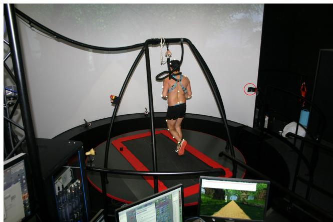

F I G U R E 1 动作捕捉实验室布置图。红圈表示用于无标记数据采集的矢状面相机位置。

校准完成后，每位受试者以其典型的训练速度进行了时长 8 分钟的熟悉测试 $\mathrm { t r i a l } ^ { \bar { 2 } 7 }$。随后，受试者分别以其舒适跑步速度、加快 10% 的速度以及 2.78 和 $3 . 3 3 \mathrm { { m s } ^ { - 1 } }$ 的固定速度进行跑步，各实验条件的先后顺序采用随机化设计。在所有实验测试阶段（熟悉测试除外）均同步采集了基于标记和无标记的动作捕捉数据，但本文仅选取 2.78 和 $3 . 3 3 \mathrm { m s ^ { - 1 } }$ 两个固定速度进行分析。之所以做出该决定，是因为舒适速度和加快 10% 的速度与固定速度大致接近，因此我们预期其结果会高度相似从而产生冗余。不过，所有速度的数据均被用于训练 DeepLabCut 模型（参见第 2.6 节）。因此，最终每位受试者有两个测试用于数据分析。

## 2.5 | 基于标记的数据处理

三维跑步运动学通过 D-flow 软件中实现的下肢和躯干肌骨模型（Human Body Model v2，由 9 个刚体节段、21 个自由度和 86 块肌肉组成）进行实时测定。与步行期间不受计算时间限制的逆向运动学分析相比，由于全局优化带来的实时分析计算时间短所产生的误差可忽略不计。26 逆向运动学采用了截止频率为 20 Hz 的二阶巴特沃斯（Butterworth）低通滤波器。输出结果使用 Matlab 中自定义编写的算法进一步处理，以提取感兴趣的变量。简而言之，矢状面髋关节、膝关节和踝关节角度在 60 s 的匀速跑步期间被时间归一化为步态周期的 0% 至 100%。当垂直地面反作用力超过 20 N 时，即判定为足着地（footstrike）。若某次测量因实时处理而包含错误数据（例如不合理的膝关节角度），则首先在 Vicon Nexus 中对该试验进行标记，并结合样条插值（spline）、模式（pattern）和刚体填充（rigid body fills）对缺失数据进行填补。随后将标记点坐标和地面反作用力导出至 Gait Offline Analysis Tool 3.3（Motek ForceLink $\mathrm { { B . V . , } }$，阿姆斯特丹）进行离线分析，其中包括使用 20 Hz 二阶巴特沃斯滤波器进行的逆向运动学计算，之后再次使用自定义 Matlab 脚本进行进一步处理。用于在无标记与基于标记的运动捕捉之间进行比较的生物力学结果，是根据其与跑步损伤预防的潜在相关性选择的，包括矢状面髋关节、膝关节和踝关节角度 $( \mathrm { e . g . , } ^ { 1 2 } )$。由于右腿最靠近矢状面二维相机，因此仅使用右腿进行分析。

## 2.6 | 无标记数据处理

所有视频文件均导入 DeepLabCut（版本 2.2rc3）中，以训练针对右腿矢状面视角的人工神经网络。该神经网络结合了在 ImageNet 上预训练的残差神经网络（ResNet-50）以及深度卷积和反卷积神经网络层，利用特征检测来预测标记点的“习得”位置。20 该网络的预训练特性确保了只需相对较少的训练数据即可实现稳健的标记点识别。23 模型训练的更多技术细节详见文献。20,28

由于我们使用 DeepLabCut 训练了一个新的非人工神经网络，因此我们将数据分为训练组和测试组，以评估模型的性能和泛化能力。将数据集分为训练组和测试组使我们能够评估模型在未参与训练的新受试者（即测试组）上的表现，从而在一定程度上反映出训练后模型的泛化性。首先，我们将 30 名受试者分配至训练组，10 名受试者分配至测试组（75%–25% 划分，类似于 $\tan ^ { 2 0 } )$）。从训练组受试者中随机抽取四次试验中的三次用于模型训练，最终共计使用 90 段视频进行训练。

模型使用一台个人电脑（NVIDIA GeForce 3060ti, AMD 5800x GPU）在默认设置下进行训练。为此，对于每位受试者，我们利用 DeepLabCut 中用于识别最适于标注的显著帧的自动化功能，提取了 10 个视频帧（典型的 1 分钟视频共 4740 帧）进行标注。这使得共有 $3 0 ^ { * } 1 0 ^ { * } 3 = 9 0 0$ 个已标注的视频帧用于模型训练。这一图像数量显著高于减少过拟合和提高对未训练数据集泛化能力所需的数量。20,28 一名研究人员在矢状面上手动标注了以下用于模型训练的解剖学感兴趣点：肘、髋、膝和踝的（近似）关节中心，以及头部中点、肩部、腕部中点、手部、髂前上棘和髂后上棘、骨盆中点、第 5 跖骨头和足跟（Figure 2，上图）。在可行的情况下，我们使用动作捕捉标记点（markers）的解剖标志进行标注。请注意，本研究中上肢标记点未用于进一步分析，但为了完整性在此予以提及，因为它们在 Figure 2 上图中是可见的。为了提高对髋关节中心的估计精度，我们首先在 Vicon Nexus29 中使用 SCoRE 程序对随机选取的 3 名受试者通过功能校准确定了髋关节旋转中心。然后，我们在 Vicon Nexus 中可视化跑步试验期间的该髋关节中心，以此为标注目的提供髋关节旋转中心的参考。头部标注在耳朵与头部连接的最高位置，肩部标注在肩锁关节处，腕部标注在两个解剖学腕部标记点的中心，骨盆中点标注在髂前上棘和髂后上棘标记点的中点（Figure 2，上图）。按照先前的建议，被遮挡的身体部位未进行标注，以确保仅将准确的标志点输入模型。23,30 模型训练耗时约 15 小时的计算时间。训练好的模型随后用于分析测试集中 10 名受试者的视频。

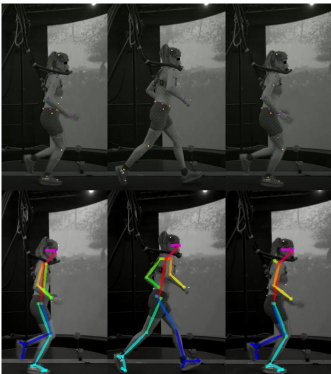  
F I G U R E 2 测试集中一名参与者的示例图像，展示了使用 DeepLabCut（上）和 OpenPose（下）识别的地标点。两个模型的视频也可在 OpenScience Framework 上获取：https://osf.io/34mka。

用于 DeepLabCut 测试集的相同视频也被导入到 OpenPose（v.1.6.0）中，我们使用其 25 点模型进行地标点检测（Figure 2，下部面板）。每个参与者和试验中标记地标点的 x-y 坐标位置均从 DeepLabCut 和 OpenPose 导出，并导入 Matlab 进行进一步分析。我们首先使用 15 Hz 四阶低通巴特沃斯（Butterworth）滤波器对所有坐标进行滤波，以去除高频噪声。然后，我们通过计算环节标记点之间的直线来计算矢状面关节角度，并使用 Matlab 中的 atan 函数计算它们各自的角度差。在某些帧中，目标地标点被手或手臂遮挡，导致感兴趣地标点的置信度值较低，有时还会导致位置估计不准确。因此，我们移除了所有置信度 <0.5 的数据点，并使用插值补全函数 interp1（pchip 类型，通过分段三次插值保持形状，参见 Figure S1）。使用基于运动学的事件检测算法将无标记运动学数据在步态周期的 0 到 100% 之间进行时间归一化。该算法将足跟触地（heel strike）检测为足跟地标点最低且最靠前的位置。持续时间小于步态周期持续时间中位数的一半或大于三倍的步态周期被视为异常值并予以剔除。我们选择使用这种步态事件检测方法，而不是像基于标记的方法那样使用来自测力台的事件，是因为在典型的临床环境中同样无法获取测力数据。

## 2.7 | 统计分析

测试集（n = 10）用于在每个速度下，使用在 Matlab 中实现的一维（1-D）统计参数映射（statistical parametric mapping, SPM）对基于标记点（marker-based）和无标记点（markerless）的方法进行比较。31,32 正态分布通过正态性检验进行评估。需要注意的是，尽管 OpenPose 不需要单独的测试集和训练集，为了保持一致性，我们在比较 OpenPose 与基于标记点的方法时，仅使用了同样包含在 DeepLabCut 测试集中的受试者。采用 SPM 配对一维 t 检验进行比较，Sidak 校正后的 alpha 水平为 0.05（即，对于每个速度下的三个关节，有效 alpha 水平为 0.017）。由于基于标记点和无标记点方法在触地识别上的差异可能会在时间归一化数据中引入偏差，我们先验地选择进行第二项分析，即使用 Matlab 中的“xcorr”函数对时间序列进行时间对齐。该函数用于确定两个时间序列之间的互相关，并平移无标记点时间序列以使互相关最大化。在比较时间对齐的数据后，我们注意到某些关节存在系统性偏移，因此还将无标记点方法与去除了偏移的基于标记点的方法进行了比较（包括进行与不进行时间对齐的情况）。使用均方根误差（root-mean square error, RMSE；单位：度）来量化所有关节及不同校正下基于标记点与无标记点方法之间的误差幅度，并在所有时间点和受试者之间取平均值。RMSE 的解释参照了先前报道的基于标记点的动作捕捉的 RMSE 和最小可检测变化量。

为了排除回归反射标记点作为二维（2-D）视频分析的非常规潜在信息源，我们还评估了 DeepLabCut 在测试集中两名未佩戴任何回归反射标记点进行跑步的受试者的四次试验中的表现，并将无标记点运动学数据与受试者在相同速度下佩戴标记点跑步时的运动学数据进行了比较。

## 3 | 结果

在进行时间对齐和去除偏移之前，DeepLabCut 和 OpenPose 的髋关节、膝关节及踝关节角度与基于标记点的方法相比表现出若干显著差异簇（Figure S2–S5），但在同时去除偏移并对时间序列进行时间对齐后，在 $2 . 7 8 \mathrm { { m s } ^ { - 1 } }$ 下通常与基于标记点的方法无显著差异（Figure 3；Figure 4）。仅对于 DeepLabCut，在支撑中后期膝关节屈曲角度显著偏低（Figure 3）。仅去除偏移或仅进行时间对齐的效果见 Figures S6–S13。在 $3 . 3 3 \mathrm { m } \mathrm { s } ^ { - 1 }$ 下，DeepLabCut 仍存在两个显著差异簇，OpenPose 存在一个显著差异簇（Figure S14；Figure S15）。

在有无偏移消除和时间对齐的情况下，DeepLabCut 和 OpenPose 在所有时间点和所有受试者上平均的各关节 RMSE 在表 1（对应 $2 . 7 8 \mathrm { { m s } ^ { - 1 } }$）和表 2（对应 $3 . 3 3 \mathrm { m s ^ { - 1 } }$）中报告。

当应用于佩戴和未佩戴逆反射标记点跑步的受试者视频时，DeepLabCut 对髋关节产生了相似的运动学结果，但未能识别踝部和足部标记点（图 S16）。

## 4 | 讨论

本研究的目的在于比较使用自定义训练的计算机视觉方法（DeepLabCut）和现有计算机视觉方法（OpenPose）与“金标准”基于标记点的动作捕捉系统测得的矢状面髋关节、膝关节和踝关节跑步运动学。我们的研究结果表明，在进行时间对齐和偏移消除之前，两种无标记点方法与基于标记点的方法相比均表现出显著且可能具有实际意义的差异。在时间对齐和偏移消除之后，OpenPose 在 $2 . 7 8 \mathrm { { m s } ^ { - 1 } }$ 下未表现出任何显著差异，而 DeepLabCut 则表现出

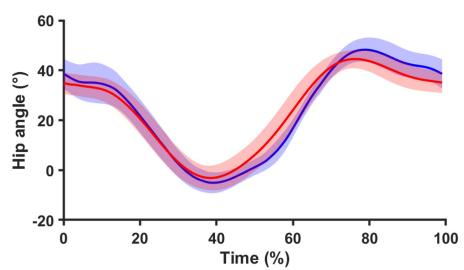

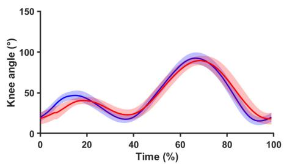

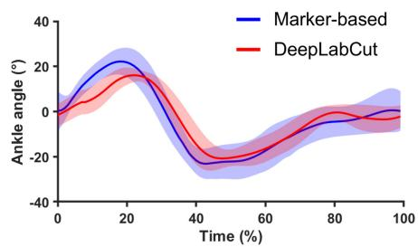

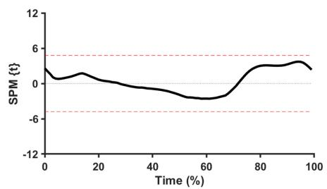

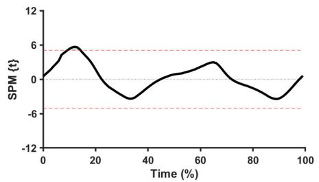

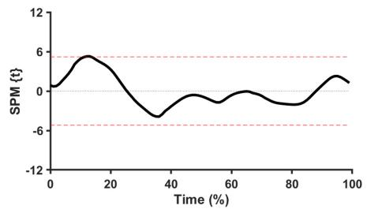

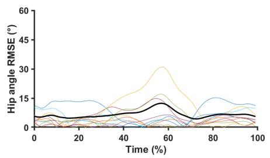

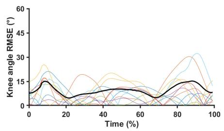

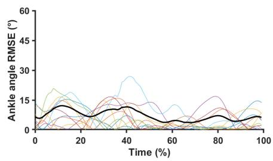  
F I G U R E 3 上图：在 $2 . 7 8 \mathrm { { m s } ^ { - 1 } }$ 速度下基于标记点（蓝色）和无标记点动作捕捉（DeepLabCut，红色）测得的髋关节（左列）、膝关节（中列）和踝关节（右列）矢状面关节角度。中图：统计参数映射中对应的配对样本 t 检验统计量与临界阈值（红色虚线）的关系。下图：各关节在基于标记点与无标记点（DeepLabCut）动作捕捉之间的平方根误差。彩色线条代表各受试者的平方根误差；粗实线代表每个时间点在所有受试者上平均的均方根误差。

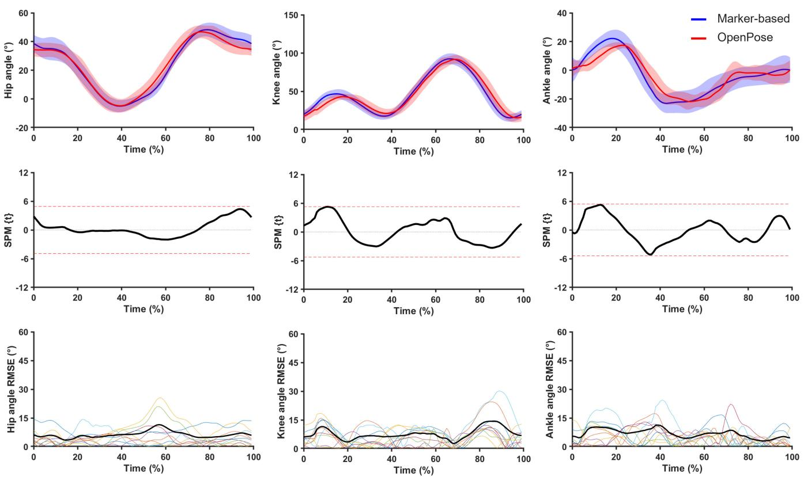

FIGURE 4 上图：在 $2 . 7 8 \mathrm { { m s } ^ { - 1 } }$ 速度下，基于标记点（蓝色）与无标记点动作捕捉（OpenPose，红色）的髋关节（左列）、膝关节（中列）和踝关节（右列）矢状面关节角度。中图：来自统计参数映射的相应配对样本 t 检验统计量与临界阈值（红色虚线）的关系。下图：各关节在基于标记点与无标记点（OpenPose）动作捕捉之间差异的平方根误差。彩色线条代表个体的平方根误差；粗实线代表每个时间点在所有受试者中平均的均方根误差。

与金标准的基于标记点的方法相比，在支撑相中后期表现出显著更小的膝关节屈曲角（Figure 3；Figure 4）。在 $\mathrm { A t } 3 . 3 3 \mathrm { m s } ^ { - 1 }$ 速度下，DeepLabCut 和 OpenPose 均在支撑相中后期显示出显著更小的膝关节屈曲角，且 DeepLabCut 还预测出在支撑相期间显著更小的踝关节背屈角。

我们的研究结果与先前在跳跃、水中慢跑和步行等其他活动中比较无标记和基于标记运动捕捉的研究大体一致。33–36例如，Drazan 及其同事34发现，在跳跃过程中，预训练的 DeepLabCut 模型与基于标记的运动捕捉之间具有极强的总体一致性，复相关系数大于 0.991，总体 RMSE 为 3.2 度，这低于我们在 $2 . 7 8 \mathrm { { m s } ^ { - 1 } }$ 和 $3 . 3 3 \mathrm { m } \mathrm { s } ^ { - 1 }$ 速度下 DeepLabCut 的总体 RMSE（分别为 6.2 和 8.8 度）以及 OpenPose 的总体 RMSE（分别为 5.7 和 5.9 度）。我们研究中较大的 RMSE 可能反映了跑步相比跳跃具有更高的运动速度，这可能以运动模糊的形式引入了噪声，从而增加了精确特征检测的难度。25作为支持，先前的研究表明，与垂直跳跃和步行相比，跑步过程中的误差更大。25与我们的发现类似，Moro 等人35发现，在地面步行过程中，由自定义训练的 DeepLabCut 模型与基于标记的方法得出的大腿、小腿和足部的矢状面角度没有显著差异，表明在群体水平上具有良好的一致性。然而，在唯一一项调查跑步的研究中，Needham, Evans, Cosker, Wade, McGuigan, Bilzon, and $\mathrm { C o l y e r } ^ { 2 5 }$ 表明，包括 DeepLabCut 在内的不同姿态估计方法在跑步过程中导致的关节中心定位误差为 23–58 mm。尽管这些关节中心定位的误差很难与我们的关节角度进行直接比较，但模拟的膝关节标记前后向位移 10 mm 会导致膝关节峰值角度发生 8 度的变化。37由于我们的 DeepLabCut 模型显示的膝关节角度 RMSE 为 8–11.5 度，这因此表明该关节中心的估计比 Needham, Evans, Cosker, Wade, McGuigan, Bilzon, and $\mathrm { C o l y e r } ^ { 2 5 }$ 的研究更为精确，因为他们在 DeepLabCut 中 58 mm 的膝关节中心误差将转化为 46 度的关节角度误差。这种较大的误差可能部分反映了在他们的研究中使用了预训练模型，而我们的研究中使用了自定义训练模型。与我们的研究结果一致，Needham, Evans, Cosker, Wade, McGuigan, Bilzon, and Colyer25 表明，对于所有关节，与预训练的 DeepLabCut 模型相比，OpenPose 在跑步过程中的关节中心定位差异更小。作者将此归因于预训练的 DeepLabCut 模型中采用了最旧且得分最低的姿态估计方法，而相比之下在

T A B L E 1 在 2.78 m s−1 速度下，对所有时间点和受试者取平均值的每个关节的 Mean ± SD RMSE (°)

<table><tr><td>方法</td><td>DeepLabCut</td><td>OpenPose</td></tr><tr><td colspan="3">未校正结果</td></tr><tr><td>髋关节</td><td> $9.07 \pm 2.53$ </td><td> $6.88 \pm 2.67$ </td></tr><tr><td>膝关节</td><td> $11.5 \pm 4.59$ </td><td> $9.18 \pm 3.91$ </td></tr><tr><td>踝关节</td><td> $7.26 \pm 2.64$ </td><td> $5.64 \pm 1.67$ </td></tr><tr><td colspan="3">时间对齐</td></tr><tr><td>髋关节</td><td> $7.78 \pm 2.64$ </td><td> $5.85 \pm 2.90$ </td></tr><tr><td>膝关节</td><td> $8.16 \pm 3.33$ </td><td> $6.53 \pm 2.43$ </td></tr><tr><td>踝关节</td><td> $6.03 \pm 2.01$ </td><td> $5.66 \pm 1.35$ </td></tr><tr><td colspan="3">偏移消除</td></tr><tr><td>髋关节</td><td> $6.91 \pm 2.59$ </td><td> $6.54 \pm 2.17$ </td></tr><tr><td>膝关节</td><td> $11.4 \pm 4.52$ </td><td> $9.17 \pm 3.92$ </td></tr><tr><td>踝关节</td><td> $6.87 \pm 2.37$ </td><td> $5.64 \pm 1.67$ </td></tr><tr><td colspan="3">时间对齐与偏移消除</td></tr><tr><td>髋关节</td><td> $5.07 \pm 2.49$ </td><td> $4.94 \pm 2.23$ </td></tr><tr><td>膝关节</td><td> $7.91 \pm 3.42$ </td><td> $6.53 \pm 2.44$ </td></tr><tr><td>踝关节</td><td> $5.60 \pm 1.63$ </td><td> $5.66 \pm 1.36$ </td></tr></table>

TABLE 2 在 $3 . 3 3 \mathrm { m s ^ { - 1 } }$ 速度下，对所有时间点和受试者取平均的各关节均值 ± 标准差 RMSE (°)

<table><tr><td>方法</td><td>DeepLabCut</td><td>OpenPose</td></tr><tr><td colspan="3">未校正结果</td></tr><tr><td>髋关节</td><td> $9.34 \pm 2.99$ </td><td> $7.70 \pm 2.19$ </td></tr><tr><td>膝关节</td><td> $9.80 \pm 3.42$ </td><td> $10.8 \pm 3.55$ </td></tr><tr><td>踝关节</td><td> $6.28 \pm 1.94$ </td><td> $6.10 \pm 1.64$ </td></tr><tr><td colspan="3">时间对齐</td></tr><tr><td>髋关节</td><td> $9.78 \pm 3.34$ </td><td> $6.24 \pm 2.34$ </td></tr><tr><td>膝关节</td><td> $11.0 \pm 4.06$ </td><td> $6.98 \pm 3.12$ </td></tr><tr><td>踝关节</td><td> $8.23 \pm 2.70$ </td><td> $5.43 \pm 1.22$ </td></tr><tr><td colspan="3">偏移消除</td></tr><tr><td>髋关节</td><td> $8.76 \pm 3.60$ </td><td> $7.43 \pm 2.13$ </td></tr><tr><td>膝关节</td><td> $12.7 \pm 6.39$ </td><td> $10.7 \pm 3.57$ </td></tr><tr><td>踝关节</td><td> $8.40 \pm 2.86$ </td><td> $6.10 \pm 1.66$ </td></tr><tr><td colspan="3">时间对齐与偏移消除</td></tr><tr><td>髋关节</td><td> $7.40 \pm 2.91$ </td><td> $5.34 \pm 2.20$ </td></tr><tr><td>膝关节</td><td> $10.9 \pm 3.78$ </td><td> $6.99 \pm 3.12$ </td></tr><tr><td>踝关节</td><td> $8.01 \pm 2.12$ </td><td> $5.44 \pm 1.27$ </td></tr></table>

OpenPose，以及关节中心跳跃至视频背景中的人物。在我们的研究中，尽管背景中没有其他人，且使用的是自定义训练模型而非预训练模型，但 OpenPose 总体上仍表现出略小的 RMSE（表 1 和表 2）。因此，这表明相比于 OpenPose，DeepLabCut 较差的表现可能主要与用于检测标志点的神经网络复杂度及架构有关。尽管如此，自定义训练的特性可能也降低了 DeepLabCut 的误差，因为在我们的研究中，DeepLabCut 与 OpenPose 之间的差异（0.1– 3.5 度）显著小于根据 (25) 中关节中心误差推算出的关节角度估计差异（13.6 度）。

为了推断这两种方法在科学研究或临床实践中用于运动学分析的实用性，有必要将群体和个体水平上观察到的差异与其他运动学分析方法进行对比，并结合基于标记点动作捕捉的最小可检测变化量来解释观察到的误差。关于前者，DeepLabCut 和 OpenPose 的误差幅度略大于（DeepLabCut）或符合/小于（OpenPose）跑步过程中不同动作捕捉技术之间报道的均方根误差（RMSE）。例如，Wouda, Giuberti, Bellusci, Maartens, Reenalda, Van Beijnum, and Veltink38 报道了在 $3 . 3 3 \mathrm { m s ^ { - 1 } }$ 下，两种肌骨模型（OpenSim 和 PlugInGait 模型）之间髋关节、膝关节和踝关节的平均 RMSE 分别为 5.2、8.3 和 5.5 度。这小于我们研究中 DeepLabCut 与基于标记点的动作捕捉在 $3 . 3 3 \mathrm { m s ^ { - 1 } }$ 下的 RMSE，后者分别为 7.4、10.9 和 8.0 度（Table 2；Figure S14）。类似地，DeepLabCut 在进行时间对齐和偏移校正后以及未经校正时的 RMSE，通常都大于 OpenSim 模型与配备可穿戴传感器的套装（Xsens）之间的 RMSE（分别为 13.5、7.2 和 3.8 度）。38 相比之下，OpenPose 在时间对齐和偏移校正后的 RMSE（在 $3 . 3 3 \mathrm { { m s } ^ { - 1 } ) }$ 下髋关节、膝关节和踝关节分别为 5.3、7.0 和 5.4 度）与 Wouda 等人报道的两种模型之间或肌骨模型与可穿戴套装之间的 RMSE 一致或更小。这表明 OpenPose 可能有助于促进更大规模和现场的数据采集。作为进一步的支持，OpenPose 与基于标记点方法之间的差异通常小于其他 2D 视频分析方法之间报道的差异。13–15 例如，使用智能手机应用程序（Coach's Eye）测量的离地（toe-off）时膝关节角度比基于标记点的动作捕捉测得的膝关节角度小 7 度，13 这大于我们研究中 OpenPose 在 $2 . 7 8 \mathrm { { m s } ^ { - 1 } }$ 下经时间对齐和偏移校正后的低估幅度 4.7 度（未校正时为 1.8 度）。

然而，DeepLabCut 和 OpenPose 与基于标记点的方法在峰值关节角度处的 RMSE，通常大于基于标记点的动作捕捉所报道的峰值关节角度的最小可检测变化量（Figure 2；Figure 3），后者在 $2 . 5 { - } 3 . 4 \ \mathrm { m s } ^ { - \mathrm { i } ^ { \cdot } 3 9 { - } 4 2 }$ 的速度范围内通常 ${ < } 5$ 度。相比之下，髋关节、膝关节和踝关节的关节活动度（excursion）的最小可检测变化量分别为 4.5–8.3、4.3–6.0 和 9.8–7.5 度，40,42 这与经过时间对齐和偏移校正后的 DeepLabCut 和 OpenPose 在整个步态周期内报道的平均 RMSE 值更为一致。

总体而言，这些结果表明，在进行时间对齐和偏移校正后，OpenPose（以及在较小程度上的自定义训练 DeepLabCut 模型）可用于加快数据采集流程并促进现场测量。对于 OpenPose 而言，使用单个 2-D 摄像机所获得的精度似乎与其他运动学分析方法（如可穿戴动捕服和其他 2-D 分析方法）相当甚至更优，但仍低于基于 3-D 标记点的动作捕捉所能达到的精度。数据采集速度的提升反过来可以促进更大规模的研究 $( \mathrm { e . g . , } ^ { 4 3 } )$。例如，在我们实验室中，针对本研究使用的全身标记点集，标记点粘贴通常需要 15 至 30 分钟，系统和受试者校准还需要额外的 10–15 分钟。由于我们研究中使用的无标记点方法既不涉及任何标记点粘贴，也不涉及任何系统或受试者校准，因此可以节省 25–45 分钟的研究时间。由于不需要标记点标注（labelling），后处理时间也可能更快。由于生物力学/步态研究中的样本量通常较小（即大约 30 名受试者44），无标记点方法可能有助于测量更大的样本，从而提高泛化性，尽管这也是以降低精度为代价的。此外，无标记点方法仅需一台摄像机即可使用，并且还可以在传统实验室环境之外（例如比赛期间）使用。

在个体层面上，经过时间对齐和偏移消除后，某些个体在步态周期的特定部分中关节角度的误差仍然很大（Figure 3；Figure 4）。这表明，在评估个体的跑步技术（进而潜在地推断损伤风险/原因）时，应谨慎使用自定义训练的 DeepLabCut 模型和 OpenPose。例如，在有和无髌股关节疼痛的个体之间，已观察到膝关节最大屈曲角度存在 1–2 度的差异，45,46 但由于 DeepLabCut 在膝关节最大屈曲处的 RMSE 约为 7 度（范围为 0–15 度；计算机视觉方法不一定能捕捉到这种差异

Figure 3），而 OpenPose 为 3.4 度（范围 0.6–6.4 度）。这种准确度上的高度变异性表明，该方法可能最适合关注群体平均效应的大规模研究——正如平均关节角度总体上良好的一致性所证实的那样——而不是个体层面的分析。

在大规模研究（或个体分析）中使用 DeepLabCut 或 OpenPose 时的一个重要考量是，为了获得最佳一致性，我们必须对数据进行时间对齐并消除系统性差异（即偏移量）。然而，当计算机视觉方法应用于临床环境时，可能无法进行此类校正，这也会影响实时应用。偏移量可能是由于摄像机相对于受试者的位置所引入的，摄像机的视野以受试者的骨盆为中心（Figure 1；Figure 2），从而相对于更远端的关节产生了角度，这反过来可能在计算出的关节角度中引入了微小的系统性偏移。这一局限性是使用单台 2-D 摄像机所固有的，但可以通过结合多台 2-D 摄像机的视角来逼近 3-D 视角来克服（正如其他研究所做的那样）18,24,25,47,48，或者通过使用从深度摄像机获取的 3-D 信息 $( \mathrm { e . g . , } ^ { 4 9 - \bar { 5 } 2 } )$ 来解决。然而需要注意的是，OpenPose 踝关节角度的幅度校正通常对 RMSE 没有影响或仅有极小的影响（Table 1；Table 2），这表明踝关节并未表现出系统性偏移。时间差异可能主要是由于确定初始触地的方法不同所致。具体而言，对于基于标记的方法，我们使用了（金标准）测力台，而对于无标记方法，我们使用了基于运动学的方法，因为测力台方法在研究实验室之外通常无法使用。然而，摄像机相对较低的采样频率使我们无法使用最准确的基于运动学的事件检测方法 $( \mathrm { e . g . , } ^ { 5 3 } )$。因此，使用具有更高采样频率的摄像机很可能会大幅提高时间一致性。然而，我们研究中的摄像机最初被纳入实验设置的唯一目的，是为临床医生提供直观检查数据的机会。因此，其分辨率和帧率对于体育应用中的无标记动作捕捉并非最优。尽管如此，我们还是对无标记和基于标记的时间序列进行了时间对齐，以探讨在更好的摄像机设置下使用更精确的事件检测方法时一致性可能会达到何种程度。总体而言，这两种方法在提高准确度方面的局限性似乎主要是基于技术层面的（即摄像机数量和采样频率），这表明在配备更好摄像机设置的未来应用中具有潜力。

需要进一步研究 DeepLabCut 模型在临床实践中可能遇到的不同环境下的泛化能力，例如使用不同的相机类型以及相对于跑步机的不同距离/角度、不同的光照条件、穿着更多衣物的影响等。尽管先前的研究表明衣物不会对无标记动作捕捉的准确性产生显著影响，54 但我们实验室的初步实验表明，不同的相机位置会显著影响定制训练的 DeepLabCut 模型的准确性（但对 OpenPose 模型无显著影响），这凸显了可能需要进一步训练以确保其在不同相机设置下的稳健运行。与此相关的一个重要发现是，DeepLabCut 模型在没有任何标记点采集的数据上，对髋部和膝部解剖标志点的识别效果同样良好（Figure S16），这表明该模型并没有“学会”去识别逆反射标记点，因此确实可以在参与者不佩戴标记点的情况下使用。然而，该模型无法识别踝关节或足部解剖标志，因此可能依赖于标记点的存在来识别这些标志点。踝部与膝部/髋部标志点之间的这种差异可能与训练集中标记点的可见性有关，即在训练集的标注图像中踝部和足部标记点始终可见，而髋部或膝部标记点由于手臂遮挡等原因并非始终可见。这一发现十分重要，因为它提示未来的研究应确保标注包含无标记点的视频帧，并表明有必要评估该模型在无标记运动中的性能。最后，这两种无标记方法仍需使用付费软件（即 Matlab）来执行部分数据处理，未来需要进一步在免费软件（例如 Python）中实现这些处理步骤，且无需编写代码，以便于从业人员使用。与此相关的是，从业人员和研究人员都可以从实时分析中获益。这可以通过使用近期开发的基于实时姿态估计的工具来实现。55

## 4.1 | 局限性

本研究存在若干局限性。首先，我们作为金标准的基于标记点的方法容易出现误差，例如由于标记点放置错误56和软组织假影（soft-tissue artifacts）。尽管如此，由同一位具有基于标记点动作捕捉经验的研究人员放置了所有标记点，以尽量减少放置误差；并且由于采用了逆运动学（inverse kinematics）流程（即，将具有关节约束的刚体肌骨模型拟合到标记点位置，并利用模型的朝向来计算关节角度），软组织假影很可能被降到了最低。与此相关的是，无标记点方法采用了正运动学（direct kinematics，即计算连接标记点的直线之间的角度），而非基于标记点方法中的逆运动学。正运动学方法相比于逆运动学方法，对关节中心估计中的误差更为敏感57，这可能增加了无标记点方法中关节角度的误差。近年来，针对无标记点动作捕捉数据的全自动逆运动学工作流已被开发出来，这在未来的应用中可能会被证明是有用的。47,58 其次，无标记点方法的准确性在很大程度上取决于用于监督学习的手动识别特征点（landmarks）的准确性。由于只有一位研究人员手动标注了所有图像，这可能会引入偏差，因为不同的研究人员可能会将特征点放置在（略微）不同的位置。然而，我们在预实验中非正式地评估了五位不同研究人员之间的一致性，结果高度相似。第三，我们相机的分辨率和采样频率相对较低（分别为 659 × 494、50 Hz，相比之下，例如文献25中为 200 Hz），这限制了精确识别特征点的能力，特别是对于经常高速运动并因而导致运动模糊的脚趾和踝关节（该效果的示例见 Figure 2）。尽管如此，与髋关节相比，我们并未在踝关节处观察到如预期中由于较高的环节速度所导致的高误差。最后，我们仅测量了身体右侧的运动学数据，因此该方法可能不适用于识别跑步技术中双腿之间的不平衡。

## 4.2 | 展望

总体而言，我们的研究结果表明，在进行时间对齐和偏移消除之前，两种无标记方法在跑步机跑步过程中的矢状面关节角度与基于标记的方法相比均表现出显著且可能具有实际意义的差异。在进行时间对齐和偏移消除后，OpenPose 在 $2 . 7 8 \mathrm { { \bar { m } s ^ { - 1 } } }$ 下未显示出任何显著差异，而与金标准基于标记的方法相比，DeepLabCut 在支撑中后期显示出显著较小的膝关节屈曲角度（Figure 3；Figure 4）。在 ${ \mathrm { A t ~ } } 3 . 3 3 { \mathrm { m s } } ^ { - 1 }$ 下，DeepLabCut 和 OpenPose 均在支撑中后期显示出显著较小的膝关节屈曲角度，且 DeepLabCut 还预测了在支撑阶段显著较小的踝关节背屈角度。OpenPose 与基于标记方法之间的差异幅度与文献报道的其他方法与基于标记方法之间的差异一致或更小，从而表明该方法在促进大规模和实地数据采集方面具有一定的实用性。然而，该误差高于基于标记的动作捕捉的最小可检测变化量。结合个体间精度的显著差异，这些结果表明 OpenPose 以及在较小程度上的自定义训练 DeepLabCut 模型最适合用于大规模数据采集和群体效应研究，而非个体水平的分析。

希望使用自定义训练 DeepLabCut 模型的科研人员和/或临床医生可从 OpenScience Framework 下载该模型，DOI 为 10.17605/OSF.IO/D6VPW。在此情况下，由于迁移学习现象，可能仅需极少量的训练即可改善模型在新的任务（例如步行）和环境中的运行效果。20,23,30 OpenPose 模型已经可以免费获取。

## 作者贡献

BVH 构思了本研究，采集并分析了数据，并撰写了手稿初稿。NP 协助进行了 DeepLabCut 数据的采集、处理和分析。HE 进行了概念构思并协助数据处理，并提供了审阅意见和修改。KM 提供了审阅意见和修改。所有作者均批准了最终版本。

## 致谢

BVH 获得了由 Eureka 颁发的 Eurostars 资助（项目编号 12912）。我们感谢 Julia Negasse 在数据采集方面提供的帮助，以及 Freek van Haaren 在 OpenPose 数据分析方面提供的帮助。

## 利益冲突声明

所有作者均声明不存在利益冲突。

## 数据可用性声明

基于标记和无标记的原始及时间归一化运动学数据，以及 DeepLabCut 模型均可从 OpenScienceFramework 获取，DOI 为 10.17605/OSF.IO/D6VPW。

## ORCID

Bas Van Hooren  https://orcid. org/0000-0001-8163-693X

## 参考文献

1. Van Hooren B, Goudsmit J, Restrepo J, Vos S. Real-time feedback by wearables in running: current approaches, challenges and suggestions for improvements. J Sports Sci. 2020;38(2):214-230. doi:10.1080/02640414.2019.1690960

2. Bramah C, Preece SJ, Gill N, Herrington L. Is there a pathological gait associated with common soft tissue running injuries? Am J Sports Med. 2018;46(12):3023-3031. doi:10.1177/0363546518793657

3. Folland JP, Allen SJ, Black MI, Handsaker JC, Forrester SE. Running technique is an important component of running economy and performance. Med Sci Sports Exerc. 2017;49(7):1412-1423. doi:10.1249/MSS.0000000000001245

4. Moore IS, Jones AM, Dixon SJ. Mechanisms for improved running economy in beginner runners. Med Sci Sports Exerc. 2012;44(9):1756-1763. doi:10.1249/MSS.0b013e318255a727

5. Preece SJ, Bramah C, Mason D. The biomechanical characteristics of high-performance endurance running. Eur J Sport Sci. 2019;19(6):784-792. doi:10.1080/17461391.2018.1554707

6. Willson JD, Sharpee R, Meardon SA, Kernozek TW. Effects of step length on patellofemoral joint stress in female runners with and without patellofemoral pain. Clin Biomech (Bristol, Avon). 2014;29(3):243-247. doi:10.1016/j.clinbiomech.2013.12.016

7. van Eijden TM, Weijs WA, Kouwenhoven E, Verburg J. Forces acting on the patella during maximal voluntary contraction of the quadriceps femoris muscle at different knee flexion/extension angles. Acta Anat (Basel). 1987;129(4):310-314. doi:10.1159/000146421

8. Barton CJ, Bonanno DR, Carr J, et al. Running retraining to treat lower limb injuries: a mixed-methods study of current evidence synthesised with expert opinion. Br J Sports Med. 2016;50(9):513-526. doi:10.1136/bjsports-2015-095278

9. Reinking MF, Dugan L, Ripple N, et al. Reliability of two-dimensional video-based running gait analysis. Int J Sports Phys Ther. 2018;13(3):453-461.

10. Hensley CP, Lenihan EM, Pratt K, et al. Patterns of video-based motion analysis use among sports physical therapists. Phys Ther Sport. 2021;50:159-165. doi:10.1016/j.ptsp.2021.05.003

11. Hensley CP, Millican D, Hamilton N, Yang A, Lee J, Chang AH. Video-based motion analysis use: a National Survey of orthopedic physical therapists. Phys Ther. 2020;100(10):1759-1770. doi:10.1093/ptj/pzaa125

12. Souza RB. An evidence-based videotaped running biomechanics analysis. Phys Med Rehabil Clin N Am. 2016;27(1):217-236. doi:10.1016/j.pmr.2015.08.006

13. Mousavi SH, Hijmans JM, Moeini F, et al. Validity and reliability of a smartphone motion analysis app for lower limb kinematics during treadmill running. Phys Ther Sport. 2020;43:27-35. doi:10.1016/j.ptsp.2020.02.003

14. Peebles AT, Carroll MM, Socha JJ, Schmitt D, Queen RM. Validity of using automated two-dimensional video analysis to measure continuous sagittal plane running kinematics. Ann Biomed Eng. 2021;49(1):455-468. doi:10.1007/s10439-020-02569-y

15. Michelini A, Eshraghi A, Andrysek J. Two-dimensional video gait analysis: a systematic review of reliability, validity, and best practice considerations. Prosthet Orthot Int. 2020;44(4):245-262. doi:10.1177/0309364620921290

16. Murray L, Beaven CM, Hebert-Losier K. Reliability of Overground running measures from 2D video analyses in a field environment. Sports (Basel). 2018;7(1):8. doi:10.3390/ sports7010008

17. Cao Z, Hidalgo G, Simon T, Wei S, Sheikh Y. OpenPose: realtime multi-person 2D pose estimation using part affinity fields. IEEE Trans Pattern Anal Mach Intell. 2018;43(1):172-186. doi:10.1109/TPAMI.2019.2929257

18. Slembrouck M, Luong H, Gerlo J, et al. Multiview 3D markerless human pose estimation from Openpose skeletons. Springer; 2020:166-178.

19. Mehta D, Sotnychenko O, Mueller F, et al. XNect: real-time multi-person 3D motion capture with a single RGB camera. Acm T Graphic. 2020;39(4):1-82. doi:10.1145/3386569.3392410

20. Mathis A, Mamidanna P, Cury KM, et al. DeepLabCut: markerless pose estimation of user-defined body parts with deep learning. Nat Neurosci. 2018;21(9):1281-1289. doi:10.1038/ s41593-018-0209-y

21. Nath T, Mathis A, Chen AC, Patel A, Bethge M, Mathis MW. Using DeepLabCut for 3D markerless pose estimation across species and behaviors. Nat Protoc. 2019;14(7):2152-2176. doi:10.1038/s41596-019-0176-0

22. Kanko RM, Laende EK, Davis EM, Selbie WS, Deluzio KJ. Concurrent assessment of gait kinematics using marker-based and markerless motion capture. J Biomech. 2021;127:110665. doi:10.1016/j.jbiomech.2021.110665

23. Mathis A, Schneider S, Lauer J, Mathis MW. A primer on motion capture with deep learning: principles, pitfalls, and perspectives. Neuron. 2020;108(1):44-65. doi:10.1016/j. neuron.2020.09.017

24. Nakano N, Sakura T, Ueda K, et al. Evaluation of 3D Markerless motion capture accuracy using OpenPose with multiple video cameras. Front Sports Act Living. 2020;2:50. doi:10.3389/ fspor.2020.00050

25. Needham L, Evans M, Cosker DP, et al. The accuracy of several pose estimation methods for 3D joint Centre localisation. Sci Rep. 2021;11(1):1-11. doi:10.1038/s41598-021-00212-x

26. van den Bogert AJ, Geijtenbeek T, Even-Zohar O, Steenbrink F, Hardin EC. A real-time system for biomechanical analysis of human movement and muscle function. Med Biol Eng Comput. 2013;51(10):1069-1077. doi:10.1007/ s11517-013-1076-z

27. Van Hooren B, Fuller JT, Buckley JD, et al. Is motorized treadmill running biomechanically comparable to Overground running? A systematic review and meta-analysis of crossover studies. Sports Med. 2020;50(4):785-813. doi:10.1007/ s40279-019-01237-z

28. Cronin NJ, Rantalainen T, Ahtiainen JP, Hynynen E, Waller B. Markerless 2D kinematic analysis of underwater running: a deep learning approach. J Biomech. 2019;87:75-82. doi:10.1016/j.jbiomech.2019.02.021

29. Ehrig RM, Taylor WR, Duda GN, Heller MO. A survey of formal methods for determining the Centre of rotation of ball joints. J Biomech. 2006;39(15):2798-2809. doi:10.1016/j. jbiomech.2005.10.002

30. Cronin NJ. Using deep neural networks for kinematic analy sis: challenges and opportunities. J Biomech. 2021;123:110460. doi:10.1016/j.jbiomech.2021.110460

31. Pataky TC. Generalized n-dimensional biomechanical field analysis using statistical parametric mapping. J Biomech. 2010;43(10):1976-1982. doi:10.1016/j.jbiomech.2010.03.008

32. Pataky TC, Vanrenterghem J, Robinson MA, Liebl D. On the validity of statistical parametric mapping for nonuniformly and heterogeneously smooth one-dimensional biomechanical data. J Biomech. 2019;91:114-123. doi:10.1016/j.jbiomech.2019.05.018

33. Washabaugh EP, Shanmugam TA, Ranganathan R, Krishnan C. Comparing the accuracy of open-source pose estimation meth ods for measuring gait kinematics. Gait Posture. 2022;97:188- 195. doi:10.1016/j.gaitpost.2022.08.008

34. Drazan JF, Phillips WT, Seethapathi N, Hullfish TJ, Baxter JR. Moving outside the lab: Markerless motion capture accurately quantifies sagittal plane kinematics during the vertical jump. J Biomech. 2021;125:110547. doi:10.1016/j.jbiomech.2021.110547

35. Moro M, Marchesi G, Odone F, Casadio M. Markerless gait analysis in stroke survivors based on computer vision and deep learning: a pilot study. Proc ACM Symp Appl Comput. 2020;2097-2104.

36. Haberkamp LD, Garcia MC, Bazett-Jones DM. Validity of an artificial intelligence, human pose estimation model for measuring single-leg squat kinematics. J Biomech. 2022;144:111333. doi:10.1016/j.jbiomech.2022.111333

37. Osis ST, Hettinga BA, Macdonald S, Ferber R. Effects of simulated marker placement deviations on running kinematics and evaluation of a morphometric-based placement feedback method. PLoS One. 2016;11(1):e0147111. doi:10.1371/journal. pone.0147111

38. Wouda FJ, Giuberti M, Bellusci G, et al. On the validity of different motion capture technologies for the analysis of running. IEEE. 2018;1175-1180.

39. Okahisa T, Matsuura T, Tomonari K, et al. Between-day reliability and minimum detectable change of the conventional gait model 2 and plug-In gait model during running. SSRN Electron J. 2022;171-178. doi:10.2139/ssrn.4076056

40. Bramah C, Preece SJ, Gill N, Herrington L. The between-day repeatability, standard error of measurement and minimal detectable change for discrete kinematic parameters during treadmill running. Gait Posture. 2021;85:211-216. doi:10.1016/j. gaitpost.2020.12.032

41. Noehren B, Manal K, Davis I. Improving between-day kinematic reliability using a marker placement device. J Orthop Res. 2010;28(11):1405-1410. doi:10.1002/jor.21172

42. Stoneham R, Barry G, Saxby L, Wilkinson M. Measurement error of 3D kinematic and kinetic measures during overground endurance running in recreational runners between two test sessions separated by 48 h. Physiol Meas. 2019;40(2):024002. doi:10.1088/1361-6579/aafa87

43. Hando B, Scott WC, Bryant JF, Tchandja JN, Scott RM, Angadi SS. Association between Markerless motion capture screenings and musculoskeletal injury risk for military trainees: a large cohort and reliability study. Orthop J Sports Med. 2021;9(10). doi:10.1177/23259671211041656

44. McCrum C, van Beek J, Schumacher C, Janssen S, Van Hooren B. Sample size justifications in Gait & Posture. Gait Posture. 2022;92:333-337. doi:10.1016/j.gaitpost.2021.12.010

45. Wirtz AD, Willson JD, Kernozek TW, Hong DA. Patellofemoral joint stress during running in females with and without patellofemoral pain. Knee. 2012;19(5):703-708. doi:10.1016/j. knee.2011.09.006

46. Haghighat F, Ebrahimi S, Rezaie M, et al. Trunk, pelvis, and knee kinematics during running in females with and without patellofemoral pain. Gait Posture. 2021;89:80-85. doi:10.1016/j. gaitpost.2021.06.023

47. Uhlrich SD, Falisse A, Kidziński Ł, et al. OpenCap: 3D human movement dynamics from smartphone videos. bioRxiv 2022.

48. Pagnon D, Domalain M, Reveret L. Pose2Sim: an open-source python package for multiview markerless kinematics. Journal of Open Source Software. 2022;7(77):4362.

49. Zimmermann C, Welschehold T, Dornhege C, Burgard W, Brox T. 3d human pose estimation in rgbd images for robotic task learning. IEEE. 2018;1986-1992.

50. Guo Y, Deligianni F, Gu X, Yang GZ. 3-D canonical pose estimation and abnormal gait recognition with a single RGB-D camera. IEEE Robotics and Automation Letters. 2019;4(4):3617- 3624. doi:10.1109/Lra.2019.2928775

51. Vafadar S, Skalli W, Bonnet-Lebrun A, et al. A novel dataset and deep learning-based approach for marker-less motion capture during gait. Gait Posture. 2021;86:70-76. doi:10.1016/j. gaitpost.2021.03.003

52. Bittner M, Yang W-T, Zhang X, Seth A, van Gemert J, van der Helm FC. Towards single camera human 3D-kinematics. Sensors. 2023;23(1):341

53. Handsaker JC, Forrester SE, Folland JP, Black MI, Allen SJ. A kinematic algorithm to identify gait events during running at different speeds and with different footstrike types. J Biomech. 2016;49(16):4128-4133. doi:10.1016/j.jbiomech.2016.10.013

54. Keller VT, Outerleys JB, Kanko RM, Laende EK, Deluzio KJ. Clothing condition does not affect meaningful clinical interpretation in markerless motion capture. J Biomech. 2022;141:111182.

55. Kane GA, Lopes G, Saunders JL, Mathis A, Mathis MW. Real time, low-latency closed-loop feedback using markerless posture tracking. Elife. 2020;9:e61909. doi:10.7554/eLife.61909

56. Gorton GE III, Hebert DA, Gannotti ME. Assessment of the kinematic variability among 12 motion analysis laboratories. Gait Posture. 2009;29(3):398-402.

57. Robinson MA, Donnelly CJ, Tsao J, Vanrenterghem J. Impact of knee modeling approach on indicators and classification of anterior cruciate ligament injury risk. Med Sci Sports Exerc. 2014;46(7):1269-1276. doi:10.1249/MSS.0000000000000236

58. Needham L, Evans M, Wade L, et al. The development and evaluation of a fully automated markerless motion capture workflow. J Biomech. 2022;144:111338. doi:10.1016/j. jbiomech.2022.111338

## 支持信息

其他支持信息可在本文末尾的支持信息部分在线获取。

本文引用方式：Van Hooren B, Pecasse N, Meijer K, Essers JMN. The accuracy of markerless motion capture combined with computer vision techniques for measuring running kinematics. Scand J Med Sci Sports. 2023;33:966- 978. doi:10.1111/sms.14319