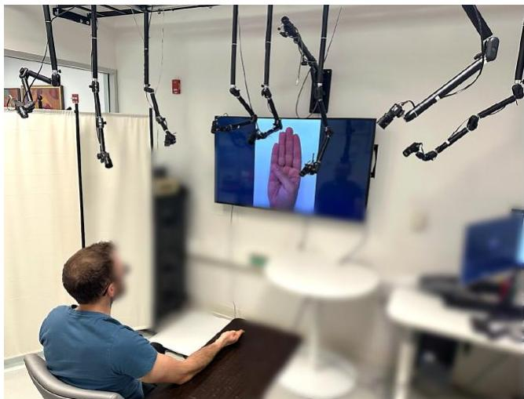
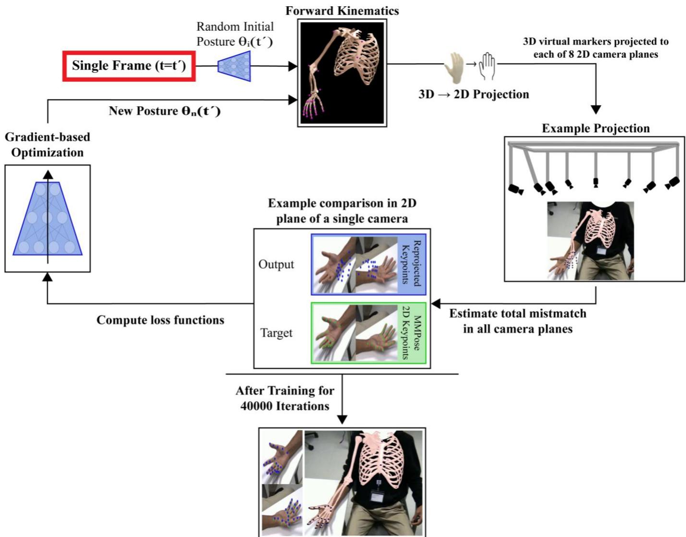
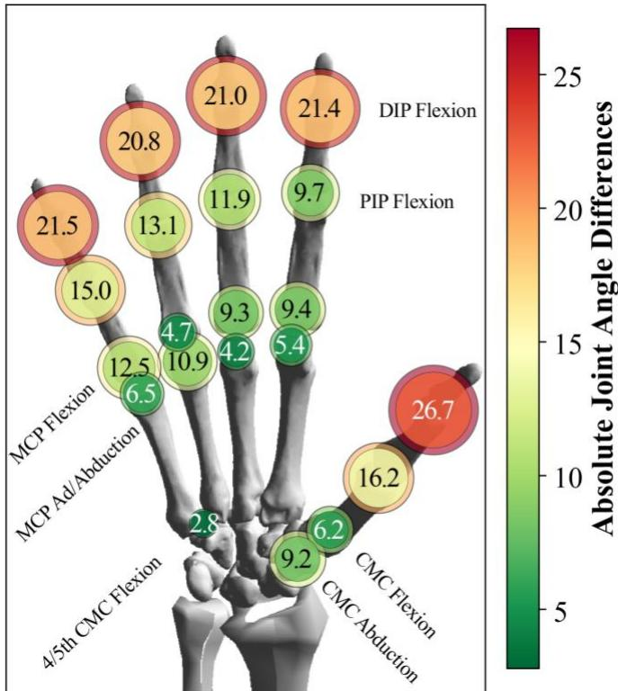
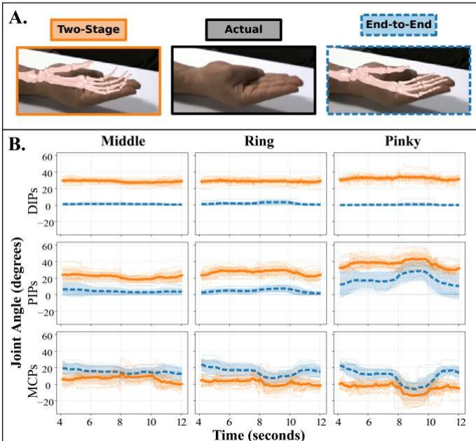
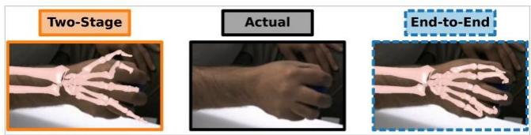
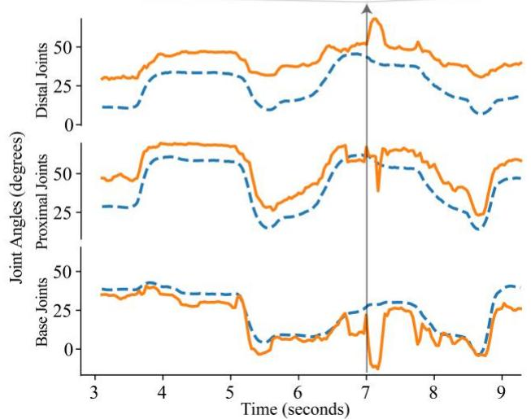
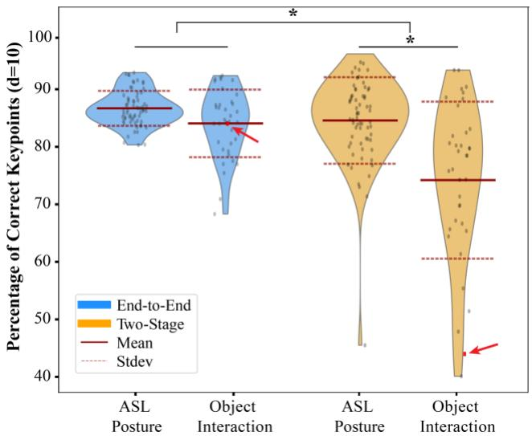

# 融合生物力学的多视角灵巧手部运动无标记动作捕捉

Pouyan Firouzabadi1,2, J.D. Peiffer1,2, Kunal Shah2, Anton Sobinov3, Lee E. Miller1,2, R. James Cotton2,4, Wendy M. Murray1,2

摘要— 无标记动作捕捉（Markerless motion capture, MMC）技术在人体运动的生物力学分析中带来了广泛的益处；然而，其在复杂手部运动中的应用落后于其他肌肉骨骼系统。目标：本研究的主要目标是评估一种生物力学重建方法的性能，该方法采用将生物力学模型融入循环的基于梯度的优化方法，利用 MMC 追踪灵巧、无约束的手部运动。方法：利用定制的 8 相机系统，我们采集了 6 名参与者执行 11 种不同任务的 121 段视频记录，任务涵盖 6 种手部姿势、5 种物体操作任务，并涉及近端上肢关节的运动。将所提出的 MMC 流程的性能与更常用的两阶段重建方法进行了直接比较，后者首先将来自计算机视觉姿态估计算法的 2D 关键点三角剖分至 3D，然后通过求解受约束的逆运动学问题来施加生物力学约束。通过目视检查进行定性评估，并使用计算机视觉指标进行定量评估，以此衡量两者的相对性能。结果：我们的方法为所有 121 段视频记录生成了解；而两阶段方法在 15% 的记录中未能收敛。在其余视频中，我们的方法比两阶段方法生成了更符合生物力学合理性的手部运动学数据，并且在涉及物体的任务中对遮挡效应表现出更强的鲁棒性。结论：端到端方法的相对鲁棒性表明，它在利用可用的 2D 数字关键点信息方面更为有效。意义：在灵巧运动期间自动且具有生物力学意义地追踪手部运动学，具有支持临床评估、康复监测以及人类运动控制研究的潜力。

索引词— 生物力学（Biomechanics），深度学习（Deep Learning），手部运动学（Hand Kinematics），运动分析（Motion Analysis），多相机系统（Multi-camera Systems），姿态估计（Pose Estimation），重建算法（Reconstruction Algorithms）

## I. 引言

无标记动作捕捉（Markerless Motion Capture, MMC）提供了一种实用的无需在身体上佩戴设备的解决方案 [1]。具体而言，MMC 利用计算机视觉和姿态估计，通过算法对运动过程中采集的 2D 视频数据中的解剖标志点进行标注 [2], [3], [4], [5], [6], [7]。MMC 使用这些被称为关键点（keypoints）的数字标签来代替传统动作捕捉中使用的物理标记点，从而减轻了受试者和研究人员的设备设置与时间负担。这些优势有助于促进大规模人群研究 [8] 和自然环境（in-the-wild）运动场景 [9] 中的数据采集。尽管 MMC 在人体运动研究中的应用日益广泛，但其在复杂手部运动中的应用仍落后于其他肌肉骨骼系统。人手在日常生活的几乎所有方面都发挥着核心作用，从书写等精细运动任务到提拉所需的强力抓握。理解手部运动的生物力学和神经控制至关重要，而 MMC 是一项有望推动该领域发展的技术。

对于传统的基于标记点的方法，标记点的位置在整个运动过程中与特定的解剖标志点保持物理连接。相比之下，数字 MMC 关键点是在记录运动的每个 2D 视频帧中独立识别的。因此，感兴趣的解剖标志点在不同帧之间可能会被不一致地标注，从而产生必须予以解决的解剖学上不可能出现的误差。大多数 MMC 数据的生物力学重建方法在两阶段（two-stage）分析中缓解这些误差：首先将来自多个相机的 2D 关键点三角测量至 3D [10]，然后通过求解有约束的逆向运动学问题来施加生物力学约束 [11], [12], [13], [14], [15]。与此不同，最近的一项进展通过迭代调整 3D 生物力学模型的姿态和缩放比例 [16], [17], [18]，并求解能最佳重投影到 2D 相机平面上的 3D 关节运动学轨迹，在单阶段过程中施加生物力学约束。该方法被称为“端到端（end-to-end）”，因为它通过一个可微生物力学模型一次性优化运动轨迹和模型缩放。

此前已有报道表明，两阶段和端到端重建方法均能达到与基于标记点系统相当的性能指标 [11], [12], [16], [19]。利用关注重建手部姿态与姿态估计关键点数据之间一致性的计算机视觉指标 [20]，我们先前证明了端到端优化在追踪复杂手部姿态方面优于两阶段拟合过程 [18]。然而，据我们所知，目前尚无任何工作直接比较这两种方法计算出的关节运动学。方法之间的相对性能对手部尤为重要，因为指骨各个节段尺寸较小，放大了对关键点误差的敏感性 [21]。此外，物体

  
Figure 1. 实验装置，8 台摄像机围绕受试者，受试者正在复现视频屏幕上显示的手部姿态（ASL 字母 B）。

Table 1. 健康受试者人口统计学特征

<table><tr><td>受试者</td><td>年龄</td><td>性别</td><td>利手</td><td>肤色 [22]</td></tr><tr><td>P1</td><td>26</td><td>M</td><td>R</td><td>Tan</td></tr><tr><td>P2</td><td>38</td><td>M</td><td>R</td><td>Tan</td></tr><tr><td>P3</td><td>25</td><td>F</td><td>R</td><td>Light</td></tr><tr><td>P4</td><td>25</td><td>F</td><td>R</td><td>Light</td></tr><tr><td>P5</td><td>23</td><td>F</td><td>R</td><td>Dark</td></tr><tr><td>P6</td><td>28</td><td>M</td><td>R</td><td>Brown</td></tr></table>

交互——手部功能的一个关键方面——给手部追踪带来了复杂性。此前仅有一项研究在其 MMC（无标记动作捕捉）工作流程中同时纳入了生物力学约束并包含了物体交互 [12]；然而，在该研究中，手部在与单一物体交互时被限制在固定的上肢姿势中。因此，有必要在功能性上肢运动以及涉及多个不同物体的情况下，对现有的重建方法进行比较。

本工作旨在评估两种生物力学重建方法在使用 MMC 追踪灵巧、无约束手部运动时的性能。在此，我们展示了在六名受试者执行姿态任务和包含上肢近端关节运动的物体交互任务时，使用单阶段端到端方法获取鲁棒关节角度的可行性。我们将运动学性能与更常见的两阶段方法进行了直接对比。我们的工作提供了定量和定性的证据，证明端到端方法能更鲁棒地追踪复杂的手部运动以及与物体的交互。

## II. 方法

本研究获得了西北大学（Northwestern University）IRB 审查委员会的批准。六名无手臂或手部损伤及功能障碍病史的健全、右利手受试者签署了知情同意书并完成了本研究（见 Table 1）。

## A. 实验设置方案

为了采集适用于生物力学分析的复杂手部运动视频，我们使用了 8 台 FLIR BlackFly S GigE RGB 摄像机，配备了 F1.4/6mm 和 F1.6/4.4-11mm 变焦镜头的组合。该系统以每秒 30 帧的速率录制 2048x1536 像素的图像，并使用 IEEE1558 协议进行同步 [23]。校准采用间距为 110 mm 的 7x5 ChArucoBoard [24]。外参和内参矩阵使用 anipose 库进行估计 [25]。来自多视角的已校准摄像机参数可实现 2D 图像平面与 3D 空间之间的变换。

参与者坐在摄像机下方，右手放置在桌面上（Fig. 1）。摄像机镜头设置为捕捉全身，且右手和上臂位于视野中央。参与者被要求完成以下动作：摆出字母 A、B、D、F、L 和 O 的美国手语（ASL）姿势；伸手抓握网球、瓶子和圆盘；以及完成与日常生活活动相关的任务（钥匙捏持和喝水）。参与者在前臂完全旋后的状态下摆出 ASL 字母手势，在保持该字母姿势的同时将前臂从旋后旋转至完全旋前，随后将前臂和手部分别恢复到旋后和中立位。对于伸手抓握任务，参与者伸手拿到物体，将其拿起，然后放回桌面的原始位置。对于钥匙捏持任务，参与者被要求使用钥匙捏持姿势握住安装在桌面上的门栓中的钥匙，顺时针旋转 180 度，再逆时针旋转回来，最后松开。对于喝水任务，参与者伸手拿杯子，将其送到嘴边，然后放回桌面上。

所有参与者均在单次访问中完成了所有任务，期间进行了多次视频录制。单次视频录制包含受试者连续重复某项特定任务三次。所有参与者共采集了 121 段视频录制。每个 ASL 字母均采集了 2 段视频录制。其余任务在不同参与者之间的录制次数在 1 到 2 次之间不等。

## B. 关键点识别

视频使用 PosePipe [26] 进行处理。由于我们研究的手部动作包含近端肢体运动，因此最初的视频处理使用了公开的全身姿态估计算法 MeTRAbs-ACAE [28] 中提供的 MoVi 关键点集 [27]。该分析标注了肩部、锁骨、胸骨、肘部、内侧和外侧手腕以及掌指（MCP）关节。由于在某些摄像机视角中研究团队的手部也可见，因此通过外推位于手腕和 MCP 关节处的 MoVi 关键点，定义了一个用于定位研究参与者右手的边界框。在此边界框内，我们使用 MMPose 库 [29] 中的 RTMPose 算法 [3] 进一步标注了 21 个手部特定关键点。对于每个关键点，RTMPose 会估计该关键点存在于该像素位置的可能性，范围在 0 到 1 之间。对于这两种重建方法，我们均排除了可能性 < 0.25 的任何关键点。

  
Figure 2. 我们的端到端 MMC 重建流程：对于单帧，基于梯度的优化器（多层感知机，MLP）首先输出任意关节角度来设定生物力学模型的姿态。该模型包含用户定义的 3D 虚拟标记点，这些标记点与通过计算机视觉标注的关键点相对应。当模型呈现指定姿态时，虚拟标记点的 3D 坐标被重新投影到 8 个相机的 2D 平面上，从而能够与该帧手部姿态估计算法识别出的 2D 数字关键点进行直接对比。在针对整段录制的优化过程中，MLP 学习从时间步 ($t$) 到关节角度 $q(t)$ 的映射，为该录制定义一组最佳拟合的关节角度轨迹。在优化关节角度的同时，生物力学模型根据参与者进行缩放，包括微调模型上虚拟标记点的位置。MLP 基于定义的损失函数训练 40000 次迭代以实现过拟合，生成最能代表来自所有相机平面可用 2D 信息的最终关节角度。

## C. 手臂与手部生物力学模型及仿真

两种重建方法均采用了相同的生物力学模型，该模型包含 28 个用户定义的虚拟标记点，与姿态估计算法标注的数字关键点相对应。具体而言，我们实现了一个 21 自由度（DoF）的手部模型 [13]，并与一个 7-DoF 的上肢模型 [14] 相结合，两者最初均在 OpenSim [32] 中开发。该组合模型包含了所有手指和拇指运动的运动学定义（包括无名指和小指腕掌关节的联动屈曲）、手腕屈/伸和偏斜、前臂旋转（旋前/旋后）、肘部屈曲以及包含肩肱节律的肩部 DoF。我们在基底刚体段（胸腔）增加了额外的 6 个 DoF，以表示其在全局坐标系中的 3D 位置和方向。

## D. 重建方法

## 1) 端到端方法

基于先前针对全身 [17] 和上肢 [19] 跟踪开发的方法，我们实现了一种包含多层感知机（Multi-Layer Perceptron, MLP）的基于梯度的优化方法，该方法将我们的生物力学模型纳入闭环中，从而从 8 个相机视角生成合理的 3D 关节运动学姿态（Fig. 2）。最初，MLP 生成随机的关节角度猜测值。这些猜测值通过正向运动学确定生物力学模型的姿态以及用户定义的虚拟标记点的对应 3D 坐标。然后将虚拟标记点的 3D 坐标重投影到每个相机的 2D 平面上。利用 2D 重投影与来自手部姿态估计算法的 2D 数字关键点之间的误差来训练 MLP。最终，训练完成的 MLP 为每个时间步生成生物力学模型的关节角度，该角度最能代表所有 8 个相机视角下的 2D 数字关键点。在反向传播过程中，计算一个缩放矩阵，该矩阵定义了胸廓、肩带、上臂、前臂、手部和手指的 6 个各向同性缩放因子。此外，该缩放矩阵还定义了 28 个偏移量，用于调整模型上虚拟标记点的位置。使用 AddBiomechanics [33] 开发的双层方法（bilevel approach）来定义模型缩放和虚拟标记点偏移量调整，以最佳拟合单个参与者的所有视频录像。

## a) 机器学习优化框架

该基于梯度的流程在 Jax [34] 中使用 Equinox 框架 [35] 实现。在使用公开可用的 MyoConverter [38] 将模型转换为 MuJoCo [37] 之后，我们将运动学模型（见 II.C）与 MuJoCo-MJX [36] 中的机器学习框架进行了集成。用于正向运动学生成关节角度并缩放模型的 MLP 具有七层，其大小分别为 (128, 256, 512, 1024, 2048, 2048, 4096；有关模型架构的更多详细信息，请参阅 [17]）。

对于单次视频录像（即单个参与者重复特定任务 3 次的录像），用于训练 MLP 的损失值包括一个重投影损失函数和两个正则化项（详见 [16]、[17]、[18]）。重投影损失定义为在所有时间步、相机和关键点上的平均像素估计误差，并根据姿态估计器输出的关键点置信度进行加权。在每个时间步 (t) 并且针对每个相机 (c)，我们将第 k 个关键点的估计误差 $( \delta _ { t , k , c } )$ 计算为重投影虚拟标记点 $( \Pi _ { c } \boldsymbol { x } _ { t , k } )$ 与标记的 2D 关键点 $( y _ { t , k , c } )$ 像素坐标之间的欧几里得距离：

$$
\delta_ {t, k, c} = \left\| \Pi_ {c} x _ {t, k} - y _ {t, k, c} \right\|\tag{1}
$$

其中一个正则化项对超出运动学模型定义的关节约束的关节运动学进行惩罚。第二个正则化项（L2 损失函数）限制了 3D 虚拟标记点偏离其用户定义位置的偏移距离。优化过程针对特定受试者单次访问的所有视频记录并行运行了 40000 次迭代，以过拟合关节角度（针对每次记录）并找到具有最低损失值的最佳缩放因子和虚拟标记点偏移量（针对整个会话）[33]。

我们使用 Optax [39] 中的 AdamW 优化器进行优化，beta 设置为 0.8，权重衰减（weight decay）设置为 1e-5。学习率采用指数衰减，从初始值 1e-3 衰减至最终值 1e-6。虚拟标记点偏移量的 lambda 设置为 1e3。我们在 A6000 GPU 上进行了测试，发现其在联合优化的 20 个记录上每秒可执行 30 次以上的迭代。

## 2) 两阶段方法 (Two-stage method)

我们将端到端方法与更常用的两阶段重构方法进行了比较。我们使用鲁棒三角测量技术 [40] 分析来自姿态估计器的相同 2D 信息，在所有 8 个相机上将 2D 关键点转换为 3D（阶段 1）。随后对生成的 3D 关键点轨迹进行后处理，并将其作为受约束逆运动学问题（阶段 2）的输入，使用 OpenSim 物理模拟器 [32] 以及上述相同的生物力学模型和虚拟标记点（见第 II.C 节）进行求解。

阶段 1 中三角化为 3D 的数字关键点通过跨越 5 个时间点的中值滤波器进行了平滑处理。滤波后的 3D 关键点用于生成与 OpenSim 模拟器兼容的轨迹文件。OpenSim 中用于缩放和优化的所有设置和配置文件均遵循公开可用的 OpenCap 流程和先前的研究工作 [11], [18]。由于运动学冗余和关键点噪声，我们在阶段 2 中观察到了收敛问题。为了缓解这一问题，我们锁定了模型基底骨段（胸腔）的初始姿态；然后，使用集成的逆运动学工具提取关节角度以及反映姿态估计关键点的优化 3D 虚拟标记点位置。

## 3) 性能指标 (Performance metrics)

共有 103 段视频记录用于两种方法之间的直接比较，因为在全部 121 段记录中有 18 段在两阶段方法中未能收敛到最终解。对使用每种方法估计的关节角度轨迹进行了定量和定性比较。首先，我们计算了两种方法之间关节角度的绝对平均差。为了考虑不同任务和受试者之间重复且不等量的测量数据，我们使用了线性混合效应模型。该模型将关节作为分类固定效应，并包含受试者特异性随机截距以解释群体内部的变异性。

由于我们没有用于评估关节角度精度的黄金标准，我们比较了在一种需要手指完全伸展的 ASL（美国手语）姿势（字母 B，如图 1 所示）下的表现。我们拟合了一个线性混合效应模型，以评估在两种重建方法均可用的 10 次打出字母 B 的试验中所计算出的关节运动学。该模型包含了方法（端到端与两阶段）、关节级别（远端 IP、近端 IP、MCP）及其双向交互作用的固定效应，以及针对参与者的随机截距。

我们还使用了计算机视觉指标——正确关键点百分比（percentage of correct keypoints, PCK）[20]，来评估 103 个视频记录中每个记录的重投影 3D 虚拟标记点位置与姿态估计器标记的 2D 数字关键点之间的一致性。为了限制人体姿态估计算法性能不一致的影响，我们仅纳入了经 RTMPose 判定似然度 > 0.5 的关键点。具体而言，对于给定视频记录在所有时间点和相机视角下识别出的似然度 > 0.5 的每个 2D 数字关键点（Total），我们确定了落在 10 像素阈值内的重投影虚拟标记点的数量（Ntrue）。即：

  
Figure 3. 在所有参与者和记录中，端到端与两阶段重建方法产生的各关节角度的绝对平均差。每个内圆的直径和颜色反映了平均误差的大小。每个实心圆周围环绕着一个单独的圆环，其直径等于平均误差 + 1 个标准差（s.d.）。标准差环的颜色也表示该自由度的平均值 + 1 个标准差的值。

$$
P C K = \frac {\mathrm{N} _ {\mathrm{true}}}{\mathrm{Total}} \times 1 0 0\tag{2}
$$

较高的 PCK 值表示更好的一致性。我们测试了包含物体的任务是否会影响不同重建方法的 PCK。利用线性混合效应模型，我们在将参与者间的变异性作为随机截距予以考量的同时，比较了任务范式（姿势与物体）与分析方法（端到端与两阶段）之间的统计交互效应。

## III. 结果

## A. 关节角度比较

两种生物力学重建方法得出了不同的关节角度估计值 $( \mathsf { p } \ < \ 0 . 0 0 1 )$ 。在所有参与者、记录、时间步长和关节中，端到端方法与两阶段方法之间的平均绝对差为 $1 2 . 1 ^ { \circ } ~ \pm ~ 8 . 8 ^ { \circ }$ 。两种方法之间差异的大小取决于关节。例如，我们观察到的平均差异介于 $2 0 ^ { \circ }$ 与

  
Figure 4 A. 生物力学模型，其姿态由两种重建方法计算得出，并叠加在受试者摆出 ASL（美国手语）字母 B 姿势的视频上。所有数据均来自 $\mathrm { t } = 4 \mathrm { s }$ 时的同一段视频录像。对于两阶段方法（实线橙色轮廓），在更远端的关节处观察到了明显的屈曲；同一帧的端到端结果（虚线蓝色轮廓）则显示出与手部实际位置更好的一致性。B. 在 10 次涉及打出字母 B 的试验中，计算出的中指、无名指和小指的关节角度。时间（\~4-12s）对应于前臂旋前期间手部保持在 B 姿势。实线、粗体、橙色线条表示通过两阶段方法计算的平均值（橙色阴影区域表示一个标准差，浅色线条表示单次试验）。虚线、粗体、蓝色线条表示通过端到端方法计算的平均值（蓝色阴影区域表示一个标准差，浅色线条表示单次试验）。

在最远端关节处为 $2 7 ^ { \circ }$，而在每个手指的近端基底关节处，两种方法在两个自由度（屈曲/伸展和外展/内收）上的差异均小于 $1 3 ^ { \circ }$（图 3）。

对摆出 ASL 字母 B 时手指关节伸展姿势的目视检查，为端到端方法能更好地反映实际运动提供了定性支持。例如，将生物力学模型重投影到单个 2D 视频帧上表明，两阶段方法产生的手指远端屈曲大于受试者实际做出的屈曲（图 4A）。定量分析时，在所有四个手指的 DIP 关节处，两阶段方法与完全伸展（0°）的差异显著大于端到端方法（两阶段方法为 $2 9 . 4 ^ { \circ } \pm 2 . 4 ^ { \circ }$；图 4B 显示了 3 根手指的数据；端到端方法为 $1 ^ { \circ } \pm 1 ^ { \circ } ;$ ；p<0.001）。对于 MCP 关节，端到端方法与零的显著偏差 $( \mathtt { p } < 0 . 0 0 1 )$ ）（例如，在 $4 { - } 1 2 \mathrm { s }$ 之间的平均屈曲为 $1 3 ^ { \circ } \pm 3 ^ { \circ } )$ 相比两阶段方法（$3 ^ { \mathrm { o } } \pm 5 . 5 ^ { \mathrm { o } } ;$ 参见图 4A，该受试者的 MCP 关节处于屈曲状态）能更好地反映手部姿势。

  
Figure 5. 涉及伸手抓球的单个物体交互任务中，两阶段方法（橙色实线）和端到端方法（蓝色虚线）得出的关节角度总结。对于这两种方法，曲线均表示跨关节组取平均的关节角度，包括（上图）远端关节角度（食指、中指、无名指和小指 DIP 关节的平均值 + 拇指 IP 关节）、（中图）近端关节角度（所有手指 PIP 关节的平均值加上拇指 MCP 关节）以及（下图）基底关节角度（所有手指 MCP 加上拇指 CMC 关节）。顶部的图像表示在 7 秒时持球时的手部姿态，并在每张图像上叠加了优化后的生物力学姿态。

## B. 物体交互分析

在物体交互任务中，两阶段方法的误差明显大于我们的端到端方法。对两种重建方法的关节运动学叠加图像进行直观检查表明，端到端方法对物体遮挡效应具有相对的鲁棒性（Fig 5）。两阶段方法偏离实际姿态的现象十分明显，而在端到端方法中这种偏差大幅减少。在来自 6 名不同受试者执行 11 种不同任务所采集的 103 段视频记录中，涉及物体的任务中两阶段方法的 PCK 得分显著更低，且统计交互效应（方法 $\times$ 任务范式）显著 $( \mathtt { p } < 0 . 0 0 1$ ；Fig. 6）。

## IV. 讨论

本研究的主要目标是评估一种最近开发的、用于利用 MMC 追踪灵巧、无约束手部运动的单阶段端到端生物力学重建方法的性能。通过将关节约束直接整合到优化循环中，该方法无需依赖后处理（例如滤波）来减少三角测量关键点中的非生理性误差 [12], [19]。我们的结果表明，对于复杂姿势和物体交互任务，我们的端到端流程始终优于更传统的两阶段方法。首先，我们的流程为全部 121 个视频录像均生成了解。相比之下，尽管对第一阶段三角测量的关键点应用了普遍采用的后处理技术（见方法部分 D.2 节），两阶段方法的第二阶段（受约束的逆向运动学优化）在 15%（18/121）的录像中未能收敛。在其余 103 个视频录像中，我们的端到端方法比两阶段方法生成了在生物力学上更合理的双手运动学结果。这在手指远端关节处尤为明显，在这些关节处于伸展状态的姿势下，两阶段方法引入了过度屈曲。端到端方法在物体交互任务中也表现出更强的鲁棒性。我们的分析揭示了两阶段重建方法的一个关键局限性：当数字关键点受到遮挡影响时，性能会下降。我们的研究结果拓展了先前的研究 [18]；在此，我们确立了端到端方法在不同手部尺寸、性别和肤色的参与者（见 Table 1）执行的广泛任务中的鲁棒性，量化了这两种重建方法所导致的关节运动学差异，并证明了端到端方法在计算机视觉指标评估下取得了更优越的性能。

  
Figure 6. 使用端到端（蓝色）和两阶段（橙色）方法从相同的 103 个视频录像的生物力学重建中计算得出的正确关键点百分比（PCK）指标。PCK 量化了重新投影的 3D 虚拟标记点落在姿态估计得出的 2D 数字关键点 10 像素阈值内的百分比。PCK 值越高表示一致性越好。与姿势任务相比，两阶段方法在包含物体的任务上的性能显著下降（p < 0.001）。红点和箭头突出了 Figure 5 中展示的试验。

尽管取得了这些进展，但本研究仍存在一些局限性。最重要的是，我们的定量误差指标并非基于真实的 3D 测量值（例如基于标记点的动作捕捉）。相反，重建性能是在所有 8 个相机视角中，与具有最高置信度得分的可用 2D 数字关键点进行定量对比的。同样，各方法之间重建关节角度的差异也未参照外部参考标准进行定量评估。然而，两种重建方法都使用了相同的视频数据、2D 数字关键点、相机标定矩阵和生物力学模型，从而为它们的相对性能提供了对比背景。此外，参与者队列使得所提出的框架能够在已知会影响基于视觉的动作跟踪方法的多种变异性来源下进行评估。

端到端方法相对更强的鲁棒性表明，它能更有效地利用现有的 2D 数字关键点信息。这得益于姿态估计算法的最新进展，例如 RTMPose [3]，其中日益精确和多样化的训练数据集（Freihand [41]、COCO-Wholebody [42]、Hand10k [43]、RHD2D [44] 和 COCO-Halpe [45]）提高了关键点定位精度以及在各种条件下的泛化能力。由于端到端方法独立于底层的姿态估计器和数据集，未来在关键点检测方面的改进可以直接整合到重建流程中，以进一步提高重建性能并减少标志点定位误差。重要的是，先前的研究表明，微小的标志点定位和模型缩放误差可能会沿着运动链传播，导致远端节段的误差被放大 [46], [47], [48]。端到端方法中观察到的远端关节角度差异较小，表明联合优化模型姿态和缩放有助于减轻这种误差传播。展望未来，除了稀疏关键点之外，能够重建具有解剖学细节的手部表面的新兴方法 [49], [50]，可能会通过提供关于手部形状和关节连接更丰富的空间信息，进一步改进无标记手部跟踪。将这些进展与具备生物力学感知能力的端到端重建方法相结合，可以提高灵巧手及物体交互任务的准确性。本研究为可在临床和康复环境中部署的、更具解剖学依据的动作捕捉系统奠定了基础。通过消除人工后处理并提高重建精度，该端到端流程实现了可扩展的手部功能生物力学评估。

## V. 结论

本研究展示了与常见的手部两阶段重建技术相比，单阶段端到端优化管线所取得的改进。在端到端方法中集成生物力学约束，能够通过多视角无标记动作捕捉实现精确的 3D 手部轨迹重建。这些发现为基于解剖学的方法奠定了基础，该方法可扩展至双手模型、不同人群以及灵巧操作任务。最终，这项工作突显了基于视频的动作捕捉在变革临床评估、康复监测和辅助技术开发方面的巨大潜力。

## VI. 致谢

本出版物中报告的研究得到了美国国立卫生研究院（National Institutes of Health）下属的国家神经疾病与中风研究所（National Institute of Neurological Disorders and Stroke）的资助，项目批准号为 R01NS131953。内容完全由作者负责，并不一定代表美国国立卫生研究院的官方观点。本出版物中报告的研究得到了美国国立卫生研究院下属的尤妮斯·肯尼迪·施莱佛国家儿童健康与人类发育研究所（Eunice Kennedy Shriver National Institute Of Child Health & Human Development）的资助，项目批准号为 T32HD007418。

人工智能使用声明：作者使用 Microsoft CoPilot 辅助表述统计分析结果、进行语言编辑和起草修改。所有输出均由作者审核和验证，作者对最终稿件承担全部责任。

利益冲突声明：作者声明不存在需要披露的竞争利益。作者贡献声明：P.F. 设计了实验研究，将手部专用生物力学模型集成到 MMC 系统中，开发了手部专用跟踪和数据分析脚本，并起草了稿件。J.P.、R.J.C. 和 K.S. 参与了实验数据采集、初始数据处理以及可微 MMC 系统工具的开发。A.S. 提供了咨询，并对生物力学模型从 OpenSim 到 Mujoco 的转换做出了贡献。L.E.M. 和 W.M.M. 监督了该项目并对稿件进行了批判性修改。W.M.M. 还对研究构思和项目监督做出了贡献。所有作者均审阅并批准了最终稿件，并同意对工作的各个方面负责。

## 参考文献

[1] L. Wade, L. Needham, P. McGuigan, and J. Bilzon, “Applications and limitations of current markerless motion capture methods for clinical gait biomechanics,” PeerJ, vol. 10, p. e12995, Feb. 2022, doi: 10.7717/peerj.12995.

[2] J. Huang, Z. Zhu, F. Guo, and G. Huang, “The Devil is in the Details: Delving into Unbiased Data Processing for Human Pose Estimation,” Proceedings of the IEEE Computer Society Conference on Computer Vision and Pattern Recognition, pp. 5699–5708, Nov. 2019, doi: 10.1109/CVPR42600.2020.00574.

[3] T. Jiang et al., “RTMPose: 基于 MMPose 的实时多人姿态估计”，2023年7月2日，arXiv: arXiv:2303.07399. doi: 10.48550/arXiv.2303.07399.

[4] J. Wang et al., “用于视觉识别的深度高分辨率表征学习”，IEEE Transactions on Pattern Analysis and Machine Intelligence, vol. 43, no. 10, pp. 3349–3364, 2019年8月, doi: 10.1109/TPAMI.2020.2983686.

[5] B. Xiao, H. Wu, and Y. Wei, “人体姿态估计与跟踪的简易基线”，收录于 Computer Vision – ECCV 2018, vol. 11210, V. Ferrari, M. Hebert, C. Sminchisescu, and Y. Weiss, 编, Lecture Notes in Computer Science, vol. 11210. , Cham: Springer International Publishing, 2018, pp. 472–487. doi: 10.1007/978-3-030- 01231-1\_29.

[6] F. Zhang, X. Zhu, H. Dai, M. Ye, and C. Zhu, “面向人体姿态估计的分布感知坐标表示”，Proceedings of the IEEE Computer Society Conference on Computer Vision and Pattern Recognition, pp. 7091–7100, 2019年10月, doi: 10.1109/CVPR42600.2020.00712.

[7] C. E. Zheng et al., “基于深度学习的人体姿态估计综述”，Tsinghua Science and Technology, vol. 24, no. 6, pp. 663– 676, 2020年12月, doi: 10.26599/TST.2018.9010100.

[8] T. Templin et al., “基于三维无标记动作捕捉在大样本队列中评估纵跳落地的运动学与动力学”，Front. Bioeng. Biotechnol., vol. 12, 2024年10月, doi: 10.3389/fbioe.2024.1426677.

[9] B. G. Lerch, G. S. Fleisig, J. S. Slowik, and G. D. Oliver, “实战比赛无标记与实验室有标记棒球投球生物力学的变异性分析”，Journal of Biomechanics, vol. 188, p. 112775, 2025年7月, doi: 10.1016/j.jbiomech.2025.112775.

[10] R. Hartley and A. Zisserman, “计算机视觉中的多视图几何（被引次数：11343）”，Cambridge University Press, vol. 2, no. 2, p. 672, 2004.

[11] S. D. Uhlrich et al., “OpenCap：基于智能手机视频的人体运动动力学分析”，PLOS Computational Biology, vol. 19, no. 10, p. e1011462, 2023年10月, doi: 10.1371/journal.pcbi.1011462.

[12] V. Maggioni, C. Azevedo-Coste, S. Durand, and F. Bailly, “用于手部及手指运动分析的无标记与有标记动作捕捉方法的优化与比较”，Sensors 2025, Vol. 25, Page 1079, vol. 25, no. 4, p. 1079, 2025年2月, doi: 10.3390/S25041079.

[13] G. Amprimo, G. Masi, G. Pettiti, G. Olmo, L. Priano, and C. Ferraris, “面向临床应用的手部追踪：Google MediaPipe Hand (GMH) 及深度增强型 GMH-D 框架的验证”，2023年8月，访问于：2024年5月30日。[在线]. 可获取于：https://arxiv.org/abs/2308.01088v1

[14] L. Gionfrida, W. M. R. Rusli, A. A. Bharath, and A. E. Kedgley, “基于姿态估计的二维视频手指运动学推断的验证”，PLOS ONE, vol. 17, no. 11, p. e0276799, 2022年11月, doi: 10.1371/journal.pone.0276799.

[15] G. M. Lim, P. Jatesiktat, and W. T. Ang, “Multi-view 3D Markerless Hand Motion Capture System with Keypoint Triangulation,” in 2024 17th International Convention on Rehabilitation Engineering and Assistive Technology (i-CREATe), Aug. 2024, pp. 1–4. doi: 10.1109/i-CREATe62067.2024.10776171.

[16] T. Unger et al., “Differentiable Biomechanics for Markerless Motion Capture in Upper Limb Stroke Rehabilitation: A Comparison With Optical Motion Capture,” IEEE Trans. Med. Robot. Bionics, pp. 1–1, 2025, doi: 10.1109/TMRB.2025.3605962.

[17] R. J. Cotton, “Differentiable Biomechanics Unlocks Opportunities for Markerless Motion Capture,” in 2025 International Conference On Rehabilitation Robotics (ICORR), Chicago, IL, USA: IEEE, May 2025, pp. 44–51. doi: 10.1109/ICORR66766.2025.11063174.

[18] P. Firouzabadi et al., “Biomechanical Arm and Hand Tracking with Multiview Markerless Motion Capture,” Proceedings of the IEEE RAS and EMBS International Conference on Biomedical Robotics and Biomechatronics, pp. 1641–1648, 2024, doi: 10.1109/BIOROB60516.2024.10719940.

[19] D. M. Mulla, M. Costantino, E. Freud, and J. A. Michaels, “ATHENA: Automatically Tracking Hands Expertly with No Annotations,” Aug. 15, 2025, bioRxiv. doi: 10.1101/2025.08.12.669753.

[20] Y. Yang and D. Ramanan, “Articulated Human Detection with Flexible Mixtures of Parts,” IEEE Transactions on Pattern Analysis and Machine Intelligence, vol. 35, no. 12, pp. 2878–2890, Dec. 2013, doi: 10.1109/TPAMI.2012.261.

[21] A. Erol, G. Bebis, M. Nicolescu, R. D. Boyle, and X. Twombly, “Vision-based hand pose estimation: A review,” Computer Vision and Image Understanding, vol. 108, no. 1–2, pp. 52–73, Oct. 2007, doi: 10.1016/j.cviu.2006.10.012.

[22] B. C. K. Ly, E. B. Dyer, J. L. Feig, A. L. Chien, and S. Del Bino, “Research Techniques Made Simple: Cutaneous Colorimetry: A Reliable Technique for Objective Skin Color Measurement,” Journal of Investigative Dermatology, vol. 140, no. 1, pp. 3-12.e1, Jan. 2020, doi: 10.1016/j.jid.2019.11.003.

[23] R. J. Cotton et al., “Markerless Motion Capture and Biomechanical Analysis Pipeline,” Mar. 2023, 访问时间: Jan. 31, 2024. [Online]. 可获取于: http://arxiv.org/abs/2303.10654

[24] G. An, S. Lee, M.-W. Seo, K. Yun, W.-S. Cheong, and S.-J. Kang, “Charuco Board-Based Omnidirectional Camera Calibration Method,” Electronics, vol. 7, no. 12, p. 421, Dec. 2018, doi: 10.3390/electronics7120421.

[25] P. Karashchuk et al., “Anipose: A toolkit for robust markerless 3D pose estimation,” Cell Reports, vol. 36, no. 13, p. 109730, Sep. 2021, doi: 10.1016/J.CELREP.2021.109730.

[26] R. J. Cotton, “PosePipe: Open-Source Human Pose Estimation Pipeline for Clinical Research,” arXiv.org. 访问时间: Feb. 04, 2024. [Online]. 可获取于: https://arxiv.org/abs/2203.08792v1

[27] S. Ghorbani et al., “MoVi: A large multi-purpose human motion and video dataset,” PLOS ONE, vol. 16, no. 6, p. e0253157, Jun. 2021, doi: 10.1371/journal.pone.0253157.

[28] I. Sarandi, A. Hermans, and B. Leibe, “利用几何感知自编码器连接骨架格式以从数十个数据集中学习 3D 人体姿态估计,” Proceedings - 2023 IEEE Winter Conference on Applications of Computer Vision,

WACV 2023, pp. 2955–2965, 2022年12月, doi: 10.1109/WACV56688.2023.00297.

[29] MMPose Contributers, “OpenMMLab 姿态估计工具箱与基准.” 访问日期：2025年4月13日. [联机]. 可用：https://github.com/open-mmlab/mmpose

[30] K. R. S. Holzbaur, W. M. Murray, and S. L. Delp, “用于模拟肌肉骨骼手术和分析神经肌肉控制的上肢模型,” Annals of Biomedical Engineering, vol. 33, no. 6, pp. 829–840, 2005年6月, doi: 10.1007/s10439-005-3320-7.

[31] D. C. McFarland, B. I. Binder-Markey, J. A. Nichols, S. J. Wohlman, M. de Bruin, and W. M. Murray, “能够模拟功能性任务的手部与腕部肌肉骨骼模型,” bioRxiv, p. 2021.12.28.474357, 2021年12月, doi: 10.1101/2021.12.28.474357.

[32] A. Seth et al., “OpenSim：模拟肌肉骨骼动力学和神经肌肉控制以研究人类与动物运动,” PLOS Computational Biology, vol. 14, no. 7, p. e1006223, 2018年7月, doi: 10.1371/JOURNAL.PCBI.1006223.

[33] K. Werling et al., “AddBiomechanics：通过顺序优化从人类运动数据中自动进行模型缩放、逆向运动学和逆向动力学计算,” bioRxiv, p. 2023.06.15.545116, 2023年9月, doi: 10.1101/2023.06.15.545116.

[34] R. Frostig, G. Brain, M. J. Johnson, and C. Leary Google, “通过高级追踪编译机器学习程序”, 访问日期：2025年6月15日. [联机]. 可用：https://github.com/jrevels/Cassette.jl.

[35] P. Kidger and C. Garcia, “Equinox：通过可调用 PyTrees 和过滤变换在 JAX 中实现神经网络,” 2021年10月30日, arXiv: arXiv:2111.00254. doi: 10.48550/arXiv.2111.00254.

[36] C. D. Freeman, E. Frey, A. Raichuk, S. Girgin, I. Mordatch, and O. Bachem, “Brax -- 用于大规模刚体模拟的可微物理引擎,” 2021年6月, 访问日期：2024年2月2日. [联机]. 可用：https://arxiv.org/abs/2106.13281v1

[37] E. Todorov, T. Erez, and Y. Tassa, “MuJoCo：一种用于基于模型控制的物理引擎,” IEEE International Conference on Intelligent Robots and Systems, pp. 5026–5033, 2012, doi: 10.1109/IROS.2012.6386109.

[38] A. Ikkala and P. Hämäläinen, “将生物力学模型从 OpenSim 转换为 MuJoCo,” Biosystems and Biorobotics, vol. 28, pp. 277–281, 2020年6月, doi: 10.1007/978-3-030-70316-5\_45.

[39] I. Loshchilov and F. Hutter, “解耦权重衰减正则化,” 7th International Conference on Learning Representations, ICLR 2019, 2017年11月, 访问日期：2024年2月4日. [联机]. 可用：https://arxiv.org/abs/1711.05101v3

[40] S. K. Roy, L. Citraro, S. Honari, and P. Fua, “On Triangulation as a Form of Self-Supervision for 3D Human Pose Estimation,” in 2022 International Conference on 3D Vision (3DV), Prague, Czech Republic: IEEE, Sep. 2022, pp. 1–10. doi: 10.1109/3DV57658.2022.00068.

[41] C. Zimmermann, D. Ceylan, J. Yang, B. Russell, M. J. Argus, and T. Brox, “FreiHAND: A Dataset for Markerless Capture of Hand Pose and Shape from Single RGB Images,” Proceedings of the IEEE International Conference on Computer Vision, vol. 2019-Octob, pp. 813–822, Sep. 2019, doi: 10.1109/ICCV.2019.00090.

[42] S. Jin et al., “Whole-Body Human Pose Estimation in the Wild,” in Computer Vision – ECCV 2020, A. Vedaldi, H. Bischof, T. Brox, and J.-M. Frahm, Eds., in Lecture Notes in Computer Science. Cham: Springer International Publishing, 2020, pp. 196–214. doi: 10.1007/978-3-030-58545-7\_12.

[43] Y. Wang, C. Peng, and Y. Liu, “Mask-Pose Cascaded CNN for 2D Hand Pose Estimation From Single Color Image,” IEEE Transactions on Circuits and Systems for Video Technology, vol. 29, no. 11, pp. 3258–3268, Nov. 2019, doi: 10.1109/TCSVT.2018.2879980.

[44] C. Zimmermann and T. Brox, “Learning to Estimate 3D Hand Pose from Single RGB Images,” Proceedings of the IEEE International Conference on Computer Vision, vol. 2017-Octob, pp. 4913–4921, May 2017, doi: 10.1109/ICCV.2017.525.

[45] H. S. Fang et al., “AlphaPose: Whole-Body Regional Multi-Person Pose Estimation and Tracking in Real-Time,” IEEE Transactions on Pattern Analysis and Machine Intelligence, vol. 45, no. 6, pp. 7157– 7173, Nov. 2022, doi: 10.1109/TPAMI.2022.3222784.

[46] T. K. Uchida and A. Seth, “Conclusion or Illusion: Quantifying Uncertainty in Inverse Analyses From Marker-Based Motion Capture due to Errors in Marker Registration and Model Scaling,” Front. Bioeng. Biotechnol., vol. 10, p. 874725, May 2022, doi: 10.3389/fbioe.2022.874725.

[47] H. Kainz, C. P. Carty, S. Maine, H. P. J. Walsh, D. G. Lloyd, and L. Modenese, “Effects of hip joint centre mislocation on gait kinematics of children with cerebral palsy calculated using patient-specific direct and inverse kinematic models,” 2017, doi: 10.1016/j.gaitpost.2017.06.002.

[48] L. Needham et al., “The development and evaluation of a fully automated markerless motion capture workflow,” Journal of Biomechanics, vol. 144, p. 111338, Nov. 2022, doi: 10.1016/J.JBIOMECH.2022.111338.

[49] X. Yang et al., “SAM 3D Body: Robust Full-Body Human Mesh Recovery,” Feb. 17, 2026, arXiv: arXiv:2602.15989. doi: 10.48550/arXiv.2602.15989.

[50] R. J. Cotton, P. Firouzabadi, and W. Murray, “Monocular Biomechanical Tracking of Fingers with Inverse Kinematics to Foundation Models,” May 10, 2026, arXiv: arXiv:2605.09258. doi: 10.48550/arXiv.2605.09258.