1 Automated creation and tuning of personalised muscle paths for OpenSim

2 musculoskeletal models of the knee joint

Killen BA1,2,3, Brito da Luz S1,2, Lloyd DG1,2, Carleton AD4, Zhang J44 , Besier TF4, Saxby DJ1,25

6 1. Griffith Centre of Biomedical and Rehabilitation Engineering (GCORE), 7 Menzies Health Institute Queensland and Advanced Design and Prototyping 8 Technologies Institute (ADAPT), Griffith University, Gold Coast, 9 Queensland, Australia

2. School of Allied Health Sciences, Griffith University, Gold Coast, Queensland, Australia

3. Human Movement Biomechanics Research Group, KU Leuven, Leuven, Belgium

4. Auckland Bioengineering Institute, University of Auckland, Auckland, New Zealand

17 Corresponding Author:

18 Dr Bryce A Killen

19 Human Movement Biomechanics Research Group, KU Leuven, Belgium

20 Email: bryce.killen@kuleuven.be

## Abstract

Computational modelling is an invaluable tool for investigating features of human locomotion and motor control which cannot be measured except through invasive techniques. Recent research has focussed on creating personalised musculoskeletal models using population-based morphing or directly from medical imaging. Although progress has been made, robust definition of two critical model parameters remains challenging: (i) complete tibiofemoral (TF) and patellofemoral (PF) joint motions, and (ii) muscle tendon unit (MTU) pathways and kinematics (i.e., lengths and moment arms). The aim of this study was to develop an automated framework, using population-based morphing approaches to create personalised musculoskeletal models, consisting of personalised bone geometries, TF and PF joint mechanisms, and MTU pathways and kinematics. Informed from medical imaging, personalised rigid body TF and PF joint mechanisms were created. Using atlas- and optimisation-based methods, personalised MTU pathways and kinematics were created with the aim of preventing MTU penetration into bones and achieving smooth MTU kinematics that follow patterns from existing literature. This framework was integrated into the Musculoskeletal Atlas Project Client software package to create and optimise models for 6 participants with incrementally increasing levels of personalisation with the aim of improving MTU kinematics and pathways. Three comparisons were made: (i) non-optimised (Model 1) and optimised models (Model 3) with generic joint mechanisms; (ii) non-optimised (Model 2) and optimised models (Model 4) with personalised joint mechanisms; and (iii) both optimised (Model 3 and 4) models. Following optimisation, improvements were consistently shown in pattern similarity to cadaveric data in comparison i and ii. For comparison iii, a number of comparisons showed no significant difference between the two compared models. Importantly, optimisation did not produce statistically significantly worse results in any case.

## Introduction

Computational models of the human musculoskeletal system enable researchers to study

internal biomechanics without invasive and expensive experiments. Rigid body

musculoskeletal modelling tools, e.g., AnyBody Modeling Software AnyBody (AnyBody

Technology, Aalborg, Denmark) and OpenSim (Delp et al. 2007; Seth et al. 2018) have been

50 used to study a wide range of sport, health, and industrial questions, and used to estimate

51 internal body mechanics such as muscle tendon unit (MTU) and joint contact forces during

52 daily activities (Winby et al. 2009; Ackland et al. 2011; Cleather and Bull 2011; Guess et al.

53 2014; Saxby et al. 2016; Konrath et al. 2017; Andersen 2018; Modenese et al. 2018). Typically,

54 generic models of bone geometries and MTU pathways are used but are unlikely to reflect

55 individual anatomy even when carefully scaled (Kainz et al. 2017; Davico et al. 2020a).

Linearly scaled models may not well represent MTU moment arms, producing almost identical

values across subjects despite measured differences in cadavers (Fick 1879; Draganich et al.

1987; Visser et al. 1990; Spoor and van Leeuwen 1992; Buford et al. 1997; Pal et al. 2007;

Wilson and Sheehan 2009; Arnold et al. 2010; Navacchia et al. 2017). Further, these generic

models typically contain tibiofemoral (TFJ) and patellofemoral joints (PFJ) that do not permit

6 degree of freedom (DOF) e.g., setting abduction/adduction and internal/external rotation to

0. Consequently, these models may be inappropriate to accurately estimate common

tibiofemoral variables from movement simulations (Gerus et al. 2013; Demers et al. 2014;

Lerner et al. 2015). To overcome these limitations, personalised models can be used.

Numerous features within musculoskeletal models can be personalised, including bone

geometry, segment mass and inertia, joint anatomy and kinematics, and MTU internal

parameters and pathways (Saxby et al. 2020). Previous research has shown the inclusion of

personalised features has a significant effect on tibiofemoral variables from simulations (e.g.,

joint moments (Reinbolt et al. 2007), and contact loading (Gerus et al. 2013; Lerner et al.

2015)). Although several studies have presented methods to include personalised skeletal

anatomy (Scheys et al. 2009; Wesseling et al. 2016; Valente et al. 2017; Modenese et al. 2018),

and joint kinematic functions (Sancisi and Parenti-Castelli 2011a, b; Brito da Luz et al. 2017;

Dzialo et al. 2018; Barzan et al. 2019; Smale et al. 2019), few studies have reported methods

to define MTU pathways (Scheys et al. 2009; Nolte et al. 2016; Modenese et al. 2018;

Modenese and Kohout 2020) in models with personalised bone geometry, joint anatomy, and

joint kinematics. Many personalisation methods are reliant on human user input with few

comparisons made with, for example, cadaveric MTU kinematics, i.e., lengths and moment arms.

Creating personalised high-fidelity musculoskeletal models entails collecting extensive sets of medical imaging. Statistical shape modelling permit population-based morphing from motion capture (MOCAP) data, or combined with minimal medical images (Zhang et al. 2014, 2016; Nolte et al. 2016, 2020; Bahl et al. 2019; Suwarganda et al. 2019; Bakke and Besier 2020; Davico et al. 2020a). These approaches have been implemented in the Musculoskeletal Atlas Project (MAP) Client (Zhang et al. 2014) that, compared to linear scaling are able to morph and create OpenSim models that accurately produce anatomical reconstruction (Zhang et al. 2016; Bahl et al. 2019; Suwarganda et al. 2019; Davico et al. 2020a), which in turn produce improved simulation repeatability (Bakke and Besier 2020). However, automatic generation of MTU pathways from morphed data i.e., without the need for explicit muscle imaging, is undefined.

Hence, this paper presents a framework built atop the MAP-Client (Zhang et al. 2014) that automates the creation and tuning of personalised OpenSim musculoskeletal models with particular focus on the TFJ. Steps used to create these models are designed to automatically perform tasks typically performed manually, constrained by algorithms to mimic manual checks. These manual checks include ensuring MTU do not penetrate bone surfaces and MTU kinematics follow available data, i.e., measured lengths and moment arms. They also include checks that MTU perform the correct action i.e., extensor muscles produce an extension moment, which we refer to as MTU polarity. Personalised features include bone geometries, joint axes definitions, TFJ and PFJ kinematic mechanisms, MTU origins and insertions points, and intermediate pathways of selected TFJ spanning MTUs. The MAP- Client, along with the developed open-source software, was used to generate four OpenSim models with different levels of personalisation, which were then implemented and tested with the following three hypotheses. First (H1) optimisation of MTU wrapping surfaces would improve similarity of MTU kinematics with those reported in literature. Second (H2), wrapping surface optimisation would prevent MTU penetrating bones and MTU polarity errors. Third (H3), optimisation of MTU wrapping surfaces would improve MTU length and moment arm smoothness. Finally, (H4) models with optimised MTU wrapping surfaces and personalised TFJ and PFJ mechanisms would produce more physiological MTU kinematics (i.e., prevent MTU penetrating bones and MTU polarity error, and improve MTU length and moment arm smoothness) compared to models with optimised MTU wrapping surfaces but generic TFJ and PFJ mechanisms.

## Methods

## Motion capture and magnetic resonance imaging

Data were collected at Griffith University as part of an ongoing project (PES/36/10/HREC). Six participants were selected from a larger cohort to span the age, height, and mass range (Table 1). Participants had no history of musculoskeletal injury, trauma, or lower-limb surgeries. Each participant provided their written and informed consent prior to undergoing comprehensive MOCAP and medical imaging. Three-dimensional (3D) marker positions during a static calibration trial were converted from standard MOCAP (i.e., c3d) to OpenSim (trc) format using MOtoNMS (Mantoan et al. 2015) for use in the MAP-Client.

## [Table 1]

Each participant underwent lower-limb magnetic resonance imaging (MRI) at a local radiology clinic (QScan Southport, QLD, Australia) performed on the same or preceding day as MOCAP. Axial T1-weighted 3D fast field echo sequences were acquired bilaterally from above the iliac crest to below the toes, while the participant lay supine in a 3 T MRI scanner (Philips Medical Systems, Netherlands). Images were acquired using a body coil in 5 stations, \~245 slices per station, 10 mm inter-station overlap throughout, 1 mm slice thickness, and 1 mm inter-slice gap with a voxel size of 0.79 mm3 and field of view of 446 mm x 446 mm.

The pelvis (excluding sacrum), femur, tibia-fibula, and patella were segmented using Mimics v19 (Materialise, Leuven, Belgium). Dedicated TFJ and PFJ scans were also acquired from a randomised limb (Table 1). Joint scans were comprised of 3D proton density 16 channel sequences acquired from mid-thigh to below the tibial tuberosity. Images were acquired in one station (\~440 slices) with 0.6 mm slice thickness, and 0.3 mm inter-slice gap with a voxel size of 0.79 mm3 and field of view of 446 mm x 446 mm. Images were used to segment the distal femur, proximal tibia, and patella bones as well as femoral, tibial, and patella cartilages, and anterior cruciate, posterior cruciate, and medial collateral ligament attachment regions.

## Creating personalised OpenSim models

Four OpenSim models (Table 2) with incremental levels of personalisation were created. Models were compared based on their performance in producing MTU kinematics that were both physiologically and anatomically plausible (see below and Appendix 2). Briefly, physiologically plausible kinematics refer to kinematics that are smooth and follow the patterns of previously published measurements taken from cadavers (Fick 1879; Draganich et al. 1987;

Visser et al. 1990; Spoor and van Leeuwen 1992; Buford et al. 1997; Pal et al. 2007; Wilson and Sheehan 2009; Arnold et al. 2010; Navacchia et al. 2017). Anatomically plausible refers to MTU which do not penetrate bones or produce non-physical pathways (i.e., circumferential loop of wrapping surface).

## Personalised OpenSim model creation

Models were created using the MAP-Client by combining MOCAP and MRI (Zhang et al. 2016). The MAP-Client uses a graphical interface along with different geometry fitting methods to reconstruct (Bahl et al. 2019; Suwarganda et al. 2019; Davico et al. 2020a) certain bones of the lower-limb (i.e., pelvis, femur, tibia, fibula, and patella). Briefly, marker positions acquired in MOCAP were used to scale a model containing statistical shape models (SSM) of the pelvis, femur, tibia, fibula, and patella. Scaled SSM were then registered to MRI bone segmentation using an iterative closest point method. Registered SSM was then morphed using host-mesh fitting to closely match MRI segmentations. Finally, a point-to-point (i.e., local) morphing was used to refine the morphed SSM to match the MRI segmentation. This previously validated process (Suwarganda et al. 2019) was completed for each bone, these morphed bones were then used to create personalised OpenSim models.

Personalised OpenSim models are in fact generic OpenSim models (Delp et al. 2007) with personalised bone geometries, joint positions, body mass, and inertial properties (Zhang et al. 2014, 2016). Only the pelvis, femur, tibia, fibula, and patella were personalised, while the ankle-foot was scaled isotopically as the MAP-Client is yet to support a statistical shape model of the foot-ankle complex.

## Defining the muscle-tendon unit pathway

The MTU origin and insertion points were defined (Zhang et al. 2014, 2016) using a template based model, i.e., the SOMSO (Marcus Sommer SOMSO Modelle, Sonneberg, Germany). The SOMSO is a physical model used for anatomy education and contains a collection of lowerlimb bones with their associated MTU attachment regions. On the SOMSO model several prominent bone sites and centroids of the MTU attachment regions were digitised. Using bone sites, MTU attachment centroids were projected to the closest node onto MAP-Client generated bones equivalent to the SOMSO bones. Subsequently, these centroids were used to define MTU origin and insertion points.

To generate MTU pathways, the MAP-Client used both fixed and conditional via points consistent with the generic model. However, via points often introduce discontinuities in MTU kinematics (Garner and Pandy 2000; Hammer et al. 2019) and non-physiological muscle shapes (Appendix 1). To overcome these limitations and ensure consistency with recent OpenSim models (Arnold et al. 2010; Rajagopal et al. 2016; Catelli et al. 2019), wrapping surfaces were implemented.

Wrapping surface parameters, i.e., location, orientations, and dimensions, were based on analytical shapes fit to bone regions and the position of MTU path points. Wrapping surface parameters were automatically defined using the MAP-Client and compared with the Fullbody Model (Rajagopal et al. 2016). However, this approach does not guarantee MTU kinematics (i.e., lengths and moment arms) that were physiologically and anatomically plausible and required further optimisation.

Optimisation of the wrapping surfaces geometric parameters was performed to produce physiologically plausible MTU kinematics and anatomically plausible MTU pathways. The optimisation used pyswarm (A Python package for particle swarm optimization (PSO) with constraint support, Abraham D. Lee, https://pythonhosted.org/pyswarm/) with two objective and three penalty custom functions (See Appendix 2 for detailed explanations). Previous studies have reported differences between cadaveric specimens in terms of the magnitude of MTU kinematics (Fick 1879; Draganich et al. 1987; Visser et al. 1990; Spoor and van Leeuwen 1992; Buford et al. 1997; Pal et al. 2007; Wilson and Sheehan 2009; Arnold et al. 2010; Navacchia et al. 2017). Therefore, the first objective, termed normalised gradient error, encouraged tracking of the cadaveric literature based on MTU kinematic patterns, rather than absolute magnitudes, using normalised gradients. The latter was the change in magnitude of MTU length or moment arm with respect to the change in joint angle (i.e., gradient) divided by the target (i.e., cadaveric) data gradient. The second objective, termed smoothness, encouraged MTU kinematic patterns to be smooth. Penalty functions produced anatomically plausible MTU pathways. The first, reduced the possibility of modelled MTU pathways penetrating bones. Penetration was detected using a ray casting method. A ray is defined between each adjacent MTU path point. The bones which the MTU can penetrate (based on the joints it spans) are loaded and the distance from each point on the bone mesh to the ray is calculated. If this distance is below a specified value, it is deemed to penetrate the bone. The second, termed polarity error, prevented moment arms inappropriately changing their mechanical actions, e.g., a flexor turning into an extensor and the third reduced the possibility of non-anatomical wrapping scenarios (Appendix 2). Once wrapping surface optimisation was completed for each participant, the MAP-Client was used to generate personalised TFJ and PFJ kinematic mechanisms.

## Joint mechanism definitions

Two different sets of TFJ and PFJ mechanisms were created: scaled generic (Models 1 and 3) and personalised (Models 2 and 4). The range of motion for the tibiofemoral joint was restricted from 0 (full extension) to -100 degrees (flexion), covering the range of motion during both walking and running (Novacheck 1998). Scaled generic TFJ mechanisms were three degree of freedom (DOF) joints with an independent flexion-extension DOF with two dependant translational DOFs (i.e., anterior/posterior and superior/inferior translations) defined as a function of TFJ flexion-extension. Translation functions were splines defined to maintain the distance between the medial and lateral femoral and tibial condyles throughout the range of motion using the neutral position as a reference (Zhang et al. 2016). Remaining DOFs (i.e., medial/lateral translation, abduction/adduction rotation, and internal/external rotation) were locked to zero. Next, a patella and PFJ was added, with patella origin located consistent with a previous model (Arnold et al. 2010) and its position fixed with respect to the tibia.

Personalised TFJ and PFJ mechanisms were then created from MRI segmentations (Sancisi and Parenti-Castelli 2011a, b; Brito da Luz et al. 2017; Barzan et al. 2019). Segmented anatomical structures (i.e., bones, cartilages, and ligaments) were imported into 3-matic v10 (Materialise, Leuven, Belgium), where surfaces and landmarks (e.g., ligament attachment regions) necessary to define joint mechanisms were identified. Multiple Objective Particle Swarm Optimisation (Multi-Objective Particle Swarm Optimization (MOPSO) by Yarpiz, 2015) was then used to ensure physiological solutions, producing numerous candidate solutions, fit by a series of spline functions completely describing 6 DOF TFJ motions: 1 independent DOF (i.e., flexion-extension), and 5 dependant DOF (i.e., secondary kinematics). Each TFJ solution was paired with a unique PFJ mechanism solution chosen based on correlation with cadaveric PFJ kinematics (Brito da Luz et al. 2017; Barzan et al. 2019). Candidate personalised TFJ-PFJ models were then joined with the MAP-Client generated model (Model 1) yielding multiple candidate personalised OpenSim models, i.e., one Model 2 per TFJ solution.

The final personalised TFJ-PFJ solution was chosen based on MTU kinematic evaluation metrics. Selected MTU (rectus femoris, vastus medialis, vastus lateralis, semimembranosus, biceps femoris long head, and medial gastrocnemius) kinematics were tested using the objective functions employed in the MTU wrapping surface optimisation (see above and Appendix 2). Evaluation metrics were summed for each model, and the TFJ-PFJ solution selected based on the lowest summed value, theoretically representing the most physiological MTU kinematics. MTU wrapping surface optimisation was then run to generate the final personalised model (Model 4).

## Model comparisons and muscle tendon unit kinematic evaluation

After creation, each model (Table 2) MTU kinematic evaluation metrics were calculated: (i) number of moment arm polarity penalties, (ii) normalised MTU moment arm gradient error, (iii) number of MTU bone penetration penalties, and (iv) MTU length and moment arm smoothness. Metrics were calculated for each MTU, model, and participant. For comparison, MTU were grouped: (i) quadriceps (left and right rectus femoris, vastus lateralis, vastus intermedius, and vastus medialis), (ii) hamstrings (left and right biceps femoris long and short head, semitendinosus, and semimembranosus), and (iii) extras (left and right medial and lateral gastrocnemius, sartorious, and gracilis). For each MTU metric, frequency count (i.e., penalties) or mean ± standard deviation (i.e., smoothness and error) were calculated.

For each comparison, the superior model was determined by magnitudes of the evaluation metrics, with smaller values indicating more physiologically/anatomically plausible MTU pathways or kinematics. Each comparison was marked (i) improved, (ii) worse, or (iii) no change, and the count (i.e., number of occurrences) summed for each MTU group and all MTU. Metric counts were compared using proportion tests to determine statistically significant differences (Wessa P.; 2016, Testing Population Proportion (v1.0.3)). To calculate z-scores, a null hypothesis of 50% was assumed and significance set at p<0.05. Dominant outcome (i.e., improved, worse, or no change) was identified and tested for statistical significance.

## Results

The total time to produce the entire set of four models for each subject was approximately 13.5 hours on a standard computer (2.4 GHz Intel i5 Processor, 8 GB of RAM) plus 2 hours of HPC for the optimisation (Table 3).

## [Table 3]

## Effect of tuning in models with generic joint mechanisms

When using generic TFJ and PFJ models, wrapping surface optimisation (i.e., Model 3) produced improved results compared to non-optimised models (i.e., Model 1) (Table 4, Fig 1 and 2). The only MTU metric which showed a statistically significant improvement was MTU moment arm gradient error, which improved following optimisation (Model 3). All remaining metrics showed either a significant proportion of no change cases (i.e., moment arm polarity penalties, MTU bone penetration penalties with the exception of the extras MTU group, and MTU length smoothness), or no significant proportions (i.e., MTU moment arm smoothness, and MTU bone penetration in the extras MTU group). Despite this, moment arm polarity penalties, MTU bone penetration penalties, and MTU length smoothness showed a higher number of improved cases compared to worse cases in all MTU groups. Similarly, MTU moment arm smoothness showed a higher number of improved cases in all MTU groups except the quadriceps group which showed an equal distribution of improved and worse cases.

## [Table 4]

[Fig 1]

## [Fig 2]

## Effect of tuning in models with personalised joint mechanisms

Comparison of models with personalised joint kinematic models with non-optimised (Model 2) and optimised (Model 4) wrapping surfaces showed similar results to the previous comparison (Table 5). Again, the only metric which showed a statistically significant improvement was MTU moment arm gradient error which improved in the optimised model (Model 4). A significant proportion of no change cases was shown in moment arm polarity penalties (except the hamstrings MTU group), MTU bone penetration penalty (except the extras MTU group), and MTU length smoothness. No significant proportion was identified for moment arm polarity penalty in the hamstrings MTU group, MTU bone penetration penalty for the extras MTU group, and MTU moment arm smoothness. Excluding no change cases, MTU moment arm smoothness showed a higher number of improved cases compared to worse cases. Additionally, a higher number of improved compared to worse cases was shown with respect to moment arm polarity penalties, MTU bone penetration penalties and MTU length smoothness for the All, and extras MTU group.

[Table 5]

## Comparison of optimised models

The final comparison, between optimised models with generic (Model 3) and personalised (Model 4) joints showed inconsistent results (Table 6; Fig 3 and 4). Across subjects, a significant proportion of cases for all MTU, quadriceps, and hamstrings groups showed no change between models for MTU moment arm polarity penalties. Likewise, MTU bone penetration penalties showed no change between models for the all MTU, quadriceps, and hamstrings groups. For all remaining comparisons, no dominant case was identified, as well as no trend in either improved or worse cases.

[Table 6]

## [Fig 3]

## [Fig 4]

## Discussion

This study aimed to develop and test a framework, built atop the MAP-Client, for automated tuning of personalised OpenSim musculoskeletal models, with a particular focus on the knee joint. The presented workflow automated tasks previously performed manually or semimanually but was also based on statistical shape modelling that used MOCAP and medical imaging to morph bones from which muscle origins, insertions, and pathways were created. This was achieved by representing the traditionally manually performed quality checks as mathematical algorithms formulated as an optimisation problem. This optimisation process automatically detected errors and adjusted the model to minimise these errors without the need for time consuming and subjective manual interventions. Generally, following the optimisation, the majority of MTU evaluation metrics showed improvements in models with both generic and personalised joint mechanisms. Importantly, this framework presents an approach for tuning model muscle pathways that could be extended from the present application (i.e., the knee joint) to other regions of the body.

## Comparison of non-optimised and optimised models

The first hypothesis (H1), that, compared to non-optimised models, optimisation of wrapping surfaces would improve similarity of model MTU kinematics to those measured in cadavers was confirmed. With and without personalised knee mechanism, optimised wrapping surfaces resulted in a clear reduction in moment arm gradient error for all MTU groups (Tables 3 and

4). Although unsurprising, since moment arm gradient error was included as an optimisation objective function, the consistent improvements provided confidence in the developed framework and indicates that optimised muscles have a similar pattern of moment arms.

The second and third hypothesis (H2 and H3) that compared to non-optimised models, optimised models would show reduced instances of MTU penetration of bone and moment arm polarity errors, and improve MTU kinematic smoothness could not be confirmed. For both generic and personalised joints, MTU moment arm polarity, bone penetration, and length and moment arm smoothness showed no significant change in frequency of occurrence when wrapping surfaces were optimised. The likely reason behind the limited changes following wrapping surface optimisation was the design of the final weighted value. Considering the evaluation metrics combined for each subject and model (Appendix 3, Tables 6-9), despite normalising both smoothness and gradient errors, the magnitude of each objective functions is vastly different. Specifically, the moment arm gradient error is much larger, potentially explaining why this was the only metric to show consistent and statistically significant improvement. Implementing a different normalisation method could potentially result in more consistent and statistically significant changes for other metrics found recalcitrant to our efforts in this paper. Additionally, the different terms in the objective function may have competed with each other, which may also provide partial explanation as to why each MTU penalty (bone penetration and polarity) were not effectively minimised by the optimiser in the models. Future work should investigate new methods of normalisation or potentially objective weightings to determine if further improvements can be achieved. Despite the lack of statistical significance, most cases resulted in improvements in MTU kinematics and pathways (Fig 5) following optimisation.

## [Fig 5]

## Comparison of optimised models

The final hypothesis (H4), that models with personalised joint mechanisms following optimisation would produce more physiological and anatomically plausible MTU kinematics was not uniformly supported. These results suggest the designed optimisation framework can produce MTU kinematics of similar quality (assessed using the suite of evaluation metrics we presented) irrespective of implemented joint mechanisms. Due to the additional data and processing time required to include these personalised joint mechanisms, models with generic TFJ and PFJ may be adequate in supporting muscle driven simulations, provided physiologically and anatomically plausible MTU kinematics are established. Although evaluation metrics showed similar results, it should be noted that the magnitudes of MTU kinematics, joint kinematics, and pathways are different (Appendix 4). As these parameters (MTU lengths and moment arms) cannot be feasibly measured throughout the joints range of motion, no conclusions can be made about which of the models are more representative of invivo MTU kinematics or pathways.

## Comparison to previous methods

The framework we present for automatic creation and tuning of MTU pathways has similarity to previous studies (Scheys et al. 2009; Nolte et al. 2016, 2020; Modenese et al. 2018; Modenese and Renault 2020), particularly its focus on automation. Our approach to incorporate data from an anatomical atlas to define MTU origins and insertions is consistent with a previous study (Nolte et al. 2016), and can be supplemented by additional medical imaging (Scheys et al. 2009). However, our method for defining intermediate MTU pathways differs from previous approaches. In past studies, cadaveric specimens were used for experiments and MTU pathways were discretised into path points through direct measurement and registration to the underlying skeleton. This approach is used for both generic (Delp et al. 2007) and subjectspecific (Scheys et al. 2009) models. More recent studies have opted for wrapping surfaces instead of path points, because they produce smoother MTU kinematics (Garner and Pandy 2000; Hammer et al. 2019). However, sizing, positioning and, in cases of non-spherical objects, orientation, of these wrapping surfaces is typically achieved manually by the human operator (Garner and Pandy 2000; Rajagopal et al. 2016; Lai et al. 2017; Catelli et al. 2019; Hammer et al. 2019). Automated methods for defining MTU pathways have also been presented for muscles crossing the hip joint (Modenese and Kohout 2020), relying on full segmentations of the muscles of interest. The advantage of the methods in this present study is they do not rely on explicit knowledge of the shape, size, or other morphological features of each muscle, acquired through expensive medical imaging and segmentation of muscles. Although the current framework did rely on imaging and segmentation of bones, these can be replaced by different morphing methods using either incomplete bone segmentations (Suwarganda et al. 2019) or 3D locations of optical motion capture markers (Nolte et al. 2016, 2020; Davico et al. 2020a).

Instead, our methods rely on testing the behaviour of the MTU within a model generated through standard MAP-Client processes, and can be easily extended to other muscles and joints. Although we focused our optimisation efforts on subject-specific models, their nature means they can also be applied to generic models to remove non-physiological and/or nonanatomical MTU pathways. Furthermore, wrapping surfaces were implemented in this research, but the extension of this optimisation approach to models consisting of via points is possible and is currently being tested.

There are limitations to this study that should be considered. First, we only considered MTU kinematics with respect to a single DOF, i.e., TFJ flexion/extension despite some MTU crossing two joints (e.g., rectus femoris). For the considered DOF, MTU kinematics may well follow the pattern from literature, however, when multiple DOFs are mobilised the MTU kinematics may present errors. Although we acknowledge this as a limitation, the framework was the first of its kind and can be extended to multiple DOFs in future work. Second, the resulting joint kinematics from the personalised joint mechanisms used in this study have not been directly validated using dynamic medical imaging. The tuning of these personalised joint mechanisms ensures physiologically and anatomically plausible solutions (Appendix 4) that track the cadaveric literature. Here we define physiologically and anatomically plausible kinematics as those which respect joint geometry (i.e., no bone into bone penetration) and tissue characteristics (i.e., ligament length changes). However, there is no guarantee the resulting kinematics represent subject-specific TFJ and PFJ kinematics. In support of this method, previous research has shown agreement in an unloaded position for 8 children (Barzan et al. 2019), while another using a similar optimisation approach, for a single subject, joint kinematics were comparable to those measured from fluoroscopy (Nardini et al. 2020).

In its current implementation our method does not guarantee modelled pathways of each MTU matches those measured from medical imaging. Although each subject underwent lower-limb MRI, these were inadequate for segmenting individual MTUs. Therefore, we cannot comment on whether the optimised MTU pathways match those measured from MRI. However, the intention of our method was to ensure physiologically and anatomically plausible MTU kinematics using morphed bones and joints within the MAP-Client, rather than a fully personalised representation of each MTU. Indeed, a greater level of personalisation would be possible if there was availability of segmented muscles from either MRIs for single or multiple posture(s), or reconstructions from statistical shape modelling (currently being developed), in which their 3D centroids could be used as additional optimisation criteria to enforce tracking of personalised the MTU centroids. Thus, the lack of 3D MTU representations in the current ach, nor validation of the approach by other means.

Indirect validation is possible by examining improvements in the predictions from a neuromusculoskeletal model (e.g. joint moments and/or joint contact forces) into which the optimised MTU pathways model is inserted. Although our group (Gerus et al. 2013; Davico et al. 2020b) and others (Serrancolí et al. 2020) have used this approach, it was beyond the scope of the current study. Our current main aim was to establish criteria and an automated framework to create musculoskeletal models of different levels of personalisation and examine their ability to produced anatomically and physiologically plausible MTU pathways and kinematics (MTU lengths and moment arms). Interestingly, previous research (Serrancolí et al. 2020) has presented a framework where MTU moment arms were directly calibrated by optimising performance of the neuromusculoskeletal model in predicting joint contact forces. However, this method introduced a mechanistic disconnect between MTU moment arms and MTU lengths (i.e. mathematically, moment arms are differential of MTU length with respect to joint angle), and MTU lengths are inputs to the MTU force generation models. Furthermore, calibrating MTU moment arms to attain better neuromusculoskeletal model predictions (e.g., joint contact forces, or joint moments) does not ensure a valid musculoskeletal model because of interdependences between musculoskeletal models and MTU models and their design variables. Instead, the current approach, by optimising the MTU pathways in the model, mechanistic validity, as well as anatomically and physiologically plausibility, is maintained between the model and the resulting MTU kinematics. Nevertheless, future research should examine if using this approach improves predictions of the overall neuromusculoskeletal models.

The framework developed in this study represents a significant contribution to the field of personalised musculoskeletal modelling. This was the first study which used the MAP-Client to automatically develop and tune personalised models and assess their suitability for subsequent musculoskeletal simulations. Several improvements and additions were made to the MAP-Client, most prominently, the definition of MTU intermediate pathways without the need to explicitly collect MRI at single or multiple joint angles. Several processes which have previously been performed manually were automated within this framework, reducing the subjectivity associated with generating these personalised models. These processes include manual landmark definitions, defining joint positions, and the definition of both MTU origin and insertion and muscle intermediate pathways. Future work will focus on improving the

MTU intermediate pathway definitions and optimisation. Specifically, an analysis of the optimisation formulation will be undertaken to minimise terms and their potential competition. Additionally, the application of these optimisation methods to via points rather that wrapping surfaces and extending the number of muscles and joint considered will also be undertaken.

## Declarations

## Funding

The authors would like to acknowledge the funding from a PhD scholarship from Griffith University.

## Conflicts of interest

The authors declare no conflict of interest relating to the presented work.

## Availability of code, data, and material

The pre-existing MAP-Client is freely available here: https://mapclient.readthedocs.io/en/latest/ with additional information provided here https://simtk.org/projects/map. Note the framework is currently only available in Python 2, an updated version for Python 3 is currently being produced by the original developers. Updates regarding the status of this update will be provided on the above SimTK link.

The developed frame generated as part of this research are available upon reasonable request from the corresponding author. The models generated as part of this research are available upon reasonable request

## References

Ackland DC, Roshan-Zamir S, Richardson M, Pandy MG (2011) Muscle and joint-contact loading at the glenohumeral joint after reverse total shoulder arthroplasty. J Orthop Res 29:1850 1858

Andersen MS (2018) How sensitive are predicted muscle and knee contact forces to normalization factors and polynomial order in the muscle recruitment criterion formulation? Int Biomech 5:88 103

Arnold EM, Ward SR, Lieber RL, Delp SL (2010) A Model of the Lower Limb of Analysis of Human Movement. Ann Biomed Eng 38:269 279

Bahl JS, Zhang J, Killen BA, et al (2019) Statistical shape modelling versus linear scaling: effects on predictions of hip joint centre location and muscle moment arms in people with hip osteoarthritis. J Biomech 85:164 172

Bakke D, Besier T (2020) Shape model constrained scaling improves repeatability of gait data. J Biomech 107:109838. https://doi.org/https://doi.org/10.1016/j.jbiomech.2020.109838

Barzan M, Modenese L, Carty CP, et al (2019) Development and validation of subject-specific pediatric multibody knee kinematic models with ligamentous constraints. J Biomech 93:194 203. https://doi.org/https://doi.org/10.1016/j.jbiomech.2019.07.001

Brito da Luz S, Modenese L, Sancisi N, et al (2017) Feasibility of using MRIs to create subjectspecific parallel-mechanism joint models. J Biomech 53:45 55

Buford WL, Marty Ivey Jr F, Malone D, et al (1997) Muscle Balanace at the Knee - Moment Arm for the Normal and the ACL-Minus Knee. IEEE Trans Biomed Eng 5:367 379

Catelli DS, Wesseling M, Jonkers I, Lamontagne M (2019) A musculoskeletal model customized for squatting task. Comput Methods Bioemchanics Biomed Eng 22:21 24

Cleather DJ, Bull AM (2011) An optimization-based simultaneous approach to the determination of muscular, ligamentous, and joint contact forces provides insight into musculoligamentous interaction. Ann Biomed Eng 39:1925 1934

Davico G, Pizzolato C, Killen BA, et al (2020a) Best methods and data to reconstruct paediatric lower limb bones for musculoskeletal modelling. Biomech Model Mechanobiol 19:1225 1238. https://doi.org/10.1007/s10237-019-01245-y

Davico G, Pizzolato C, Lloyd DG, et al (2020b) Increasing level of neuromusculoskeletal model personalisation to investigate joint contact forces in cerebral palsy: A twin case study. Clin Biomech 72:141 149. https://doi.org/10.1016/j.clinbiomech.2019.12.011

Delp SL, Anderson FC, Arnold AS, et al (2007) OpenSim: open-source software to create and analyze dynamic simulations of movement. IEEE Trans Biomed Enginerring 54:1940 1950

Demers MS, Pal S, Delp SL (2014) Changes in tibiofemoral forces due to variations in muscle activity during walking. J Orthop Res 32:769 776. https://doi.org/10.1002/jor.22601

Draganich LF, Andriacchi TP, Andersson GB (1987) Interaction between intrinsic knee mechanics and the knee extensor mechanism. J Orthop Res 5:539 547

Dzialo CM, Pedersen PH, Simonsen CW, et al (2018) Development and validation of a subject-

specific moving-axis tibiofemoral joint model using MRI and EOS imaging during a quasi-static lunge. J Biomech 72:71 80

Fick AE (1879) Uber Zweigelenkige Muskeln. Arch Anat Physiol (Anat Abt) 201 239

Garner BA, Pandy MG (2000) The Obstacle Set Method for Representing Muslce Paths in Musculoskeletal Models. Comput Methods Bioemchanics Biomed Eng 3:1 30

Gerus P, Sartori M, Besier TF, et al (2013) Subject-specific knee joint geometry improves predictions of medial tibiofemoral contact forces. J Biomech 9:2 9. https://doi.org/10.1016/j.jbiomech.2013.09.005i

Guess TM, Stylianou AP, Kia M (2014) Concurrent prediction of muscle and tibiofemoral contact forces during treadmill gait. J Biomech Eng 136:21032

Hammer M, Gunther M, Haeufle DFB, Schmitt S (2019) Tailoring anatomical muscle paths: a sheath-like solution for muscle routing in musculoskeletal computer models. Math Biosci 311:68 81

Kainz H, Carty CP, Maine S, et al (2017) Effects of hip joint centre mislocation on gait kinematics of children with cerebral palsy calculated using patient-specific direct and inverse kinematic models. Gait Posture 57:154 160. https://doi.org/10.1016/j.gaitpost.2017.06.002

Konrath JM, Saxby DJ, Killen BA, et al (2017) Muscle contributions to medial tibiofemoral compartment contact loading following ACL reconstruction using semitendinosus and gracilis tendon grafts. PLoS One 12:. https://doi.org/https://doi.org/10.1371/journal.pone.0176016

Lai AKM, Arnold AS, Wakeling JM (2017) Why are Antagonist Muscles Co-activated in My Simulation? A Musculoskeletal Model for Analysing Human Locomotor Tasks. Ann Biomed Eng 45:2762 2774. https://doi.org/10.1007/s10439-017-1920-7

Lerner ZF, Demers MS, Delp SL, Browning RC (2015) How tibiofemoral alignment and contact locations affect predictions of medial and lateral tibiofemoral contact forces. J Biomech 48:644 650

Modenese L, Kohout J (2020) Automated Generation of Three-Dimensional Complex Muscle Geometries for Use in Personalised Musculoskeletal Models. Ann Biomed Eng 48:1793 1804. https://doi.org/10.1007/s10439-020-02490-4

Modenese L, Montefiori E, Wang A, et al (2018) Investigation of the dependence of joint contact forces on musculotendon parameters using a codified workflow for image-based modelling. J Biomech 73:108 118. https://doi.org/10.1016/j.jbiomech.2018.03.039

Modenese L, Renault J-B (2020) Automatic Generation of Personalised Models of the Lower Limb from Three-Dimensional Bone Geometries: A Validation Study. bioRxiv 2020.06.23.162727. https://doi.org/10.1101/2020.06.23.162727

Nardini F, Belvedere C, Sancisi N, et al (2020) An Anatomical-Based Subject-Specific Model of In-Vivo Knee Joint 3D Kinematics From Medical Imaging. Appl. Sci. 10

Navacchia A, Kefala V, Shelburne KB (2017) Dependence of Muscle Moment Arms on In Vivo Three-Dimensional Kinematics of the Knee. Ann Biomed Eng 45:789 798

Nolte D, Ko S-T, Bull AMJ, Kedgley AE (2020) Reconstruction of the lower limb bones from

digitised anatomical landmarks using statistical shape modelling. Gait Posture 77:269 275. https://doi.org/https://doi.org/10.1016/j.gaitpost.2020.02.010

Nolte D, Tsang CK, Zhang KY, et al (2016) Non-linear scaling of a musculoskeletal model of the lower limb using statistical shape models. J Biomech 49:3576 3581. https://doi.org/10.1016/j.jbiomech.2016.09.005

Novacheck TF (1998) The biomechanics of running. Gait Posture 7:77 95. https://doi.org/10.1016/s0966-6362(97)00038-6

Pal S, Langenderfer JE, Stowe JQ, et al (2007) Probabilistic modelling of knee muscle moment arms: effects of methods, origin-insertion, and kinematic variability. Ann Biomed Eng 35:1632 1642

Rajagopal A, Dembia CL, Demers MS, et al (2016) Full-Body Musculoskeletal Model for Muscle-Driven Simulation of Human Gait. IEEE Trans Biomed Eng 63:2068 2079

Reinbolt JA, Haftka RT, Chmielewski TL, Fregly BJ (2007) Are patient-specific joint and inertial parameters necessary for accurate inverse dynamics analyses of gait? IEEE Trans Biomed Eng 54:782 793. https://doi.org/10.1109/TBME.2006.889187

Sancisi N, Parenti-Castelli V (2011a) A novel 3D parallel mechanism for the passive motion simulation of the patella-femur-tibia complex. Meccanica 46:207 220. https://doi.org/10.1007/s11012-010-9405-x

Sancisi N, Parenti-Castelli V (2011b) A New Kinematic Model of the Passive Motion of the Knee Inclusive of the Patella. J Mech Robot 3:. https://doi.org/10.1115/1.4004890

Saxby DJ, Killen BA, Pizzolato C, et al (2020) Machine learning methods to support personalized neuromusculoskeletal modelling. Biomech Model Mechanobiol. https://doi.org/10.1007/s10237-020-01367-8

Saxby DJ, Modenese L, Bryant AL, et al (2016) Tibiofemoral Contact Forces During Walking, Running and Sidestepping. Gait Posture 49:78 85. https://doi.org/10.1016/j.gaitpost.2016.06.014

Scheys L, Loeckx D, Spaepen A, et al (2009) Atlas-based non-rigid image registration to automatically define line-of-action muscle models: a validation study. J Biomech 42:565 572. https://doi.org/10.1016/j.jbiomech.2008.12.014

Serrancolí G, Kinney AL, Fregly BJ (2020) Influence of musculoskeletal model parameter values on prediction of accurate knee contact forces during walking. Med Eng Phys 85:35 47. https://doi.org/https://doi.org/10.1016/j.medengphy.2020.09.004

Seth A, Hicks JL, Uchida TK, et al (2018) OpenSim: Simulating musculoskeletal dynamics and neuromuscular control to study human and animal movement. PLoS Comput Biol 14:e1006223

Smale KB, Conconi M, Sancisi N, et al (2019) Effect of implementing magnetic resonance imaging for patient-specific OpenSim models on lower-body kinematics and knee ligament lengths. J Biomech 83:9 15

Spoor CW, van Leeuwen JL (1992) Knee Muscle Moment Arms From MRI and From Tendon Travel. J Biomech 25:201 206

Suwarganda EK, Diamond LE, Lloyd DG, et al (2019) Minimal medical imaging can

accurately reconstruct geometric bone models for musculoskeletal models. PLoS One. https://doi.org/https://doi.org/10.1371/journal.pone.0205628

Valente G, Crimi G, Vanella N, et al (2017) nmsBuilder: Freeware to create subject-specific musculoskeletal models for OpenSim. Comput Methods Programs Biomed 152:85 92

Visser JJ, Hoogkamer JE, Bobbert MF, Huijing PA (1990) Length and moment arm of human leg muscles as a function of knee and hip-joint angles. Eur J Appl Physiol Occup Physiol 61:453 460

Wesseling M, De Groote F, Meyer C, et al (2016) Subject-specifc musculoskeletal modelling in patients before and after total hip arthroplasty. Comput Methods Biomech Biomed Engin 19:1683 1691

Wilson NA, Sheehan FT (2009) Dynamic in vivo 3-dimensional moment arms of the individual quadriceps components. J Biomech 42:1891 1897

Winby CR, Lloyd DG, Besier TF, Kirk TB (2009) Muscle and external load contribution to knee joint contact loads during normal gait. J Biomech 42:2294 2300

Zhang J, Fernandez J, Hislop-Jambrish J, Besier TF (2016) Lower limb estimation from sparse landmarks using an articulated shape model. J Biomech 49:3875 3881

Zhang J, Sorby H, Clement J, et al (2014) The MAP Client: User Friendly Musculoskeletal Modelling Workflows. In: Bello F, Cotin S (eds) Interntional Symposium on Biomedical Simulation. Springer, Strasbourg, France, pp 182 192

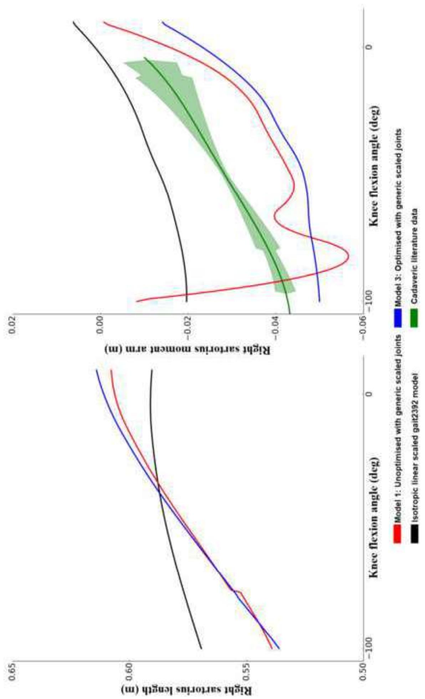

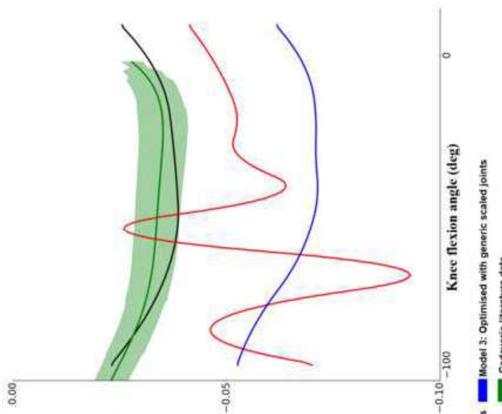

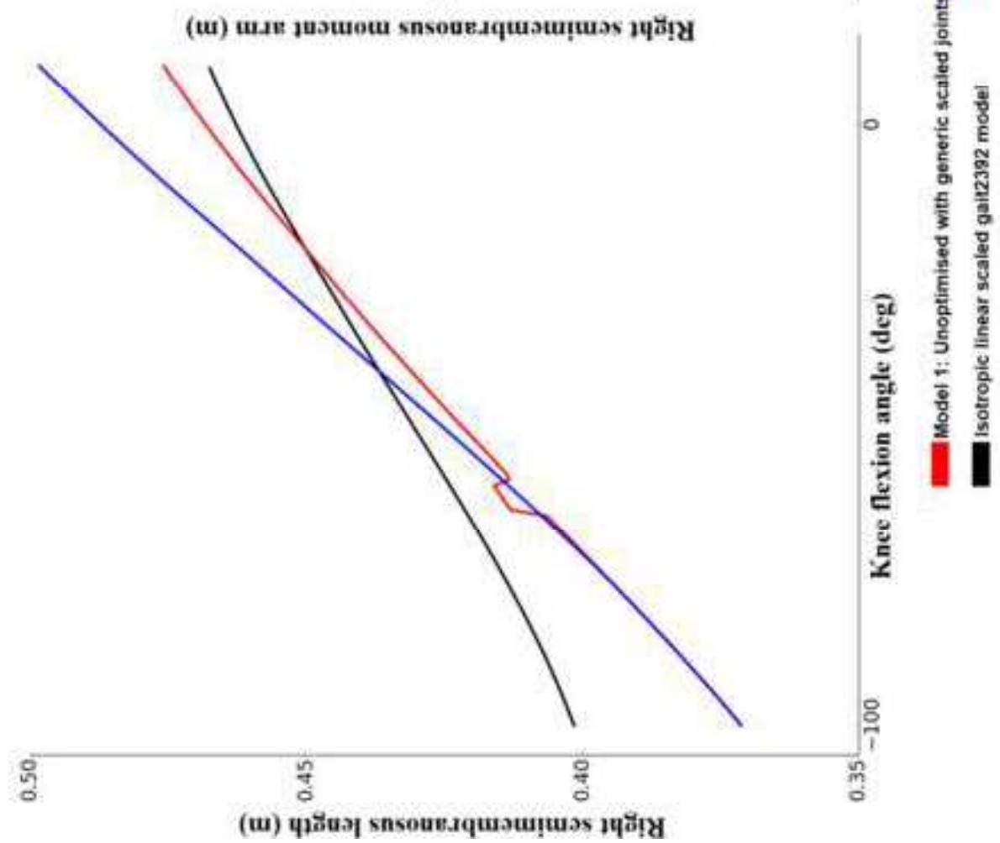

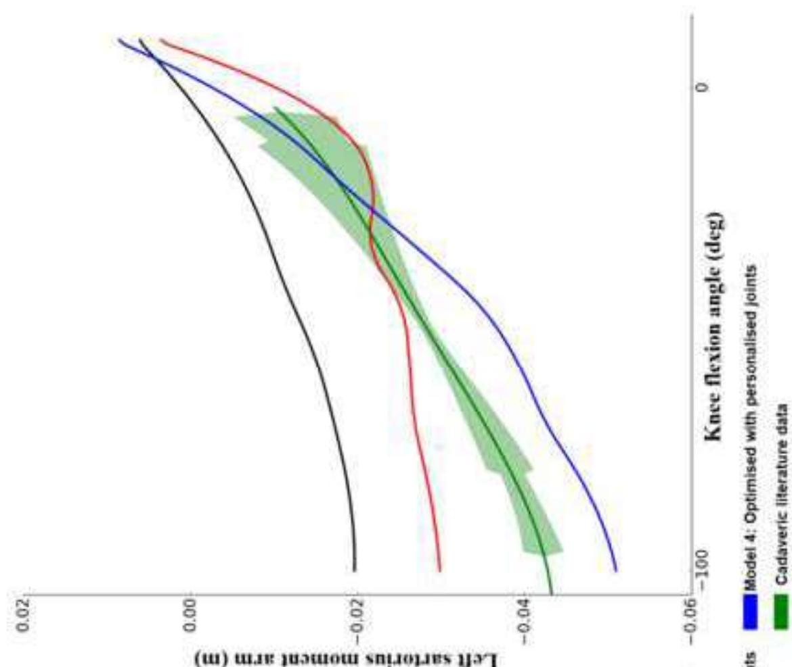

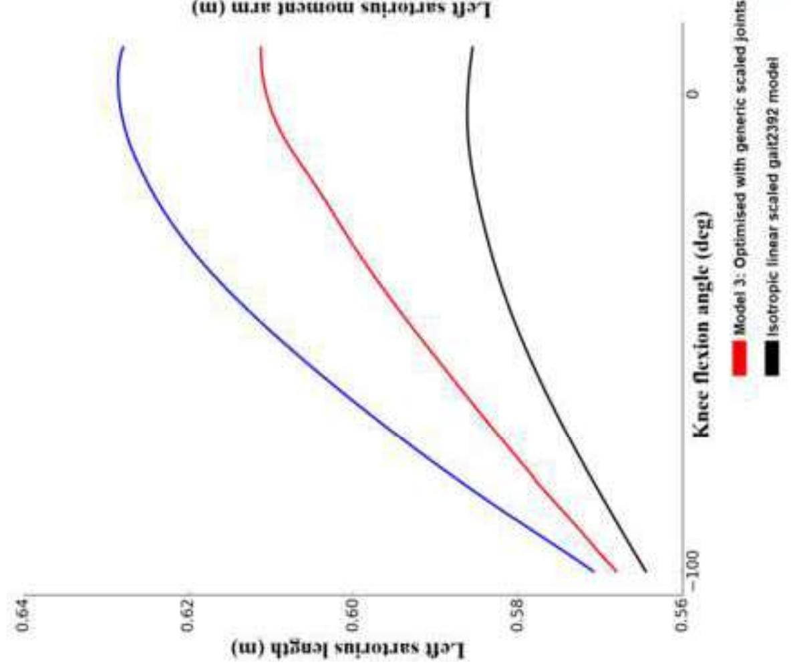

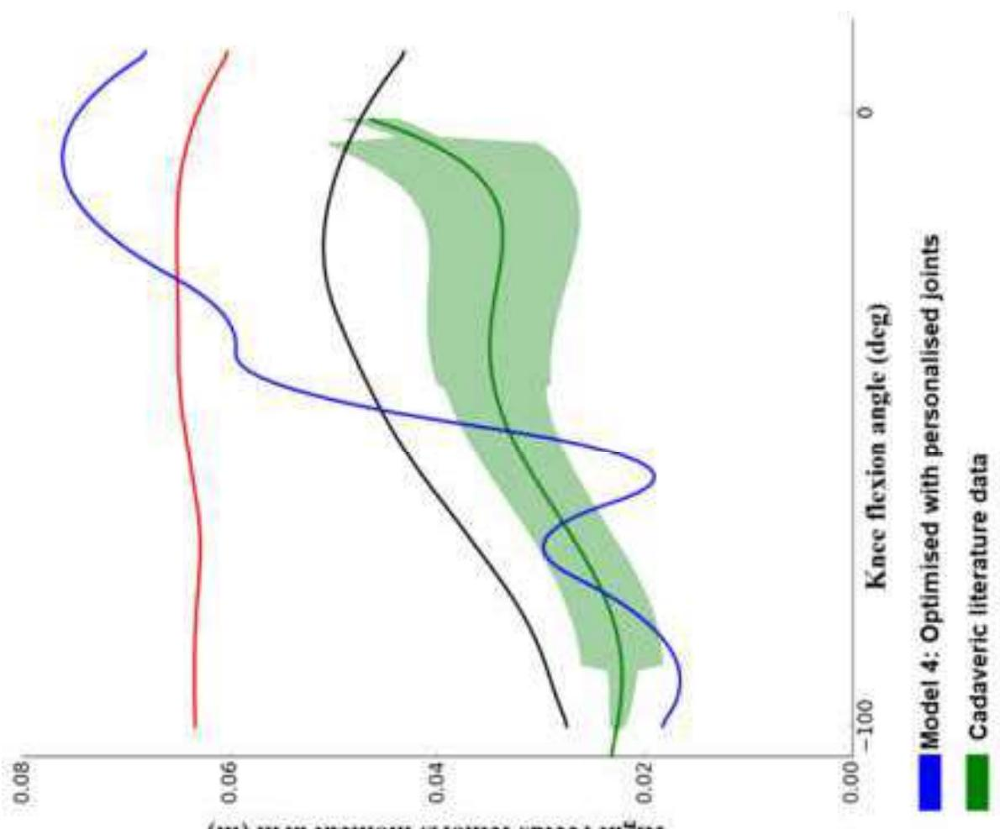

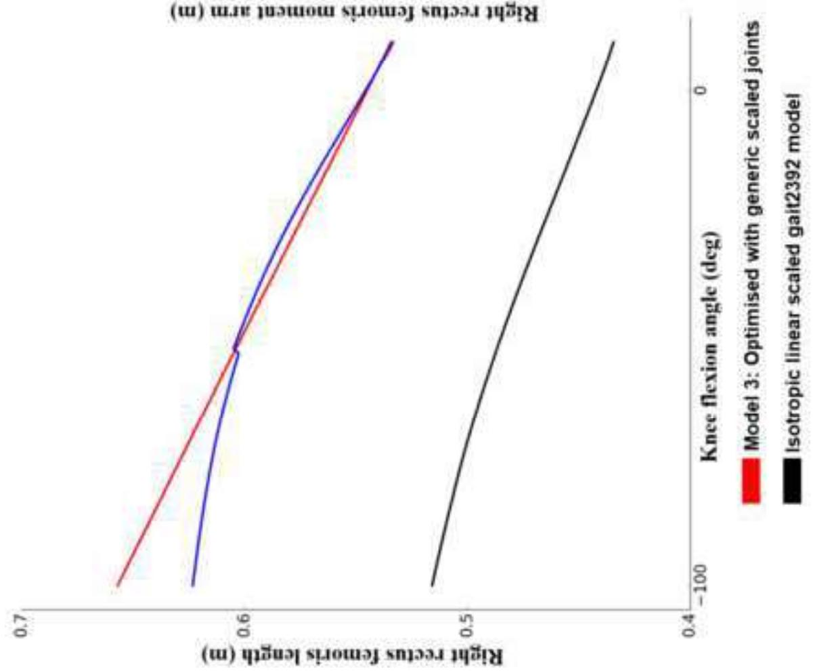

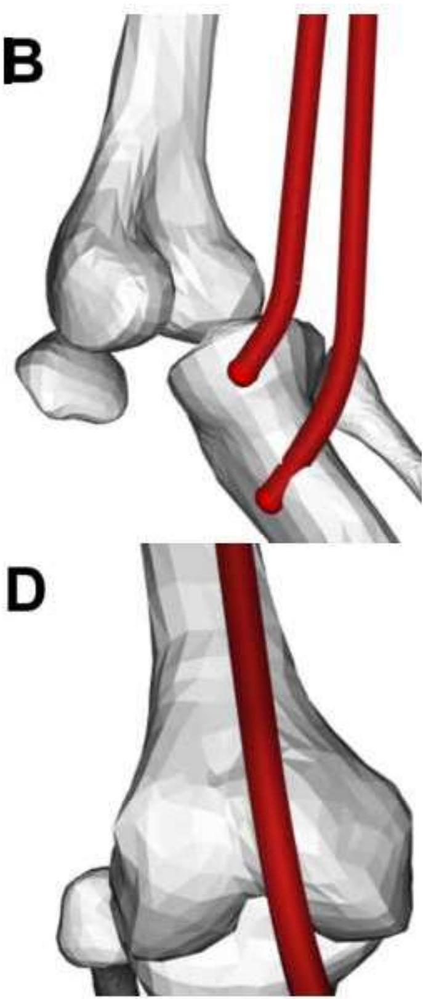

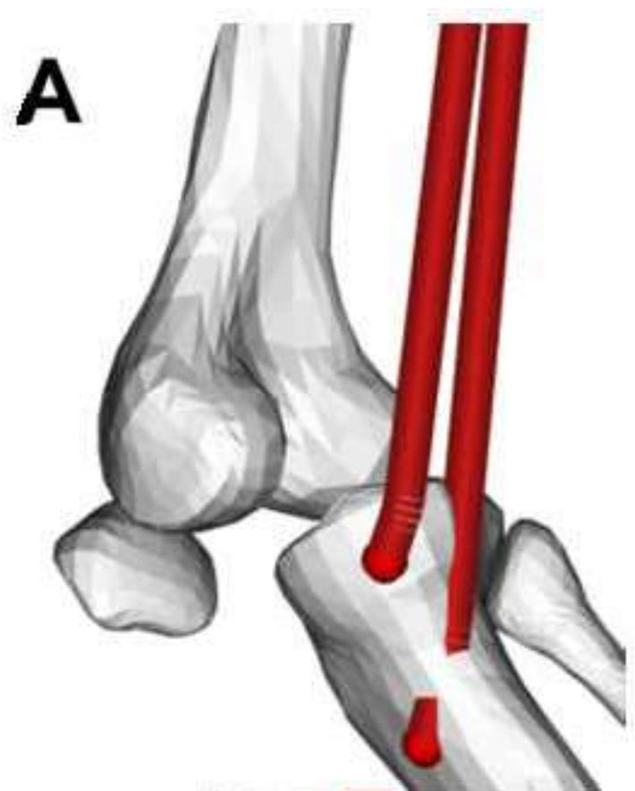

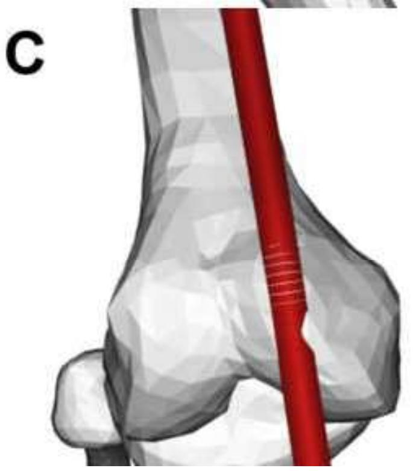

Table 1: Demographic data pertaining to study participants.

<table><tr><td>Participant</td><td>Gender</td><td>Limb</td><td>Age (years)</td><td>Height (cm)</td><td>Weight (kg)</td></tr><tr><td>M01</td><td>M</td><td>R</td><td>24</td><td>182.0</td><td>82</td></tr><tr><td>M02</td><td>F</td><td>R</td><td>22</td><td>172.0</td><td>63</td></tr><tr><td>M03</td><td>M</td><td>R</td><td>23</td><td>180.0</td><td>88</td></tr><tr><td>M07</td><td>M</td><td>L</td><td>32</td><td>185.0</td><td>89</td></tr><tr><td>M09</td><td>M</td><td>L</td><td>31</td><td>161.0</td><td>45</td></tr><tr><td>M11</td><td>F</td><td>L</td><td>21</td><td>160.5</td><td>55</td></tr><tr><td>(n or means±sd)</td><td>4M &amp; 2F</td><td>3L &amp; 3R</td><td>25.5±4.8</td><td>173.4±10.7</td><td>70.3±18.6</td></tr></table>

M-males, F-females; L-left , R-right; sd-standard deviation.

Table 2: Explanations of each of the four models developed as part of this study.  
Model 1 MAP-Client generated model containing personalised: bone geometry, joint positions, MTU origin and insertions, and non-optimised wrapping-surfaces

<table><tr><td>Model 2</td><td>Model 1, but scaled generic TFJ and PFJ have been replaced with personalised joint mechanisms (Brito da Luz et al. 2017; Barzan et al. 2019)</td></tr><tr><td>Model 3</td><td>Model 1 following MTU wrapping-surface optimisation</td></tr><tr><td>Model 4</td><td>Model 2 following MTU wrapping-surface optimisation</td></tr></table>

MTU muscle-tendon unit.

Table 3: Time required for each task in model creation.

<table><tr><td>Task</td><td>Time (hours)</td></tr><tr><td>MRI Segmentations (pelvis and bilateral lower limb)</td><td>3</td></tr><tr><td>MAP-Client bone morphing (pelvis and bilateral lower-limb)</td><td>3</td></tr><tr><td>TFJ MRI Segmentation (bone, cartilage, and ligaments)</td><td>3</td></tr><tr><td>MAP-Client OpenSim creation</td><td>0.5</td></tr><tr><td>TFJ and PFJ mechanism optimisation</td><td>4</td></tr><tr><td>Wrapping-surface optimisation</td><td>2*</td></tr><tr><td>Total</td><td>15.5 hours</td></tr></table>

\*The optimisation was run on the high-performance computer cluster and run in parallel. The specifications of the clusters used were 2-4GB RAM  
MRI magnetic resonance imaging; TFJ tibiofemoral joint; PFJ patellofemoral joint.

y of the three types of results, cells were left es improvement, red indicates worsening, and yellow indicates no change. In cases of no statistica sample size was 144 (8 per group x 3 groups x 6 subjects). Statistically significant differences are was either (+) improved, (-) worse, or (±) no change. For each MTU group, sample size was 4 aces (Model 3). Displayed is the number of instances, for each MTU group and all combined e comparisons between the MAP-Client model with fitted wrapping-surfaces (Model 1) and the

<table><tr><td colspan="3">Polarity penalty</td><td colspan="3">Muscle penetration</td><td colspan="3">Length smoothness</td><td colspan="3">Moment arm smoothness</td><td colspan="3">Moment arm gradient</td></tr><tr><td>+</td><td>-</td><td>±</td><td>+</td><td>-</td><td>±</td><td>+</td><td>-</td><td>±</td><td>+</td><td>-</td><td>±</td><td>+</td><td>-</td><td>±</td></tr><tr><td colspan="15">All MTUs</td></tr><tr><td>23,16%</td><td>5,3.5%</td><td>116,80.6%</td><td>48,33.3%</td><td>3,2.1%</td><td>93,64.6%</td><td>28,19.4%</td><td>9,6.3%</td><td>107,74.3%</td><td>62,43.1%</td><td>37,25.7%</td><td>45,31.3%</td><td>141,97.9%</td><td>3,2.1%</td><td>0,0%</td></tr><tr><td colspan="15">Quadriceps MTU group</td></tr><tr><td>0,0%</td><td>0,0%</td><td>48,100%</td><td>5,10.4%</td><td>2,4.2%</td><td>41,85.4%</td><td>13,27.1%</td><td>0,0%</td><td>35,72.9%</td><td>14,29.2%</td><td>14,29.2%</td><td>20,41.7%</td><td>48,100%</td><td>0,0%</td><td>0,0%</td></tr><tr><td colspan="15">Hamstrings MTU group</td></tr><tr><td>9,18.8%</td><td>4,8.3%</td><td>35,72.9%</td><td>16,33.3%</td><td>1,2.1%</td><td>31,64.6%</td><td>9,18.8%</td><td>4,8.3%</td><td>35,72.9%</td><td>27,56.3%</td><td>13,27.1%</td><td>8,16.7%</td><td>46,95.8%</td><td>2,4.2%</td><td>0,0%</td></tr><tr><td colspan="15">Extras MTU group</td></tr><tr><td>14,29.2%</td><td>1,2.1%</td><td>33,68.8%</td><td>27,56.3%</td><td>0,0%</td><td>21,43.8%</td><td>6,12.5%</td><td>5,10.4%</td><td>37,77.1%</td><td>21,43.8%</td><td>10,20.8%</td><td>17,35.4%</td><td>47,97.9%</td><td>1,2.1%</td><td>0,0%</td></tr><tr><td colspan="15">Where, +, represents improvement from models 1 to 3, - represents worsening from models 1 to 3, and, ± represents no change between models 1 and 3.</td></tr></table>

cases of no statistically significant difference between any of the three types of results, ce ifferences are denoted using coloured cells, where green indicates improvement, red indicates e was 48 (8 MTU x 6 subjects). For all combined MTU, sample size was 144 (8 per group x bined MTU, where the MTU quality evaluation metric was either (+) improved, (-) worse, or ised wrapping-surfaces and personalised joint mechanisms (Model 4). Displayed is the numbe arison between MAP-Client model with fitted wrapping-surfaces and personalised joint mechanis

<table><tr><td colspan="3">Polarity penalty</td><td colspan="3">Muscle penetration</td><td colspan="3">Length smoothness</td><td colspan="3">Moment arm smoothness</td><td colspan="3">Moment arm gradient</td></tr><tr><td>+</td><td>-</td><td>±</td><td>+</td><td>-</td><td>±</td><td>+</td><td>-</td><td>±</td><td>+</td><td>-</td><td>±</td><td>+</td><td>-</td><td>±</td></tr><tr><td colspan="15">All MTUs</td></tr><tr><td>25, 17.4%</td><td>4, 2.8%</td><td>115, 79.9%</td><td>45, 31.3%</td><td>10, 6.9%</td><td>89, 61.8%</td><td>26, 18.1%</td><td>18, 12.5%</td><td>100, 69.4%</td><td>71, 49.3%</td><td>29, 20.1%</td><td>44, 30.6%</td><td>135, 93.8%</td><td>9, 6.3%</td><td>0, 0%</td></tr><tr><td colspan="15">Quadriceps MTU group</td></tr><tr><td>1, 2.1%</td><td>1, 2.1%</td><td>46, 95.8%</td><td>9, 18.8%</td><td>4, 8.3%</td><td>35, 72.9%</td><td>6, 12.5%</td><td>7, 14.6%</td><td>35, 72.9%</td><td>21, 43.8%</td><td>9, 18.8%</td><td>18, 37.5%</td><td>46, 95.8%</td><td>2, 4.2%</td><td>0, 0%</td></tr><tr><td colspan="15">Hamstrings MTU group</td></tr><tr><td>12, 25%</td><td>2, 4.2%</td><td>34, 70.8%</td><td>15, 31.3%</td><td>1, 2.1%</td><td>32, 66.7%</td><td>7, 14.6%</td><td>7, 14.6%</td><td>34, 70.8%</td><td>21, 43.8%</td><td>11, 22.9%</td><td>16, 33.3%</td><td>43, 89.6%</td><td>5, 10.4%</td><td>0, 0%</td></tr><tr><td colspan="15">Extras MTU group</td></tr><tr><td>12, 25%</td><td>1, 2.1%</td><td>35, 72.9%</td><td>21, 43.8%</td><td>5, 10.4%</td><td>22, 45.8%</td><td>13, 27.1%</td><td>4, 8.3%</td><td>31, 64.6%</td><td>29, 60.4%</td><td>9, 18.8%</td><td>10, 20.8%</td><td>46, 95.8%</td><td>2, 4.2%</td><td>0, 0%</td></tr><tr><td colspan="15">Where, +, represents improvement from models 2 to 4, - represents worsening from models 2 to 4, and, ± represents no change between models 2 to 4,</td></tr></table>

y of the three types of results, cells were left tes improvement, red indicates worsening, and yellow indicates no change. In cases of no statistica ple size was 144 (8 per group x 3 groups x 6 subjects). Statistically significant differences are was either (+) improved, (-) worse, or (±) no change. For each MTU group, sample size was 48 (8 ersonalised joint mechanisms (Model 4). Displayed is the number of instances, for each MTU arison between MAP-Client model with optimised-wrapping surfaces (Model 3) and MAP-Clien

<table><tr><td colspan="3">Polarity penalty</td><td colspan="3">Muscle penetration</td><td colspan="3">Length smoothness</td><td colspan="3">Moment arm smoothness</td><td colspan="3">Moment arm gradient</td></tr><tr><td>+</td><td>-</td><td>±</td><td>+</td><td>-</td><td>±</td><td>+</td><td>-</td><td>±</td><td>+</td><td>-</td><td>±</td><td>+</td><td>-</td><td>±</td></tr><tr><td colspan="15">All MTUs</td></tr><tr><td>27,18.8%</td><td>13,9%</td><td>104,72.7%</td><td>3,2.1%</td><td>25,17.4%</td><td>116,80.6%</td><td>20,13.9%</td><td>27,18.8%</td><td>97,67.4%</td><td>43,29.9%</td><td>48,33.3%</td><td>53,36.8%</td><td>66,45.8%</td><td>78,54.2%</td><td>0,0%</td></tr><tr><td colspan="15">Quadriceps MTU group</td></tr><tr><td>0,0%</td><td>1,2.1%</td><td>47,97.9%</td><td>0,0%</td><td>11,22.9%</td><td>37,77.1%</td><td>3,6.3%</td><td>16,33.3%</td><td>29,60.4%</td><td>14,29.2%</td><td>16,33.3%</td><td>18,37.5%</td><td>24,50%</td><td>24,50%</td><td>0,0%</td></tr><tr><td colspan="15">Hamstrings MTU group</td></tr><tr><td>6,12.5%</td><td>4,8.3%</td><td>38,79.2%</td><td>2,4.2%</td><td>4,8.3%</td><td>42,87.5%</td><td>6,12.5%</td><td>6,12.5%</td><td>36,75%</td><td>15,31.3%</td><td>15,31.3%</td><td>18,37.5%</td><td>19,39.6%</td><td>29,60.4%</td><td>0,0%</td></tr><tr><td colspan="15">Extras MTU group</td></tr><tr><td>21,43.8%</td><td>8,16.7%</td><td>19,39.6%</td><td>1,2.1%</td><td>10,20.8%</td><td>37,77.1%</td><td>11,22.9%</td><td>5,10.4%</td><td>32,66.7%</td><td>14,29.2%</td><td>17,35.4%</td><td>17,35.4%</td><td>23,47.9%</td><td>25,52.1%</td><td>0,0%</td></tr><tr><td colspan="15">Where, +, represents improvement from models 3 to 4, - represents worsening from models 3 to 4, and, ± represents no change between models 3 and 4.</td></tr></table>

Fig 1: Right leg sartorius MTU kinematic curves for participant M02 where left plot is MTU length and right plot is TFJ flexion moment arm. Black lines are for the isotropic linearly scaled gait2392 model, green lines are combined cadaveric literature data, red lines represent Model 1, and blue lines represent Model 3. MTU muscle-tendon unit; TFJ tibiofemoral joint.

Fig 2: Right leg semimembranosus MTU kinematic curves for participant M03 where left plot is MTU length and right plot is TFJ flexion moment arm. Black lines are for the isotropic linearly scaled gait2392 model, green lines are combined cadaveric literature data, red lines represent Model 1, and blue lines represent Model 3. MTU muscle-tendon unit; TFJ tibiofemoral joint.

Fig 3: Left leg sartorius MTU kinematic curves for participant M01 where left plot is MTU length and right plot is TFJ flexion moment arm. Black lines are for the isotropic linearly scaled gait2392 model, green lines are combined cadaveric literature data, red lines represent Model 3, and blue lines represent Model 4. MTU muscle-tendon unit; TFJ tibiofemoral joint.

Fig 4: Right leg rectus femoris MTU kinematic curves for participant M01 where left plot is MTU length and right plot is TFJ flexion moment arm. Black lines are for the isotropic linearly scaled gait2392 model, green lines are combined cadaveric literature data, red lines represent Model 3, and blue lines represent Model 4. MTU muscle-tendon unit; TFJ tibiofemoral joint.

Fig 5: An esxample of MTU bone penetration for participant M09 in Model 1 (A, C) in the semitendinosus (A, B) and vastus lateralis (C,D) which are removed following model optimisation, i.e., Model 3 (B, D).

## 1 Appendix 1: Common non-physiological MTU kinematics and non-physical MTU 2 pathways

In most generic OpenSim models, MTU intermediate pathways are predominantly defined 4 using a combination of fixed and conditional $( ^ { 6 6 } \mathrm { { v i a } ^ { , 9 } ) }$ points. The use of via points allows 5 users to define MTU pathways conditional to the behaviour of the model $( \mathrm { e . g . }$ , becoming active 6 when the model reaches a specific configuration). Although this approach may work in generic 7 models, transferring these via points to personalised models through linear or deviatoric scaling 8 is a non-trivial task. Previous researchers (Scheys et al. 2009; Modenese et al. 2018), as well 9 as the MAP-Client developers have used non-rigid morphing methods to fit via points to 10 personalised bone geometries. Although these methods can be implemented in a 11 straightforward manner within the MAP-Client, they often introduce non-physical pathways 12 (Fig S1) and non-physiological MTU kinematics (Fig S2). Non-physical pathways refer to 13 pathways which contain $9 0 ^ { \mathrm { o } }$ turns and penetrate bones. Non-physiological MTU kinematics 14 refer to MTU lengths which are not smooth and/or do not follow the patterns (represented as 15 the change in moment arm magnitude with respect to joint angle) from previously published 16 literature developed through cadaveric experiments.

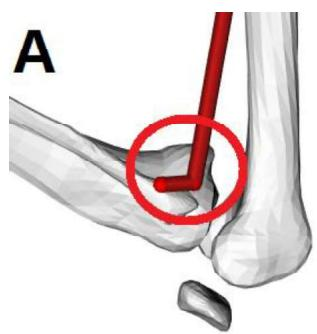

B  
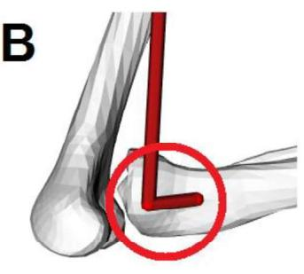

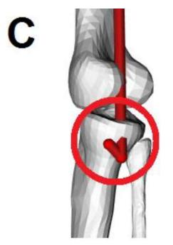

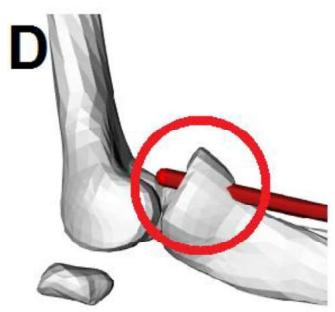  
E

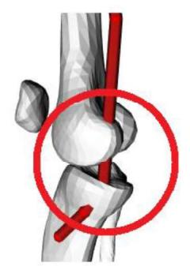

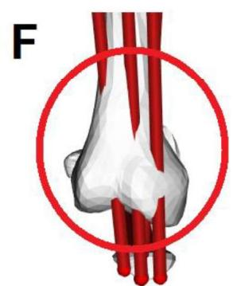  
Fig S1: Examples of non-physiological MTU shapes (A, B, C) and MTU bone penetration (C, D, E, F) in a standard MAP-Client generated model with morphed via points. MTU muscletendon unit.

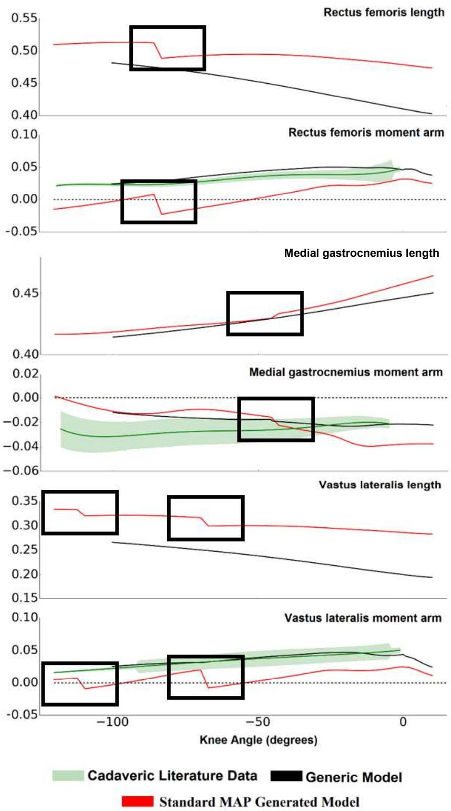  
Fig S2: The MTU lengths and moment arms from a standard MAP-Client generated model (red), generic gait2392 model (black), and cadaveric literature (green) for the rectus femoris, medial gastrocnemius, and vastus lateralis where discontinuities are highlighted in black boxes. MTU muscle-tendon unit.

## Appendix 2: Detailed optimisation and evaluation criteria

The optimisation method was written using open-source Python packages and deployed on the Griffith University High- https://confers.griffith.edu.au/display/GHCD/Gowonda+HPC) enabling massive parallelisation. The optimisation method used within this framework is referred to as particle swarm optimisation (PSO) (pyswarm: A Python package for particle swarm optimization (PSO) with constraint support, Abraham D. Lee, https://pythonhosted.org/pyswarm/). The PSO simultaneously searches different regions of the solution space using different “particles". During each iteration, MTU length and moment arms were calculated and tested against various objective criteria and penalty functions.

The MTU moment arms calculated using OpenSim are highly sensitive to small changes in MTU length. To overcome this and increase computational speed, previously published methods for accurate estimations of MTU moment arms were implemented. This implementation uses cubic B-splines fit to MTU lengths (Sartori et al. 2012) across the TFJ flexion/extension range of motion. The MTU moment arms are then calculated as the partial derivatives of these splines with respect to joint degree of freedom, i.e., changes in length divided by changes in joint angle. To ensure this process was not artificially increasing the calculated MTU length smoothness (covered below), the normalised error (splineNormErr) between the OpenSim calculated and cubic B-splined MTU lengths was calculated and minimised within the optimisation framework.

Patterns of MTU kinematics were represented as gradients with respect to joint angle (change in MTU moment arm/length divided by the change in joint angle), therefore pattern similarity was assessed using the normalised error between the gradients (maGradErr) of the modelled (MAP-Client personalised model) and target data (cadaveric literature data). Further objective functions were created to measure and control curve smoothness to ensure smooth and continuous MTU kinematics. The smoothness measure relied on three assumptions. First, MTU kinematic curves were primarily monophasic with no significant peaks or troughs, which is correct when the joints are moved through physiological ranges. Second, the gradient of the curves was constant with respect to MTU length or slowly changing in the case of MTU moment arms. The third and final assumption was that if MTU kinematic curves were a perfectly straight line, the second derivative of this line would be zero. Consequently, if the MTU kinematics had only slightly changing gradients the second derivative would approximate zero. Therefore, kinematic smoothness was defined as the number of modelled curve (MAP-Client personalised model) derivatives required for the differentiated curve's range, mean, and maximum to fall below predefined thresholds. The smoothness measure of the tested curve was then normalised to the smoothness measure of the target data. It should be noted that only the generic OpenSim model data were used to normalise the smoothness measure whereby the average smoothness measure of the two generic OpenSim models (see below) was used. As mentioned above, the objective criteria used several targets within the optimisation.

Target data were taken from multiple sources but can be divided into two distinct categories: model and literature data. Model data were obtained from two generic OpenSim models: gait2392 model (Delp et al. 2007), on which MAP-Client models are based, and the more recent Fullbody Model (Rajagopal et al. 2016). Unlike model data, literature data were taken from a wide range of different studies carried out on cadavers (Fick 1879; Draganich et al. 1987; Visser et al. 1990; Spoor and van Leeuwen 1992; Buford et al. 1997; Pal et al. 2007; Wilson and Sheehan 2009; Arnold et al. 2010; Navacchia et al. 2017). Note that selected original cadaveric data was not directly available for each of the aforementioned studies. However, we used cadaveric data that were reproduced and published elsewhere (Arnold et al. 2010; Rajagopal et al. 2016). These values were combined for each MTU, and the mean and standard deviation calculated.

Optimisation criteria and penalty functions were employed to mathematically detect various errors commonly observed in MTU kinematics and pathways. Each MTU's moment arm was required to have a mechanical action about a joint DOF (e.g., flexion or extension) consistent with target data (Fig S3). This was termed “polarity of the moment arm" and a penalty was defined to ensure these were physiological (moment arm polarity penalty). At each TFJ flexion angle, the polarity of the tested model (i.e., MAP-Client personalised model) and the generic gait2392 model was compared. If the polarity was the same, no penalty was applied, else a secondary test was performed. Specifically, the adjacent 20 angles (i.e., ±10º) were checked. If the polarity of the tested model within this range matched the target data, the discrepancy was no longer considered a polarity error. When this condition was not met, a penalty was applied to the final weighted value.

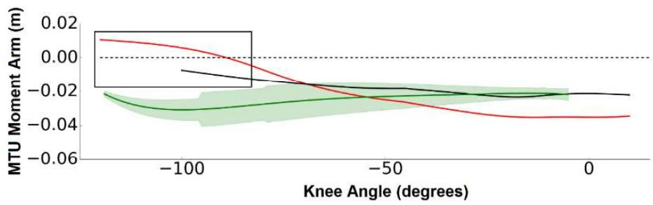  
Fig S3: Example of MTU moment arm polarity error in the MAP-Client generated model (red) compared to both generic model (black) and literature (green) data.

Depending on where an MTU intersects an associated wrapping cylinder, it may wrap entirely around it, i.e., complete a full circumferential loop before continuing to the insertion point (Fig S4A). To avoid these non-physical MTU pathways, the MTU path points in the neutral position were queried. These points represent the origin, insertion, and via points as well as the points where the MTU starts and finishes wrapping (Fig S4B). With the assumption that each MTU path point is inferior compared to the previous path point (which is true in the neutral position), the superior/inferior coordinate of each path point is tested. If the superior/inferior coordinate of a path point was greater than the superior/inferior coordinate of the previous path point this was indicative of a wrapping error.

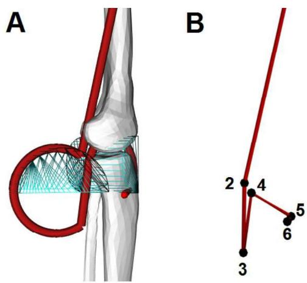  
Fig S4: (A) Example of MTU wrapping error in an OpenSim model whereby the MTU wraps around the circumference of the cylinder and (B) associated MTU path points numbered sequentially where points 3 and 4 illustrate the wrap error.

MTU bone penetration penalty employed an automated detection algorithm. Initially, the joints that each MTU spanned and the bodies (i.e., bones) they could penetrate were determined. Like the wrap error penalty, each MTU path point is determined and a vector calculated between adjacent path points. Due to limitation in the OpenSim application programming interface (API), the path between wrap on/off points cannot be readily determined. As a result the penalty only considered vectors that intersected bone surfaces between either: (i) two fixed points (e.g., origin or via point), (ii) a fixed point and a wrapping on point, (iii) a wrapping off and wrapping on point (on different wrapping surfaces), and (iv) a wrapping off point and a fixed point (Fig S5). It was assumed that if the on/off wrapping points did not penetrate, the intermediate path also did not penetrate.

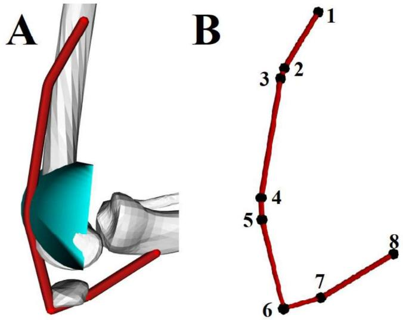  
Fig S5: (A) Illustration of the vastus medialis pathway at $1 0 0 ^ { \mathrm { o } }$ of TFJ flexion within OpenSim and (B) each of the path points available within the OpenSim API. Where points 1, 6, 7, and 8 are fixed points, points 2 and 4 are wrapping on points, and points 3 and 5 are wrapping off points. Using the proposed framework, tested path point pairs are: 1-2, 3-4, 5-6, 6-7, and 7-8.

Once each of the penalties had been determined, they were combined into a single penalty value where each penalty function, if returning a positive test, attracted penalty value. The penalty functions and objective criteria were combined into a single weighted value, which was minimised via optimisation (Equation 1). Detailed explanations of each of the optimisation functions and penalty functions are restated explicitly below.

$$
w v = s p l i n e L e n N + l e n N + s p l i n e N o r m E r r + m a G r a d E r r + p e n\tag{1}
$$

where, is the weighted value, is the smoothness measure of the splined lengths fit to the OpenSim MTU lengths, is the smoothness measure of the OpenSim API derived MTU lengths, is the normalised error between the OpenSim derived and cubic B-spline fit MTU lengths, is the normalised error between the MTU moment arms and target data, and, is the summed penalty value.

splineLenN: provided an estimation of the smoothness of the splines MTU lengths. Here the MTU lengths at each joint angle defined by the B-spline method are differentiated with respect to joint angle. This derivation was repeated (using the numpy.gradient function) until the mean, max, min, and range of the derivates fell below a defined threshold which was 9 orders of magnitude smaller than the tested values. The number of derivations required for this to occur defined the splineLenN value.

lenN: Is identical to the above splineLenN measure however instead of using the lengths from the implemented B-spline method, it uses length derived directly fr

splineNormErr: was deisgned to ensure the implemented B-spline method was not artifically increasing the smoothness of the MTU lengths. It was calculated as the root mean squared difference between the MTU length from the OpenSim API and the B-spline estimation normalise to the MTU length from OpenSim.

maGradErr: provided an estimation of the similarity between the cadaveric and model data. As mentioned above, the pattern of both cadaveric and model moment arms is represent as the gradient, i.e., change in moment arm / change in joint angle. The maGradErr was then calculated as the root mean squared difference between cadaveric and model values, normalised to the cadaveric value.

pen: represented the summed penalty value, as mentioned there were three penalties implemented in this framework. First the wrapping error penalty and second MTU bone penetration error, and third the MTU polarity penalty. Each of these errors, if presented were penalised with a value of 250 added to the final error.

## Appendix 3: Model evaluation criteria results for each model

The combined evaluation metrics used within this research are shown below for Models 1 4, in Table S1- S4, respectively.

Table S1: Performance criteria results for the MAP-Client model with fit wrapping surfaces and a generic joint model (Model 1).

<table><tr><td></td><td>Polarity penalty</td><td>Muscle penetration</td><td>Length smoothness</td><td>Moment arm smoothness</td><td>Moment arm gradient error</td></tr><tr><td>M01</td><td>7 (29.2%)</td><td>8 (33.3%)</td><td> $3.5 \pm 11.5$ </td><td> $1.5 \pm 0.4$ </td><td> $1270.8 \pm 1964.14$ </td></tr><tr><td>M02</td><td>4 (16.7%)</td><td>8 (33.3%)</td><td> $1.1 \pm 0.2$ </td><td> $3.1 \pm 6.5$ </td><td> $19527 \pm 72014$ </td></tr><tr><td>M03</td><td>7 (29.2%)</td><td>8 (33.3%)</td><td> $1.4 \pm 1.1$ </td><td> $1.6 \pm 1.1$ </td><td> $1891.7 \pm 4145.5$ </td></tr><tr><td>M07</td><td>6 (25.0%)</td><td>9 (37.5%)</td><td> $1.3 \pm 0.8$ </td><td> $1.42 \pm 0.9$ </td><td> $1704.2 \pm 2666.1$ </td></tr><tr><td>M09</td><td>5 (20.8%)</td><td>13 (54.2%)</td><td> $2.1 \pm 4.8$ </td><td> $6.7 \pm 20.6$ </td><td> $55325.7 \pm 182702$ </td></tr><tr><td>M11</td><td>8 (33.3%)</td><td>7 (29.2%)</td><td> $3.4 \pm 10.8$ </td><td> $6.8 \pm 23.4$ </td><td> $42438.2 \pm 20233$ </td></tr></table>

Where polarity penalty and muscle penetration are reported as the number and percentage of occurrences of each penalty, and the remaining metrics are reported as the average ± standard deviation across each of the 24 muscles considered in this analysis. In all cases, a lower value represents a better result.

Table S2: Performance criteria results for the MAP-Client model with fit wrapping surfaces and a personalised joint model (Model 2).

<table><tr><td></td><td>Polarity penalty</td><td>Muscle penetration</td><td>Length smoothness</td><td>Moment arm smoothness</td><td>Moment arm gradient error</td></tr><tr><td>M01</td><td>10 (41.7%)</td><td>8 (33.3%)</td><td>2.7 ± 7.6</td><td>2.8 ± 5.3</td><td>9915.8 ± 416417.7</td></tr><tr><td>M02</td><td>4 (16.7%)</td><td>12 (50%)</td><td>1.6 ± 2.1</td><td>5.7 ± 18</td><td>33246.5 ± 157718</td></tr><tr><td>M03</td><td>3 (12.5%)</td><td>10 (41.7%)</td><td>1.2 ± 0.2</td><td>1.5 ± 0.5</td><td>683.9 ± 741.9</td></tr><tr><td>M07</td><td>6 (25%)</td><td>9 (37.5%)</td><td>1.1 ± 0.2</td><td>3.7 ± 5.5</td><td>7808.9 ± 13452.1</td></tr><tr><td>M09</td><td>12 (50%)</td><td>15 (60%)</td><td>1.7 ± 1.8</td><td>7.2 ±17.3</td><td>45440.5 ± 147443</td></tr><tr><td>M11</td><td>9 (37.5%)</td><td>11 (45.8%)</td><td>1.12 ± 0.19</td><td>3.9 ± 9.7</td><td>22362.5 ± 96077.7</td></tr></table>

Where polarity penalty and muscle penetration are reported as the number and percentage of occurrences of each penalty, and the remaining metrics are reported as the average ± standard deviation across each of the 24 muscles considered in this analysis. In all cases, a lower value represents a better result.

Table S3. Performance criteria results for the MAP-Client model with optimised wrapping surfaces and a generic joint model (Model 3).

<table><tr><td></td><td>Polarity penalty</td><td>Muscle penetration</td><td>Length smoothness</td><td>Moment arm smoothness</td><td>Moment arm gradient error</td></tr><tr><td>M01</td><td>7 (29.2%)</td><td>0 (0.0%)</td><td> $1.06 \pm 0.2$ </td><td> $1.36 \pm 0.9$ </td><td> $97.88 \pm 251.9$ </td></tr><tr><td>M02</td><td>7 (29.2%)</td><td>0 (0.0%)</td><td> $1.37 \pm 1.3$ </td><td> $1.36 \pm 0.8$ </td><td> $36.46 \pm 49.7$ </td></tr><tr><td>M03</td><td>5 (20.84%)</td><td>1 (4.2%)</td><td> $1.23 \pm 0.7$ </td><td> $1.32 \pm 0.4$ </td><td> $87.62 \pm 151.3$ </td></tr><tr><td>M07</td><td>7 (29.2%)</td><td>4 (16.7%)</td><td> $1.17 \pm 0.2$ </td><td> $1.40 \pm 0.6$ </td><td> $110.94 \pm 188.7$ </td></tr><tr><td>M09</td><td>6 (25.0%)</td><td>2 (8.3%)</td><td> $1.06 \pm 0.2$ </td><td> $1.30 \pm 0.6$ </td><td> $54.42 \pm 87.3$ </td></tr><tr><td>M11</td><td>5 (20.8%)</td><td>1 (4.2%)</td><td> $1.13 \pm 0.2$ </td><td> $1.72 \pm 0.6$ </td><td> $142.36 \pm 186.1$ </td></tr></table>

Where polarity penalty and muscle penetration are reported as the number and percentage of occurrences of each penalty, and the remaining metrics are reported as the average ± standard deviation across each of the 24 muscles considered in this analysis. In all cases, a lower value represents a better result.

Table S4. Performance criteria results for the MAP-Client model with optimised wrapping surfaces and a personalised joint model (Model 4).

<table><tr><td></td><td>Polarity penalty</td><td>Muscle penetration</td><td>Length smoothness</td><td>Moment arm smoothness</td><td>Moment arm gradient error</td></tr><tr><td>M01</td><td>3 (12.5%)</td><td>3 (12.5%)</td><td> $1.41 \pm 0.9$ </td><td> $1.46 \pm 0.7$ </td><td> $422.44 \pm 1126.1$ </td></tr><tr><td>M02</td><td>0 (0.0%)</td><td>2 (8.3%)</td><td> $0.99 \pm 0.2$ </td><td> $1.33 \pm 0.4$ </td><td> $32.50 \pm 35.6$ </td></tr><tr><td>M03</td><td>4 (16.7%)</td><td>5 (20.8%)</td><td> $1.58 \pm 2.1$ </td><td> $1.83 \pm 1.9$ </td><td> $438.29 \pm 1983.8$ </td></tr><tr><td>M07</td><td>Fig4(16.7%)</td><td>9 (37.5%)</td><td> $1.62 \pm 1.6$ </td><td> $1.71 \pm 0.9$ </td><td> $150.03 \pm 302.1$ </td></tr><tr><td>M09</td><td>5 (20.8%)</td><td>5 (20.8%)</td><td> $1.32 \pm 0.2$ </td><td> $1.29 \pm 0.4$ </td><td> $169.25 \pm 321.1$ </td></tr><tr><td>M11</td><td>4 (16.7%)</td><td>6 (25.0%)</td><td> $1.14 \pm 0.2$ </td><td> $1.68 \pm 1.1$ </td><td> $186.06 \pm 353.7$ </td></tr></table>

Where polarity penalty and muscle penetration are reported as the number and percentage of occurrences of each penalty, and the remaining metrics are reported as the average ± standard deviation across each of the 24 muscles considered in this analysis. In all cases, a lower value represents a better result.

## Appendix 4: Comparison of joint mechanism

Two different types of joint mechanisms were implemented in this manuscript, the first a generic implementation similar to the generic gait2392 model, and second personalised joint mechanisms based on medical imaging segmentations. No direct validation between these two joint mechanisms was performed as no gold standard ground truth data was available. The personalised joint mechanisms were implemented due to observed errors in joint motion in the generic joint mechanisms, specifically, the tibia was observed to translate too far superiorly (Fig S6) at 90 degrees of knee flexion.

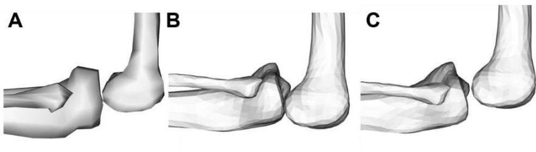  
Fig S6: Comparison of the tibia position at 90 degrees of tibiofemoral flexion in the generic gait 2392 model (A), a model with the generic joint mechanism (B), and a personalised joint mechanism (C)  
In addition to these seemingly non-physiological motions, the observed variation in the estimated secondary kinematics showed much higher variability in both tibiofemoral and patellofemoral kinematics (Fig S8, S9) especially compared to those in the generic joint mechanisms (Fig S7)

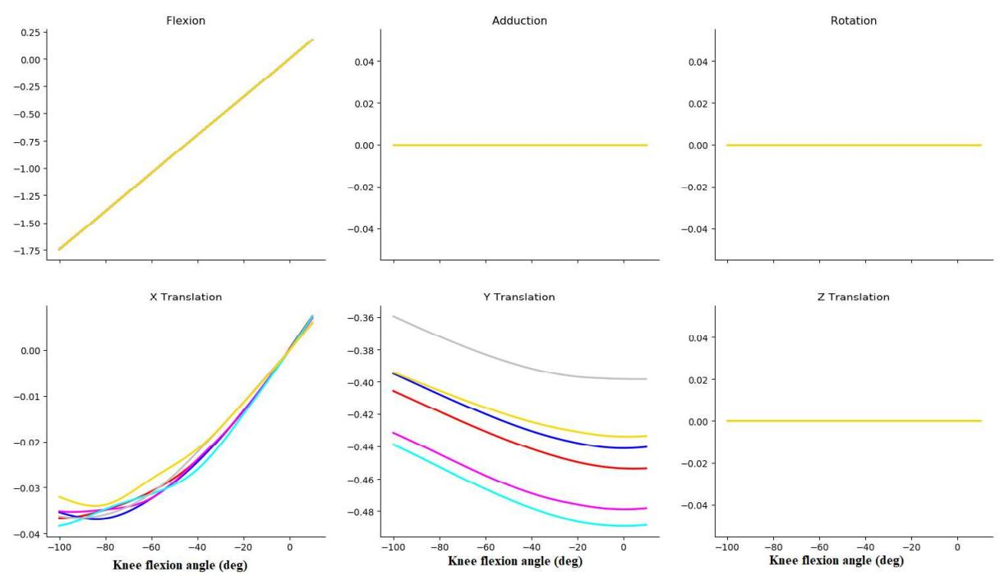  
Fig S7: Tibiofemoral joint motion from MAP Client generated models with generic joint mechanisms for each participant and each of the 6 DOFs where each colour represents a different participant. Translations are reported in metres and rotations in radians. Note that each motion is expressed relative to the TFJ flexion angle.

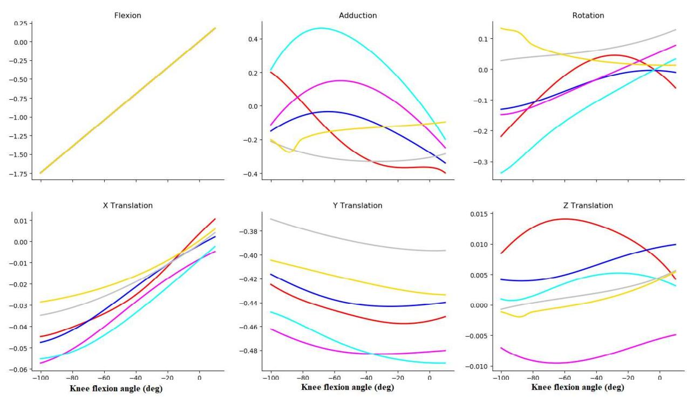  
Fig S8: Personalised TFJ kinematics for each participant and each of the 6 DOFs where each colour represents a different participant. Translations are reported in metres and rotations in radians. Note that each motion is expressed relative to the TFJ flexion angle.

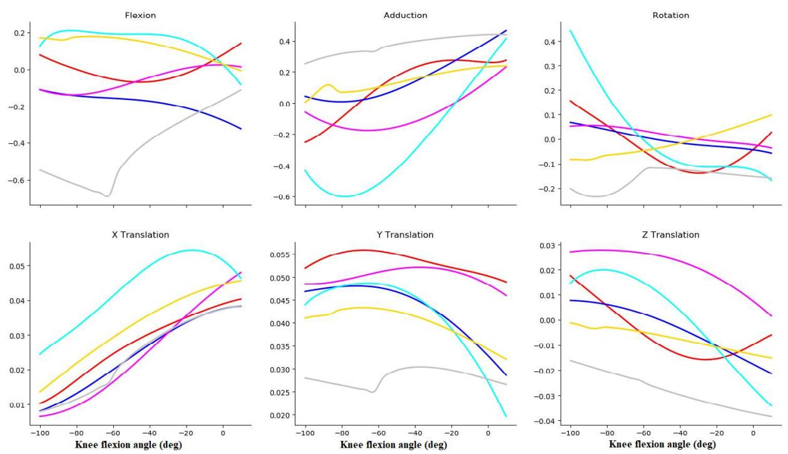  
Fig S9: Personalised PFJ motion for each participant and each of the 6 DOFs where each colour represents a different participant. Translations are reported in metres and rotations in radians. Note that each motion is expressed relative to the TFJ flexion angle