RESEARCH ARTICLE

# OpenSim Moco: Musculoskeletal optimal control

Christopher L. Dembia<sub>ID</sub> 1☯ , Nicholas A. Bianco<sub>ID</sub><sup>1☯</sup>, Antoine Falisse<sub>ID</sub> <sup>2,3</sup>, Jennifer L. Hicks<sub>ID</sub><sup>3</sup>, Scott L. Delp<sub>ID</sub><sup>1,3,4</sup>


## OPEN ACCESS

Citation: Dembia CL, Bianco NA, Falisse A, Hicks JL, Delp SL (2020) OpenSim Moco: Musculoskeletal optimal control. PLoS Comput Biol 16(12): e1008493. https://doi.org/10.1371/ journal.pcbi.1008493

Editor: Kenneth S. Campbell, University of Kentucky, UNITED STATES

Received: May 20, 2020

Accepted: November 5, 2020

Published: December 28, 2020

Copyright: © 2020 Dembia et al. This is an open access article distributed under the terms of the Creative Commons Attribution License, which permits unrestricted use, distribution, and reproduction in any medium, provided the original author and source are credited.

Data Availability Statement: All data is available in the manuscript. All files required to reproduce the results are available at https://github.com/ stanfordnmbl/mocopaper. The OpenSim Moco software is freely available from https://opensim. stanford.edu/moco. The source code for Moco is available from https://github.com/opensim-org/ opensim-moco.

Funding: CLD, NAB, AF, JLH, and SLD received support from the National Institutes of Health (https://www.nih.gov) grants U54 EB020405, P2C HD065690 P2C HD101913 d P41 EB027060

1 Department of Mechanical Engineering, Stanford University, Stanford, California, United States of America, 2 Department of Movement Sciences, KU Leuven, Leuven, Belgium, 3 Department of Bioengineering, Stanford University, Stanford, California, United States of America, 4 Department of Orthopaedic Surgery, Stanford University, Stanford, California, United States of America

☯ These authors contributed equally to this work.

\* dembia@alumni.stanford.edu

## Abstract

Musculoskeletal simulations are used in many different applications, ranging from the design of wearable robots that interact with humans to the analysis of patients with impaired movement. Here, we introduce OpenSim Moco, a software toolkit for optimizing the motion and control of musculoskeletal models built in the OpenSim modeling and simulation package. OpenSim Moco uses the direct collocation method, which is often faster and can handle more diverse problems than other methods for musculoskeletal simulation. Moco frees researchers from implementing direct collocation themselves—which typically requires extensive technical expertise—and allows them to focus on their scientific questions. The software can handle a wide range of problems that interest biomechanists, including motion tracking, motion prediction, parameter optimization, model fitting, electromyography-driven simulation, and device design. Moco is the first musculoskeletal direct collocation tool to handle kinematic constraints, which enable modeling of kinematic loops (e.g., cycling models) and complex anatomy (e.g., patellar motion). To show the abilities of Moco, we first solved for muscle activity that produced an observed walking motion while minimizing squared muscle excitations and knee joint loading. Next, we predicted how muscle weakness may cause deviations from a normal walking motion. Lastly, we predicted a squat-tostand motion and optimized the stiffness of an assistive device placed at the knee. We designed Moco to be easy to use, customizable, and extensible, thereby accelerating the use of simulations to understand the movement of humans and other animals.

## Author summary

Computer simulation has become an increasingly popular tool for studying the musculoskeletal system. Simulations are used to study the role of muscles in walking and running, to analyze the gait of individuals with neurological disease, and to design prostheses and exoskeletons. Historically, researchers have relied on experimental data to generate simulations and estimate muscle activity. Modern simulation approaches based on the direct

CLD and NAB received support from the National Science Foundation Graduate Research Fellowship Program. CLD received support from a Stanford Bio-X Graduate Fellowship (https://biox.stanford. edu). NAB received support from the Stanford Graduate Fellowship Program (https://vpge. stanford.edu/fellowships-funding/sgf). AF received support from the Research Foundation Flanders (https://www.fwo.be) under Ph.D. grant 1S35416N and travel grant V441717N. The funders had no role in study design, data collection and analysis, decision to publish, or preparation of the manuscript.

Competing interests: The authors have declared that no competing interests exist.

collocation optimal control method allow researchers to not only estimate muscle activity, but also predict new motions without the need for experimental data. However, direct collocation methods are difficult and time-consuming to implement and require expertise in optimal control and optimization theory. Here we introduce OpenSim Moco, an open source software package that makes predicting new motions accessible to those without an optimal control background. Moco leverages the existing modeling tools offered by the OpenSim musculoskeletal modeling package and provides an easy-to-use interface that facilitates generating and sharing simulation pipelines. Moco is modular and easily extensible and includes a testing suite that solves problems with known solutions. We provide examples including predicting muscle activity that minimizes knee loading, predicting how muscle weakness affects normal walking, and optimizing a knee exoskeleton to assist a squat-to-stand motion.

This is a PLOS Computational Biology Software paper.

## Introduction

Musculoskeletal simulations have shed light on movement disorders by, for example, discovering ways to walk that reduce knee loading [1], revealing that children with cerebral palsy exhibit simplified motor control when walking [2], and reproducing eye disorders that cause diplopia [3]. Beyond human health and performance, researchers use musculoskeletal simulations to understand how nonhuman animals move, for example by studying dinosaur locomotion [4] and differences between human and chimpanzee strength [5].

Simulations of movement are often categorized by whether the motion is prescribed from experimental data or predicted by the simulation. One may prescribe the motion of a musculoskeletal model to match a motion measured in an experiment [6, 7] to estimate unmeasured quantities such as muscle-level energy consumption [8, 9]. The most commonly used prescribed motion methods are rapid but lack support for important model features such as muscle dynamics (e.g., static optimization [10]). Motion prediction [11] can establish cause-effect relationships (e.g., discovering gait impairments that arise from weakness or contracture [12]) and help design clinical interventions (e.g., prostheses [13] and exoskeletons [14]). However, some methods for predicting motions, such as single shooting, often require waiting many hours or days for a solution, so researchers often simplify the musculature of their model or reduce the dimensionality of the control scheme [12, 15]. A third category, which lies between prescribing and predicting motion, is tracking motion, where errors between model kinematics and reference data are part of the cost function rather than exactly prescribed [16]. While some researchers have created their own code to solve problems spanning the prescribed-topredicted spectrum, many researchers lack the expertise or resources required to implement custom algorithms. Simulation methods that solve diverse problems, combined with tools that make these methods easy to adopt for all researchers, would accelerate the application of simulations to scientific and clinical questions.

Most musculoskeletal simulations are naturally posed as optimal control problems [17]. Optimal control problems seek the parameters and time-varying controls of a system that minimize a cost (e.g., energy consumption) subject to the system dynamics, expressed as

differential-algebraic equations. Biomechanists often use single shooting to solve optimal control problems, but more rapid alternatives exist. Direct multiple shooting uses time-stepping numerical integration to simulate consecutive intervals of a trajectory and constrains adjacent interval endpoints to be consistent [18, 19], which leads to improved numerical stability and faster convergence compared to single shooting. Direct collocation is an increasingly popular method that avoids the need for time-stepping integration and permits a more easily configurable trade-off between accuracy and computational cost compared to direct multiple shooting. With this method, the states and controls of the system are approximated as polynomial splines over a mesh of time points and an optimizer solves for the knot points that lead the splines to obey the system dynamics [20–23]. The dynamics are enforced by requiring the time derivative of the state splines to match the derivative from the system differential equations at specified time points. (This method is called “direct collocation” because the spline derivatives are “collocated” with the exact derivatives ([24], page 211; [25], page 498).) Direct collocation produces a nonlinear program in which the states are introduced as variables and the system dynamics are enforced as constraints. Typical musculoskeletal models lead to optimization problems with thousands of variables. These large problems are tractable with direct collocation because the constraints enforcing the system dynamics at a given time depend only on the variables near that time.

The advantages of direct collocation have led biomechanists to use the method for prescribing motions [26, 27], tracking motions [16, 28–31], predicting motions [32–44], fitting muscle properties [45], and optimizing model parameters [46]. Researchers have made key methodological advances, including efficiently handling multibody and muscle dynamics via implicit formulations [26, 47], minimizing energy consumption [48, 49], and employing algorithmic differentiation to simulate complex models more rapidly compared to using finite differences [50].

Despite the advantages of direct collocation, very few biomechanics laboratories have been able to apply this powerful technique. The method requires arduous bookkeeping of variables and efficient calculation of the objective and constraint function derivatives required by gradi ent-based optimization algorithms. Several direct collocation solvers exist (e.g., [51, 52]), but current solvers require users to incorporate their musculoskeletal models manually. OpenSim is a software package used by thousands of biomechanics researchers to model musculoskeletal systems [53–55], but OpenSim does not currently employ direct collocation. Several biomechanists have graciously shared their code combining OpenSim or hand-coded models with direct collocation solvers, but such code is tailored to specific models or problem formulations, or lacks support for models with kinematic constraints [26, 35, 36, 40]. Furthermore, such code can depend on closed-source components, which can limit custom extensions [26]. Lastly, choosing the problem formulation (e.g., expressing dynamics as explicit or implicit differential equations) and solver settings (e.g., detecting sparsity patterns automatically) that lead to fast convergence requires expertise; ideally, such expertise is embedded into the software via defaults, and users can edit their formulation or solver settings with simple commands.

To improve the accessibility of advanced optimal control methods in musculoskeletal biomechanics, we introduce OpenSim Moco (“musculoskeletal optimal control”), an easy-to-use, customizable, and extensible software toolkit for solving optimal control problems with Open-Sim musculoskeletal models (Fig 1). OpenSim frees biomechanists from implementing equations of motion on their own, and Moco frees biomechanists from implementing direct collocation. Moco not only removes the need to set up gradient-based optimization, but also provides an interface that abstracts away the details of constructing an optimal control problem. Users can add custom cost terms or constraints if Moco does not provide what they need.

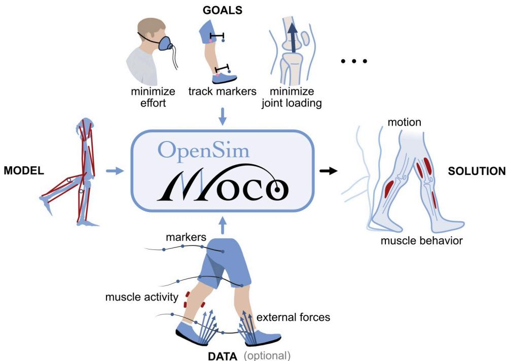  
Fig 1. Overview of Moco. OpenSim Moco produces the optimal motion and muscle behavior for an OpenSim musculoskeletal model [54], given goals to achieve during the motion and reference data. Moco provides a library of goals, such as minimizing effort (illustrated with an indirect calorimetry mask), deviation from marker data (or generalized coordinate data), and joint loading. Reference data for the motion (markers or generalized coordinates), external forces (from force places), and muscle activity (from electromyography) are optional. Illustration credit: Kai Rasmussen.

https://doi.org/10.1371/journal.pcbi.1008493.g001

This paper details the design and implementation of Moco and shows three applications. First, we estimated muscle activity for an observed walking motion and predicted changes in muscle activity with a different cost function. Second, we used Moco to predict how muscle weakness may cause deviations from a normal walking motion. Finally, to illustrate that Moco can predict motions and model parameters, we predicted a squat-to-stand motion and optimized the stiffness of a passive assistive device.

## Design and implementation

Researchers can use Moco to solve optimal control problems that they define via a library of cost and constraint modules, which are implemented through configurable software classes. Users describe their problem with the MocoProblem class. (We use italics to denote the names of classes in Moco and OpenSim.) To decouple the problem from the numerical methods used to solve it, we use the MocoSolver class. Moco classes are available via C++, MATLAB, Python, and XML text files, with interfaces familiar to OpenSim users. We package the MocoProblem and MocoSolver together into a MocoStudy (Fig 2), which can be written to and loaded from XML text files. Moco contains utilities for visualizing and plotting the solution to a study, which is held by the MocoSolution class. For certain standard biomechanics problems, Moco provides simpler interfaces that may be preferable to the flexibility of MocoStudy.

## Defining problems with MocoProblem

MocoProblem supports a diversity of scientific questions and contains the following elements.

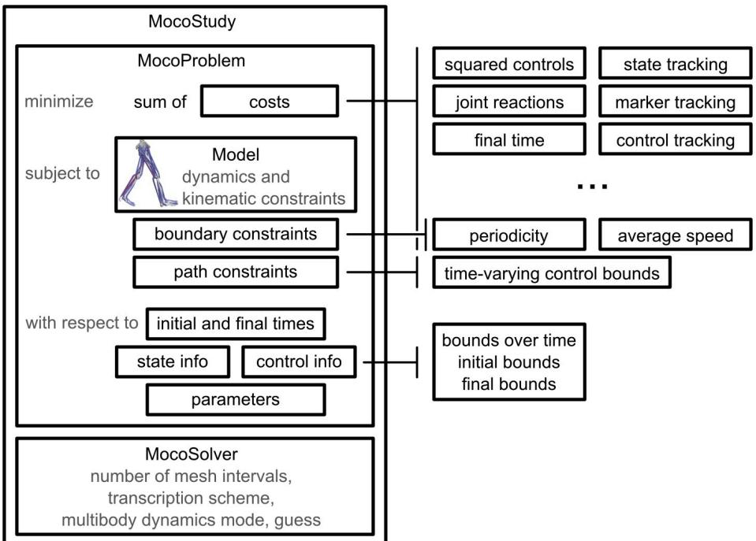  
Fig 2. Overview of MocoStudy. Researchers can use Moco to solve custom optimal control problems via a library of cost, boundary constraint, and path constraint modules. Moco contains additional cost modules beyond what is shown here, and users can define their own custom modules.  
https://doi.org/10.1371/journal.pcbi.1008493.g002

• cost terms: Users can minimize a weighted sum of squared controls, deviation from an observed motion, joint reaction loads, the duration of a motion, and other costs by appending to the MocoProblem an instance of the class associated with a cost module (e.g., Moco-ControlGoal allows minimizing the sum of squared controls).

• multibody dynamics, muscle dynamics, and kinematic constraints: OpenSim Models are a popular format for modeling musculoskeletal systems. Moco uses OpenSim Models to obtain the underlying differential-algebraic system of equations, including multibody dynamics, auxiliary dynamics (e.g., muscle activation dynamics and tendon compliance), and kinematic constraints; these equations are provided by the industrial-grade Simbody multibody dynamics library [55]. Moco supports any kinematic constraints present in the system using a method by Posa and colleagues [56]. Kinematic constraints are useful for modeling anatomy that either is not easily described using standard joints or would otherwise require calibrated models of ligaments and cartilage to produce the salient features of the desired motion. Examples of models with complex anatomy achieved by kinematic constraints include models of the knee, shoulder, and neck [57–60]. Kinematic constraints are also necessary when modeling closed kinematic loops. For example, cycling models can create closed kinematic loops if both feet are fixed to the same bicycle crank [44].

• boundary constraints: Users can enforce average speed, symmetry, or periodicity with constraints relating initial and final states.

• path constraints: Users can constrain any function of time to lie in a specified range over the motion. For example, researchers often estimate muscle activity with electromyography and Moco allows constraining simulated muscle excitations to be close to those measurements via the MocoControlBoundConstraint class.

• parameter optimization: Users can optimize model properties, such as the mass of a body, the optimal fiber length of a muscle, or the stiffness of an exoskeleton.

• bounds on variables: Users can bound the values of states, controls, and initial and final time.

For a detailed mathematical description of the problems supported by Moco, including how Moco handles kinematic constraints, consult S1 Appendix.

Users can combine the modules of a MocoProblem in diverse ways. The following examples illustrate the breadth of problems that users can solve.

• dynamically-constrained inverse kinematics: Minimize the error between experimental and model marker positions (marker tracking) and squared controls while obeying multibody dynamics.

• electromyography-constrained muscle force estimation: For a prescribed experimental motion, minimize squared muscle excitations while obeying multibody dynamics and con straining the difference between muscle excitations and electromyography data.

• torso mass calibration: For a prescribed experimental motion, adjust the mass of the torso to minimize residual forces at the pelvis while obeying multibody dynamics.

• prediction of kinematic and muscular coordination adaptations to walking in an exoskeleton: Minimize squared muscle excitations while obeying multibody and muscle dynamics and a constraint on average speed of the mass center.

We demonstrate the Moco interface in Fig 3 with a simple MATLAB example. Setting the model and adding a cost (termed “goal” in the code) each require only a single statement.

Direct collocation relies on gradient-based optimization, which converges faster and more reliably when all functions in the problem are continuous and differentiable. Moco includes a previously published continuous and differentiable muscle model named DeGrooteFregly2016- Muscle [26]. We extended this muscle model to include damping, which further improves convergence but can introduce small compressive forces when the muscle fiber shortens at low activation. To represent compliant contact forces in a continuous and smooth manner, Moco includes a previously published contact model named SmoothSphereHalfSpaceForce [61].

Users wishing to employ a cost term, boundary constraint, or path constraint that Moco does not provide can create a C++ plugin using the same steps as for OpenSim plugins. By providing a library of cost, boundary constraint, and path constraint modules, allowing these modules to be combined, and enabling users to create their own modules, we achieve our design goals of ease-of-use, customizability, and extensibility.

## Solving problems with MocoSolver

All details of solving an optimal control problem are encapsulated in MocoSolver, which is decoupled from MocoProblem for flexibility. For example, users can add bodies or muscles to their model without modifying the solver. MocoSolver uses the CasADi library [62] to transcribe the continuous optimal control problem defined by MocoProblem into a finite-dimensional nonlinear program, which we solve with well-established gradient-based nonlinear program solvers such as IPOPT [63] and SNOPT [64] (see S1 Appendix). CasADi can provide the derivatives of the objective and constraint functions using either finite differences or algorithmic differentiation; Moco uses only finite differences to avoid the complexity of adapting the OpenSim codebase to support algorithmic differentiation.

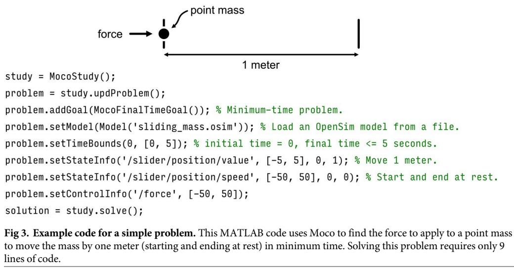

```matlab
study = MocoStudy();
problem = study.updProblem();
problem.addGoal(MocoFinalTimeGoal()); % Minimum-time problem.
problem.setModel(Model('sliding_mass.osim')); % Load an OpenSim model from a file.
problem.setTimeBounds(0, [0, 5]); % initial time = 0, final time <= 5 seconds.
problem.setStateInfo('/slider/position/value', [-5, 5], 0, 1); % Move 1 meter.
problem.setStateInfo('/slider/position/speed', [-50, 50], 0, 0); % Start and end at rest.
problem.setControlInfo('/force', [-50, 50]);
solution = study.solve();
```

Moco provides two transcription schemes: the second-order trapezoidal scheme and the third-order Hermite–Simpson scheme [20]. Multibody dynamics can be expressed with either explicit differential equations (“forward dynamics”) or implicit differential equations (“inverse dynamics”); problems may converge faster with implicit differential equations [26, 47]. Moco-Solver also provides settings for the constraint tolerance, convergence tolerance, and the number of mesh intervals used to solve the MocoProblem.

Solving a MocoStudy yields a MocoSolution (Fig 4), which is a subclass of MocoTrajectory and provides easy access to the values of all variables at any iteration in the optimization. Users provide initial guesses via MocoTrajectory, and can use the solution from one problem as the initial guess for a subsequent problem; this allows users to build a complex study with a series of simpler studies. For example, predicting the change in walking kinematics caused by an ankle exoskeleton could benefit from an initial guess generated from a tracking simulation of normal walking. MocoSolution provides additional information, including whether or not the solver converged, the final objective value, and the number of solver iterations.

After solving a problem, researchers can use Moco to visualize the solution as an animation, plot the state and control trajectories (with utilities provided in MATLAB and Python), or compute quantities from the solution. The ability to save MocoTrajectories and MocoStudies to files allows users to reproduce each other’s results, which is essential for sound science [65].

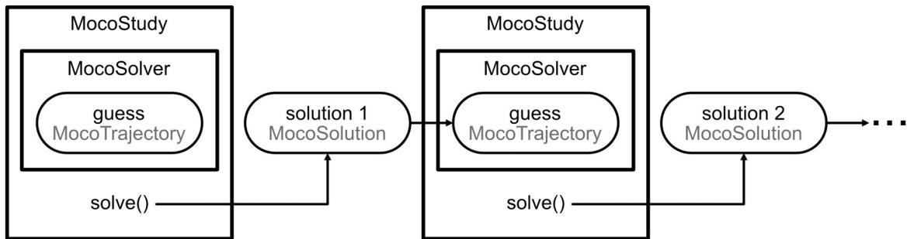  
Fig 4. Using trajectories to solve problems iteratively. Guesses for the optimization are specified using MocoTrajectory, which holds the values of states, controls, and parameters at any iteration in the optimization. MocoSolution is a subclass of MocoTrajectory that holds the solution to a study and includes the success status of the optimization, the final objective value, and the number of solver iterations. Users can use the solution of one problem as the initial guess for a subsequent problem

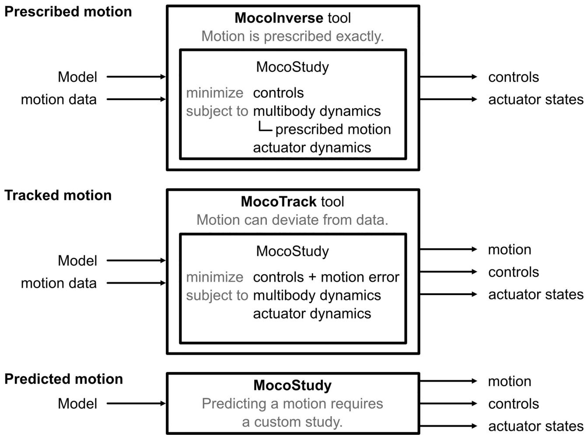  
Fig 5. Solving prescribed motion, tracked motion, and predicted motion problems. Moco provides the tools MocoTrack and MocoInverse for solving standard problems. Both require a Model and kinematic data as inputs and produce controls and actuator states as outputs, but these tools solve different optimal control problems. MocoTrack produces a new simulated motion, while MocoInverse does not permit deviations from the provided kinematic data. Predicting a motion is not easily standardized and requires a custom MocoStudy.  
https://doi.org/10.1371/journal.pcbi.1008493.g005

## Tools for standard problems

Currently, Moco provides two tools for solving standard problems (Fig 5):

• MocoInverse solves the muscle/actuator redundancy problem, wherein we solve for muscle (or other actuator) controls that achieve a motion that is prescribed exactly (see S1 Appendix) while minimizing squared controls or other costs.

• MocoTrack solves motion tracking problems, wherein we solve for both a motion and muscle (or other actuator) controls that minimize the error compared to an observed motion in addition to squared controls or other costs.

MocoTrack is useful for predicting deviations from motion data (e.g., predicting kinematic adaptations to an exoskeleton), while MocoInverse is a faster option when the motion should be enforced exactly (e.g., estimating elastic energy storage for an observed motion). MocoTrack can use contact models, while MocoInverse can apply measured external forces to the model. For both tools, the only required inputs are an OpenSim model and motion data (coordinate or marker trajectories, and external forces if relevant). Internally, the tools build a MocoStudy with solver settings that yield fast and reliable convergence on problems we tested.

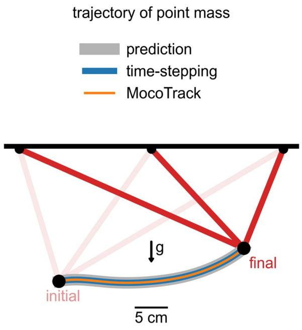

Future versions of Moco may include tools for model calibration, electromyography-driven simulation, and other standard problems. For problems that do not fit into a standard form, such as predicting a motion, MocoStudy provides the necessary flexibility.

## Verification

Verifying software is essential [66]; thus, we conducted extensive verification tests. For example, to verify that Moco implements direct collocation correctly we solved the “linear tangent steering” optimal control problem [67], which has a known solution. The solution matched the known solution with a root-mean-square error of $2 . 7 \times 1 0 ^ { - 5 }$

We also ensured that a time-stepping forward simulation using controls from a motion prediction produced the same motion as in the prediction. This test used a model consisting of a point mass suspended by three muscles (DeGrooteFregly2016Muscle) and under the influence of gravity (Fig 6). For this problem, the muscles had activation dynamics and rigid tendons. We first predicted the state and control trajectories to move the point mass between prescribed initial and final positions, starting and ending at rest (Fig 6, gray band). In this prediction, the cost included both the sum of squared muscle excitations and the final time. Then, we used the predicted controls to perform a time-stepping forward simulation using an OpenSim integrator (Fig 6, blue line). The resulting position trajectory of the point mass matched that from the prediction with a root-mean-square error of 0.0051 m (1.8% of the distance between the initial and final positions). This gives us confidence that Moco enforces the same multibody and muscle dynamics enforced in a time-stepping forward simulation in OpenSim. For more

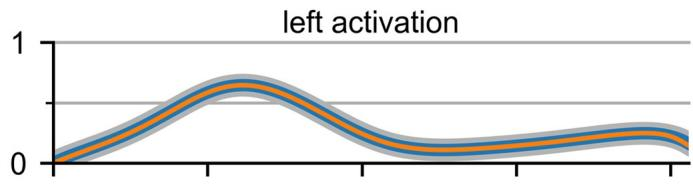

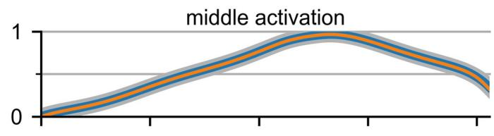

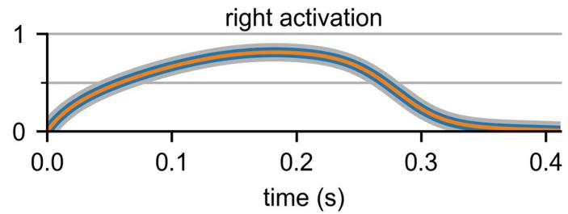  
Fig 6. Verification of time-stepping and motion tracking. Left: The trajectory of a point mass suspended by three muscles and moving under the influence of gravity (g) was simulated using Moco. Right: The activations of the “left,” “middle,” and “right” muscles are shown for different simulations. The original trajectory (gray band) was predicted by minimizing final time and the sum of squared muscle excitations. The time-stepping forward simulation driven with the predicted controls (blue) produced the motion we originally predicted. Tracking the predicted motion with MocoTrack (orange) produced the original activations.

https://doi.org/10.1371/journal.pcbi.1008493.g006

complex problems, conducting a time-stepping forward simulation using controls from a MocoSolution requires a stabilizing feedback controller to counteract numerical errors.

To gain confidence in motion tracking problems, we ensured that using MocoTrack on a synthesized motion with known muscle activity produced the original muscle activity. We used the same suspended point mass model and tracked the previous motion prediction (Fig 6, gray band) while minimizing squared excitations. The muscle activations from MocoTrack (Fig 6, orange line) matched those from the prediction with a root-mean-square error that was 0.47% of the peak predicted activation. For most tracking problems of interest, we do not know the true muscle activity solution; verifying tracking problems using synthesized data gives us confidence in the ability of Moco to estimate muscle activity.

Moco contains an automated test suite, with over 80 test cases, that extends beyond the verification described here. The test suite contains four major types of tests: analytical tests, interface tests, algorithmic tests, and regression tests. All tests are located within the source code; we employ continuous integration to ensure all tests succeed before accepting changes to the code on GitHub. A detailed description of our automated test suite is in S1 Appendix.

Our automated test suite can give users confidence that Moco implements direct collocation correctly, but users must ensure that they use appropriate mesh density (number of mesh intervals per unit time) and constraint tolerance settings for their problems [66]. While a problem with a coarse mesh may meet the user’s specified constraint tolerance, errors in the dynamics may be too large for the simulation to be useful ([20], section 4.7). Users can perform convergence analyses to ensure that solutions are not overly sensitive to the chosen mesh density or constraint tolerance.

## Results

Here we present three results obtained using Moco that represent biomechanics applications spanning the prescribed-to-predicted spectrum. In the first result, we used the MocoInverse tool to solve for muscle activity while prescribing exactly the model generalized coordinate values. We compared muscle activity results using cost functions with and without a knee contact loading term. In the second result, we used MocoTrack to simulate normal walking and walking with weakened hip abductor and ankle dorsiflexor muscles. When simulating weakness, we weakened muscles (while retaining the original cost function weights) until the model was no longer able to track the normal kinematic reference data and compared the resulting motion to known gait pathologies. In the third result, we predicted a squat-to-stand motion using a custom MocoStudy. We then solved the problem again while optimizing the stiffness of an assistive device at the knee to evaluate the effect of assistance on muscle activity. These three results illustrate the most common user interfaces provided by Moco and demonstrate that Moco can efficiently and accurately solve problems relevant to biomechanics researchers.

## Prescribing a walking motion to estimate muscle activity

Moco can estimate muscle activity in walking, which allows studying muscle coordination in normal and pathological gait. We used a model with 29 degrees of freedom and 80 lower-limb muscles, generalized coordinate trajectories (obtained from an inverse kinematics solution and adjusted using the OpenSim Residual Reduction Algorithm), and ground reaction forces to simulate one gait cycle of walking at a self-selected speed of 1.24 m/s. The model and data are based on [59], where they are described in greater detail. We modeled activation dynamics in all muscles but only modeled tendon compliance in the gastrocnemii and soleus, where a rigid-tendon assumption is less appropriate [26]. We solved for muscle behavior using MocoInverse, which prescribes kinematics exactly (see “Tools for standard problems” for

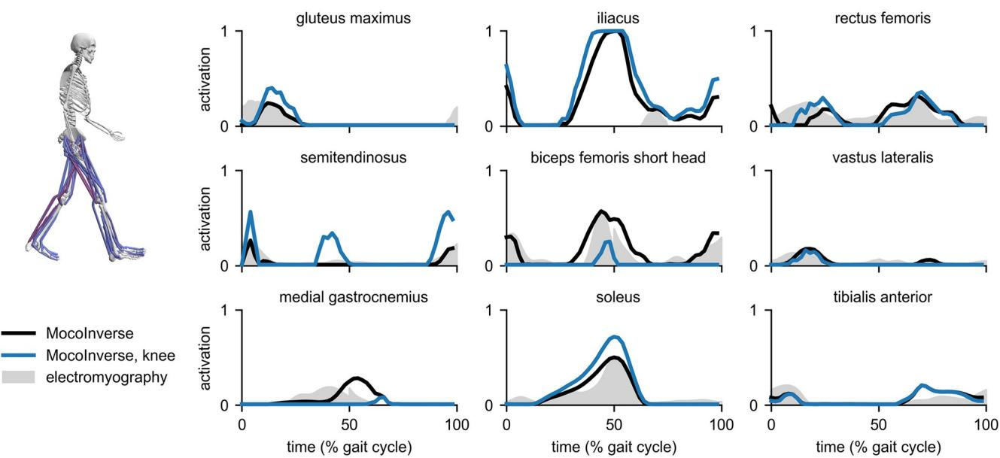  
Fig 7. Estimates of muscle activity during walking. MocoInverse produced muscle activations (black) whose timing was similar to the timing from electromyography measurements (gray) for all muscles shown except iliacus. Electromyography for gluteus maximus and iliacus comes from Perry and Burnfield [68]; electromyography for all other muscles comes from Rajagopal et al. [59] and was normalized such that its peak matched the peak of the MocoInverse activations. Adding a cost term for knee joint loading reduced the activity of the biceps femoris short head and medial gastrocnemius, which span the knee (blue), and increased the activity of other muscles to ensure the original prescribed motion was achieved.  
https://doi.org/10.1371/journal.pcbi.1008493.g007

details). The initial guess for all variables was the midpoint of the bounds on the variables. We compared the muscle activations produced by MocoInverse to electromyography measurements (Fig 7; black lines and gray shading).

MocoInverse produced activations that included some of the major features of the electromyography data, such as the timing of peak activity for the semitendinosus, biceps femoris short head, vastus lateralis, medial gastrocnemius, and soleus. Activity for the iliacus was much higher than measured in a separate data set [68]; this is likely because the passive hip flexion moment generated by the model during late stance [59] is much lower than expected based on passive moments measured by load cells [69]. With MocoInverse, the difference between required net joint moments and muscle-generated net joint moments (termed “reserve” moments) were restricted to be no greater than 2.5 N-m across time and degrees of freedom, which is in accordance with established guidelines (reserve moments are below 5% of peak net joint moments [66]). MocoInverse solved this problem in 3.5 minutes using a 3.6 GHz Intel Core i7 processor with 8 parallel threads. We compared the solution from MocoInverse to those from the OpenSim Static Optimization and Computed Muscle Control [6] tools (S1 Fig). Muscle activity was similar between all three tools for all muscles shown except the medial gastrocnemius, soleus, and tibialis anterior; differences for these muscles were caused by differences in the algorithms, such as how tendon compliance was handled.

To demonstrate that Moco problems are customizable, we added a cost term to MocoInverse to minimize knee joint loading (weight for squared controls term: 1.0; weight for joint loading term: 0.005). With this additional cost, the average magnitude of the knee joint reaction force decreased from 1.7 to 1.1 body weights. The peak knee joint reaction force was 5.0 body weights with and without the additional cost; obtaining a peak value closer to those measured with in-vivo knee joint implants (1.8–3.0 body weights [70]) may be possible by minimizing the deviation of muscle activity from electromyography data [71]. As expected, the activity of muscles crossing the knee joint (vastus lateralis, biceps femoris short head, and

medial gastrocnemius) decreased (Fig 7; blue lines). To compensate for the reduced medial gastrocnemius moment at the ankle, soleus activity increased, as seen in a previous simulation study [72]. Moco solved this problem in 15 minutes.

## Tracking a walking motion with normal and weakened muscles

In addition to producing initial guesses for predictive optimizations, tracking problems (in which a motion is tracked as part of the cost function rather than exactly prescribed) can be useful for studying how changes to a model affect its ability to reproduce a reference motion. Moco contains the MocoTrack tool for constructing and solving tracking simulations. We explored the effect of weakening different muscle groups in a lower extremity walking model on the ability to track normal walking data. As inputs to MocoTrack, we used the same model and kinematic data as for the MocoInverse problem above. Instead of prescribing ground reaction forces, we added compliant foot–ground contact force elements on both feet [43]. We removed the torque actuators serving as “reserve” moments, which were only necessary for MocoInverse, so that the lower limbs were entirely muscle-driven. Unlike MocoInverse, Moco-Track does not prescribe model generalized coordinate values; therefore, we enforced the kinematic constraints in the model that dictate patellar motion based on the knee angle [73]. These kinematic constraints enabled realistic muscle moment arms about the knee without the need to model knee ligaments and cartilage. The cost included terms for motion tracking (weight: 0.11) and squared controls (weight: 0.16). We included a boundary constraint that ensured the model walked with the same average speed as in the reference data, and a path constraint that prevented the feet from interpenetrating. We assumed mediolateral symmetry and simulated half of a gait cycle. The initial guess for the kinematic variables was taken from the tracking data, and the initial guess for muscle-related variables was the midpoint of the bounds on the variables.

We first solved the tracking problem using normal muscle strengths (maximum isometric forces). MocoTrack produced a motion that tracked experimental kinematics (Fig 8, top) and ground reaction forces whose timing matched that of the sagittal plane experimental ground reaction forces (Fig 8, left). Muscle activations for many major lower extremity muscles were qualitatively similar to electromyography data including gluteus maximus, biceps femoris short head, vastus lateralis, medial gastrocnemius, soleus, and tibialis anterior (Fig 8, activations). Using the same computer as for the MocoInverse problems, MocoTrack solved this problem in 130 minutes; this duration is shorter than that commonly seen in single shooting predictions [12], but is longer than what can be achieved when combining algorithmic differentiation with direct collocation [43].

We next weakened the ankle dorsiflexor muscles (tibialis anterior, extensor digitorum longus, and extensor hallucis longus) by reducing max isometric forces by 95% and solved the tracking problem again (using the “normal” solution for the initial guess). MocoTrack produced a “drop foot” [68] walking solution, where the model was unable to dorsiflex the ankle in early stance and in swing (Fig 9, left). We solved the problem again after restoring the dorsiflexor muscle strengths and weakening the hip abductor muscles (gluteus medius, gluteus minimus, and tensor fascia lata) by 90% (using the “normal” solution for the initial guess). For both weakened conditions, we used the original cost terms that penalized squared controls and tracking error. While such tracking problems are rarely used to predict gait adaptations, they provide a compromise between accuracy and the careful research required to “design” cost terms that reproduce walking without tracking data. Since major hip abductor forces were nearly reduced to zero (e.g., gluteus medius), the model was unable to produce the hip adduction angle observed in the experimental data and normal tracking solution. The adapted gait

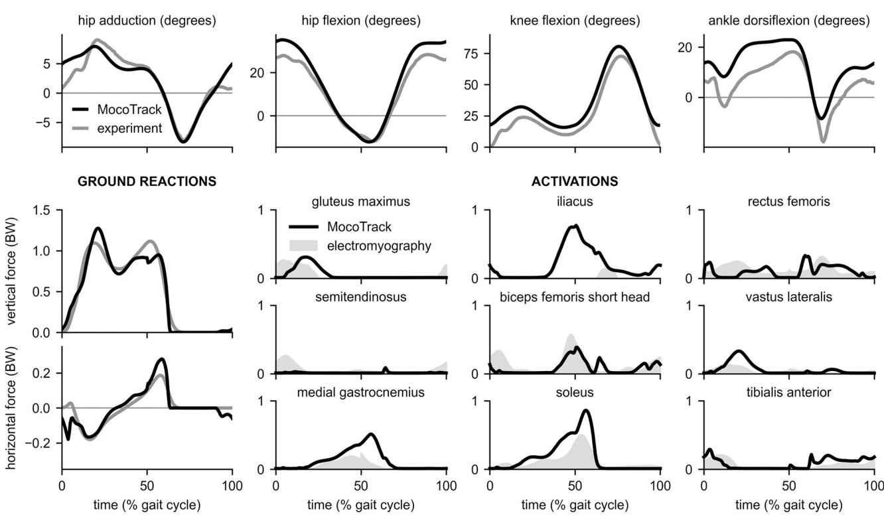  
Fig 8. Tracking 3-D experimental motion data. Top: MocoTrack produced kinematics (black) that tracked experimental data (gray). Left: MocoTrack produced sagittal plane ground reaction forces (black) whose timing matched that of experimentally-measured ground reaction forces (gray). However, the magnitude in the first peak of the vertical ground reaction force was overestimated. Right: Similar to MocoInverse, MocoTrack produced muscle activations (black) that matched the timing of electromyography measurements (gray). Electromyography for gluteus maximus and iliacus comes from Perry and Burnfield [68]; electromyography for all other muscles come from Rajagopal et al. [59] and signals were again normalized such that their peak matched the peak of the MocoInverse activations to be consistent with Fig 7.

https://doi.org/10.1371/journal.pcbi.1008493.g008

included a large increase in truck sway (Fig 9, right), which is characteristic of Trendelenburg gait [43, 68]. MocoTrack solved the weakened dorsiflexor and hip abductor problems in 101 and 148 minutes, respectively.

## Predicting and assisting a squat-to-stand motion

To show that Moco can predict motions and optimize parameters of a model, we predicted a squat-to-stand motion that minimized a combination of muscle effort, expressed as the sum of squared excitations (weight: 1.0), and the duration of the motion (weight: 1.0). The initial pose was prescribed to be squatting [74], and the final pose was prescribed to be upright standing. No motion was tracked. The model contained a torso and a single leg actuated by 9 muscles with activation dynamics; 6 of these muscles had compliant tendon dynamics (hamstrings, rectus femoris, vasti, gastrocnemius, soleus, and tibialis anterior). Muscle strengths were taken from a previous study [12] and doubled to model both legs as one. We modeled foot–ground contact by fixing the foot of the model to the ground with a weld joint. The model contained the same kinematic constraints dictating patellar motion as described in the previous result. The initial guess for the kinematic variables was the midpoint of the bounds on the variables; the initial guess for muscle excitations and activations was 0.05. The predicted motion and muscle activations are shown in Fig 10 (black lines). As expected [75], extensor muscles such as the gluteus maximus, hamstrings, and vasti exhibited substantial activity.

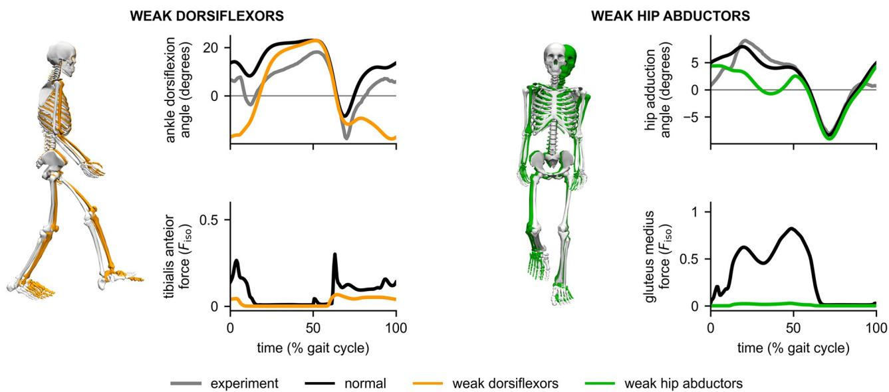  
Fig 9. Effect of weakened dorsiflexors and hip abductors on motion tracking. Left: Weakening the ankle dorsiflexors caused ankle plantarflexion to increase during early stance and swing (orange) compared to the experimental ankle angle (gray) and the normal tracking solution (black curves, white skeleton). The tibialis anterior force is normalized by the normal max isometric force of the muscle, $F _ { \mathrm { i s o } } .$ . Right: Weakening the hip abductors resulted in a reduced hip adduction angle (green) during stance compared to the experimental hip adduction angle (gray) and the normal tracking solution (black). As shown in the skeleton graphic, increased trunk sway was observed (green) compared to the normal tracking solution (white). The force in the gluteus medius, a primary hip abductor, was nearly reduced to zero across the gait cycle.  
https://doi.org/10.1371/journal.pcbi.1008493.g009

Next, we added a torsional spring to the knee and solved for the optimal motion, muscle activations, and spring stiffness. The spring was in equilibrium when the knee was extended, as illustrated in Fig 10. We used the same cost as in the unassisted case; no motion was tracked. With the assistive device, the motion was achieved with lower muscle activity. The optimal spring stiffness was 90 N-m/rad.

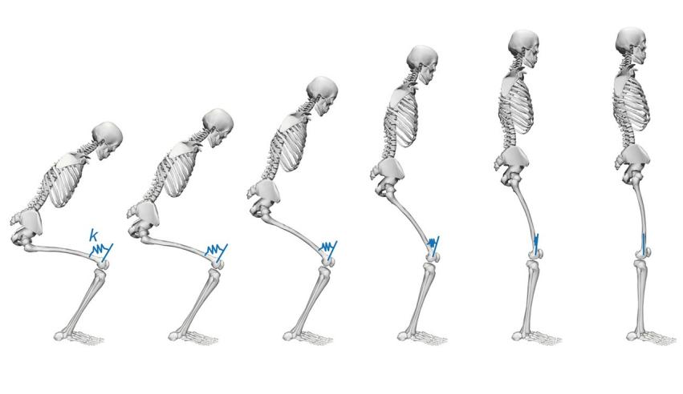

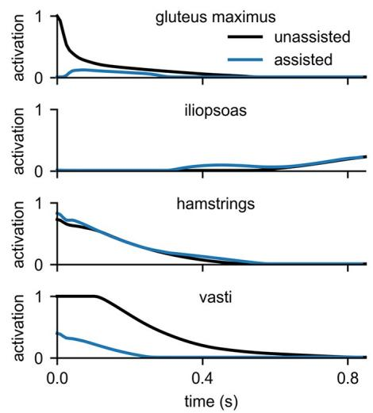  
Fig 10. Predicting and assisting a squat-to-stand motion. Left: We predicted a squat-to-stand motion with prescribed initial and final poses that minimized the sum of squared muscle excitations and final time, then added a torsional spring to the knee and solved for the optimal spring stiffness k. Right: The activations of key muscles throughout the motion without (black) and with (blue) the assistive spring show that the spring allowed gluteus maximus and vasti activity to decrease substantially.

https://doi.org/10.1371/journal.pcbi.1008493.g010

Table 1. Durations and settings for optimization problems.

<table><tr><td>problem</td><td>duration(minutes)</td><td># meshintervals</td><td># DOFs</td><td># muscles</td><td>convergencetolerance</td><td>constrainttolerance</td></tr><tr><td>MocoInverse, gait, normal (Fig 7, black)</td><td>3.5</td><td>25</td><td>29</td><td>80</td><td> $10^{-2}$ </td><td> $10^{-3}$ </td></tr><tr><td>MocoInverse, gait, minimizing knee load (Fig 7, blue)</td><td>15</td><td>25</td><td>29</td><td>80</td><td> $10^{-2}$ </td><td> $10^{-3}$ </td></tr><tr><td>MocoTrack, gait, normal (Fig 8)</td><td>130</td><td>40</td><td>29</td><td>80</td><td> $10^{-3}$ </td><td> $10^{-3}$ </td></tr><tr><td>MocoTrack, gait, weak dorsiflexors (Fig 9, orange)</td><td>101</td><td>40</td><td>29</td><td>80</td><td> $10^{-3}$ </td><td> $10^{-3}$ </td></tr><tr><td>MocoTrack, gait, weak hip abductors (Fig 9, green)</td><td>148</td><td>40</td><td>29</td><td>80</td><td> $10^{-3}$ </td><td> $10^{-3}$ </td></tr><tr><td>Predictive MocoStudy, squat-to-stand, unassisted (Fig 10, black)</td><td>3</td><td>50</td><td>4</td><td>9</td><td> $10^{-3}$ </td><td> $10^{-3}$ </td></tr><tr><td>Predictive MocoStudy, squat-to-stand, assisted (Fig 10, blue)</td><td>3</td><td>50</td><td>4</td><td>9</td><td> $10^{-3}$ </td><td> $10^{-3}$ </td></tr></table>

Durations were obtained with a 3.6 GHz Intel Core i7 processor with 8 parallel threads. All problems were solved with the Hermite–Simpson transcription scheme; each mesh interval in this scheme contains two points on the interval boundary and a collocation point at the interval midpoint (i.e., a problem with N mesh intervals has 2N + 1 time points). DOFs: degrees of freedom; convergence tolerance: the tolerance on the KKT conditions [20]; constraint tolerance: the largest permissible value of any single constraint violation [63].  
https://doi.org/10.1371/journal.pcbi.1008493.t001

Both predictions converged in 3 minutes. The ability to rapidly predict motions and optimize device parameters makes Moco a valuable tool for designing assistive devices.

The duration of the various optimizations presented in this section are summarized in Table 1.

## Summary of verification and validation

For each of our results, we validated our simulated quantities against experimental electromyography, kinematics, and ground reaction forces as appropriate. To ensure our solutions were not sensitive to our choice of mesh, we performed a sensitivity analysis (S2 Fig). Our verification and validation shows that Moco is capable of producing meaningful results but does not guarantee that users will obtain meaningful results for their own applications. Researchers must validate the results they obtain with their own models, cost terms, constraints, and data by comparing their results to appropriate experimental data; we encourage researchers to follow previously published guidelines [66] for validation.

## Availability and future directions

OpenSim Moco is free to download for Windows and Mac on the Moco website (https:// opensim.stanford.edu/moco) and SimTK (https://simtk.org/projects/opensim-moco). The source code is available on GitHub (https://github.com/opensim-org/opensim-core). The Moco source code is licensed under the permissive Apache License 2.0, though some dependencies have more restrictive licenses (e.g., CasADi [62] is available under the GNU Lesser General Public License).

The documentation for Moco contains four main sections. The User Guide explains how to use Moco and provides tips for posing a problem. The Theory Guide explains how Moco implements direct collocation. The Application Programming Interface (API) Reference describes the classes and functions in the library. The Developer Guide explains our software design. We provide a two-page “cheat sheet” that demonstrates common commands. To use Moco effectively, users must be familiar with various topics not covered in the documentation, including optimal control theory and direct collocation [20], numerical methods (e.g., finite

differences) and optimization and associated pitfalls (e.g., local minima), multibody dynamics, Hill-type muscle models [26], and musculoskeletal modeling in OpenSim [54].

Moco contains examples in MATLAB, Python, and C++ that range from predicting the optimal trajectory for a double pendulum to predicting 2-D muscle-driven walking (which solves in 30 minutes). The code that generated the results for this paper is available at https:// github.com/stanfordnmbl/mocopaper.

Moco and the direct collocation method have a number of limitations that should be considered when planning a simulation study. Moco currently lacks the ability to handle certain optimal control problems, such as those with multiple phases [45] or unilateral kinematic constraints [76]. Bringing custom model components (e.g., a fatigable muscle) into Moco requires knowledge of C++ and the OpenSim software architecture; future versions of the software should allow users to implement custom model components in MATLAB or Python. The performance and ease of use of the direct collocation solvers in Moco could be improved. Computing the nonlinear program derivatives with algorithmic differentiation instead of finite differences would vastly improve the speed of Moco [50]. Supporting mesh refinement would allow the solver to increase the number of mesh intervals in time ranges with fast dynamics, thereby improving accuracy ([20], section 4.7). Moco attempts to produce well-scaled optimization problems to facilitate rapid convergence (e.g., using normalized tendon force as a state variable), but providing automated problem scaling ([20], section 4.8) could further improve convergence. Lastly, the direct collocation method itself is not well-suited to simulations that are interactive (e.g., users perturbing the model) or include randomness (e.g., uneven terrain); such problems are better suited to single shooting [12] or reinforcement learning approaches [77].

Going forward, we will focus on applying Moco to high-impact topics in biomechanics, including orthopedic surgeries and rehabilitation strategies such as muscle strength training. Predictions of movement typically employ generic models because large-scale subject-specific simulations are difficult to build. Moco permits researchers to easily build and share subjectspecific studies that could discern which individuals may benefit from an intervention. Using Moco with data from inertial measurement units [78] or videos processed with computer vision [79] will allow researchers to study muscle behavior for movements based on observations outside of the laboratory.

The Moco project benefits from an active community of researchers employing musculoskeletal simulation. We have engaged this community by hosting workshops on Moco at international conferences, at Stanford University, and online. We will continue to engage this community through additional workshops and by helping others to contribute documentation, examples, teaching materials, and code.

We designed Moco to be easy to use, customizable, and extensible. We verified the software and applied it to multiple musculoskeletal problems. Moco handles models with kinematic constraints, muscle activation dynamics, compliant tendons, and compliant contact, and can minimize a combination of complex costs such as marker tracking and joint reaction loads. Given this foundation, we expect Moco to accelerate research by reducing the time spent wrestling with simulation tools and enabling our field to tackle more ambitious problems.

## Supporting information

S1 Appendix. Mathematical details. This appendix describes in detail how Moco solves optimal control problems with direct collocation.

(PDF)

S1 Fig. Comparing MocoInverse to static optimization and computed muscle control. The OpenSim Static Optimization and Computed Muscle Control tools produced muscle activations with similar timing as those produced by MocoInverse for the walking motion presented in Fig 7. Across all tools, magnitudes were similar for all muscles shown except medial gastrocnemius, soleus, and tibialis anterior. Differences in magnitudes were caused by differences in the algorithms, such as how tendon compliance was handled.

(TIF)

S2 Fig. Convergence analysis. To ensure our results were not sensitive to the chosen number of mesh intervals (which is related to mesh density), we performed a convergence analysis: we ensured that the objective function value converged on a single value as the number of mesh intervals increased. We performed the convergence analysis for three problems from the results: “MocoInverse, gait, normal” (Fig 7, black), “MocoTrack, gait, normal” (Fig 8), and “Predictive MocoStudy, squat-to-stand, unassisted” (Fig 10, black). For each graph, the objective is normalized by the value of the objective from using the greatest number of mesh intervals.

(TIF)

## Acknowledgments

We thank Ajay Seth, Michael Sherman, Friedl de Groote, Antonie J. van den Bogert, Michael Posa, Joris Gillis, and Joel Andersson for discussing methodology and implementation; Bradley Humphreys, Carmichael Ong, Noah Gordon, and Jennifer Yong for contributing code; Andrew Baines, Mohammad Shourijeh, and Prasanna Sritharan for testing the software; and Ayman Habib for reviewing the manuscript.

## Author Contributions

Conceptualization: Christopher L. Dembia, Nicholas A. Bianco.

Funding acquisition: Jennifer L. Hicks, Scott L. Delp.

Methodology: Christopher L. Dembia, Nicholas A. Bianco, Antoine Falisse.

Project administration: Jennifer L. Hicks, Scott L. Delp.

Resources: Scott L. Delp.

Software: Christopher L. Dembia, Nicholas A. Bianco, Antoine Falisse.

Supervision: Jennifer L. Hicks, Scott L. Delp.

Validation: Christopher L. Dembia, Nicholas A. Bianco.

Visualization: Christopher L. Dembia, Nicholas A. Bianco.

Writing – original draft: Christopher L. Dembia, Nicholas A. Bianco.

Writing – review & editing: Christopher L. Dembia, Nicholas A. Bianco, Antoine Falisse, Jennifer L. Hicks, Scott L. Delp.

## References

1. Fregly BJ, Reinbolt JA, Rooney KL, Mitchell KH, Chmielewski TL. Design of patient-specific gait modifi cations for knee osteoarthritis rehabilitation. IEEE Transactions on Biomedical Engineering. 2007; 54:1687–1695. https://doi.org/10.1109/TBME.2007.891934 PMID: 17867361

2. Steele KM, Rozumalski A, Schwartz MH. Muscle synergies and complexity of neuromuscular control during gait in cerebral palsy. Developmental Medicine & Child Neurology. 2015; 57:1176–1182.

3. Priamikov A, Fronius M, Shi B, Triesch J. OpenEyeSim: A biomechanical model for simulation of closed-loop visual perception. Journal of Vision. 2016; 16:25–25. https://doi.org/10.1167/16.15.25 PMID: 28006074

4. Hutchinson JR, Anderson FC, Blemker SS, Delp SL. Analysis of hindlimb muscle moment arms in Tyrannosaurus rex using a three-dimensional musculoskeletal computer model: implications for stance, gait, and speed. Paleobiology. 2005; 31:676–701. https://doi.org/10.1666/04044.1

5. O’Neill MC, Umberger BR, Holowka NB, Larson SG, Reiser PJ. Chimpanzee super strength and human skeletal muscle evolution. Proceedings of the National Academy of Sciences. 2017; 114:7343– 7348. https://doi.org/10.1073/pnas.1619071114 PMID: 28652350

6. Thelen DG, Anderson FC, Delp SL. Generating dynamic simulations of movement using computed muscle control. Journal of Biomechanics. 2003; 36:321–328. https://doi.org/10.1016/S0021-9290(02) 00432-3 PMID: 12594980

7. Lloyd DG, Besier TF. An EMG-driven musculoskeletal model to estimate muscle forces and knee joint moments in vivo. Journal of Biomechanics. 2003; 36:765–776. https://doi.org/10.1016/S0021-9290(03) 00010-1 PMID: 12742444

8. Farris DJ, Hicks JL, Delp SL, Sawicki GS. Musculoskeletal modelling deconstructs the paradoxical effects of elastic ankle exoskeletons on plantar-flexor mechanics and energetics during hopping. Jour nal of Experimental Biology. 2014; 217:4018–4028. https://doi.org/10.1242/jeb.107656 PMID: 25278469

9. Jackson RW, Dembia CL, Delp SL, Collins SH. Muscle-tendon mechanics explain unexpected effects of exoskeleton assistance on metabolic rate during walking. Journal of Experimental Biology. 2017; 220:jeb.150011. https://doi.org/10.1242/jeb.150011 PMID: 28341663

10. Prilutsky BI, Zatsiorsky VM. Optimization-Based Models of Muscle Coordination. Exercise and Sport Sciences Reviews. 2002; 30(1):32–38. https://doi.org/10.1097/00003677-200201000-00007 PMID: 11800497

11. Geijtenbeek T. SCONE: Open Source Software for Predictive Simulation of Biological Motion. Journal of Open Source Software. 2019; 4:1421. https://doi.org/10.21105/joss.01421

12. Ong CF, Geijtenbeek T, Hicks JL, Delp SL. Predicting gait adaptations due to ankle plantarflexor muscle weakness and contracture using physics-based musculoskeletal simulations. PLoS Computational Biology. 2019; 15(10):e1006993. https://doi.org/10.1371/journal.pcbi.1006993 PMID: 31589597

13. Handford ML, Srinivasan M. Robotic lower limb prosthesis design through simultaneous computer optimizations of human and prosthesis costs. Scientific Reports. 2016; 6:19983. https://doi.org/10.1038/ srep19983 PMID: 26857747

14. Millard M, Sreenivasa M, Mombaur K. Predicting the Motions and Forces of Wearable Robotic Systems Using Optimal Control. Frontiers in Robotics and AI. 2017; 4:41. https://doi.org/10.3389/frobt.2017. 00041

15. Anderson FC, Pandy MG. Dynamic Optimization of Human Walking. Journal of Biomechanical Engineering. 2001; 123(5):381–390. https://doi.org/10.1115/1.1392310 PMID: 11601721

16. Lin YC, Pandy MG. Three-dimensional data-tracking dynamic optimization simulations of human locomotion generated by direct collocation. Journal of Biomechanics. 2017; 59:1–8. https://doi.org/10.1016/ j.jbiomech.2017.04.038 PMID: 28583674

17. Todorov E, Li W. Optimal control methods suitable for biomechanical systems. Proceedings of the 25th Annual International Conference of the IEEE Engineering in Medicine and Biology Society. 2003;2:1758–1761.

18. Bock HG, Plitt KJ. A Multiple Shooting Algorithm for Direct Solution of Optimal Control Problems\*. IFAC Proceedings Volumes. 1984; 17(2):1603—1608. https://doi.org/10.1016/S1474-6670(17)61205-9

19. Leineweber DB, Bauer I, Bock HG, Schlo¨der JP. An efficient multiple shooting based reduced SQP strategy for large-scale dynamic process optimization. Part 1: theoretical aspects. Computers & Chemical Engineering. 2003; 27(2):157—166. https://doi.org/10.1016/S0098-1354(02)00158-8

20. Betts JT. Practical Methods for Optimal Control and Estimation Using Nonlinear Programming. SIAM; 2010.

21. Kelly M. An Introduction to Trajectory Optimization: How to Do Your Own Direct Collocation. SIAM Review. 2017; 59:849–904. https://doi.org/10.1137/16M1062569

22. Hargraves CR, Paris SW. Direct trajectory optimization using nonlinear programming and collocation. Journal of Guidance, Control, and Dynamics. 1987; 10(4):338–342. https://doi.org/10.2514/3.20223

23. von Stryk O. In: Bulirsch R, Miele A, Stoer J, Well K, editors. Numerical Solution of Optimal Control Problems by Direct Collocation. Basel: Birkha¨user Basel; 1993. p. 129–143. Available from: https://doi. org/10.1007/978-3-0348-7539-4\_10.

24. Hairer E, Wanner G, Nørsett SP. Solving Ordinary Differential Equations I, Nonstiff Problems. Springer; 1993.

25. Hairer E, Wanner G. Solving Ordinary Differential Equations II, Stiff and Differential-Algebraic Problems. Springer; 1996.

26. De Groote F, Kinney AL, Rao AV, Fregly BJ. Evaluation of Direct Collocation Optimal Control Problem Formulations for Solving the Muscle Redundancy Problem. Annals of Biomedical Engineering. 2016; 44:2922–2936. https://doi.org/10.1007/s10439-016-1591-9 PMID: 27001399

27. Ueno R, Navacchia A, DiCesare CA, Ford KR, Myer GD, Ishida T, et al. Knee abduction moment is predicted by lower gluteus medius force and larger vertical and lateral ground reaction forces during drop vertical jump in female athletes. Journal of Biomechanics. 2020; 103:109669. https://doi.org/10.1016/j. jbiomech.2020.109669 PMID: 32019678

28. Kaplan ML, Heegaard JH. Predictive algorithms for neuromuscular control of human locomotion. Journal of Biomechanics. 2001; 34(8):1077–1083. https://doi.org/10.1016/S0021-9290(01)00057-4 PMID: 11448699

29. Mehrabi N, Schwartz MH, Steele KM. Can Altered Muscle Synergies Control Unimpaired Gait? Journa of Biomechanics. 2019; 90:84–91. https://doi.org/10.1016/j.jbiomech.2019.04.038 PMID: 31101431

30. Koelewijn AD, van den Bogert AJ. Joint contact forces can be reduced by improving joint moment symmetry in below-knee amputee gait simulations. Gait & Posture. 2016; 49:219–225. https://doi.org/10. 1016/j.gaitpost.2016.07.007 PMID: 27459416

31. Meyer AJ, Eskinazi I, Jackson JN, Rao AV, Patten C, Fregly BJ. Muscle Synergies Facilitate Computational Prediction of Subject-Specific Walking Motions. Frontiers in Bioengineering and Biotechnology. 2016; 4:77. https://doi.org/10.3389/fbioe.2016.00077 PMID: 27790612

32. Ackermann M, van den Bogert AJ. Optimality principles for model-based prediction of human gait. Journal of Biomechanics. 2010; 43:1055–1060. https://doi.org/10.1016/j.jbiomech.2009.12.012 PMID: 20074736

33. Ackermann M, van den Bogert AJ. Predictive simulation of gait at low gravity reveals skipping as the preferred locomotion strategy. Journal of Biomechanics. 2012; 45:1293–1298. https://doi.org/10.1016/j. jbiomech.2012.01.029 PMID: 22365845

34. Miller RH, Hamill J. Optimal footfall patterns for cost minimization in running. Journal of Biomechanics. 2015; 48:2858–2864. https://doi.org/10.1016/j.jbiomech.2015.04.019 PMID: 25952545

35. Porsa S, Lin YC, Pandy MG. Direct Methods for Predicting Movement Biomechanics Based Upon Optimal Control Theory with Implementation in OpenSim. Annals of Biomedical Engineering. 2016; 44:2542–2557. https://doi.org/10.1007/s10439-015-1538-6 PMID: 26715209

36. Lee LF, Umberger BR. Generating optimal control simulations of musculoskeletal movement using OpenSim and MATLAB. PeerJ. 2016; 4:e1638. https://doi.org/10.7717/peerj.1638 PMID: 26835184

37. Umberger BR, Miller RH. In: Optimal Control Modeling of Human Movement. Cham: Springer International Publishing; 2018. p. 327–348.

38. Bobbert MF, Kistemaker DA, Vaz MA, Ackermann M. Searching for strategies to reduce the mechanical demands of the sit-to-stand task with a muscle-actuated optimal control model. Clinical Biomechanics. 2016; 37:83–90. https://doi.org/10.1016/j.clinbiomech.2016.06.008 PMID: 27380203

39. Moore JK, van den Bogert AJ. opty: Software for trajectory optimization and parameter identification using direct collocation. The Journal of Open Source Software. 2018; 3:300. https://doi.org/10.21105/ joss.00300

40. Lin YC, Walter JP, Pandy MG. Predictive Simulations of Neuromuscular Coordination and Joint-Contact Loading in Human Gait. Annals of Biomedical Engineering. 2018; 46:1216–1227. https://doi.org/10. 1007/s10439-018-2045-3 PMID: 29671152

41. Lai AKM, Biewener AA, Wakeling JM. Metabolic cost underlies task-dependent variations in motor unit recruitment. Journal of the Royal Society Interface. 2018; 15:20180541. https://doi.org/10.1098/rsif. 2018.0541 PMID: 30464057

42. Nguyen VQ, Johnson RT, S FC IV, Umberger BR. Bilevel Optimization for Cost Function Determination in Dynamic Simulation of Human Gait. IEEE Transactions on Neural Systems and Rehabilitation Engineering. 2019; 27:1426–1435. https://doi.org/10.1109/TNSRE.2019.2922942 PMID: 31199264

43. Falisse A, Serrancolı´ G, Dembia CL, Gillis J, Jonkers I, De Groote F. Rapid predictive simulations with complex musculoskeletal models suggest that diverse healthy and pathological human gaits can emerge from similar control strategies. Journal of the Royal Society, Interface. 2019; 16:20190402. https://doi.org/10.1098/rsif.2019.0402 PMID: 31431186

44. Jansen C, McPhee J. Predictive dynamic simulation of Olympic track cycling standing start using direct collocation optimal control. Multibody System Dynamics. 2020; 49:53–70. https://doi.org/10.1007/ s11044-020-09723-3

45. Falisse A, Rossom SV, Jonkers I, De Groote F. EMG-Driven Optimal Estimation of Subject-Specific Hill Model Muscle–Tendon Parameters of the Knee Joint Actuators. IEEE Transactions on Biomedical Engineering. 2017; 64:2253–2262. https://doi.org/10.1109/TBME.2016.2630009 PMID: 27875132

46. Rohani F, Richter H, van den Bogert AJ. Optimal design and control of an electromechanical transfemoral prosthesis with energy regeneration. PLoS ONE. 2017; 12:e0188266. https://doi.org/10.1371/ journal.pone.0188266 PMID: 29149213

47. van den Bogert AJ, Blana D, Heinrich D. Implicit methods for efficient musculoskeletal simulation and optimal control. Procedia IUTAM. 2011; 2:297–316. https://doi.org/10.1016/j.piutam.2011.04.027 PMID: 22102983

48. Koelewijn AD, Dorschky E, van den Bogert AJ. A metabolic energy expenditure model with a continuous first derivative and its application to predictive simulations of gait. Computer Methods in Biomechanics and Biomedical Engineering. 2018; 21:1–11. https://doi.org/10.1080/10255842.2018.1490954

49. Koelewijn AD, Heinrich D, van den Bogert AJ. Metabolic cost calculations of gait using musculoskeletal energy models, a comparison study. PLoS ONE. 2019; 14(9):e0222037. https://doi.org/10.1371/ journal.pone.0222037 PMID: 31532796

50. Falisse A, Serrancolı´ G, Dembia CL, Gillis J, De Groote F. Algorithmic differentiation improves the computational efficiency of OpenSim-based trajectory optimization of human movement. PLoS ONE. 2019; 14:e0217730. https://doi.org/10.1371/journal.pone.0217730 PMID: 31622352

51. Becerra VM. Solving Complex Optimal Control Problems at No Cost with PSOPT. 2010 IEEE International Symposium on Computer-Aided Control System Design. 2010; p. 1391–1396.

52. Patterson MA, Rao AV. GPOPS-II: A MATLAB Software for Solving Multiple-Phase Optimal Control Problems Using hp-Adaptive Gaussian Quadrature Collocation Methods and Sparse Nonlinear Programming. ACM Transactions on Mathematical Software. 2014; 41. https://doi.org/10.1145/2558904

53. Delp SL, Anderson FC, Arnold AS, Loan P, Habib A, John CT, et al. OpenSim: Open-Source Software to Create and Analyze Dynamic Simulations of Movement. IEEE Transactions on Biomedical Engineering. 2007; 54:1940–1950. https://doi.org/10.1109/TBME.2007.901024 PMID: 18018689

54. Seth A, Hicks JL, Uchida TK, Habib A, Dembia CL, Dunne JJ, et al. OpenSim: Simulating musculoskeletal dynamics and neuromuscular control to study human and animal movement. PLoS Computationa Biology. 2018; 14:e1006223. https://doi.org/10.1371/journal.pcbi.1006223 PMID: 30048444

55. Sherman MA, Seth A, Delp SL. Simbody: multibody dynamics for biomedical research. Procedia IUTAM. 2011; 2:241–261. https://doi.org/10.1016/j.piutam.2011.04.023 PMID: 25866705

56. Posa M, Tedrake R, Kuindersma S. Optimization and Stabilization of Trajectories for Constrained Dynamical Systems. 2016 IEEE International Conference on Robotics and Automation. 2016; p. 1366– 1373.

57. Seth A, Matias R, Veloso AP, Delp SL. A Biomechanical Model of the Scapulothoracic Joint to Accurately Capture Scapular Kinematics during Shoulder Movements. PLoS ONE. 2016; 11:e0141028. https://doi.org/10.1371/journal.pone.0141028 PMID: 26734761

58. Lerner ZF, DeMers MS, Delp SL, Browning RC. How tibiofemoral alignment and contact locations affect predictions of medial and lateral tibiofemoral contact forces. Journal of Biomechanics. 2015; 48:644– 650. https://doi.org/10.1016/j.jbiomech.2014.12.049 PMID: 25595425

59. Rajagopal A, Dembia CL, DeMers MS, Delp DD, Hicks JL, Delp SL. Full-Body Musculoskeletal Model for Muscle-Driven Simulation of Human Gait. IEEE Transactions on Biomedical Engineering. 2016; 63:2068–2079. https://doi.org/10.1109/TBME.2016.2586891 PMID: 27392337

60. Cazzola D, Holsgrove TP, Preatoni E, Gill HS, Trewartha G. Cervical Spine Injuries: A Whole-Body Musculoskeletal Model for the Analysis of Spinal Loading. PLoS ONE. 2017; 12:e0169329. https://doi. org/10.1371/journal.pone.0169329 PMID: 28052130

61. Serrancoli G, Falisse A, Dembia C, Vantilt J, Tanghe K, Lefeber D, et al. Subject-Exoskeleton Contact Model Calibration Leads to Accurate Interaction Force Predictions. IEEE Transactions on Neural Systems and Rehabilitation Engineering. 2019; 27:1597–1605. https://doi.org/10.1109/TNSRE.2019. 2924536 PMID: 31247556

62. Andersson JAE, Gillis J, Horn G, Rawlings JB, Diehl M. CasADi: a software framework for nonlinear optimization and optimal control. Mathematical Programming Computation. 2019; 11:1–36. https://doi. org/10.1007/s12532-018-0139-4

63. Wa¨chter A, Biegler LT. On the implementation of an interior-point filter line-search algorithm for largescale nonlinear programming. Mathematical Programming. 2006; 106:25–57. https://doi.org/10.1007/ s10107-004-0559-y

64. Gill PE, Murray W, Saunders MA. SNOPT: An SQP Algorithm for Large-Scale Constrained Optimization. SIAM Review. 2005; 47:99–131. https://doi.org/10.1137/S0036144504446096

65. Peng RD. Reproducible Research in Computational Science. Science. 2011; 334:1226–1227. https:/ doi.org/10.1126/science.1213847 PMID: 22144613

66. Hicks JL, Uchida TK, Seth A, Rajagopal A, Delp SL. Is My Model Good Enough? Best Practices for Verification and Validation of Musculoskeletal Models and Simulations of Movement. Journal of Biomechanical Engineering. 2015; 137:020905. https://doi.org/10.1115/1.4029304 PMID: 25474098

67. Bryson AE, Ho YC. Applied Optimal Control: Optimization, Estimation, and Control. Washington: Hemisphere Pub. Corp; 1975.

68. Perry J, Burnfield J. Gait Analysis: Normal and Pathological Function. 2nd ed. Slack Incorporated; 2010.

69. Whittington B, Silder A, Heiderscheit B, Thelen DG. The contribution of passive-elastic mechanisms to lower extremity joint kinetics during human walking. Gait & Posture. 2008; 27(4):628–634. https://doi. org/10.1016/j.gaitpost.2007.08.005 PMID: 17928228

70. Fregly BJ, Besier TF, Lloyd DG, Delp SL, Banks SA, Pandy MG, et al. Grand challenge competition to predict in vivo knee loads. Journal of Orthopaedic Research. 2012; 30(4):503–513. https://doi.org/10. 1002/jor.22023 PMID: 22161745

71. Kinney AL, Besier TF, D’Lima DD, Fregly BJ. Update on grand challenge competition to predict in vivo knee loads. Journal of biomechanical engineering. 2013; 135(2):021012. https://doi.org/10.1115/1. 4023255 PMID: 23445057

72. DeMers MS, Pal S, Delp SL. Changes in tibiofemoral forces due to variations in muscle activity during walking. Journal of Orthopaedic Research. 2014; 32:769–776. https://doi.org/10.1002/jor.22601 PMID: 24615885

73. Arnold EM, Ward SR, Lieber RL, Delp SL. A Model of the Lower Limb for Analysis of Human Movement. Annals of Biomedical Engineering. 2010; 38(2):269–279. https://doi.org/10.1007/s10439-009-9852-5 PMID: 19957039

74. Fregly BJ, Fregly CD, Kim BT. Computational Prediction of Muscle Moments During ARED Squat Exercise on the International Space Station. Journal of Biomechanical Engineering. 2015; 137:121005. https://doi.org/10.1115/1.4031795 PMID: 26473475

75. Yavuz HU, Erdag D. Kinematic and Electromyographic Activity Changes during Back Squat with Submaximal and Maximal Loading. Applied Bionics and Biomechanics. 2017; 2017:1–8. https://doi.org/10. 1155/2017/9084725 PMID: 28546738

76. Patel A, Shield SL, Kazi S, Johnson AM, Biegler LT. Contact-Implicit Trajectory Optimization Using Orthogonal Collocation. IEEE Robotics and Automation Letters. 2019; 4(2):2242–2249. https://doi.org/ 10.1109/LRA.2019.2900840

77. Kidziński Ł, Ong C, Mohanty SP, Hicks J, Carroll S, Zhou B, et al. Artificial Intelligence for Prosthetics: Challenge Solutions. In: Escalera S, Herbrich R, editors. The NeurIPS’18 Competition. Cham: Springer International Publishing; 2020. p. 69–128.

78. Dorschky E, Nitschke M, Seifer AK, van den Bogert AJ, Eskofier BM. Estimation of gait kinematics and kinetics from inertial sensor data using optimal control of musculoskeletal models. Journal of Biomechanics. 2019; 95:109278. https://doi.org/10.1016/j.jbiomech.2019.07.022 PMID: 31472970

79. Cao Z, Hidalgo Martinez G, Simon T, Wei S, Sheikh YA. OpenPose: Realtime Multi-Person 2D Pose Estimation using Part Affinity Fields. IEEE Transactions on Pattern Analysis and Machine Intelligence. 2019;. https://doi.org/10.1109/TPAMI.2019.2929257