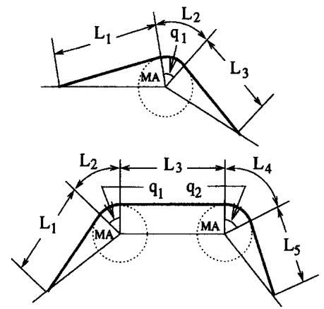
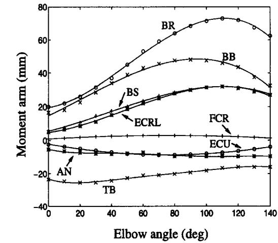
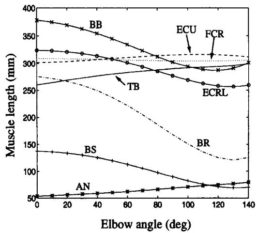

<!-- 本文件是 MinerU 自动抽取的**英文结构化正文**，不是中文翻译。 -->
<!-- 中文翻译若需要，须另走 06_附录/pdf2zh调用脚本/translate_all.py，不得把本文件当译文引用。 -->
<!-- 抽取来源：01_参考论文/整合系统/生物力学线/B2_肌肉骨骼动力学_与可微仿真/Pigeon1996-JBiomech：人体上肢肌肉力臂与长度随关节角的变化/Pigeon1996-JBiomech：人体上肢肌肉力臂与长度随关节角的变化.pdf -->
<!-- DOI：10.1016/0021-9290(96)00031-0 -->
<!-- 图片：3 张，位于同级 images/，已按正文引用相对路径改写。 -->

# MOMENT ARMS AND LENGTHS OF HUMAN UPPER LIMB MUSCLES ASFUNCTIONS OF JOINT ANGLES

Pascale Pigeon,\* L'Hocine Yahia\* and Anatol G. Feldman\*†

\*Institut de génie biomédical, École Polytechnique de Montréal; and †Institut de Réadaptation de Montréal, Université de Montréal, Québec, Canada

Abstract—Modeling of musculoskeletal structures requires accurate data on anatomical parameters such as muscle lengths (MLs), moment arms (MAs) and those describing the upper limb position. Using a geometrical model of planar arm movements with three degrees of freedom, we present, in an analytical form, the available information on the relationship between MAs and MLs and joint angles for thirteen human upper limb muscles The degrees of freedom included are shoulder flexion/extension, elbow flexion/extension, and either wrist flexion/extension (the forearm in supination) or radial/ulnar deviation (the forearm in mid-pronation). Previously published MA/angle curves were approximated by polynomials. ML/angle curves were obtained by combining the constant values of MLs (defined by the distance between the origin and insertion points for a specific upper limb position) with a variable part obtained by multiplying the MA (joint radius) and the joint angle. The MAs of the prime wrist movers in radial/ulnar deviation were linear functions of the joint angle $( \check { R ^ { 2 } } \geqslant 0 . 9 9 5 4 )$ ,while quadratic polynomials accurately described their MAs during wrist flexion/extensions. The relationship between MAs and the elbow angle was described by 2nd, 3rd or 5th-order polynomials $( R ^ { 2 } \geqslant 0 . 9 9 0 4 ) _ { : }$ with a lesser quality of fit for the anconeus $( R ^ { 2 } = 0 . 9 3 4 9 )$ . In the full range of angular displacements, the length of wrist, elbow and shoulder muscles can change by 8.5, 55 and 200%, respectively. Copyright © 1996 Elsevier Science Ltd.

Keywords: Biomechanic models; Human upper limb; Moment arms; Muscle lengths; Joint angles.

## INTRODUCTION

In some biomechanical models, motor control is essentially associated with the anatomical arrangement of muscles (Feldman and Levin, 1993; Flanagan et al., 1993; Flash and Mussa-Ivaldi, 1990). These and other models require precise data relating muscle lengths (MLs) and moment arms (MAs) with joint angles. Such data have not been presented in a systematic form for the human upper limb, and, in addition, were simplified by assuming that MAs are constant (Happee, 1994; Zajac et al., 1984) and MLs are linear functions of joint angles (Flanagan et al., 1993). Trigonometric models of the arm were also used to estimate MAs (Stern, 1971; Van Zuylen et al., 1988; Yeo, 1976). In the present report, we derive the equations for the relationship between the MAs, MLs and joint angles for 13 upper limb muscles subserving three degrees of freedom (DFs) for horizontal planar arm movements: shoulder flexion/extension, elbow flexion/extension, and either wrist flexion/extension or wrist radial/ulnar deviation. The approach involves curve fitting previously published MA/angle data and formulation of equations for ML/angle curves.

## METHODS

The equations relating MAs and joint angles were obtained using anatomical or model data (Amis et al., 1979; Horii et al., 1993; Winters and Kleweno, 1993; Wood et al., 1989). The

MatLab Polyfit function (The MathWorks, Inc., 1992) was used for the fitting. Based on these equations, we then derived the equations for MLs. A ML was a function of the joint angles, MAs and also included a constant representing a portion of the length $( L _ { 1 } + L _ { 3 } \thinspace \mathrm { o r } L _ { 1 } + L _ { 3 } + L _ { 5 }$ in Fig. 1(A), similar to Fig. 2 in Winters and Stark, 1988). This constant was taken for each muscle from the measurements made by Seireg and Arvikar (1989) who used Braus' scaled diagrams (Braus, 1954). Seireg and Arvikar (1989) modeled muscles as strings between the points of origin and insertion in the bone-fixed coordinate system. They measured MLs for an erect body posture with the upper limb hanging vertically and forearm supinated. To obtain a ML for any limb position, we multiplied the MA (radius of the joint) by the joint angles and added it to the constant portion of the length defined above. Thus, if a MA for a DF was described by a second-order polynomial, the order of the polynomial for the ML increased by a unit. For a laterally extended limb (when the wrist radial/ulnar deviation as well as the wrist, elbow, and shoulder flexion/extensions are zero), the ML coincided with its constant portion $[ q _ { j } = 0 ^ { \circ }$ Fig. 1(A)]. Ulnar deviations, extensions of the wrist, and elbow and shoulder flexions were considered positive and the sign of the MAs remained constant in the full range of movements since no muscle changed the direction of its mechanical action [i.e. from flexion to extension, Fig. 1(B)].

Eight mono- and five bi-articular muscles contributing to torques about the three DFs with the arm held horizontally at shoulder level were considered: the flexor carpi ulnaris (FCU), extensor carpi radials brevis (ECRB), anconeus (AN), brachialis (BS), brachioradialis (BR), the clavicular portion of pectoralis (PC) and the anterior (DA) and posterior (DP) portions of the deltoid muscle; the flexor carpi radialis (FCR), extensor carpi radialis longus (ECRL), extensor carpi ulnaris (ECU), biceps brachii (BB) and triceps brachii (TB). The MA equations were obtained based on the available data for the wrist flexion/ extension and radial/ulnar deviation (Horii et al., 1993) and for the elbow flexion/extension (Amis et al., 1979; Winters and Kleweno, 1993). Data for the AN, FCR, ECU and TB were taken from Amis et al. (1979) and those for the BS, BR, ECRL and BB from Winters and Kleweno (1993). Two MA/angle BB curves (Winters and Kleweno, 1993) for elbow flexion/extension, one for pronation and the other for supination, were averaged to get a curve for a mid-pronation. MAs of the DA, DP, PC, BB and TB (Wood et al., 1989) measured on a cadaver for one specific position were used for shoulder flexion/extension. MAs and MLs were described by the following equations:

A  

B  

C  

(1)

$$
\begin{array} { c } { { M A _ { m } ^ { \mathrm { D F } } = x _ { n } q _ { j } ^ { n } + x _ { n - 1 } q _ { j } ^ { n - 1 } + \ \cdots \displaystyle + x _ { 1 } q _ { j } + x _ { 0 } , } } \\ { { { } } } \\ { { M L _ { m } = c s t + e _ { m } ^ { \mathrm { w R U } } ( \mathrm { o r } \ e _ { m } ^ { \mathrm { w F E } } ) + e _ { m } ^ { \mathrm { e F E } } + e _ { m } ^ { s \mathrm { F E } } } } \\ { { { } } } \\ { { = c s t + \displaystyle \sum _ { j = 1 } ^ { 3 } ( y _ { n } q _ { j } ^ { n } + y _ { n - 1 } q _ { j } ^ { n - 1 } + \ \cdots \ + y _ { 1 } q _ { j } ) , } } \end{array}\tag{2}
$$

where $M A _ { m } ^ { \mathrm { { D F } } }$ is the moment arm, in mm, of muscle m for a particular $\mathbf { D } \mathbf { F } ; x _ { i }$ stands for coefficients $a _ { i } , b _ { i } , c _ { i } \ o r \ d _ { 0 }$ for wrist radial/ulnar deviation (wRU), wrist flexion/extension (wFE), elbow flexion/extension (eFE), or shoulder flexion/extension (sFE), respectively; i varies from 0 to n; n is the order of the polynomial fitting the data; $q _ { j }$ is the joint angle, in degrees $( q _ { 1 } , q _ { 2 } , q _ { 3 }$ for wrist radial/ulnar deviation or wrist flexion/extension, elbow flexion/extension and shoulder flexion/extension, respectively), ML is the length of muscle m in mm; cst is the constant ML portion; $e _ { m }$ is the excursion of muscle m due to rotation in a specific $\mathbf { D F } ; y _ { i }$ stands for coefficients $\pmb { r _ { i } } , \pmb { s _ { i } } ,$ ti or u for wrist radial/ulnar deviation, wrist flexion/extension, elbow flexion/extension, and shoulder flexion/extension; j is the DF causing the excursion.

MAs were functions of a single joint angle while MLs were functions of one or two joint angles for mono- and bi-articular muscles, respectively. Since we considered only horizontal planar movements of the upper limb held at shoulder level, the wrist DF in equation (2) depended on the forearm orientation (for a mid-pronated forearm, wrist radial/ulnar deviation was the DF producing horizontal planar movements of the hand; wrist flexion/extension did the same for a supinated forearm) The goodness of fit was estimated by the coefficient of determination, $R ^ { 2 }$ (correlation coefficient squared). The order of the interpolation polynomial was found when $R ^ { \acute { 2 } }$ was not less than 0.99.

## RESULTS

MAs of the FCU and ECRB were interpolated by linear functions for wrist radial/ulnar deviations, and quadratic polynomials for wrist flexion/extensions (Table 1). The slope (a1) of MA/angle curves for ECRB and ECRL for wrist radial/ulnar deviations was small (Table 2) compared to other muscles.

The MLs of single-joint wrist muscles were calculated using equation (2). For example, the ML of the FCU (Table 3) for wrist radial/ulnar deviations is given by:

$$
\begin{array} { r l } & { M L _ { \mathrm { F C U } } = c s t + e _ { \mathrm { F C U } } ^ { \mathrm { w R U } } } \\ & { \qquad = 2 8 9 . 4 0 + 5 . 1 8 7 1 \times 1 0 ^ { - 3 } q _ { 1 } ^ { 2 } - 0 . 2 8 5 3 q _ { 1 } . } \end{array}\tag{3}
$$

Fig. 1. (A) Schematic representation of the relationship between joint angles and MLs showing the constant portion of the length of mono- $( L _ { 1 } + L _ { 3 } )$ and bi-articular $\left( { { L _ { 1 } } + { L _ { 3 } } + { L _ { 5 } } } \right)$ muscles as well as the changes in the length $( L _ { 2 }$ and $\pmb { L _ { 4 } } )$ due to joint rotation (qj). (B) MA/angle curves of elbow muscles. Except for the FCR, the MAs of flexors are described by thirdorder polynomials. Fifth-order interpolations were used for the MAs of AN and TB while a quadratic one was used for the MA of the ECU. The MA of the BB is sensitive to forearm rotation and is shown here for a mid-pronated forearm. The symbols on the curve represent the previously published MA data (Amis et al., 1979; Winters and Kleweno, 1993) used in the interpolations. (C) ML/angle curves of elbow muscles. Some flexors shorten by only 1% (FCR) whereas others by 55% (BR). Some extensor MLs increase with elbow flexion by only 3% (ECU) and others by 49% (AN). The values at 0° (fully extended elbow) correspond to the constant portion of MLs (Table 3). Unlike in (B), the symbols on the curve are used to distinguish between different

Taoesn ee  osn so (n eo eneas snn    eo  o (t e  eo  ion
<table><tr><td colspan="10">Coefficients of determination, R²</td></tr><tr><td>DF</td><td colspan="3">wRU</td><td colspan="3">Wrist flexion/extension</td><td colspan="4">Elbow flexion/extension</td></tr><tr><td>n</td><td>1</td><td>2</td><td>1</td><td>2 3</td><td></td><td>4</td><td>1</td><td>2</td><td>3</td><td>4 5</td></tr><tr><td>FCU</td><td>0.9998*</td><td>0.9998</td><td>0.6374</td><td>0.9913*</td><td>0.9979 0.9992</td><td></td><td></td><td></td><td></td><td></td></tr><tr><td>ECRB</td><td>0.9978*</td><td>0.9978</td><td>0.9708</td><td>0.9969* 0.9996</td><td>0.9997</td><td>0.8016</td><td>0.8790</td><td>0.8792</td><td>0.9056</td><td>0.9349*</td></tr><tr><td>AN</td><td></td><td></td><td></td><td></td><td></td><td>0.8427</td><td>0.9783</td><td>0.9988*</td><td>0.9989</td><td>0.9991</td></tr><tr><td>BS</td><td></td><td></td><td></td><td></td><td></td><td>0.8528</td><td>0.9533</td><td>0.9989*</td><td>0.9994</td><td>0.9994</td></tr><tr><td>BR</td><td>0.9989*</td><td>0.9989</td><td>0.7675</td><td>0.9957* 0.9961</td><td>0.9980</td><td>0.0438</td><td>0.9975*</td><td>0.9979</td><td>0.9981</td><td>0.9995</td></tr><tr><td>FCR</td><td>0.9954*</td><td>0.9955</td><td>0.3823</td><td>0.9203 0.9944*</td><td>0.9944</td><td>0.8470</td><td>0.9596</td><td>0.9986*</td><td>0.9995</td><td>0.9996</td></tr><tr><td>ECRL ECU</td><td>0.9997*</td><td>0.9998</td><td>0.7476</td><td>0.9983* 0.9987</td><td>0.9998</td><td>0.0795</td><td>0.9966*</td><td>0.9979</td><td>0.9995</td><td>0.9999</td></tr><tr><td>BB</td><td></td><td></td><td></td><td></td><td></td><td>0.4669</td><td>0.9612</td><td>0.9918*</td><td>0.9972</td><td>0.9988</td></tr><tr><td></td><td></td><td></td><td></td><td></td><td></td><td>0.9154</td><td>0.9270</td><td>0.9797</td><td>0.9837</td><td>0.9904*</td></tr><tr><td>TB</td><td></td><td></td><td></td><td></td><td></td><td></td><td></td><td></td><td></td><td></td></tr></table>

oe e a  e  s   r e a sse e     ,  d t  e s   i  se  ich R  t s rs  t    ts          s   n  rt   h rodw ne os s s o s

<table><tr><td colspan="10">Moment arm coefficients</td></tr><tr><td>DF</td><td colspan="2">wRU</td><td colspan="3">Wrist flexion/extension</td><td colspan="2"></td><td colspan="2">Elbow flexion/extension</td><td colspan="3"></td></tr><tr><td>Muscle</td><td>a1</td><td>a0</td><td>b3×106 b2×104</td><td>b1×102</td><td>b₀</td><td>Cc{5×109</td><td>c4×107</td><td>c3×105</td><td>c2×103</td><td>c1×101</td><td>C0</td><td>d0</td></tr><tr><td>FCU</td><td>-0.2972</td><td>16.349</td><td></td><td>8.3020</td><td>- 2.6875 - 16.247</td><td></td><td></td><td></td><td></td><td></td><td></td><td></td></tr><tr><td>ECRB</td><td>-0.0842</td><td>-10.124</td><td></td><td>-1.8656 2.5315</td><td>10.780</td><td></td><td></td><td></td><td></td><td></td><td></td><td></td></tr><tr><td>AN</td><td></td><td></td><td></td><td></td><td></td><td>-2.7306</td><td>10.448</td><td>-14.329</td><td>8.4297</td><td>-2.2841</td><td>-5.3450 5.5492</td><td></td></tr><tr><td>BS</td><td></td><td></td><td></td><td></td><td></td><td></td><td></td><td>-2.0530</td><td>2.3425 10.084</td><td>2.3080 1.6681</td><td>19.490</td><td></td></tr><tr><td>BR</td><td></td><td></td><td></td><td></td><td></td><td></td><td></td><td>-6.5171</td><td></td><td></td><td></td><td>33.02</td></tr><tr><td>DA</td><td></td><td></td><td></td><td></td><td></td><td></td><td></td><td></td><td></td><td></td><td></td><td>78.74</td></tr><tr><td>DP</td><td></td><td></td><td></td><td></td><td></td><td></td><td></td><td></td><td></td><td></td><td></td><td>50.80</td></tr><tr><td>PC FCR</td><td>-0.1445</td><td>-6.6164</td><td>10.111</td><td>-3.6152</td><td>-15.079</td><td></td><td></td><td></td><td>-0.3627</td><td>0.5375</td><td>0.9351</td><td></td></tr><tr><td>ECRL</td><td>0.0411</td><td>-17.475</td><td>4.7731 -3.2685</td><td>0.0892</td><td>7.9605</td><td></td><td></td><td>- 3.0229</td><td>4.4347</td><td>1.2590</td><td>4.7304</td><td></td></tr><tr><td>ECU</td><td>- 0.2205</td><td>19.726</td><td>-9.2926</td><td>3.6494</td><td>6.0834</td><td></td><td></td><td></td><td>1.1491</td><td>-1.7386</td><td>-2.1826</td><td></td></tr><tr><td>BB</td><td></td><td></td><td></td><td></td><td></td><td></td><td></td><td>-2.9883</td><td>1.8047</td><td>4.5322</td><td>14.660</td><td>29.21</td></tr><tr><td>TB</td><td></td><td></td><td></td><td></td><td></td><td>-3.5171</td><td>13.277</td><td>-19.092</td><td>12.886</td><td>- 3.0284</td><td>-23.287</td><td>25.40</td></tr></table>

Note(- i  ai iin    i otnr i o dn aa- re  a s  a- t s r r  s wnns a  d s  s t   ae  a t et  a t   a sn  s t  sider

Ta   d t             t  ata
<table><tr><td colspan="2"></td><td colspan="10">Muscle length coefficients</td><td colspan="2"></td></tr><tr><td></td><td>DF</td><td colspan="2">wRU</td><td colspan="4">Wrist flexion/extension</td><td colspan="5">Elbow flexion/extension</td><td colspan="2">sFE</td></tr><tr><td>Muscle</td><td>cst(mm)</td><td>r2×103</td><td>r1</td><td>S4×108</td><td>S3 × 106 s2×104</td><td>S1</td><td>t6×1011</td><td>t5×108</td><td></td><td>t4×107</td><td>t3×10⁵</td><td>t2×10³</td><td>t1 × 102</td><td>u1×101</td></tr><tr><td>FCU</td><td>289.40</td><td>5.1871</td><td>0.2853</td><td></td><td>- 14.490</td><td>4.6906</td><td>0.2836</td><td></td><td></td><td></td><td></td><td></td><td></td><td></td></tr><tr><td>ECRB</td><td>316.03</td><td>1.4696</td><td>0.1767</td><td></td><td>3.2561</td><td>4.4183</td><td>-0.1881</td><td></td><td></td><td></td><td></td><td></td><td></td><td></td></tr><tr><td>AN</td><td>53.57</td><td></td><td></td><td></td><td></td><td></td><td></td><td>4.7658</td><td>- 1.8235</td><td>25.008</td><td>-14.713</td><td>3.9865</td><td>9.3288</td><td></td></tr><tr><td>BS</td><td>137.48</td><td></td><td></td><td></td><td></td><td></td><td></td><td></td><td></td><td>3.5832</td><td>-4.0884 一</td><td>4.0282</td><td>-9.6852</td><td></td></tr><tr><td>BR</td><td>276.13</td><td></td><td></td><td></td><td></td><td></td><td></td><td></td><td></td><td>11.374</td><td>-17.600</td><td>-2.9114</td><td>-34.017</td><td></td></tr><tr><td>DA</td><td>172.84</td><td></td><td></td><td></td><td></td><td></td><td></td><td></td><td></td><td></td><td></td><td></td><td></td><td>-5.7631</td></tr><tr><td>DP</td><td>157.64</td><td></td><td></td><td></td><td></td><td></td><td></td><td></td><td></td><td></td><td></td><td></td><td></td><td>13.743</td></tr><tr><td>PC</td><td>155.19</td><td></td><td></td><td></td><td></td><td></td><td></td><td></td><td></td><td></td><td></td><td></td><td></td><td>-8.8663</td></tr><tr><td>FCR</td><td>309.19 324.06</td><td>2.5220 -0.7173</td><td>0.1155 0.3050</td><td>-8.3306</td><td>-17.647 5.7046</td><td>6.3097 -0.1557</td><td>-0.2632</td><td></td><td></td><td></td><td>0.6330</td><td>-0.9381</td><td>- 1.6321</td><td></td></tr><tr><td>ECRL</td><td>301.90</td><td>3.8485</td><td>- 0.3443</td><td></td><td>16.219</td><td>-6.3694</td><td>-0.1389 -0.1062</td><td></td><td></td><td>5.2706</td><td>-7.7400 -2.0056</td><td>-2.1974 3.0344</td><td>一 -8.2561 3.8094</td><td></td></tr><tr><td>ECU BB</td><td>378.06</td><td></td><td></td><td></td><td></td><td></td><td></td><td></td><td></td><td>5.2156</td><td>-3.1498</td><td>-7.9101</td><td>-25.587</td><td>-5.0981</td></tr><tr><td></td><td>260.05</td><td></td><td></td><td></td><td></td><td></td><td></td><td>6.1385</td><td>-2.3174</td><td>33.321</td><td>-22.491</td><td>5.2856</td><td>40.644</td><td>4.4331</td></tr><tr><td>TB</td><td></td><td></td><td></td><td></td><td></td><td></td><td></td><td></td><td></td><td></td><td></td><td></td><td></td><td></td></tr></table>

Nen n  si  e  se n o  tr s   ee n     otod   (  s  e  r x o soeo  s oe  o  is oe   t s   ee  osln

In particular, when $q _ { 1 } = 5 ^ { \circ } .$ equation (3) yields $M L _ { \mathrm { F C U } } =$ 288.10 mm. FCU shortens as the wrist moves into ulnar deviation. The lengths of the FCU and ECRB change, respectively, by 3 and 1.5% for the full range of wrist radial/ulnar deviations or by 8.5 and 5.5% for full wrist flexion/extensions.

The MAs of single-joint elbow muscles (BS and BR) were described by third-order polynomials (Table 1). The $R ^ { 2 }$ value for the MA of AN reached the threshold 0.99 limit at $n = 1 1$ The $R ^ { 2 }$ values were, however, very close to the threshold at $n = 5 ,$ and we chose this order for the AN interpolation. The same order was used for the interpolation of the MA of TB for elbow flexion/extensions. For other muscles, the $R ^ { 2 }$ values were greater than 0.99 when the order of the polynomials was 3 or less. For full elbow flexions, the ML of the AN increased by 49% while MLs of the BS and BR shortened by 49% and 55%, respectively [Fig. 1(C)].

The MAs for DA, DP and PC for shoulder flexion/extensions were constant (Table 2) resulting in linear ML functions. The ML of DP at 100° of shoulder flexion was twice as much as the ML at $- 4 5 ^ { \circ }$ while the opposite was true for the PC.

The MAs of double-joint muscles (FCR, ECRL and ECU) for wrist radial/ulnar deviations and wrist flexion/extensions were approximated by linear and quadratic polynomials, respectively, except for the MA of the ECRL for wrist flexion/extensions which required a third order interpolation. The MLs changed by 1–7% during the wrist full rotation. For the same muscles acting at the elbow joint, the second and third orders were used for interpolations (Table 1). The MA of the FCR appeared nearly constant for elbow flexion/extensions but a good fit was only reached when a second order interpolation was used. The MLs of the FCR and ECU changed less than 5% with elbow flexion/extensions, while ECRL by 20% [Fig. 1(C)].

The MAs of the BB and TB for elbow flexion/extensions were described by a third and a fifth order curve, respectively. The MA of the BB changed substantially more than that of the TB [Fig. 1(B)]. The BB shortened by 20% and 18% during elbow and shoulder flexions, respectively, while the TB lengthened by 15% and 27% [Fig. 1(C)].

The MA and ML equations (Tables 2 and 3) were valid in the ranges: — 17° to 10°, for wrist radial/ulnar deviations; $- 4 5 ^ { \circ }$ to 45°, for wrist flexion/extensions; 0° (complete extension) to 140°, for elbow flexion/extensions; and $- 4 \hat { 5 } ^ { \circ }$ to $1 0 0 ^ { \circ }$ for shoulder flexion/extensions.

## DISCUSSION

The models of motor control tend to become more complex by integrating the mechanical, control and reflex mechanisms (Feldman and Levin, 1993; Flanagan et al., 1990; Flash and Mussa-Ivaldi, 1990), requiring, in particular, an improvement of the mathematical description of anatomical structures (Winters and Stark, 1988). In the present study, based on previously published data we derived the equations describing MA/angle and ML/angle relationships for 13 muscles and planar arm movements. Our results support the notion that the MAs of upper limb muscles depend considerably on position and that the assumption of constant MAs is inaccurate for all muscles except for the ECRB and ECRL for wrist radial/ulnar deviations. Furthermore, the assumption that the MAs of elbow flexors vary sinusoidally with elbow angle suggested in trigonometric models (Van Zuylen et al., 1988; Yeo, 1976) results in an error by predicting negligible MAs near full extension. The error in these models occurs since they ignore the fact that muscle tendons arc the bony prominences and surrounding soft tissues (Winters and Stark, 1988; Kleweno and Winters, 1988).

The equations presented here have limitations partly related to those of the data used in the present study. For example, the data on the MAs of shoulder muscles measured on an embalmed cadaver (Wood et al., 1989) do not account for variations in the MAs during planar shoulder flexion/extensions. In contrast, during abduction, the MAs of the anterior and posterior portions of the deltoid are reported to vary between 19.9 and

15.8 mm, and 2.3 and 25.6 mm, respectively (Pio et al., 1993) thus suggesting that the MA of this muscie may also change during horizontal planar motion at the shoulder. In situ, the constant portion of MLs (Seireg and Arvikar, 1989) depends on the initial limb position. For example, when the arm is raised, the humeral ball translates laterally increasing the initial ML of the BB. Full pronation stretches the ML of BB up to 2-3 cm (Winters and Kleweno, 1993); thus, during wrist radial/ulnar deviations when the forearm is mid-pronated, the ML of BB increases. The MA of the BB during elbow flexion/extensions depends somewhat on the initial forearm position (Winters and Kleweno, 1993). Neglecting this dependency, one may underestimate the ML by about 5 mm when the elbow angle is 140° and the forearm is supinated. Finally, muscles with multiple heads (the BB and TB) are considered to have unique MAs and MLs. Actually, only the long head of the TB spans the shoulder joint, and the MAs of the two heads of the BB have disparity of 2.5 mm during shoulder flexion/extensions (Wood et al., 1989).

The MAs of muscles during wrist flexion/extensions described by Jacobson et al. (1993) resemble those obtained by Horii et al. (1993). The MAs measured for elbow flexion/extensions (An et $a l . ,$ 1984; Jorgensen and Bankov, 1971) and wrist radial/ulnar deviations and flexion/extensions (Ohnishi et $a l . ,$ 1991; Tolbert et $a l . ,$ 1985) are within the range given by our equations. The maximal and minimal values of the MA of the TB are reached when the elbow joint angle is about 30° and $1 1 5 ^ { \circ }$ , respectively (Gerbeaux et al., 1993; Murray et al., 1995). The peak value of the MAs of elbow flexors (the BR, BB and BS) is reached when the angle is greater than $7 5 ^ { \circ }$ (Murray et al., 1995), which resembles to our interpolations [Fig. 1(B)]. The experimental shoulder MLs measured at one position (Van der Helm and Veenbaas, 1991) are consistent with our values. Also, the large changes in the MLs of the DP and PC for shoulder flexion/extensions in our equations are consistent with the published data for humeral abduction (Van der Helm, 1994).

Our analysis shows that the more a MA varies with joint angle, a higher order of polynomial is required to accurately describe the ML/angle relationship. A good example is the MA of the BB at the elbow [Fig. 1(B)] for which a linear interpolation results in a low $R ^ { 2 }$ value (0.4669, Table 1). An acceptable accuracy is reached when the order of the MA curve is 3 so that the order of the ML/angle curve is 4 [Fig. 1(C)]. Generally, elbow MAs require a higher order interpolation than wrist MAs. MAs are maximal for the elbow flexors. Wrist MAs vary linearly with radial/ulnar deviation, and for all wrist muscles except ECRL, MA/angle relationships for wrist flexion/extensions are quadratic. The MA/angle curves of shoulder muscles for horizontal flexion/extensions at the shoulder are likely linear as is the case for adduction/abductions (Kuechle et $^ { a l . , }$ 1993; Pio et al., 1993). Changes in MLs during full joint excursions may be small (e.g. 1% for the FCR during elbow flexion/ extensions) and large (200% for the DP during shoulder flexion/extensions).

Acknowledgements—This study was supported by grants from the Natural Sciences and Engineering Council of Canada (NSERC), the Medical Research Council of Canada (MRC) and the Fonds pour la Formation de Chercheurs et l'Aide à la recherche (FCAR) of Quebec. The authors acknowledge Dr. Yang, Ph.D., for helpful discussions.

## REFERENCES

Amis, A. A., Dowson, D. and Wright, V. (1979) Muscle strengths and musculo-skeletal geometry of the upper limb. Eng. Med 8(1), 41–48.

An, K. N., Kwak, B. M., Chao, E. Y. and Morrey, B. F. (1984) Determination of muscle and joint forces: a new technique to solve the indeterminate problem. J. Biomech. Engng 106, 364–367.

Braus, H. (1954) Anatomic Der Menschen, Springer, Berlin.

Feldman, A. G. and Levin, M. F. (1993) Control variables and related concepts in motor control. Concepts Neurosci. 4(1) 25-51.

Flanagan, J. R., Ostry, D. J. and Feldman, A. G. (1990) Control of human jaw and multijoint arm movements, In Cerebral Control of Speech and Limb Movements (Edited by Hammond, G. E.), Ch. 2, pp. 29–58. Springer, London.

Flanagan, J. R., Ostry, D. J. and Feldman, A. G. (1993) Control of trajectory modifications in target-directed reaching, J. Motor Behavior 25(3), 140–152.

Flash, T. and Mussa-Ivaldi, F. (1990) Human arm stiffness characteristics during the maintenance of posture. Exp. Brain Res. 82, 315–326.

Gerbeaux, M., Pertuzon, E., Turpin, E. and Lensel-Corbeil, G. (1993) Determination of the length of the lever arm of the triceps brachii. J. Biomechanics 26, 795.

Happee, R. (1994) Inverse dynamic optimization including muscular dynamics, a new simulation method applied to goal directed movements. J. Biomechanics 27, 953–960.

Horii, E., An, K. N. and Linschied, R. L. (1993) Excursion of prime wrist tendons. J. Hand. Surg. 18A(1), 83–90.

Jacobson, M. D., Yeatman, P., Sokoloff, B. and Lieber, R. L. (1993) Relationship between moment arms and muscle properties during wrist joint rotation, In Transactions of the 39th Annual Meeting, Vol. 18, Orthopaedic Research Society, San Francisco, California, p. 318.

Jorgensen, K. and Bankov, S. (1971) Maximum strength of elbow flexors with pronated and supinated forearm, In Medicine and Sport, Biomechanics II, Vol. 6 (Edited by Vredenbregt, J. and Wartenweiler, J.), pp. 181–184. S. Karger Basel.

Kleweno, D. G. and Winters, J. M. (1988) Sensitivity of upperlimb strength curves to 3-d geometry: model results. Adv. Bioeng., No. BED-8 in ASME Winter Annual Meeting, pp. 159–162.

Kuechle, D. K., Newman, S. R., Itoi, E., Morrey, B. F. and Niebur, G. L. (1993) Rotator cuff function during humeral elevation in 4 planes, In Transactions of the 39th Annual Meeting, Vol. 18: 1, Orthopaedic Research Society, San Francisco, CA, p. 138.

Murray, W. M., Delp, S. L. and Buchanan, T. S. (1995) Variation of muscle moment arms with elbow and forearm position. J. Biomechanics 28, 513–525.

Ohnishi, N., Ryu, J., Colbaugh, R. and Rowen, B. (1991) Moment arms of the prime wrist motors and extrinsic finger motors at the wrist, In Transactions of the 37th Annual Meeting, Vol. 16, Orthopaedic Research Society, Anaheim, California, p. 567.

Pio, A., Rendina, M., Grassi, F. and Ceciliani, L. (1993) Abductor muscle excursions and moment arm determinations in the shoulders. J. Biomechanics 26, 795.

Seireg, A. and Arvikar, R. (1989) Biomechanical Analysis of the Musculoskeletal Structure for Medicine and Sports, Hemisphere Publishing Corporation, New York.

Stern, J. T. (1971) Investigations concerning the theory of ‘spurt' and 'shunt' muscles. J. Biomechanics 4, 437–453.

The MathWorks, Inc. (1992) M ATLAB Reference Guide, Cochituate Place, 24 Prime Park Way, Natick, MA 01760.

Tolbert, J. R., Blair, W. F., Andrews, J. G. and Crowninshield R. D. (1985) The kinetics of normal and prosthetic wrists J. Biomechanics 18, 887–897.

Van der Helm, F. C. T. (1994) Analysis of the kinematic and dynamic behavior of the shoulder mechanism. J. Biomechanics 27, 527–550.

Van der Helm, F. C. T. and Veenbaas, R. (1991) Modelling the mechanical effect of muscles with large attachment sites: application to the shoulder mechanism. J. Biomechanics 24, 1151-1163.

Van Zuylen, E. J., Van Velzen, A. and Denier van der Gon, J. J. (1988) A biomechanical model for flexion torques of human arm muscles as a function of elbow angle. J. Biomechanics 21, 183-190.

Winters, J. M. and Kleweno, D. G. (1993) Effect of initial alignment on muscle contributions to isometric strength curves. J. Biomechanics 26, 143–153.

Winters, J. M. and Stark, L. (1988) Estimated mechanical properties of synergistic muscles involved in movements of a variety of human joints. J. Biomechanics 21, 1027-1041.

Wood, J. E., Meek, S. G. and Jacobsen, S. C. (1989) Quantitation

of human shoulder anatomy for prosthetic arm control–ii anatomy matrices. J. Biomechanics 22, 309–325.

Yeo, B. P. (1976) Investigations concerning the principle of minimal total muscular force. J. Biomechanics 9, 413–416.

Zajac, F. E., Wicke, R. W. and Levine, W. S. (1984) Dependence of jumping performance on muscle properties when humans use only calf muscles for propulsion. J. Biomechanics 17, 513-523.