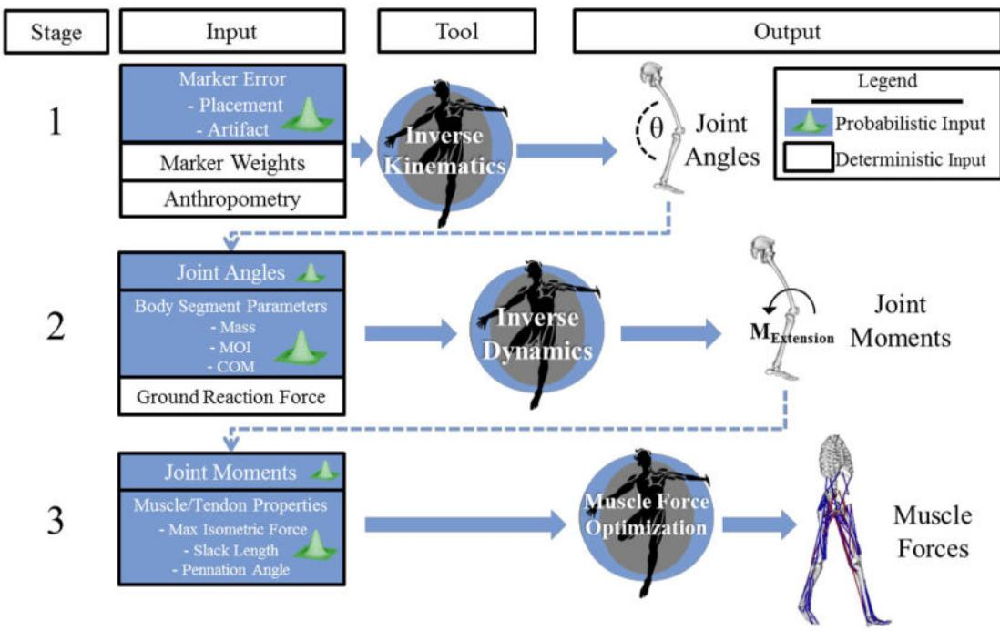
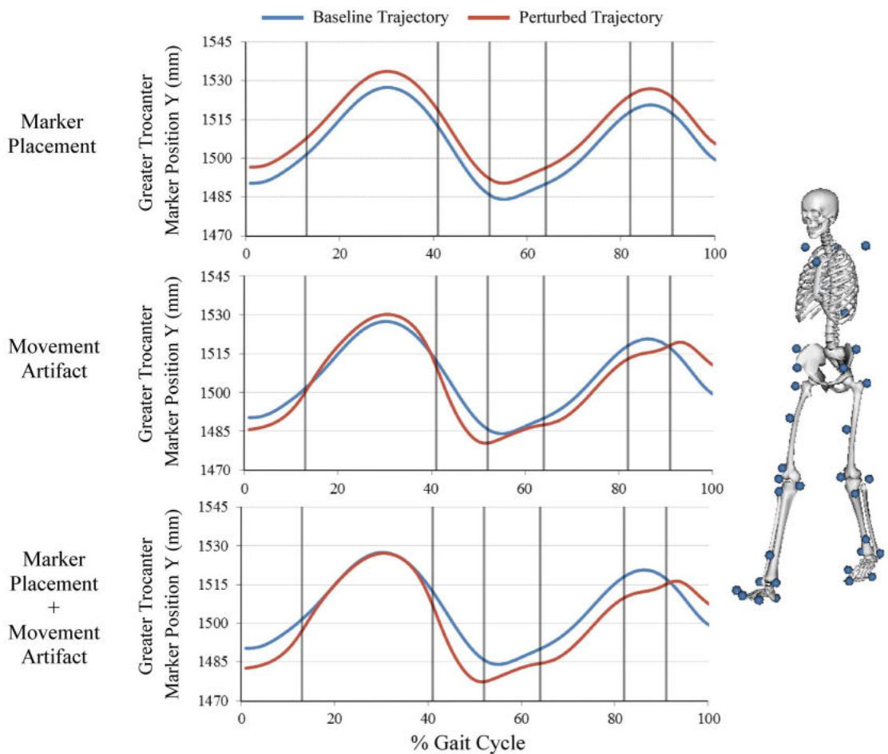
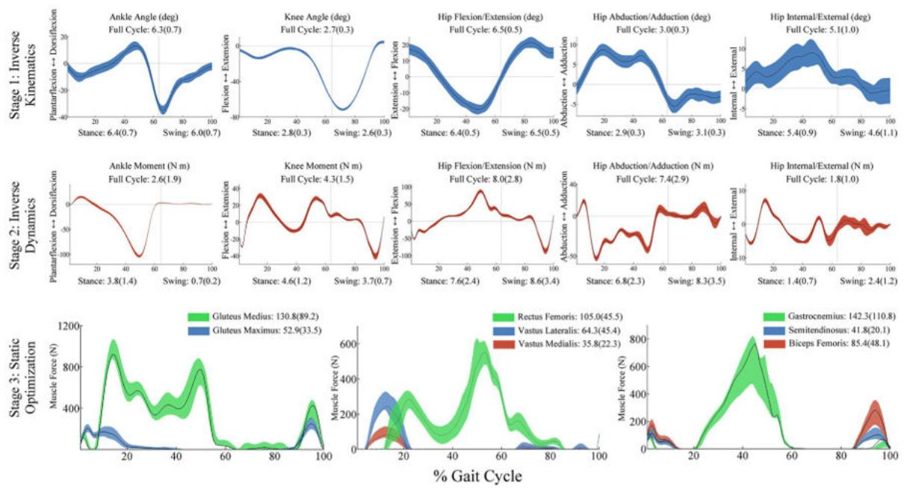
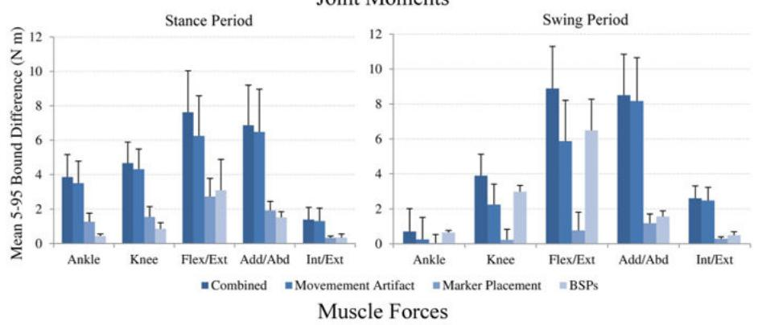
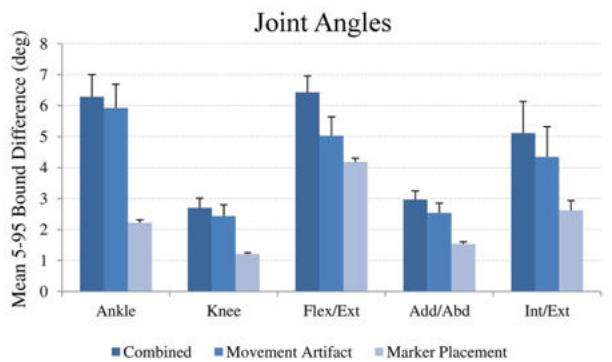
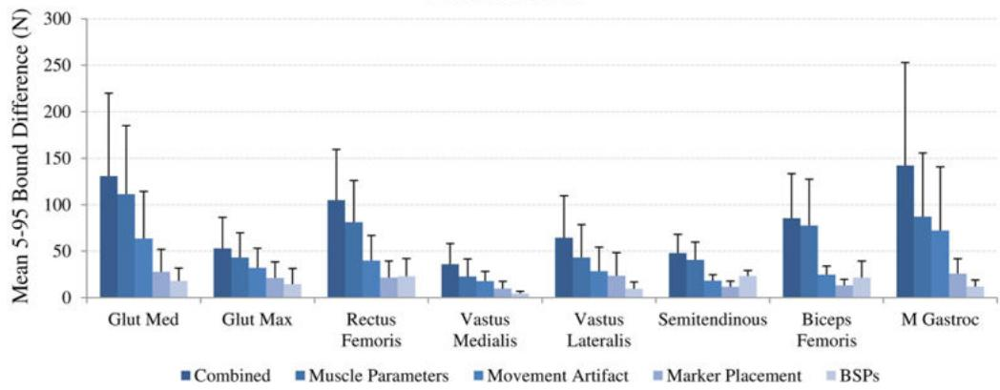
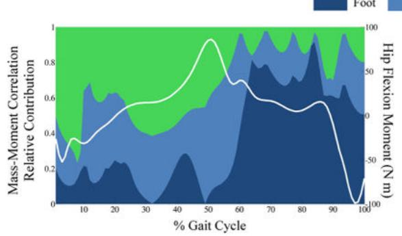
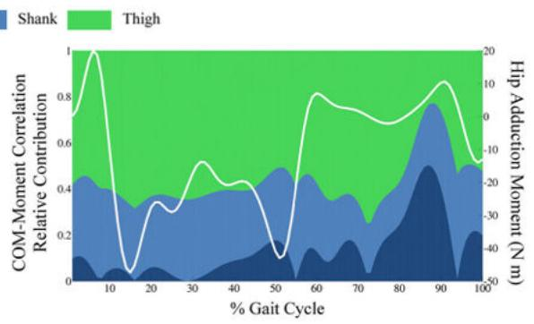
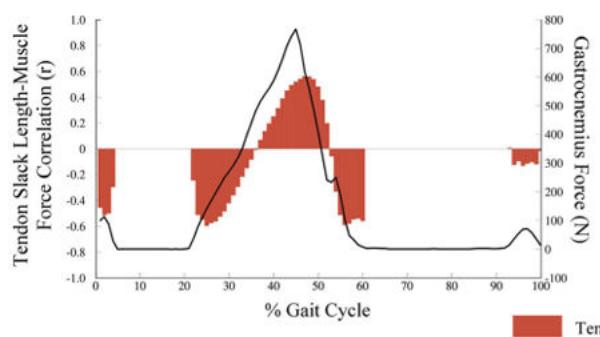
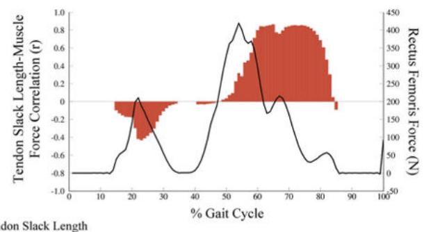

# A Probabilistic Approach to Quantify the Impact of Uncertainty Propagation in Musculoskeletal Simulations

Casey A. Myers, Peter J. Laz, Kevin B. Shelburne, and Bradley S. Davidson Center for Orthopaedic Biomechanics, Department of Mechanical and Materials Engineering, University of Denver, 2390 S. York St, Denver, CO 80208, USA

## Abstract

Uncertainty that arises from measurement error and parameter estimation can significantly affect the interpretation of musculoskeletal simulations; however, these effects are rarely addressed. The objective of this study was to develop an open-source probabilistic musculoskeletal modeling framework to assess how measurement error and parameter uncertainty propagate through a gait simulation. A baseline gait simulation was performed for a male subject using OpenSim for three stages: inverse kinematics, inverse dynamics, and muscle force prediction. A series of Monte Carlo simulations were performed that considered intrarater variability in marker placement, movement artifacts in each phase of gait, variability in body segment parameters, and variability in muscle parameters calculated from cadaveric investigations. Propagation of uncertainty was performed by also using the output distributions from one stage as input distributions to subsequent stages. Confidence bounds (5–95%) and sensitivity of outputs to model input parameters were calculated throughout the gait cycle. The combined impact of uncertainty resulted in mean bounds that ranged from 2.7° to 6.4° in joint kinematics, 2.7 to 8.1 N m in joint moments, and 35.8 to 130.8 N in muscle forces. The impact of movement artifact was 1.8 times larger than any other propagated source. Sensitivity to specific body segment parameters and muscle parameters were linked to where in the gait cycle they were calculated. We anticipate that through the increased use of probabilistic tools, researchers will better understand the strengths and limitations of their musculoskeletal simulations and more effectively use simulations to evaluate hypotheses and inform clinical decisions.

## Keywords

Musculoskeletal simulation; Joint mechanics; Kinematics; Inverse dynamics; Muscle force; OpenSim; Motion capture; Uncertainty; Gait; Probabilistic analysis; Error analysis

## Introduction

Simulation of human movement has significantly impacted approaches to clinical treatment of cerebral palsy, lower extremity amputees, and osteoarthritis13,14,17,40,41,44 as well as

basic science related to the understanding of movement progression and control during dynamic tasks.3,33,43,52 Because these simulations often combine human movement data measured in the laboratory with mathematical models of the musculoskeletal system, accurate estimations of biomechanical outputs such as intersegmental joint loads, muscle activation/coordination, and muscle force are possible.18 The experimental methods used to create anatomic detail in musculoskeletal models have improved over the past decade through direct measurement of sarcomere length26 and increased cadaveric sample sizes,48 which has led to enhanced accuracy of simulations specific to individual patients. As the field of musculoskeletal simulation progresses, the use of simulation to create individual and population-based treatments will increase.

Outputs from musculoskeletal simulations are affected by measurement error and model parameter uncertainties that are important to consider when interpreting results. A common approach to musculoskeletal simulations contains three sequential stages (inverse kinematics, inverse dynamics, and muscle force prediction); therefore, the uncertainty introduced at earlier stages can propagate through the process and produce a range of possible results within subsequent stages. In the first stage, inverse kinematics are commonly calculated from marker-based motion capture, where placement and motion of markers relative to anatomic landmarks can introduce measurement error.8,9,20 In the second stage, inverse dynamics are influenced by inverse kinematics from the first stage and by estimates of body segment parameters (mass, center of mass, moment of inertia), which are commonly calculated from regression equations based on cadaveric investigations.7,49 In the third stage, muscle force prediction utilizes the data from inverse kinematics, inverse dynamics, and a Hill-type muscle model that includes anatomic and physiologic parameters (maximum isometric force, optimal fiber length, tendon slack length, pennation angle) that are estimated from cadaveric investigations.5,48 Because each of these simulation inputs introduce uncertainty, it is important that interpretation and clinical decision-making consider that the output taken from a single set of input parameters lies within a range of possible solutions.

Probabilistic analyses provide comprehensive methods to simultaneously quantify the impact of uncertainties that arise from multiple sources. These techniques were developed in structural reliability engineering,32 and have been applied in other biomechanical applications.28 The primary metrics for used to quantify the impact of uncertainty from these analyses are confidence bounds and sensitivity factors. Confidence bounds provide the output levels associated with specific probability (e.g., 5 and 95%) and sensitivity factors24 provide insight on how changing an input parameter affects the simulation output. The probabilistic method familiar to most researchers is Monte Carlo simulation, which is a repeated sampling method that models inputs according to predetermined probability distributions and presents the outputs as distributions.23 Recent musculoskeletal studies have used repeated sampling methods to quantify output variability and sensitivity of inverse dynamics and muscle force prediction to variability in model parameters.1,22,27,34,39,44 Although these studies provide insight into factors that affect a particular model at a single stage in the simulation, the current study introduces new methodology to musculoskeletal simulation practices that characterizes the impact and interaction of multiple sources of

uncertainty, and quantifies the propagation of uncertainty through each stage of the musculoskeletal simulation process.

When developing musculoskeletal simulations for research or clinical decision making, understanding and reporting the output confidence and sensitivity to a range of known possible inputs should be standard practice. However, an accessible toolset and standard methods to report these results currently do not exist in the musculoskeletal community. The objective of this investigation was to develop an open-source probabilistic musculoskeletal modeling framework to assess how measurement error and parameter uncertainty propagates through the outputs of each simulation stage: (1) joint angles from inverse kinematics, (2) joint moments from inverse dynamics, and (3) muscle forces from static optimization. The probabilistic framework was developed for OpenSim,15 a platform with widespread use among biomechanics researchers and clinicians and the ability to interact with the simulation through an open source application programming interface (API). The probabilistic tool developed is available for download at simtk.org/home/prob\_tool. We anticipate that regular use of systematic uncertainty analysis within the musculoskeletal simulation community will allow researchers to interpret simulation outputs with confidence, refine new model development, and more effectively translate the results from musculoskeletal simulations to clinical decision-making and human performance assessments.

## Methods

## Experimental Setup and Baseline Simulation

Following approval from the institutional review board, a single male participant (mass: 68.2, height: 154.5 cm) walked at a self-selected pace while an 8-camera motion capture system (Vicon, Centennial, CO) tracked 40 markers at 100 Hz on the torso, pelvis, thigh, shank, and foot. Marker clusters were fixed to each segment and used to define baseline (unperturbed) segment reference frames throughout the gait cycle, but were not included in the OpenSim model for tracking and calculation of joint kinematics. Two force platforms (Bertec Corp, Columbus, Ohio) captured ground reaction forces sampled at 1000 Hz for a complete gait cycle that began and ended with a right foot heel strike. Body segment parameters (BSPs) and muscle properties were scaled to the subject for the baseline simulation using scale factors calculated from marker positions. OpenSim was used to generate baseline joint kinematics, moments, and muscle forces using the gait2392 model.12 A custom interface using the OpenSim/Matlab API was developed to perturb the baseline simulation by altering input files within a Monte Carlo simulation. All input perturbations were sampled from Gaussian distributions created from means and variance reported in the relevant experimental literature (Tables 1, 2).6,9,19,37,48 Propagation of uncertainty was performed by using output files of results from the previous OpenSim stage as input in the subsequent stage during each trial of the Monte Carlo simulation (Fig. 1).

## Stage 1: Probabilistic Inverse Kinematics

Marker placement and movement artifact, two sources of measurement error that influence the results of inverse kinematics, were modeled and combined for each of the 40 markers used in the simulation. This was accomplished by generating a perturbed trajectory for each marker (Fig. 2) as input into the Inverse Kinematics Tool within each trial of the Monte Carlo simulation.

Marker placement error results from the inability of an investigator to locate an anatomic landmark through palpation. Therefore, the error is a placement that is constantly offset from the anatomic location it is intended to mark. This was modeled by sampling the magnitude of this offset in each plane from a distribution created by previously reported intrarater variances $\left( \mathrm { T a b l e 1 } \right) . ^ { 9 }$ For marker placements in which intrarater variance was unavailable, the mean variance for markers on the corresponding segment was used to define the input distribution. The Monte Carlo simulation generated a random perturbation for each marker coordinate from the distributions and applied it as a constant perturbation to every sample during the gait cycle. Each perturbation was performed in baseline segment coordinate systems that were consistent with those defined in Della Croce $e t a l . ^ { 8 }$ The perturbed trajectory was transformed into the lab coordinate system to produce a trajectory that was constantly offset from the original within the segment (Fig. 2).

Marker movement artifact occurs when skin and soft tissues move relative to the underlying bone during limb movement. The magnitude of the marker movement varies with time based on the character of the motion, location of the marker placement, and the anatomy of the subject. Movement artifact was modeled by perturbing each marker uniquely within each of the eight traditional phases of the gait cycle (e.g., between ‘heel off’ and ‘opposite initial contact’).36 The Monte Carlo simulation sampled a perturbation from a distribution constrained with a maximum resultant artifact of 15 mm.6,20 Smoothness at the phase transition was enforced by applying a 4th-order low pass Butterworth filter with a 20 Hz cutoff frequency to the trajectory. The movement artifact uncertainty was combined with the marker placement uncertainty for each of the 40 markers and a new marker trajectory file was generated for use by the Inverse Kinematics Tool. Joint angles from the right side were analyzed for the following degrees of freedom: ankle plantarflexion/dorsiflexion, knee flexion/extension (flex/ext), hip flex/ext, hip adduction/abduction (add/abd), and hip internal/external (int/ext) rotation.

## Stage 2: Probabilistic Inverse Dynamics

Uncertainties in BSPs were modeled by perturbing the baseline model inputs for segment mass, moment of inertia, and center of mass location. The input distributions were defined using baseline model parameters as the means and variances were defined by coefficients of variation measured by Rao $e t a l . ^ { 3 7 }$ and Pavol $e t a l . ^ { 3 5 }$ (Table 2). Each trial of the Monte Carlo simulation combined a perturbed model file with randomly generated BSPs with the kinematic output created from the inverse kinematics tool and measured ground reaction forces to generate joint moments at each degree of freedom.

## Stage 3: Probabilistic Muscle Force Prediction

Uncertainties in muscle parameters were modeled by perturbing the baseline model inputs for maximum isometric force, tendon slack length, and pennation angle. The input distributions were defined using the baseline model parameters as the means and variances were defined by coefficients of variation measured by Friederich and $\mathrm { B r a n d } ^ { 1 9 }$ and Ward et $a l . ^ { 4 8 }$ (Table 2). Muscle forces were predicted using static optimization with the objective function that minimized the sum of muscle activation squared. Eight lower-extremity musclesonthe right side were assessed: gluteus maximus, gluteus medius, rectus femoris, vastus medialis, vastus lateralis, semitendinosus, biceps femoris long head, and medial gastrocnemius. Because the gluteus medius and gluteus maximus muscles were each modeled using three fascicles with different paths, each fascicle received unique input parameters for each trial in the Monte Carlo simulation. The force generated by each muscle fascicle was summed to obtain a single muscle force output for gluteus medius and gluteus maximus, respectively.

## Data Analysis

To assess the individual contributions and the combined effects of the sources of input uncertainty on simulation outputs, a series of Monte Carlo simulations of 3000 trials were performed separately considering all combined sources of uncertainty and for each individual source of uncertainty.16 The 5 and 95 confidence bounds were calculated for joint kinematics for each degree of freedom, joint moments for each degree of freedom, and muscle forces. These bounds indicate a 90% probability that the true result of the simulation output lies between the lower and upper confidence bounds. For joint kinematic and joint moment outputs, mean and standard deviation for the 5–95 confidence bounds were calculated for the entire gait cycle, and separately for the stance and swing periods. For muscle force outputs, the mean and standard deviation for the 5–95 confidence bounds were calculated over the time period(s) when the muscles were active. The outputs for each simulation stage were reported in actual units (not normalized) to maintain the interpretability. Mean and standard deviation of peak muscle force timing was calculated for each muscle. Using similar methods as Valente et al.,44 Monte Carlo simulations of 3000 trials were sufficient for convergence with differences in the mean confidence bounds of less than $0 . 1 ^ { \circ }$ for joint angles, 0.1 N m for joint moments, and 0.5 N for muscle force.

Sensitivity of joint moment and muscle force outputs to individual BSPs and muscle parameters were quantified by Pearson Product-Moment Correlation between the input parameter and the maximum value of each output. To objectively assess if a correlation was meaningful, a 95% confidence interval (CI) was calculated for the correlation coefficient. Correlations were considered statistically significant when the CI did not include zero with an alpha level of 0.05.10 Strengths of the correlations that were statistically significant were categorized as weakly sensitive $( r = 0 . 2 – 0 . 4 )$ , moderately sensitive $( r = 0 . 4 – 0 . 6 )$ , or highly sensitive $( r = 0 . 6 – 1 . 0 )$ . The slope of each relationship was calculated and multiplied by the standard deviation of the input parameter from Table 2. This additional scaling places the slope in the context of the potential variance of the input parameter. To assess if calculating sensitivity at the maximum value of the output is a consistent representation of sensitivity throughout the gait cycle, a Pearson Product-Moment Correlation was calculated for the input parameter and the generated range of outputs at each individual time point.

## Results

## 5–95 Confidence Bounds

The impact of marker placement error and movement artifact on joint kinematics can be observed by the size of the 5–95 confidence bounds for each joint angle output (Fig. 3, Stage 1). The knee flex/ext joint angle exhibited the smallest bounds $( 2 . 7 \pm 0 . 3 ^ { \circ } )$ , but the largest motion during the gait cycle. The relative bound sizes for hip angle in add/abd $( 3 . 0 \pm 0 . 3 ^ { \circ } )$ and int/ext $( 5 . 1 \pm 1 . 0 ^ { \circ } )$ were large considering the smaller motions in these degrees of freedom.

When considering the combined effects of marker error (marker placement and movement artifact) and body segment parameter uncertainty, bounds for hip flex/ext $( 8 . 0 \pm 2 . 8 \mathrm { N m } )$ and add/abd $( 7 . 4 \pm 2 . 8 \mathrm { { N m } ) }$ moments were substantially larger than any other degree of freedom (ankle: $2 . 7 \pm 1 . 8 \mathrm { N }$ m; knee: $4 . 4 \pm 1 . 4 \mathrm { N }$ m; hip int/ext: $1 . 8 \pm 1 . 0 \mathrm { N m } )$ (Fig. 3, Stage 2). Joint moment bound sizes during the swing period were 81.7% smaller in the ankle and 16.5% smaller in the knee compared to the stance period; however, bound sizes in hip degrees of freedom were 42.9% larger on average in the swing period compared to the stance period.

The combined effect of all sources of uncertainty had the greatest impact on medial gastrocnemius $( 1 4 2 . 3 \pm 1 1 0 . 8 \mathrm { N } )$ and the gluteus medius $( 1 3 0 . 8 \pm 8 9 . 2 \ : \mathrm { N } )$ , which demonstrated the largest bounds for muscle force output (Fig. 3, Stage 3). Gastrocnemius and gluteus medius also generated the largest peak forces during the gait cycle (gastrocnemius: $6 6 3 . 1 \pm 1 0 5 . 5 \mathrm { N } ;$ gluteus medius: $1 0 2 5 . 4 \pm 6 2 . 9 \mathrm { N } )$ . The average muscle force bound size for all eight muscles was $8 3 . 1 \pm 3 9 . 6 \mathrm { N }$ . Variability was present in peak muscle force timing for each of the eight muscles that was on average $1 0 4 \pm 1 1 2$ ms and as high as 402 ms for the gluteus medius.

By comparing 5–95% bounds with all uncertainty sources considered vs. the individual sources, relative contributions of each source can be evaluated $( \mathrm { F i g . 4 } )$ . For Stage 1, the impact of movement artifact was 1.8 times larger than marker placement on joint kinematics for all degrees of freedom, with the greatest difference occurring at the ankle $( 5 . 9 \pm 0 . 8 ^ { \circ } { \bf V } { \bf S }$ . $2 . 2 \pm 0 . 1 ^ { \circ } )$ . When this uncertainty was propagated to joint moment calculation in Stage 2, the relative impact of movement artifact compared to marker placement increased to 2.3–4.0 times, with higher impact in swing period than in the stance period for hip add/abd and hip int/ext. BSPs had a relatively small impact on joint moments compared to the impact of marker error. The exception was hip flex/ext during the swing period where BSP uncertainty has the largest impact and was 2.1 times greater during the stance period compared to the swing period (Fig. 4).

In Stage 3, the impact of muscle parameter uncertainty on muscle force output was 1.7 times greater for all muscles than movement artifact, which had the second largest impact. The impact of movement artifact was greater than marker placement and resulted in a muscle force bound size of $3 7 . 2 \pm 2 0 . 4 \ : \mathrm { N }$ on average for all muscles. BSP uncertainty had a relatively small impact on muscle force output in all muscles except the hamstrings, where BSP uncertainty had the second largest impact after muscle parameter uncertainty (Fig. 4).

## Input Parameter Sensitivity

Statistically significant correlations existed between each BSP and hip moments. Hip flex/ext was highly sensitive to segment mass, with the strongest correlation at the shank (thigh: $r = 0 . 4 2 , \mathrm { C I } [ 0 . 4 0 - 0 . 4 5 ] ;$ ; shank: $r = 0 . 6 4 , \mathrm { C I } [ 0 . 6 2 – 0 . 6 7 ] ;$ foot: $r = 0 . 1 1 , \mathrm { C I } [ 0 . 0 8 -$ 0.22]). Hip add/abd moment was highly sensitive to segment mass, with the strongest correlation at the thigh (thigh: $r = 0 . 7 5 ,$ CI [0.72–0.77]; shank: $r = 0 . 3 3 , \mathrm { C I } [ 0 . 3 0 { - 0 . 3 8 } ] ;$ foot: $r = 0 . 1 4 , \mathrm { C I } \left[ 0 . 1 1 - 0 . 2 3 \right] )$ . Flex/ext moment was moderately sensitive to thigh moment of inertia $( r = 0 . 5 1 , \mathrm { C I } [ 0 . 4 5 - 0 . 5 6 ] )$ ); however, add/abd moment was not sensitive to thigh moment of inertia. Hip add/abd was moderately sensitive to the medial/lateral position of the center of mass of the thigh and weakly sensitive to the center of mass of the shank (thigh: r $= 0 . 4 7 , \mathrm { C I } \left[ 0 . 4 1 - 0 . 5 6 \right]$ ; shank: $r = 0 . 2 6 ,$ CI [0.22–0.34]; foot: $r = - 0 . 0 6 , \mathrm { C I } \ [ - 0 . 0 9 - 0 . 1 1 ] )$ (Table 3). The joint moment-segment mass relationship produced the largest impact on joint moment outputs for a one standard deviation change in segment mass compared to the other BSPs. For example, the hip flex/ext moment would change 1.06 N m in response to a one standard deviation change in shank mass (Table 4).

In general, muscle force outputs were highly sensitive to changes in maximum isometric force and tendon slack length; however, this was not consistent across muscles (Table 3). The gluteus muscles were highly sensitive to uncertainty in maximum isometric force (e.g., gluteus medius3: $r = 0 . 7 2 , \mathrm { C I } \ [ 0 . 7 0 { - } 0 . 7 4 ] )$ and weak to moderately sensitive to uncertainty in tendon slack length (e.g., gluteus medius3: $r = 0 . 2 4 , \mathrm { C I } \ [ 0 . 2 0 { - } 0 . 2 7 ] )$ . The gluteus muscle force would change 34.82 N in response to a one standard deviation change in maximum isometric force compared to 16.53 N in response to a one standard deviation change in tendon slack length. By contrast, the vasti muscles were highly sensitive to tendon slack length (e.g., vastus lateralis: $r = - 0 . 8 3 , \mathrm { C I } \left[ - 0 . 8 4 - 0 . 8 2 \right] )$ , and would change 13.70 N in response to a one standard deviation change in tendon slack length compared to 3.17 N for maximum isometric force.

For both body segment and muscle parameters, the strength and sign (±) of correlations were dependent on where in the gait cycle the sensitivity analysis was performed. During the initial portion of the gait cycle, hip flexion moment was most sensitive to uncertainty in thigh mass with little sensitivity to uncertainty in shank or foot mass. However, after transitioning to the swing period, hip flexion moment was most sensitive to uncertainty in foot mass and least sensitive to uncertainty in thigh mass (Fig. 5). Although muscle force was consistently sensitive to tendon slack length throughout the gait cycle, the direction of the relationship (±) changed throughout the gait cycle, particularly for the medial gastrocnemius and rectus femoris (Fig. 5).

## Discussion

This study demonstrated a systematic probabilistic approach to assess the impact of measurement error and parameter uncertainty on outputs from musculoskeletal simulations. Uncertainties in simulation inputs propagate through the simulation workflow and result in significant impacts on joint kinematics, joint moments, and muscle force prediction. Mean 5–95 confidence bounds ranged from $2 . 7 ^ { \circ }$ to $6 . 4 ^ { \circ }$ in joint kinematics, 2.7 to 8.1 N m in joint moments, and 35.8 to 130.8 N in muscle forces. Muscle parameter uncertainty had the

largest impact on muscle force prediction, greater than the uncertainty carried forward from marker placement and movement artifact. When measurement error was propagated through inverse dynamics and muscle force prediction, movement artifact had the largest impact on joint moment outputs and a considerable impact on muscle force prediction. Impact of movement artifact depended on whether the swing or stance period was considered. Similarly, sensitivity to specific BSPs and muscle parameters were varied, and linked to where in the gait cycle they were calculated. Uncertainty sources also led to a range of outputs for peak muscle force timing that reached as high as 402 ms for gluteus medius. The impact of uncertainty in BSPs and muscle parameters may be mitigated by measuring and applying in vivo joint moment/joint angle data to subject-specific scaling. Probabilistic analyses can improve understanding and interpretation of simulation data and can be applied to musculoskeletal simulations without large computational expense.

Movement artifact impacted the range of outputs more than marker placement after each stage of the simulation. The effect of movement artifact varied throughout the gait cycle and contributed to the variable size of the 5–95 confidence bounds in both joint moments and muscle forces. Movement artifact is a more dynamic form of uncertainty than marker placement error, and can have a large influence on calculated segment accelerations. In this investigation, marker positions were used only for segment tracking; however, marker position error may result in a significant impact on joint kinematics when marker positions are used to identify joint center locations. For example, locating the hip joint center based on marker position can result in errors as high as 22 and 15% in hip flexion/extension moments and adduction/abduction moments, respectively.42 When evaluating which sources of uncertainty investigators can influence, uncertainty due to marker placement error has been reduced through the development of digital placement methods and marker sets designed to consider variations in subject populations.29 Reduction of movement artifact is difficult and not feasible in most motion capture based experiments because the markers will always be affixed over the skin, which highlights the need to understand its impact.

The sensitivity of joint moments and muscle forces to uncertainty in individual input parameters varied throughout the gait cycle. Overall, BSP uncertainty had a greater impact on joint moments during the swing period compared to stance (Fig. 5). During the stance period, the foot mass made small contributions to the range of hip flexion moment values when compared to contributions from the thigh mass. However, after the transition to the swing period, the foot mass is the dominant contributor to hip flexion moment output range. This shift corresponds to the role that ground reaction forces play in joint moment calculations during each period.46 Without the ground reaction forces in the swing period, the importance of the BSPs on joint moment predictions are higher compared to the stance period. Although the sensitivity of muscle forces to tendon slack length was statistically significant for all muscles, and a one standard deviation change in tendon slack length produced a muscle force change up to 42 N, the strength of sensitivity and direction of influence (sign of correlation coefficient) depended on the muscle length at the point of peak muscle force generation. Changes in tendon slack have a direct influence on the region of the force–length curve a muscle operates. Therefore, the sensitivity of muscle force output to this parameter changes sign based on whether the muscle is on the “ascending” or

“descending” portion of the force–length curve1 (Fig. 5). Representing sensitivity by calculating the relationship at a single time point in the gait cycle or over a period (swing and stance) does not fully characterize the relationship over the entire motion. For the most relevant representation of sensitivity, we recommend that each investigator assess the strength of sensitivity at the time point of clinical or scientific interest.

The highly sensitive nature of outputs to BSPs and muscle parameters highlights the importance of applying accurate subject-specific parameters. Parameter specification is commonly performed by scaling each BSP and muscle parameters based on segment dimensions. However, few parameters reliably scale based on segment dimensions alone.47 Incorporating easily measured subject-specific parameters such as joint moment/angle data into subject-specific models may limit the impact of uncertainties in BSPs and muscle parameters, which are difficult to determine. The joint moment/angle relationship25 and the sarcomere length/joint angle relationship30 are not uniform for all subjects. Functional scaling that relies on in vivo data has been used to generate subject-specific models that accurately represent joint moment/angle relationships.21,31 Another option that results in high model accuracy is to introduce length constraints that preserve the normalized muscle fiber length/angle relationship for each muscle when scaling optimum fiber length and tendon slack length.51

This study uniquely considered the interaction of measurement error and parameter estimation, and systematically followed their impact through the processing stages commonly used in musculoskeletal simulation. Previous investigations have considered the impact of input uncertainty on results at individual simulation stages,1,4,11,27,34,38,50 but comparisons between studies can be difficult. De Groote et al.11 and Ackland et al.1 demonstrated a high level of sensitivity of peak force in lower-extremity muscles to tendon slack length when using Hill-type muscle models. Confidence bounds for muscles forces have not been previously reported based on uncertainty; however, the shape and magnitude of our muscle force predictions are similar to several studies that modeled healthy gait with subject-specific models. For example, maximum force for the gluteus medius has been reported to range from 900 to 100 N during gait for subjects of similar size to the one modeled here, and these values are within the 5–95% confidence bounds calculated for gluteus medius.2,45 The confidence bounds calculated for joint moments as a result of uncertainty in BSPs were 25% smaller than bounds reported by Langenderfer et al.27 The differences are attributed to the use of a different bound size (1–99 vs. 5–95%) and differences in the model used to generate joint kinematics and kinetics. Reinbolt et al.38 demonstrated that uncertainty in BSPs had only a mild effect on peak lower-extremity joint moments. Our data demonstrated that, for most joint moments, the impact of uncertainty depends on the portion of the gait cycle that is analyzed.

Several modeling decisions were made in the design of this study that should be evaluated when performing similar studies using probabilistic musculoskeletal simulations. First, outputs at each simulation stage will be affected by the model used and the number and location of the markers included in the model. We chose to use the OpenSim gait2392 model because it is widely used in gait analysis, and provides a consistent and accessible platform for investigators to make future comparisons. Second, several methods exist to

calculate inverse kinematics, inverse dynamics, and predict muscle forces. Although the trends in output bounds and sensitivity will likely be similar, variations in these components will change the predicted results and should be evaluated on a problem-specific basis. Third, specific to the probabilistic musculoskeletal simulation, the input distributions will influence the simulation results. We recommend that researchers base their input distributions on experimental data whenever possible. Last, there are many more sources of uncertainty that can influence a simulation than included here such as model scaling, the muscle model chosen, and the number and architecture of the muscles included. The purpose of this study was to evaluate recognized sources of uncertainty that affect the three major stages of the simulation process. The open source tools developed in this study will enable the widespread use of probabilistic methods and an improved understanding of the impact of uncertainty in musculoskeletal simulation.

In conclusion, this study demonstrated a systematic probabilistic approach to quantify and assess the impact of uncertainty propagation on musculoskeletal simulation of gait. These tools will enable researchers to perform these analyses on a variety of models at minimal computational cost. We anticipate that assessment of uncertainty will become standard practice within the musculoskeletal simulation community, allow researchers and clinicians to better understand the strengths and limitations of their musculoskeletal simulations, and improve use of computational simulations to evaluate hypotheses and inform clinical decisions.

## Acknowledgments

We thank Katie Thompson for her assistance in figure preparation. This work was funded in part by the Donald W. Gustafson Fellowship in Orthopaedic Biomechanics awarded by the Gustafson Family Foundation.

## References

1. Ackland DC, Lin YC, Pandy MG. Sensitivity of model predictions of muscle function to changes in moment arms and muscle-tendon properties: a Monte-Carlo analysis. J Biomech. 2012; 45:1463– 1471. [PubMed: 22507351]

2. Anderson FC, Pandy MG. Static and dynamic optimization solutions for gait are practically equivalent. J Biomech. 2001; 34:153–161. [PubMed: 11165278]

3. Anderson FC, Goldberg SR, Pandy MG, Delp SL. Contributions of muscle forces and toe-off kinematics to peak knee flexion during the swing phase of normal gait: an induced position analysis. J Biomech. 2004; 37:731–737. [PubMed: 15047002]

4. Andrews JG, Misht SP. Methods for investigating the sensitivity of joint resultants to body segment parameter variations. J Biomech. 1996; 29:651–654. [PubMed: 8707793]

5. Arnold EM, Ward SR, Lieber RL, Delp SL. A model of the lower limb for analysis of human movement. Ann Biomed Eng. 2010; 38:269–279. [PubMed: 19957039]

6. Benoit DL, Ramsey DK, Lamontagne M, Xu L, Wretenberg P, Renström P. Effect of skin movement artifact on knee kinematics during gait and cutting motions measured in vivo. Gait Posture. 2006; 24:152–164. [PubMed: 16260140]

7. Chandler, RF.; Clauser, CE.; McConville, JT.; Reynolds, HM.; Young, JW. Investigation of Inertial Properties of the Human Body. Ohio: 1975. AMRL-TR-74

8. Chiari L, Croce UD, Leardini A, Cappozzo A. Human movement analysis using stereophotogrammetry. Part 2: instrumental errors. Gait Posture. 2005; 21:197–211. [PubMed: 15639399]

9. Croce UD, Cappozzo A, Kerrigan D. Pelvis and lower limb anatomical landmark calibration precision and its propagation to bone geometry and joint angles. Med Biol Eng Comput. 1999; 37:155–161. [PubMed: 10396818]

10. Curran-Everett D. Explorations in statistics: confidence intervals. Adv Physiol Educ. 2009; 33:87– 90. [PubMed: 19509392]

11. De Groote F, Van Campen A, Jonkers I, De Schutter J. Sensitivity of dynamic simulations of gait and dynamometer experiments to hill muscle model parameters of knee flexors and extensors. J Biomech. 2010; 43:1876–1883. [PubMed: 20392450]

12. Delp SL, Loan JP, Hoy MG, Zajac FE, Topp EL, Rosen JM. An interactive graphics-based model of the lower extremity to study orthopaedic surgical procedures. IEEE Trans Biomed Eng. 1990; 37:757–767. [PubMed: 2210784]

13. Delp SL, Arnold AS, Speers RA, Moore CA. Hamstrings and Psoas lengths during normal and crouch gait: implications for muscle-tendon surgery. J Orthop Res. 1996; 14:144–151. [PubMed: 8618157]

14. Delp SL, Arnold AS, Piazza SJ. Graphics-based modeling and analysis of gait abnormalities. Biomed Mater Eng. 1998; 8:227–240. [PubMed: 10065889]

15. Delp SL, Anderson FC, Arnold AS, Loan P, Habib A, John CT, Guendelman E, Thelen DG. OpenSim: open-source software to create and analyze dynamic simulations of movement. IEEE Trans Biomed Eng. 2007; 54:1940–1950. [PubMed: 18018689]

16. Fitzpatrick CK, Clary CW, Laz PJ, Rullkoetter PJ. Relative contributions of design, alignment, and loading variability in knee replacement mechanics. J Orthop Res. 2012; 30:2015–2024. [PubMed: 22696429]

17. Fregly BJ, Reinbolt JA, Rooney KL, Mitchell KH, Chmielewski TL. Design of patient-specific gait modifications for knee osteoarthritis rehabilitation. IEEE Trans Biomed Eng. 2007; 54:1687–1695. [PubMed: 17867361]

18. Fregly BJ, Besier TF, Lloyd DG, Delp SL, Banks SA, Pandy MG, D'Lima DD. Grand challenge competition to predict in vivo knee loads. J Orthop Res. 2012; 30:503–513. [PubMed: 22161745]

19. Friederich JA, Brand RA. Muscle fiber architecture in the human lower limb. J Biomech. 1990; 23:91–95. [PubMed: 2307696]

20. Gao B, Zheng NN. Investigation of soft tissue movement during level walking: translations and rotations of skin markers. J Biomech. 2008; 41:3189–3195. [PubMed: 18930462]

21. Garner BA, Pandy MG. Estimation of musculotendon properties in the human upper limb. Ann Biomed Eng. 2003; 31:207–220. [PubMed: 12627828]

22. Goehler CM, Murray WM. The sensitivity of endpoint forces produced by the extrinsic muscles of the thumb to posture. J Biomech. 2010; 43:1553–1559. [PubMed: 20303085]

23. Halder, A.; Mahadevan, S. Probability, Reliability and Statistical Methods in Engineering Design. New York, NY: Wiley; 2000.

24. Hamby DM. A review of techniques for parameter sensitivity analysis of environmental models. Environ Monit Assess. 1994; 32:135–154. [PubMed: 24214086]

25. Herzog W, Guimaraes AC, Anton MG, Carter-Erdman KA. Moment-length relations of rectus femoris muscles of speed skaters/cyclists and runners. Med Sci Sport Exerc. 1991; 23:1289–1296.

26. Horsman K, Koopman HFJM, van der Helm FCT, Prose LP, Veeger HEJ. Morphological muscle and joint parameters for musculoskeletal modelling of the lower extremity. Clin Biomech. 2007; 22:239–247.

27. Langenderfer JE, Laz PJ, Petrella AJ, Rullkoetter PJ. An efficient probabilistic methodology for incorporating uncertainty in body segment parameters and anatomical landmarks in joint loadings estimated from inverse dynamics. J Biomech Eng. 2008; 130:014502. [PubMed: 18298193]

28. Laz PJ, Browne M. A review of probabilistic analysis in orthopaedic biomechanics. Proc Inst Mech Eng Part H J Eng Med. 2010; 224:927–943.

29. Lerner ZF, Board WJ, Browning RC. Effects of an obesity-specific marker set on estimated muscle and joint forces in walking. Med Sci Sport Exerc. 2014; 46:1261–1267.

30. Lieber RL, Ljung B, Friden J. Intraoperative sacromere length measurements reveal differential design of human wrist extensor muscles. J Exp Biol. 1997; 200:19–25. [PubMed: 9023992]

31. Lloyd DG, Besier TF. An EMG-driven musculoskeletal model to estimate muscle forces and knee joint moments in vivo. J Biomech. 2003; 36:765–776. [PubMed: 12742444]

32. Melchers, RE. Structural reliability analysis and prediction. New York, NY: Wiley; 2001.

33. Neptune RR, Clark DJ, Kautz SA. Modular control of human walking: a simulation study. J Biomech. 2009; 42:1282–1287. [PubMed: 19394023]

34. Nguyen TC, Reynolds KJ. The effect of variability in body segment parameters on joint moment using Monte Carlo simulations. Gait Posture. 2014; 39:346–353. [PubMed: 24021524]

35. Pavol MJ, Owings TM, Grabiner MD. Body segment inertial parameter estimation for the general population of older adults. J Biomech. 2002; 35:707–712. [PubMed: 11955511]

36. Perry, J. Gait analysis: normal and pathological function. Baltimore, MD: Stack, Inc.; 1992.

37. Rao G, Amarantini D, Berton E, Favier D. Influence of body segments' parameters estimation models on inverse dynamics solutions during gait. J Biomech. 2006; 39:1531–1536. [PubMed: 15970198]

38. Reinbolt JA, Haftka RT, Chmielewski TL, Fregly BJ. Are patient-specific joint and inertial parameters necessary for accurate inverse dynamics analyses of gait? IEEE Trans. Biomed Eng. 2007; 54:782–793.

39. Scovil CY, Ronsky JL. Sensitivity of a Hill-based muscle model to perturbations in model parameters. J Biomech. 2006; 39:2055–2063. [PubMed: 16084520]

40. Shelburne KB, Pandy MG. Determinants of cruciate-ligament loading during rehabilitation exercise. Clin Biomech. 1998; 13:403–413.

41. Silverman AK, Neptune RR. Muscle and prosthesis contributions to amputee walking mechanics: a modeling study. J Biomech. 2012; 45:2271–2278. [PubMed: 22840757]

42. Stagni R, Leardini A, Cappozzo A, Benedetti MG, Cappello A. Effects of hip joint centre mislocation on gait analysis results. J Biomech. 2000; 33:1479–1487. [PubMed: 10940407]

43. Thelen DG, Anderson FC. Using computed muscle control to generate forward dynamic simulations of human walking from experimental data. J Biomech. 2006; 39:1107–1115. [PubMed: 16023125]

44. Valente G, Taddei F, Jonkers I. Influence of weak hip abductor muscles on joint contact forces during normal walking: probabilistic modeling analysis. J Biomech. 2013; 46:2186–2193. [PubMed: 23891175]

45. Van der Krogt MM, Delp SL, Schwartz MH. How robust is human gait to muscle weakness? Gait Posture. 2012; 36:113–119.

46. Vaughan, CL.; Davis, BL.; O'Connor, JC. Dynamics of Human Gait. Cape Town: Kiboho Publishers; 1992.

47. Ward SR, Smallwood LH, Lieber RL. Scaling of Human Lower Extremity Muscle Architecture to Skeletal Dimensions. ISB XXth Congr 29th Annu Meet. 2005

48. Ward SR, Eng CM, Smallwood LH, Lieber RL. Are current measurements of lower extremity muscle architecture accurate? Clin. Orthop Relat Res. 2009; 467:1074–1082.

49. Dempster, WE. Space Requirements of the Seated Operator. Ohio: Wright Air Development; 1955. WADC-TR-55-159

50. Wesseling M, de Groote F, Jonkers I. The effect of perturbing body segment parameters on calculated joint moments and muscle forces during gait. J Biomech. 2014; 47:596–601. [PubMed: 24332615]

51. Winby CR, Lloyd DG, Kirk TB. Evaluation of different analytical methods for subject-specific scaling of musculotendon parameters. J Biomech. 2008; 41:1682–1688. [PubMed: 18456272]

52. Zajac FE, Neptune RR, Kautz SA. Biomechanics and muscle coordination of human walking. Part I: introduction to concepts, power transfer, dynamics and simulations. Gait Posture. 2002; 16:215– 232. [PubMed: 12443946]

  
Figure 1.

A gait trial was analyzed using OpenSim across three stages: inverse kinematics, inverse dynamics, and muscle force optimization. Distributions of sources of uncertainty were inputs to each tool in a probabilistic simulation. To assess the propagation of uncertainty, output distributions from each tool were input into the next tool in the workflow. Output of each tool was used to calculate 5–95 confidence bounds and the sensitivity of the output to each source of uncertainty.

Figure 2.  
  
Representative marker trajectory that illustrates simulation of marker placement uncertainty, movement artifact uncertainty, and the combination of the two sources. Marker placement uncertainty was modeled as a constant offset throughout the gait cycle. Movement artifact was modeled using a trajectory that varied within each phase of the gait cycle (each phase separated by vertical lines). The marker set used for segment tracking is shown on the right.

  
5–95 confidence bounds for each simulation stage output following inverse kinematics (Stage 1), inverse dynamics (Stage 2) and static optimization (Stage 3). Values for the calculated mean 5–95 confidence bounds are displayed. Kinematic and kinetic degrees of freedom were divided into stance and swing periods. The baseline simulation output is represented by the black line.

  
Joint Moments

  
Figure 4.  
Mean 5–95 confidence bounds for each individual source of uncertainty for kinematics, joint moments and muscle forces. 5–95 confidence bounds calculated for joint moments were divided into stance and swing periods.

  
Figure 5.  
Upper: Relative sensitivity of flexion/extension and adduction/abduction hip moments to foot, shank, and thigh body segment parameters for each time point during the gait cycle. Relative sensitivity is presented as the segment correlation coefficient divided by the sum of the foot, shank, and thigh coefficient. Segment mass to hip flexion moment (Left), medial lateral position of the center of mass and hip adduction moment (Right). Lower: Sensitivity of predicted muscle force to tendon slack length calculated at each time point throughout the gait cycle for medial gastrocnemius (Left) and rectus femoris (right). Uncertainty in tendon slack length influences the point on the force–length curve that these two biarticular muscles operate on throughout the gait cycle. Note: no sensitivity reported when the muscle force is 0.

TABLE 1  
Maximum amount of variability (± 2 standard deviations) in marker placement expressed in coordinates of a segment coordinate system based on Della Croce et $\mathbf { \Delta } _ { a l } \mathbf { \nabla } ^ { \mathbf { 9 } }$

<table><tr><td>Anatomical landmark</td><td colspan="4">Maximum amount of variability (±2SD)</td></tr><tr><td>Hip</td><td>X (mm)</td><td>Y (mm)</td><td>Z (mm)</td><td>3D (mm)</td></tr><tr><td>Left anterior supior iliac spine</td><td>3.4</td><td>4</td><td>11</td><td>12.2</td></tr><tr><td>Right anterior supior iliac spine</td><td>10</td><td>11.5</td><td>14.5</td><td>21</td></tr><tr><td>Left posterior superior iliac spine</td><td>2.8</td><td>8.3</td><td>7.5</td><td>11.5</td></tr><tr><td>Right posterior superior iliac spine</td><td>5.7</td><td>10.7</td><td>4.6</td><td>13</td></tr><tr><td>Femur</td><td>X (mm)</td><td>Y (mm)</td><td>Z (mm)</td><td>3D (mm)</td></tr><tr><td>Greater trocanter</td><td>12.2</td><td>11.1</td><td>7</td><td>17.9</td></tr><tr><td>Medial epicondyle</td><td>5.1</td><td>5</td><td>6.7</td><td>9.8</td></tr><tr><td>Lateral epicondyle</td><td>3.9</td><td>4.9</td><td>7.8</td><td>10</td></tr><tr><td>Lateral patella</td><td>3.8</td><td>3.9</td><td>7.8</td><td>9.5</td></tr><tr><td>Medial patella</td><td>5.2</td><td>2.4</td><td>10.8</td><td>12.2</td></tr><tr><td>Most distal point of lateral condyle</td><td>4.7</td><td>3.4</td><td>2.9</td><td>6.5</td></tr><tr><td>Most distal point of medial condyle</td><td>4.4</td><td>1.4</td><td>4.4</td><td>6.4</td></tr><tr><td>Tibia</td><td>X (mm)</td><td>Y (mm)</td><td>Z (mm)</td><td>3D (mm)</td></tr><tr><td>Tibial tuberosity</td><td>1.2</td><td>1.8</td><td>4.3</td><td>4.8</td></tr><tr><td>Fibula head</td><td>3.3</td><td>3.3</td><td>3.3</td><td>5.7</td></tr><tr><td>Medial ridge of medial plateau</td><td>3.4</td><td>4.4</td><td>6.6</td><td>8.6</td></tr><tr><td>Lateral ridge of the lateral plateau</td><td>8</td><td>2.1</td><td>5.6</td><td>10</td></tr><tr><td>Medial malleolus</td><td>2.2</td><td>2.6</td><td>6.6</td><td>7.4</td></tr><tr><td>Lateral malleolus</td><td>2.6</td><td>2.4</td><td>5.7</td><td>6.7</td></tr><tr><td>Foot</td><td>X (mm)</td><td>Y (mm)</td><td>Z (mm)</td><td>3D (mm)</td></tr><tr><td>Calcaneus</td><td>7</td><td>4.9</td><td>5.7</td><td>10.3</td></tr><tr><td>First metatarsal head</td><td>2.6</td><td>3.2</td><td>6.9</td><td>8</td></tr><tr><td>Second metatarsal head</td><td>2.2</td><td>6.3</td><td>6</td><td>9</td></tr><tr><td>Fifth metatarsal head</td><td>0.7</td><td>2</td><td>6.5</td><td>6.8</td></tr></table>

TABLE 2  
Baseline value and (SD) of body segment and muscle parameters for each segment and muscle considered in the probabilistic analyses

<table><tr><td>Body segment parameters</td><td colspan="3">Segment baseline (SD)</td></tr><tr><td>Parameter</td><td>Foot</td><td>Shank</td><td>Thigh</td></tr><tr><td>COM—Med/Lat (cm)</td><td>0 (0.93)</td><td>0 (0.37)</td><td>0 (0.29)</td></tr><tr><td>COM—Ant/Post (cm)</td><td>0 (0.93)</td><td>0 (0.37)</td><td>0 (0.29)</td></tr><tr><td>COM—Sup/Inf (cm)</td><td>0 (1.86)</td><td>-221.11 (0.75)</td><td>-17.91 (0.59)</td></tr><tr><td>I—Add/Abd (kg m2)</td><td>0.004 (0.0009)</td><td>0.050 (0.005)</td><td>0.119 (0.026)</td></tr><tr><td>I—Int/Ext (kg m2)</td><td>0.001 (0.0003)</td><td>0.004 (0.0004)</td><td>0.023 (0.005)</td></tr><tr><td>I—Flex/ext (kg m2)</td><td>0.004 (0.0008)</td><td>0.049 (0.005)</td><td>0.124 (0.027)</td></tr><tr><td>Mass (kg)</td><td>1.43 (0.100)</td><td>3.39 (0.22)</td><td>8.50 (1.17)</td></tr><tr><td>Muscle parameters</td><td colspan="3">Parameter baseline (SD)</td></tr><tr><td>Muscle</td><td>Maximum isometric force (N)</td><td>Tendon slack length (m)</td><td>Pennation angle (rad)</td></tr><tr><td>Rectus femoris</td><td>1169 (76.7)</td><td>0.32426 (0.01479)</td><td>0.087 (0.061)</td></tr><tr><td>Vastus medialis</td><td>1294 (109.9)</td><td>0.13229 (0.00485)</td><td>0.087 (0.120)</td></tr><tr><td>Vastus lateralis</td><td>1871 (177.6)</td><td>0.16503 (0.00586)</td><td>0.087 (0.119)</td></tr><tr><td>Semitendinosus</td><td>410 (57.2)</td><td>0.27522 (0.02461)</td><td>0.087 (0.086)</td></tr><tr><td>Biceps femoris</td><td>896 (65.4)</td><td>0.34844 (0.02376)</td><td>0 (0.096)</td></tr><tr><td>Gastrocnemius</td><td>1558 (135.8)</td><td>0.43873 (0.031858)</td><td>0.297 (0.077)</td></tr><tr><td>Gluteus maximus 1</td><td>688 (53.0)</td><td>0.12730 (0.00981)</td><td>0.087 (0.104)</td></tr><tr><td>Gluteus maximus 2</td><td>983 (64.9)</td><td>0.13027 (0.00860)</td><td>0 (0.104)</td></tr><tr><td>Gluteus maximus 3</td><td>662 (45.9)</td><td>0.14877 (0.01031)</td><td>0.087 (0.104)</td></tr><tr><td>Gluteus medius 1</td><td>983 (49.4)</td><td>0.07898 (0.00397)</td><td>0.140 (0.118)</td></tr><tr><td>Gluteus medius 2</td><td>688 (56.6)</td><td>0.05368 (0.00442)</td><td>0 (0.118)</td></tr><tr><td>Gluteus medius 3</td><td>784 (52.0)</td><td>0.05382 (0.00357)</td><td>0.332 (0.118)</td></tr></table>

Sensitivity (correlation coefficient) calculated between muscle and body segment parameter inputs and the resulting maximum value of each

<table><tr><td>Body segment parameters</td><td colspan="5">Segment</td></tr><tr><td>Center of mass</td><td>Ankle</td><td>Knee</td><td>Hip Flex/Ext</td><td>HipAdd/Abd</td><td>Hip Int/Ext</td></tr><tr><td>Foot Med/Lat</td><td>0.06</td><td>-0.07</td><td>0.06</td><td>-0.06</td><td>0.13</td></tr><tr><td>Foot Ant/Post</td><td> $0.67^c$ </td><td> $0.43^b$ </td><td>0.03</td><td>-0.04</td><td>0.11</td></tr><tr><td>Foot Sup/Inf</td><td>-0.10</td><td>-0.13</td><td>0.19</td><td>0.02</td><td>-0.01</td></tr><tr><td>Shank Med/Lat</td><td>-0.02</td><td>-0.02</td><td>-0.03</td><td> $0.26^a$ </td><td> $-0.33^a$ </td></tr><tr><td>Shank Ant/Post</td><td>0.00</td><td>0.46</td><td>0.05</td><td>-0.02</td><td> $0.21^a$ </td></tr><tr><td>Shank Sup/Inf</td><td>0.04</td><td>0.13</td><td>0.07</td><td>-0.06</td><td>0.05</td></tr><tr><td>Thigh Med/Lat</td><td>0.00</td><td>0.00</td><td>0.01</td><td> $0.47^b$ </td><td> $-0.58^b$ </td></tr><tr><td>Thigh Ant/Post</td><td>0.00</td><td>-0.01</td><td>0.18</td><td>0.00</td><td> $0.60^b$ </td></tr><tr><td>Thigh Sup/Inf</td><td>0.03</td><td>0.02</td><td>-0.28</td><td>-0.14</td><td>0.00</td></tr><tr><td>Moment of inertia</td><td>Ankle</td><td>Knee</td><td>Hip Flex/Ext</td><td>HipAdd/Abd</td><td>Hip Int/Ext</td></tr><tr><td>Foot AA</td><td>0.00</td><td>-0.02</td><td>0.00</td><td>0.02</td><td>-0.01</td></tr><tr><td>Foot IE</td><td>-0.06</td><td>-0.01</td><td>-0.03</td><td>0.00</td><td>-0.05</td></tr><tr><td>Foot FE</td><td> $0.44^b$ </td><td>0.07</td><td>-0.05</td><td>0.02</td><td>0.03</td></tr><tr><td>Shank AA</td><td>0.03</td><td>-0.03</td><td>0.03</td><td>0.01</td><td>-0.05</td></tr><tr><td>Shank IE</td><td>-0.01</td><td>0.00</td><td>0.01</td><td>-0.01</td><td>-0.02</td></tr><tr><td>Shank FE</td><td>0.01</td><td> $0.29^a$ </td><td>-0.08</td><td>0.02</td><td>0.02</td></tr><tr><td>Thigh AA</td><td>0.01</td><td>-0.01</td><td>0.01</td><td>-0.09</td><td>-0.15</td></tr><tr><td>Thigh IE</td><td>0.00</td><td>-0.02</td><td>-0.02</td><td>-0.01</td><td>-0.06</td></tr><tr><td>Thigh FE</td><td>0.04</td><td>0.01</td><td> $0.51^b$ </td><td>0.02</td><td>0.19</td></tr><tr><td>Mass</td><td>Ankle</td><td>Knee</td><td>Hip Flex/Ext</td><td>HipAdd/Abd</td><td>Hip Int/Ext</td></tr><tr><td>Foot</td><td> $0.58^b$ </td><td> $0.29^a$ </td><td>0.11</td><td>0.14</td><td>0.00</td></tr><tr><td>Shank</td><td>0.03</td><td> $0.64^c$ </td><td> $0.64^c$ </td><td> $0.33^a$ </td><td>-0.19</td></tr></table>

Author Manuscript

<table><tr><td>Body segment parameters</td><td colspan="5">Segment</td></tr><tr><td>Thigh</td><td>0.01</td><td>0.00</td><td> $0.42^b$ </td><td> $0.75^c$ </td><td>0.02</td></tr><tr><td>Muscle parameters</td><td colspan="5">Parameter</td></tr><tr><td>Muscle</td><td colspan="2">Maximum isometric force</td><td colspan="2">Tendon slack length</td><td>Pennation angle</td></tr><tr><td>Rectus femoris</td><td></td><td>0.17</td><td></td><td> $0.29^a$ </td><td>0.00</td></tr><tr><td>Vastus medialis</td><td></td><td> $0.33^a$ </td><td></td><td> $-0.63^c$ </td><td>-0.07</td></tr><tr><td>Vastus lateralis</td><td></td><td> $0.28^a$ </td><td></td><td> $-0.83^c$ </td><td>-0.10</td></tr><tr><td>Semitendinosus</td><td></td><td> $0.76^c$ </td><td></td><td> $0.51^b$ </td><td>-0.05</td></tr><tr><td>Biceps femoris</td><td></td><td> $0.53^b$ </td><td></td><td> $0.39^a$ </td><td>-0.03</td></tr><tr><td>Gastrocnemius</td><td></td><td> $0.53^b$ </td><td></td><td> $0.51^b$ </td><td> $-0.39^a$ </td></tr><tr><td>Gluteus maximus 1</td><td></td><td> $0.59^b$ </td><td></td><td> $-0.72^c$ </td><td>0.00</td></tr><tr><td>Gluteus maximus 2</td><td></td><td> $0.62^c$ </td><td></td><td> $-0.70^c$ </td><td>-0.04</td></tr><tr><td>Gluteus maximus 3</td><td></td><td> $0.80^c$ </td><td></td><td> $-0.47^b$ </td><td>-0.05</td></tr><tr><td>Gluteus medius 1</td><td></td><td> $0.63^c$ </td><td></td><td> $-0.57^b$ </td><td>-0.15</td></tr><tr><td>Gluteus medius 2</td><td></td><td> $0.91^c$ </td><td></td><td> $0.20^a$ </td><td>-0.12</td></tr><tr><td>Gluteus medius 3</td><td></td><td> $0.72^c$ </td><td></td><td> $0.24^a$ </td><td> $-0.44^b$ </td></tr></table>

each output The slope of sensitivity relationships calculated between muscle and body segment parameter inputs and the resulting maximum value of

<table><tr><td>Body segment parameters</td><td colspan="5">Expected change in output for a +1 SD change in input</td></tr><tr><td>Center of mass</td><td>Ankle (N m)</td><td>Knee (N m)</td><td>Hip Flex/Ext (N m)</td><td>HipAdd/Abd (N m)</td><td>Hip Int/Ext (N m)</td></tr><tr><td>Foot Med/Lat</td><td>0.01</td><td>-0.02</td><td>0.10</td><td>-0.03</td><td>0.01</td></tr><tr><td>Foot Ant/Post</td><td> $0.04^c$ </td><td> $0.06^b$ </td><td>0.02</td><td>-0.01</td><td>0.00</td></tr><tr><td>Foot Sup/Inf</td><td>-0.03</td><td>-0.07</td><td>0.62</td><td>0.02</td><td>0.00</td></tr><tr><td>Shank Med/Lat</td><td>0.00</td><td>-0.01</td><td>-0.06</td><td> $0.14^a$ </td><td> $-0.03^a$ </td></tr><tr><td>Shank Ant/Post</td><td>0.00</td><td>0.13</td><td>0.09</td><td>-0.01</td><td> $0.02^a$ </td></tr><tr><td>Shank Sup/Inf</td><td>0.00</td><td>0.04</td><td>0.11</td><td>-0.03</td><td>0.00</td></tr><tr><td>Thigh Med/Lat</td><td>0.00</td><td>0.00</td><td>0.02</td><td> $0.25^b$ </td><td> $-0.05^b$ </td></tr><tr><td>Thigh Ant/Post</td><td>0.00</td><td>0.00</td><td>0.30</td><td>0.00</td><td> $0.05^b$ </td></tr><tr><td>Thigh Sup/Inf</td><td>0.00</td><td>0.00</td><td>-0.46</td><td>-0.07</td><td>0.00</td></tr><tr><td>Moment of inertia</td><td>Ankle (N m)</td><td>Knee (N m)</td><td>Hip Flex/Ext (N m)</td><td>HipAdd/Abd (N m)</td><td>Hip Int/Ext (N m)</td></tr><tr><td>Foot AA</td><td>0.00</td><td>-0.01</td><td>-0.01</td><td>0.01</td><td>0.00</td></tr><tr><td>Foot IE</td><td>-0.01</td><td>0.00</td><td>-0.06</td><td>0.00</td><td>0.00</td></tr><tr><td>Foot FE</td><td> $0.06^b$ </td><td>0.02</td><td>-0.08</td><td>0.01</td><td>0.00</td></tr><tr><td>Shank AA</td><td>0.00</td><td>-0.01</td><td>0.04</td><td>0.00</td><td>0.00</td></tr><tr><td>Shank IE</td><td>0.00</td><td>0.00</td><td>0.01</td><td>0.00</td><td>0.00</td></tr><tr><td>Shank FE</td><td>0.00</td><td> $0.08^a$ </td><td>-0.13</td><td>0.01</td><td>0.00</td></tr><tr><td>Thigh AA</td><td>0.00</td><td>0.00</td><td>0.02</td><td>-0.05</td><td>-0.01</td></tr><tr><td>Thigh IE</td><td>0.00</td><td>0.00</td><td>-0.04</td><td>0.00</td><td>0.00</td></tr><tr><td>Thigh FE</td><td>0.01</td><td>0.00</td><td> $0.84^b$ </td><td>0.01</td><td>0.01</td></tr><tr><td>Mass</td><td>Ankle (N m)</td><td>Knee (N m)</td><td>Hip Flex/Ext (N m)</td><td>HipAdd/Abd (N m)</td><td>Hip Int/Ext (N m)</td></tr><tr><td>Foot</td><td> $0.08^b$ </td><td> $0.08^a$ </td><td>0.18</td><td>0.08</td><td>0.00</td></tr><tr><td>Shank</td><td>0.00</td><td> $0.18^c$ </td><td> $1.06^c$ </td><td> $0.18^a$ </td><td>-0.02</td></tr></table>

Author Manuscript aWeakly sensitive: r = 0.2–0.4;

<table><tr><td>Body segment parameters</td><td colspan="5">Expected change in output for a +1 SD change in input</td></tr><tr><td>Thigh</td><td>0.00</td><td>0.00</td><td> $0.70^b$ </td><td> $0.41^c$ </td><td>0.00</td></tr><tr><td></td><td colspan="5">Muscle parameters</td></tr><tr><td>Muscle</td><td colspan="2">Maximum isometric force</td><td colspan="2">Tendon slack length</td><td>Pennation angle</td></tr><tr><td>Rectus femoris (N)</td><td colspan="2">0.49</td><td colspan="2"> $0.92^a$ </td><td>0.00</td></tr><tr><td>Vastus medialis (N)</td><td colspan="2"> $2.83^a$ </td><td colspan="2"> $9.83^c$ </td><td>-1.57</td></tr><tr><td>Vastus lateralis (N)</td><td colspan="2"> $3.53^a$ </td><td colspan="2"> $-16.71^c$ </td><td>-2.78</td></tr><tr><td>Semitendinosus (N)</td><td colspan="2"> $16.02^c$ </td><td colspan="2"> $11.22^b$ </td><td>-1.32</td></tr><tr><td>Biceps femoris (N)</td><td colspan="2"> $29.43^b$ </td><td colspan="2"> $22.52^a$ </td><td>-2.98</td></tr><tr><td>Gastrocnemius (N)</td><td colspan="2"> $74.69^b$ </td><td colspan="2"> $42.30^b$ </td><td> $-27.96^a$ </td></tr><tr><td>Gluteus maximus 1 (N)</td><td colspan="2"> $13.25^b$ </td><td colspan="2"> $-16.01^c$ </td><td>0.07</td></tr><tr><td>Gluteus maximus 2 (N)</td><td colspan="2"> $18.17^c$ </td><td colspan="2"> $-19.74^c$ </td><td>-1.98</td></tr><tr><td>Gluteus maximus 3 (N)</td><td colspan="2"> $8.72^c$ </td><td colspan="2"> $-5.18^b$ </td><td>-0.73</td></tr><tr><td>Gluteus medius 1 (N)</td><td colspan="2"> $12.35^c$ </td><td colspan="2"> $-10.93^b$ </td><td>-3.68</td></tr><tr><td>Gluteus medius 2 (N)</td><td colspan="2"> $31.70^c$ </td><td colspan="2"> $7.01^a$ </td><td>-7.12</td></tr><tr><td>Gluteus medius 3 (N)</td><td colspan="2"> $20.28^c$ </td><td colspan="2"> $6.69^a$ </td><td> $-12.19^b$ </td></tr></table>

b bmoderately sensitive: r = 0.4–0.6;