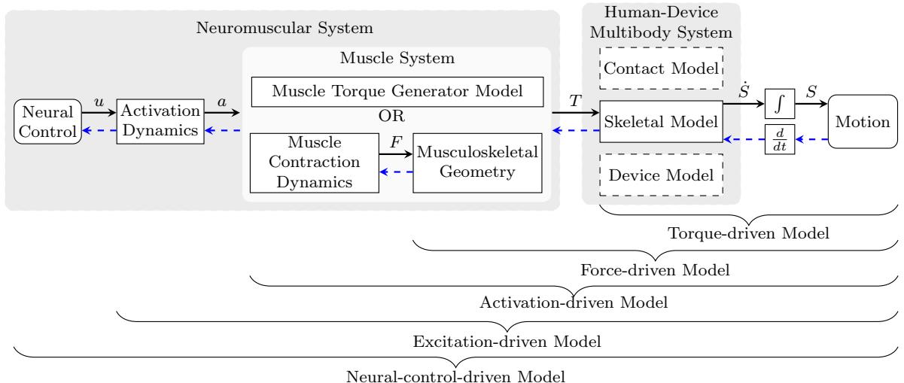

# 人体神经肌肉骨骼系统的预测性多体动力学仿真：综述

M´ıriam Febrer-Nafr´ıa, Ali Nasr, Mahdokht Ezati, Peter Brown, Josep M. Font-Llagunes, John McPhee

收稿与录用日期后续插入

摘要 在过去的十年中，多体系统动力学在人体运动预测性仿真中的应用迅速增加。利用不依赖实验测试或原型的预测性“假设（what-if）”人体动力学仿真，可以更快、更经济且更安全地开发新的医疗干预手段和医疗器械。在本文中，我们对人体运动预测性多体动力学仿真的研究进行了全面综述，涵盖在临床实践、医疗与辅助设备设计、体育以及工业人机工程学中的应用。本文回顾了人体神经肌肉骨骼系统的多体模型，包括关节、接触以及肌肉力或力矩的模型，随后综述了利用最优控制方法和代价函数来预测人体运动的仿真方法。此外，本文还回顾了建模与最优控制软件，并指出了未来的研究方向。

关键词 神经肌肉骨骼系统模型 · 预测性动力学仿真 · 生物力学 · 最优控制 · 人体运动 · 综述

## 1 引言

多体动力学理论体系和方法非常适合用于研究人体运动的生物力学。人体骨骼系统由通过生理关节相连的骨骼组成，可以建模为由刚性连杆和机械关节构成的传统机构。该人体机构由肌腱单元驱动，并由中枢神经系统控制。将人体建模为机械多体系统，能够利用机械工程中的传统公式推导出其运动方程。为了仿真人体运动，这些运动方程还需要辅以肌肉驱动和神经控制模型。

Schiehlen 在其关于多体系统动力学的历史综述论文中指出，多体动力学已广泛应用于汽车、航空航天和机械领域 [1]。相比之下，生物力学被列为需要进一步研究的“具有挑战性的应用”。二十五年后的今天，生物力学已成为多体动力学中最前沿的研究领域之一。事实上，在过去完整的十年间（2012–2021年），《Multibody System Dynamics》期刊上发表的与生物力学相关的文章数量为 98 篇，占已发表论文总数（不包括社论）的 19%；也就是说，在《Multibody System Dynamics》中，大约每五篇发表的文章中就有一篇与生物力学相关。

生物力学相关研究数量的增长，得益于诸如在加拿大滑铁卢举办且近期迎来十周年的“IUTAM人体动力学研讨会：从多体系统到生物力学”（IUTAM Symposium on Human Body Dynamics: From Multibody Systems to Biomechanics）等学术活动 [2]。该活动汇聚了生物力学模拟与多体动力学领域的顶尖研究人员，开展了为期三天的密集学术交流。本文重点阐述自该研讨会以来的10年间，多体生物力学建模领域所取得的进展。

我们检索到了两篇近期发表的聚焦于神经肌肉骨骼建模与运动模拟的综述论文。Fregly 提出了关于生物力学模型如何在当前临床实践中发挥效用的个人见解 [3]。该论文提出了一些未来的研究挑战（例如模型个性化与验证等），以及在建模与模拟实现临床应用价值之前必须解决的临床、技术、合作和实践层面的问题。其次，De Groote 和 Falisse 综述了关于人类步态预测模拟的最新研究 [4]。该论文介绍了用于预测行走的各种不同模拟方法，以及提高模拟精度和验证模拟结果所面临的挑战与未来展望。

在本文中，我们综述了利用神经肌肉骨骼模型进行一般人体运动的预测模拟方法，即在不跟踪实验数据的情况下对人体运动进行的“假设分析（what-if）”模拟。本综述所收录的研究论文既不局限于临床应用 [3]，也不局限于行走运动 [4]。我们展示了在不同应用领域的研究，如临床、工业、体育或人机工程学。在临床领域，我们注意到美国食品药品监督管理局（U.S. Food and Drug Administration，FDA）近期建议使用计算机模拟来替代耗时且昂贵的临床试验 [5]。本文包含两个主要部分：1）建模部分，包括神经肌肉骨骼系统多体动力学建模的独特特征，例如非线性接触动力学、非理想关节以及肌肉几何与动力学；2）预测模拟部分，包括在缺乏实验数据时用于生成假设模拟的优化方法、优化代价函数与约束条件，以及具体应用。最后，我们对未来的研究方向提出了一些建议。

## 2 多体生物力学模型

人体运动多体动力学模型的精细程度取决于预期的预测和分析结果。人体可以通过理想的关节力矩、激活度或肌肉兴奋度来驱动（Figure 1）。在许多预测性仿真研究中，采用了仅具有几个自由度（degrees of freedom, DoF）且不含肌肉的概念模型 [4]。肌肉骨骼（Musculoskeletal, MSK）模型也可用于表示人体的运动，或者使用包含中枢神经系统（central nervous system, CNS）模型的神经肌肉骨骼（neuromusculoskeletal, NMSK）模型，这会增加系统动力学的复杂性。在以下各节中，将对不同的建模要素（骨骼、接触、神经肌肉骨骼以及人机交互）和建模软件包进行综述。文献中最相关的预测仿真的各建模要素详细描述可在补充材料（Supplementary material）中找到。

## 2.1 骨骼模型

多体模型使用刚体或柔性体来表示人体各环节的运动。这些环节代表一根骨骼（或一组骨骼）以及一同运动的周围组织（2.1.1 节）。关节以及环节之间的其他相互作用可以通过本构关系来表示，用于对它们之间的弹性元件（例如关节软骨和韧带）进行建模。运动学约束也可用于定义环节之间的相对运动（2.1.2 节）。骨骼模型可以通过理想关节力矩（T）驱动，如图 Figure 1 所示。如果采用 NMSK 模型（2.3 节），则可以由来自神经控制器（2.3.3 节）的肌肉力（F）、激活度（a）或肌肉兴奋度（u）驱动。

  
Fig. 1 以关节力矩（T）、肌肉力（F）、肌肉激活度（a）或肌肉兴奋度（u）作为输入的 NMSK 系统的正向动力学（Forward dynamic, FD）仿真（实线箭头）。状态向量（S）由位置和速度组成。逆动力学（Inverse dynamic, ID）仿真（虚线箭头）遵循与 FD 仿真相反的路径。肌肉系统可以使用肌肉力矩生成器（muscle torque generators, MTGs）或肌肉动力学（例如 Hill 型肌肉模型）与肌肉骨骼几何形状的组合进行建模。

## 2.1.1 铰接体模型

人体的运动学和动力学模型通常表示为一系列由关节连接在一起的刚性环节或铰接连杆 [6, 7]。根据目标运动和研究目的，可以选择 2D 或 3D 模型。例如，2D 模型曾用于预测下肢关节的矢状面生物力学特性 [8, 9]，而 3D 铰接体模型曾用于预测 3D 拐杖辅助行走步态 [10]。

从系统拓扑学的角度来看，骨骼系统主要由开式运动链（open kinematic chain）构成，较少情况下由闭式运动链（closed kinematic loop）构成（例如，双手抓住一个刚体时）。包含开式运动链的模型已被用于模拟人类步态的摆动相 [11, 12, 13, 14, 15]。具有串联运动学连接的开环模型在采用最少数量的坐标时，会导出常微分方程（ordinary differential equations, ODEs）系统 [14, 16]，而在采用相关坐标（例如自然坐标）时，则形成微分代数方程（differential algebraic equations, DAEs）系统。对于人类步态的双支撑相，由于模型包含闭式运动链，关节变量并不完全独立 [17]。闭环的另一个例子是骑行者的双脚固定在曲柄上，或者手抓在车把上时 [18]。因此，动力学方程呈现为 DAEs 的形式。对于包含闭式运动链的系统，仿真框架的求解难度会显著增加 [9]。

身体位置由广义坐标描述，广义坐标可以是相对坐标或绝对坐标。相对坐标主要与内部运动（即相邻环节之间的相对运动）相关，而绝对坐标表示相对于惯性参考系的位置和姿态。例如，在步行预测研究中，骨盆相对于惯性系的位置由绝对坐标定义，而膝关节角度则被视为相对坐标或关节坐标 [19]。这些广义坐标用于构建系统状态。

身体环节通常被假定为刚体，环节特性（包括长度、质心（center of mass, CoM）、质量和转动惯量）通常根据人体测量数据（文献中的解剖回归方程）进行计算，并通过缩放以匹配目标受试者 [9, 18, 20, 21]。运动捕捉数据可用于估计环节长度 [9]。对于快速运动，环节可能需要采用非刚体（“晃动质量”，wobbling masses）进行建模 [22]。

## 2.1.2 关节模型

人体的关节决定了身体各环节的方向性活动能力。在人体运动建模与分析中，理想关节通过引入自由度（DoF）并相应地为系统施加约束来连接相邻的刚体环节。关节的建模可以从简单的 1 自由度旋转（铰链）关节 [23] 到 6 自由度关节 [19, 24]。

运动学约束有助于对那些使用普通关节难以描述的解剖结构进行建模，否则这些解剖结构需要经过校准的韧带和软骨模型来生成所需的运动特征 [25, 26]。膝关节、肩关节和颈部的模型，就是利用运动学约束来实现复杂解剖结构建模的典型例子 [27]。

关节可以结合显式接触和韧带模型，以限制关节的生理运动 [26]。韧带是跨越关节连接两块骨骼的纤维组织，确保关节角度保持在功能性运动范围（range of motion, RoM）内 [28, 29]。韧带和软骨等被动结构可以通过复杂的方程式显式建模，也可以通过集中被动关节力矩进行建模 [22, 26]。这些韧带和软骨模型能够抵抗运动，并在关节过度屈曲或过度伸展时被激活 [24, 28, 30]。韧带通常被建模为非线性弹簧-阻尼器，对关节起到软限位或指数限位的作用 [24, 28, 29, 29, 31, 32]，并提高稳定性 [26, 29]。Eskinazi 等人表明，韧带刚度必须大于某个临界值，直接搭配最优控制才能收敛 [24]。

## 2.2 接触模型

在多体人体模型中，考虑并建模的最常见外部接触是足-地接触（对于步行、跑步和跳跃的建模是必需的），这也是本节的核心重点。

其他值得关注的接触包括臀部-座椅接触（例如坐立转换模型 [33, 34] 和骑行模型 [18, 35]）、拐杖-地面接触 [10, 36]，以及用于物理辅助设备 [33] 和外骨骼 [37, 38, 39] 的身体多点接触。

## 2.2.1 法向力模型

接触可以通过多种方式进行建模。下面大致按照模型复杂度从简单到复杂的顺序进行介绍。

一种方法是将接触建模为刚性关节。这在人体与表面处于连续接触的模型中尤为常见，例如深蹲过程中的足-地接触 [21]、手部刚性抓握物体 [18, 32]，以及踩踏过程中的足-踏板和臀部-座椅接触 [35, 40]。在接触可能是间歇性的情况下，可以通过仅在物体接触时施加运动学约束及其反作用力来对刚性接触进行建模。这导致在不同的仿真阶段使用不同的方程组。在使用刚性接触的 2D 模型中，每个足部接触通常使用两个点约束，分别代表脚跟和脚尖 [14, 41, 42]。根据足部模型的不同，3D 模型每只脚曾使用过一个 [43]、两个 [13]、四个 [16]，或者——当足部被建模为两个刚节时——六个 [44, 45] 点约束。

刚性接触模型可能会忽略接触过程中发生的某些足部运动。一种改进方法是考虑足部的“滚动”（roll），这可以通过将足部建模为无滑移滚动的刚体来实现。Ren 等人在其 2D 模型中将鞋底建模为曲面，并进行了拟合以使踝关节运动学与实验数据相匹配 [17]。在 Felis 和 Mombaur 的 3D 模型中，用一个球体代表脚跟，用一条短线段代表前足，从而在脚跟接触期间产生滚动运动，在产生前足接触期间产生 2D 旋转 [7]。

除刚体接触外，还存在许多可变形接触模型。其中最简单的是点接触模型。在点接触中，法向力通常被建模为地面与接触表面上某一点之间的线性或非线性弹簧及阻尼器。用于点接触的法向力模型包括线性弹簧-阻尼方程 [29, 46]、指数弹簧-阻尼方程 [47]，以及类似于或基于 Hunt-Crossley 的方程 [48, 49, 50, 51]。为了更好地模拟大面积表面上的接触（如足-地接触的情况），可以在整个表面上使用多个接触点。每只脚所使用的接触点包括 1 个接触点 [29]、2 到 5 个接触点（通常放置在足部边缘）[46, 47, 49, 52, 53]，以及以网格形式分布在接触表面上的更多数量的接触点（例如文献 [50] 中的 51 个和文献 [51] 中的 47 个）。在文献 [50] 的案例中，单元数量（51 个）是通过增加接触点数量直至模型与实验数据的拟合程度不再提升来确定的。

除了使用大量接触点之外，另一种替代方法是使用一个可以相对于足部移动的单点接触，这通常基于接触表面的几何表示。例如，足部已被建模为 2 到 8 个球体 [54, 55, 56, 57]，接触力施加在特定时刻球体上最接近地面的点；这些力是使用 Hunt-Crossley（或其他非线性模型）点接触方程计算的。比球体更复杂的几何形状也已被应用：Lopes et al. 使用超椭球体（superellipsoid）对足-地接触进行了建模 [58]，而 Millard and Kecskem´ethy 则使用了基于圆盘-平面接触的模型 [59]。根据 Lopes et al. 的研究，超椭球体模型比使用多个接触点的类似模型在计算上更高效 [58]。

另一种使用解析几何表示表面的模型是体积接触（volumetric contact）[60]。它利用弹性地基理论（elastic foundation theory）来表示分布在表面上的接触载荷，而不是作用于离散点上。在足-地接触中使用体积接触的一些初期工作采用了球体 [61] 和椭球体 [62, 63]，它也已被用于模拟体育运动中的冲击碰撞 [32]。

有限元（Finite element, FE）接触模型也已被用于足-地接触。与本文提及的其他模型相比，这是一种计算成本高昂的方法，特别是对于需要多次动力学仿真的预测模型而言，且文献中的范例较少。Halloran et al. 在一项专注于地面接触压力的研究中使用了 FE 模型，并报告接触模型占用了 99.5% 的计算时间 [64]。作为一种更高效的替代方案，Halloran et al. 开发了一个基于有限元（FE）模型训练的代理模型（surrogate model），该模型在计算时间减少 95% 的情况下获得了与 FE 模型相似的结果 [65]。

文献中现有工作对接触模型的选择，似乎是基于计算效率以及对仿真、优化或控制方法的适用性，而不是基于哪种建模方法对运动和接触力最为精确。在同类型仿真中对不同接触模型进行的直接比较很少 [58, 65]。若能有更多研究针对同一人体模型和运动对比不同接触模型的相对精度和计算效率，将有助于深入了解不同模型的相对优势。

## 2.2.2 摩擦力模型

当接触被建模为刚性关节或约束时，摩擦力可作为约束的一部分进行建模。为了确保摩擦力不超过实际物理极限，这些模型可能会添加额外的约束或惩罚函数来限制摩擦力（例如，可以基于库仑定律（Coulomb’s law）对其进行约束）[13, 42]。

对于可变形接触，一种摩擦力建模方法是使用基于库仑摩擦模型的速度相关函数。在这些“正则化”（regularized）模型中，摩擦力是速度的非线性函数，它近似于库仑摩擦，但引入了额外的参数来平滑摩擦力中的不连续性。

关于这些模型所用不同方程的一些示例，请参见 [48]、[51] 和 [53]。基于速度的摩擦模型的一个缺点是，方程在低速时往往呈刚性（stiff），而人体运动通常正是这种情况；在步态或跳跃过程中，足部在接触地面时不应发生滑移，在抓握物体时，手通常也不应发生滑移。另一个缺点是，即使预期没有滑移，该模型在接触期间仍允许存在一定的切向速度。

可变形接触的另一种替代摩擦模型是基于位置的摩擦模型。在基于位置的模型（包括刷毛摩擦模型（bristle friction models））中，摩擦力被建模为接触面上的切向弹簧。这为方程增加了一个额外的状态变量，导致其方程比基于速度的摩擦模型更为复杂。与基于速度的模型不同，基于位置的模型在静摩擦（stiction）期间不允许出现额外的滑移，这意味着对于观察到粘滑（stick-and-slip）行为的实验，它们更加精确 [66]。基于位置的足-地摩擦模型的示例参见 [47, 67]。

在这些模型中较少受到关注的一个接触方面是接触表面的横向顺应性（lateral flexibility，源于人体的软组织）。例如，足部的骨骼和关节可能会发生位移，而足部表面仍保持贴合（不滑动）在地面上。基于位置的摩擦模型有可能被用于对这种顺应性进行建模。在现有的基于位置的摩擦模型中，尚不清楚这是否是采用该模型的预期目的之一。

除了目前提到的模型之外，另一种潜在的摩擦模型是 Maw 摩擦模型 [68]。由于接触面上的法向力和切向力不同，接触面的不同区域可能会产生不同的黏着和滑移状态（例如某些区域滑动而其他区域黏着），该模型可以对这种效应进行建模。这可能适用于步态过程中的足部接触等生物力学模型，因为在步态接触过程中接触面积和接触力都会发生巨大变化。

## 2.3 神经肌肉骨骼模型

许多研究人员通过使用逼真的肌肉骨骼（MSK）模型，在预测仿真中引入了肌肉的力学行为，其中包括解剖学详尽的肌肉力学粘弹性模型，例如 Hill 型肌肉模型（第 2.3.1 节）。为了降低预测仿真的计算成本，可以使用肌肉力矩发生器（muscle torque generators, MTGs）来表示肌肉力产生的合力矩 [18, 42, 69]（第 2.3.2 节）。此外，肌肉模型还可以结合受生物学启发的神经控制方法（第 2.3.3 节），例如肌肉协同（muscle synergies）、中枢模式发生器（central pattern generators, CPGs）或牵张反射（stretch reflexes）。肌肉的力学特性限制了人体的最大运动表现 [70]，影响仿真结果 [6, 31]，并对验证精度产生影响 [26]。

## 2.3.1 Hill型肌肉模型

广泛使用的 Hill 型模型包括：(1) 用于对其力-长度-速度特性进行建模的收缩元件（contractile element, CE）$\left( F _ { V } \left( V \right) F _ { L } \left( L \right) \right)$；(2) 用于模拟肌肉刚度或被动响应的与肌纤维并联的非线性并联弹性元件 $( F _ { P } \left( L , V \right) )$；以及 (3) 利用应力-应变曲线表征相连肌腱刚度的非线性串联弹性元件。后者与肌肉模型串联（公式 1）。

$$
F (t) = F _ {A} (u, t) F _ {V} (V) F _ {L} (L) F _ {m a x} + F _ {P} (L, V)\tag{1}
$$

肌肉的产力特性受肌肉最大等长肌力 $\left( F _ { m a x } \right)$ 及其相关的最佳肌纤维长度和羽状角、肌肉最大缩短速度以及肌腱静息长度的影响 [11, 26, 31]。该模型的大多常数特性基于文献报道的数据。然而，肌肉骨骼几何模型负责计算肌肉长度和速度等模型变量。肌肉的几何路径模型既可以通过一组直线构建，也可以通过直线与空间曲线（包裹）的组合来构建 [24, 26, 47]。

由于相对缓慢的电化学过程，肌肉无法实现瞬间收缩或舒张。肌肉的力-速度特性部分解释了这种行为，但它同时也是肌肉激活时间历程的函数。主要是通过一个一阶微分方程 $\left( F _ { A } \left( u , t \right) \right)$ 将肌肉激活度随时间的变化率与肌肉兴奋度联系起来。

在预测模拟中使用高维复杂模型，通常会受到求解伴随的最优神经肌肉控制问题所需巨大计算成本的阻碍 [11]。由于数值问题，肌肉冗余的静态优化只能容纳简化的 Hill 型肌肉模型 [71]。然而，在预测模拟中使用基于生物学的肌肉模型，可以估算人体肌肉动作的代谢能量消耗 [49, 72, 73, 74]。

## 2.3.2 肌肉力矩发生器

在模拟中使用解剖学细节详尽的肌肉模型可以深入了解单个肌肉和关节的负荷；然而，这些肌肉模型会增加预测模拟的计算成本。另一种替代方法是使用生理力矩执行器来表示肌肉力量所产生的合力矩 [18, 42]。

在该方法中，每个关节由一对主动肌-拮抗肌参数化 MTG [9]（公式 (2)）驱动，用以模拟关节周围的屈肌群 (+) 和伸肌群 (−) [32, 75]。MTG 由主动和被动元件组成。主动分量包括每个关节处与角度相关 $\left( \tau _ { \theta } \left( \theta \right) \right)$ 和与角速度相关 $\left( \tau _ { \omega } \left( \omega \right) \right)$ 的力矩产生能力 [42]，分别代表生理上的肌肉力-长度和力-速度关系 [18]。为了同时兼顾向心和离心肌肉收缩，缩放函数采用分段形式 [18]。被动分量 $( \tau _ { p } \left( \theta , \omega \right) )$ 被建模为非线性旋转弹簧和阻尼器，代表关节周围肌肉组织、肌腱和韧带拉伸所产生的被动力 [18]。描述 MTG 力矩产生能力的曲线通过最大等长力矩进行归一化，通常根据测力计实验数据进行表征 [75]。与传统肌肉类似，一个微分方程 $\left( \tau _ { a } \left( u , t \right) \right)$ 将肌肉激活度 (a) 随时间的变化率与肌肉兴奋度 (u) 联系起来。

$$
T (t) = \tau_ {a} ^ {+} (u ^ {+}, t) \tau_ {\omega} ^ {+} (\omega) \tau_ {\theta} ^ {+} (\theta) \tau_ {0} ^ {+} + \tau_ {a} ^ {-} (u ^ {-}, t) \tau_ {\omega} ^ {-} (\omega) \tau_ {\theta} ^ {-} (\theta) \tau_ {0} ^ {-} + \tau_ {p} (\theta , \omega)\tag{2}
$$

通过使用 MTGs（肌力矩生成器），NMSK（神经肌肉骨骼）模型和动力学仿真得到了简化，因为模型参数和输入变量的数量减少了 [18]。通过使用 MTGs 替代线型肌肉，无需求解冗余肌力，从而加快了仿真速度并使数值结果更易于解释 [75]。由于 MTGs 具有二阶导数连续性，其应用促进了基于梯度的优化 [75]。此外，由于 MTGs 模拟的是肌群而非多条线型肌肉，因此更容易贴合特定受试者 [75]。然而，关节反作用力无法通过基于 MTG 驱动的模型进行计算 [69]。在屈肌 (+) 和伸肌 (−) MTG 分量发生协同收缩的情况下，人们再次面临需要解决的冗余问题；目前似乎尚未有关于协同收缩情况下 MTGs 求解的发表文献。

## 2.3.3 神经控制

CNS（中枢神经系统）被认为是通过将单个肌肉组合成群来协调身体运动的 [23]。类似地，在人体模型中，大量独立的肌肉激活可以通过低维的协同激活集进行控制 [51, 76]。协同控制（较低维的时变信号集）可以通过分解经过处理的高维肌电（EMG）信号集来获得。对于分解，通常采用结合优化方法的非负矩阵分解（non-negative matrix factorization）[77]。协同权重定义了每个协同控制对处理后 EMG 信号的贡献 [51, 76, 78, 79]。肌肉协同的应用降低了神经肌肉控制问题的复杂性和规模 [23, 76, 80, 81]，简化了控制过程 [76, 81]，改善了预测结果 [82]，并提升了最优控制算法的计算速度与收敛性 [51, 78]。

Table 1 预测仿真中不同神经肌肉骨骼损伤建模方式总结。

<table><tr><td>损伤类型</td><td>建模方法</td><td>参考文献</td></tr><tr><td rowspan="2">肌肉无力</td><td>降低最大等长肌力</td><td>[57, 89]</td></tr><tr><td>限制最大髋外展力矩（约束）</td><td>[46]</td></tr><tr><td>肌肉挛缩</td><td>减小肌肉的最佳肌纤维长度</td><td>[57]</td></tr><tr><td rowspan="2">脑瘫 (Cerebral palsy)</td><td>个体特异性肌肉力矩生成器</td><td>[9]</td></tr><tr><td>个性化几何结构（来自 MRI 图像）、个性化肌腱参数（最佳肌纤维长度和肌腱松弛长度）、痉挛模型-个性化反馈增益估计，以及通过肌肉协同建模降低神经肌肉控制复杂度</td><td>[80]</td></tr><tr><td>脊髓损伤</td><td>利用无力因子限制失神经支配肌肉的最大神经兴奋</td><td>[14]</td></tr><tr><td>非脊髓性膝关节损伤</td><td>根据双能 X 射线吸收测定法和人体测力计测量结果，在模型中实现个体特异性参数和力矩生成函数</td><td>[90]</td></tr><tr><td rowspan="2">中风</td><td>个体特异性肌腱参数、肌肉骨骼几何结构、肌肉协同控制</td><td>[51, 76]</td></tr><tr><td>个体特异性关节和惯性参数</td><td>[12, 15, 19]</td></tr><tr><td rowspan="2">膝骨关节炎</td><td>个体特异性代价函数权重</td><td rowspan="2">[41, 53, 74, 89, 91]</td></tr><tr><td>移除肌肉</td></tr><tr><td rowspan="2">截肢者</td><td>在踝关节处添加被动刚度</td><td rowspan="2">[89]</td></tr><tr><td>减轻小腿和足部节段的质量以模拟假肢</td></tr></table>

作为基于协同方法的一种替代方案，机器学习方法可用于将处理后的 EMG（肌电图）信号映射到肌肉兴奋 [83, 84]。

人类运动源于 CNS（中枢神经系统）、MSK（肌肉骨骼）系统与环境之间的节律性相互作用 [28]。CPG（中枢模式发生器）是一个神经细胞网络；在缺乏感觉反馈的情况下，它可以在没有节律性输入时形成神经活动的同步节律性运动信号 [28, 43, 67]。CPG 可以在抵抗扰动的稳定性和速度控制方面在人类运动中发挥作用 [28]。它们主要用于步态（行走和跑步）的最优控制模拟 [28]。

NMSK（神经肌肉骨骼）模型可以结合一组基于生物学启发的牵张反射控制规则，这些规则产生的肌肉兴奋信号由当前的运动学、肌肉状态和环境条件决定 [54]。每块肌肉通过牵张反馈控制器 [54] 或比例-微分控制器 [85]，按其归一化肌纤维长度的比例被激活。基于牵张反射的控制律用于人体肢体的抗扰动和精确控制 [85]。

## 2.4 个体特异性与损伤建模

人体肌肉骨骼（MSK）模型可以通过从文献中获取定义骨骼模型（惯性与几何参数）、肌腱（MT）模型以及足-地接触模型的不同参数值来构建。这些参数通常基于尸体标本的实验测量值进行估计 [86, 87]。根据研究目的，特别是对于临床应用，这些参数可以进一步针对个体特征进行具体化，以开发患者特异性模型 [9, 19]（Table 1）。为所研究的患者建立受试者特异性模型对于获得有意义的模拟结果至关重要，并且还可以作为客观治疗规划方法的基础 [88]。为此，准确确定这些参数值非常重要。

## 2.4.1 骨骼模型

身体环节属性（质量、长度、惯性属性）以及关节中心和关节轴通常使用回归方程从通用模型调整为特定受试者模型。这是大多数预测性模拟研究的常用方法 [14, 41, 53, 57, 82]，其中环节长度使用反光标记点进行测量，并用于计算缩放因子以缩放人体测量学属性 [92, 93]。根据研究目的，可以使用特定群体模型，例如：女性-男性、青年人-老年人。在 [94] 中，对四个不同群体的跑步进行了预测：青年女性、青年男性、老年女性和老年男性。在 [33] 中，预测了支持老年患者起坐转移的最佳方式，其质量和惯性参数取自男女老年人群的第 20/50/80 百分位数。然而，线性缩放存在一定的局限性，当受试者远离群体平均值时（例如脑瘫儿童 [80] 或残奥会运动员 [95]），该方法可能不够准确。

医学成像，例如磁共振成像（MRI）[80, 96]、计算机断层扫描（CT）成像 [97, 98]、双平面X射线 [99] 和双能X射线吸收测定法（DXA）[95]，已被用于构建受试者特异性模型。在文献 [96] 中，作者开发了用于在 OpenSim 中创建受试者特异性骨骼几何形状、关节、肌肉路径和包络面的软件。他们通过开发基于 MRI 的下肢肌肉骨骼模型对该软件进行了测试。在文献 [97] 中，从 CT 图像中分割出了植入全膝关节置换术（TKR）假体的受试者的特定骨骼几何形状。在文献 [99] 中，利用双平面X射线测定了6名儿童和6名成人的受试者特异性质量及身体节段质心（CoM）的三维位置。在文献 [95] 中，作者旨在界定残奥会运动员（例如脊髓损伤和下肢截肢患者）的身体节段参数。基于 DXA 对二维身体节段参数（即质量、长度、CoM 位置矢量以及绕 CoM 的主转动惯量）进行了量化。既往研究提出了新方法 [95, 96, 99] 或使用受试者特异性模型进行仿真 [97]，但并未预测新的运动。在文献 [80] 中，根据一名伴有骨骼畸形的脑瘫（CP）患儿的 MRI 图像构建了具有个性化几何形状的 3D MSK 模型，并用于预测该特定患儿的步行运动。

其他研究则利用动态测量数据（如标志点轨迹和地面反作用力）结合优化方法来校准模型关节和/或惯性参数。文献 [15] 开发了一种估计髋、膝和踝关节中心及关节轴，以及全身惯性参数的方法。基于该方法，作者使用 3D 理想力矩驱动模型预测了膝骨关节炎受试者的步行运动，旨在为膝骨关节炎康复设计患者特异性的步态修正方案 [12, 19]。该课题组还预测了中风后受试者在不同速度下步行的步态 [51]，并使用 3D 肌肉协同驱动模型设计了一种治疗方案，以改善中风受试者中风后步态中的推进力对称性 [76]。

尽管已经开发了一些基于医学成像构建下肢 MSK 模型的方法，但这些个性化模型很少用于预测性仿真。原因之一可能是现有的建模方法仍需进一步改进，因为它们仅应用于单个关节 [98]、下半身 [15]，或仅在单个受试者身上进行了测试 [80, 96, 97]。此外，现有的用于预测性仿真的模型个性化过程需要大量的学习时间 [3]。

## 2.4.2 肌肉模型

为了确定肌肉力，正确识别肌肉几何形状（例如肌肉附着点、肌肉路径）以及 MT（肌腱）参数（用于描述 Hill 型肌肉模型）至关重要。在存在骨畸形的情况下，例如脑瘫儿童 [80]，个性化的骨骼形状和肌肉附着点尤为重要。描述 Hill 型肌肉模型的 MT 参数通常采集自尸体研究。最大等长肌力通常与骨骼模型参数（环节质量、长度、转动惯量）一起进行线性缩放。然而，MT 参数具有受试者特异性，且不同受试者之间的数值差异很大 [87]。

目前已提出了多种结合测量与优化技术来估计个性化 MT 参数的方法。文献 [100] 研究了考虑受试者体型差异的不同技术，作者发现，通过在整个关节运动范围内保持肌肉工作范围（肌力产生特性）进行缩放是效果最好的方法。在 [101] 中，前述方法得到了推广，用于在通用模型线性缩放后调整下肢肌肉参数，并在由医学图像构建的髋关节受试者特异性模型中“从零开始”估计肌肉参数。在 [87, 102] 中，通过功能性运动测得的角度-力矩关系（标记点轨迹和测力计测量）被用于估计 Hill 型 MT 参数值。运动数据和 EMG（肌电）测量结合优化技术已被用于识别肌腱参数 [61, 80, 103]。MTG 参数也已通过测力计测量得到识别 [9, 75, 104]。

## 肌肉功能障碍

肌肉无力和肌肉挛缩是脑瘫、中风、肌营养不良和脊髓损伤等多种神经肌肉骨骼（NMSK）疾病中常见的机能缺陷。预测仿真研究中的通用方法是通过设定一个相对于“健康”状态的无力因子（或使用百分比）来模拟肌肉无力，以此限制特定肌肉或肌群所能产生的最大力 [14, 46, 57, 89, 105]。为了模拟肌肉挛缩，文献 [57] 将肌肉的最佳肌纤维长度相对于“健康”状态缩短了不同百分比。在所有这些研究中，主要目标是检验预测框架在模拟受损行走时能否正确预测预期趋势，而不是试图为特定受试者寻找治疗方案 [14, 46, 57, 89]。当预测特定受试者的运动时，描述 Hill 型模型的肌肉肌腱（MT）参数会基于实验数据进行个性化调整。在文献 [9, 104] 中，利用肌肉肌腱单元组（MTGs）来产生跨越每个关节的所有肌肉的组合效应，并基于为研究所针对的特定受试者收集的实验数据，对最大等长扭矩进行了个性化设置。MT 参数可以通过优化算法进行估计，包括最佳肌纤维长度和肌腱松弛长度 [51, 76, 80]，以及描述激活力学特性的其他参数 [76]。肌电（EMG）驱动的建模也已被用于调整患者肌肉骨骼几何结构的代理表征，以提高行走过程中下肢关节力矩的预测精度 [106]。

## 老龄化

老龄化会导致运动能力的进行性丧失（主要由肌肉无力引起）[107]，以及刚度和张力的增加 [108]。针对老年受试者的预测仿真研究较少。在文献 [34] 中，使用特定人群模型对虚拟健康年轻个体和老年个体的从坐到站（sit-to-stand）动作进行了预测和对比（数字健康年轻组和老年组各包含 5 名数字男性和 5 名数字女性个体）。对于老年模型，假设并应用了等长肌力降低 20% 的比率。在文献 [33] 中，对老年患者的从坐到站转移进行了预测，以设计最佳的物理辅助装置。然而，该模型由理想关节扭矩驱动，且未对每个关节所能产生的扭矩施加限制。

## 2.4.3 神经控制模型

运动数据和 EMG 测量值结合优化技术，已被用于识别肌肉协同参数 [51, 76, 109]。然而，NMSK 损伤中的神经控制和肌肉行为与健康受试者相比存在某些差异。在临床应用中，如果要为特定受试者获得有意义的结果，正确建模这些机能缺陷至关重要。

## 神经控制损伤

痉挛（Spasticity）是脑瘫（cerebral palsy, CP）和中风中的常见损伤，其特征是牵张反射亢进。然而，痉挛的潜在机制及其对步态的影响仍未得到充分理解。在 [110] 中，小腿被建模为一个力矩驱动的单连杆摆，以深入探究痉挛的生理机制；在 [111] 中，开发了一种基于肌力反馈的痉挛模型。该模型在 [80] 中被应用于一名脑瘫患儿的预测仿真案例研究中。高肌肉共收缩（muscle co-contraction）常见于神经系统受损受试者。在这些情况下，结合 EMG 测量信息的基于模型的优化技术可用于解决肌肉冗余问题，从而求解出更符合实际的主动肌和拮抗肌肌力 [112]。最后，神经肌肉控制复杂性的降低已通过肌肉协同（muscle synergies）进行建模，并在脑瘫患儿案例中施加了较少数量的协同 [80]。

## 2.4.4 足-地接触模型

当使用弹簧和阻尼器单元、Hunt-Crossley 模型或体积接触来对足-地接触进行建模时，需要指定这些模型的参数值。预测仿真研究中使用的一种方法是手动调整这些参数以拟合实验测量数据 [48, 53, 54, 70]。另一种方法是针对特定受试者校准这些数值，通过求解一个使仿真数据与测量数据（运动和地面反作用力）之间的差异最小化的优化问题来实现 [37, 76, 82, 89]。在 [62] 中，压力数据被纳入了优化流程中。

可以通过做出某些假设来减少待校准参数的数量。例如，通常假设双足之间的参数值是对称的 [51, 113, 114]。其他方法包括在代价函数中最小化各个弹簧刚度（或阻尼系数）与所有弹簧平均刚度（或阻尼系数）之间的差异 [114]，或者通过三维抛物面来近似整个鞋底的刚度分布 [51]。减少变量的另一种方法是对所有弹簧-阻尼单元采用某些恒定的参数值，例如阻尼系数 [51] 或摩擦系数 [114]。

在 [115] 中，接触模型参数值利用来自五名受试者的实验数据（每名受试者在不同步行速度下进行 15 次试验）进行了校准，研究发现粘弹性单元的垂直和前后位置对每位受试者而言都是特异的。在 [114] 中，进行了一项灵敏度研究，作者发现双脚的自由力矩对刚度值的变化表现出中等灵敏度，而所有其他地面反作用力量对模型参数值的变化几乎不敏感。然而，其验证仅使用了一名受试者在相同步频下的步态数据。在 [62] 中，采集了一名受试者在三种不同速度下的数据：一种速度用于校准，另外两种速度用于验证。然而，该模型并未通过运行预测性仿真来进行评估，且数据仅采集自一名受试者。在 [89] 中，作者将基于文献 [116] 通用模型的 3D 全身肌骨模型结果与使用优化接触模型的结果进行了对比。尽管接触几何形状存在较大差异，但使用通用模型代替优化接触模型对预测的步态模式几乎没有影响，仅在踝关节角度上存在微小偏移。所有这些结果都引出了一些悬而未决的问题：这些参数值是否真正具有受试者特异性，以及其中哪些参数对于精确的预测性仿真更为关键。

## 2.5 人-机模型

为了设计与人体相互作用的设备，有必要将设备与人体一同建模。人-机建模与预测性仿真能够提供对不可测量变量的洞察 [42]，有助于改进增强型设备的设计 [32, 39]，是确定最佳设备特性和实现设备参数个性化的实用工具 [9, 82]，可缩短原型开发周期 [41]，用于研究设备性能和交互体验 [39, 85]，并提高运动表现 [18, 32, 40]。人-机预测性仿真的示例包括被动辅助设备（例如拐杖 [10] 和轮椅 [90]）、可穿戴机器人或外骨骼 [37, 38, 39, 39, 75]、被动或主动矫形器 [9, 14, 74, 82, 89]、自行车 [18, 40]、高尔夫球杆 [32, 104]）以及车辆 [85]。

人-机交互模型的复杂度从非常简单到高度详细不等。在一个简单模型的示例中，仅考虑了可穿戴机器人设备的合成主动和被动关节力矩，用于在优化框架内研究人体的跳跃性能 [42]。相比之下，一个全面的高保真车辆动力学模型结合神经肌肉驾驶员模型被用于研究驾驶员的控制性能、转向手感以及人体对车辆控制和稳定性的影响 [85]。

根据研究目标以及设备的机械特性，设备可以建模为刚体或柔性体。例如，外骨骼可以建模为通过运动学约束与穿戴者相耦合的刚体机构，以预测外骨骼将如何影响人体运动 [38, 39, 75]。利用直接正交配点法以及包含肌肉 MTG 模型和柔性高尔夫球杆 Rayleigh 梁模型的多体动力学模型，研究人员发现了对高尔夫挥杆和球杆的改进方法 [32, 104]。

在某些应用中，不仅需要对设备进行建模，还需要对设备与环境或人体的相互作用进行建模。例如，除外骨骼模型外，在线性或旋转弹簧-阻尼元件被用于在最优控制框架中对人-外骨骼接口进行建模，以评估用户舒适度及交互有效性 [37]。在拐杖和人体模型中引入了拐杖-地面接触模型，以预测不同的三维拐杖辅助行走步态模式 [10]。在自行车模型中采用了轮胎力和力矩的 Pacejka 模型，用于双腿骑行者站立起步的预测动力学仿真 [18]。

一些设备是有源（动力驱动）的，由电机和机械传动装置提供外部驱动力。这些设备还包含一个控制系统，用于定义运动任务期间的设备助力。例如，在基于最优控制的预测仿真方法中使用了主动（或动力驱动）膝踝足矫形器模型，以在行走过程中个性化膝关节轨迹参数 [82]。Garc´ıa Vallejo 等人将主动矫形器建模为附着在下肢的外置设备，用于预测矫形器辅助下的人体步态，同时优化踝关节刚度（设备设计参数） [14]。通常，这些研究中采用的驱动系统（电机和机械传动装置）模型都非常简化 [14, 82]。

## 2.6 建模软件包

多种商业（例如 MapleSim、AnyBody、MuJoCo 和 LifeMOD/Adams）和开源（例如 OpenSim 和 BiomechZoo）多体动力学程序已被用于建模和仿真人体

MSK（肌肉骨骼）系统。这些程序为人机运动仿真提供了关节和 Hill 型肌肉模型。在此我们介绍已用于预测仿真的软件。MapleSim 基于符号计算，可在需要时（例如用于优化或灵敏度研究）提供解析导数，而 AnyBody、MuJoCo、LifeMOD 和 OpenSim 则使用数值编程。

OpenSim (SimTK, Stanford, CA, USA) 是一个广泛使用的开源生物力学建模与模拟环境，它依赖于 Simbody 动力学引擎；该软件由 Stanford University（斯坦福大学）开发 [117]。它提供了动力学运动方程的显式表达 [55]，并采用变步长的 5 阶 Runge–Kutta 积分法 [55] 或半显式 Euler 积分器 [57, 78]。OpenSim 提供了用于生成追踪模拟的工具 [118]，例如模型缩放工具（scale model tool，用于利用表面标记点数据将 OpenSim 通用模型缩放到目标受试者的尺寸 [76, 82]）、逆运动学分析工具（inverse kinematic analysis tool，用于从标记点轨迹获取人体模型的关节坐标 [10, 37, 82, 91]）、逆动力学（inverse dynamic, ID）分析工具（用于获取合成净关节力矩 [37, 76, 82]）以及肌肉分析工具（muscle analysis tool，用于计算肌腱长度和肌肉力臂 [51, 76]）。

AnyBody 建模系统（AnyBody Modeling System [119]，AnyBody Technology, Aalborg, Denmark）提供了一个基于解剖学研究构建的通用 MSK 模型。AnyBody 包含两个图形用户界面和一个可由其他程序调用的控制台。它使用动态试验来缩放各个身体环节。AnyBody 仅限于 ID 模拟；它使用基于 ID 的优化方法计算肌肉力，以最小化多项式肌肉招募准则 [46, 119]。

MapleSim (Maplesoft Inc., Waterloo, ON, Canada) 是一款支持 MSK 系统建模的多体动力学模拟软件。MapleSim 的多领域能力允许在同一软件中对人体和设备（例如自行车 [18]、车辆 [85]、康复机器人 [120] 或轮椅 [90]）进行建模。符号模型和优化后的模拟代码可以从 MapleSim 环境中导出为 DAE 或 ODE，以用于计算高效的前向动力学（forward dynamic, FD）模型 [18, 85, 90, 104]。

## 3 生物力学中的人体运动预测模拟

## 3.1 生物力学模拟方法

一旦选定了人体生物力学模型，就需要一个求解器来模拟该模型针对特定任务的运动。模拟求解器采用预测模拟方法，包括基于优化的方法和反馈控制方法。基于优化的方法使用“轨迹优化”或“最优控制”进行任务分析。反馈控制方法则借助直线规划或非最优控制器来解决特定任务的模拟问题。在本文中，我们重点关注基于优化的方法，以及那些使用优化来引导其控制器的反馈控制方法（例如模型预测控制）。

## 3.1.1 基于优化的方法

轨迹优化（trajectory optimization）与最优控制（optimal control）作为常用的基于优化的方法，常常被混淆并互换使用。在轨迹优化中，通过确定静态参数值来优化给定的性能指标。相比之下，在最优控制中，则是估计系统的时变输入以及（可选的）静态参数，以优化给定的性能指标。最优控制方法分为两类：间接法和直接法 [121]。

间接法利用变分法获得最优控制的解析表达式，即伴随微分方程。因此，需要求解边值问题以获得最优解。然而，由于大多数伴随变量缺乏明确的物理意义，为其寻找初始猜测值极具挑战性。此外，伴随微分方程具有高度非线性；因此，对这些微分方程进行反向积分在数值上可能不稳定。

在直接法中，不需要求解边值问题。取而代之的是，将控制量和/或状态量参数化，并将最优控制问题转化为非线性规划问题（NLP）进行求解。具有大规模 NLP 的系统（例如人体运动的最优控制）可以使用不同的软件包进行求解，例如内点优化器（IPOPT）和稀疏非线性优化器（SNOPT）。直接法分为两种具体方法：直接打靶法（direct shooting）和直接配置法（direct collocation）。

在直接打靶法中，优化设计变量是模型控制量。在该方法中，正向动力学方程被显式积分，并通过时间推进步进式地依次求解每个时间帧。该方法的缺点在于数值积分问题可能会导致预测出不稳定的运动。因此，使用直接打靶法预测稳定运动通常需要稳定化反馈控制。

为了克服直接打靶法的缺点，研究人员采用了直接配置法，其中优化设计变量同时包含模型控制量和状态量。在该方法中，正向动力学方程采用隐式求解，并且所有时间帧同时求解。尽管该方法会导致规模庞大的非线性优化问题，但它可以在不面临数值积分问题的情况下预测新条件下的稳定运动。

## 3.1.2 反馈控制方法

在反馈控制方法中，正向动力学模型和反馈控制器可以在结合或不结合逆动力学模型的情况下使用。利用控制器，通过与参考运动数据进行比较来更新关节执行器数值（力矩或肌肉力）。一种经典的反馈控制方法是比例-积分-微分（PID）控制。PID 通过反馈过去的误差来控制受控对象（plant）模型。

由于数值微分误差和不准确的模型参数，反馈控制方法可能会预测出不切实际的关节力矩或肌肉力。一些研究将反馈控制器与模型预测控制（MPC）结合使用以改善结果。

MPC 可以被认为是一种实用的基于优化的方法，它使用内部模型来估计/预测输出，将其与参考数据进行比较，并最终通过最小化代价函数来预测受控对象模型的控制输入。代价函数可以包含数据跟踪误差。MPC 不仅能为模型提供稳定性，还具有预测特性 [23]。MPC 是一种快速的近最优控制器，似乎非常适合实时生物机电应用 [120]。

## 3.2 生物力学预测仿真的组成部分

在本小节中，我们描述了用于运动预测的优化公式（主要是最优控制方法）的组成部分：仿真输入、初始猜测、约束条件和代价函数。人们认为中枢神经系统（CNS）会在运动过程中优化运动表现（即最小化运动代谢消耗、肌肉活动度、发力程度或其他准则），文献中也提出了不同的代价函数项来在数学上表示这些最优原则 [4, 11, 43, 52, 122]。此外，一些仿真还包含一些可能与最优原则没有直接关系的任务要求（例如到达目标位置）[123]，或包含与临床相关的目标 [3, 80]。值得特别提及的是与体育相关的预测仿真，其目标是最大化运动表现而非最小化发力消耗 [32, 42, 104, 124]。文献中最具代表性的预测仿真的优化公式各组成部分的详细描述见补充材料。

## 3.2.1 控制变量与状态变量

## 力矩驱动模型

采用基于逆动力学（ID）算法的力矩驱动模型进行预测仿真时，将广义坐标 [17, 44, 45, 125] 或广义坐标与地面反作用力 [12, 15, 19] 用作输入。这些文献采用参数优化或序列二次规划（SQP）来求解优化问题。当采用基于正动力学（FD）的算法时，优化问题的输入为关节力矩以及广义坐标和/或速度的初始值 [7, 33, 42, 43]。这些文献采用动态优化（协方差矩阵自适应）或直接多重打靶法来求解该问题。最后，在直接配置（direct collocation）方法中，关节力矩以及广义坐标和速度均作为优化算法的输入 [16, 104]。在直接配置方法中用作控制量的其他变量还包括关节加加速度（jerk）[10, 37, 82] 和关节力矩变化率 [10, 82]。一项预测随机环境中行走的研​​究 [126] 将广义坐标和速度定义为状态量，将状态反馈控制律参数定义为控制量。

## 肌肉与协同驱动模型

采用肌肉驱动（及协同驱动）模型的预测仿真通常将肌肉兴奋、肌肉激活或肌肉力用作控制量。在基于正动力学（FD）的方法中，控制量通常是肌肉兴奋 [9, 11, 20, 49, 65]，其次是肌肉激活 [71, 75, 81] 和肌肉力 [41]。状态量（肌肉激活、肌肉长度、广义坐标和速度）的初始值可以在问题中直接指定，也可以作为未知量进行求解。当它们被指定或已知时，可以从实验数据中获取（例如，假设静态平衡）[20, 65, 124]，也可以预先进行优化 [47]。在文献 [11] 中，广义坐标和速度的初始条件根据实验数据直接指定，但肌肉激活的初始条件则作为变量包含在内。Garc´ıa-Vallejo 等人采用了一种参数优化方法，其中肌肉力和广义坐标均作为设计变量 [13, 14]。

在直接配置法中，大多数研究将肌肉兴奋定义为控制变量，并将肌肉激活度、肌肉长度（CE 长度）、广义坐标和速度定义为状态变量 [35, 48, 55, 74, 118]。在 [23] 中，肌肉长度未包含在状态变量中，而在 [127] 中，肌肉力被用作状态变量以替代肌肉长度。肌肉驱动仿真中使用的其他类型控制变量包括肌肉力矩发生器的激活/去激活时间 [32]、肌肉协同控制量 [51]、组合系数 [78]、关节加加速度 [24, 51, 76]，以及肌肉激活度、肌腱力和速度的时间导数 [80, 89]。基于 Geyer 和 Herr [128] 提出的肌肉反射控制器的执行器控制律的预测仿真，将控制器参数定义为设计变量 [28, 67, 72, 129]，或将控制器参数连同广义坐标和速度的初始值一起定义为设计变量 [30, 54, 57]。

## 静态参数

除控制变量和状态变量外，一些预测研究还包含了待优化的静态参数，例如全（或半）周期持续时间 [33, 82, 89, 124]、跨步/步态周期持续时间 [48, 70]、不同运动阶段的持续时间 [13, 30, 33, 45]、跨步长/步长 [14, 82] 以及行走速度 [7]。已使用的其他参数包括足部朝向角、足跟着地时两踝之间的内外侧间距 [13]、跖趾（MTP）关节的角刚度 [52, 70]，以及用于模拟肌肉、韧带和被动组织的顺应性及阻尼特性的线性弹簧-阻尼器参数 [7, 43]。

## 辅助运动

对于预测辅助运动的研究，需要特别提及。假肢或矫形器的电机力矩 [14, 41] 或人体-外骨骼接触力 [37] 可被视作控制输入。此外，当优化用于辅助设备设计时，矫形器设计参数如弹簧刚度 [9, 14, 42] 或平衡位置 [42] 可作为设计变量添加。在 [130] 中对上肢外骨骼控制器的增益和参数进行了优化。最后，在 [76] 中，针对中风后患者的快速功能性电刺激（FES）治疗的刺激幅度和定时进行了优化。

## 3.2.2 初始猜测

## 初始猜测定义

基于正向动力学（FD）方法中的状态初始值可以通过实验数据获得 [29, 75]，通过施加特定姿态（如站立姿势 [42]），或通过寻找最优稳态来获取 [65]。它们也可以被赋予随机值 [28]，或设为零，尤其是速度 [16, 42, 75]。控制量可以赋予常数值 [65, 75]，或者手动微调直至找到第一个“良好”解 [42, 54, 67, 72]。在控制量和状态量均为变量的方法中，需要给出若干时间点的初始猜测值。一种方法是根据实验数据 [9, 19, 104] 或正向动力学仿真 [55, 118] 来确定这些初始猜测值。一些研究使用正常（或自选）速度下的步态实验数据，并预测更高和更低速度下的步态 [51, 89, 131]。也可以仅给出初始和终止状态 [18, 37]。一些研究人员则使用随机值、准随机值或任意值作为初始猜测值 [8, 30, 73, 124, 132]。

最常见的方法是使用先前追踪或预测问题的解作为初始猜测值。在追踪问题中，参考运动可以从已发表研究的实验数据中获取 [48, 122]，也可以采集自健康受试者 [48, 56, 94, 122] 或患者 [51, 76]。另一种选择是使用先前仿真中获得的解作为初始猜测值 [23, 57, 122, 126]，特别是在为了促进收敛而在最初的仿真中“放宽”某些约束、随后逐步“收紧”的情况下 [21, 73]。在其他情况下，会首先生成名义条件（例如平均速度或正常行走）下的初始预测，然后将其作为预测不同条件下运动的初始猜测值 [42, 51, 67, 74]。或者，可以从随机初始猜测值开始进行首次预测，并将每个解用作下一次预测的初始猜测值，并在后续预测中收紧某些容差 [73]。

## 敏感性分析与全局最优

一些研究使用不同的初始猜测值来确定最优控制解对初始猜测值变化的敏感性 [55]，并证明其仿真对初始猜测值的鲁棒性 [89, 132]。文献 [18] 发现，初始和最终猜测值似乎仅影响 CPU 时间，并未影响最优解。然而，文献 [81] 发现该方法对初始猜测值明显敏感，因此进行了多次运行以获得结果的均值和变异性。

很难确保所获得的解是全局最优解。在文献 [124] 中，他们发现无论初始猜测（initial guess）如何，算法都会收敛到相同的解。在文献 [41] 中，作者仅考虑了可以从多个初始种子中发现的解。然而，先前的这些研究预测的是二维跳跃和二维下肢步态运动；而对于三维行走，通常不同的初始猜测会收敛到不同的解，且具有最小代价函数值的解被视为最优解 [8, 28, 30, 40, 48]。这些参考文献使用 2 到 10 个不同的初始猜测运行每次仿真，并发现每个不同的初始猜测都会产生不同的解。在文献 [126] 中，针对一个简单的一自由度（DoF）摆起摆问题，他们使用了 100 个随机初始猜测。取决于模型和问题的复杂程度，可测试的不同初始猜测的数量是有限的。

## 3.2.3 约束条件

在优化方法中，约束可分为动力学约束、代数等式约束和代数不等式约束 [133]。在文献中，代数约束也被分类为内部路径约束或终端路径约束 [6]，以及时变约束或非时变约束 [44]。在最优控制方法中，系统动力学（可能包括骨骼动力学、激活状态动力学和收缩动力学）在显式表述中通常定义为微分方程 [43]，而在隐式表述中通常定义为代数等式约束 [91]。

## 任务相关约束

在预测仿真中，必须陈述不同的任务约束以定义需要预测的运动。对于行走，通常将目标平均速度施加为约束 [48, 65, 89, 91]。此外，周期或步段时间 [17, 21, 94, 125]、步长或跨步长 [7, 10, 43]、或步宽 [46] 也可以是已知或额外施加的。通常，在行走的预测仿真中假定双侧对称。这通常通过仅预测半个周期来实现 [11, 73, 89, 122]。此外，在大多数行走的预测仿真中都会施加周期性条件 [13, 44, 51, 94]。对于除行走以外的其他预测运动，终端（或端点）约束定义了规定的终点 [21, 127]，或针对位置和/或速度的特定条件 [104]。此外，初始和最终状态也可以被限制在特定的容差范围内 [10, 22, 71, 118]。

## 物理约束

除了骨骼动力学之外，预测模拟中必须包含的其他物理约束是那些定义接触条件的约束，它们可以是运动学约束或动力学方程。一些研究通过运动学约束对足-地接触进行建模 [33, 75]，这些约束定义了特定时间段内的足部点位置 [10, 14, 43, 125]，或者增加了关于足部地面穿透 [16, 17] 和/或离地间隙 [13, 41, 44] 的条件。有时，在触地时 [43, 125] 或在各阶段开始时 [9] 会施加零速度约束。在通过运动学约束对足-地接触进行建模的研究中，也考虑了力和动力学方程，例如强制法向力始终为正 [13]、压力中心位于足部边界内 [44]，或对摩擦力施加某些限制（例如 $F \le \mu N$）[17, 45]。在预测模拟中通过运动学约束建模的其他接触包括与椅子的接触 [33]、与自行车车座的接触 [18]、手与箱子的接触 [75]、人体与外骨骼之间的接触 [75]，以及限制手在跑步机扶手上的位置 [76]。在行走中，有时会添加约束以避免双足之间的碰撞 [45, 89] 或避免身体自穿透 [44, 89]。最后，在 [14] 中，膝踝足矫形器（knee-ankle-foot orthosis, KAFO）的驱动是通过约束建模的：膝关节在支撑相期间被锁定，而 Klenzak 踝关节则约束踝关节跖屈。

## 生理约束

在人体运动的预测模拟中，添加了定义逼真或生理上可行的运动约束：关节活动度（RoM）限制 [16, 41, 48, 125]、避免关节过伸 [17, 124]；或将神经兴奋与激活限制在 0 到 1 之间 [6, 21, 56, 81]、限制在大于 0 的下限值到 1 之间 [65, 89]，或限制在 0 到适应弱化受损状态的最大值之间 [14]。与肌肉力相关的其他约束包括肌肉力始终为正的条件 [124] 或将其限制在某一最大值 [85]，以及使用可变边界 [44, 104] 或通过收缩动力学 [72] 来限制关节力矩。生理约束包括兴奋-激活力学和肌肉收缩动力学（由 Hill 型肌肉模型 [134] 定义的力-长和力-速特性）。后者可以使用或多或少复杂的方程进行建模。与神经活动相关的其他约束包括对神经传导速度的限制 [67] 和肌肉兴奋时序 [50]。最后，基于反射的控制器通过对生理反馈回路和传感器进行建模，在控制空间上增加了逼真的约束 [57]。

## 代价函数中的约束与惩罚项

部分约束是通过代价函数中的惩罚项来施加的。例如，避免关节过度伸展被表述为一个约束 [6, 13, 124] 或代价函数中的惩罚项 [47]，而追踪协同控制则是通过约束 [76] 或代价函数中的惩罚项 [51] 来施加的。使用惩罚项来施加约束的一个潜在缺点是它们可能会产生局部极小值 [40]。

## 3.2.4 代价函数项

## 最优性项

## 代谢消耗

预测步行和跑步最被广泛接受的方法之一是最小化代谢消耗，分别采用了 2D [28, 30, 52, 73] 和 3D [11, 56, 67, 72] 模型。该代价函数项也被用于预测自行车蹬踏动作 [40]。在一些研究中，最小化代谢消耗被作为代价函数中的单一目标 [28, 56, 73, 94]，而在其他研究中则与其他项进行了组合 [8, 14, 54, 129]。

## 肌肉努力度与疲劳

广泛用于运动预测的第二类项是与肌肉努力度（muscle effort）和疲劳相关的项，通过最小化加权的肌肉兴奋度、激活度、肌肉力和肌肉应力来量化。激活度的平方和最小化 [48, 89, 91, 122] 和激活度的立方和最小化 [48, 94, 122, 132] 用于最小化肌肉努力度或疲劳。激活度的 10 次方最小化 [48, 80, 94] 近似于最大肌肉兴奋度积分的最小化，从而避免过度激活任何单块肌肉 [135]。平方激活度可以按肌肉体积 [48]、肌肉质量 [94] 或行走距离 [9] 进行加权。运动预测也曾通过最小化平方兴奋度 [23, 35, 53, 94]、平方肌肉力 [94, 127] 或肌肉力对时间的一阶导数 [21, 40]、平方肌肉应力 [52, 94]、不同幂次的应力 [40, 94] 或除以肌肉质量 [94] 来实现。在一些研究中，针对储备执行器或肌肉力矩执行器，最小化了平方兴奋度 [80, 89]、激活度 [24, 75] 或激活度对时间的一阶导数 [104]。值得注意的是，一些研究人员对不同的肌肉努力度/疲劳相关项进行了对比 [40, 48, 94]，但并未发现某一种具体的代价函数表述形式相比其他形式具有明显的优势。最小化肌肉努力度/疲劳相关项在 2D [40, 73, 104, 118] 和 3D [24, 49, 78, 81] 仿真中均有效，且既被用作单一目标 [9, 21, 73, 118]，也被与其他优化项相结合 [24, 71, 89, 104]。除了步行和跑步 [73, 94, 122, 132] 之外，还使用肌肉努力度或疲劳相关项预测了不同的活动：深蹲 [21, 123, 127]、自行车蹬踏 [35, 40]、手动轮椅推进 [104]、使用外骨骼举重 [75]、手臂运动 [23, 71, 78, 81] 和手指敲击 [20]。

## 关节力矩

关节力矩的最小化被定义为能量最小化 [29, 125] 或动态消耗最小化 [44, 72] 准则，尤其在力矩驱动仿真中，但也见于一些肌肉驱动仿真中。在某些 3D 行走行矩驱动仿真中，关节力矩平方的最小化被用作单目标代价函数 [29, 44, 125]，而在其他研究中，它与其他准则相结合 [43, 126, 136]。在 [33] 中，关节力矩平方的最小化与其他项结合使用，用于设计支持老年患者坐立转移的物理辅助设备。一些肌肉驱动仿真包括所有关节力矩平方的最小化 [85]、上肢理想关节力矩的最小化 [72]，或用于模拟韧带和其他被动结构的被动关节力矩的最小化 [8, 80, 89]。

## 稳定性与平衡

在力矩驱动 [7, 33, 43] 和肌肉驱动 [30, 54, 57, 72, 132] 仿真中，提供稳定性/平衡的项始终与其他准则结合使用。定义稳定性最常见的方法是使头部的运动最小化 [43, 57, 72]，这可以通过使头部角速度最小化 [7, 33] 或头部加速度最小化 [30] 来实现。另一种选择是使头部与身体质心（CoM）之间的距离或相对向前速度最小化 [54]，或使头部与支撑基底中心之间的距离最小化 [132]。

## 机械与动力学项

用于运动预测的其他机械或动力学目标包括使机械能、角动量或接触力最小化，以及提高运动的平滑度。力矩驱动模型中机械能的最小化被用于不同的运动中，例如作为 2D 行走中的单一项 [17]，或作为 3D 拐杖行走 [10] 和 2D 坐立转移 [33] 中的组合项。在 3D 力矩驱动模型中，在 CoM 处表示的系统角动量最小化 [7] 或局部角动量范数平方和的最小化 [10] 与其他准则相结合使用。其他被最小化的与接触力和地面反作用力相关的项包括：跑步中的关节接触力 [94]、转向任务中腕关节的反作用力 [85]；行走中的足-地碰撞：地面反作用力（GRFs）导数 [30]、触地时足部的冲量 [43]；手动轮椅推进中手部力量的总和 [104]。最后，还有其他与运动平滑度相关的项：在最后时间步使关节速度平方最小化 [78]、使关节加速度最小化 [80, 89]，或使 CoM 的加加速度（jerk）代价最小化 [132]。

## 体育运动应用

在体育运动中，目标通常被定义为一个目标函数，正如最初的奥林匹克格言“Citius, Altius, Fortius”（“更快、更高、更强”）所述。“更快”的例子包括短跑速度最大化 [70] 和自行车原地起步距离最大化 [18]。“更高”的例子包括跳跃高度最大化 [47, 65, 124] 或跳跃距离最大化 [42]，以及高尔夫击球飞行距离最大化 [32, 104]。这些目标通常是代价函数中考虑的唯一准则 [6, 18, 55]。

## 临床应用

在临床应用中，代价函数通常包含不同的准则，其中之一与治疗目标相关，例如膝关节接触力最小化 [8] 或内收力矩最小化 [19, 50]、最大屈膝角最小化 [8]、前后向力最小化 [76] 或关节力矩不对称性最小化 [53]。在使用辅助设备（如主动式矫形器和假肢）的人体行走中，与设备相关的代价可包含在代价函数中，例如最小化来自辅助设备的均方根（RMS）功率 [14] 或驱动力矩 [14, 41]，或最小化人机外骨骼交互能量 [37]。在某些穿戴式机器人系统、假肢和矫形器设计与调谐仿真中，通常优化来自设备的参数，而无需在代价函数中考虑附加项 [9, 42]。

## 任务相关与优化支持项

代价函数中包含的一些用于预测运动的项，并非出于最优化原理，而是任务相关的（期望的或施加的速度）、用于避免不良运动的惩罚项、正则化项以及优化支持项。

预测仿真中使用的与角度或位置相关的任务目标包括覆盖至少一定距离 [28]、最小化方向盘转角 [85]、施加脚踏车曲柄行程 [40]，或达到期望位置（例如车辆横向位置 [85] 或手部末端位置 [23, 78]）。与速度相关的任务目标包括达到目标速度 [28, 35, 67, 72] 或角速度 [40]，或目标步幅/周期持续时间 [53, 74, 126]。其他项包括促进运动学状态的周期性 [49, 50] 或促进稳定速度 [70]。

惩罚项用于避免不良运动，例如关节过度伸展以避免韧带损伤 [30, 57, 70, 78]，或行走过程中躯干偏离直立姿势 [45, 72]。避免的其他不良效应包括跌倒 [54, 57, 67, 72] 或滑倒 [42, 136]。最后，模型力矩产生已通过惩罚快速激活和去激活受到限制 [41]。

Table 2 在使用包含追踪一个或多个物理量的多目标代价函数预测新运动的仿真中，被追踪（x）的项。

<table><tr><td>参考文献</td><td>运动</td><td>维度</td><td>控制</td><td>角度/方向</td><td>关节力矩</td><td>残余载荷</td><td>地面反作用力 (GRF)</td><td>压力中心 (CoP)</td><td>足部轨迹/足部角度</td><td>激活度/协同控制</td><td>激励时序</td><td>跨步/步长时间</td></tr><tr><td>[35]</td><td>骑行</td><td>2D</td><td>Hill 型肌肉</td><td></td><td></td><td></td><td></td><td></td><td>x</td><td></td><td></td><td></td></tr><tr><td>[127]</td><td>深蹲起立</td><td>2D</td><td>Hill 型肌肉</td><td></td><td>x</td><td></td><td></td><td></td><td></td><td></td><td></td><td></td></tr><tr><td>[12, 19]</td><td>行走（膝骨关节炎）</td><td>3D</td><td>理想力矩执行器</td><td>x</td><td>x</td><td>x</td><td>x</td><td>x</td><td>x</td><td></td><td></td><td></td></tr><tr><td>[15]</td><td>行走（膝骨关节炎）</td><td>3D</td><td>理想力矩执行器</td><td>x</td><td>x</td><td>x</td><td></td><td>x</td><td>x</td><td></td><td></td><td></td></tr><tr><td>[64]</td><td>行走</td><td>2D</td><td>Hill 型肌肉</td><td>x</td><td></td><td></td><td>x</td><td></td><td></td><td></td><td></td><td></td></tr><tr><td>[91]</td><td>行走（假肢）</td><td>2D</td><td>Hill 型肌肉</td><td>x</td><td></td><td></td><td>x</td><td></td><td></td><td></td><td></td><td></td></tr><tr><td>[13]</td><td>行走（单侧功能障碍）</td><td>3D</td><td>Hill 型肌肉</td><td>x</td><td></td><td></td><td>x</td><td></td><td></td><td></td><td></td><td></td></tr><tr><td>[46]</td><td>行走（髋外展肌无力）</td><td>3D</td><td>理想力矩执行器</td><td>x</td><td></td><td></td><td></td><td></td><td></td><td></td><td></td><td></td></tr><tr><td>[50]</td><td>行走（步态再训练）</td><td>3D</td><td>Hill 型肌肉</td><td></td><td></td><td></td><td></td><td></td><td></td><td></td><td>x</td><td></td></tr><tr><td>[51]</td><td>行走（脑卒中后）</td><td>3D</td><td>肌肉协同</td><td>x</td><td>x</td><td></td><td></td><td></td><td></td><td>x</td><td></td><td></td></tr><tr><td>[14]</td><td>行走（佩戴膝踝足矫形器 KAFO 的脊髓损伤受试者）</td><td>2D</td><td>Hill 型肌肉</td><td>x</td><td></td><td></td><td>x</td><td></td><td></td><td></td><td></td><td></td></tr><tr><td>[53]</td><td>行走（假肢）</td><td>2D</td><td>Hill 型肌肉</td><td>x</td><td></td><td></td><td>x</td><td></td><td></td><td></td><td></td><td>x</td></tr><tr><td>[20]</td><td>手指敲击</td><td>2D</td><td>Hill 型肌肉</td><td>x</td><td></td><td></td><td></td><td></td><td></td><td></td><td></td><td></td></tr><tr><td>[74]</td><td>行走（单侧小腿截肢）</td><td>2D</td><td>Hill 型肌肉</td><td>x</td><td></td><td></td><td>x</td><td></td><td></td><td></td><td></td><td>x</td></tr><tr><td>[132]</td><td>行走</td><td>2D</td><td>Hill 型肌肉</td><td>x</td><td></td><td></td><td>x</td><td></td><td></td><td></td><td></td><td></td></tr><tr><td>[81]</td><td>手臂运动</td><td>3D</td><td>肌肉协同</td><td>x</td><td></td><td></td><td></td><td></td><td></td><td></td><td></td><td></td></tr><tr><td>[37]</td><td>坐立转换（佩戴外骨骼）</td><td>2D</td><td>理想力矩执行器</td><td></td><td>x</td><td></td><td>x</td><td>x</td><td></td><td></td><td></td><td></td></tr><tr><td>[126]</td><td>行走</td><td>2D</td><td>理想力矩执行器</td><td>x</td><td></td><td></td><td>x</td><td></td><td></td><td></td><td></td><td>x</td></tr></table>

一些学者添加了正则化项（或优化支持项）以避免奇异弧（singular arcs），即控制量无法由最优性条件唯一确定的情况 [133]。正则化项包括最小化关节加加速度（jerk）[10, 24, 51, 76]、关节力矩 [7]、关节力矩变化量 [10]、外力 [33]、激活度的时间导数 [89]、肌腱力的时间导数 [89] 以及手臂的关节加速度 [89]。一些研究将加加速度与运动平滑度相关联 [137, 138]，但它是否属于指导人体运动的最优性原理之一仍不明确。

## 数据跟踪项

部分仿真在代价函数中包含了跟踪项（Table 2）。所跟踪的物理量可以从文献中的实验数据或先前的仿真中获取。被跟踪的物理量包括关节角度或身体姿态 [19, 51, 91, 132]、关节力矩 [15, 37, 51, 127]、骨盆处的残余载荷 [12]、地面反作用力 [13, 53, 74, 91]、压力中心（centre of pressure, COP）[19, 37]、足部轨迹或足部角度 [15, 35]、激活度/协同控制 [51]、兴奋时序 [50]，或跨步/步长周期 [74, 126]。一些文献仅跟踪单一类型的量（例如仅关节角度或仅作用力）[35, 94]，而另一些文献则同时跟踪不同类型的量 [14, 19, 74, 126]。跟踪也可以通过等式约束来实现 [24, 71, 76]。

一些学者利用跟踪项来解答特定的研究问题。在 [31] 中发现，在保持正常膝关节运动的同时可以减小接触力，但代价是步速略有放缓且跨步长度缩短。在 [80] 中，结果表明对于脑瘫患儿而言，直立（接近健康）行走的最优性低于屈膝步态（crouch walking）行走。

## 3.2.5 代价函数设计

预测仿真的一个重要方面是确定代价函数中包含的项，以及这些项中每一项的权重因子。通常，代价函数是基于先前发表的研究或某些假设预先设定的（a priori），权重因子则通过手动调整确定 [47, 54, 91, 127]。确定代价函数的另一种方法是比较使用不同代价函数预测出的运动。一些研究对比了不同的单项代价函数 [48, 94]，以深入了解各项的作用，或者对比具有不同数学形式的相同代价函数（例如在 [49] 中，比较了用于计算代价函数中代谢消耗项的五种不同能量模型）。在另一些研究中，进行这种比较的目的在于找到一种组合代价函数，以获得相比单项代价函数更好的结果 [10, 30, 82]。其他已发表的研究则通过逆最优控制（inverse optimal control）问题，从一系列候选代价函数族中确定代价函数 [139]。这些研究包含较少（[132] 中为 3 项，[140] 中为 5 项）或较多（[141] 中为 12 项）的不同项。通过最小化解与实验数据或合成运动之间的差异，从而求得权重因子。接近零甚至为零的权重可能表明该特定项无需包含在代价函数中。正如前文所述，当代价函数为先验假设时，权重可以手动调整；也可以通过正式比较来确定 [12, 19, 33]，例如计算帕累托前沿（Pareto front）[30, 41]；或者可以使用优化程序来确定 [15, 29]。

将特定受试者模型与最优控制方法相结合是设计患者特异性治疗方案的一种很有前景的工具 [3]，但为生成新的受损或辅助行走动作寻找正确的最优控制问题表述是当前面临的一项挑战 [4, 89, 142]。一些研究人员假设健康受试者和受损受试者 $( \mathrm { e . g . }$ , amputee, one-sided impairments, spinal cord injury (SCI) subjects) 的代价函数是相同的 [13, 82, 89, 91]。其他学者则提出假设并通过进行预测来进行检验。例如，在 [53] 中，作者假设单侧经胫骨截肢的受试者可以以增加能耗或异常运动学为代价，以更对称的关节力矩行走；而在 [80] 中，作者研究了患有脑瘫（CP）的儿童采用受损的屈膝步态模式是因为神经-力学约束，还是因为这样更加优化。一个常见的发现是，优化后的代价函数包含不同的准则，因为使用多准则会带来更好的结果 [10, 89, 132, 143]。这通常是通过构建一个同时优化多个准则的组合代价函数来实现的，但也可以通过依次优化单项代价函数来完成 [28]。在多目标代价函数的情况下，一个关键环节是寻找权重因子并解释这些数值，因为它们可能包含代价函数各项的缩放比例，并且在代价函数中占主导地位的项不一定是最重要的因素 [89, 132]。此外，这些权重（甚至某些代价函数项）是否具有受试者特异性是一个开放的研究问题 [12, 15, 80]，这在临床应用中具有极其重要的意义 [3]。

## 3.3 仿真结果的验证

结果验证是预测性仿真中证实这些结果能代表物理系统并可应用于真实场景的关键步骤 (Table 3)。Hicks 及其同事 [26] 提出了一个用于模型和仿真验证与确认的七阶段流程。然而，通常并未对 MSK（肌肉骨骼）模型进行如此严格（或类似）的验证，这主要是由于其技术难度所致 [144, 145]。一些研究人员在未对照实验数据进行验证的情况下便发表了其预测仿真结果，而是根据预期的发现进行定性讨论（例如，步态看起来是否自然 [43]）。通常，这是因为作者旨在评估新方法的可行性，而不是分析某些特定的任务或运动 [21, 81, 118]，或者是因为他们更关注于比较不同方法 [16, 78] 或不同问题表述（例如，不同的代价函数 [48, 53]）之间的差异。

当结果得到验证时，这种验证往往是较弱的 [3]。一些研究人员通过“可视化”或结合研究人员或临床医生的经验来对结果进行定性验证 [33]。另一种方法是将结果与已发表的数据进行对比验证 [14, 55, 122, 129]。在这种方法中，验证通常是定性进行的（例如，通过检查趋势或结果是否落在均值及 1 或 2 个标准差范围内）。尽管这种方法可以用于检查预测结果看起来是否逼真或自然，但它不能用于需要更严格验证的特定受试者（subject-specific）应用中 [3]。

验证预测仿真结果最常用的方法是将其与针对单个 [7, 18, 29] 或多个 [11, 49, 74, 104] 受试者采集的实验数据进行对比。在绝大多数情况下，采集的数据为标记点轨迹 [15] 和地面反作用力 [15]，一些研究还包括肌电图（EMG）测量 [76, 80] 或肺部气体交换率 [49]。当使用特定受试者模型（即某些模型参数的确定不仅限于人体测量学缩放）时，验证通常进行得更为全面，在这种情况下，数据是针对研究所针对的特定受试者采集的 [9, 15, 51, 76, 80, 104]。

也有少数研究发表了广泛的人体运动数据集，包括运动、地面反作用力和 EMG 数据，以及可用于模型验证的体内（in vivo）髋关节或膝关节接触力数据 [146, 147]。一些研究利用这些数据集来验证其预测方法 [24, 56]。此外，最近开发了一种新型剪切波张力计用于体内测量肌腱力 [148]。这些新技术在利用无创方法测量内部力方面很有前景。然而，尽管运动测量能力取得了这一显著进展，文献中仍缺乏用于临床的大规模运动数据（例如患者治疗前后的运动数据）[3]。

## 3.4 应用领域

利用神经肌肉骨骼模型进行的预测仿真已被用于临床目的（Table 4）、体育运动以及工业/工效学应用（Table 5）。美国食品药品监督管理局（Food and Drug Administration）最近支持使用计算机仿真来辅助医疗器械设计 [5]。使用计算机仿真代替（或结合）临床试验可以缩减医疗器械和干预方案设计中的时间和成本。正如第 3.2.4 节所提到的，奥林匹克原始格言“更快、更高、更强”（“Citius, Altius, Fortius”）非常契合体育运动中的预测仿真。最后，一些研究展示了在某些工业应用中使用预测仿真来避免工伤、提高生产率和/或减少不适感的潜力。

3.4.1 临床

## 概念验证研究

一些研究人员通过包含一些额外的概念验证（proof-of-concept）结果来展示其预测框架在临床中的潜在应用，其中对某些损伤、功能障碍和/或辅助设备进行了建模。在 [91] 和 [13] 中，分别预测了截肢患者和单侧功能障碍患者的行走运动。两项研究均使用了通用模型，并在代价函数中包含了多个追踪项。在 [46] 中，模拟了特伦德伦伯格步态（Trendelenburg gait，伴有髋外展肌无力），该模型能够预测出躯干侧向摆动略有增加作为代偿策略。在 [89] 中，通过预测肌无力受试者和佩戴假肢受试者的行走，展示了采用肌肉驱动（躯干和下肢）的 3D 全身模型的完全预测框架的能力。

## 临床问题的探究

预测模拟已被用于深入理解特定的临床问题。在这些案例中，所使用的模型通常是通用的且多为 2D 模型，并且仅包含下肢，因为该研究的主要目标不是为特定受试者寻找结果，而是为了更好地理解潜在机制或为普通人群寻找可能的治疗方案。在 [57] 中，作者探讨了由踝关节跖屈肌无力和挛缩引起的步态适应，这种情况常见于脑瘫（cerebral palsy）、中风和肌营养不良等病症。膝骨关节炎（knee osteoarthritis）的发生和发展均与行走过程中的膝关节负荷相关。在 [8] 中，预测了使膝关节轴向接触力最小化的行走模式。这些结果有助于制定改变行走生物力学以减轻膝关节负荷的策略，而无需诉诸手术。在 [50] 中，作者使用 3D 下肢模型探讨了膝关节内收力矩减小与膝关节内侧接触力变化之间的关系。在 [53] 中，他们检验了以下假设：单侧经胫骨截肢患者可以以增加体力消耗或异常运动学为代价，实现以更对称的关节力矩行走。该假设通过步态预测模拟得到了证实。在 [74] 中，作者试图理解经胫骨截肢受试者肌力变化与步态能量学之间的关系，其结果表明，维持肌肉力量可以防止单侧经胫骨截肢后行走代谢消耗的增加。

## 特定受试者的治疗设计

Fregly 等人使用计算模型来预测内侧膝骨关节炎患者应如何改变步态行走，以减少膝关节内侧接触力并缓解疼痛 [19]。他们开发了一种针对特定患者的代价函数，用于预测步态过程中足部路径对膝关节内收力矩的影响 [12]，并针对特定患者比较了膝骨关节炎的两种治疗方法——步态调整与胫骨高位截骨术——如何改变膝关节外部内收力矩 [15]。在这三项研究中，所使用的模型为力矩驱动的三维全身模型，通过校准关节中心和关节轴实现了针对受试者的个性化定制。代价函数中包含了一些跟踪项。这些研究的一个局限性在于模型中未包含软骨磨损，而这在膝骨关节炎患者中可能非常重要。此外，膝关节被建模为单自由度（DoF）关节，未考虑胫股关节和髌股关节的次级运动学特征，也未考虑韧带力。在文献 [24] 中，研究人员开发了一种包含更复杂膝关节模型的计算框架，该框架利用优化算法和代理建模技术，能够同时估算肌肉力、关节接触力以及身体运动。该框架为未来的研究提供了一个极具前景的工具。

<table><tr><td>参考文献</td><td>运动/受试者（研究类型）</td><td>维度（控制）</td><td>受试者特异性？</td><td>方法</td><td>完全预测？</td><td>验证？</td></tr><tr><td>[91]</td><td>截肢者（概念验证）</td><td>2D 下肢（肌肉）</td><td>否</td><td>直接配点法</td><td>半预测 (cf-multi)</td><td>文献结果</td></tr><tr><td>[89]</td><td>截肢者、肌肉无力（概念验证）</td><td>3D 全身（肌肉）</td><td>否</td><td>直接配点法</td><td>是</td><td>实验数据 (n = 1)</td></tr><tr><td>[13]</td><td>单侧功能障碍（概念验证）</td><td>3D 下肢（肌肉）</td><td>否</td><td>参数优化</td><td>半预测 (cf-multi)</td><td>实验数据 (n = 1)</td></tr><tr><td>[46]</td><td>髋外展肌无力（概念验证）</td><td>3D 下肢（力矩）</td><td>否</td><td>运动学反馈控制器</td><td>半预测 (cf-single)</td><td>定性验证</td></tr><tr><td>[57]</td><td>肌肉无力与挛缩（机理探究）</td><td>2D 下肢（肌肉）</td><td>否</td><td>单打靶法</td><td>是</td><td>文献结果</td></tr><tr><td>[8]</td><td>膝骨关节炎（机理探究）</td><td>2D 下肢（肌肉）</td><td>否</td><td>模拟退火</td><td>是</td><td>实验数据 (n = 21)</td></tr><tr><td>[50]</td><td>步态再训练（机理探究）</td><td>3D 下肢（肌肉）</td><td>否</td><td>模拟退火</td><td>半预测 (cf-single)</td><td>实验数据 (n = 14)</td></tr><tr><td>[53]</td><td>截肢者（机理探究）</td><td>2D 下肢（肌肉）</td><td>否</td><td>直接配点法</td><td>半预测 (cf-multi)</td><td>解/方法</td></tr><tr><td>[74]</td><td>截肢者（机理探究）</td><td>2D 下肢（肌肉）</td><td>否</td><td>直接配点法</td><td>半预测 (cf-multi)</td><td>实验数据 (n = 26)</td></tr><tr><td>[10]</td><td>拐杖行走（首次预测）</td><td>3D 全身（力矩）</td><td>否</td><td>直接配点法</td><td>是</td><td>实验数据 (n = 1)</td></tr><tr><td>[19]</td><td>膝骨关节炎（个体特异性治疗）</td><td>3D 下肢（力矩）</td><td>是</td><td>轨迹优化</td><td>半预测 (cf-multi)</td><td>实验数据 (n = 1)</td></tr><tr><td>[12]</td><td>膝骨关节炎（个体特异性治疗）</td><td>3D 全身（力矩）</td><td>是</td><td>轨迹优化</td><td>半预测 (cf-multi)</td><td>实验数据 (n = 1)</td></tr><tr><td>[15]</td><td>膝骨关节炎（个体特异性治疗）</td><td>3D 全身（力矩）</td><td>是</td><td>轨迹优化</td><td>半预测 (cf-multi)</td><td>实验数据 (n = 1)</td></tr><tr><td>[51]</td><td>中风（个体特异性治疗）</td><td>3D 全身（肌肉）</td><td>是</td><td>直接配点法</td><td>半预测 (cf-multi)</td><td>实验数据 (n = 1)</td></tr><tr><td>[24]</td><td>TKR（个体特异性治疗）</td><td>3D 下肢（肌肉）</td><td>是</td><td>直接配点法</td><td>半预测 (constraints)</td><td>数据集</td></tr><tr><td>[76]</td><td>中风（个体特异性治疗）</td><td>3D 全身（肌肉）</td><td>是</td><td>直接配点法</td><td>半预测 (constraints)</td><td>实验数据 (n = 1)</td></tr><tr><td>[80]</td><td>CP（个体特异性治疗）</td><td>3D 全身（肌肉）</td><td>是</td><td>直接配点法</td><td>是</td><td>实验数据 (n = 1)</td></tr><tr><td>[14]</td><td>SCI（辅助设备设计）</td><td>2D 下肢（肌肉）</td><td>否</td><td>参数优化</td><td>半预测 (cf-multi)</td><td>文献结果</td></tr><tr><td>[41]</td><td>截肢者（辅助设备设计）</td><td>2D 下肢（肌肉）</td><td>否</td><td>直接多重打靶法</td><td>是</td><td></td></tr><tr><td>[33]</td><td>老年患者（辅助设备设计）</td><td>2D 全身（力矩）</td><td>群体</td><td>直接多重打靶法</td><td>是</td><td>定性验证（临床医生）</td></tr><tr><td>[9]</td><td>步态异常（辅助设备设计）</td><td>2D 下肢 (MTG)</td><td>是</td><td>直接多重打靶法</td><td>是</td><td>实验数据 (n = 1)</td></tr><tr><td>[82]</td><td>SCI（辅助设备设计）</td><td>3D 全身（力矩）</td><td>否</td><td>直接配点法</td><td>是</td><td>实验数据 (n = 2)</td></tr></table>

具有临床应用的模拟。当未包含追踪项时，模拟被视为“完全预测性的”；（如果包含追踪项，则我们指明它们是包含在代价函数（cf）中还是约束中；如果包含在代价函数中，是单目标还是多目标）。关于结果的验证，如果作者使用了来自以往研究（但由相同作者完成）的数据；当结果与实验数据进行评估时，我们用“n”表示受试者数量（通常会采集多次试验），以及关于活动数量的信息。

<table><tr><td rowspan="2" colspan="2"></td><td colspan="2">力矩驱动</td><td colspan="2">MTG驱动</td><td colspan="2">肌肉/协同驱动</td></tr><tr><td>2D</td><td>3D</td><td>2D</td><td>3D</td><td>2D</td><td>3D</td></tr><tr><td>未验证</td><td></td><td></td><td>[43, 45]</td><td></td><td></td><td>[21, 71, 118]</td><td>[81, 85]</td></tr><tr><td rowspan="3">弱验证</td><td>定性评估</td><td>[33]</td><td></td><td></td><td></td><td></td><td></td></tr><tr><td>方案或方法间比较</td><td></td><td>[16]</td><td></td><td></td><td>[48, 53, 65, 127]</td><td>[78]</td></tr><tr><td>与文献结果对比</td><td>[126]</td><td>[44, 125]</td><td>[42]</td><td></td><td>[6, 14, 20, 22, 28, 35, 40, 55, 57, 64, 73, 91, 122, 129]</td><td>[67, 78]</td></tr><tr><td rowspan="3">强验证</td><td>与实验数据对比 (n=1)</td><td>[17, 37]</td><td>[7, 10, 12, 15, 19, 29]</td><td>[9, 75, 90]</td><td>[18]</td><td>[23]</td><td>[13, 51, 76, 80, 89]</td></tr><tr><td>与实验数据对比 (n&gt;1)</td><td></td><td>[46]</td><td></td><td>[32, 104]</td><td>[8, 30, 52, 54, 70, 74, 94, 124, 132]</td><td>[11, 47, 49, 50, 72]</td></tr><tr><td>与数据集对比</td><td></td><td></td><td></td><td></td><td></td><td>[56]</td></tr></table>

用于预测仿真结果的验证。如果作者使用了先前研究（但作者相同）中收集的数据，当结果依据实验数据进行评估时，我们用“n”表示受试者数量（通常会采集多次试验），并提供活动数量的信息。

关于活动数量（单个/多个）的信息。在依据实验数据评估结果时，我们用“n”表示受试者数量（通常会采集多次试验）。关于结果验证，如果作者使用了先前研究（但作者相同）中收集的数据；如果包含跟踪项，我们则指明它们是包含在代价函数（cf）中还是约束中，以及若包含在代价函数中……具有工业和体育应用的仿真。当不包含跟踪项时，仿真被视为“完全预测性”（fully predictive）仿真。

<table><tr><td>应用领域</td><td>参考文献</td><td>动作/受试对象</td><td>维度（控制）</td><td>受试者特异性？</td><td>方法</td><td>是否完全预测？</td><td>验证？</td></tr><tr><td rowspan="3">辅助设备</td><td>[85]</td><td>转向任务</td><td>3D 上肢（肌肉）</td><td>否</td><td>MPC + PD 控制器</td><td>半预测-单一</td><td>未验证</td></tr><tr><td>[37]</td><td>从坐到站（外骨骼）</td><td>2D 下肢（力矩）</td><td>否</td><td>直接配置法</td><td>半预测（cf-multi）</td><td>实验 (n = 1)</td></tr><tr><td>[75]</td><td>举重（外骨骼）</td><td>2D 全身（MTG）</td><td>是</td><td>直接多重打靶法</td><td>是</td><td>实验 (n = 1)</td></tr><tr><td rowspan="10">体育运动</td><td>[35]</td><td>骑行踏板</td><td>2D 下肢（肌肉）</td><td>否</td><td>直接配置法</td><td>半预测（cf-single）</td><td>文献结果</td></tr><tr><td>[22]</td><td>踢腿</td><td>2D 下肢（肌肉）</td><td>否</td><td>直接配置法</td><td>完全</td><td>实验</td></tr><tr><td>[70]</td><td>短跑</td><td>2D 下肢（肌肉）</td><td>否</td><td>模拟退火算法</td><td>是</td><td>实验 (n = 12)</td></tr><tr><td>[52]</td><td>跑步</td><td>2D 下肢（肌肉）</td><td>否</td><td>模拟退火算法</td><td>是</td><td>实验 (n = 12)</td></tr><tr><td>[72]</td><td>跑步</td><td>3D 下肢（肌肉）</td><td>否</td><td>轨迹优化</td><td>是</td><td>实验 (n = 20)</td></tr><tr><td>[42]</td><td>助力跳跃</td><td>2D 全身（MTG）</td><td>否</td><td>动态优化</td><td>是</td><td>文献结果</td></tr><tr><td>[32]</td><td>高尔夫挥杆</td><td>3D 上肢（MTG）</td><td>否</td><td>遗传算法</td><td>是</td><td>实验 (n = 10)</td></tr><tr><td>[40]</td><td>骑行踏板</td><td>2D 下肢（肌肉）</td><td>否</td><td>模拟并行算法</td><td>是</td><td>文献结果</td></tr><tr><td>[18]</td><td>自行车站立式起步</td><td>3D 全身（MTG）</td><td>是</td><td>直接配置法</td><td>是</td><td>实验 (n = 1)</td></tr><tr><td>[104]</td><td>高尔夫挥杆</td><td>3D 上肢（MTG）</td><td>否</td><td>直接配置法</td><td>是</td><td>实验 (n = 10)</td></tr><tr><td rowspan="2">临床/体育</td><td>[90]</td><td>轮椅篮球运动员</td><td>2D 上肢（MTG）</td><td>是</td><td>直接配置法</td><td>是</td><td>实验 (n = 1)</td></tr><tr><td>[94]</td><td>跑步</td><td>2D 下肢（肌肉）</td><td>群体</td><td>直接配置法</td><td>是</td><td>实验 (n = 14)</td></tr></table>

已有研究针对中风患者进行了受试者特异性治疗方案设计的预测。在 Meyer et al. [51] 的研究中，预测了中风患者在不同速度下的行走。在这项工作中，除最小化关节加加速度（joint jerk）外，代价函数还包含各种追踪项（上半身关节角度和下半身关节力矩、肌肉激活度或协同激活度），其依据是假设在不同条件下，受试者会尝试寻找一个与其常规情况下表现接近的解。在 [76] 中，为一名中风后患者设计了用于快速跑台训练的个性化功能性电刺激治疗方案。在该研究中，代价函数包括关节加加速度最小化以及肢体间推进力不对称性最小化（这是设定的步态改善目标参数）。在 [80] 中，报道了一项支持临床决策以选择针对脑瘫儿童合适治疗方案的案例研究。作者探讨了肌腱特性改变、神经肌肉控制复杂度降低以及痉挛状态对步态模式的影响。他们得出结论，肌腱特性的改变是所研究儿童出现屈膝步态（crouch gait）的主要原因，这与临床检查结果相吻合。

## 辅助设备设计

最近，最优控制已被用于确定踝足矫形器（ankle-foot orthosis, AFO）的最佳弹簧特性，以最小化步态异常儿童的肌肉做功 [9]。在 [33] 中，设计了一种辅助设备以最好地支持老年患者的起立（sit-to-stand）转移。所使用的模型基于男女老年群体的第 20/50/80 百分位数。在 [14] 中，半预测性仿真被用于确定脊髓损伤（SCI）受试者主动式膝踝足矫形器（KAFO）的参数。Febrer-Nafr´ıa et al. [10] 最近发现，结合了关节加加速度、关节力矩变化、关节机械功率和角动量最小化的多项代价函数，在不追踪任何实验数据的情况下预测了四点拐杖行走 [10]。基于这种问题表述，作者预测了一名 SCI 受试者在拐杖-矫形器辅助下的行走，旨在寻找机器人矫形器的最佳控制器参数 [82]。

一个有趣的应用是预测佩戴假肢行走的步态。一些研究人员尝试预测经胫骨截肢者（transtibial amputees）的步态。在这些研究中，踝部肌肉通常被移除，在踝关节处添加被动刚度，并保留肢体质量和惯性特性 [41, 53, 74, 91]。在某些情况下，肢体质量和惯性特性会被缩减以模拟假肢 [89]。在这些研究中，并未对患者的神经控制策略进行显式建模，这限制了这些模拟的可靠性。在模型中纳入神经控制将有助于加深我们对经胫骨截肢手术中部分保留的踝部肌肉力学及控制机制受手术影响的理解 [74]。关于个性化神经康复技术的新兴基于模型的方法的综述（其中包括设计仿生变刚度经股假肢的示例）可见于 [149]。预测模拟可用于改进假肢控制器的设计。

## 3.4.2 运动

一些体育运动动作，例如从深蹲姿势站起 [21] 或踢球 [22]，已被选为应用示例，以展示问题构建的有效性或相较于以往方法在计算时间上的改进。

## 跑步

承接第 3.2.4 节所讨论的内容，究竟哪种代价函数能够正确描述跑步中的人体表现仍是一个悬而未决的问题。在 [72] 中，作者提出代谢能量消耗（作为发力程度的度量）可同时用于步行和跑步的优化。在 [89] 中，作者使用了相同的多准则代价函数（其中包括运输成本（cost of transport, COT），即单位行进距离所消耗的代谢能量）来预测步行和跑步。在那种情况下，他们的结果表明代价函数可能并未涵盖跑步过程中的所有目标，因为预测的走-跑转换速度和支撑相时长略高于/长于预期。在 [52] 中，作者探索了不同的代价函数，包括最小化 COT、最小化总肌肉激活度以及最小化总肌肉应力。虽然最小化 COT 自然预测出了最低的 COT，但与实验均值相比，最小化激活度预测出了更真实的 COT。所有这些研究预测的都是恒定速度下的周期性跑步，这可能并非完全符合实际，因为它们没有考虑诸如疲劳等随时间变化的影响（当前的代谢能量消耗模型中并未包含疲劳）。关于跑步的代价函数还需要进行更多的研究，因为对于短跑、越野跑或马拉松跑等不同项目，其代价函数可能会有所不同。

除代价函数外，关于跑步的其他方面也得到了研究。这些学者使用通用 2D 肌肉驱动下肢模型对跑步进行了完全预测性仿真，以深入了解跑步的不同方面。他们发现，力-速度关系是限制最大冲刺速度的最重要的肌肉收缩特性 [70]，而后脚跟着地（rear-foot striking）是适用于大量目标（或代价函数）的最优着地模式 [94]。

## 自行车运动

关于自行车运动建模与仿真的研究主要集中在坐姿踩踏上。最早的半预测性仿真之一使用 2D 肌肉驱动模型解决了稳态踩踏问题 [35]。计算得到的肌肉激活程度与实验肌电图（EMG）数据吻合良好。在 [40] 中，作者比较了自行车踩踏的不同完全预测性代价函数，发现基于最小化肌肉激活和肌肉应力的仿真与实验踩踏数据匹配最为紧密。最近，一个 2D 肌肉驱动模型被用于预测站立起跑——即骑手从静止状态开始并尝试尽快加速到最高速度 [18]。该代价函数包含单个目标项：在给定的时间段内实现最大距离。预测性仿真与实验结果高度一致，并复现了站立起跑技术的关键特征。作者提出该模型可用于研究最优骑行技术和装备。

## 高尔夫

高尔夫挥杆动作已通过由 MTGs 驱动的 3D 上半身模型，并采用完全预测性单项代价函数（最大化球的飞行距离），结合遗传算法 [32] 和直接配点法 [104] 进行了预测。这些仿真使人们更深入地理解高尔夫球手生物力学与高尔夫球杆物理特性之间的相互作用，可用于改进高尔夫球杆的设计。

## 体育运动的临床方面

人体运动预测可用于寻找降低运动损伤发生风险的方法。在 [94] 中，研究了与跑步表现和损伤风险相关的最优着地模式。另一个应用实例见于轮椅运动。由 MTGs 驱动的 2D 上半身模型被用于预测一位遭受严重非脊髓性下肢膝关节损伤的篮球运动员的手动轮椅推进动作 [90]，同时一个 2D 力矩驱动的全身模型被用于预测一位患有脊髓损伤的残奥会运动员的轮椅冰壶动作 [95]。

## 3.4.3 面向健康人群的辅助设备

一个三维肌肉驱动的手臂模型已被用于模拟驾驶过程中的转向任务 [85]。逼真的驾驶员模型（包括肌肉负荷、疲劳和协同收缩的建模）可以在开发新型驾驶员辅助技术中发挥重要作用。此外，正如矫形器辅助跳远的预测模拟 [42] 以及使用腰部外骨骼搬运箱子时受试者-外骨骼组合运动的预测模拟 [75] 所展示的那样，模拟可以辅助提升运动表现技术的设计。这些研究中使用的框架适用于模拟大范围的机器人辅助人体运动，但是人-外骨骼交互是通过运动学约束建模的，这可能会限制这些模拟的有效性。正确建模接触力是人-外骨骼交互的一个重要方面。研究发现，这些接触力模型的标定对于在坐-立运动过程中准确预测受试者与外骨骼之间的协同运动及交互力至关重要 [37]。我们可以得出结论：在工业/人机工程学领域，现有的预测模拟研究数量有限，但它们展示了利用这些模拟来提高工作表现和/或避免损伤的潜在应用价值。

## 3.5 最优控制软件

尽管一些研究人员针对特定的 NMSK 和 MSK 模型编写了自己的最优控制算法，但也存在可用于通用计算模型的最优控制软件包。以下各段将介绍这些通用软件包中最常用的几种。其他工具箱或软件包括 CasADi（一种用于非线性优化和算法微分的开源工具 [150]，采用 IPOPT 求解器）、递归积分最优轨迹求解器（RIOTS）（来自美国加州大学伯克利分校（University of California, Berkeley）的 MATLAB 工具箱）、用于生物运动预测模拟的开源软件（SCONE） [151]、基于 IPOPT 的 Python 框架 Bioptim [152]，以及可使用 OpenSim 模型执行追踪和预测模拟的肌肉骨骼最优控制软件（Moco）[27]。

研究人员通过将 OpenSim 模型与 MATLAB（The MathWorks, Inc., MA, USA）[55, 118] 或 SCONE [57] 中的优化算法相结合，获得了 MSK 运动的预测模拟。MATLAB 可以通过在共享内存和 OpenSim 的 C++ API 之间进行数据通信的 MEX 文件来调用 OpenSim 多体动力学引擎 [51, 55, 76, 118, 153]。Eskinazi 和 Fregly 开发了一个具备直接配置法（direct collocation）代码并行化能力的 MATLAB 与 OpenSim 交互接口，从而可以即时创建多个查询 [24]。

MATLAB 软件的优化工具箱包含了文献中广泛使用的优化算法。常见的算法包括：Levenberg–Marquardt 非线性最小二乘（模型拟合）优化 [15, 19]；可运行约束非线性优化算法（fmincon）例程的 SQP 算法 [17, 65] [20, 71, 127]；fmincon 中可用的内点法算法 [55, 118]；以及通过有界约束多变量函数（fminsearchbnd）使用无导数方法运行的 Nelder–Mead 算法 [71]。

MATLAB 还可以与开源的 IPOPT [154] 或商业的 SNOPT [155] 工具箱集成。通过利用当系统动力学转化为大量代数等式约束时所产生的约束雅可比矩阵的稀疏性，IPOPT 和 SNOPT 有潜力显著超越 fmincon [118]。当缺乏良好的初始猜测时，IPOPT 更受青睐 [18, 24, 51, 104]；而当已经求解了一系列相关问题且早期猜测已接近解时，SNOPT 则更为适用 [91]。

多重打靶代码（MUSCOD-II）[156] 作为一种基于直接多重打靶的约简 SQP 方法，用于求解混合整数非线性约束最优控制问题。通过在网格上离散化连续控制并求解由此产生的边值问题，MUSCOD-II 将无限维问题约简为有限维非线性问题。

通用最优控制 MATLAB 软件第二版（GPOPS-II）是一个用于直接配置（联立）多阶段最优控制的商业工具箱，该工具箱实现了变阶高斯求积正交配置算法 [157]。GPOPS-II 使用 hp-自适应网格细化方法来优化各个区间宽度和多项式阶数，以获得最终的最优解。GPOPS-II 将状态和输入参数化为一个稀疏非线性规划问题。IPOPT 和 SNOPT 求解器均可在 GPOPS-II 工具箱中使用。对于动力学约束，GPOPS-II 不支持隐式动力学，需要使用显式动力学 [10]。

## 4 结论

在过去的 25 年中，多体系统动力学在人体运动仿真中的应用迅速增加。新的关节、肌肉和接触模型已与最优控制方法相结合，开发出无需依赖昂贵且耗时的实验数据的人体预测动力学仿真。这些假设分析（what-if）仿真为快速、安全地开发新的医疗干预措施和辅助设备带来了广阔的前景，初步应用已涵盖假肢与矫形器、手术评估、可穿戴机器人以及体育运动优化。

然而，在人体预测性模拟（predictive human simulations）被广泛接受和应用之前，仍有许多重大挑战需要克服。首先也是最重要的一点，必须切实确立这些计算机模拟的准确性，特别是对于个性化治疗所需的特定受试者模型（subject-specific models）。这些特定受试者模型需要系统的方法，将无创测量数据（例如来自可穿戴传感器或利用基于 AI 的姿态估计实现的无标记动作捕捉）转换为模型中的诸多参数。需要开展对比关节、肌肉和接触力（包括人机交互）不同模型的研究，以制定为特定应用选择最合适模型的指导准则。应研究肌肉冗余问题（muscle redundancy problem）的快速且精确的解法，特别是在存在肌肉或肌肉力矩发生器共收缩的情况下。还需要更多研究来确定人体在运动时是否以及何时会最小化某种代价函数，以及该函数中应包含哪些数学项。

人体预测性模拟非常耗时，主要是因为最优控制方法在搜索最优运动和设备时必须运行大量的动力学模拟。需要开发提高其计算效率的方法，特别是在必须迅速做出决策的临床实践中。肌肉协同（muscle synergies）提供了一种减少输入数量从而缩减最优控制问题规模的方法，而机器学习可用于提高动力学模拟和控制算法的速度。模型预测控制（model-predictive control）是实现近似最优人体运动快速模拟的另一种极具前景的方法。

另一个未来的研究方向是探究如何对康复过程中神经控制系统的恢复，以及人体对辅助或康复设备的适应（反之亦然，对于具有基于模型的控制器的设备而言）进行建模。为了模拟改变后的步行或伸展触及模式，需要研究肌肉协调的神经控制如何适应不同的神经肌肉状况（如脊髓损伤或中风）。衰老对肌肉和认知的影响也应纳入预测动力学模拟中，以服务于临床实践和体育应用。后者还需要更好的肌肉动力学模型（特别是能量消耗和疲劳模型），以提升运动表现并避免损伤。

在过去的 25 年里，人体运动多体动力学的发展十分显著，作者预计人体运动预测动力学模拟的研究将继续保持指数级增长，直到计算机模拟在临床实践、体育以及生物医学工程公司中变得普及。

## 5 声明

## 伦理审批 不适用。

利益冲突 作者声明不存在 Springer 所定义的利益冲突，也不存在可能被认为会影响本论文所报告的结果和/或讨论的其他利益。

作者贡献 J.M.、J.F-L.、M.E. 和 M.F-N. 构思并设计了综述内容。所有作者均阅读并筛选了本综述中包含的参考文献。M.F-N.、A.N.、M.E. 和 P.B. 撰写了第 2 节和第 3 节的初稿。J.M. 和 J.F-L. 修改了手稿并撰写了引言和结论部分的初稿。所有作者均审阅了手稿。

资助信息 本项工作得到了由 MCIN/AEI/10.13039/501100011033 以及“ERDF A way of making Europe”资助的 Grant RTI2018-097290-B-C33 项目的支持。

数据和材料可用性 有关文献中最具代表性的预测仿真中各建模元素及优化公式各组成部分的详细描述，可在补充材料（Supplementary material）的 Excel 文件中查阅。

## 术语表

CE 收缩元件（contractile element）。

CNS 中枢神经系统（central nervous system）。

CoM 质心（center of mass）。

COP 压力中心（centre of pressure）。

COT 运输能耗（cost of transport）。

CP 脑瘫（cerebral palsy）。

CPG 中枢模式发生器（central pattern generator）。

CT 计算机断层扫描（computed tomography）。

DAE 微分代数方程（differential algebraic equation）。

DXA 双能 X 射线吸收测定法（dual-energy X-ray absorptiometry）。

FE 有限元（finite element）。

FES 功能性电刺激（functional electrical stimulation）。

GPOPS-II 通用最优控制 MATLAB 软件第 II 版（general-purpose optimal control MATLAB software version II）。

GRF 地面反作用力（ground reaction force）。

ID 逆动力学（inverse dynamic）。

IPOPT 内点法优化器（interior point optimizer）。

KAFO 膝踝足矫形器（knee-ankle-foot orthosis）。

Moco 肌肉骨骼最优控制（musculoskeletal optimal control）。

MPC 模型预测控制（model predictive control）。

MRI 磁共振成像（magnetic resonance imaging）。

MSK 肌肉骨骼（musculoskeletal）。

MT 肌腱（muscle-tendon）。

MTG 肌肉力矩生成器（muscle torque generator）。

MTP 跖趾关节（metatarsophalangeal）。

MUSCOD-II 多重打靶代码（multiple shooting code）。

NLP 非线性规划问题（nonlinear programming problem）。

NMSK 神经肌肉骨骼（neuromusculoskeletal）。

ODE 常微分方程（ordinary differential equation）。

PID 比例-积分-微分（proportional-integral-derivative）。

RIOTS 递归积分最优轨迹求解器（recursive integration optimal trajectory solver）。

RMS 均方根（root mean square）。

RoM 关节活动度（range of motion）。

SCI 脊髓损伤（spinal cord injury）。

SNOPT 稀疏非线性优化器（sparse nonlinear optimizer）。

SQP 序列二次规划（sequential quadratic programming）。

TKR 全膝关节置换术（total knee replacement）。

## 参考文献

1. Schiehlen, W.: Multibody System Dynamics: Roots and Perspectives. Multibody System Dynamics 1(2), 149–188 (1997). DOI 10.1023/A:1009745432698

2. McPhee, J.J., K¨ovecses, J.: Foreword. Procedia IUTAM 2, 1–3 (2011). DOI 10.1016/j.piutam.2011.04.001

3. Fregly, B.J.: A conceptual blueprint for making neuromusculoskeletal models clinically useful. Applied Sciences 11(5), 2037 (2021). DOI 10.3390/app11052037

4. De Groote, F., Falisse, A.: Perspective on musculoskeletal modelling and predictive simulations of human movement to assess the neuromechanics of gait. Proceedings of the Royal Society B: Biological Sciences 288(1946) (2021). DOI 10.1098/rspb.2020.2432

5. Morrison, T.M., Pathmanathan, P., Adwan, M., Margerrison, E.: 利用计算模型推进FDA科学与工程实验室医疗器械监管科学的发展. Frontiers in Medicine 5(SEP), 1–11 (2018). DOI 10.3389/fmed.2018.00241

6. Pandy, M.G., Zajac, F.E., Sim, E., Levine, W.S.: 人体跳跃最大高度的最优控制模型. Journal of Biomechanics 23(12), 1185–1198 (1990). DOI 10.1016/0021-9290(90)90376-E

7. Felis, M.L., Mombaur, K.: 基于最优控制方法的全身体三维人体步态综合. In: Proceedings of the IEEE International Conference on Robotics and Automation (ICRA), vol. 2016-June, pp. 1560–1566. IEEE (2016). DOI 10.1109/ICRA.2016.7487294

8. Miller, R.H., Brandon, S.C., Deluzio, K.J.: 预测行走过程中使膝关节轴向接触力最小化的矢状面生物力学. Journal of Biomechanical Engineering 135(1), 1–11 (2013). DOI 10.1115/1.4023151

9. Sreenivasa, M., Millard, M., Felis, M., Mombaur, K., Wolf, S.I.: 基于预测行走模型的最优控制踝足矫形器刚度辨识. Frontiers in Computational Neuroscience 11, 23 (2017). DOI 10.3389/fncom.2017.00023

10. Febrer-Nafr´ıa, M., Pallar\`es-L´opez, R., Fregly, B.J., Font-Llagunes, J.M.: 基于力矩驱动模型的三维手杖行走步态预测. Multibody System Dynamics 51(1), 1–19 (2021). DOI 10.1007/s11044-020-09751-z

11. Anderson, F.C., Pandy, M.G.: 人体行走的动态优化. Journal of Biomechanical Engineering 123(5), 381 (2001). DOI 10.1115/1.1392310

12. Fregly, B.J., Reinbolt, J.A., Chmielewski, T.L.: 用于预测步态中足部路径对膝关节内收力矩影响的患者特异性代价函数评估. Computer Methods in Biomechanics and Biomedical Engineering 11(1), 63–71 (2008). DOI 10.1080/10255840701552036

13. Garc´ıa-Vallejo, D., Schiehlen, W.: 基于参数优化的人体行走三维仿真. Archive of Applied Mechanics 82(4), 533–556 (2012). DOI 10.1007/s00419-011-0571-7

14. Garc´ıa-Vallejo, D., Font-Llagunes, J.M., Schiehlen, W.: 基于美观与能量优化的脊髓损伤患者主动矫形器动力学分析与设计. Nonlinear Dynamics 84(2), 559–581 (2016). DOI 10.1007/s11071-015-2507-1

15. Reinbolt, J.A., Haftka, R.T., Chmielewski, T.L., Fregly, B.J.: 用于预测步态相关障碍治疗后疗效的计算框架. Medical Engineering and Physics 30(4), 434–443 (2008). DOI 10.1016/j.medengphy.2007.05.005

16. Wang, Q., Xiang, Y.J., Arora, J.S., Malek, K.A.: 基于优化的人体步态规划的替代公式构建. In: Proceedings of the 48th AIAA/ASME/ASCE/AHS/ASC Structures, Structural Dynamics, and Materials Conference, vol. 3, pp. 2531–2542. American Institute of Aeronautics and Astronautics Inc. (2007). DOI 10.2514/6.2007-1909

17. Ren, L., Jones, R.K., Howard, D.: Predictive modelling of human walking over a complete gait cycle. Journal of Biomechanics 40(7), 1567–1574 (2007). DOI 10.1016/j.jbiomech.2006.07.017

18. Jansen, C., McPhee, J.: Predictive dynamic simulation of Olympic track cycling standing start using direct collocation optimal control. Multibody System Dynamics 49(1), 53–70 (2020). DOI 10.1007/s11044-020-09723-3

19. Fregly, B., Reinbolt, J., Rooney, K., Mitchell, K., Chmielewski, T.: Design of patient-specific gait modifications for knee osteoarthritis rehabilitation. IEEE Transactions on Biomedical Engineering 54(9), 1687–1695 (2007). DOI 10.1109/TBME.2007.891934

20. Shourijeh, M., Razavian, R.S., McPhee, J.: Estimation of maximum finger tapping frequency using musculoskeletal dynamic simulations. Journal of Computational and Nonlinear Dynamics 12(5), 051009 (2017). DOI 10.1115/1. 4036288

21. Menegaldo, L.L., Fleury, A.D.T., Weber, H.I.: Biomechanical modeling and optimal control of human posture. Journal of Biomechanics 36(11), 1701–1712 (2003). DOI 10.1016/S0021-9290(03)00170-2

22. Stelzer, M., Von Stryk, O.: Eficient forward dynamics simulation and optimization of human body dynamics. ZAMM Zeitschrift fur Angewandte Mathematik und Mechanik 86(10), 828–840 (2006). DOI 10.1002/zamm.200610290

23. Mehrabi, N., Sharif Razavian, R., Ghannadi, B., McPhee, J., Sharif Razavian, R., McPhee, J., Ghannadi, B., McPhee, J.: Predictive simulation of reaching moving targets using nonlinear model predictive control. Frontiers in Computa tional Neuroscience 10, 143 (2017). DOI 10.3389/fncom.2016.00143

24. Eskinazi, I., Fregly, B.J.: A computational framework for simultaneous estimation of muscle and joint contact forces and body motion using optimization and surrogate modeling. Medical Engineering and Physics 54, 56–64 (2018). DOI 10.1016/j.medengphy.2018.02.002

25. Sherman, M.A., Seth, A., Delp, S.L.: Simbody: Multibody dynamics for biomedical research. In: Procedia IUTAM, vol. 2, pp. 241–261. Elsevier (2011). DOI 10.1016/j.piutam.2011.04.023

26. Hicks, J.L., Uchida, T.K., Seth, A., Rajagopal, A., Delp, S.L.: Is my model good enough? Best practices for verification and validation of musculoskeletal models and simulations of movement. Journal of Biomechanical Engineering 137(2) (2015). DOI 10.1115/1.4029304

27. Dembia, C.L., Bianco, N.A., Falisse, A., Hicks, J.L., Delp, S.L.: OpenSim Moco: Musculoskeletal optimal control. PLoS Computational Biology 16(12 December), 1–21 (2020). DOI 10.1371/journal.pcbi.1008493

28. Dzeladini, F., van den Kieboom, J., Ijspeert, A.: The contribution of a central pattern generator in a reflex-based neuromuscular model. Frontiers in Human Neuroscience 8(JUNE), 1–18 (2014). DOI 10.3389/fnhum.2014.00371

29. Liu, C.K., Hertzmann, A., Popovi´c, Z.: Learning physics-based motion style with nonlinear inverse optimization. ACM Transactions on Graphics 24(3), 1071–1081 (2005). DOI 10.1145/1073204.1073314

30. Veerkamp, K., Waterval, N.F., Geijtenbeek, T., Carty, C.P., Lloyd, D.G., Harlaar, J., van der Krogt, M.M.: Evaluating cost function criteria in predicting healthy gait. Journal of Biomechanics 123, 110530 (2021). DOI 10.1016/j.jbiomech. 2021.110530

31. Millard, M., Uchida, T.K., Seth, A., Delp, S.L.: Flexing computational muscle: Modeling and simulation of musculo tendon dynamics. Journal of Biomechanical Engineering 135(2) (2013). DOI 10.1115/1.4023390

32. McNally, W., McPhee, J.: Dynamic optimization of the golf swing using a six degree-of-freedom biomechanical model. Proceedings 2(6), 243 (2018). DOI 10.3390/PROCEEDINGS2060243

33. Mombaur, K., Ho Hoang, K.L.: How to best support sit to stand transfers of geriatric patients: Motion optimization under external forces for the design of physical assistive devices. Journal of Biomechanics 58, 131–138 (2017). DOI 10.1016/j.jbiomech.2017.04.037

34. Yang, J., Ozsoy, B.: Three dimensional unassisted sit-to-stand prediction for virtual healthy young and elderly individuals. Multibody System Dynamics 49(1), 33–52 (2020). DOI 10.1007/s11044-019-09699-9

35. Kaplan, M.L., H. Heegaard, J.: Predictive algorithms for neuromuscular control of human locomotion. Journal of Biomechanics 34(8), 1077–1083 (2001). DOI 10.1016/S0021-9290(01)00057-4

36. Font-Llagunes. J.M.. Bariau. A.. Pàmies-Vilà. R.. Kövecses, J: Dynamic analysis of impact in swing-through crutch gait using impulsive and continuous contact models. Multibody System Dynamics 28(3), 257–282 (2012). DOI 10.1007/s11044-011-9300-9

37. Serrancoli, G., Falisse, A., Dembia, C., Vantilt, J., Tanghe, K., Lefeber, D., Jonkers, I., De Schutter, J., De Groote, F.: Subject-exoskeleton contact model calibration leads to accurate interaction force predictions. IEEE Transactions on Neural Systems and Rehabilitation Engineering 27(8), 1597–1605 (2019). DOI 10.1109/TNSRE.2019.2924536

38. Nasr, A.. Ferguson, S., McPhee, J.: Model-based design and optimization of passive shoulder exoskeletons. Journal of Computational and Nonlinear Dynamics 17(5), 051004 (2022). DOI 10.1115/1.4053405

39. Nasr, A., Hashemi, A., McPhee, J.: Model-based mid-level re ulation for assist-as-needed hierarchical control of wearable robots: A Computational study of human-robot adaptation. Robotics 11(1), 20 (2022). DOI 10.3390 robotics11010020

40 Gidley A D Marsh A P. Umberger, B R : Performance criteria for generating predictive optimal control simulations of bicycle pedaling. Computer Methods in Biomechanics and Biomedical Engineering 22(1), 11–20 (2019). DOI 10.1080/10255842.2018.1522535

41. Handford, M.L., Srinivasan, M.: Robotic lower limb prosthesis design through simultaneous computer optimizations of human and prosthesis costs. Scientific Reports 6(1), 1–7 (2016). DOI 10.1038/srep19983

42. Ong, C.F., Hicks, J.L., Delp, S.L.: Simulation-based design for wearable robotic systems: An optimization framework for enhancing a standing long jump. IEEE Transactions on Biomedical Engineering 63(5), 894–903 (2016). DOI 10.1109/TBME.2015.2463077

43. Felis, M., Mombaur, K.: Modeling and optimization of human walking. In: Cognitive Systems Monographs, vol. 18, pp. 31–42. Springer (2013). DOI 10.1007/978-3-642-36368-9{\ }3

44. Xiang, Y., Arora, J.S., Abdel-Malek, K.: Optimization-based prediction of asymmetric human gait. Journal of Biomechanics 44(4), 683–693 (2011). DOI 10.1016/j.jbiomech.2010.10.045

45. Hyung, J.K., Wang, Q., Rahmatalla, S., Swan, C.C., Arora, J.S., Abdel-Malek, K., Assouline, J.G.: Dynamic motion planning of 3D human locomotion using gradient-based optimization. Journal of Biomechanical Engineering 130(3), 031002 (2008). DOI 10.1115/1.2898730

46. Fluit, R., van der Krogt, M.M., van der Kooij, H., Verdonschot, N., Koopman, H.F.J.M.: A simple controller for the prediction of three-dimensional gait. Journal of Biomechanics 45(15), 2610–2617 (2012). DOI 10.1016/j.jbiomech.2012.08.019

47. Anderson, F.C., Pandy, M.G.: A dynamic optimization solution for vertical jumping in three dimensions. Compute Methods in Biomechanics and Biomedical Engineering 2(3), 201–231 (1999). DOI 10.1080/10255849908907988

48. Ackermann, M., van den Bogert, A.J.: Optimality principles for model-based prediction of human gait. Journal of Biomechanics 43(6), 1055–1060 (2010). DOI 10.1016/j.jbiomech.2009.12.012

49. Miller, R.H.: A comparison of muscle energy models for simulating human walking in three dimensions. Journal of Biomechanics 47(6), 1373–81 (2014). DOI 10.1016/j.jbiomech.2014.01.049

50. Miller, R.H., Esterson, A.Y., Shim, J.K.: Joint contact forces when minimizing the external knee adduction moment by gait modification: A computer simulation study. The Knee 22(6), 481–489 (2015). DOI 10.1016/j.knee.2015.06.014

51. Meyer, A.J., Eskinazi, I., Jackson, J.N., Rao, A.V., Patten, C., Fregly, B.J.: Muscle synergies facilitate computational prediction of subject-specific walking motions. Frontiers in Bioengineering and Biotechnology 4(OCT), 77 (2016). DOI 10.3389/fbioe.2016.00077

52. Miller., R.H., Umberger, B.R., Hamill, J., Caldwell, G.E.: Evaluation of the minimum energy hypothesis and other potential optimality criteria for human running. Proceedings of the Royal Society B: Biological Sciences 279(1733), 1498–1505 (2012). DOI 10.1098/rspb.2011.2015

53. Koelewijn, A.D., van den Bogert, A.J.: Joint contact forces can be reduced by improving joint moment symmetry in below-knee amputee gait simulations. Gait and Posture 49, 219–225 (2016). DOI 10.1016/j.gaitpost.2016.07.007

54. Dorn, T.W., Wang, J.M., Hicks, J.L., Delp, S.L.: Predictive simulation generates human adaptations during loaded and inclined walking. PLoS ONE 10(4), e0121407 (2015). DOI 10.1371/journal.pone.0121407

55. Porsa, S., Lin, Y.C., Pandy, M.G.: Direct methods for predicting movement biomechanics based upon optimal control theory with implementation in OpenSim. Annals of Biomedical Engineering 44(8), 2542–2557 (2016). DOI 10.1007/ s10439-015-1538-6

56. Lin, Y.C., Walter, J.P., Pandy, M.G.: Predictive simulations of neuromuscular coordination and joint-contact loading in human gait. Annals of Biomedical Engineering 46(8), 1216–1227 (2018). DOI 10.1007/s10439-018-2026-6

57. Ong, C.F., Geijtenbeek, T., Hicks, J.L., Delp, S.L.: Predicting gait adaptations due to ankle plantarflexor muscle weakness and contracture using physics-based musculoskeletal simulations. PLoS computational biology 15(10), e1006993 (2019). DOI 10.1371/journal.pcbi.1006993

58. Lopes, D.S., Neptune, R.R., Ambr´osio, J.A., Silva, M.T.: A Superellipsoid-Plane Model for Simulating Foot-Ground Contact During Human Gait. Computer Methods in Biomechanics and Biomedical Engineering 19(9), 954–963 (2016). DOI 10.1080/10255842.2015.1081181

59. Millard, M., Kecskem´ethy, A.: A 3D Foot-Ground Model using Disk Contacts. In: The 3rd Joint International Conference on Multibody System Dynamics & The 7th Asian Conference on Multibody Dynamics. Busan, Korea (2014)

60. Gonthier, Y., Lange, C., McPhee, J., Piedbœuf, J.C.: A contact modeling method based on volumetric properties. In: Proceedings of the ASME International Design Engineering Technical Conferences and Computers and Information in Engineering Conference, vol. 6 A, pp. 477–486. ASME, Long Beach, California, USA (2005). DOI 10.1115/ detc2005-84610

61. Shourijeh, M.S., McPhee, J.: Foot–ground contact modeling within human gait simulations: from Kelvin–Voigt to hyper-volumetric models. Multibody System Dynamics 35(4), 393–407 (2015). DOI 10.1007/s11044-015-9467-6

62. Brown, P., McPhee, J.: A 3D ellipsoidal volumetric foot–ground contact model for forward dynamics. Multibody System Dynamics 42(4), 447–467 (2018). DOI 10.1007/s11044-017-9605-4

63. Ezati, M., Brown, P., Ghannadi, B., McPhee, J.: Comparison of direct collocation optimal control to trajectory optimization for parameter identification of an ellipsoidal foot–ground contact model. Multibody System Dynamics 49(1), 71–93 (2020). DOI 10.1007/s11044-020-09731-3

64. Halloran, J.P., Ackermann, M., Erdemir, A., van den Bogert, A.J.: Concurrent Musculoskeletal Dynamics and Finite Element Analysis Predicts Altered Gait Patterns to Reduce Foot Tissue Loading. Journal of Biomechanics 43(14), 2810–2815 (2010). DOI 10.1016/j.jbiomech.2010.05.036

65. Halloran, J.P., Erdemir, A., Van Den Bogert, A.J.: Adaptive surrogate modeling for eficient coupling of musculoskeletal control and tissue deformation models. Journal of Biomechanical Engineering 131(1), 1–7 (2009). DOI 10.1115/1.3005333

66. Verulkar, A., Sandu. C.. Dopico, D.. Sandu. A.: Computation of Direct Sensitivities of Spatial Multibody Systems With Joint Friction. Journal of Computational and Nonlinear Dynamics 17(7) (2022). DOI 10.1115/1.4054110

67. Song, S., Geyer, H.: A neural circuitry that emphasizes spinal feedback generates diverse behaviours of human locomotion. Journal of Physiology 593(16), 3493–3511 (2015). DOI 10.1113/JP270228

68. Maw, N., Barber, J.R., Fawcett, J.N.: The oblique impact of elastic spheres. Wear 38(1), 101–114 (1976). DOI 10.1016/0043-1648(76)90201-5

69. Inkol, K.A., Brown, C., McNally, W., Jansen, C., McPhee, J.: Muscle torque generators in multibody dynamic simulations of optimal sports performance. Multibody System Dynamics 50(4), 435–452 (2020). DOI 10.1007/ s11044-020-09747-9

70. Miller, R.H., Umberger, B.R., Caldwell, G.E.: Limitations to maximum sprinting speed imposed by muscle mechanical properties. Journal of Biomechanics 45(6), 1092–1097 (2012). DOI 10.1016/j.jbiomech.2011.04.040

71. Shourijeh, M., Mehrabi, N., McPhee, J.: Forward static optimization in dynamic simulation of human musculoskeletal systems: A proof-of-concept study. Journal of Computational and Nonlinear Dynamics 12(5), 051005 (2017). DOI 10.1115/1.4036195

72. Wang, J.M., Hamner, S.R., Delp, S.L., Koltun, V.: Optimizing locomotion controllers using biologically-based actuators and objectives. ACM Transactions on Graphics 31(4), 1–11 (2012). DOI 10.1145/2185520.2185521

73. Koelewijn, A.D., Dorschky, E., van den Bogert, A.J.: A metabolic energy expenditure model with a continuous first derivative and its application to predictive simulations of gait. Computer Methods in Biomechanics and Biomedical Engineering 21(8), 521–531 (2018). DOI 10.1080/10255842.2018.1490954

74. Russell Esposito, E., Miller, R.H.: Maintenance of muscle strength retains a normal metabolic cost in simulated walking after transtibial limb loss. PLoS ONE 13(1), e0191310 (2018). DOI 10.1371/journal.pone.0191310

75. Millard, M., Sreenivasa, M., Mombaur, K.: Predicting the motions and forces of wearable robotic systems using optimal control. Frontiers Robotics AI 4(AUG), 41 (2017). DOI 10.3389/frobt.2017.00041

76. Sauder, N.R., Meyer, A.J., Allen, J.L., Ting, L.H., Kesar, T.M., Fregly, B.J.: Computational design of FastFES treatment to improve propulsive force symmetry during post-stroke gait: A feasibility study. Frontiers in Neurorobotics 13, 80 (2019). DOI 10.3389/fnbot.2019.00080

77. Razavian, R.S., Mehrabi, N., McPhee, J.: A model-based approach to predict muscle synergies using optimization: Application to feedback control. Frontiers in Computational Neuroscience 9(OCT), 1–13 (2015). DOI 10.3389/fncom. 2015.00121

78. Al Borno, M., Hicks, J.L., Delp, S.L.: The efects of motor modularity on performance, learning and generalizability in upper-extremity reaching: a computational analysis. Journal of the Royal Society Interface 17(167), 20200011 (2020). DOI 10.1098/rsif.2020.0011

79. Nasr, A., Laschowski, B., McPhee, J.: Myoelectric control of robotic leg prostheses and exoskeletons: A review. In: Proceedings of the ASME International Design Engineering Technical Conferences and Computers and Information in Engineering Conference and Computers and Information in Engineering Conference, vol. 85444, pp. 2021–69203. ASME, Online, Virtual (2021). DOI 10.1115/DETC2021-69203

80. Falisse, A., Pitto, L., Kainz, H., Hoang, H., Wesseling, M., Van Rossom, S., Papageorgiou, E., Bar-On, L., Hallemans, A., Desloovere, K., Molenaers, G., Van Campenhout, A., De Groote, F., Jonkers, I.: Physics-based simulations to predict the diferential efects of motor control and musculoskeletal deficits on gait dysfunction in cerebral palsy: A retrospective case study. Frontiers in Human Neuroscience 14, 40 (2020). DOI 10.3389/fnhum.2020.00040

81. Razavian, R.S., Ghannadi, B., McPhee, J.: A synergy-based motor control framework for the fast feedback control of musculoskeletal systems. Journal of Biomechanical Engineering 141(3), 031009 (2019). DOI 10.1115/1.4042185

82. Febrer-Nafr´ıa, M., Fregly, B.J., Font-Llagunes, J.M.: Evaluation of optimal control approaches for predicting active knee-ankle-foot-orthosis motion for individuals with spinal cord injury. Frontiers in Neurorobotics 15(January), 1–14 (2022). DOI 10.3389/fnbot.2021.748148

83. Nasr, A., Bell, S., He, J., Whittaker, R.L., Jiang, N., Dickerson, C.R., McPhee, J.: MuscleNET: Mapping electromyography to kinematic and dynamic biomechanical variables by machine learning. Journal of Neural Engineering 18(4), 0460d3 (2021). DOI 10.1088/1741-2552/ac1adc

84. Nasr, A., Inkol, K.A., Bell, S., McPhee, J.: InverseMuscleNET: Alternative machine learning solution to stati optimization and inverse muscle modeling. Frontiers in Computational Neuroscience 15, 759489 (2021). DOI 10.3389/fncom.2021.759489

85. Mehrabi, N., Sharif Razavian, R., McPhee, J., Razavian, R., McPhee, J.: A physics-based musculoskeletal driver model to study steering tasks. Journal of Computational and Nonlinear Dynamics 10(2), 1–8 (2015). DOI 10.1115/1.4027333

86. Rajagopal, A., Dembia, C.L., DeMers, M.S., Delp, D.D., Hicks, J.L., Delp, S.L.: Full-Body Musculoskeletal Model for Muscle-Driven Simulation of Human Gait. IEEE Transactions on Biomedical Engineering 63(10), 2068–2079 (2016). DOI 10.1109/TBME.2016.2586891

87. Van Campen, A., Pipeleers, G., De Groote, F., Jonkers, I., De Schutter, J.: A new method for estimating subjectspecific muscle-tendon parameters of the knee joint actuators: A simulation study. International Journal for Numerical Methods in Biomedical Engineering 30(10), 969–987 (2014). DOI 10.1002/CNM.2639

88. Fregly, B.J.: Design of optimal treatments for neuromusculoskeletal disorders using patient-specific multibody dynamic models. International journal for computational vision and biomechanics 2(2), 145–155 (2009)

89. Falisse, A., Serrancol´ı, G., Dembia, C.L., Gillis, J., Jonkers, I., De Groote, F.: Rapid predictive simulations with complex musculoskeletal models suggest that diverse healthy and pathological human gaits can emerge from similar control strategies. Journal of the Royal Society Interface 16(157), 20190402 (2019). DOI 10.1098/rsif.2019.0402

90. Brown, C., McPhee, J.: Predictive forward dynamic simulation of manual wheelchair propulsion on a rolling dynamometer. Journal of Biomechanical Engineering 142(7), 071008 (2020). DOI 10.1115/1.4046298

92. De Leva, P.: Adjustments to zatsiorsky-seluyanov’s segment inertia parameters. Journal of Biomechanics 29(9), 1223–1230 (1996). DOI 10.1016/0021-9290(95)00178-6

93. Winter, D.A.: Biomechanics and Motor Control of Human Movement: Fourth Edition, vol. 7. Wiley (2004). DOI 10.1002/9780470549148

94. Miller, R.H., Hamill, J.: Optimal footfall patterns for cost minimization in running. Journal of Biomechanics 48(11), 2858–2864 (2015). DOI 10.1016/j.jbiomech.2015.04.019

95. Laschowski, B., McPhee, J.: Quantifying body segment parameters using dual-energy X-ray absorptiometry: A paralympic wheelchair curler case report. Procedia Engineering 147, 163–167 (2016). DOI 10.1016/j.proeng.2016.06.207

96. Valente, G., Crimi, G., Vanella, N., Schileo, E., Taddei, F.: NMSBUILDER: Freeware to create subject-specific musculoskeletal models for OpenSim. Computer Methods and Programs in Biomedicine 152, 85–92 (2017). DOI 10.1016/j.cmpb.2017.09.012

97. Smith, C.R., Vignos, M.F., Lenhart, R.L., Kaiser, J., Thelen, D.G.: The influence of component alignment and ligament properties on tibiofemoral contact forces in total knee replacement. Journal of Biomechanical Engineering 138(2) (2016). DOI 10.1115/1.4032464

98. Bartels, W., Demol, J., Gelaude, F., Jonkers, I., Vander Sloten, J.: Computed tomography-based joint locations afect calculation of joint moments during gait when compared to scaling approaches. Computer Methods in Biomechanics and Biomedical Engineering 18(11), 1238–1251 (2015). DOI 10.1080/10255842.2014.890186

99. Sandoz, B., Laporte, S., Skalli, W., Mitton, D.: Subject-specific body segment parameters’ estimation using biplanar X-rays: A feasibility study. Computer Methods in Biomechanics and Biomedical Engineering 13(6), 649–654 (2010). DOI 10.1080/10255841003717608

100. Winby, C.R., Lloyd, D.G., Kirk, T.B.: Evaluation of diferent analytical methods for subject-specific scaling of mus culotendon parameters. Journal of Biomechanics 41(8), 1682–1688 (2008). DOI 10.1016/j.jbiomech.2008.03.008

101. Modenese, L., Ceseracciu, E., Reggiani, M., Lloyd, D.G.: Estimation of musculotendon parameters for scaled and subject specific musculoskeletal models using an optimization technique. Journal of Biomechanics 49(2), 141–148 (2016). DOI 10.1016/j.jbiomech.2015.11.006

102. Lloyd, D.G., Besier, T.F.: An EMG-driven musculoskeletal model to estimate muscle forces and knee joint moments in vivo. Journal of Biomechanics 36(6), 765–776 (2003). DOI 10.1016/S0021-9290(03)00010-1

103. Falisse, A., Afschrift, M., De Groote, F.: Modeling toes contributes to realistic stance knee mechanics in threedimensional predictive simulations of walking. PLoS ONE 17(1 1), 1–16 (2022). DOI 10.1371/journal.pone.0256311

104. Brown, C., McNally, W., McPhee, J.: Optimal control of joint torques using direct collocation to maximize ball carry distance in a golf swing. Multibody System Dynamics 50(3), 323–333 (2020). DOI 10.1007/S11044-020-09734-0

105. Alonso, J., Romero, F., P\`amies-Vil\`a, R., Lugr´ıs, U., Font-Llagunes, J.M., Alonso, F.J., Romero S´anchez, F., P\`amies-Vil\`a, R., Lugr´ıs, U., Font-Llagunes, J.M.: A simple approach to estimate muscle forces and orthosis actuation in powered assisted walking of spinal cord-injured subjects. Multibody System Dynamics 28(1-2), 109–124 (2012). DOI 10.1007/s11044-011-9284-5

106. Meyer, A.J., Patten, C., Fregly, B.J.: Lower extremity EMG-driven modeling of walking with automated adjustment of musculoskeletal geometry. PLOS ONE 12(7), e0179698 (2017). DOI 10.1371/JOURNAL.PONE.0179698

107. Narici, M.V., Mafulli, N., Maganaris, C.N.: Ageing of human muscles and tendons. https://doi.org/10.1080/09638280701831058 30(20-22), 1548–1554 (2009). DOI 10.1080/09638280701831058

108. Agyapong-Badu, S., Warner, M., Samuel, D., Stokes, M.: Measurement of ageing efects on muscle tone and mechanical properties of rectus femoris and biceps brachii in healthy males and females using a novel hand-held myometric device. Archives of Gerontology and Geriatrics 62, 59–67 (2016). DOI 10.1016/j.archger.2015.09.011

109. Serrancol´ı, G., Kinney, A.L., Fregly, B.J., Font-Llagunes, J.M.: Neuromusculoskeletal Model Calibration Significantly Afects Predicted Knee Contact Forces for Walking. Journal of Biomechanical Engineering 138(8) (2016). DOI 10.1115/1.4033673

110. De Groote, F., Blum, K.P., Horslen, B.C., Ting, L.H.: Interaction between muscle tone, short-range stifness and increased sensory feedback gains explains key kinematic features of the pendulum test in spastic cerebral palsy: A simulation study. PLOS ONE 13(10), e0205763 (2018). DOI 10.1371/journal.pone.0205763

111. Falisse, A., Bar-On, L., Desloovere, K., Jonkers, I., De Groote, F.: A spasticity model based on feedback from muscle force explains muscle activity during passive stretches and gait in children with cerebral palsy. PLoS ONE 13(12) (2018). DOI 10.1371/journal.pone.0208811

112. Raison, M., Detrembleur, C., Fisette, P., Samin, J.C.: Assessment of antagonistic muscle forces during forearm flexion/extension. Computational Methods in Applied Sciences 23, 215–238 (2011). DOI 10.1007/978-90-481-9971-6{\ } 11

113. P\`amies-Vil\`a, R., Font-Llagunes, J.M., Lugr´ıs, U., Cuadrado, J.: Parameter identification method for a threedimensional foot-ground contact model. Mechanism and Machine Theory 75, 107–116 (2014). DOI 10.1016/j. mechmachtheory.2014.01.010

114. Jackson, J.N., Hass, C.J., Fregly, B.J.: Development of a subject-specific foot-ground contact model for walking. Journal of Biomechanical Engineering 138(9) (2016). DOI 10.1115/1.4034060

115. Remy, C.D.: Integration of an Adaptive Ground Contact Model into the Dynamic Simulation of Gait. Ph.D. thesis, University of Wisconsin-Madison (2006)

116. Lin, Y.C., Pandy, M.G.: Three-dimensional data-tracking dynamic optimization simulations of human locomotion generated by direct collocation. Journal of Biomechanics 59, 1–8 (2017). DOI 10.1016/j.jbiomech.2017.04.038

117. Delp, S.L., Anderson, F.C., Arnold, A.S., Loan, P., Habib, A., John, C.T., Guendelman, E., Thelen, D.G.: OpenSim: Open-source software to create and analyze dynamic simulations of movement. IEEE Transactions on Biomedica Engineering 54(11), 1940–1950 (2007). DOI 10.1109/TBME.2007.901024

118. Lee, L.F., Umberger, B.R.: Generating optimal control simulations of musculoskeletal movement using OpenSim and MATLAB. PeerJ 2016(1), e1638 (2016). DOI 10.7717/peerj.1638

119. Damsgaard, M., Rasmussen, J., Christensen, S.T., Surma, E., de Zee, M.: Analysis of musculoskeletal systems in the AnyBody Modeling System. Simulation Modelling Practice and Theory 14(8), 1100–1111 (2006). DOI 10.1016/j. simpat.2006.09.001

120. Ghannadi, B., Mehrabi, N., Razavian, R.S., McPhee, J.: Nonlinear model predictive control of an upper extremity rehabilitation robot using a two-dimensional human-robot interaction model. IEEE International Conference on Intelligent Robots and Systems 2017-Septe, 502–507 (2017). DOI 10.1109/IROS.2017.8202200

121. Ezati, M., Ghannadi, B., McPhee, J.: A review of simulation methods for human movement dynamics with emphasis on gait. Multibody System Dynamics 47(3), 1–28 (2019). DOI 10.1007/s11044-019-09685-1

122. Ackermann, M., Van den Bogert, A.J.: Predictive simulation of gait at low gravity reveals skipping as the preferred locomotion strategy. Journal of Biomechanics 45(7), 1293–1298 (2012). DOI 10.1016/j.jbiomech.2012.01.029

123. Umberger, B.R., Miller, R.H.: Optimal Control Modeling of Human Movement. In: Handbook of Human Motion, pp. 1–22. Springer (2017). DOI 10.1007/978-3-319-30808-1{\ }177-1

124. Pandy, M.G., Anderson, F.C., Hull, D.G.: A parameter optimization approach for the optimal control of large-scale musculoskeletal systems. Journal of Biomechanical Engineering 114(4), 450–460 (1992). DOI 10.1115/1.2894094

125. Chung, H.J., Xiang, Y., Mathai, A., Rahmatalla, S., Kim, J., Marler, T., Beck, S., Yang, J., Arora, J., Abdel-Malek, K., Obusek, J.: A robust formulation for prediction of human running. In: SAE Technical Papers. SAE International (2007). DOI 10.4271/2007-01-2490

126. Koelewijn, A.D., van den Bogert, A.J.: A solution method for predictive simulations in a stochastic environment. Journal of Biomechanics 104, 109759 (2020). DOI 10.1016/j.jbiomech.2020.109759

127. Menegaldo, L.L., Fleury, A.d.T., Weber, H.I.: A ’cheap’ optimal control approach to estimate muscle forces in musculoskeletal systems. Journal of Biomechanics 39(10), 1787–1795 (2006). DOI 10.1016/j.jbiomech.2005.05.029

128. Geyer, H., Herr, H.: A Muscle-reflex model that encodes principles of legged mechanics produces human walking dynamics and muscle activities. IEEE Transactions on Neural Systems and Rehabilitation Engineering 18(3), 263– 273 (2010). DOI 10.1109/TNSRE.2010.2047592

129. Song, S., Geyer, H.: Evaluation of a neuromechanical walking control model using disturbance experiments. Frontiers in Computational Neuroscience 11(March), 15 (2017). DOI 10.3389/fncom.2017.00015

130. Nasr, A.. Hashemi, A.. McPhee. J.: Model-Based Mid-Level Regulation for Assist-As-Needed Hierarchical Control ot Wearable Robots: A Computational Study of Human-Robot Adaptation. Robotics 2022, Vol. 11, Page 20 11(1), 20 (2022). DOI 10.3390/ROBOTICS11010020

131. Ezati, M., McPhee, J.: Child Gait Predictive Dynamic Simulation. In: ECCOMAS Thematic Conference on Multibody Dynamics (2021)

132. Nguyen, V.Q., Johnson, R.T., Sup, F.C., Umberger, B.R.: Bilevel optimization for cost function determination in dynamic simulation of human gait. IEEE Transactions on Neural Systems and Rehabilitation Engineering 27(7), 1426–1435 (2019). DOI 10.1109/TNSRE.2019.2922942

133. Betts, J.T.: Practical Methods for Optimal Control Using Nonlinear Programming, Third Edition, third edit edn. Society for Industrial and Applied Mathematics, Philadelphia, PA, USA (2020). DOI 10.1137/1.9781611976199

134. De Groote, F., Kinney, A.L., Rao, A.V., Fregly, B.J.: Evaluation of Direct Collocation Optimal Control Problem Formulations for Solving the Muscle Redundancy Problem. Annals of Biomedical Engineering 44(10), 2922–2936 (2016). DOI 10.1007/s10439-016-1591-9

135. Rasmussen, J., Damsgaard, M., Voigt, M.: Muscle recruitment by the min/max criterion — a comparative numerical study. Journal of Biomechanics 34(3), 409–415 (2001). DOI 10.1016/S0021-9290(00)00191-3

136. Norman-Gerum, V., McPhee, J.: Constrained Dynamic Optimization of Sit-to-Stand Motion Driven by B´ezier Curves. Journal of Biomechanical Engineering 140(12), 1–7 (2018). DOI 10.1115/1.4041527

137. Yan, J.H., Hinrichs, R.N., Payne, V.G., Thomas, J.R.: Normalized Jerk: A Measure to Capture Developmental Characteristics of Young Girls’ Overarm Throwing. Journal of Applied Biomechanics 16(2), 196–203 (2000). DOI 10.1123/JAB.16.2.196

138. Hreljac, A.: Stride smoothness evaluation of runners and other athletes. Gait and Posture 11(3), 199–206 (2000). DOI 10.1016/S0966-6362(00)00045-X

139. Mainprice, J., Hayne, R., Berenson, D.: Predicting human reaching motion in collaborative tasks using Inverse Optimal Control and iterative re-planning. Proceedings - IEEE International Conference on Robotics and Automation 2015- June(June), 885–892 (2015). DOI 10.1109/ICRA.2015.7139282

140. Mombaur, K., Truong, A., Laumond, J.P.: From human to humanoid locomotion-an inverse optimal control approach. Autonomous Robots 28(3), 369–383 (2010), DOI 10.1007/s10514-009-9170-7

141. Clever, D., Mombaur, K.: An inverse optimal control approach for the transfer of human walking motions in constrained environment to humanoid robots. Robotics: Science and Systems 12 (2016). DOI 10.15607/rss.2016.xii.005

142. Mombaur, K.: Optimal control for applications in medical and rehabilitation technology: Challenges and solutions. In: Springer Optimization and Its Applications, vol. 109, pp. 103–145. Springer (2016). DOI 10.1007/ 978-3-319-30785-5{\ }5

143. Sha, D., Thomas, J.S.: An optimisation-based model for full-body upright reaching movements. Computer Methods in Biomechanics and Biomedical Engineering 18(8), 847–860 (2015). DOI 10.1080/10255842.2013.850675

144. Petrella, A., Rasmussen, J., Al-Munajjed, A., Damsgaard, M., Lund, M., Kiis, A.: How good is good enough? Lessons in musculoskeletal model validation with the anybody modeling system. Journal of Medical Devices, Transactions of the ASME 7(4), 1–2 (2013). DOI 10.1115/1.4025766

145. Killen, B.A., Falisse, A., De Groote, F., Jonkers, I.: In silico-enhanced treatment and rehabilitation planning for patients with musculoskeletal disorders: Can musculoskeletal modelling and dynamic simulations really impact current clinical practice? Applied Sciences 10(20), 1–22 (2020). DOI 10.3390/app10207255

146. Fregly, B.J., Besier, T.F., Lloyd, D.G., Delp, S.L., Banks, S.A., Pandy, M.G., D’Lima, D.D.: Grand challenge competition to predict in vivo knee loads (2012). DOI 10.1002/jor.22023

147. Taylor, W.R., Sch¨utz, P., Bergmann, G., List, R., Postolka, B., Hitz, M., Dymke, J., Damm, P., Duda, G., Gerber, H., Schwachmeyer, V., Hosseini Nasab, S.H., Trepczynski, A., Kutzner, I.: A comprehensive assessment of the musculoskeletal system: The CAMS-Knee data set. Journal of Biomechanics 65, 32–39 (2017). DOI 10.1016/j.jbiomech.2017.09.022

148. Martin, J.A., Brandon, S.C.E., Keuler, E.M., Hermus, J.R., Ehlers, A.C., Segalman, D.J., Allen, M.S., Thelen, D.G.: Gauging force by tapping tendons. Nature Communications 9(1), 1592 (2018). DOI 10.1038/s41467-018-03797-6

149. Sartori, M., Llyod, D.G., Farina, D.: Neural data-driven musculoskeletal modeling for personalized neurorehabilitation technologies. IEEE Transactions on Biomedical Engineering 63(5), 879–893 (2016). DOI 10.1109/TBME.2016.2538296

150. Andersson, J.A., Gillis, J., Horn, G., Rawlings, J.B., Diehl, M.: CasADi: a software framework for nonlinear optimization and optimal control. Mathematical Programming Computation 11(1), 1–36 (2019). DOI 10.1007/ s12532-018-0139-4

151. Geijtenbeek, T.: SCONE: Open Source Software for Predictive Simulation of Biological Motion. Journal of Open Source Software 4(38), 1421 (2019). DOI 10.21105/joss.01421

152. Michaud, B., Bailly, F., Charbonneau, E., Ceglia, A., Sanchez, L., Begon, M.: Bioptim, a Python Framework for Musculoskeletal Optimal Control in Biomechanics. IEEE Transactions on Systems, Man, and Cybernetics: Systems (2022). DOI 10.1109/TSMC.2022.3183831

153. Seth, A., Sherman, M.A., Reinbolt, J.A., Delp, S.L.: OpenSim: A musculoskeletal modeling and simulation framework for in silico investigations and exchange. In: Procedia IUTAM, vol. 2, pp. 212–232. Elsevier (2011). DOI 10.1016/j. piutam.2011.04.021

154. W¨achter, A., Biegler, L.T.: On the implementation of an interior-point filter line-search algorithm for large-scale nonlinear programming. Mathematical Programming 106(1), 25–57 (2006). DOI 10.1007/s10107-004-0559-y

155. Gill, P.E., Murray, W., Saunders, M.A.: SNOPT: An SQP algorithm for large-scale constrained optimization. SIAM Journal on Optimization 12(4), 979–1006 (2002). DOI 10.1137/S1052623499350013

156. Leineweber, D.B., Sch¨afer, A., Bock, H.G., Schl¨oder, J.P.: An eficient multiple shooting based reduced SQP strategy for large-scale dynamic process optimization part II: Software aspects and applications. Computers and Chemical Engineering 27(2), 167–174 (2003). DOI 10.1016/S0098-1354(02)00195-3

157. Patterson, M.A., Rao, A.V.: GPOPS - II: A MATLAB software for solving multiple-phase optimal control problems using hp-adaptive gaussian quadrature collocation methods and sparse nonlinear programming. ACM Transactions on Mathematical Software 41(1) (2014). DOI 10.1145/2558904