# 2011 Symposium on Human Body Dynamics

# Simulation of human movement: applications using OpenSim

Jeffrey A. Reinbolta,\*, Ajay Sethb, Scott L. Delpb,c

aMechanical, Aerospace, & Biomedical Engineering, The University of Tennessee, Knoxville, TN, USA bBioengineering and cMechanical Engineering, Stanford University, Stanford, CA, USA

## Abstract

Computer simulations are playing an increasingly important role in solving complex engineering problems, and have the potential to revolutionize experimentally-based medical decision making and treatment design. Experiments alone provide important but limited understanding of movement dynamics. Although we can measure some quantities, such as muscle activities and ground reaction forces, responsible for a movement, simulations complement these measurements with estimates of other important variables, such as muscle and joint forces. Simulations also allow us to establish cause-and-effect relationships giving insights into muscle function. Perhaps the most exciting feature of simulations is the potential to perform “what if” studies to test hypotheses, predict functional outcomes, and identify emergent behaviors. This paper highlights applications using OpenSim, including projects which: minimize measures of an unreasonable simulation; identify new movements as an athletic training tool to reduce injury risk, and establish relationships among posture, muscle forces, and ground reaction forces.

© 2011 Published by Elsevier Ltd. Open access under CC BY-NC-ND license. Peer-review under responsibility of John McPhee and József Kövecses Keywords: Dynamic simulation; musculoskeletal modeling; posture; ground reaction forces; reducing injury risk

## 1. Introduction

Imagine the muscle coordination necessary to hold this document in your hand or to navigate through it using a computer mouse and keyboard. Human movement requires the coordination of many muscles. The transformation between neural control and purposeful movement is highly complex and involves many individual elements (e.g., muscle-tendon dynamics, musculoskeletal geometry, and multibody dynamics). Many of these individual elements have been characterized by experiments [1-4] that alone provide important but limited understanding of movement dynamics. Although we can measure a few quantities responsible for a movement (e.g., electromyogram and ground reaction forces), it is extremely difficult to measure important variables such as muscle and joint forces. It is even more difficult to establish cause-and-effect relationships that give insights into muscle function.

Simulations complement experiments and give estimates of generally immeasurable variables that provide insights into both muscle function and human movement control. Models and simulations based on experiments are used to generate the muscle-tendon dynamics, musculoskeletal geometry, and multibody dynamics transformations between a simulated neural control and a simulated movement. Simulations of individual elements of human movement provide estimates of important variables, such as muscle and joint forces. Simulations also allow us to establish cause-and-effect relationships giving insights into muscle function. Perhaps the most exciting feature of simulations is the potential to perform “what if” studies to test hypotheses, predict functional outcomes, and identify emergent behaviors.

This paper highlights applications using OpenSim [5], including projects which: minimize measures of an unreasonable simulation; identify new movements as an athletic training tool to reduce injury risk, and establish relationships among posture, muscle forces, and ground reaction forces.

## 2. Minimizing Measures of an Unreasonable Simulation

## 2.1. Objective

In this application using OpenSim [5], we used optimization to minimize measures of an unreasonable simulation by adjusting input parameters for computed muscle control [6]. Our goal was to determine optimal input parameters that produce a simulation closely tracking experimental data of overground running with limited residual forces/torques.

## 2.2. Background and Foundation

Computed muscle control is a popular choice to rapidly generate forward dynamic simulations [6]. It is difficult to generate stable simulations based on results from inverse dynamics; therefore, computed muscle control uses static optimization along with feedforward and feedback controls to track desired kinematics. This tracking algorithm required a few minutes to determine muscle excitation patterns for a pedaling movement [6] and several minutes for a half-cycle of gait data [7]. Computed muscle control’s speed and availability within OpenSim [5] have increased its popularity. Nearly 100 citations have been made to three main articles describing computed muscle control [5-7]. While some report computation time, most do not report two relevant quantities:

x An individual’s time required to produce a reasonable simulation (e.g., closely tracking experimental kinematics and obeying Newton’s equations of motion relating ground reactions and body segment accelerations).

x Quantitative measures of unreasonability (e.g., kinematic tracking errors and residual forces/torques needed to balance Newton’s equations of motion – residuals are equivalent to experimental and modeling errors).

Given our experience developing the OpenSim software [5], using computed muscle control ourselves, and discussing its use with others, it takes an excessive amount of time for engineers or clinicians to produce a reasonable simulation. Depending on one’s reasonability tolerance, it may take 1-3 days or up to a few months to produce one reasonable simulation. In all cases, individuals spend their time choosing an unnecessary number of input parameters for computed muscle control to generate a forward dynamic simulation that minimizes measures of unreasonability.

## 2.3. Research Description

The subject analyzed in this study was from a set 34 male Western Australian Amateur Football players who had previously undergone movement analysis during anticipated and unanticipated sidestepping at The University of Western Australia, Perth, Australia [8]. Movement analysis data, including three-dimensional marker trajectories and ground reaction forces and moments, were collected as a routine part of the sidestepping study (Fig. 1a). The subject gave informed consent for the collection and analysis of his movement data.

A three-dimensional, full-body, 37 degree-of-freedom (DoF) skeletal model driven by 37 actuators formed the foundation of each simulation. The position and orientation of the pelvis relative to ground was defined with 6 DoFs. The head and torso were represented as a rigid segment connected with the pelvis by 3 DoFs. The remaining extremity joints were modeled as follows: each hip as 3 DoFs, each knee as 3 DoFs with its flexion/extension axis translating as a function of knee angle, each ankle as 1 DoF, each shoulder as 3 DoFs, each elbow and wrist as 2 DoFs. Each actuator was modeled as an ideal force or torque (handled the same as any other actuator, say a muscle-tendon unit, within the software). The model was generated in OpenSim [5] and it was used in conjunction with movement analysis data to create a subject-specific dynamic simulation (Fig. 1b).

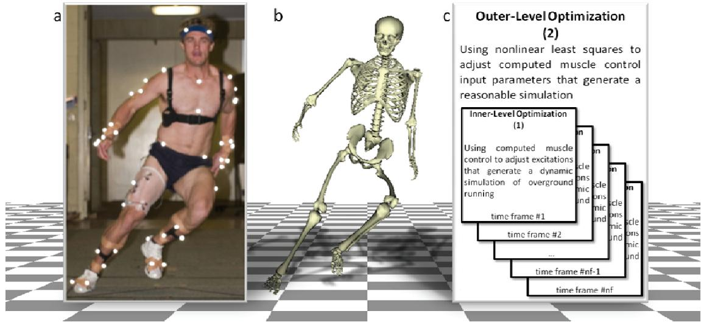  
Fig. 1. The subject in this study was a male Western Australian Amateur Football player. (a) Movement analysis data, including three-dimensional marker trajectories and ground reaction forces and moments, were collected for overground running. (b) A dynamic simulation of the subject was created using a three-step process: 1) a 37 degree-of-freedom skeletal model driven by 37 actuators was scaled to the subject’s size; 2) inverse kinematics determined values of the model’s generalized coordinates that matched marker data; and 3) computed muscle control determine an optimal set of excitations that produced a forward dynamic simulation. (c) An outer-level optimization determined input parameters for computed muscle control that were used during the inner-level optimization to generate a reasonable forward dynamic simulation of overground running

A dynamic simulation of the subject was created using a three-step process. First, the skeletal model was scaled to represent the experimentally measured size of the subject. Second, inverse kinematics analysis was utilized to obtain values of generalized coordinates for the model that closely matched the experimentally measured kinematics of the subject. Third, computed muscle control was implemented to determine an optimal set of actuator excitations that produced a forward dynamic simulation generally consistent with the experimentally measured kinematics. This three-step process was used to create simulations of the subject during overground running from pre-contact to toe-off.

While optimization procedures were used during every step, the third step involving computed muscle control was improved by a nested, or two-level, optimization approach (Fig. 1c). The inner-level optimization generated a simulation using computed muscle control and its associated input parameters including acceleration tracking weights, maximum residual forces/torques, and maximum joint torques. The outer-level optimization chose these input parameters that produced a simulation minimizing measures of unreasonability.

An inner-level optimization was used by computed muscle control to generate a simulation. The innerlevel cost function was the default OpenSim [5] implementation. This inner-level cost function (1) minimized weighted $( w _ { \ddot { q } _ { l } } )$ squared error between desired acceleration $( \ddot { q } _ { i } ^ { d e s i r e d } )$ and forward dynamically simulated acceleration $( \ddot { q } _ { i } ^ { s i m u l a t e d } )$ over ݊ݍ DoFs, squared residual force/torque $( R _ { j } )$ proportional to its driving excitation $( x _ { j } ^ { R } )$ normalized by its maximum $( R _ { j } ^ { m a x } )$ over 6 residuals, and squared joint torque $\left( T _ { k } \right)$ proportional to its driving excitation $( x _ { k } ^ { T } )$ normalized by its maximum $( T _ { k } ^ { m a x } )$ over ݊ܶ torques:

$$
\min_{x^{R},  x^{T}}\left[\sum_{i = 1}^{nq}w_{\ddot{q}_{i}}\big(\ddot{q}_{i}^{desired} - \ddot{q}_{i}^{simulated}\big)^{2} + \sum_{j = 1}^{6}\left(\frac{R_{j}(x_{j}^{R})}{R_{j}^{max}}\right)^{2} + \sum_{k = 1}^{nT}\left(\frac{T_{k}(x_{k}^{T})}{T_{k}^{max}}\right)^{2}\right]\Bigg|_{\substack{inner\\ level}}\tag{1}
$$

The design variables were a set of excitations $( \pmb { x } ^ { R } , \pmb { x } ^ { T } )$ driving each residual force/torque or joint torque actuator. These excitations were input into the forward dynamic model and numerical integration of Newton’s equations of motion generated the dynamic simulation for every time frame. The simulation output kinematics, residual forces/torques, and joint torques that were based on the choice of input parameters including each acceleration weight $( w _ { \ddot { q } _ { l } } )$ , maximum residual $( R _ { j } ^ { m a x } )$ , and maximum joint torque $( T _ { k } ^ { m a x } )$ ). The input parameter choices for computed muscle control determine whether or not the dynamic simulation closely tracks experimental kinematics data with limited residual forces/torques, producing a reasonable simulation.

An outer-level optimization, rather than human intuition, was used to determine input parameters that generated a reasonable simulation. The outer-level cost function reduced the number of human-defined input parameters from $n q + 6 + n T$ ) 74 for our model) to merely 2. The outer-level cost function (2) minimized uniformly weighted $( W _ { p e l v i s }$ , 1000 in our case) squared error between experimental kinematics $( q _ { i j } ^ { e x p } )$ and simulated kinematics $( q _ { i j } ^ { s i m } )$ over 6 pelvis DoFs, squared error for kinematics over the remaining ݊ݍ DoFs, uniformly weighted $( W _ { R }$ , 500 in our case) squared residual force/torque $( R _ { i k } )$ over 6 residuals, and squared joint torque $\left( T _ { i l } \right)$ over ݊ܶ torques with each quantity taken over ݂݊ time frames:

$$
\min_{\boldsymbol{w}_{\bar{q}},\boldsymbol{R}^{max},\boldsymbol{T}^{max}}\sum_{i = 1}^{nf}\left[W_{pelvis}\sum_{j = 1}^{6}\big(q_{ij}^{exp} - q_{ij}^{sim}\big)^{2} + \sum_{j = 7}^{nq}\big(q_{ij}^{exp} - q_{ij}^{sim}\big)^{2} + W_{R}\sum_{k = 1}^{6}R_{ik}{}^{2} + \sum_{l = 1}^{nT}T_{il}{}^{2}\right]\Bigg|_{\substack{outer\\ level}}\tag{2}
$$

The design variables were a set of acceleration weights $( { \pmb w } _ { \ddot { q } } )$ , maximum residual forces/torques $( R ^ { m a x } )$ , and maximum joint torques $( T ^ { m a x } )$ defining input parameters for computed muscle control. These input parameters were used throughout the inner-level optimization to generate a dynamic simulation closely tracking experimental kinematics data with limited residual forces/torques.

## 2.4. Results and Discussion

Optimal input parameters for computed muscle control were found (Fig. 2) that produced a simulation closely tracking experimental data (RMS errors less than $3 . 9 ^ { \circ }$ for hip internal rotation of the swing limb) of overground running with limited residual forces (RMS less than 0.3N) and torques (RMS less than 0.4Nm). When comparing the optimized simulation with that produced by an OpenSim [5] user with the same goals, RMS tracking errors increased at most $3 . 1 ^ { \circ }$ (again for hip internal rotation of the swing limb). In some DoFs, the RMS tracking errors decreased slightly (2.9mm for vertical position of the pelvis). These tracking error changes were due to the fact that the residual forces/torques decreased significantly (RMS up to 151N and 23Nm). As for total time required to generate each simulation, the OpenSim [5] user spent approximately 3 research days on the problem and the optimization required a wall clock time of 11.8 hours (approximately a 50% decrease in time; however, the optimization allows the user to focus on other research while it is running, which magnifies this difference in recorded time).

a  
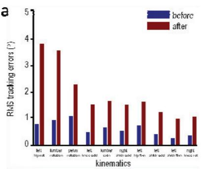

b  
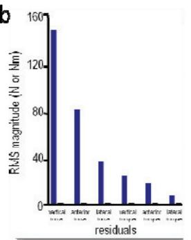  
C

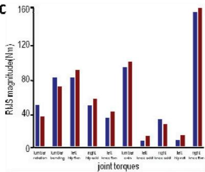

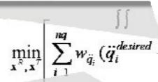

d  
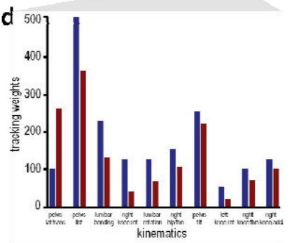

e  
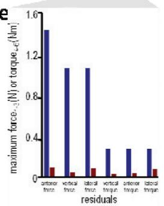  
f

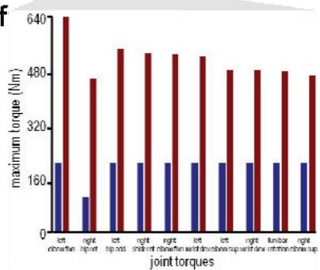  
Fig. 2. Largest differences ordered by decreasing magnitude for (a) kinematics (accelerations integrated twice to get positions), (b) residual forces/torques, and (c) joint torques resulting from simulations generated using computed muscle control before (blue, by the OpenSim [5] user) and after (red) optimization. These results are based on input (d) acceleration weights, (e) maximum residua forces/torques, and (f) maximum joint torques chosen by the OpenSim [5] user (before case) or the optimizer (after case).

We did not expect the large increase (< 3.1º) in tracking errors and we were surprised by the differences (< 15Nm) in joint torques. Both changes were necessary to dramatically reduce the residual forces/torques. The magnitudes of these changes were determined by our weight choices for tracking pelvis DoFs $( W _ { p e l \nu i s } = 1 0 0 0 )$ and reducing residual forces/torques $( W _ { R } = 5 0 0 )$ . Given smaller weight values, the outer-level cost function would be minimized differently and emphasis would be placed on tracking errors other than the pelvis and reducing joint torques.

Improving computed muscle control through optimization allows engineers and clinicians to produce a reasonable forward dynamic simulation within a modest amount of time and without the need to choose extra input parameters.

## 3. Identifying New Movements to Reduce Injury Risk

## 3.1. Objective

In this application using OpenSim [5], we used computed muscle control to identify new movements that reduce ligament injury risk during change of direction while running. Our goal was to determine kinematic changes that reduce peak valgus knee moments during the weight-acceptance phase of an unanticipated sidestep.

## 3.2. Background and Foundation

Anterior cruciate ligament (ACL) injuries are one of the most costly knee injuries and more than half of these injuries occur during sport [9]. After 3 years following ACL reconstruction, 70% to 100% of injured athletes are not capable of returning to the same level of competition [10]. The majority of noncontact ACL injuries occur during change-of-direction or sidestepping movements which cause the knee to collapse into valgus [11-14]. Specifically, valgus knee moments during the weight acceptance (WA) phase of sidestepping are significantly elevated relative to straight line running [15-17]. Peak valgus knee moments are elevated further during unanticipated sidestepping situations [18]. Consequently, ACL injury prevention training interventions should focus on reducing valgus knee loading during WA of unanticipated sidestepping, since this phase is when ACL injury risk is thought to be greatest.

Musculoskeletal models combined with optimization methods have been used to identify casual relationships between whole-body kinematics and peak knee moments during walking [19]. Using computed muscle control within OpenSim [5] which uses motion data and optimization methods to create dynamically consistent simulation of human movement, similar computational methods can be used to identify causal relationships between whole-body kinematics and valgus knee moments during sidestepping. Moreover, the kinematic changes influencing peak valgus knee moments during the WA phase of an unanticipated sidestep are not well understood.

## 3.3. Research Description

The 9 subjects (age 19-30 yrs; height 1.83 ± 0.04 m; mass 80.8 ± 6.66 kg) analyzed in this study were from a set 34 male Western Australian Amateur Football players as described in section 2 above. Movement analysis data, including three-dimensional marker trajectories and ground reaction forces and moments, were collected as a routine part of the sidestepping study (Fig. 1a). The subjects gave informed consent for the collection and analysis of this movement data.

A three-dimensional, full-body, 37 DoF skeletal model driven by 37 actuators formed the foundation of each simulation as described in section 2 above. The model was generated in OpenSim [5] and it was used in conjunction with movement analysis data to create subject-specific dynamic simulations (Fig. 1b). These simulations of unanticipated sidestepping were created using a three-step process as described in section 2 above.

Computed muscle control was employed to solve for a kinematic solution that minimized peak valgus knee moment, while tracking the experimentally recorded joint coordinates and maintaining dynamic consistency with the experimentally recorded GRF. To achieve this goal, the maximum attainable torque value associated with the knee’s varus/valgus DoF was reduced. Effectively, the optimization problem was reformulated to avoid (or prevented from) using the valgus knee moment during the simulation. The angle and moment differences for all 37 DoF pre- and post-kinematic optimization were compared.

## 3.4. Results and Discussion

In all 9 simulations, peak mean valgus knee moments were significantly $( \mathtt { p } = 0 . 0 4 5 )$ reduced by an average of 44.2 Nm following kinematic optimization. Other peak mean knee moments were elevated by an average of 24.1 Nm (flexion) and 1.1 Nm (internal rotation), but these were not statistically significant changes (Fig. 3a). Pre- to post-kinematic optimization, each simulation produced unique changes to reduce peak valgus knee moments (Fig. 3b). However, subsets of 9 critical joint coordinates (stance side: ankle plantarflexion, hip abduction, shoulder adduction and internal rotation; swing side: knee extension, hip flexion and abduction, shoulder extension; and trunk rotation) were used to reduce these moments.

a  
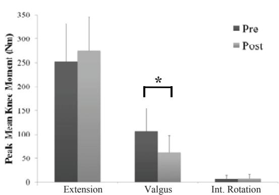

b  
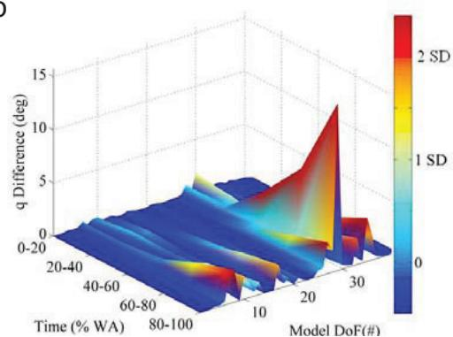  
Fig. 3. (a) Peak mean extension, valgus, and internal rotation knee moments pre- to post-kinematic optimization calculated during the weight acceptance (WA) phase of an unanticipated sidestep. Symbol \* indicates significant change over time (Į = 0.05). (b) Angular kinematic differences from pre- to post-kinematic optimization for all 37 model degrees of freedom (DoF) over the WA phase of an unanticipated sidestep simulation for 1 of the 9 simulations.

Two primary kinematic strategies were used to reduce peak valgus knee moments. The first strategy, used in 6 of the 9 simulations, elevated the mean ankle plantar flexion by $7 . 9 \pm 5 . 2 ^ { \mathrm { ~ o ~ } }$ pre- to postkinematic optimization. The second kinematic strategy, used in all 9 simulations, repositioned the wholebody center of mass medially and anteriorly relative to stance foot, which was the desired direction of travel during the unanticipated sidestepping movement.

The generalized kinematic strategy of repositioning the whole-body center of mass medially towards the desired direction of travel can be considered a relatively simple strategy to implement from a coach’s perspective. This technique recommendation will also require athletes to develop new motor control strategies to successfully learn this technique. Though previous literature has shown patient-specific gait modifications are effective in reducing peak frontal plane knee moments in multiple case studies [19,22,23], the efficacy of directing the whole-body center of mass medially during sidestepping must still be verified clinically in large heterogeneous populations before these recommendations can be made to the general athletic and clinical populations.

## 4. Establishing Relationships Among Posture, Muscle Forces, and Ground Reaction Forces

## 4.1. Objective

In this application using OpenSim [5], we used musculoskeletal modeling and optimization to investigate the relationship among posture, muscle forces, and ground reaction forces. Our goal was to determine if posture influences the muscles’ capacity to generate ground reaction forces in the transverse plane throughout the stance phase of gait.

## 4.2. Background and Foundation

Crouch gait, a common movement abnormality among children with cerebral palsy, decreases walking efficiency due to the increased knee and hip flexion during the stance phase of gait [24]. Excessive knee flexion during walking can deteriorate joints and may lead to chronic knee pain [25], and if untreated, these symptoms could worsen over time [26]. Several factors have been linked with crouch gait, including muscle weakness, spasticity, tightness, and decreased motor control [27]. Despite being studied for decades, a cause-and-effect relationship between these factors and crouch gait remains unknown, in part, due to the complexity of the musculoskeletal system [27].

Crouch gait is generally considered to be disadvantageous for patients with cerebral palsy; however, a crouched posture may afford biomechanical advantages that lead some patients to adopt a crouch gait. For example, an athlete adopts a crouched posture to increase the ability to move in any chosen direction. Likewise, a passenger standing on a moving train adopts this posture to increase the ability to resist moving. In both cases, the transverse-plane movements are produced or resisted by generating ground reaction forces in the transverse plane.

## 4.3. Research Description

A three-dimensional musculoskeletal model with 15 degrees of freedom and 92 muscle-tendon actuators was created in OpenSim [5]. The model consists of a head, trunk, pelvis, and right and lef femur, tibia, and foot segments. The stance foot (right foot in our case) was welded to the ground. The lower extremity joints were modeled as follows: the subtalar and ankle joint were revolute joints, each knee was a planar joint, and the hip was a ball-and-socket joint. The head and torso were included in the model and were articulated with the pelvis through a ball-and-socket joint.

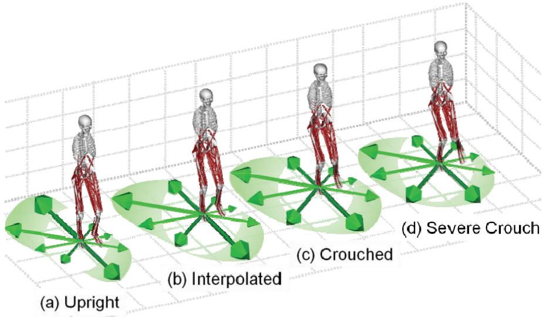  
Fig. 4. Three-dimensional, full-body musculoskeletal model with 15 degrees of freedom and 92 muscle-tendon actuators placed in 4 (of 45 total) postures shown with maximum ground reaction force profiles in the transverse plane: (a) experimental upright posture [28], (b) interpolated posture between experimental upright and crouch data, (c) experimental crouched posture [28], (d) and extrapolated posture from experimental upright and crouch data

The musculoskeletal model was placed in 15 different postures from upright to severe crouch during initial, middle, and final single-limb stance of the gait cycle for a total of 45 postures (Fig. 4). Upright posture was defined from the average gait data of 83 able-bodied subjects [28]. Crouch was defined from the average gait data of 100 subjects with cerebral palsy and crouch gait [28]. Using this experimental data, we linearly interpolated nine postures between upright and crouch for the three different parts of stance. We extrapolated four additional postures with knee flexions greater than crouch as well.

For each of the 45 different postures, a series of optimizations were performed. The optimizer maximized ground reaction forces for the 8 compass directions in the transverse plane by modifying muscle forces acting on the model. Each optimization was subject to constraints requiring: 1) the center of pressure to be under the stance foot and 2) the vertical ground reaction force to be greater than or equal to zero. A ground reaction force profile was generated for each posture by finding the area of the forces from the 8 compass directions. Our hypothesis was evaluated by comparing the areas of the force profiles across all postures.

## 4.4. Results and Discussion

A range of crouched postures allowed the largest areas of ground reaction force profiles during stance (Fig. 5). Before middle stance, mild crouched postures (#4-6) between upright and crouch allowed the largest ground reaction force profiles. These postures produced force profile areas within 1% of each other, with posture #5 being the largest. Comparatively, upright (#1) and crouched (#11) postures had 12- 13% smaller force profile areas, and severe crouch (#15) was roughly 23% smaller. From our previous work, the crouched posture during middle stance produced the largest area of force profile [29]. This trend continues until final single-limb stance. During final stance, a posture (#12) between crouch and severe crouch allowed the largest ground reaction force profiles; however, this force profile area was less than 2% larger compared to crouch (#11). The force profile area of crouch was 7.3% higher compared to upright and 4% higher than severe crouch during final stance.

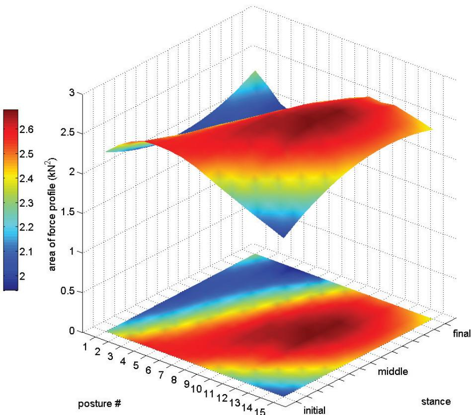  
Fig. 5. Surface (top) and contour (floor) plots showing areas of ground reaction force profiles across three parts of stance and across all postures (intermediate force profile areas between initial-middle-final generated with a cubic spline interpolation). Force profile areas throughout stance are from lowest (blue) to highest (red). During early stance, mild crouched postures (#4-6) allowed the greatest forces. During late stance, crouched postures (#9-11) allowed greater forces compared to upright

An overall larger force profile area is allowed by postures from mild crouch (for initial stance) to crouch (for final stance). To maximize the muscles’ capacity to generate ground reaction forces in the transverse plane, one would have to move from a mild crouch to a crouched posture throughout the stance phase of gait (Fig. 5, red areas).

Although this study extends our previous study [29], this work is fundamentally different from Hicks et al. [28] which examined the effect of crouched postures on the capacity of muscles to extend the hip and knee joints. They used induced acceleration analysis to determine the joint angular accelerations towards extension resulting from the application of 1 N muscle force to the model. Their study showed almost all of the major hip and knee extensors’ capacities were reduced in crouch gait. This finding suggests a reduction in the ability to generate vertical ground reaction force. In our case, we used optimization to maximize horizontal ground reaction forces without regard for the vertical ground reaction force. Our finding suggests an increase in the ability to generate these horizontal forces.

## 5. Challenges and Next Steps

Although the future of human movement simulation is exciting, its challenges cannot be overlooked. For decades, experimental and physical approaches have advanced our understanding of human movement control, joint motion, muscle strength, and functional capacity of the human body. Progress is inherently limited by two factors: 1) important variables (e.g., muscle forces) are not generally measurable in experiments and 2) cause-and-effect relationships (e.g., muscle contributions to movement) are difficult to establish from experiments. Muscle-actuated dynamic simulations complement experimental and physical approaches by estimating important variables and identifying cause-and-effect relationships giving insights into muscle function. Some of the issues related to simulations comparable with the above applications using OpenSim are outlined below.

First, although simulations fundamentally depend upon experiments, efforts to incorporate experimental information into simulation software have had important limitations. Many companies produce and distribute experimental measurement systems, which record physical examination and movement analysis information using a variety of different formats. Many laboratories develop their own software to generate simulations based on their experimental information, but this proprietary software is not shared with other labs. Developing muscle-actuated dynamic models underlying these simulations is challenging, and most laboratories lack the resources or technical expertise to create their own models. As a result, most simulations have relied upon "generic" models, based on experimentally measured values from a limited number of adult-sized cadavers with normal musculoskeletal geometry. It is necessary to overcome these limitations by creating tools for a wide variety of experimental information, generating new algorithms for solving complex problems involving model optimization to match this information, and developing a general framework integrating experiments, data, and computation for pursuing further research.

Second, there is no freely available, open-source computational tool for modeling and simulating biomechanical systems as well as developing robust design and control algorithms. Modeling and simulation software allows biomechanists to view models, edit muscles, generate simulations, and analyze biomechanical systems. Separately, mathematical computing software allows engineers and scientists to develop algorithms, analyze data, visualize results, and perform numerical computations. The study of human movement and treatment of movement abnormalities could greatly benefit from combined software tools that offer a greater understanding of neuromuscular biomechanics, and predictive capabilities for optimal surgical and rehabilitation treatment planning.

Third, to predict functional outcomes, the open question of how appropriate muscle patterns are selected to achieve a behavioral goal must be answered. Typically, simulations do not incorporate sensory organs or mechanisms providing feedback necessary for motor control. In fact, many simulations do not include the majority of parts in a central nervous system for that matter. To synthesize the complex transformation between neural control and purposeful movement is a daunting obstacle. Software elements that integrate experimental movement data, novel control systems, and massively paralle algorithms are necessary to accelerate the multidisciplinary study of human movement control.

Modeling and simulation technologies need to be advanced significantly to realize the full potential of personalized, simulation-based medicine. A gap exists between the experimental and physical approaches used by physicians, physical therapists, and rehabilitation scientists and the computer simulation approaches used by engineers, mathematicians, and computer scientists. From humble beginnings over half a century ago, computer simulations have made a dramatic impact across engineering fields. For similar impacts to be made in human movement, a symbiotic relationship between clinicians and engineers must be formed. This synergistic relationship will not only produce the best possible simulation results, but it has the potential to transform the multidisciplinary study of human movement.

## Acknowledgements

The authors are grateful to Cyril Donnelly, Hoa Hoang, Ashley Clark, Samuel Hamner, and Jennifer Hicks for valuable contributions and helpful discussions. This work was supported by The University of Tennessee, NIH roadmap for Medical Research U54 GM072 970, PAFIX through the NHMRC 400937, Canadian Society of Biomechanics, and The University of Western Australia’s Convocation Office.

## References

[1] Robertson G, Caldwell G, Hamill J, Kamen G, Whittlesey S, editors. Research Methods in Biomechanics. Champaign: Human Kinetics; 2004.

[2] Murray WM, Delp SL, Buchanan TS. Variation of muscle moment arms with elbow and forearm position. Journal of 1996; :513-25.

[3] Arnold AS, Salinas S, Asakawa DJ, Delp SL. Accuracy of muscle moment arms estimated from MRI-based musculoskeletal models of the lower extremity. Computer Aided Surgery 2000;5:108-19.

[4] Newton I. Philosophiae Naturalis Principia Mathematica. London; 1687.

[5] Delp SL, Anderson FC, Arnold AS, Loan P, Habib A, John CT, Guendelman E, and Thelen DG. OpenSim: Open-source software to create and analyze dynamic simulations of movement. IEEE Transactions on Biomedical Engineering 2007;55:1940-50.

[6] Thelen DG, Anderson FC, and Delp SL. Generating dynamic simulations of movement using computed muscle control. Journal of Biomechanics 2003;36:321-8.

[7] Thelen DG and Anderson FC. Using computed muscle control to generate forward dynamic simulations of human walking from experimental data. Journal of Biomechanics 2006;39:1107-15.

[8] Donnelly CJ, Doyle TLA, Finch CF, Elliott BC, and Lloyd DG. The influence of balance and technique training on knee loading and risk of ACL injury during sidestepping. In Proceeding of the XXII Congress of the International Society of Biomechanics, Cape Town, South Africa, July 5-9, 2009.

[9] Gianotti SM, Marshall SW, Hume PA, Bunt L. Incidence of anterior cruciate ligament injury and other knee ligament injuries: a national population-based study. Journal of Science and Medicine in Sport 2009;12:622-7.

[10] Roos H, Ornell M, Gardsell P, Lohmander LS, Lindstrand A. Soccer after anterior cruciate ligament injury--an incompatible combination? A national survey of incidence and risk factors and a 7-year follow-up of 310 players. Acta 1995; :107-12.

[11] Andersen TE, Tenga A, Engebretsen L, Bahr R. Video analysis of injuries and incidents in norwegian professional football. British Journal of Sports Medicine 2004; :626-31.

[12] Cochrane JL, Lloyd DG, Buttfield A, Seward H, McGivern J. Characteristics of anterior cruciate ligament injuries in australian football. Journal of Science and Medicine in Sport 2007;10:96-104.

[13] Koga H, Nakamae A, Shima Y, Iwasa J, Myklebust G, Engebretsen L, Bahr R, Krosshaug T. Mechanisms for noncontact anterior cruciate ligament injuries: Knee joint kinematics in 10 injury situations from female team handball and basketball. 2010; :2218-25.

[14] Krosshaug T, Nakamae A, Boden BP, Engebretsen L, Smith G, Slauterbeck JR, Hewett TE, Bahr R. Mechanisms of anterior cruciate ligament injury in basketball: Video analysis of 39 cases. American Journal of Sports Medicine2007;35:359-67.

[15] Besier TF, Lloyd DG, Cochrane JL, Ackland TR. External loading of the knee joint during running and cutting maneuvers. Medicine & Science in Sports & Exercise 2001;33:1168-75.

[16] Cochrane JL, Lloyd DG, Besier TF, Elliott BC, Doyle TL, Ackland,TR. Training affects knee kinematics and kinetics in cutting maneuvers in sport.  2010; :1535-44

[17] Dempsey AR, Lloyd DG, Elliott BC, Steele JR, Munro BJ, Russo KA. The effect of technique change on knee loads during sidestep cutting. Medicine & Science in Sports & Exercise 2007;39:1765-73.

[18] Besier TF, Lloyd DG, Ackland TR, Cochrane JL. Anticipatory effects on knee joint loading during running and cutting maneuvers.  2001; :1176-81.

[19] Fregly BJ, Reinbolt JA, Rooney KL, Mitchell KH, Chmielewski TL. Design of patient-specific gait modifications for knee osteoarthritis rehabilitation. IEEE Transactions on Biomedical Engineering 2007;54:1687-95.

[20] Donnelly CJ, Lloyd DG, Elliott BC, and Reinbolt JA. Minimizing valgus knee loading during sidestepping: implications for ACL injury risk. In Proceedings of the 6th World Congress on Biomechanics, Suntec City, Singapore, August 1-6, 2010.

[21] Hamner SR, Seth A, Delp SL. Muscle contributions to propulsion and support during running. Journal of Biomechanics 2010;43:2709-16.

[22] Schache AG, Fregly BJ, Crossley KM, Hinman RS, Pandy MG. The effect of gait modification on the external knee adduction moment is reference frame dependent. Clinical Biomechanics 2008;23:601-8.

[23] Walter JP, D'Lima DD, Colwell CW, Jr, Fregly BJ. Decreased knee adduction moment does not guarantee decreased medial contact force during gait. Journal of Orthopaedic Research 2010;28:1348-54.

[24] Wren TA, Rethlefsen S, Kay RM. Prevalence of specific gait abnormalities in children with cerebral palsy: influence of cerebral palsy subtype, age, and previous surgery. Journal of Pediatric Orthopaedics 2005;25:79-83.

[25] Rose J, Gamble JG, Burgos A, Medeiros J, Haskell WL. Energy expenditure index of walking for normal children and for children with cerebral palsy. Developmental Medicine and Child Neurology 1990;32:333-40

[26] Bell KJ, Ounpuu S, DeLuca PA, Romness MJ. Natural progression of gait in children with cerebral palsy. Journal of Pediatric Orthopaedics 2002;22:677-82.

[27] Arnold AS, Anderson FC, Pandy MG, and Delp SL. Muscular contributions to hip and knee extension during the single limb stance phase of normal gait: a framework for investigating the causes of crouch gait. Journal of Biomechanics 2005;38:2181-9.

[28] Hicks JL, Schwartz M, Arnold AS, and Delp SL. Crouched postures reduce the capacity of muscles to extend the hip and knee during the single-limb stance phase of gait. Journal of Biomechanics 2008;41:960-7

[29] Hoang HX, and Reinbolt JA. Posture influences ground reaction force: implications for crouch gait. In Proceedings of 3D Analysis of Human Movement, San Francisco, USA, July 14-16, 2010.