www.elsevier.com/locate/clinbiomech

# 前臂骨畸形几何模型中前臂旋前/旋后受限的机制

Takashi Yasutomi a,\*, Yukio Nakatsuchi b, Hiroaki Koike a, Shigeharu Uchiyama

a Department of Orthopaedics, Shiokawa Hospital, 773 Touda, Sutama-cho, Kitakoma-gun, Yamanashi 408 0114, Japan b Department of Orthopaedics, Nagano National Hospital, Ueda-City, Nagano, Japan c Department of Orthopaedic Surgery, Suwa Red Cross Hospital, Suwa-City, Nagano, Japan 2001年12月11日收到；2002年5月10日接受

## 摘要

目的。阐明与前臂骨成角畸形和骨间隙狭窄相关的前臂旋前/旋后受限机制。

设计。采用包含骨间膜的前臂骨三维几何模型及其轴向截面模型。

背景。与前臂骨畸形相关的旋前/旋后受限是前臂骨折治疗中遇到的重要问题之一。阐明其机制对于该并发症的预防和治疗具有重要意义。

方法。在轴向截面中，利用解析几何方法，分别在骨间隙无狭窄或狭窄的模型中，研究了旋前/旋后轴与前臂骨之间的位置关系对旋前/旋后活动度的影响。随后，在每根前臂骨具有相同成角畸形的三维模型中，利用解析几何计算了导致旋前/旋后受限的成角畸形的方向和程度。模型的各项参数均通过正常前臂的放射学测量获得。

结果。在无骨间隙狭窄的轴向截面模型中，当旋前/旋后轴穿过骨间区域（桡尺侧小于 2 cm，前后侧小于 0.8 cm）时，可实现大于 40° 的旋前和旋后。当该轴偏离此区域时，观察到显著的旋前/旋后丧失，这与骨间膜的限制而非骨性撞击有关。此外，随着骨间膜缩短导致的骨间隙狭窄，该区域的面积相应减小。在三维模型中，导致旋前/旋后显著丧失的成角畸形方向和程度分别为：桡偏大于 14°、尺偏大于 7°、前倾大于 5°、后倾大于 4°。

结论。旋前/旋后轴与带骨间膜的前臂骨之间的位置关系可能在前臂旋前/旋后运动中起重要作用。

## 临床相关性

基于对这种旋前/旋后受限机制的理解来评估骨畸形，将有助于对前臂骨畸形愈合进行恰当治疗。 - 2002 Elsevier Science Ltd. 保留所有权利。

关键词：生物力学（Biomechanics）；前臂（Forearm）；几何模型（Geometric model）；骨间膜（Interosseous membrane）；畸形愈合（Malunion）；旋转（Rotation）

## 1. 引言

前臂旋前/旋后（前臂旋转）受限是前臂骨折治疗中常遇到的问题之一。前臂骨的成角畸形以及桡骨和尺骨之间骨间隙的狭窄会导致前臂旋转受限 [1–4]。在以往关于前臂骨成角畸形对前臂旋转影响的研究中 [1,4]，骨间膜（interosseous membrane, IOM）张力增加以及前臂骨之间的撞击被报道为引起前臂旋转受限的干扰因素。然而，导致此类干扰的成角畸形的方向和程度尚未确定。我们此前曾描述过，在伴有桡骨成角畸形的病例中，前臂旋转期间桡骨凸起顶点的轨迹取决于前臂旋转轴（axis of forearm rotation, AFR）的位置 [5]。在旋转过程中骨间隙增宽的病例中，当骨间隙达到 IOM 的长度时，旋转可能会受到 IOM 的限制 [2,5]。我们认为 AFR 与前臂骨之间的位置关系会影响前臂旋转的活动度。同时我们认为，当两根前臂骨在特定位置向相同方向且以相同程度发生畸形时，它们之间的某一种位置关系可能对应于成角畸形方向和程度的一种组合。基于这一设想，我们研究了导致前臂旋转受限的成角畸形方向与程度。首先，我们在前臂轴向截面的二维（2D）模型中估算了 AFR 的区域，该区域允许桡骨旋前和旋后而不受 IOM 的限制或尺骨的撞击。其次，在该 2D 模型中研究了桡尺骨间隙狭窄对前臂旋转的影响。第三，根据 2D 几何研究的结果，在三维（3D）前臂模型中研究了导致前臂旋转受限的成角畸形方向与程度。

## 2. 方法

## 2.1. 前臂骨的放射学测量

对五名无骨骼异常的男性志愿者的左前臂双平面X线片进行放射学测量，以设计前臂骨骼的几何模型。他们的平均年龄为 40.0（SD，4.6）岁，平均身高为 173.2（SD，5.6）cm，平均体重为 69.2（SD，11.6）kg。通过将肩关节外展 90°、肘关节屈曲 90°、前臂处于中立旋位，获取前臂的后前位和侧位X线片。将前臂置于暗盒上，球管-胶片距离设置为 1 m。X线片上尺骨的纵轴设定在尺骨中三分之一处。在后前位图像中，我们测量了从尺骨远端到桡骨近端垂线之间的尺骨纵轴长度（L）、尺骨纵轴与桡骨近端中心之间的距离（T）、尺骨纵轴与前臂中部桡骨骨干中心之间的距离（N），以及前臂中部桡骨和尺骨骨干的宽度 $( B _ { 1 }$ 和 $B _ { 2 } )$。$B _ { 1 }$ 和 $B _ { 2 }$ 平均值的一半用 B 表示。在侧位图像中，我们测量了尺骨纵轴与桡骨近端中心之间的距离（S）以及尺骨纵轴与前臂中部桡骨骨干中心之间的距离（M）（Fig. 1）。

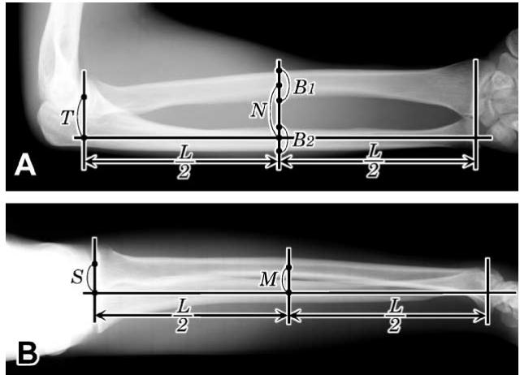  
Fig. 1. 左前臂后前位和侧位X线片的测量。(A) 为与本研究模型的视点匹配而反向打印的后前位图像；(B) 侧位图像。L，尺骨远端到桡骨头近端引向尺骨纵轴垂线之间的距离；S 和 T，尺骨纵轴与桡骨近端中心之间的距离；M 和 N，尺骨纵轴与前臂中部桡骨骨干中心之间的距离；$B _ { 1 }$ 和 $B _ { 2 } ,$ 分别为桡骨和尺骨骨干的宽度。

## 2.2. 三维前臂模型

本研究的模型为左上肢。肱骨纵轴固定在垂直位置，肘关节保持在 $9 0 ^ { \circ }$ 屈曲位。前臂的初始旋转调整至中立位。假设前臂骨为直骨。假设骨间膜（IOM）在尺骨上的附着点以及在桡骨上的附着点各自共线，并将这两条线分别定义为线 U 和线 R。穿过桡骨近端且垂直于线 U 的平面定义为平面 P。平面 P 与尺骨远端之间的距离用 L 表示。平面 P 处前臂骨纵轴之间距离的水平分量和垂直分量分别用 S 和 T 表示，距平面 P 远端 $L / 2$ 处对应的分量分别用 M 和 N 表示。正如其他文献中所述 [6]，前臂旋转轴（AFR）定义为穿过桡骨近端中心和尺骨远端的直线。当前臂骨发生畸变而相邻关节未脱位时，以与正常情况相同方式定义的线亦可用于表示 AFR。本模型中建立了一个三维右手正交坐标系（X; Y; Z），其原点位于线 U 上距平面 P 距离为 $L / 2$ 的点。Y 轴平行于肱骨纵轴且朝上；Z 轴与线 U 重合且朝向远端；X 轴同时垂直于 Y 轴和 Z 轴（图 2）。

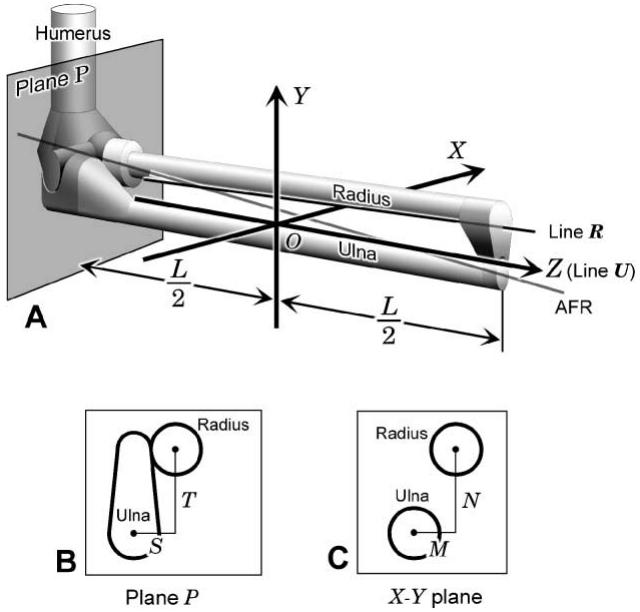  
Fig. 2. (A) 带有正交三维坐标系（X; Y; Z）的左前臂骨模型示意图。(B,C) 穿过平面 P 和 XY 平面的截面示意图；L，平面 P 与尺骨远端之间的长度；AFR，前臂旋转轴；S 和 T，平面 P 处前臂骨纵轴之间距离的水平分量和垂直分量；M 和 N，XY 平面处的相同分量。

## 2.3. 前臂轴向截面的二维模型

我们在垂直于 AFR 的截面内建立了一个二维直角坐标系 $\mathbf { \Phi } ( x , y )$，其原点与三维坐标系的原点重合（Fig. 3）。y 轴从原点延伸至 IOM 在桡骨上的附着点，x 轴正方向指向前臂后侧。为了简化后文描述的方程，桡骨和尺骨的截面被简化为直径为 $2 \times B$ 的圆，这两个截面分别由圆 R 和圆 $U ,$ 表示。xy 平面与 AFR 及线 R 的交点分别定义为点 C 和点 A，这些点在 xy 平面内的坐标设为 $C \left( C _ { x } , C _ { y } \right)$ 和 A ð0; aÞ，a 的值可以用 L、M、N、S、T 和 B 的值表示。

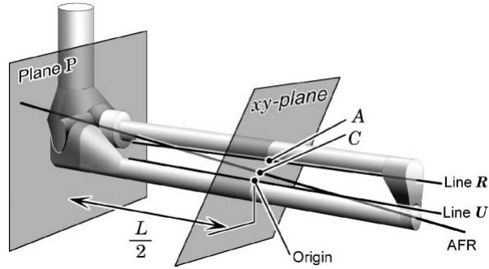  
Fig. 3. 显示 AFR 和截面（xy 平面）的前臂骨骼模型示意图。A，截面与线 R 的交点；C，截面与 AFR 的交点。

每个圆的圆心、原点和点 A 被调整为共线。圆 R 绕点 C 的逆时针旋转代表前臂旋前，顺时针旋转代表旋后（Fig. 4）。圆 R 逆时针旋转的角度定为正数，顺时针旋转的角度定为负数。IOM 被表示为连接原点和点 A 的一根线绳。线绳的长度表示为 $d ,$ 假设其在原点与点 A 之间的长度之外还允许有松弛度。根据 Pfaefle 等人 [7] 的研究，线绳的松弛度设定为原点与点 A 之间长度的 6%。他们描述了作为 IOM 最主要结构的中央束的应力-应变曲线，并报道其断裂应变为 9.0%。在本研究中，我们选择了应力-应变曲线线性部分上限附近的值作为线绳的松弛度。

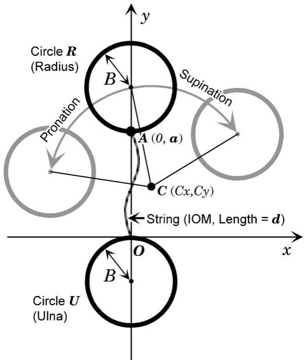  
Fig. 4. 截面内的二维直角坐标系 (x,y)。

## 2.4. 几何学研究

## 2.4.1. 研究 1（二维几何学研究）

在 xy 平面上研究了点 C 的区域，圆 R 可以在该区域周围旋转，而不受绳索的限制或与圆 U 发生碰撞。当圆 R 允许从中立位旋转至旋后超过 $\rho ^ { \circ }$ 或旋前超过 $\sigma ^ { \circ }$ 时，点 C 的区域分别定义为函数 $\ R \mathrm { e g } ( - \rho )$ 或 RegðrÞ。$\ R \mathrm { e g } ( - \rho )$ 与 $\operatorname { R e g } ( \sigma )$ 之间的交集区域定义为 $\mathrm { R e g } ( - \rho / \sigma )$。当 $0 ^ { \circ } \leqslant \phi \leqslant 9 0 ^ { \circ }$ 时，${ \mathrm { R e g } } ( \phi )$ 由表示以下四种临界情况的方程图像所包围：(1) 绳索连接点之间的距离在圆 $R$ 旋转中途达到最大值，且该最大距离等于绳索的长度；(2) 绳索连接点之间的距离在圆 R 旋转结束时达到最大值，且该最大距离等于绳索的长度；(3) 圆 R 与圆 U 之间的距离在圆 R 旋转中途达到最小值，此时两圆相互接触；以及 (4) 圆 R 与圆 U 之间的距离在圆 R 旋转结束时达到最小值，此时两圆相互接触。情况 (1) 下点 C 区域的边界由一个椭圆表示

$$
\left\{2 a C _ {y} + d ^ {2} - a ^ {2} \right\} ^ {2} = 4 d ^ {2} (C _ {x} ^ {2} + C _ {y} ^ {2}).\tag{1}
$$

情况 (2) 下点 C 区域的边界由带参数 h 的参数方程图像表示。这些方程使用矩阵表示为：

$$
\begin{array}{l} \binom {C _ {x}} {C _ {y}} = \frac {1}{2} \csc \frac {\Phi}{2} \left\{\left( \begin{array}{c c} \cos \frac {\Phi}{2} & 0 \\ 0 & \sin \frac {\Phi}{2} \end{array} \right) \binom {a + B V _ {1}} {a + B V _ {2}} \right. \\ \qquad + \left( \begin{array}{c c} \sin (\Theta - \frac {\Phi}{2}) & \cos (\Theta - \frac {\Phi}{2}) \\ - \cos (\Theta - \frac {\Phi}{2}) & \sin (\Theta - \frac {\Phi}{2}) \end{array} \right) \binom {B V _ {3}} {B V _ {4} - d} \Bigg \} \end{array}
$$

其中

$$
\left\{ \begin{array}{l} \Phi = \phi \pi / 1 8 0 \\ \Theta = \theta \pi / 1 8 0 \end{array} \right.\tag{2}
$$

以及

情况 (3) 下点 C 区域的边界由一条双曲线表示

$$
\begin{array}{c} \left\{2 (a + 2 B) C _ {y} - (a + B) ^ {2} + 5 B ^ {2} \right\} ^ {2} \\ = 1 6 B ^ {2} \left\{C _ {x} ^ {2} + (C _ {y} + B) ^ {2} \right\}. \end{array}\tag{3}
$$

情况 (4) 下点 C 区域的边界由一个圆表示

$$
\begin{array}{l} \left(C _ {x} - \frac {(a + 2 B) \sin \Phi}{2 (1 - \cos \Phi)}\right) ^ {2} + \left(C _ {y} - \frac {a}{2}\right) ^ {2} \\ = \frac {2 B ^ {2}}{(1 - \cos \Phi)} \text {   where   } \Phi = \phi \pi / 1 8 0. \end{array}\tag{4}
$$

$0 ^ { \circ } \leqslant \phi \leqslant 9 0 ^ { \circ }$ 时的 Regð /Þ 是 Regð/Þ 关于 y 轴的镜像。绘制了在不同 $\phi$ 值下（$\phi$ 以 $1 0 ^ { \circ }$ 为间隔从 $1 0 ^ { \circ }$ 变化至 $9 0 ^ { \circ }$）Regð/Þ 和 $\mathrm { R e g } ( - \phi / \phi )$ 的边界线。

## 2.4.2. 研究 2（2D 几何研究）

使用 2D 模型和研究 1 中所用的方程，研究了圆 R 与圆 U 之间距离的缩短对 $\mathrm { R e g } ( - 7 0 ^ { \circ } / 7 0 ^ { \circ } )$ 大小的影响。圆 R 和圆 U 之间的距离用 a 表示，绳索的长度用 d 表示（Fig. 4）。a 和 d 的初始值利用放射学测量结果获得。根据在逐渐减小 a 的过程中绳索的表现，我们将该研究分为两部分：研究 2A 和研究 2B。在研究 2A 中，绳索的长度固定为 d 的初始值。在研究 2B 中，绳索的长度随着 a 的减小成比例缩短，其长度 d 比各对应的 a 长 6%。绳索的这种缩短模拟了沿 IOM（骨间膜）形成的瘢痕或类似情况。当从 a 的初始值中扣除的减少量以每次 2.5 mm 从 0 增加至 10 mm 时，绘制了在不同 $^ { a , }$ 值下的 Reg( 70 /70 ) 边界线。在 a 处于初始值时的 Reg( 70 /70 ) 大小被定义为其初始大小。

## 2.4.3. 研究 3（3D 几何研究）

在 3D 前臂中研究了允许桡骨旋前和旋后而不受 IOM 限制或与尺骨发生撞击的前臂骨成角畸形的方向和幅度

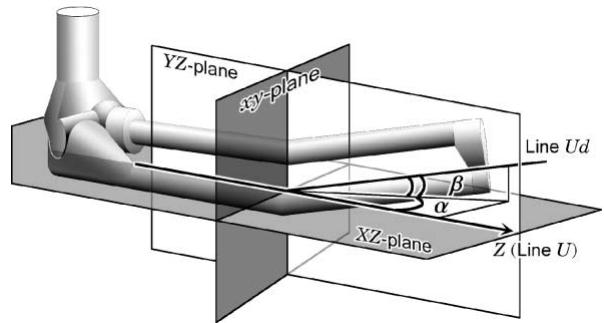  
Fig. 5. 伴有成角畸形的前臂骨模型示意图。

模型。在骨骼与 xy 平面相交的交点处，为每根前臂骨设定了相同方向和大小的成角畸形。骨间膜（IOM）在尺骨远端一半处的附着点被定义为直线 Ud。YZ 平面与直线 Ud 之间的夹角，以及 XZ 平面与直线 Ud 之间的夹角分别用 a 和 b 表示（Fig. 5）。当 xy 平面的原点沿直线 U 从前臂的一端移动到另一端时，对于特定的 /，各 Reg( /=/) 的连接会使该空间受到约束。该空间被定义为区域 D。无骨畸形前臂模型的区域 D 在数学上是一个凸空间。只要前臂骨的形状允许桡骨自由旋转，前臂旋转轴（AFR）就会存在于区域 D 内。当前臂骨在 xy 平面发生成角时，区域 D 由在 xy 平面相接触的两个凸空间组成。AFR 若发生偏离区域 D 的情况，将会出现在 xy 平面。因此，在 xy 平面内检查 AFR 的位置与 $\mathrm { R e g } ( - \phi / \phi )$ 之间的关系，便可表明 AFR 是否存在于区域 D 之内。随后可以通过联立求解表示 $\mathrm { R e g } ( - \phi / \phi )$ 和 AFR 的方程来求得角度 a 和 b。当允许桡骨进行 $\phi$ 或更大角度的旋后和旋前时，成角畸形的容许角度范围由函数 $\mathrm { A n g } ( - \phi / \phi )$ 表示。在以 10 为间隔将 $\phi$ 从 10 增加到 90 的同时，绘制了不同 $\phi$ 值下 $\mathrm { A n g } ( - \phi / \phi )$ 的边界线。将通过放射学测量获得的 L、M、N、S、T 和 B 的平均值代入方程中。使用 Mathematica version 3.0 (Wolfram Research, Champaign, IL, USA) 联立求解研究 3 中的方程，并绘制各研究所得出的图表。

## 3. 结果

## 3.1. 前臂骨的放射学测量

放射学测量的结果如 Table 1 所示。

## 3.2. 几何学研究

## 3.2.1. 研究 1

$1 0 ^ { \circ } \leqslant \phi \leqslant 9 0 ^ { \circ }$ 的 Reg(/) 边界线如图 6 所示。边界线由两部分组成：由表示圆 R 与圆 U 之间撞击的方程导出的凹形圆弧边界，以及由表示细绳约束的方程导出的凸形圆弧边界。每个 Reg(/) 的大小取决于圆 R 允许的前旋角度。Reg( /) 是 Reg(/) 关于 y 轴的镜像反射。当圆 R 的前旋或旋后因与圆 U 撞击而受限时，向相反方向的旋转则受到细绳的限制，且这种限制要大得多（图 7）。$\mathrm { R e g } ( - \phi / \phi )$ 的边界线仅由表示细绳限制的方程导出。当允许圆 R 前旋和旋后达到 $4 0 ^ { \circ }$ 或更大时，各 $\mathrm { R e g } ( - \phi / \phi )$ 几乎处于相同的范围内，该范围在桡尺向长 2 cm，在前后向宽 0.8 cm（图 8）。

## 3.2.2. 研究 2

在研究 2A 中，当 a 减少 2.5、5.0 和 7.5 mm 时，每个 Reg( 70 /70 ) 的尺寸均大于 Reg( 70 /70 ) 的初始尺寸。当 a 减少 10 mm 时，由于圆 R 与圆 U 之间的撞击，Reg( 70 /70 ) 的尺寸在前后方向上相比于 Reg( 70 /70 ) 的初始尺寸有所减小（图 9A）。在研究 2B 中，每个 $\mathrm { R e g } ( - 7 0 ^ { \circ } / 7 0 ^ { \circ } )$ 的尺寸均小于 Reg( 70 /70 ) 的初始尺寸。当 a 减少 2.5 mm 时，研究 2B 中的 Reg( 70 /70 ) 尺寸减小了 30% 以上（图 9B）。

## 3.2.3. 研究 3

$1 0 ^ { \circ } \leqslant \phi \le 9 0 ^ { \circ }$ 的 $\mathrm { A n g } ( - \phi / \phi )$ 边界线如图 10 所示。当桡骨被允许

前臂骨的放射学测量值

<table><tr><td>L</td><td>B</td><td>S</td><td>T</td><td>M</td><td>N</td></tr><tr><td>22.93 (0.93)</td><td>1.59 (0.38)</td><td>0.92 (0.42)</td><td>2.35 (0.24)</td><td>1.05 (0.33)</td><td>3.07 (0.14)</td></tr></table>

数据以厘米为单位表示为均值（标准差）。

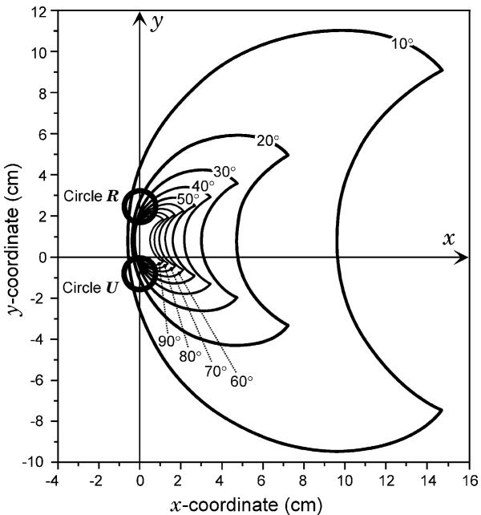  
图 6. $10^\circ$ 间隔下 $1 0 ^ { \circ } \leqslant \phi \leqslant 9 0 ^ { \circ }$ 的 Reg(/) 边界线。

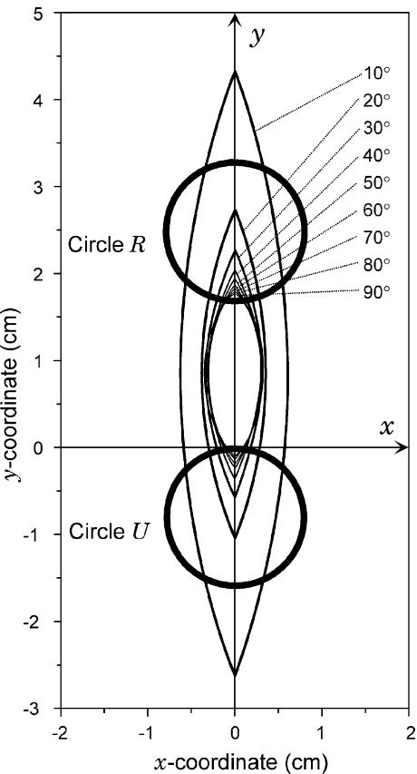  
图 8. $10^\circ$ 间隔下 $1 0 ^ { \circ } \leqslant \phi \leqslant 9 0 ^ { \circ }$ 的 $\mathrm { R e g } ( - \phi / \phi )$ 边界线。

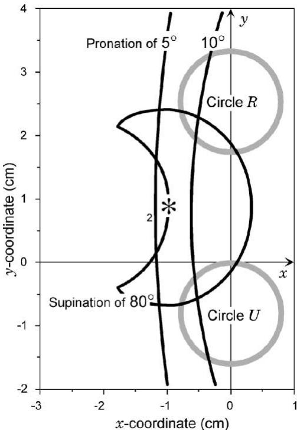  
Fig. 7. Reg( 80 )、Reg(10 ) 和 ${ \mathrm { R e g } } ( 5 ^ { \circ } )$ 的边界线。当 AFR 位于星号处时，由于圆 R 与圆 U 之间的撞击，旋后被限制在 80，而旋前由于绳索的限制被限制在小于 $1 0 ^ { \circ }$。

从其中立位旋转旋前和旋后至 $4 0 ^ { \circ }$ 或更大角度，各个 $\mathrm { A n g } ( - \phi / \phi )$ 显示出几乎相同的范围，即桡侧约 $1 4 ^ { \circ }$、尺侧约 $7 ^ { \circ }$、前侧约 $5 ^ { \circ }$ 以及后侧约 $4 ^ { \circ }$。

## 4. 讨论

我们获得了允许桡骨绕其旋转 $\phi$ 或更大角度的 AFR（前臂旋转轴）区域，该区域由函数 Reg(/) 表示。我们认为 Reg(/) 与 AFR 之间的位置关系可反映前臂的旋转范围。AFR 偏离 Reg(/) 会在以下三种情况下发生：在不改变 Reg(/) 大小的情况下改变了 AFR 的位置；通过减小 Reg(/) 的大小并改变骨骼位置使 AFR 发生偏离；以及在不改变骨骼位置的情况下通过减小 Reg(/) 的大小使 AFR 发生偏离。第一种情况适用于前臂双骨畸形；第二种情况适用于伴有 IOM（骨间膜）缩短的骨间隙狭窄；第三种情况适用于 IOM 松弛度的降低。这三种情况已被报道为前臂骨折相关前臂旋转受限的原因 [1–4,8]。

Tarr 等人 [4] 研究了前臂骨成角畸形导致的前臂旋转受限，并在尸体研究中指出，限制前臂旋转的是软组织张力（尤其是 IOM 的张力），而非前臂骨之间的撞击。在我们的研究中，当前臂的旋前或旋-

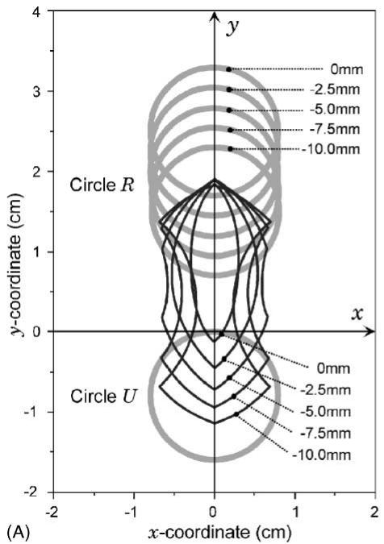

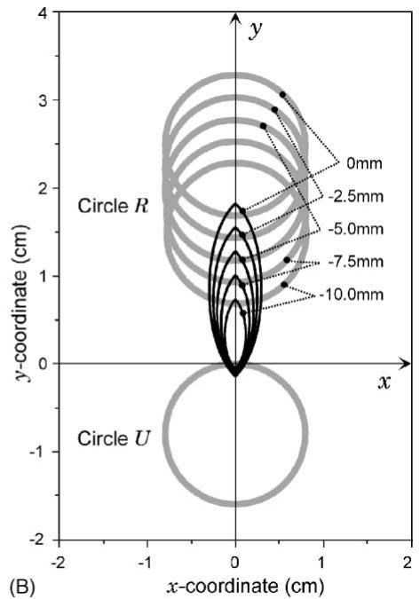  
Fig. 9. 圆 R 与圆 U 之间距离的缩短对 Reg( 70 /70 ) 大小的影响。(A) 研究 2A 的结果。绳索长度保持恒定。(B) 研究 2B 的结果。绳索长度与圆 R 和圆 U 之间距离的缩短成比例缩短。

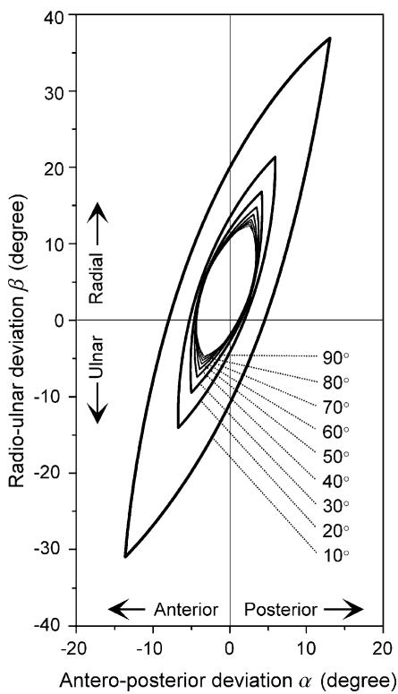  
Fig. 10. 以 10 为间隔，10 6 / 6 90 的 Ang( /=/) 边界线。

后受到前臂骨撞击的限制时，向相反方向的旋转则受到 IOM 的限制，且这种限制要显著得多。这一结果表明，在我们建立的前臂骨成角畸形模型中，IOM 的限制是前臂旋转受限的主要原因。

桡骨与尺骨之间骨间隙的狭窄也被报道为导致前臂旋转受限的原因之一 [3]。在我们的研究中，伴随骨间膜（IOM）缩短的骨间隙狭窄由于受到 IOM 的限制，总是会减小 $\mathrm { R e g } ( - \phi / \phi )$ 的范围；然而，在 IOM 未缩短的情况下，骨间隙狭窄则是通过前臂骨骼的撞击来减小 $\mathrm { R e g } ( - \phi / \phi )$ 的范围，尤其是当狭窄程度超过 10 mm 时。因此，沿 IOM 瘢痕形成导致的 IOM 缩短，或在骨间隙狭窄部位发生的类似情况，均被发现会导致前臂旋转度降低。此外，无论 IOM 的长度如何，骨间隙狭窄超过 10 mm 也会导致前臂旋转度降低。

Price et al. [8] 报道称，前臂旋转度的降低可能是由软组织瘢痕化产生的 IOM 张力所致。沿 IOM 的瘢痕形成会降低 IOM 的松弛度，进而导致前臂旋转度降低。在存在前后向畸形的前臂模型中，当 IOM 不松弛时，前臂旋转仅局限于单侧（旋前或旋后）。

至于导致前臂旋转显著丧失的畸形角度，在我们的研究中，前向为 $5 ^ { \circ }$，后向为 $4 ^ { \circ }$。这些角度小于以往尸体研究所报道的角度，既往研究指出前臂成角超过 $1 5 ^ { \circ }$ 或 $2 0 ^ { \circ }$ 可能会导致前臂旋转显著丧失 [1,4]。尸体研究结果与我们的研究结果之间存在差异的可能原因如下：在我们研究中代表 IOM 的线绳的松弛度可能低于实际情况，因为该线绳的松弛度是根据 IOM 中最强韧的结构——IOM 中心束的拉伸应变来确定的；此外，我们研究的模型未考虑邻近关节的松弛度，而实际的前臂旋转不仅会产生旋转运动，还会产生下尺桡关节的滑动运动 [6,9,10]。如果本研究使用的模型包含下尺桡关节的滑动运动，AFR 的位置将从 $\mathrm { R e g } ( - \phi / \phi )$ 平移至 $\mathrm { R e g } ( - \phi - \Delta \phi / \phi + \Delta \phi ) \ ( \Delta \phi \geqslant 0 )$，从而允许前臂进行更大范围的旋转。这一现象意味着在前后方向上每个 $\mathrm { A n g } ( - \phi / \phi )$ 的范围都会增大。

在存在前臂骨畸形的患者中，最大旋转时前臂旋转轴（AFR）的平移也同样重要。当桡骨受到骨间膜（IOM）限制时，若对其施加进一步的旋转载荷，则需要 AFR 发生平移或 IOM 发生撕裂才能使桡骨旋转。并且，当旋转轴的平移达到正常极限时，在最大旋前或旋后时会对邻近关节或 IOM 施加偏心载荷。我们此前曾报道过一例由于前臂骨骨折畸形愈合导致前臂旋转受限合并桡骨头前脱位的病例 [5]，我们认为导致其脱位的偏心载荷正是通过上述机制产生的。

## 5. 结论

AFR、前臂骨与 IOM 之间的位置关系在前臂旋转中起着重要作用。在我们的模型中，前臂骨成角畸形情况下导致前臂旋转受限的主要原因是 IOM 的限制。骨间隙变窄引起的前臂旋转受限受到 IOM 缩短的影响，该缩短模拟了沿 IOM 的瘢痕形成。在邻近关节无滑动运动的三维（3D）模型中，确定了会导致前臂旋转受限的成角畸形的方向和幅度。

## 参考文献

[1] Matthews LS, Kaufer H, Garver DF, Sonstegard DA. The efect on supination–pronation of angular malalignment of fractures of both bones of the forearm. An experimental study. J Bone Joint Surg 1982;64A:14–7.

[2] Rang M. Radius and ulna. In: Children’s fractures. 2nd ed. Philadelphia: J.B. Lippincott; 1983. p. 197–220.

[3] Roberts JA. Angulation of the radius in children’s fractures. J Bone Joint Surg 1986;68B:751–4.

[4] Tarr RR, Garfinkel AI, Sarmiento A. The efects of angular and rotational deformities of both bones of the forearm. An in vitro study. J Bone Joint Surg 1984;66A:65–70.

[5] Yasutomi T, Nakatsuchi Y, Koike H. Anterior dislocation of the radial head secondary to malunion of the forearm bones. J Shoulder Elbow Surg 2000;9:536–40.

[6] Nakamura T, Yabe Y, Horiuchi Y, Yamazaki N. In vivo motion analysis of forearm rotation utilizing magnetic resonance imaging. Clin Biomech 1999;14:315–20.

[7] Pfaefle HJ, Tomaino MM, Grewal R, Xu J, Boardman ND, Woo SL, et al. Tensile properties of the interosseous membrane of the human forearm. J Orthop Res 1996;14:842–5.

[8] Price CT, Scott DS, Kurzner ME, Flynn JC. Malunited forearm fractures in children. J Pediat Orthop 1990;10:705–12.

[9] Ekenstam Faf, Hagert CG. Anatomical studies on the geometry and stability of the distal radio ulnar joint. Scand J Plast Reconstr Surg Hand Surg 1985;19:17–25.

[10] Linscheid RL. Biomechanics of the distal radioulnar joint. Clin Orthop 1992;257:46–55.