# 包含肩带的上肢多体生物力学模型

Carlos Quental · João Folgado · Jorge Ambrósio · Jacinto Monteiro

收稿日期：2011年5月11日 / 录用日期：2011年12月16日 / 在线发表：2012年1月11日 © Springer Science+Business Media B.V. 2012

摘要 本研究旨在提出一个稳健的上肢肌肉骨骼模型，作为研究不同类型肩部病变（包括使用解剖型或反式假体）的基础。该多体生物力学模型由七个刚体组成，由胸锁关节、肩锁关节和盂肱关节进行约束（每个关节均建模为3个自由度 (d.o.f.) 的球关节）；肱尺关节和桡尺关节均建模为1个自由度的铰链关节；肩胸关节则由两个允许肩胛骨在胸廓上滑动的完整约束来建模。肌肉系统包括21块肌肉，使用障碍物集方法（obstacle-set method）描述为37个独立肌束段。肌肉收缩动力学采用Hill型肌肉模型表示，各肌肉的激活度为未知量。肌力分配是一个冗余问题，通过优化技术最小化代表肌肉能量消耗的目标函数，从而求解肌肉激活度及相应的肌力。优化问题中强制满足生物力学模型的运动方程，并施加了盂肱关节和肩胸关节的稳定性条件，由此提供了两组约束条件。通过将采集到的手臂外展运动结果与文献中的已有数据及肌电（EMG）数据进行对比，完成了模型的验证。

关键词 多体系统动力学 · 逆动力学分析 · 肌肉骨骼模型 · 上肢 · 肩带

## 1 引言

上肢由包括肩部、肘部和腕部的开链机构组成。肩部是上肢中最复杂且起决定性作用的机构，由四个骨骼节段组成，即胸廓、锁骨、肩胛骨和肱骨，它们由内侧向远端通过三个解剖关节相连：胸锁（SC）关节、肩锁（AC）关节和盂肱（GH）关节。换言之，它包括肩带（锁骨和肩胛骨）以及肩关节（肩胛骨和肱骨）[1]。在文献中，通常还会提到第四个关节来描述肩胛骨与胸廓之间的连接。尽管肩胛骨被约束在胸廓表面滑动，但该连接并非真正的解剖学关节 [2]。所有关节的协调运动使肩部机构拥有整个人体中最大的活动度（range of motion）。然而，这种高度的灵活性是以牺牲内在关节稳定性为代价的，尽管有多种机制为关节盂提供额外的稳定性，但如图 Fig. 1 详述的肩关节仍然是人体中最常发生脱位的关节。这些稳定机制包括主动肌肉协调、弹性韧带张力、盂唇形变、关节吸附力、黏附/内聚力、关节倾角（articular version）、本体感觉或关节内负压 [3]。

尽管几乎所有常见的上半身活动都需要上肢参与，但与其他区域的研究（如步态和下背部生物力学）相比，上肢生物力学模型仍处于发展的早期阶段 [3, 4]。上肢生物力学模型的首批实例见于19世纪末；在物理模型中，尸体肩部标本的肌肉被替换为麻线，从而能够确定力臂并定性测量不同肌肉的贡献 [4, 5]。此后，大多数关于肩部的研究都集中在不同复杂程度的理论或计算机模型上，但直到20世纪80年代才出现大规模肌骨模型（musculoskeletal models）[3, 6]。最完整且显著的肩部动态模型之一由 Van der Helm 于1994年提出 [7]。该模型采用动态有限元方法，将骨骼建模为通过三维铰链单元连接的刚体，并通过约束肩胛骨保持与椭球体接触，对以往一直被忽视的肩胛胸壁（scapulothoracic, ST）关节进行了开创性建模。总体而言，该模型包括 16 块肌肉（每块肌肉由 1 到 6 个产力单元建模）、3 个关节、3 条囊外韧带以及肩胛胸壁滑动平面。近年来，又有其他模型被提出 [4, 8]。Charlton 和 Johnson 开发的模型由 5 个关节（包括新增的肱尺（humeroulnar, HU）关节和桡尺（radioulnar, RU）关节）、23 块肌肉（由 93 个肌肉单元建模）以及肩胛胸壁滑动平面组成。尽管作者尝试对肋锁韧带和斜方韧带产生的力进行建模，但该工作的主要目标和重点是所开发模型的验证 [4]。文献 [8] 中提出的模型旨在将肌骨模型的能力与肩部人体工程学分析相结合。所开发的模型由 23 块肌肉（共计 38 个肌肉单元）、4 个关节和肩胛胸壁滑动平面定义。盂肱关节的稳定性是该研究提出的主要创新点，因为它没有遵循以往发表文献中将盂肱接触力的投影约束在代表关节盂的椭圆内的做法。在该研究中，应用了一种各向异性的、基于经验推导的盂肱稳定性指数，该指数定量表征了盂肱界面防止脱位的方向性要求。尽管具有这些有利方面，但所提出的模型在模拟肌肉收缩动力学方面受到显著限制，因为未考虑力-长度（force–length）和力-速度（force–velocity）关系。尽管文献中存在许多肩部模型，但各模型均有其自身的优势和局限性，因此肩部生物力学建模的若干方面仍有待进一步发展。

Fig. 1 肩关节复合体的解剖学描述  
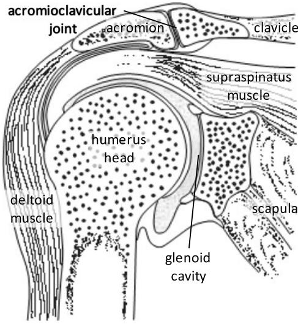

优化方法常用于多体生物力学模型中，尤其在步态与人体运动（locomotion）应用中备受重视 [9–11]。这些方法结合多体系统表征生物力学系统复杂性的能力，能够对较为复杂的人体运动（如过肩投掷）进行规划 [12]。通过数学量化来确定运动目标仍然是一个前沿研究课题，例如在运动控制 [13] 或人类语音研究 [14] 中均有涉及。

在本文中，利用多体系统动力学建立了上肢肌肉骨骼模型。本研究的初衷是构建一个稳健的模型，该模型可不断改进以用于模拟不同的病理状态，特别是在肩关节置换为解剖型或反向人工假体的情况下——这是第三大常见的关节置换术 [15]。

## 2 生物力学模型

## 2.1 骨骼模型

本文提出的上肢模型基于 Garner 和 Pandy [16] 发表的数据。然而，参考文献 [16] 中提出的参考坐标系与国际生物力学学会（International Society of Biomechanics, ISB）标准化与术语委员会随后提出的上肢数据标准化规范不一致。利用现有的骨性标志，根据 Wu 等人 [17] 的建议重新定义了参考坐标系。由于原始文献中缺乏相关数据，肩胛骨的参考坐标系基于 Van der Helm [18] 的定义。需要注意的是，为了提高肱骨节段坐标系的精度，前臂的位置相对于文献 [16] 中给出的标准位置进行了调整。在新的参考坐标系中描述的骨性标志局部坐标详见附录（Appendix）。

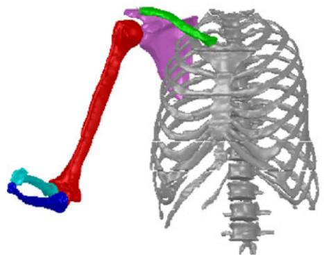  
(a)

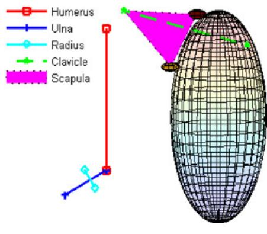  
(b)  
Fig. 2 (a) 上肢生物力学模型多体系统的几何描述；(b) 上肢示意图

如图 Fig. 2 所示，本文提出的模型包括被建模为刚体的胸部、胸廓、锁骨、肩胛骨、肱骨、尺骨和桡骨。为了克服常用角度坐标的一些缺陷，采用了欧拉参数作为方向坐标 [19]。因此，每个刚体由 7 个坐标定义，从而构成一个包含 49 个分量的广义坐标向量，用以表示所有解剖部位的位置与姿态。

胸廓被定义为全局参考坐标系，肋骨架被定义为椭球体，二者均处于静止状态。SC（胸锁）、AC（肩锁）和 GH（盂肱）关节均被建模为 3 自由度球窝关节。ST（肩胸）关节采用两个完整约束进行建模，以确保肩胛骨在肋骨架上滑动，即在肩胛骨表面定义两个点，并始终强制它们与肋骨架保持接触。HU（肱尺）和 RU（桡尺）关节被建模为 1 自由度铰链关节。因此，加上欧拉参数之间的关系所产生的约束以及上述所有解剖学约束，该上肢模型中总共有 40 个约束。

上臂、肱骨以及前臂、尺骨和桡骨的身体环节惯性参数（BSIP）是根据文献 [20] 中报道的预测方程估算的。对于肩胛骨和锁骨，由于缺乏预测方程，因此其 BSIP 是根据磁共振成像估算的 [21]。在惯性主轴系中定义的质量和转动惯量如 Table 1 所示。对于肩胛骨和锁骨，惯性主轴被认为与参考位置对齐，而对于其余部分，其主轴方向则取自 [20]。Table 2 和 Table 3 给出了模型中各解剖环节位置对应的质心（COM）以及新参考坐标系的方向余弦。

Table 1 上肢解剖学环节的质量和转动惯量

<table><tr><td>环节</td><td>Mass (kg)</td><td> $I_{xx}$  (kg m2)</td><td> $I_{yy}$  (kg m2)</td><td> $I_{zz}$  (kg m2)</td></tr><tr><td>胸廓</td><td>-</td><td>-</td><td>-</td><td>-</td></tr><tr><td>锁骨</td><td>0.12784</td><td>0.00122800</td><td>0.00109900</td><td>0.0003900</td></tr><tr><td>肩胛骨</td><td>0.94898</td><td>0.01912900</td><td>0.03007200</td><td>0.0112420</td></tr><tr><td>肱骨</td><td>2.16000</td><td>0.01922569</td><td>0.00392116</td><td>0.0204860</td></tr><tr><td>尺骨</td><td>0.94883</td><td>0.00527229</td><td>0.00081371</td><td>0.0052723</td></tr><tr><td>桡骨</td><td>0.58117</td><td>0.00322935</td><td>0.00049841</td><td>0.0032294</td></tr></table>

Table 2 全局参考坐标系中上肢各刚体的质心坐标  
Table 3 图 2b 所示参考位置下，全局参考坐标系中上肢各刚体的方向余弦

<table><tr><td>节段</td><td>x (m)</td><td>y (m)</td><td>z (m)</td></tr><tr><td>胸部</td><td>0.000000</td><td>0.000000</td><td>0.000000</td></tr><tr><td>肋骨架</td><td>-0.058280</td><td>-0.168220</td><td>0.060660</td></tr><tr><td>锁骨</td><td>-0.031891</td><td>0.045060</td><td>0.087043</td></tr><tr><td>肩胛骨</td><td>-0.101363</td><td>0.022263</td><td>0.133529</td></tr><tr><td>肱骨</td><td>-0.045643</td><td>-0.108735</td><td>0.174550</td></tr><tr><td>尺骨</td><td>0.068962</td><td>-0.271643</td><td>0.209029</td></tr><tr><td>桡骨</td><td>0.066841</td><td>-0.264919</td><td>0.200488</td></tr></table>

<table><tr><td>节段</td><td>轴</td><td>x (m)</td><td>y (m)</td><td>z (m)</td></tr><tr><td rowspan="3">胸部</td><td>x</td><td>1.000000</td><td>0.000000</td><td>0.000000</td></tr><tr><td>y</td><td>0.000000</td><td>1.000000</td><td>0.000000</td></tr><tr><td>z</td><td>0.000000</td><td>0.000000</td><td>1.000000</td></tr><tr><td rowspan="3">肋骨架</td><td>x</td><td>0.191868</td><td>0.048710</td><td>0.980211</td></tr><tr><td>y</td><td>0.972773</td><td>0.122858</td><td>-0.196517</td></tr><tr><td>z</td><td>-0.129999</td><td>0.991228</td><td>-0.023812</td></tr><tr><td rowspan="3">锁骨</td><td>x</td><td>0.945081</td><td>0.000000</td><td>0.326834</td></tr><tr><td>y</td><td>0.150238</td><td>0.888086</td><td>-0.434432</td></tr><tr><td>z</td><td>-0.290257</td><td>0.459677</td><td>0.839313</td></tr><tr><td rowspan="3">肩胛骨</td><td>x</td><td>0.700190</td><td>0.241287</td><td>0.671947</td></tr><tr><td>y</td><td>0.030094</td><td>0.930349</td><td>-0.365435</td></tr><tr><td>z</td><td>-0.713321</td><td>0.276096</td><td>0.644161</td></tr><tr><td rowspan="3">肱骨</td><td>x</td><td>0.972966</td><td>0.081387</td><td>0.216131</td></tr><tr><td>y</td><td>-0.082770</td><td>0.996565</td><td>-0.002661</td></tr><tr><td>z</td><td>-0.215605</td><td>-0.015299</td><td>0.976360</td></tr><tr><td rowspan="3">尺骨</td><td>x</td><td>0.000000</td><td>0.999191</td><td>-0.040203</td></tr><tr><td>y</td><td>-0.976409</td><td>-0.008680</td><td>-0.215752</td></tr><tr><td>z</td><td>-0.2159271</td><td>0.039254</td><td>0.975620</td></tr><tr><td rowspan="3">桡骨</td><td>x</td><td>0.075004</td><td>-0.831538</td><td>-0.550380</td></tr><tr><td>y</td><td>-0.996083</td><td>-0.088392</td><td>-0.002198</td></tr><tr><td>z</td><td>-0.046821</td><td>0.548389</td><td>-0.834911</td></tr></table>

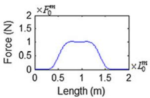  
(a)

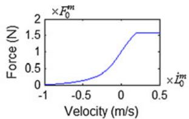  
(b)

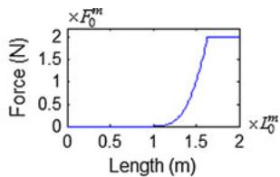  
(c)  
Fig. 3 肌肉模型的力–长度与力–速度关系。(a) 收缩元件的力–长度关系；(b) 表示一般向心–离心收缩的力–速度关系，其中力值是在肌肉长度等于其静息长度时测量的；(c) 被动元件的力–长度关系

## 2.2 肌肉骨骼模型

在这项工作中，肌肉收缩动力学由 Hill 肌肉模型描述。该模型由一个主动收缩元件（CE，模拟由收缩功能单元产生的主动肌肉动作）和一个被动弹性元件（PE，模拟与肌纤维物理并联的结构的刚度）表示。这两个元件都与一个通常与横桥刚度相关的被动弹性元件（SE）串联，在不涉及短肌腱执行器的协调研究中可以忽略该元件 [22, 23]。肌肉力定义为 CE 元件产生的力加上 PE 元件的贡献：

$$
\left\{ \begin{array}{l} F ^ {m} = F _ {\mathrm{CE}} ^ {m} \big (L ^ {m} (t), \dot {L} ^ {m} (t), a ^ {m} (t) \big) + F _ {\mathrm{PE}} ^ {m} \big (L ^ {m} (t) \big) \\ F _ {\mathrm{CE}} ^ {m} = \frac {F _ {L} ^ {m} (t) F _ {\dot {L}} ^ {m} (t)}{F _ {0} ^ {m}} a ^ {m} (t) \end{array} \right.\tag{1}
$$

肌肉组织的收缩特性受其当前长度 $L ^ { m } ( t )$、长度变化率 $\dot { L } ^ { m } ( t )$ 以及肌肉激活度 $a ^ { m } ( t )$ 的控制。如图 3a 和 3b 所示的肌肉力–长度关系 $F _ { L } ^ { m } ( t )$ 和力–速度关系 $F _ { \dot { L } } ^ { m } ( t )$ 来源于 [22]，且仅取决于肌肉的运动学，即其长度和伸长速度。如果肌肉运动学和肌肉特性（特别是最佳肌纤维长度 $L _ { 0 } ^ { m }$、肌腱松弛长度 $L _ { s } ^ { m }$ 和最大等长肌力 $F _ { 0 } ^ { m }$）已知，则确定 CE 元件的贡献只需评估肌肉激活水平。根据图 3c，被动元件产生的力仅取决于肌肉长度。

该模型实现了由 37 个肌段表示的 21 块肌肉的肌肉几何结构，并包含了障碍集方法（obstacle-set method）[24] 所施加的几何特征。除了常用的路径点（via points）外，该方法还定义了四种类型的几何体，即单球体、单圆柱体、双圆柱体和带半球端面的圆柱体（sphere-capped cylinder），以更好地描述肌肉路径。特别是，当肌肉受到骨骼和其他肌肉的约束时，这些基本几何体代表了解剖学几何结构。

上肢肌肉骨骼数据最初发表于 [25]，但由于连体参考坐标系发生了改变，因此以一致的方式对新的肌肉数据进行了修改，并在附录（Appendix）中报告。

在生物力学模型中，肌肉作为点对点运动学驱动执行器被引入。每块肌肉都与一个约束方程相关联，该方程强制两个不同刚体上的通用点之间的距离根据长度-时间函数发生变化 [26]。对于由两点以上定义的肌肉，其对生物力学模型的贡献被视为近似其真实几何形状的若干个两点肌肉执行器的总和。

## 2.3 逆向动力学

当运动已知且仅有产生该运动的作用力未知时，逆向动力学方法被用于求解生物力学问题。生物力学模型的运动通常使用视频成像采集，或通过其他准则进行定义 [26]。本研究即属于这种情况。所分析的运动是在里斯本高等技术学院—里斯本工业大学（IST—TU Lisbon）的里斯本生物力学实验室（LBL）采集的。使用四台采样率为 100 Hz 的摄像机记录了 7 秒的手臂外展运动。同时，同步记录了 9 块浅表肌肉的肌电图（EMG）信号，即肩峰部三角肌（Deltoideus p. acromialis）、锁骨部三角肌（Deltoideus p. clavicularis）、肩胛部三角肌（Deltoideus p. scapularis）、肱二头肌（Biceps brachii）、前锯肌（Serratus anterior）、降部斜方肌（Trapezius p. descendenz）、横部斜方肌（Trapezius p. transversus）、胸大肌（Pectoralis Major）和肱三头肌（Triceps brachii）[27]。

## 2.3.1 运动学数据采集

基于 Van der Helm [18] 的工作，国际生物力学学会（ISB）提出了用于上肢运动采集和描述的标准流程 [17]。为了记录刚体的三维运动，必须有效描述其 6 个自由度（d.o.f.），即理想情况下每块骨骼都应具有 3 个在整个运动过程中均可追踪的解剖标志点。然而，并非所有上肢骨骼都具有 3 个可触及的骨性标志点，因此需要其他骨骼的骨性标志点来定义环节坐标系，从而导致了位置依赖性。Wu et al. [17] 推荐了 15 个骨性标志点（如 Table 4 所述并在 Fig. 4 中显示），用于定义胸廓、锁骨、肩胛骨、肱骨、尺骨和桡骨的坐标系。

对于锁骨而言，由于仅有两个骨性标志点可触及，因此无法通过无创测量来确定锁骨的轴向旋转。以 [28] 为例，锁骨的轴向旋转是通过最小化肩锁关节（AC 关节）旋转来估计的。对于肩胛骨，尽管其具有 3 个可触及的骨性标志点，但仅依靠表面标记点并不能实现精确追踪。在手臂抬高过程中，肩胛骨相对于皮肤移动，导致标记点与相应解剖标志点之间的位移高达 2 cm [29, 30]。最精确的方法包括测量准静态位置，即使用肩胛骨定位器在连续的静态位置上识别标志点。然而，该方法过于耗时，且肌肉活动可能与动态条件存在差异 [30, 31]。在本研究中，肩胛骨的动态追踪采用了 Šenk 和 Chèze 近期提出的一种方法，该方法在手臂抬高至 120◦ 时仍表现出可接受的精度，如图 4a 所示 [32]。必须指出的是，在一组功能性任务中出现的平均最大肱骨抬高角度约为 100◦ [33]。

对于肱骨而言，特别是需要盂肱关节（GH 关节）中心来定义其纵轴。由于 GH 关节中心不是可触及的骨性标志点，因此必须通过回归分析 [34] 或其他方法 [35–37] 进行估计。在本研究中，鉴于文献 [30] 提出的算法具有更高的精度，故采用该算法 [38]。

Table 4 胸廓、锁骨、肩胛骨、肱骨、尺骨和桡骨的解剖标志点 [17]

<table><tr><td>骨骼</td><td>骨性标志点</td><td>描述</td></tr><tr><td rowspan="4">胸廓</td><td>C7</td><td>第 7 颈椎棘突</td></tr><tr><td>T8</td><td>第 8 胸椎棘突</td></tr><tr><td>IJ</td><td>颈静脉切迹最深点</td></tr><tr><td>PX</td><td>剑突</td></tr><tr><td rowspan="2">锁骨</td><td>SC</td><td>胸锁关节最腹侧点</td></tr><tr><td>AC</td><td>肩锁关节最背侧点</td></tr><tr><td rowspan="4">肩胛骨</td><td>TS</td><td>肩胛冈三角</td></tr><tr><td>AI</td><td>肩胛下角</td></tr><tr><td>AA</td><td>肩峰角</td></tr><tr><td>PC</td><td>喙突最腹侧点</td></tr><tr><td rowspan="3">肱骨</td><td>GH</td><td>盂肱旋转中心</td></tr><tr><td>EL</td><td>外上髁最尾侧点</td></tr><tr><td>EM</td><td>内上髁最尾侧点</td></tr><tr><td>尺骨</td><td>US</td><td>尺骨茎突最尾-内侧点</td></tr><tr><td>桡骨</td><td>RS</td><td>桡骨茎突最尾-外侧点</td></tr></table>

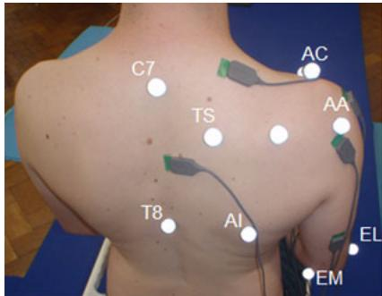  
(a)

(b)  
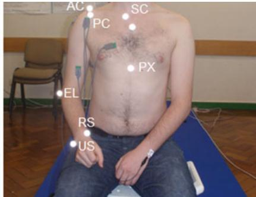  
Fig. 4 骨性标志点的位置。(a) 后视图；(b) 前视图

## 2.3.2 运动方程

无论采用何种方法获取运动，只有当其运动特征与运动学约束一致时，该运动才被完全确定。用 $\mathbf{q}$ 表示系统坐标向量，由运动副和肌肉执行器产生的运动学约束表示为

$$
\boldsymbol {\Phi} = \boldsymbol {\Phi} (\mathbf {q}) = \mathbf {0}.\tag{2}
$$

系统中运动学约束的存在意味着刚体之间引入了反作用力。根据 [19] 中给出的详细推导，反作用力记为 $\mathbf { g } ^ { ( c ) }$，表示为

$$
\mathbf {g} ^ {(c)} = \boldsymbol {\Phi} _ {\mathbf {q}} ^ {T} \boldsymbol {\lambda}\tag{3}
$$

其中 $\Phi _ { \mathbf { q } }$ 和 $\lambda$ 分别表示约束的雅可比矩阵以及与运动学约束相关的拉格朗日乘子向量。

对于受约束的生物力学模型，运动方程写作

$$
\mathbf {M} \ddot {\mathbf {q}} + \boldsymbol {\Phi} _ {\mathbf {q}} ^ {T} \boldsymbol {\lambda} = \mathbf {g}\tag{4}
$$

其中 $\mathbf{M}$ 为系统的质量矩阵，包含所有刚体的质量和转动惯量；$\ddot { \bf q }$ 为加速度向量；$\mathbf{g}$ 为广义外力向量。

如前所述，肌肉作为运动学驱动器引入系统中，而不仅是作为力添加到力向量中。肌肉产生的力取决于收缩元件和被动元件的共同作用。由于在整个分析周期内运动是已知的，仅取决于肌肉长度的被动元件贡献也是已知的，因此被视为直接作用于由该肌肉相连的刚体上的外加力。收缩元件的贡献则作为反作用力予以考虑，即拉格朗日乘子向量中包含了与每块肌肉收缩元件相关的项。这些拉格朗日乘子可以表示肌肉力；若肌肉方程乘以适当的标量因子，也可表示肌肉激活度。用激活度表示运动方程在优化问题中具有一定优势，因为设计变量被限制在 0 和 1 之间 [23]，从而确保它们具有相似的数量级。

## 2.4 EMG 分析

肌电（EMG）信号取决于若干生理、解剖和技术因素 [39]。例如，在运动的极限位置，其振幅会受到肌肉长度的影响。尽管肌肉产生的力可能较小，但由于肌纤维的长度，EMG 振幅可能会更高 [7]。因此，肌肉产生的力量大小与 EMG 振幅之间精确的定量关系往往难以捉摸 [39]。尽管如此，EMG 信号仍常用于验证逆动力学分析所预测的结果。EMG 振幅与肌肉力之间的定性关系使得人们能够定义激活/未激活（on/off）模式，并将其与模型预测进行比较 [40]。

在实验室记录的 EMG 信号经过整流，并计算其均方根（RMS）电压。为了定义激活/未激活模式，所采用的方法包括计算在任何活动开始前 EMG 基线的标准差。然后将该范围的倍数因子定义为阈值，即高于此阈值则定义肌肉处于激活状态，低于此阈值则处于未激活状态。

## 2.5 肌肉力分配问题

人体肌肉骨骼系统的特征是肌肉冗余，即不同的肌肉可以支配同一自由度 [41]。在数学上，这意味着未知数（肌肉激活度）的数量大于系统的自由度数量（即系统实际机动性的度量）。肌肉力分配问题具有无穷多组解，即存在产生相同运动的无限种肌肉激活组合。优化过程的目标是在满足一定数量的限制或约束条件的同时，找到使目标函数最小化的肌肉力分配问题的解。理想情况下，目标函数具有一定的生物学相关性，即尽可能模拟中枢神经系统在决定招募哪些肌肉及其激活水平时所采用的标准。但需要注意的是，所采用的合适准则取决于多个方面，例如所分析的运动类型、要实现的目标或是否存在任何类型的病理状况 [26]。

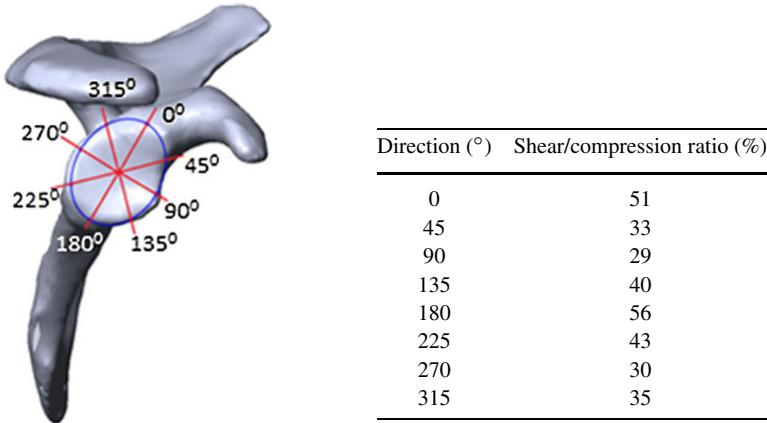

<table><tr><td>方向 (°)</td><td>剪切/压缩比 (%)</td></tr><tr><td>0</td><td>51</td></tr><tr><td>45</td><td>33</td></tr><tr><td>90</td><td>29</td></tr><tr><td>135</td><td>40</td></tr><tr><td>180</td><td>56</td></tr><tr><td>225</td><td>43</td></tr><tr><td>270</td><td>30</td></tr><tr><td>315</td><td>35</td></tr></table>

Fig. 5 定向肩关节脱位力阈值比。该比例表示关节脱位耐受的方向性剪切力与压缩力之比 [8]

最常用的优化程序被称为静态优化（static optimization），它将肌肉视为瞬时可用的执行器，其肌力仅取决于当前的激活水平，因此可以在每个时间瞬时独立进行优化 [42]。如果将运动离散化为 n − 1 个恒定时间间隔，则可以建立 n 个不同的优化问题。本文提出的用于逆动力学分析的程序，试图在整个运动过程中同时进行最小化，而不是在每个时间瞬时独立进行。考虑到分析周期被离散化为 n 个时间步，设计变量即为所有 m 块肌肉在所有 n 个时间步的肌肉激活度。被称为全局肌肉激活向量的 mn × 1 向量 a 排列如下：

$$
\mathbf {a} = \left[ a _ {1} ^ {1}, \dots , a _ {j} ^ {1}, \dots , a _ {n} ^ {1}, \dots , a _ {1} ^ {i}, \dots , a _ {j} ^ {i}, \dots , a _ {n} ^ {i}, \dots , a _ {1} ^ {m}, \dots , a _ {j} ^ {m}, \dots , a _ {n} ^ {m} \right]\tag{5}
$$

其中 $a _ { j } ^ { i }$ 为第 i 块肌肉在时间 $t _ { j }$ 的激活度。

在文献中可用的若干具有生物学相关性的目标函数中，本文采用了 Praagman 等人 [43] 提出的目标函数，它是一个与能量相关的代价函数。该函数基于肌肉中两个主要的耗能过程，比最常用的肌肉应力代价函数能得出更好的结果 [43]。该问题被描述为在满足生物力学系统的运动方程以及肌肉激活度边界约束（未激活状态为零，完全激活状态为一）的同时，最小化肌肉能量消耗。同时，还必须确保关节的稳定性。通过应用如图 Fig. 5 所示的方向性经验稳定比，限制相对于压力的关节剪切力大小，从而稳定盂肱关节 [8]，同时通过确保反作用力为压力来稳定肩胛胸壁关节 [44]。

在数学上，肌肉力分配问题表示为

$$
\begin{array}{l} \min \quad J (t, \mathbf {a}) = \sum_ {t = 1} ^ {n} \sum_ {i = 1} ^ {m} c _ {1} \frac {V ^ {i} F _ {\mathrm{CE}} ^ {i}}{P C S A ^ {i}} + c _ {2} V ^ {i} a _ {t} ^ {i} + c _ {3} a _ {t} ^ {i ^ {2}} \\ \text { subject   to: } \left\{ \begin{array}{l} \mathbf {f} _ {t} (\mathbf {a}) = \left(\boldsymbol {\Phi} _ {\mathbf {q}} ^ {T} \boldsymbol {\lambda} + (\mathbf {M} \ddot {\mathbf {q}} - \mathbf {g})\right) _ {t} = \mathbf {0}, \quad t = 1, \dots , n \\ \mathbf {0} \leq \mathbf {a} \leq \mathbf {1} \\ \left(\frac {\mathbf {f} _ {\mathrm{GH}} ^ {T} \boldsymbol {\tau} _ {\mathrm{GH} _ {d}}}{\mathbf {f} _ {\mathrm{GH}} ^ {T} \mathbf {n} _ {\mathrm{GH}}}\right) _ {t} \leq t h _ {d}, \quad d = 1, 2, 3, 4 \text { and } t = 1, \dots , n \\ (\mathbf {f} _ {\mathrm{ST} _ {p}} ^ {T} \mathbf {n} _ {\mathrm{ST} _ {p}}) _ {t} > 0, \quad p = 1, 2 \text { and } t = 1, \dots , n \end{array} \right. \end{array}\tag{6}
$$

其中 $V ^ { i }$ 为体积，$F _ { \mathrm { C E } } ^ { i }$ 为收缩力，$P C S A ^ { i }$ 为横截面积，$a _ { t } ^ { i }$ 为肌肉 $i$ 在时间步 $t$ 的激活度。变量 $c _ { 1 } , c _ { 2 }$ 和 $c _ { 3 }$ 为权重因子 [43]。该优化问题必须满足的约束条件为：(a) 每个时刻 $t$ 的运动方程，由 $\mathbf { f } _ { t } ( \mathbf { a } )$ 表示；(b) 肌肉激活度的边界约束；(c) 盂肱关节的稳定性，其中 $\mathbf { f } _ { \mathrm { G H } }$ 表示盂肱关节反作用力，$n$ 表示关节盂平面的法向量，$\pmb { \tau } _ { \mathrm { G H } _ { d } }$ 表示关节盂平面中描述方向 $d$ 且阈值为 $t h _ { d } \colon$ 的单位向量；以及 (d) 肩胛胸壁关节的稳定性，其反作用力记为 $\mathbf { f } _ { \mathrm { S T } }$，肩胛骨与胸廓之间的压缩方向向量记为 $\mathbf { n } _ { \mathrm { S T } }$。最后这一约束必须对定义 ST 关节的 2 个点中的每个 $p$ 点均得到满足。

优化问题具有 $n \times ( m + k )$ 个设计变量，即对于 $n$ 个时间步中的每一个，都有 $m$ 个肌肉激活度和 $k$ 个与运动学约束相关的拉格朗日乘子（Lagrange multipliers），据此可求得关节反作用力。在总设计变量数中增加 $n \times k$ 个变量，是由于关节反作用力随肌肉力而改变，因此与运动副相关的拉格朗日乘子也必须包含在优化问题中。关于约束条件，该问题具有 $n _ { \mathrm { d . o . f . } } \times n$ 个等式约束、$6 \times n$ 个不等式约束以及 $n \times m$ 个边界约束。在本模型中，总自由度数 $n _ { \mathrm { d . o . f . } } = 4 2 , m = 3 7$ 且 $k = 3 3$。每个时间步的不等式约束数量源自为 GH（盂肱）和 ST（肩胛胸壁）关节定义的 6 个稳定性约束，即 4 个关于盂肱接触力的约束，以及关于定义 ST 关节的 2 个点中每个点的肩胛胸壁接触力的 1 个约束。显然，优化问题的规模与分析中的时间帧数成正比，这对实际可采用的分析离散化程度构成了限制。

该生物力学模型在 Matlab® 中实现。采用带有内点法算法（interior-point algorithm）的 Matlab 函数 fmincon 来求解该优化问题。目标函数和约束梯度以解析形式提供以提高其性能，而 Hessian 矩阵则通过有限内存拟牛顿法（limited-memory quasi-Newton）近似计算。以 50 ms 的恒定时间间隔对运动进行采样，所得到的问题特征包含 9870 个设计变量、5781 个等式约束、846 个不等式约束以及 9870 个下界和上界约束。

## 3 结果

针对几组不同的初始设计变量集对式 (6) 所描述的优化问题进行了求解。鉴于所使用的优化算法始终只能找到局部极小值，这种初始化流程提高了所找到的最佳极小值实际上为全局极小值的几率。在不同试验中被视为最佳的结果总结于图 6 至图 8 中。为简明起见，此处不对优化方法的收敛性问题展开讨论。

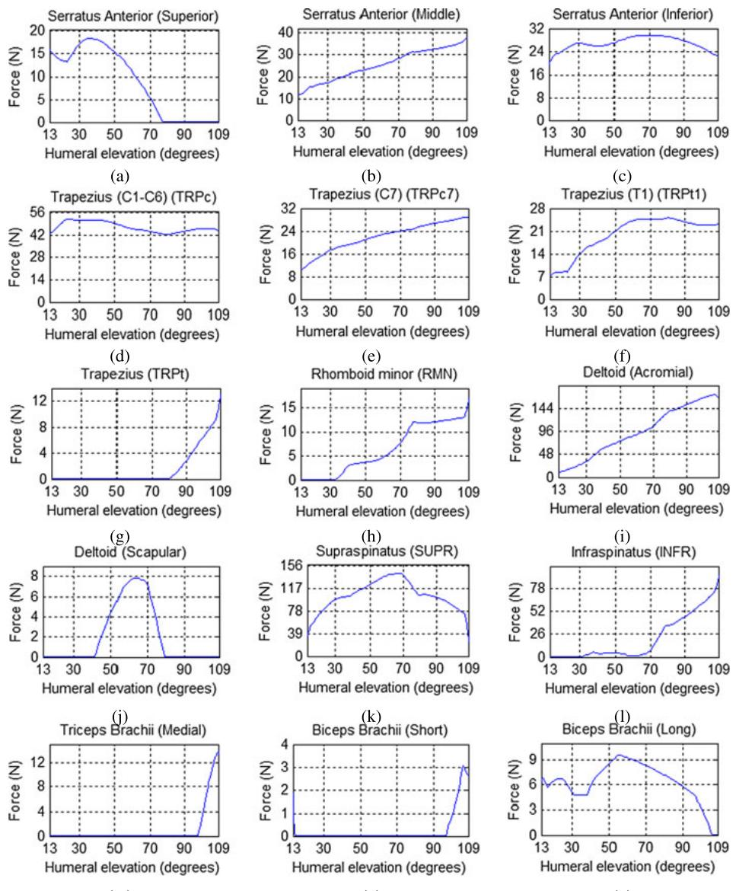  
(m)  
(n)  
(o)  
Figure 6 在手臂从 13◦ 外展至 109◦ 期间，跨越 SC、AC 和 GH 关节的肌肉力（以牛顿为单位显示）

## 3.1 肌肉力

Figure 6a 至 6o 展示了模型预测的在手臂抬高角度从 13◦ 逐渐增加至 109◦ 的外展运动过程中，跨越 SC（胸锁）、AC（肩锁）和 GH（盂肱）关节的肌肉收缩元力。产生小于 1 N 主动力的肌肉几乎没有激活，因此未在图中显示。在这一运动范围内，被动元的贡献也微不足道，故图中未予呈现。

前锯肌（serratus anterior muscle）是肩胛骨前伸和上回旋的原动肌 [45]，在模型中被划分为三个肌束。上束的受力如图 Fig. 6a 所示，其激活持续至肱骨抬高 75◦；而中束（力如图 Fig. 6b 所示）和下束（力如图 Fig. 6c 所示）在整个运动过程中均处于激活状态。上部和中部纤维由于其更为水平的牵引力线，主要负责肩胛骨的前伸，而下部纤维则通过牵拉肩胛骨下部，有效地实现肩胛骨的上回旋。此外，前锯肌的整体活性与其将肩胛骨稳定在胸廓上的主要功能相吻合 [1]。

斜方肌（trapezius muscle）在功能上分为 3 个部分：上部、中部和下部 [1]。由 TRPc 肌束建模的上部（其受力如图 Fig. 6d 所示）在约 30◦ 时达到最大活性。尽管在大小上存在差异，但其活性模式与前锯肌下部纤维相似，这与其在肩胛骨上回旋中的共同功能高度契合。如图 Fig. 6e 和 6f 所示的中部（TRPc7 和 TRPt1 肌束）的活性随着手臂的抬高而增加。如图 Fig. 6g 所示的下部 TRPt 的作用十分关键，它在手臂外展过程中与上部协同作用，以旋转肩胛骨并使关节盂向上翻转 [46]。

小菱形肌（rhomboid minor muscle）的受力如图 Fig. 6h 所示，它与前锯肌共同起到将肩胛骨稳定在胸壁上的作用 [45]。模型预测其在幅度达到 30◦ 之后开始产生活性。

三角肌中间部分（在 Fig. 6i 中由 DLTa 表示）具有肩部机构中最大的生理横截面积（PCSA）。鉴于其在外展手臂方面的有效性，预计它会产生很大的力，特别是在 30◦–120◦ 的幅度之间 [45]。本文提出的模型支持这一论点，因为它预测 DLTa 是外展过程中最活跃的肌肉，在所分析运动的末期达到 173 N 的最大力。在 [45] 中，三角肌的前部和后部被认为在外展过程中充当中部的稳定器，然而该模型仅预测了后部（DLTs）具有一定活性，如图 Fig. 6j 所示。三角肌锁骨部活性的缺乏可以通过运动方程中缺少韧带力来解释。在 [7] 中，Van der Helm 得出结论，将锥状韧带排除在力传递之外会导致三角肌锁骨部和斜方肌处于非活跃状态。请注意，胸锁韧带、肋锁韧带、锥状韧带和斜方韧带是根据 [47] 中发表的数据建模的；然而，由于缺乏有关其静息长度的信息，运动方程中并未考虑它们的贡献。

冈上肌（其力如图 Fig. 6k 所示）的活性持续增加直至 70◦。在此期间，它实际上是最活跃的肌肉，这不仅印证了其负责启动外展运动的观点 [46]，而且强化了它与其他肩袖肌群共同协助外展并稳定盂肱关节的作用 [1, 45]。在其余的肩袖肌群中，只有冈下肌（如图 Fig. 6l 所示）表现出值得注意的活性，特别是在手臂幅度超过 70◦ 之后，这与冈上肌肌力的下降相吻合。

肱三头肌对手臂外展没有贡献 [45]。尽管如此，如图 Fig. 6m 所示，该模型预测内侧头在幅度超过 100◦ 后会出现一些活性。在 LBL 记录运动时，由于肘部未受到约束，因此前臂相对于手臂必定发生了运动，即使幅度很小。请注意，EMG 在运动结束时也检测到了一些活性。

肱二头肌根据其两个头（短头和长头）被建模为两个肌束。肱二头肌短头在外展结束时表现出一定活性，如图 Fig. 6n 所示，而长头几乎始终处于活跃状态，如图 Fig. 6o 所示。Vizniak 将肱二头肌长头与手臂外展联系在一起 [45]。此外，Terry 和 Chopp 强调了肱二头肌长头作为肱骨头下压肌的功能，有助于维持肩关节的稳定性 [48]。

## 3.2 EMG 测量活性

如前所述，此处的肌电活动被用作肌肉活动的定性指标，以支持模拟结果。针对上肢 9 块浅层肌肉（即前锯肌、斜方肌降部、斜方肌横部、三角肌锁骨部、三角肌肩峰部、三角肌肩胛冈部、肱二头肌、胸大肌和肱三头肌）所记录的 EMG 信号 RMS 分别展示于 Fig. 7a 至 Fig. 7i 中。为了说明肌肉活动的时期，在所有图中的信号上方均绘制了一个灰色矩形。

根据 EMG 结果，前锯肌几乎一直处于活跃状态。鉴于电极位置，该信号与当前模型中前锯肌的中部关联更大，从而证实了模型的预测。斜方肌降部与 TRPc、TRPc7 和 TRPt1 肌束的关联更强。正如模型所预测的那样，EMG 显示其在整个外展过程中均有活动。与 TRPt 肌束关联更强的斜方肌横部，其活动模式也与模型预测相似。

正如预期的那样，三角肌肩峰部始终处于活跃状态，这证实了所获得的结果。然而，三角肌的肩胛冈部和锁骨部与模型不符。在模型中，锁骨部缺乏活动可能是由于运动方程中未包含韧带所致；由于肩胛冈部在手臂外展中应发挥与锁骨部类似的作用，因此也可能受到其影响。需要指出的是，肩峰部、锁骨部和肩胛冈部的电极彼此靠得非常近，这可能导致它们之间存在一定的串扰（cross-talk）。此外，位于锁骨部和肩胛冈部电极之间的肩峰部电极在所有信号中表现出最高的幅度。

肱二头肌信号与模型对肱二头肌短头的预测一致。无论如何，所记录的信号并不是最精确的，因为手臂的姿势并非采集该肌肉 EMG 信号的最佳方式。Zipp [49] 建议前臂应处于旋后位，但为了遵循 ISB 的指导规范，在手臂外展过程中前臂完全处于旋前位。

尽管肱三头肌信号在肌肉活动开始时的手臂幅度上存在微小差异，但它与模型相吻合。正如模型所预测的那样，胸大肌信号未显示出任何活动。

## 3.3 关节反作用力

如 Fig. 8a、8b、8c、8e 和 8f 所示，SC、AC、ST、HU 和 RU 关节的反作用力相当小，几乎始终小于体重的 10%。如 Fig. 8d 所示，GH 关节表现出最高的反作用力，在手臂抬高约 100◦ 时达到体重的 32%。

SC（胸锁）关节和 AC（肩锁）关节的结果与 Newcastle 模型 [4] 高度吻合。与 Van der Helm 模型 [7] 相比，仅 SC 关节表现出一定的相似性。需要注意的是，Newcastle 模型包含了锥状韧带和斜方韧带，而 Van der Helm 模型仅包含锥状韧带，因此由于韧带贡献的差异，存在一些区别是在预料之中的。此外，结果还取决于具体的运动，而各模型采用的运动显然各不相同；除了很难多次精确复现完全相同的运动之外，各模型定义运动的方法也不同。Van der Helm 记录了不同手臂抬高角度下的静态位置；Newcastle 模型使用回归方程给出的锁骨和肩胛骨运动；而在本研究中，运动是通过视频成像记录的。这些原因也解释了关于 ST（肩胸）关节反作用力大小的差异。本模型计算出的受力最大仅达到体重的 7%，而在文献 [4] 和文献 [7] 中则达到了体重的 15%。

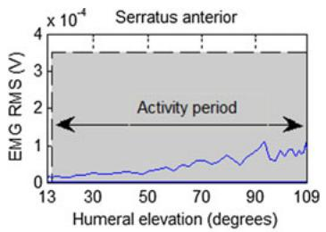  
(a)

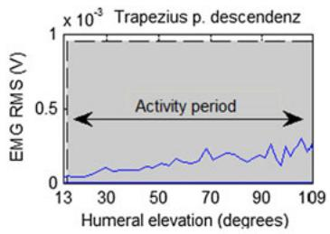

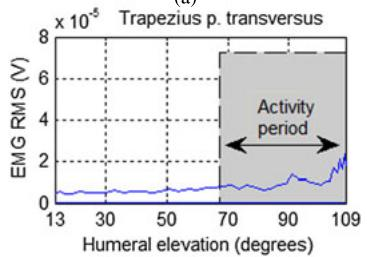  
(c)

(b)  
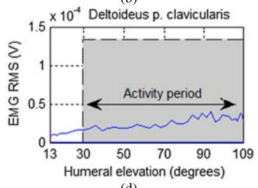

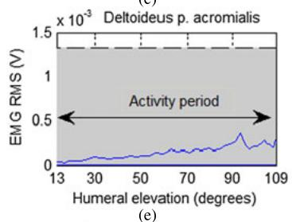

(d)  
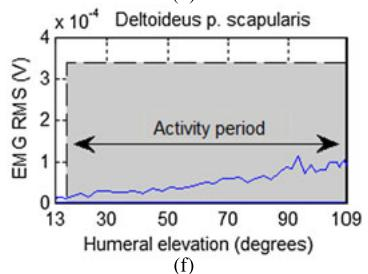

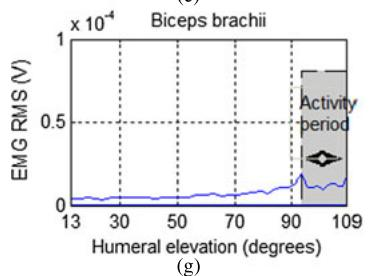

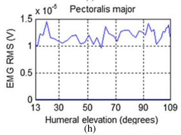

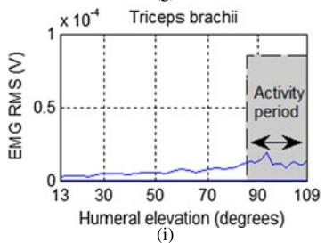  
Fig. 7 EMG 信号的 RMS 以及肌肉激活/非激活（on/off）模式

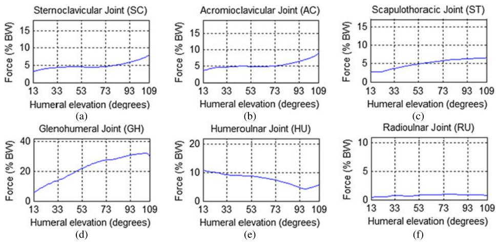  
Fig. 8 由逆向动力学分析估算得到的关节反作用力

GH（盂肱）关节反作用力与 Van der Helm 模型及 Newcastle 模型的结果非常吻合，尽管数值大小存在差异。本模型达到的最大值为体重的 32%，而 Van der Helm 模型达到约 50%，Newcastle 模型则达到体重的约 80%。

## 4 总结与结论

本工作提出了一种通过多体方法开发并实现的上肢生物力学模型。定义该模型所需的骨骼和肌肉骨骼数据最初由 Garner 和 Pandy [16, 25] 提出，但在本研究中转换为了一个采用符合国际生物力学学会（International Society of Biomechanics）推荐的新参考坐标系的新数据集。该模型通过肌肉致动器驱动所跨越关节的自由度，从而实现采集到的运动。运动是通过视频成像采集的，并采用了一种新颖的方法来校正肩胛骨的旋转 [32]。肌肉力分配问题通过优化工具解决。本研究没有采用标准的静态优化，而是使用了一种全局静态优化方法，在整个运动过程中计算所有肌肉的肌肉激活度和力历史。结果表明，预测的肌肉力和关节反作用力均在文献报道的数值范围内 [4, 7]。此外，激活模式在定性上与已知的肌肉功能一致 [1, 45]。将结果与 EMG 数据进行对比，仅三角肌的锁骨部和肩胛部在合理范围内未达到预期值。

作为未来的工作，该模型必须考虑韧带对肩关节生物力学的贡献。显然，韧带在维持肩关节稳定性方面起着重要作用，将其纳入模型将产生更准确的肌肉力预测 [50]。另一个目标是模拟不同的病理状态，特别是反向肩关节置换术（Reverse Shoulder Arthroplasty, RSA）后的情况。由于在肩袖撕裂关节病患者和其他复杂的肩关节重建问题中具有令人满意的功能效果，RSA 在过去几年中得到了广泛应用 [51]。然而，反向假体改变了肩关节的自然生物力学，理解这些改变对于获得最佳疗效至关重要 [52]。本工作提出的模型为带有肩关节假体的上肢生物力学模型提供了基础。

致谢 本项工作得到了科学技术基金会（Foundation for Science and Technology）项目 PTDC/SAU-BEB/103408/2008 以及博士奖学金 SFRH/BD/46311/2008 的资助。作者对 Daniel Simões Lopes、Paulo Luzio de Melo 和 Nelson Ribeiro 在 LBL 提供的协助表示感谢。

## 附录

在各刚体局部参考系中描述的骨骼和肌肉骨骼数据如表 5 和表 6 所示，其定义与 ISB 一致。表 5 给出了模型中用于对每个肌束建模的障碍集参数。肌肉路径始终由起点和止点定义，并且在两者之间可以存在任意数量的途径点和障碍物。在 obstacle 列中，单球体、单圆柱体、双圆柱体和球头圆柱体分别命名为 sphere、single cylind.、double cylinder 和 stub。所列出的所有坐标均相对于 frame 列中描述的局部参考系。更详细的解释见 [24, 25]。

Table 5 用于对上肢 21 块肌肉的肌肉路径进行建模的障碍集参数

<table><tr><td>肌肉</td><td>障碍体</td><td></td><td>坐标系</td><td>x (m)</td><td>y (m)</td><td>z (m)</td><td>直径 (m)</td></tr><tr><td rowspan="2">锁骨下肌 (SBCL)</td><td>起点</td><td></td><td>胸廓</td><td>-0.020580</td><td>0.005900</td><td>0.055880</td><td></td></tr><tr><td>止点</td><td></td><td>锁骨</td><td>-0.009532</td><td>-0.007983</td><td>0.014653</td><td></td></tr><tr><td rowspan="6">前锯肌（上部）(SRAs)</td><td>起点</td><td></td><td>胸廓</td><td>-0.056610</td><td>0.013200</td><td>0.085980</td><td></td></tr><tr><td>单圆柱体</td><td>中心</td><td>胸廓</td><td>-0.084900</td><td>0.018000</td><td>0.045370</td><td>-0.07888</td></tr><tr><td></td><td>x 轴</td><td></td><td>0.134578</td><td>0.737302</td><td>0.662023</td><td></td></tr><tr><td></td><td>y 轴</td><td></td><td>0.975759</td><td>-0.214962</td><td>0.041050</td><td></td></tr><tr><td></td><td>z 轴</td><td></td><td>0.172576</td><td>0.640451</td><td>-0.748358</td><td></td></tr><tr><td>止点</td><td></td><td>肩胛骨</td><td>-0.051469</td><td>0.039337</td><td>-0.007516</td><td></td></tr><tr><td rowspan="6">前锯肌（中部）(SRAm)</td><td>起点</td><td></td><td>胸廓</td><td>-0.012790</td><td>-0.073270</td><td>0.114810</td><td></td></tr><tr><td>单圆柱体</td><td>中心</td><td>胸廓</td><td>-0.071350</td><td>-0.058490</td><td>0.050190</td><td>-0.15582</td></tr><tr><td></td><td>x 轴</td><td></td><td>-0.003986</td><td>0.207826</td><td>0.978158</td><td></td></tr><tr><td></td><td>y 轴</td><td></td><td>0.981817</td><td>-0.184832</td><td>0.043272</td><td></td></tr><tr><td></td><td>z 轴</td><td></td><td>0.189788</td><td>0.960544</td><td>-0.203310</td><td></td></tr><tr><td>止点</td><td></td><td>肩胛骨</td><td>-0.077444</td><td>-0.037495</td><td>0.003240</td><td></td></tr><tr><td rowspan="6">前锯肌（下部）(SRAi)</td><td>起点</td><td></td><td>胸廓</td><td>0.012170</td><td>-0.188490</td><td>0.133240</td><td></td></tr><tr><td>单圆柱体</td><td>中心</td><td>胸廓</td><td>-0.060190</td><td>-0.135350</td><td>0.031140</td><td>-0.22316</td></tr><tr><td></td><td>x 轴</td><td></td><td>-0.279102</td><td>0.081165</td><td>0.956825</td><td></td></tr><tr><td></td><td>y 轴</td><td></td><td>0.957817</td><td>-0.047525</td><td>0.283423</td><td></td></tr><tr><td></td><td>z 轴</td><td></td><td>0.068477</td><td>0.995567</td><td>-0.064477</td><td></td></tr><tr><td>止点</td><td></td><td>肩胛骨</td><td>-0.084064</td><td>-0.092847</td><td>-0.000958</td><td></td></tr><tr><td rowspan="6">斜方肌 (C1-C6) (TRPc)</td><td>起点</td><td></td><td>胸廓</td><td>-0.085240</td><td>0.142730</td><td>0.001710</td><td></td></tr><tr><td>单圆柱体</td><td>中心</td><td>胸廓</td><td>-0.069970</td><td>0.090340</td><td>0.039220</td><td>0.0441</td></tr><tr><td></td><td>x 轴</td><td></td><td>0.141858</td><td>0.245031</td><td>0.959081</td><td></td></tr><tr><td></td><td>y 轴</td><td></td><td>0.982514</td><td>0.083181</td><td>-0.166575</td><td></td></tr><tr><td></td><td>z 轴</td><td></td><td>-0.120593</td><td>0.965940</td><td>-0.228946</td><td></td></tr><tr><td>止点</td><td></td><td>肩胛骨</td><td>-0.016578</td><td>0.001596</td><td>0.045698</td><td></td></tr><tr><td rowspan="6">斜方肌 (C7) (TRPc7)</td><td>起点</td><td></td><td>胸廓</td><td>-0.110510</td><td>0.071900</td><td>0.003950</td><td></td></tr><tr><td>单圆柱体</td><td>中心</td><td>胸廓</td><td>-0.104530</td><td>0.039010</td><td>0.045460</td><td>0.0946</td></tr><tr><td></td><td>x 轴</td><td></td><td>-0.007211</td><td>0.118960</td><td>0.992873</td><td></td></tr><tr><td></td><td>y 轴</td><td></td><td>0.589782</td><td>-0.801310</td><td>0.100292</td><td></td></tr><tr><td></td><td>z 轴</td><td></td><td>0.807530</td><td>0.586302</td><td>-0.064382</td><td></td></tr><tr><td>止点</td><td></td><td>肩胛骨</td><td>0.053271</td><td>0.032469</td><td>0.011411</td><td></td></tr><tr><td rowspan="6">斜方肌 (T1) (TRPt1)</td><td>起点</td><td></td><td>胸廓</td><td>-0.124170</td><td>0.052180</td><td>0.000000</td><td></td></tr><tr><td>单圆柱体</td><td>中心</td><td>胸廓</td><td>-0.115930</td><td>0.024740</td><td>0.048430</td><td>0.10306</td></tr><tr><td></td><td>x 轴</td><td></td><td>0.010970</td><td>0.009010</td><td>0.999899</td><td></td></tr><tr><td></td><td>y 轴</td><td></td><td>0.618811</td><td>-0.785540</td><td>0.000289</td><td></td></tr><tr><td></td><td>z 轴</td><td></td><td>0.785464</td><td>0.618745</td><td>-0.014193</td><td></td></tr><tr><td>止点</td><td></td><td>肩胛骨</td><td>-0.008219</td><td>0.034764</td><td>0.025560</td><td></td></tr><tr><td rowspan="6">斜方肌 (T2-T7) (TRPt)</td><td>起点</td><td></td><td>胸廓</td><td>-0.172470</td><td>-0.109820</td><td>0.002900</td><td></td></tr><tr><td>单圆柱体</td><td>中心</td><td>胸廓</td><td>-0.106800</td><td>-0.069640</td><td>0.043890</td><td>0.14544</td></tr><tr><td></td><td>x 轴</td><td></td><td>0.022615</td><td>0.014307</td><td>0.999642</td><td></td></tr><tr><td></td><td>y 轴</td><td></td><td>0.993127</td><td>-0.115173</td><td>-0.020819</td><td></td></tr><tr><td></td><td>z 轴</td><td></td><td>0.114834</td><td>0.993242</td><td>-0.016813</td><td></td></tr><tr><td>止点</td><td></td><td>肩胛骨</td><td>-0.073950</td><td>-0.007748</td><td>0.010203</td><td></td></tr><tr><td rowspan="2">肩胛提肌 4 (LVS)</td><td>起点</td><td></td><td>胸廓</td><td>-0.042510</td><td>0.147510</td><td>0.029630</td><td></td></tr><tr><td>止点</td><td></td><td>肩胛骨</td><td>-0.053307</td><td>0.046731</td><td>-0.004321</td><td></td></tr><tr><td rowspan="6">小菱形肌 (RMN)</td><td>起点</td><td></td><td>胸廓</td><td>-0.094390</td><td>0.085340</td><td>0.001590</td><td></td></tr><tr><td>单圆柱体</td><td>中心</td><td>胸廓</td><td>-0.066790</td><td>0.018740</td><td>0.042130</td><td>0.14166</td></tr><tr><td></td><td>x 轴</td><td></td><td>0.042086</td><td>-0.076805</td><td>0.996157</td><td></td></tr><tr><td></td><td>y 轴</td><td></td><td>0.868613</td><td>-0.489863</td><td>-0.074467</td><td></td></tr><tr><td></td><td>z 轴</td><td></td><td>0.493700</td><td>0.868410</td><td>0.046097</td><td></td></tr><tr><td>止点</td><td></td><td>肩胛骨</td><td>-0.067005</td><td>0.026075</td><td>0.004508</td><td></td></tr><tr><td rowspan="6">大菱形肌 (T1–T2) (RMJt2)</td><td>起点</td><td></td><td>胸廓</td><td>-0.125500</td><td>0.047970</td><td>0.000520</td><td></td></tr><tr><td rowspan="4">单圆柱体</td><td>中心</td><td>胸廓</td><td>-0.066790</td><td>0.018740</td><td>0.042130</td><td>0.15166</td></tr><tr><td>x 轴</td><td></td><td>0.042086</td><td>-0.076805</td><td>0.996157</td><td></td></tr><tr><td>y 轴</td><td></td><td>0.868613</td><td>-0.489863</td><td>-0.074467</td><td></td></tr><tr><td>z 轴</td><td></td><td>0.493700</td><td>0.868410</td><td>0.046097</td><td></td></tr><tr><td>止点</td><td></td><td>肩胛骨</td><td>-0.074474</td><td>-0.009819</td><td>0.007245</td><td></td></tr><tr><td rowspan="6">大菱形肌 (T3–T4) (RMJt3)</td><td>起点</td><td></td><td>胸廓</td><td>-0.149150</td><td>-0.007750</td><td>0.002490</td><td></td></tr><tr><td rowspan="4">单圆柱体</td><td>中心</td><td>胸廓</td><td>-0.092460</td><td>-0.051990</td><td>0.052130</td><td>0.1412</td></tr><tr><td>x 轴</td><td></td><td>0.014501</td><td>0.090823</td><td>0.995761</td><td></td></tr><tr><td>y 轴</td><td></td><td>0.955174</td><td>-0.295758</td><td>0.013066</td><td></td></tr><tr><td>z 轴</td><td></td><td>0.295691</td><td>0.950936</td><td>-0.091041</td><td></td></tr><tr><td>止点</td><td></td><td>肩胛骨</td><td>-0.085324</td><td>-0.064976</td><td>0.004605</td><td></td></tr><tr><td rowspan="2">胸小肌 (PMN)</td><td>起点</td><td></td><td>胸廓</td><td>-0.007640</td><td>-0.079220</td><td>0.108260</td><td></td></tr><tr><td>止点</td><td></td><td>肩胛骨</td><td>0.035604</td><td>0.015424</td><td>-0.035426</td><td></td></tr><tr><td rowspan="6">胸大肌（锁骨部）(PMJc)</td><td>起点</td><td></td><td>锁骨</td><td>0.007808</td><td>-0.005234</td><td>-0.032057</td><td></td></tr><tr><td rowspan="4">单圆柱体</td><td>中心</td><td>胸廓</td><td>-0.075200</td><td>-0.019050</td><td>0.120450</td><td>-0.140</td></tr><tr><td>x 轴</td><td></td><td>-0.549153</td><td>-0.453903</td><td>0.701715</td><td></td></tr><tr><td>y 轴</td><td></td><td>0.690614</td><td>0.226361</td><td>0.686887</td><td></td></tr><tr><td>z 轴</td><td></td><td>-0.470621</td><td>0.861819</td><td>0.189165</td><td></td></tr><tr><td>止点</td><td></td><td>肱骨</td><td>0.005240</td><td>0.027797</td><td>0.016583</td><td></td></tr><tr><td rowspan="6">胸大肌（胸骨部）(PMJs)</td><td>起点</td><td></td><td>胸廓</td><td>0.021920</td><td>-0.060150</td><td>0.028030</td><td></td></tr><tr><td rowspan="4">单圆柱体</td><td>中心</td><td>胸廓</td><td>-0.087370</td><td>-0.073240</td><td>0.064490</td><td>-0.209</td></tr><tr><td>x 轴</td><td></td><td>-0.092383</td><td>0.051844</td><td>0.994373</td><td></td></tr><tr><td>y 轴</td><td></td><td>0.980988</td><td>-0.166429</td><td>0.099817</td><td></td></tr><tr><td>z 轴</td><td></td><td>0.170667</td><td>0.984690</td><td>-0.035483</td><td></td></tr><tr><td>止点</td><td></td><td>肱骨</td><td>0.007461</td><td>0.065624</td><td>0.016440</td><td></td></tr><tr><td rowspan="6">胸大肌（肋骨部）(PMJr)</td><td>起点</td><td></td><td>胸廓</td><td>0.050910</td><td>-0.158580</td><td>0.034450</td><td></td></tr><tr><td rowspan="4">单圆柱体</td><td>中心</td><td>胸廓</td><td>-0.071850</td><td>-0.065730</td><td>0.046280</td><td>-0.20286</td></tr><tr><td>x 轴</td><td></td><td>-0.168136</td><td>0.209186</td><td>0.963313</td><td></td></tr><tr><td>y 轴</td><td></td><td>0.984890</td><td>-0.005483</td><td>0.173093</td><td></td></tr><tr><td>z 轴</td><td></td><td>0.041490</td><td>0.977860</td><td>-0.205103</td><td></td></tr><tr><td>止点</td><td></td><td>肱骨</td><td>0.011364</td><td>0.102118</td><td>0.018144</td><td></td></tr><tr><td rowspan="10">背阔肌（胸部）(LTDt)</td><td>起点</td><td></td><td>胸廓</td><td>-0.165150</td><td>-0.187070</td><td>0.001540</td><td></td></tr><tr><td rowspan="8">双圆柱体</td><td>中心</td><td>胸廓</td><td>-0.099280</td><td>-0.152060</td><td>0.056670</td><td>0.14888</td></tr><tr><td>x 轴</td><td></td><td>0.982399</td><td>0.041482</td><td>0.182131</td><td></td></tr><tr><td>y 轴</td><td></td><td>0.184377</td><td>0.371728</td><td>0.909848</td><td></td></tr><tr><td>z 轴</td><td></td><td>-0.029961</td><td>0.927415</td><td>-0.372833</td><td></td></tr><tr><td>中心</td><td>肩胛骨</td><td>0.036207</td><td>-0.020636</td><td>0.001606</td><td>-0.04182</td></tr><tr><td>x 轴</td><td></td><td>0.586376</td><td>-0.479356</td><td>0.652979</td><td></td></tr><tr><td>y 轴</td><td></td><td>0.316893</td><td>-0.606115</td><td>-0.729522</td><td></td></tr><tr><td>z 轴</td><td></td><td>0.745481</td><td>0.634700</td><td>-0.203506</td><td></td></tr><tr><td>止点</td><td></td><td>肱骨</td><td>0.003710</td><td>0.064121</td><td>0.006400</td><td></td></tr><tr><td rowspan="10">背阔肌（腰部）(LTDI)</td><td>起点</td><td></td><td>胸廓</td><td>-0.143550</td><td>-0.360530</td><td>0.004620</td><td></td></tr><tr><td rowspan="8">双圆柱体</td><td>中心</td><td>胸廓</td><td>-0.095030</td><td>-0.224480</td><td>0.056130</td><td>0.16408</td></tr><tr><td>x 轴</td><td></td><td>-0.278497</td><td>-0.109078</td><td>0.954223</td><td></td></tr><tr><td>y 轴</td><td></td><td>0.939619</td><td>0.174797</td><td>0.294216</td><td></td></tr><tr><td>z 轴</td><td></td><td>-0.198888</td><td>0.978544</td><td>0.053811</td><td></td></tr><tr><td>中心</td><td>肱骨</td><td>-0.008200</td><td>0.079638</td><td>0.002769</td><td>-0.02594</td></tr><tr><td>x 轴</td><td></td><td>0.051772</td><td>0.200831</td><td>0.978257</td><td></td></tr><tr><td>y 轴</td><td></td><td>0.998153</td><td>-0.041578</td><td>-0.044290</td><td></td></tr><tr><td>z 轴</td><td></td><td>0.037389</td><td>0.978266</td><td>-0.203856</td><td></td></tr><tr><td>止点</td><td></td><td>肱骨</td><td>0.005011</td><td>0.082901</td><td>0.008447</td><td></td></tr><tr><td rowspan="10">背阔肌（腰部）(LTDI)</td><td>起点</td><td></td><td>胸廓</td><td>-0.143550</td><td>-0.360530</td><td>0.004620</td><td></td></tr><tr><td rowspan="8">双圆柱体</td><td>中心</td><td>胸廓</td><td>-0.095030</td><td>-0.224480</td><td>0.056130</td><td>0. 16408</td></tr><tr><td>x 轴</td><td></td><td>-0.278497</td><td>-0.109078</td><td>0.954223</td><td></td></tr><tr><td>y 轴</td><td></td><td>0.939619</td><td>0.174797</td><td>0.294216</td><td></td></tr><tr><td>z 轴</td><td></td><td>-0.19888</td><td>0.978544</td><td>0.053811</td><td></td></tr><tr><td>中心</td><td>肱骨</td><td>-0.008200</td><td>0.079638</td><td>0.002769</td><td>-0.02594</td></tr><tr><td>x 轴</td><td></td><td>0.051772</td><td>0.200831</td><td>0. 978257</td><td></td></tr><tr><td>y 轴</td><td></td><td>0.998153</td><td>-0.041578</td><td>-0.044290</td><td></td></tr><tr><td>z 轴</td><td></td><td>0.037389</td><td>0.978266</td><td>-0.203856</td><td></td></tr><tr><td>止点</td><td></td><td>肱骨</td><td>0.008313</td><td>0.104369</td><td>0.006064</td><td></td></tr><tr><td rowspan="10">背阔肌（髂部）(LTDi)</td><td>起点</td><td></td><td>胸廓</td><td>-0.128040</td><td>-0.419760</td><td>0.049550</td><td></td></tr><tr><td rowspan="8">双圆柱体</td><td>中心</td><td>胸廓</td><td>-0.073810</td><td>-0.313520</td><td>0.095010</td><td>0.11776</td></tr><tr><td>x 轴</td><td></td><td>-0.222249</td><td>-0.037328</td><td>0.974275</td><td></td></tr><tr><td>y 轴</td><td></td><td>0.959100</td><td>0.171302</td><td>0.225351</td><td></td></tr><tr><td>z 轴</td><td></td><td>-0.175307</td><td>0.984511</td><td>-0.002270</td><td></td></tr><tr><td>中心</td><td>肱骨</td><td>-0.008200</td><td>0.079638</td><td>0.002769</td><td>-0.02594</td></tr><tr><td>x 轴</td><td></td><td>0.051772</td><td>0.200831</td><td>0.978257</td><td></td></tr><tr><td>y 轴</td><td></td><td>0.99153</td><td>-0.041578</td><td>-0.044290</td><td></td></tr><tr><td>z 轴</td><td></td><td>0.037389</td><td>0.978266</td><td>-0.203856</td><td></td></tr><tr><td>止点</td><td></td><td>肱骨</td><td>0.008313</td><td>0.104369</td><td colspan="2">0.006064</td></tr><tr><td rowspan="7">三角肌（锁骨部）(DLTc)</td><td>起点</td><td></td><td>锁骨</td><td>-0.007478</td><td>-0.006228</td><td>0.039853</td><td></td></tr><tr><td rowspan="4">短柱体</td><td>中心</td><td>肩胛骨</td><td>0.029353</td><td>-0.016590</td><td>-0.031059</td><td>0.08430</td></tr><tr><td>x 轴</td><td></td><td>0.780871</td><td>0.190168</td><td>-0.595041</td><td></td></tr><tr><td>y 轴</td><td></td><td>0.265291</td><td>-0.963328</td><td>0.040274</td><td></td></tr><tr><td>z 轴</td><td></td><td>-0.565560</td><td>-0.189310</td><td>-0.802685</td><td></td></tr><tr><td>途径点</td><td></td><td>肱骨</td><td>0.01133</td><td>0.054716</td><td>0.020872</td><td></td></tr><tr><td>止点</td><td></td><td>肱骨</td><td>0.001509</td><td>0.039205</td><td>0.021475</td><td></td></tr><tr><td rowspan="7">三角肌（肩峰部）(DLTa)</td><td>起点</td><td></td><td>肩胛骨</td><td>0.075220</td><td>0.018783</td><td>0.019865</td><td></td></tr><tr><td>短柱体</td><td>中心</td><td>肩胛骨</td><td>0.049576</td><td>-0.017267</td><td>-0.004009</td><td>0.09256</td></tr><tr><td></td><td>x 轴</td><td></td><td>0.796470</td><td>0.025343</td><td>0.604146</td><td></td></tr><tr><td></td><td>y 轴</td><td></td><td>-0.045315</td><td>-0.993811</td><td>0.101428</td><td></td></tr><tr><td></td><td>z 轴</td><td></td><td>0.602976</td><td>-0.108163</td><td>-0.790392</td><td></td></tr><tr><td>途径点</td><td></td><td>肱骨</td><td>-0.006168</td><td>0.036697</td><td>0.034270</td><td></td></tr><tr><td>止点</td><td></td><td>肱骨</td><td>-0.001924</td><td>0.009165</td><td>0.024335</td><td></td></tr><tr><td rowspan="8">三角肌（肩胛冈部）(DLTs)</td><td>起点</td><td></td><td>肩胛骨</td><td>0.008981</td><td>0.025917</td><td>0.030405</td><td></td></tr><tr><td>途径点</td><td></td><td>肩胛骨</td><td>0.018854</td><td>0.006910</td><td>0.059724</td><td></td></tr><tr><td>短柱体</td><td>中心</td><td>肩胛骨</td><td>0.030453</td><td>-0.023741</td><td>-0.011439</td><td>-0.14288</td></tr><tr><td></td><td>x 轴</td><td></td><td>-0.007219</td><td>-0.097865</td><td>0.995173</td><td></td></tr><tr><td></td><td>y 轴</td><td></td><td>-0.885573</td><td>0.462851</td><td>0.039092</td><td></td></tr><tr><td></td><td>z 轴</td><td></td><td>-0.464442</td><td>-0.881018</td><td>-0.090008</td><td></td></tr><tr><td>途径点</td><td></td><td>肱骨</td><td>-0.027709</td><td>0.057766</td><td>0.030595</td><td></td></tr><tr><td>止点</td><td></td><td>肱骨</td><td>-0.008896</td><td>0.043186</td><td>0.024107</td><td></td></tr><tr><td rowspan="4">冈上肌 (SUPR)</td><td>起点</td><td></td><td>肩胛骨</td><td>-0.023597</td><td>0.032954</td><td>-0.001227</td><td></td></tr><tr><td>途径点</td><td></td><td>肩胛骨</td><td>0.033797</td><td>0.025283</td><td>0.004086</td><td></td></tr><tr><td>途径点</td><td></td><td>肱骨</td><td>-0.005172</td><td>0.161214</td><td>0.023195</td><td></td></tr><tr><td>止点</td><td></td><td>肱骨</td><td>-0.003434</td><td>0.151238</td><td>0.029676</td><td></td></tr><tr><td rowspan="7">冈下肌 (INFR)</td><td>起点</td><td></td><td>肩胛骨</td><td>-0.041348</td><td>-0.025199</td><td>0.015032</td><td></td></tr><tr><td>途径点</td><td></td><td>肩胛骨</td><td>0.026955</td><td>-0.013907</td><td>0.031414</td><td></td></tr><tr><td>短柱体</td><td>中心</td><td>肩胛骨</td><td>-0.004536</td><td>0.142218</td><td>0.004976</td><td>0.05106</td></tr><tr><td></td><td>x 轴</td><td></td><td>-0.793738</td><td>0.325941</td><td>-0.513558</td><td></td></tr><tr><td></td><td>y 轴</td><td></td><td>-0.483202</td><td>0.174944</td><td>0.857853</td><td></td></tr><tr><td></td><td>z 轴</td><td></td><td>0.369453</td><td>0.929062</td><td>0.018636</td><td></td></tr><tr><td>止点</td><td></td><td>肱骨</td><td>-0.008090</td><td>0.142485</td><td>0.030857</td><td></td></tr><tr><td rowspan="7">肩胛下肌 (SBSC)</td><td>起点</td><td></td><td>肩胛骨</td><td>-0.040439</td><td>-0.031019</td><td>0.004506</td><td></td></tr><tr><td>途径点</td><td></td><td>肩胛骨</td><td>0.005170</td><td>-0.016085</td><td>-0.016511</td><td></td></tr><tr><td>单圆柱体</td><td>中心</td><td>肩胛骨</td><td>0.023192</td><td>0.012796</td><td>-0.008592</td><td>0.03082</td></tr><tr><td></td><td>x 轴</td><td></td><td>0.444443</td><td>-0.111244</td><td>-0.888872</td><td></td></tr><tr><td></td><td>y 轴</td><td></td><td>0.895001</td><td>0.013080</td><td>0.445871</td><td></td></tr><tr><td></td><td>z 轴</td><td></td><td>-0.037974</td><td>-0.993709</td><td>0.105375</td><td></td></tr><tr><td>止点</td><td></td><td>肱骨</td><td>0.016772</td><td>0.141293</td><td>-0.003379</td><td></td></tr><tr><td rowspan="7">小圆肌 (TMN)</td><td>起点</td><td></td><td>肩胛骨</td><td>-0.010403</td><td>-0.045772</td><td>0.018824</td><td></td></tr><tr><td>途径点</td><td></td><td>肩胛骨</td><td>0.005450</td><td>-0.034259</td><td>0.031051</td><td></td></tr><tr><td>短柱体</td><td>中心</td><td>肱骨</td><td>-0.004471</td><td>0.141199</td><td>0.010807</td><td>0.04417</td></tr><tr><td></td><td>x 轴</td><td></td><td>-0.812242</td><td>-0.073322</td><td>-0.578693</td><td></td></tr><tr><td></td><td>y 轴</td><td></td><td>-0.552557</td><td>-0.221267</td><td>0.803583</td><td></td></tr><tr><td></td><td>z 轴</td><td></td><td>-0.186940</td><td>0.972463</td><td>0.139172</td><td></td></tr><tr><td>止点</td><td></td><td>肱骨</td><td>-0.008878</td><td>0.114531</td><td>0.027503</td><td></td></tr><tr><td rowspan="6">大圆肌 (TMJ)</td><td>起点</td><td></td><td>肩胛骨</td><td>-0.063192</td><td>-0.081645</td><td>0.016139</td><td></td></tr><tr><td>单圆柱体</td><td>中心</td><td>肩胛骨</td><td>-0.037742</td><td>-0.078844</td><td>0.000739</td><td>0.04800</td></tr><tr><td></td><td>x 轴</td><td></td><td>-0.617827</td><td>0.403449</td><td>0.674921</td><td></td></tr><tr><td></td><td>y 轴</td><td></td><td>0.528484</td><td>-0.422504</td><td>0.736338</td><td></td></tr><tr><td></td><td>z 轴</td><td></td><td>0.582231</td><td>0.811617</td><td>0.047819</td><td></td></tr><tr><td>止点</td><td></td><td>肱骨</td><td>-0.004359</td><td>0.090834</td><td>0.000177</td><td></td></tr><tr><td rowspan="7">喙肱肌 (CRCB)</td><td>起点</td><td></td><td>肩胛骨</td><td>0.047180</td><td>0.004295</td><td>-0.033638</td><td></td></tr><tr><td>单圆柱体</td><td>中心</td><td>肩胛骨</td><td>0.013194</td><td>-0.030664</td><td>0.002898</td><td>0.03462</td></tr><tr><td></td><td>x 轴</td><td></td><td>0.182214</td><td>-0.787608</td><td>-0.588620</td><td></td></tr><tr><td></td><td>y 轴</td><td></td><td>0.422983</td><td>-0.477630</td><td>0.770035</td><td></td></tr><tr><td></td><td>z 轴</td><td></td><td>-0.887627</td><td>-0.389288</td><td>0.246112</td><td></td></tr><tr><td>途径点</td><td></td><td>肱骨</td><td>0.004393</td><td>0.039466</td><td>-0.003037</td><td></td></tr><tr><td>止点</td><td></td><td>肱骨</td><td>-0.009315</td><td>-0.023481</td><td>0.005695</td><td></td></tr><tr><td rowspan="9">肱三头肌（长头）(TRClg)</td><td>起点</td><td></td><td>肩胛骨</td><td>0.022362</td><td>-0.030890</td><td>0.012474</td><td></td></tr><tr><td>双圆柱体</td><td>中心</td><td>肱骨</td><td>0.071248</td><td>0.005701</td><td>0.027168</td><td>0.24438</td></tr><tr><td></td><td>x 轴</td><td></td><td>0.982548</td><td>0.152910</td><td>-0.105917</td><td></td></tr><tr><td></td><td>y 轴</td><td></td><td>-0.185258</td><td>0.855620</td><td>-0.483315</td><td></td></tr><tr><td></td><td>z 轴</td><td></td><td>0.016721</td><td>0.494502</td><td>0.869015</td><td></td></tr><tr><td></td><td>中心</td><td>肱骨</td><td>-0.002512</td><td>-0.154233</td><td>0.010295</td><td>0.058</td></tr><tr><td></td><td>x 轴</td><td></td><td>-0.597712</td><td>0.801133</td><td>0.030436</td><td></td></tr><tr><td></td><td>y 轴</td><td></td><td>-0.790585</td><td>-0.595295</td><td>0.143522</td><td></td></tr><tr><td>止点</td><td></td><td>尺骨</td><td>-0.027590</td><td>0.120980</td><td>-0.003652</td><td></td></tr><tr><td rowspan="7">肱三头肌（内侧头）(TRCm)</td><td>起点</td><td></td><td>肱骨</td><td>-0.021626</td><td>-0.031157</td><td>0.003596</td><td></td></tr><tr><td>途径点</td><td></td><td>肱骨</td><td>-0.015317</td><td>-0.080974</td><td>-0.014857</td><td></td></tr><tr><td>单圆柱体</td><td>中心</td><td>肱骨</td><td>-0.007386</td><td>-0.161108</td><td>0.024148</td><td>0.05008</td></tr><tr><td></td><td>x 轴</td><td></td><td>-0.455914</td><td>0.885785</td><td>-0.086757</td><td></td></tr><tr><td></td><td>y 轴</td><td></td><td>-0.874561</td><td>-0.463951</td><td>-0.141042</td><td></td></tr><tr><td></td><td>z 轴</td><td></td><td>-0.165183</td><td>0.011571</td><td>0.986195</td><td></td></tr><tr><td>止点</td><td></td><td>尺骨</td><td>-0.027590</td><td>0.120980</td><td>-0.003652</td><td></td></tr><tr><td rowspan="8">肱三头肌（外侧头）(TRClt)</td><td>起点</td><td></td><td>肱骨</td><td>-0.018593</td><td>0.051375</td><td>0.011804</td><td></td></tr><tr><td>途径点</td><td></td><td>肱骨</td><td>-0.039143</td><td>-0.009284</td><td>0.029226</td><td></td></tr><tr><td>单圆柱体</td><td>中心</td><td>肱骨</td><td>-0.008121</td><td>-0.157218</td><td>0.012194</td><td>0.04558</td></tr><tr><td></td><td>x 轴</td><td></td><td>-0.565142</td><td>0.812901</td><td>0.140736</td><td></td></tr><tr><td></td><td>y 轴</td><td></td><td>-0.771786</td><td>-0.581215</td><td>0.257944</td><td></td></tr><tr><td></td><td>z 轴</td><td></td><td>0.291480</td><td>0.037157</td><td>0.955855</td><td></td></tr><tr><td>途径点</td><td></td><td>尺骨</td><td>-0.027740</td><td>0.116830</td><td>0.004928</td><td></td></tr><tr><td>止点</td><td></td><td>尺骨</td><td>-0.027590</td><td>0.120980</td><td>-0.003652</td><td></td></tr><tr><td rowspan="10">肱二头肌（短头）(BICs)</td><td>起点</td><td></td><td>肩胛骨</td><td>0.051317</td><td>0.008236</td><td>-0.026231</td><td></td></tr><tr><td rowspan="8">双圆柱体</td><td>中心</td><td>肩胛骨</td><td>0.046295</td><td>-0.013204</td><td>-0.003694</td><td>0.04854</td></tr><tr><td>x 轴</td><td></td><td>-0.498504</td><td>0.736735</td><td>0.456929</td><td></td></tr><tr><td>y 轴</td><td></td><td>0.468255</td><td>0.672356</td><td>-0.537345</td><td></td></tr><tr><td>z 轴</td><td></td><td>-0.729622</td><td>-0.071844</td><td>-0.680066</td><td></td></tr><tr><td>中心</td><td>肱骨</td><td>-0.031815</td><td>-0.137995</td><td>0.028451</td><td>0.1029</td></tr><tr><td>x 轴</td><td></td><td>0.098752</td><td>0.857697</td><td>0.504583</td><td></td></tr><tr><td>y 轴</td><td></td><td>0.944683</td><td>0.078567</td><td>-0.318433</td><td></td></tr><tr><td>z 轴</td><td></td><td>-0.312763</td><td>0.508117</td><td>-0.802494</td><td></td></tr><tr><td>止点</td><td></td><td>桡骨</td><td>0.011267</td><td>0.062358</td><td>-0.006852</td><td></td></tr><tr><td rowspan="8">肱二头肌（长头）(BICl)</td><td>起点</td><td></td><td>肩胛骨</td><td>0.044350</td><td>0.007356</td><td>-0.005102</td><td></td></tr><tr><td>球体</td><td>中心</td><td>肱骨</td><td>-0.005207</td><td>0.137592</td><td>0.007898</td><td>0.04850</td></tr><tr><td>途径点</td><td></td><td>肱骨</td><td>0.018847</td><td>0.136860</td><td>0.0130018</td><td></td></tr><tr><td rowspan="4">单圆柱体</td><td>中心</td><td>肱骨</td><td>-0.031815</td><td>-0.137995</td><td>0.028451</td><td>0.1029</td></tr><tr><td>x 轴</td><td></td><td>0.098752</td><td>0.857697</td><td>0.504583</td><td></td></tr><tr><td>y 轴</td><td></td><td>0.944683</td><td>0,078567</td><td>-0.318433</td><td></td></tr><tr><td>z 轴</td><td></td><td>-0.312763</td><td>0.508117</td><td>-0.802494</td><td></td></tr><tr><td>止点</td><td></td><td>桡骨</td><td>0.011267</td><td>0.062358</td><td>-0.006852</td><td></td></tr><tr><td rowspan="7">肱肌 (BRA)</td><td>起点</td><td></td><td>肱骨</td><td>-0.004796</td><td>-0.078525</td><td>0.013732</td><td></td></tr><tr><td>途径点</td><td></td><td>肱骨</td><td>0.006898</td><td>-0.102462</td><td>0.014796</td><td></td></tr><tr><td rowspan="4">单圆柱体</td><td>中心</td><td>肱骨</td><td>-0.003257</td><td>-0.150069</td><td>0.070357</td><td>0.07046</td></tr><tr><td>x 轴</td><td></td><td>0.331567</td><td>0.941483</td><td>-0.060598</td><td></td></tr><tr><td>y 轴</td><td></td><td>0.910935</td><td>-0.336199</td><td>-0.239096</td><td></td></tr><tr><td>z 轴</td><td></td><td>-0.245478</td><td>0.024076</td><td>-0.969103</td><td></td></tr><tr><td>止点</td><td></td><td>尺骨</td><td>-0.006370</td><td>0.079420</td><td>-0.001182</td><td></td></tr><tr><td rowspan="12">肱桡肌 (BRD)</td><td>起点</td><td></td><td>肱骨</td><td>-0.015876</td><td>-0.081455</td><td>0.024688</td><td></td></tr><tr><td>途径点</td><td></td><td>肱骨</td><td>-0.010508</td><td>-0.092090</td><td>0.031797</td><td></td></tr><tr><td rowspan="8">双圆柱体</td><td>中心</td><td>肱骨</td><td>-0.019750</td><td>-0.157746</td><td>0.013999</td><td>-0.06456</td></tr><tr><td>x 轴</td><td></td><td>-0.568861</td><td>0.815252</td><td>0.108450</td><td></td></tr><tr><td>y 轴</td><td></td><td>-0.704815</td><td>-0.551205</td><td>0.446553</td><td></td></tr><tr><td>z 轴</td><td></td><td>0.423832</td><td>0.177589</td><td>0.888161</td><td></td></tr><tr><td>中心</td><td>桡骨</td><td>-0.004560</td><td>-0.042135</td><td>-0.010147</td><td>0.01434</td></tr><tr><td>x 轴</td><td></td><td>-0.999165</td><td>0.037250</td><td>-0.016761</td><td></td></tr><tr><td>y 轴</td><td></td><td>-0.019037</td><td>-0.061680</td><td>0.997915</td><td></td></tr><tr><td>z 轴</td><td></td><td>0.036140</td><td>0.997400</td><td>0.062336</td><td></td></tr><tr><td>途径点</td><td></td><td>桡骨</td><td>-0.004973</td><td>-0.079347</td><td>-0.004727</td><td></td></tr><tr><td>止点</td><td></td><td>桡骨</td><td>0.001461</td><td>-0.150209</td><td>-0.004018</td><td></td></tr><tr><td rowspan="7">旋后肌 (SUP)</td><td>起点</td><td></td><td>尺骨</td><td>-0.023100</td><td>0.062590</td><td>0.017318</td><td></td></tr><tr><td>单圆柱体</td><td>中心</td><td>桡骨</td><td>-0.006050</td><td>0.012568</td><td>-0.016263</td><td>0.02572</td></tr><tr><td></td><td>x 轴</td><td></td><td>0.256671</td><td>-0.040254</td><td>0.965660</td><td></td></tr><tr><td></td><td>y 轴</td><td></td><td>0.966192</td><td>-0.014477</td><td>-0.257416</td><td></td></tr><tr><td></td><td>z 轴</td><td></td><td>0.024343</td><td>0.999084</td><td>0.035177</td><td></td></tr><tr><td>途径点</td><td></td><td>桡骨</td><td>-0.005898</td><td>0.025620</td><td>0.006089</td><td></td></tr><tr><td>止点</td><td></td><td>桡骨</td><td>0.002530</td><td>0.018862</td><td>-0.005433</td><td></td></tr><tr><td rowspan="7">旋前圆肌 (PRNT)</td><td>起点</td><td></td><td>肱骨</td><td>-0.018975</td><td>-0.144200</td><td>-0.004172</td><td></td></tr><tr><td>途径点</td><td></td><td>肱骨</td><td>-0.007357</td><td>-0.153144</td><td>-0.013845</td><td></td></tr><tr><td>单圆柱体</td><td>中心</td><td>肱骨</td><td>-0.003163</td><td>-0.169181</td><td>0.013604</td><td>0.03516</td></tr><tr><td></td><td>x 轴</td><td></td><td>0.289872</td><td>0.866061</td><td>-0.407324</td><td></td></tr><tr><td></td><td>y 轴</td><td></td><td>0.632725</td><td>-0.492735</td><td>-0.597387</td><td></td></tr><tr><td></td><td>z 轴</td><td></td><td>-0.718077</td><td>-0.084558</td><td>-0.690808</td><td></td></tr><tr><td>止点</td><td></td><td>桡骨</td><td>0.000561</td><td>-0.009491</td><td>-0.002762</td><td></td></tr></table>

Table 6 在各刚体局部参考系中定义的骨性标志点坐标。骨性标志点 HUC 和 PHUC 分别表示 HU 关节中心和 HU 关节轴上的一点。RUC 和 PRUC 具有相同含义，但针对的是 RU 关节。其余骨性标志点见表 4 说明

<table><tr><td>参考系</td><td>骨性标志点</td><td>x (m)</td><td>y (m)</td><td>z (m)</td></tr><tr><td rowspan="2">胸廓</td><td>IJ</td><td>0.000000</td><td>0.000000</td><td>0.000000</td></tr><tr><td>SC</td><td>-0.014380</td><td>-0.003710</td><td>0.032540</td></tr><tr><td rowspan="2">锁骨</td><td>SC</td><td>-0.001264</td><td>-0.017004</td><td>-0.073247</td></tr><tr><td>AC</td><td>-0.001265</td><td>-0.017003</td><td>0.080923</td></tr><tr><td rowspan="6">肩胛骨</td><td>AC</td><td>0.059495</td><td>0.032658</td><td>0.000571</td></tr><tr><td>TS</td><td>-0.063009</td><td>0.032659</td><td>0.000575</td></tr><tr><td>投影在胸廓上的 TS</td><td>-0.057789</td><td>0.020745</td><td>-0.025387</td></tr><tr><td>AI</td><td>-0.088414</td><td>-0.088411</td><td>0.000585</td></tr><tr><td>投影在胸廓上的 AI</td><td>-0.083834</td><td>-0.085858</td><td>-0.020842</td></tr><tr><td>GH</td><td>0.059398</td><td>-0.010938</td><td>0.005177</td></tr><tr><td rowspan="3">肱骨</td><td>GH</td><td>-0.005207</td><td>0.137592</td><td>0.007898</td></tr><tr><td>HUC</td><td>-0.005217</td><td>-0.166743</td><td>0.007900</td></tr><tr><td>PHUC</td><td>0.016706</td><td>-0.163002</td><td>0.105396</td></tr><tr><td rowspan="5">尺骨</td><td>EJC</td><td>-0.002700</td><td>0.110990</td><td>-0.003702</td></tr><tr><td>PEJC</td><td>-0.002700</td><td>0.089398</td><td>0.093939</td></tr><tr><td>US</td><td>-0.002700</td><td>-0.146120</td><td>-0.003702</td></tr><tr><td>RUC</td><td>-0.002700</td><td>0.110990</td><td>0.020118</td></tr><tr><td>PRUC</td><td>-0.002700</td><td>0.210564</td><td>0.029344</td></tr><tr><td rowspan="3">桡骨</td><td>RUC</td><td>-0.002700</td><td>0.111000</td><td>-0.003700</td></tr><tr><td>PRUC</td><td>-0.002854</td><td>0.209900</td><td>0.011091</td></tr><tr><td>RS</td><td>0.001480</td><td>-0.163402</td><td>-0.006672</td></tr></table>

## 参考文献

1. Lippert, L.S.: Clinical Kinesiology and Anatomy. Philadelphia, Davis Company (2006)

2. Reese, N.B., Bandy, W.D.: Joint Range of Motion and Muscle Length Testing. Elsevier, St. Louis (2010)

3. Hong, Y., Bartlett, R.: Handbook of Biomechanics and Human Movement. Routledge, New York (2008)

4. Charlton, I.W., Johnson, G.R.: A model for the prediction of the forces at the glenohumeral joint. J. Eng. Med. 220(8), 801–812 (2006)

5. Lindsay, N.: Modelling of the shoulder mechanism, in: Report no. 106, Institute of Mechanical Engi neering, Aalborg University, Denmark (2001)

6. Seireg, A., Arvikar, R.: Biomechanical Analysis of the Musculoskeletal Structure for Medicine and Sports. Hemisphere, New York (1989)

7. Van der Helm, F.C.: Analysis of the kinematic and dynamic behavior of the shoulder mechanism. J. Biomech. 27(5), 527–550 (1994)

8. Dickerson, C.R., Chaffin, D.B., Hughes, R.E.: A mathematical musculoskeletal model for proactive ergonomic analysis. Comput. Methods Biomech. Biomed. Eng. 10(6), 389–400 (2007)

9. Tlalolini, D., Aoustin, Y., Chevallereau, C.: Design of a walking cyclic gait with single support phases and impacts for the locomotor system of a thirteen-link 3D biped using the parametric optimization. Multibody Syst. Dyn. 23(1), 33–56 (2010)

10. Ghiasi, A.R., Alizadeh, G., Mirzaei, M.: Simultaneous design of optimal gait pattern and controller fo a bipedal robot. Multibody Syst. Dyn. 23(4), 401–429 (2010)

11. Blajer, W., Czaplicki, A., Dziewiecki, K., Mazur, Z.: Influence of selected modeling and computational issues on muscle force estimates. Multibody Syst. Dyn. 24(4), 473–492 (2010)

12. Kim, J.H., Xiang, Y., Yang, J., Arora, J.S., Abdel-Malek, K.: Dynamic motion planning of overarm throw for a biped human multibody system. Multibody Syst. Dyn. 24(1), 1–24 (2010)

13. Aoustin, Y., Formal’skii, A., Martynenko, Y.: Pendubot: combining of energy and intuitive approaches to swing up, stabilization in erected pose. Multibody Syst. Dyn. 25(1), 65–80 (2011)

14. Kim, K., Ura, T., Kashino, M., Gomi, H.: A perioral dynamic model for investigating human speech articulation. Multibody Syst. Dyn. 26(2), 107–134 (2011)

15. Norris, T.R., Iannotti, J.P.: Functional outcome after shoulder arthroplasty for primary osteoarthritis: a multicenter study. J. Shoulder Elb. Surg. 11(2), 130–135 (2002)

16. Garner, B.A., Pandy, M.G.: A kinematic model of the upper limb based on the visible human project (VHP) image dataset. Comput. Methods Biomech. Biomed. Eng. 2(2), 107–124 (1999)

17. Wu, G., van der Helm, F.C., Veeger, H.E., Makhsous, M., Van Roy, P., Anglin, C., Nagels, J., Karduna, A.R., McQuade, K., Wang, X., Werner, F.W., Buchholz, B.: ISB recommendation on definitions of joint coordinate systems of various joints for the reporting of human joint motion. Part II. Shoulder, elbow, wrist and hand. J. Biomech, 38(5). 981–992 (2005)

18. van der Helm, F.C.T.: A standardized protocol for motion recordings of the shoulder. In: Proceedings of the First Conference of the ISG, Delft, The Netherlands, August 26–27, pp. 7–12 (1997)

19. Nikravesh, P.: Computer-Aided Analysis of Mechanical Systems. Prentice-Hall, Englewood Cliffs (1988)

20. Dumas, R., Chèze, L., Verriest, J.P.: Adjustments to McConville et al. and Young et al. body segment inertial parameters. J. Biomech. 40(3), 543–553 (2007)

21. Cheng, C., Chen, H., Chen, C., Lee, C., Chen, C.: Segment inertial properties of Chinese adults deter mined from magnetic resonance imaging. Clin. Biomech. 15(8), 559–566 (2000)

22. Silva, M., Ambrósio, J.: Solution of redundant muscle forces in human locomotion with multibody dynamics and optimization tools（基于多体动力学与优化工具的人体运动冗余肌肉力求解）. Mech. Based Des. Struct. Mach. 31(3), 381–411 (2003)

23. Rodrigo, S.E., Ambrósio, J., Silva, M., Penisi, O.H.: Analysis of human gait based on multibody formulations and optimization tools（基于多体公式与优化工具的人体步态分析）. Mech. Based Des. Struct. Mach. 36(4), 446–477 (2008)

24. Garner, B.A., Pandy, M.G.: The obstacle-set method for representing muscle paths in musculoskeletal models（肌肉骨骼模型中表征肌肉路径的障碍集方法）. Comput. Methods Biomech. Biomed. Eng. 3(1), 1–30 (2000)

25. Garner, B.A., Pandy, M.G.: Musculoskeletal model of the upper limb based on the visible human male dataset（基于可视人体男性数据集的上肢肌肉骨骼模型）. Comput. Methods Biomech. Biomed. Eng. 4(2), 93–126 (2001)

26. Ambrósio, J., Kecskeméthy, A.: Multibody Dynamics of Biomechanical Models for Human Motion via Optimization（通过优化实现人体运动生物力学模型的多体动力学）. In: García Orden, J., Goicolea, J., Cuadrado, J. (eds.) Multibody Dynamics, pp. 245–272. Springer, Dordrecht (2007)

27. Konrad, P.: The ABC of EMG（肌电图入门指南）. Noraxon Inc., Scottsdale (2005)

28. Van der Helm, F.C.T., Pronk, G.M.: Three-dimensional recording and description of motions of the shoulder mechanism（肩部机构运动的三维记录与描述）. J. Biomech. Eng. 117(1), 27–40 (1995)

29. De Groot, J.H.: The shoulder: a kinematic and dynamic analysis of motion and loading（肩部：运动与载荷的运动学及动力学分析）. Ph.D. thesis, Delft, The Netherlands, 1998

30. Chèze, L., Fregly, B.J., Dimnet, J.: A solidification procedure to facilitate kinematic analyses based on video system data（一种便于基于视频系统数据进行运动学分析的刚体化方法）. J. Biomech. 28(7), 879–884 (1995)

31. Lovern, B., Stroud, L.A., Evans, R.O., Evans, S.L., Holt, C.A.: Dynamic tracking of the scapula using skin-mounted markers（利用皮肤表面标记点对肩胛骨进行动态跟踪）. Proc. Inst. Mech. Eng., H J. Eng. Med. 223(7), 831–832 (2009)

32. Šenk, M., Chèze, L.: A new method for motion capture of the scapula using an optoelectronic tracking device: a feasibility study（一种利用光电跟踪设备进行肩胛骨运动捕捉的新方法：可行性研究）. Comput. Methods Biomech. Biomed. Eng. 13(3), 397–401 (2010)

33. van Andel, C., van Hutten, K., Eversdijk, M., Veeger, D., Harlaar, J.: Recording scapular motion using an acromion marker cluster（利用肩峰标记点簇记录肩胛骨运动）. Gait Posture 29(1), 123–128 (2009)

34. Meskers, C.G., van der Helm, F.C., Rozendaal, L.A., Rozing, P.M.: In vivo estimation of the glenohumeral joint rotation center from scapular bony landmarks by linear regression（通过肩胛骨骨性解剖标志线性回归活体估计盂肱关节旋转中心）. J. Biomech. 31(1), 93–96 (1998)

35. Woltring, H.J., de Lange, A., Kauer, J.M.G., Huiskes, R.: Instantaneous Helical Axis Estimation Via Natural, Cross-Validated Splines（基于自然交叉验证样条的瞬时螺旋轴估计）. In: Proceedings of the Fifth Meeting of the European Society of Biomechanics, Berlin, Germany, September 8–10, pp. 121–128 (1986)

36. Chang, L.Y., Pollard, N.: Constrained least-squares optimization for robust estimation of center of rotation（用于旋转中心鲁棒估计的受约束最小二乘优化）. J. Biomech. 40(6), 1392–1400 (2007)

37. Gamage, S.S.H.U., Lasenby, J.: New least squares solutions for estimating the average centre of rotation and the axis of rotation（用于估计平均旋转中心与旋转轴的新最小二乘解）. J. Biomech. 35(1), 87–93 (2002)

38. Lempereur, M., Leboeuf, F., Brochard, S., Rousset, J., Burdin, V., Rémy-Néris, O.: In vivo estimation of the glenohumeral joint centre by functional methods: accuracy and repeatability assessment. J. Biomech. 43(2), 370–374 (2010)

39. De Luca, C.J.: The use of surface electromyography in biomechanics. J. Appl. Biomech. 13(2), 135–163 (1997)

40. Erdemir, A., McLean, S., Herzog, W., van den Bogert, A.J.: Model-based estimation of muscle forces exerted during movements. Clin. Biomech. 22(2), 131–154 (2007)

41. Kaplan, M.L., Heegaard, J.H.: Predictive algorithms for neuromuscular control of human locomotion. J. Biomech. 34(8), 1077–1083 (2001)

42. Maurel, W.: 3D modeling of the human upper limb including the biomechanics of joints, muscles and soft tissues. Ph.D. thesis, Lausanne, Switzerland, 1999

43. Praagman, M., Chadwick, E.K., van der Helm, F.C., Veeger, H.E.: The relationship between two different mechanical cost functions and muscle oxygen consumption. J. Biomech. 39(4), 758–765 (2006)

44. Chadwick, E.K.J., van der Helm, F.C.T.: Musculo-skeletal modeling of the shoulder. In: Shoulder Biomechanics Tutorial (ISB2003), Dunedin, New Zealand, July 6–11, pp. 1–41 (2003)

45. Vizniak, N.A.: Muscle Manual. Professional Health Systems, Burnaby, Canada, 2010

46. Tyldesley, B., Grieve, J.I.: Muscles, Nerves and Movement in Human Occupation. Blackwell Sci., Oxford (2002)

47. Breteler, M.D.K., Spoor, C.W., van der Helm, F.C.T.: Measuring muscle and joint geometry parameters of a shoulder for modeling purposes. J. Biomech. 32(11), 1191–1197 (1999)

48. Terry, G.C., Chopp, T.M.: Functional Anatomy of the Shoulder. J. Athl. Train. 35(3), 248–255 (2000)

49. Zipp, P.: Recommendations for the standardization of lead positions in surface electromyography. Eur. J. Appl. Physiol. 50(1), 41–54 (1982)

50. Raina, S.: Modeling shoulder ligament contributions and their effects on muscle force predictions. M.Sc. thesis, Waterloo, Canada, 2008

51. Sanchez-Sotelo, J.: Reverse total shoulder arthroplasty. Clin. Anat. 22(2), 172–182 (2009)

52. Rasmussen, J., Carbes, S., Gomaa, S.T.: A computational model of a reverse shoulder joint prosthesis. In: 17th Annual Symposium on Computational Methods in Orthopaedic Biomechanics, Las Vegas, Nevada, February 21 (2009)