A P P L I E D R E S E A R C H

WILEY

# Computational performance of musculoskeletal simulation in OpenSim Moco using parallel computing

Alex N. Denton | Brian R. Umberger

School of Kinesiology, University of Michigan, Ann Arbor, Michigan, USA

Correspondence

Brian R. Umberger, School of Kinesiology, University of Michigan, Ann Arbor, MI, USA.

Email: umberger@umich.edu

Funding information Rackham Graduate Student Research Grant

## Abstract

Optimal control musculoskeletal simulation is a valuable approach for studying fundamental and clinical aspects of human movement. However, the high computational demand has long presented a substantial challenge, creating a need to improve simulation performance. The OpenSim Moco software package permits musculoskeletal simulation problems to be solved in parallel on multicore processors using the CasADi optimal control library, potentially reducing the computational demand. However, the computational performance of this framework has not been thoroughly examined. Thus, we aimed to investigate the computational speed-up obtained via multicore parallel computing relative to solving problems serially (i.e., using a single core) in optimal control simulations of human movement in OpenSim Moco. Simulations were solved using up to 18 cores with a variety of temporal mesh interval densities and using two different initial guess strategies. We examined a range of musculoskeletal models and movements that included two- and three-dimensional models, tracking and predictive simulations, and walking and reaching tasks. The maximum overall parallel speed-up was problem specific and ranged from 1.7 to 7.7 times faster than serial, with most of the speed-up achieved by about 6 processor cores. Parallel speed-up was generally greater on finer temporal meshes, while the initial guess strategy had minimal impact on speed-up. Considerable speedup can be achieved for some optimal control simulation problems in OpenSim Moco by leveraging the multicore processors often available in modern computers. However, since improvements are problem specific, achieving optimal computational performance will require some degree of exploration by the end user.

K E YW O RD S

biomechanics, musculoskeletal model, optimal control, optimization

## 1 | INTRODUCTION

Musculoskeletal simulation combined with optimal control techniques represents a valuable research approach capable of providing novel insights into human movement; however, computational efficiency is a major limiting factor in the widespread adoption of this technique.1,2 There are computationally efficient simulation techniques, such as static optimization,3 yet these algorithms are tied to a set of experimental data, do not typically include muscle tendon dynamics, and cannot be used to predict novel movements.4 The substantial computational cost of optimal control simulation has been reduced, in part, through algorithmic developments such as direct collocation.5–9 OpenSim Moco10 is a relatively new software tool that streamlines the use of direct collocation while leveraging the OpenSim musculoskeletal modeling environment.11 Rapid simulation using direct collocation not only makes many computationally demanding problems tractable but can also facilitate more complex analyses such as bilevel optimization12 and Monte Carlo methods,13 where each iteration of the algorithm involves solving a full optimal control problem.

Another way computational efficiency can be improved in optimal control simulations is by solving parts of the problem in parallel. Parallel computing is a powerful and widely applicable computational technique where components of the problem are solved simultaneously.14 For decades, biomechanical simulations of human movement have taken advantage of parallel computing, but usually in the context of centralized high-performance computing resources (e.g., reference 2) or clusters of commodity computers (e.g., reference 15). Modern laptop and desktop computers are now available with one or more processors, each containing up to dozens of processor cores. This computer architecture is ideal for OpenSim Moco, which uses the CasADi library16 with the ability to evaluate the objective and constraint equations in parallel on multicore processors.

Although parallel computing is now possible in mainstream computers, multicore processors with more than 4–8 processor cores come at a steep financial cost. The potential for parallel computing to reduce runtime is likely to be problem-specific, depending on factors such as problem size, problem type (e.g., tracking data vs. predicting move ments), movement task, model complexity, and problem discretization (i.e., temporal mesh density). There is also com putational overhead in parallelizing a problem, such that using more processor cores beyond a certain point may lead to no further speed-up or a reduction in computational performance. Understanding these issues allows computational scientists to select algorithms and computer architectures that best match their simulation problems given limitec financial resources. Thus, the purpose of this study was to investigate how the number of processor cores used in solv ing optimal control musculoskeletal simulations interacts with musculoskeletal model complexity, movement task initial guess type, and temporal mesh density to affect the simulation runtime and speed-up potential.

## 2 | METHODS

## 2.1 | Musculoskeletal models

Simulations of walking were generated using both two-dimensional (2-D) and three-dimensional (3-D) full-body mus culoskeletal models, and simulations of reaching were generated using a 2-D upper limb model. We focused our analyses on gait and upper limb reaching movements as these are among the most commonly studied movements in human biomechanics and have also been the focus of OpenSim Moco studies, for example, references 17,18. Muscle tendon actuators for all three musculoskeletal models were based on a Hill-type muscle model.19

The full-body 2-D12 and 3-D17 musculoskeletal models were described in detail previously but will be summarized here. The 2-D sagittal plane model consisted of nine segments, 11 degrees of freedom, and 18 muscle-tendon unit actuators.12 The foot-ground interaction was modeled using eight Hunt-Crossley contact elements under each foot.6 The full-body 3-D musculoskeletal model consisted of 18 segments, 31 degrees of freedom, and 84 muscle-tendon unit actuators.17 The foot-ground interaction was modeled using 11 Hunt-Crossley contact elements under each foot.20

The upper limb musculoskeletal model was modified from the OpenSim “Arm26” model,21 which was based on a previously published 3-D model.22 The original planar Arm26 model21 consisted of three segments, two degrees of freedom, and six muscle-tendon actuators. We extended the Arm26 model by adding six additional muscles from22 to provide more robust control of the glenohumeral joint. The muscles from22 that were added to the current upper limb model were: anterior deltoid (DELT1), posterior deltoid (DELT3), teres major (TMAJ), pectoralis major (PECM) latissimus dorsi (LAT), and coracobrachialis (CORB). The 2-D full-body model and the modified 2-D upper limb model are both available on the SimTK website at https://simtk.org/projects/mocoparallel and the 3-D full-body is available at https://simtk.org/projects/umocod.

## 2.2 | Simulations

All simulations were run serially and in parallel across a range of processor cores (1, 3, 6, 9, 12, 15, and 18). 2-D tracking simulations, 2-D predictive simulations, and 3-D tracking simulations of a half gait cycle (1.3 m/s) were generated using OpenSim Moco 4.310 and MATLAB 2020a (Mathworks, Natick) on a multicore computer workstation (Intel® Core(TM) i9-7980XE CPU @ 2.6 GHz, 18-core processor, and 64 GB of RAM). To generate the simulation, OpenSim Moco relies on the CasADi library,16 which provides a framework for solving numerical optimal control problems, and the IPOPT optimizer,23 which solves the nonlinear program (NLP) using a gradient-based approach. A complete working example is provided on the SimTK website (https://simtk.org/projects/mocoparallel) that indicates the various simulation parameter settings that were used, and highlights the parameter values that were changed across the different simulations.

In 2-D tracking simulations of walking, the objective function was a weighted sum of the tracking error (i.e., squared deviation of the simulation from experimental kinematic and ground reaction force data), the sum of squared muscle excitations.24 The data tracked were the average of eight healthy adult participants walking overground at 1.3 m/s.12 In 3-D tracking simulations of walking, the objective function was a sum of the tracking error (i.e., squared deviation of the simulation from experimental kinematic and ground reaction force data), the sum of squared muscle excitations.24 The data tracked were the average of 14 healthy adult participants walking overground at 1.45 m/s.25 The predictive objective function was the sum of cubed muscle excitations.5

The half gait cycle duration (.54 s) was divided into n temporal mesh intervals, resulting in 2n + 1 collocation nodes using a Hermite-Simpson discretization scheme.10 The problems were solved over a range of mesh interval densities (5, 25, 50, and 100). The finest mesh density used for the 3-D simulations was 75 rather than 100, due to inconsisten convergence at 100 mesh intervals. The optimal control problems were each solved twice using two different types of initial guesses: a dynamically consistent guess (CG) in which the model was already walking, but was not close to the final solution, and a mesh refinement (MR) strategy, whereby the solution at a particular mesh density (e.g., 5) was used as the initial guess for the next greater mesh density (e.g., 25).7 For the CG case, the same initial guess was used for every mesh interval density. The CG guesses for the walking simulations were generated by solving an alternative type of walking problem, such that the CG for a tracking problem was the solution to a predictive problem, and the CG for a predictive problem was the solution to a tracking problem. The CG was also used on the coarsest mesh density t start the MR process. The upfront costs of generating the initial guesses were small and were not included in th reported runtimes.

Predictive simulations of discrete point-to-point forward reaching were solved using the same computer as for the walking simulations. The desired motion began with the arm down at the side of the torso with the elbow slightl flexed (shoulder elevated 0, elbow flexed 20) and the final target position had the arm projected in front of the torso with the elbow likewise slightly flexed (shoulder elevated 75, elbow flexed 20). The joint angular velocities for the ini tial and final positions were both zero. The desired initial and final joint kinematic states were enforced using bound constraints at the initial and final time nodes. The joint motions were otherwise unconstrained between the initial and final times. The objective function for the reaching task was to complete the motion in the minimum amount of time. A range of mesh interval densities (10. 25. 50. 100) was selected to solve the problem. The reaching simulations would not converge on the coarsest mesh interval used in the simulations of walking (5 intervals); thus, the coarsest mesh interval density was set to 10 for reaching. As with the walking simulations, the optimal control reaching problem was solved twice for each mesh density using CG and MR initial guesses. The CG strategy for the reaching simulations began with an initial guess in which the model was already moving, but was not close to the final solution.

Computers with multicore processors provide the opportunity not only to solve a single problem in parallel but also to solve multiple problems simultaneously. Based on the initial results obtained in this study, we conducted a secondary analysis of the overall speed-up associated with generating multiple simulations simultaneously using the parallel for loop (parfor) included in the MATLAB Parallel Computing Toolbox. As an exemplar case for this secondary analysis, we solved 2-D predictive simulations of walking on a 50 mesh time interval using six processor cores with a CG. The runtime required to generate three simulations sequentially was compared with the runtime required to generate th three simulations simultaneously within a parfor loop.

## 2.3 | Evaluation

Each simulation was run three times across the range of processor cores, temporal mesh densities, and initial guess types. Solving the same problem repeatedly leads to the same result; however, the runtime can vary slightly. Therefore, computational runtimes were averaged across the three independent runs for each case. The speed-up using paralle computing in comparison to the serial case was quantified as (Equation 1).

$$
\text { Speed - up } = \frac {\text { serial   runtime }}{n \text { parallel   runtime }}\tag{1}
$$

where n is the number of processor cores used in parallel. The overall runtimes accounted for time spent in the IPOPT algorithm (e.g., determining the Newton step, solving linear systems) and the time spent evaluating the NLP functions (e.g., objective function, objective gradient, constraints Jacobian). For the OpenSim Moco end user, the NLP function evaluations can be easily parallelized across multiple processor cores by setting a single CasADi parameter. The solu tion of the sparse linear systems encountered in the IPOPT algorithm can also be parallelized, in principle, but in prac tice this is more complicated for the end user and depends on the particular linear solver being used (several are available) and the linear algebra subroutines the solver was compiled against. In this study, we only evaluated parallelization of the NLP function evaluations. The proportion of total runtime that is spent evaluating the NLP functions can vary among problems; therefore, so does the speed-up potential in our approach. Thus, in addition to reporting the overall speed-up, we also examined the speed-up of just the part representing the NLP function evaluation to under stand how the parallelized part of the problem scales within the problem

## 3 | RESULTS

The runtimes for 2-D tracking simulations of walking ranged between 1.3 min and 3.4 h across the tested mesh interval densities, number of computer processor cores, and initial guess strategies (Figure 1A,B). Both initial guess strategies resulted in a similar overall runtime, however, the runtimes for simulations using an MR strategy were slightly greater than the runtimes for simulations using a CG strategy on mesh intervals densities of size 25 and 100, but not 50 (Figure 1A,B). The overall speed-up due to parallelization for the 2-D tracking simulations of walking was minimal The greatest speed-up using either initial guess strategy was only about 1.7 times faster than serial, with most of th speed-up achieved by about 6 processor cores regardless of the initial guess strategy (Figure 2A,B).

2-D predictive simulations of walking had runtimes between 54.9 s and 33.6 min depending on the mesh interval density, number of computer processor cores, and initial guess strategy (Figure 1C,D). Both initial guess strategies resulted in similar overall runtimes, but the runtimes for simulations using a CG were slightly greater than the run times for simulations using an MR strategy on mesh intervals densities of size 5, 50, and 100, but not 25 (Figure 1C,D) The maximum speed-up varied from about 3.7–3.8, depending on the initial guess strategy, with most of the speed-up achieved by 6 processor cores (Figure 2C,D).

3-D tracking simulations of walking had runtimes between 2 and 53 h (Figure 1E,F). Similar to 2-D predictive simulations of walking, the runtimes for simulations using a CG were consistently greater than the runtimes for simulations using an MR strategy on mesh intervals densities of size 50 and 75, but not 25 (Figure 1E,F). Runtimes between the two initial guess strategies for the 3-D tracking simulations differed the most, with simulations using a CG strategy complet ing 2.3 times slower overall than simulations using an MR strategy (Figure 1E,F). The maximum speed-up factor fo 3-D tracking simulations of walking using a CG strategy was 4.1 times faster than serial, and 3.5 times faster than seria when using an MR strategy, with most of the speed-up achieved by 6–9 processor cores (Figure 2E,F).

2-D predictive simulations of reaching had runtimes between 1.3 min and 1.2 h. Reaching simulations using a CG strategy were 2.1 times slower overall than simulations using an MR strategy (Figure 1G,H). The runtimes using a CG strategy were consistently greater than the runtimes for simulations using an MR strategy on mesh intervals densi ties of size 5, 25, and 100, but not 50 (Figure 1G,H). 2-D predictive simulations of reaching achieved the greatest speed up ranging from 7.5–7.7 times faster than serial, depending on the initial guess strategy (Figure 2G,H). The potential for further speed-up beyond 9 cores depended on the temporal mesh density (Figure 2G,H). 2-D predictive simulations of reaching benefitted the most from parallelization. There was a general increase in speed-up factor when using finer mesh interval densities and more processor cores, regardless of the initial guess strategy (Figure 2G,H).

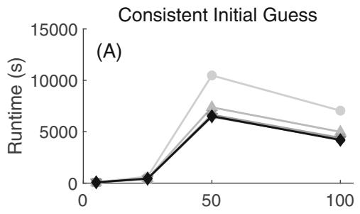

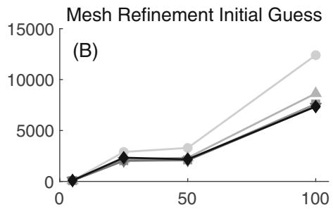

(C)  
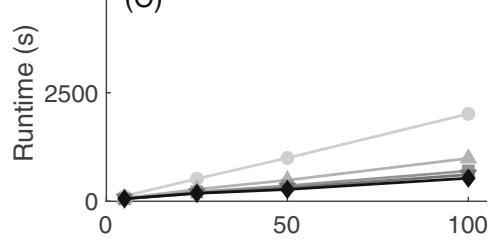

(D)  
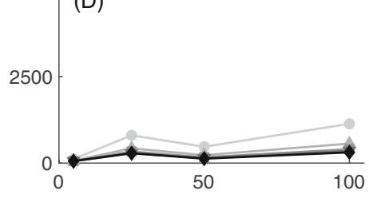

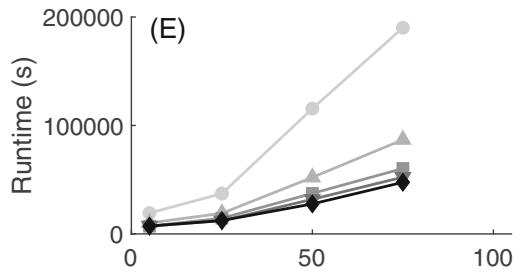

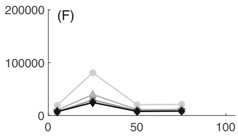

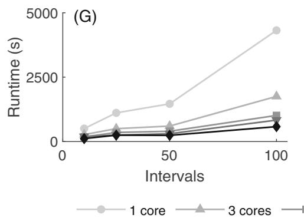

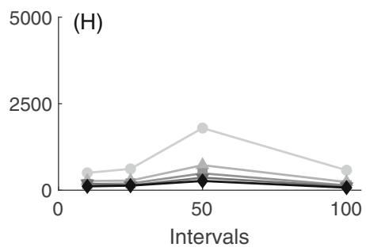  
F I G U R E 1 The computational runtime for 2-D tracking simulations of walking (A and B), 2-D predictive simulations of walking (C and D), 3-D tracking simulations of walking (E and F), and 2-D predictive simulations of reaching (G and H) across a range of computer processor cores and mesh interval densities. Note the different vertical ranges among the different rows of plots.

Only parallelization of the NLP function evaluation of each simulation was evaluated in this study. The speed-up for the NLP function evaluations generally increased with mesh interval density and the number of processor cores (Figure 3). The speed-up for the NLP function evaluations (Figure 3) was greater than the overall speed-up (Figure 2) for 2-D tracking simulations of walking, 2-D predictive simulations of walking, and 3-D tracking simulations of walk ing. The speed-up for the NLP function evaluations (Figure 3) was similar to the overall speed-up (Figure 2) for 2-D predictive simulations of reaching.

The percent of overall runtime spent on NLP function evaluations ranged from 35.8% for 2-D tracking simulations to 95.6% for 2-D predictive simulations of reaching (Table 1). The percent of overall runtime spent on NLP function evaluations for the 2-D predictive simulations of walking and 3-D tracking simulations of walking were similar to each other, at slightly more than half of the total runtime (Table 1).

For both 2-D and 3-D tracking simulations of walking, the minimum objective function values were greatest on the coarsest mesh density, and fairly consistent for finer meshes (Figure 4A,C). For 2-D predictive walking and reaching simulations, the minimum objective function values were consistent across all mesh interval densities (Figure 4B,D) The initial guess strategy had little effect on the minimum objective function values (Figure 4).

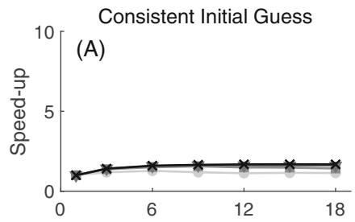

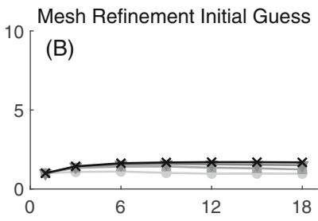

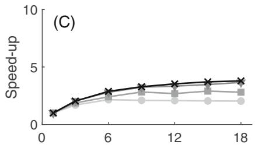

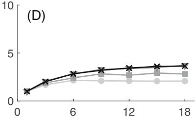

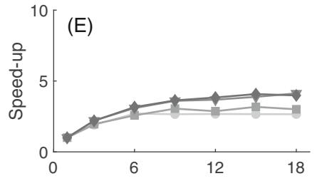

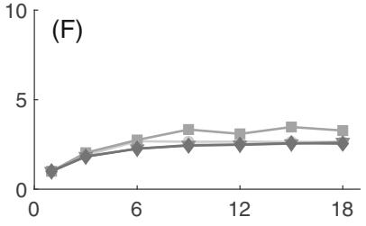

10  
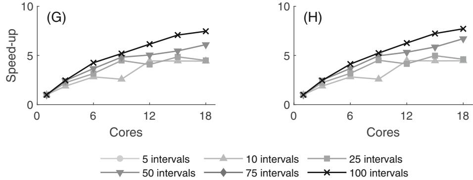  
F I G U R E 2 The overall computational speed-up factor for 2-D tracking simulations of walking (A and B), 2-D predictive simulations of walking (C and D), 3-D tracking simulations of walking (E and F), and 2-D predictive simulations of reaching (G and H) across a range of computer processor cores and mesh interval densities. The maximum speed-up factor varied from about 1.7 to 7.7 across the different simulations, being greatest for the 2-D simulations of reaching, and lowest for the 2-D tracking simulations of walking

The iteration count ranged from 21 to 1084 across the different simulations and initial guess strategies. There were no consistent trends in the number of iterations required to solve the four optimal control problems for either initia guess strategy across mesh interval densities (Figure 5). The MR strategy allowed 3-D tracking simulations of walking and 2-D predictive simulations of reaching to converge to a solution in considerably fewer iterations on finer mesh densities (Figure 5C,D). Yet, this was not true for the other problems, especially in 2-D tracking simulations of walking (Figure 5A).

The cumulative runtime to solve the 2-D predictive walking simulation (50 mesh time interval, six processor cores, CG) three times consecutively was 17.8 min. The runtime to solve the same three problems within a parallel for loop was 6.1 min. Thus, given the 18 available processor cores in this study, it was possible to achieve an overall 2.9 speed up factor beyond that obtained by parallelizing the NLP function evaluations within the individual simulations. Solving the same 2-D predictive walking problem three times consecutively in the serial case resulted in a cumulative runtime

10  
10  
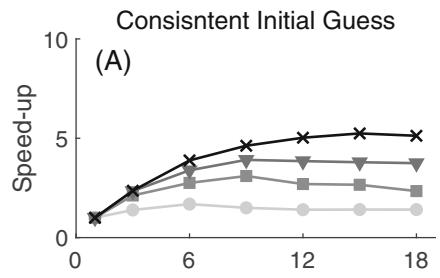

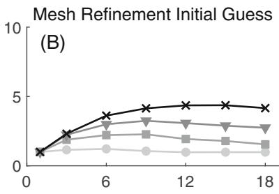

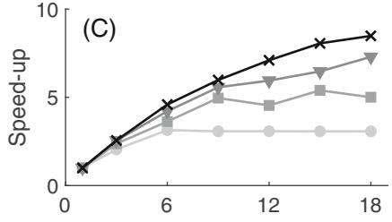

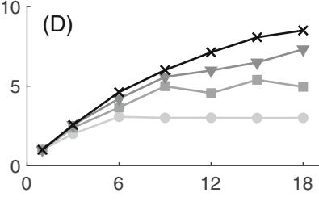

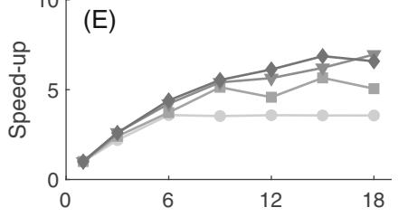

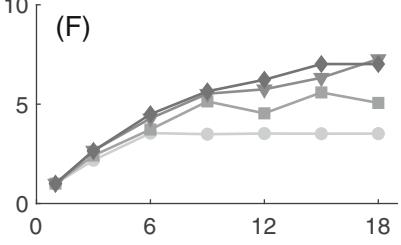

10  
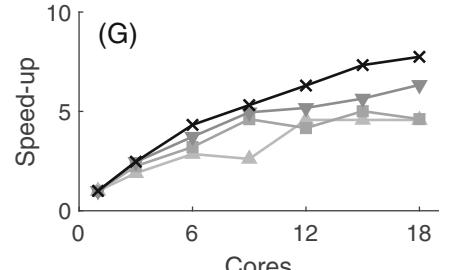

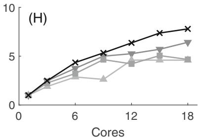  
F I G U R E 3 The computational speed-up factor of the nonlinear programming (NLP) function evaluation of the optimal control problem for 2-D tracking simulations of walking (A and B), 2-D predictive simulations of walking (C and D), 3-D tracking simulations of walking (E and ${ \mathrm { F } } ) ,$ and 2-D predictive simulations of reaching (G and H) across a range of computer processor cores and mesh interval densities. The maximum speed-up factor varied from about 4.4 to 8.5 across the different simulations, being greatest for the 2-D predictive simulation of walking, and lowest for the 2-D tracking simulations of walking.

T A B L E 1 Mean percentage of total runtime spent on nonlinear programming (NLP) function evaluations in solving the optimal control problems (±1 standard deviation).

<table><tr><td>Simulation type</td><td>Time spent on NLP function evaluations (%)</td></tr><tr><td>2-D tracking walking</td><td>35.8 ± 12.8</td></tr><tr><td>2-D predictive walking</td><td>54.3 ± 13.4</td></tr><tr><td>3-D tracking walking</td><td>58.6 ± 17.1</td></tr><tr><td>2-D predictive reaching</td><td>95.6 ± 2.1</td></tr></table>

Note: Data were averaged for each model and task across the number of processor cores, mesh intervals, and initial guess types.

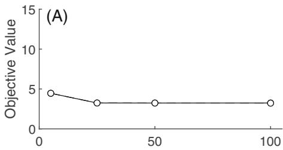

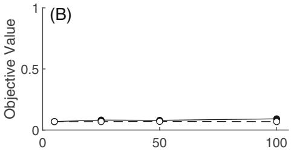

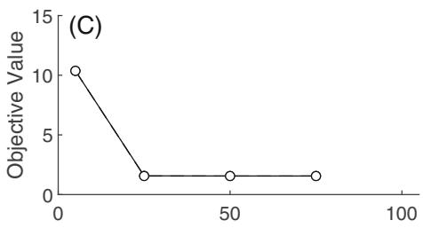

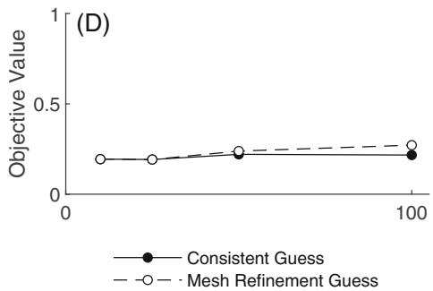  
F I G U R E 4 The minimum objective function values for 2-D tracking simulations of walking (A), 2-D predictive simulations of walking (B), 3-D tracking simulations of walking (C), and 2-D predictive simulations of reaching (D) across a range of mesh interval densities using both initial guess strategies. For some problems (B and D), the minimum objective function value was consistent across mesh interval densities, while for other cases (A and C) the minimum objective function value was greater on coarse meshes. The initial guess strategies had little impact on the minimum objective function value across mesh densities. Note the different ranges on the vertical axes among panels.

of 49.9 min. Thus, combining parallelization of the NLP function evaluations and parallel solution of the individua simulations results in an overall 8.2 speed-up factor.

## 4 | DISCUSSION

In the present study, we evaluated how model complexity, movement task, initial guess type, and temporal mesh den sity affect the speed-up of optimal control simulations of human movement when parallelized across a range of com puter processor cores in a single computer workstation. Parallel computing has been used in biomechanics research for decades on supercomputers and computer clusters2,15 but can now be implemented on a typical laptop or desktop computer. The optimal control algorithms16 implemented in OpenSim Moco10 are well-suited for a computer with a multicore processor with the potential to improve computational performance. For all of the simulations considered here, multicore parallel computing resulted in at least some improvement in computational performance. but the extent of the speed-up varied considerably across the different simulations.

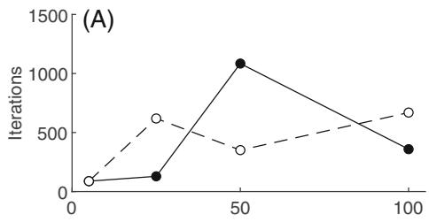

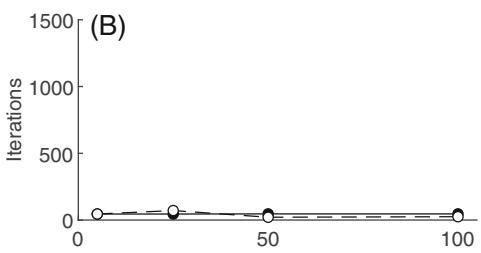

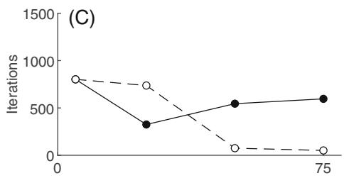

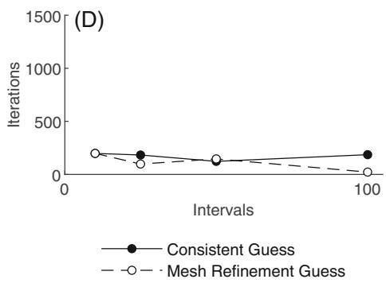  
F I G U R E 5 The iteration count for 2-D tracking simulations of walking (A), 2-D predictive simulations of walking (B), 3-D tracking simulations of walking (C), and 2-D predictive simulations of reaching (D) across a range of mesh interval densities using both initial guess strategies. The mesh interval density and initial guess strategy did not have consistent effects on the number of iterations needed to converge to a solution across conditions.

The overall degree of speed-up was closely related to the percent of total runtime spent evaluating the NLP function evaluations. That portion of the total runtime was greatest for the 2-D predictive simulations of reaching and was low est for the 2-D tracking simulations of walking (Table 1), which respectively had the greatest and least effective paralle speed-up (Figure 2). The 2-D predictive walking and 3-D tracking walking problems differed in problem size and type yet had similar percentages of the total runtime represented by the NLP function evaluations (Table 1), resulting in sim ilar overall parallel speed-up (Figure 2). Thus, while the overall speed-up achieved with multicore parallel processing ir OpenSim Moco is problem-specific, it appears to be well predicted by the split between the time spent in the IPOPT algorithm versus the time spent evaluating the NLP functions, which can be readily determined for any particular prob lem from the standard output provided by the IPOPT program. The exact factors that dictate the amount of time spent in the IPOPT algorithm relative to the NLP function evaluations are difficult to know precisely for any particular prob lem, but will be influenced by factors such as how computationally expensive the user functions are to evaluate, and the number and types of constraints on the solution.

In most cases, the overall speed-up was greatest between 3 and 6 processor cores, with most of the improvement achieved by 3 processor cores. Only for the reaching simulations on finer meshes was there considerable speed-up beyond 6 cores, albeit still less than ideal linear speed-up. Therefore, most of the achievable speed-up for th simulations considered here can be realized on computers with only 4 processor cores, which is common in modern computers. Common factors causing less than linear speed-up are the overhead associated with communication among cores, and some cores needing to wait for others to complete before proceeding.26 However, it is difficult to know the extent to which specific factors affect speed-up in any particular problem without considerable further analysis than was pursued here. The availability of more processor cores, which comes at a financial cost, can yield additional speed up for certain problems, such as the upper limb reaching task, or by allowing multiple problems to be solved simulta neously on the same computer. We used a parallel for loop to solve multiple problems in parallel, as might be typical in a Monte Carlo simulation or bilevel optimization, but it would also be possible to start multiple unrelated instances of OpenSim Moco simultaneously. The main consideration in either case is deciding how to allocate the available proces sor cores within and between the multiple OpenSim Moco problems that are being solved in parallel.

The maximum possible overall speed-up in this study was limited by the fact that we only investigated para llelization of the NLP function evaluations. That was our focus because the CasADi library16 used in OpenSim Moco10 makes it easy to select the number of parallel threads used for that part of the problem. Thus, parallelizing the NLP function evaluations is likely to be representative of typical user behavior. The default setting in OpenSim Moco is to evaluate the NLP function evaluations via the CasADi solver in parallel using all available cores. Thus, the user does not need to do anything to invoke parallel processing and will only need to change settings if fine-grained control is desired over how processor cores are allocated. A systematic investigation of parallelization within the linear equation solvers available in IPOPT (e.g., reference 27) could potentially lead to further enhancements in computational perfor mance and should be a focus for future research. Even within the part of a problem that is parallelized there are likel to be differences in the actual speed-up that is realized. Thus, we evaluated the speed-up achieved in the NLP function evaluations, separate from the overall speed-up. Speed-up is considered “ideal” when doubling the number of processo cores doubles the computational speed. For most problems, the speed-up for the NLP function evaluations was substantially greater than the overall speed-up. However, even in the best case (2-D predictive walking, Figure 3C) the speed-up was less than ideal. Near ideal speed-up was previously reported for evaluating the objective and constraints derivatives in the solution of a direct shooting problem of human walking on a distributed memory parallel supercom puter.2 The discrepancies from the present results are likely due to different optimal control formulations (direct shoot ing versus direct collocation in the present study) and different computer architectures (independent compute nodes versus a single multicore processor in the present study).

The individual runtimes varied considerably across models and tasks, number of mesh intervals and processor cores, and initial guess types (Figure 1). Variations in runtimes were due in part to the number of iterations require for the problems to converge (Figure 5), which were sensitive to the mesh densities and initial guess types. We present the runtimes for completeness, however, our primary focus was not the runtimes per se, but rather the speed up obtained through parallel computing. In contrast to the runtimes, the speed-up that was achieved generall scaled consistently across mesh intervals and processor cores, and was similar for the two different initial guess types (Figures 2 and 3). While we focus here on parallel speed-up, runtime is certainly an important performance consideration and is affected not only by the degree of parallelization but also by other factors such as mesh density and guess type (Figure 1). We also note that the time required to obtain the initial guesses was not included in the reported runtimes. When solving a large set of related problems, as was done here, a small number of initial guesses can be used for all of the problems, representing a trivial amount of the overall computing time. This would also be true when starting from an arbitrary or random initial guess. However, there can be cases where unique initia guesses need to be obtained for every optimization run and in those cases the time required could be more substantial.

Generating simulations of human movement using direct collocation involves discretizing the problem over a temporal mesh. Using a coarse mesh will usually reduce computational demand, but could impair the quality of the solution. Solving a problem on a finer mesh may lead to a higher quality solution, but at the cost of being more computationally intensive.9 In the current study, solutions obtained on finer mesh interval densities generally resulted in a greater speed-up when parallelized across more processor cores than solutions obtained on coarser mesh interval densities. Thus, the computational efficiency achieved through parallel computing helped offset the computational demands of using finer temporal mesh densities.

This study had several limitations. Parallelizing only the NLP function evaluation part of the problem limited the overall speed-up that was possible. However, it is important to note this approach likely reflects how a typical OpenSim Moco user would parallelize optimal control simulations of human movement. Additionally, the walking and reaching tasks that we used are common in the literature, yet there are many other tasks that have also been simulated using musculoskeletal models. The present results will not necessarily generalize to simulations of other tasks. Finally, OpenSim Moco can solve problems that we did not consider here, such as determining the muscle states that corre spond to a prescribed motion (i.e., a Moco Inverse problem). The potential for parallel computing to speed-up these other problem types cannot be inferred from the present results. We chose to focus on tracking and predictive optimal control problems as they tend to be the most computationally demanding.

Herein, we analyzed the computational demands of a broad range of optimal control simulations of human movement using parallel computing in OpenSim Moco. While the speed-up achieved was not ideal, the computational performance improved for all of the examined simulations when solved in parallel, and solving multiple problems simultaneously yielded further computational speed-up. In summary, multicore parallel computing in OpenSim Moco via the CasADi library provides an effective means to reduce the computation demand of optimal control musculoskele tal simulation, enhancing the feasibility of this research technique.

## ACKNOWLEDGMENTS

We appreciate helpful comments provided by Dr. Aaron Fox on an earlier draft of this paper. This study was supported by a Rackham Graduate Student Research Grant and was inspired in part by an OpenSim Moco forum post by Dr. Ros Miller about simulation results obtained on different temporal mesh densities.

## CONFLICT OF INTEREST STATEMENT

The authors declare no conflicts of interest.

## DATA AVAILABILITY STATEMENT

We will share a complete working example is provided on the SimTK website (https://simtk.org/projects/ mocoparallel). The project page is currently set to private while we get everything prepared and uploaded. We will make it publicly available upon publication of the paper.

## ORCID

Alex N. Denton https://orcid.org/0000-0002-4939-4819 Brian R. Umberger https://orcid.org/0000-0002-5780-2405

## REFERENCES

1. Anderson FC, Pandy MG. Dynamic optimization of human walking. J Biomech Eng. 2001;23(5):381-390. doi:10.1115/1.1392310

2. Anderson FC, Ziegler JM, Pandy MG, Whalen RT. Application of high-performance computing to numerical simulation of human movement. J Biomech Eng. 1995;117(1):155-157. doi:10.1115/1.2792264

3. Crowninshield RD, Brand RA. A physiologically based criterion of muscle force prediction in locomotion. J Biomech. 1981;14(11):793- 801. doi:10.1016/0021-9290(81)90035-X

4. Umberger BR. Caldwell GE. Musculoskeletal modeling. In: Robertson DGE. Caldwell GE. Hamill J. Kamen G. Whittlesey SN. eds Research Methods in Biomechanics. 2nd ed. Human Kinetics; 2014:247-276.

5. Ackermann M, van den Bogert AJ. Optimality principles for model-based prediction of human gait. J Biomech. 2010;43(6):1055-1060. doi:10.1016/j.jbiomech.2009.12.012

6. Porsa S, Lin Y-C, Pandy MG. Direct methods for predicting movement biomechanics based upon optimal control theory with implemen tation in OpenSim. Ann Biomed Eng. 2016;44(8):2542-2557. doi:10.1007/s10439-015-1538-6

7. Lee L-F, Umberger BR. Generating optimal control simulations of musculoskeletal movement using OpenSim and MATLAB. PeerJ. 2016;4:e1638. doi:10.7717/peerj.1638

8. Lin Y-C, Pandy MG. Three-dimensional data-tracking dynamic optimization simulations of human locomotion generated by direct col location. J Biomech. 2017;59:1-8. doi:10.1016/j.jbiomech.2017.04.038

9. Kelly M. An introduction to trajectory optimization: how to do your own direct collocation. SIAM Rev. 2017;59(4):849-904. doi:10.1137/ 16M1062569

10. Dembia CL, Bianco NA, Falisse A, Hicks JL, Delp SL. OpenSim Moco: musculoskeletal optimal control. PLoS Comput Biol. 2020;16(12): e1008493. doi:10.1371/journal.pcbi.1008493

11. Seth A, Hicks JL, Uchida TK, et al. OpenSim: simulating musculoskeletal dynamics and neuromuscular control to study human and ani mal movement. PLoS Comput Biol. 2018;14(7):e1006223. doi:10.1371/journal.pcbi.1006223

12. Nguyen VQ, Johnson RT, Sup FC, Umberger BR. Bilevel optimization for cost function determination in dynamic simulation of human gait. IEEE Trans Neural Syst Rehabil Eng. 2019;27(7):1426-1435. doi:10.1109/TNSRE.2019.2922942

13. Johnson RT. Lakeland D. Finley JM. Using Bavesian inference to estimate plausible muscle forces in musculoskeletal models JNeuroeng Rehabil. 2022:19:34. doi:10.1186/s12984-022-01008-4

14. Amdahl GM. Validity of the single processor approach to achieving large scale computing capabilities. Proceedings of the Spring Joint Computer Conference, 483–485. 1967. doi:10.1145/1465482.1465560

15. van Soest AJ, Casius LJ. The merits of a parallel genetic algorithm in solving hard optimization problems. J Biomech Eng. 2003;125(1): 141-146. doi:10.1115/1.1537735

16. Andersson JAE, Gillis J, Horn G, Rawlings JB, Diehl M. CasADi: a software framework for nonlinear optimization and optimal control. Math Program Comput. 2019;11:1-36. doi:10.1007/s12532-018-0139-4

17. Miller RH, Russell Esposito E. Transtibial limb loss does not increase metabolic cost in three-dimensional computer simulations of human walking. PeerJ. 2021;9:e11960. doi:10.7717/peerj.11960

18. Fox AS, Bonacci J, Gill SD, Page RS. Simulating the effect of glenohumeral capsulorrhaphy on kinematics and muscle function. J Orthop Res. 2021;39(4):880-890. https://doi-org.proxy.lib.umich.edu/10.1002/jor.24908

19. De Groote F, Kinney AL, Rao AV, Fregly BJ. Evaluation of direct collocation optimal control problem formulations for solving the muscle redundancy problem. Ann Biomed Eng. 2016;44(10):2922-2936. doi:10.1007/s10439-016-1591-9

20. Sherman MA, Seth AJ, Delp SL. Simbody: multibody dynamics for biomedical research. Procedia IUTAM. 2011;2:241-261. doi:10.1016/j piutam.2011.04.023

21. Seth A, Sherman M, Reinbolt JA, Delp SL. OpenSim: a musculoskeletal modeling and simulation framework for in silico investigations and exchange. Procedia IUTAM. 2011;2:212-232. 10.1016/j.piutam.2011.04.021

22. Holzbaur KR, Murray WM, Delp SL. A model of the upper extremity for simulating musculoskeletal surgery and analyzing neuromuscular control. Ann Biomed Eng. 2005;33(6):829-840. doi:10.1007/s10439-005-3320-7

23. Wächter A, Biegler LT. On the implementation of an interior-point filter line-search algorithm for large-scale nonlinear programming. Math Program. 2006;106:25-57. doi:10.1007/s10107-004-0559-y

24. van den Bogert AJ, Blana D, Heinrich D. Implicit methods for efficient musculoskeletal simulation and optimal control. Procedia IUTAM. 2011;2:297-316. doi:10.1016/j.piutam.2011.04.027

25. Miller RH, Edwards WB, Brandon SE, Morton AM, Deluzio KJ. Why don't most runners get knee osteoarthritis? A case for perunit-distance loads. Med Sci Sports Exerc. 2014;46(3):572-579. doi:10.1249/MSS.0000000000000135

26. Shameem A, Jason R. Multi-Core Programming-Increasing Performance through Software Multithreading. Intel; 2005.

27. Tasseff B, Coffrin C, Wächter A, Laird C. Exploring benefits of linear solver parallelism on modern nonlinear optimization applications. arXiv:1909.08104. 2019 10.48550/arXiv.1909.08104