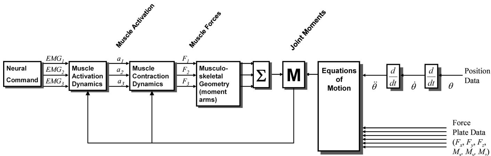
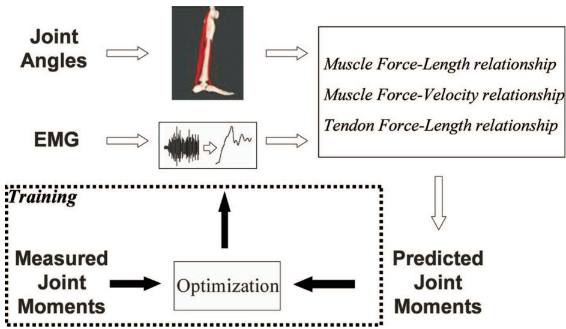
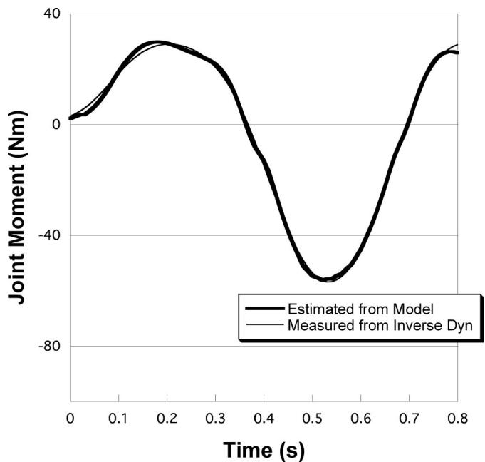
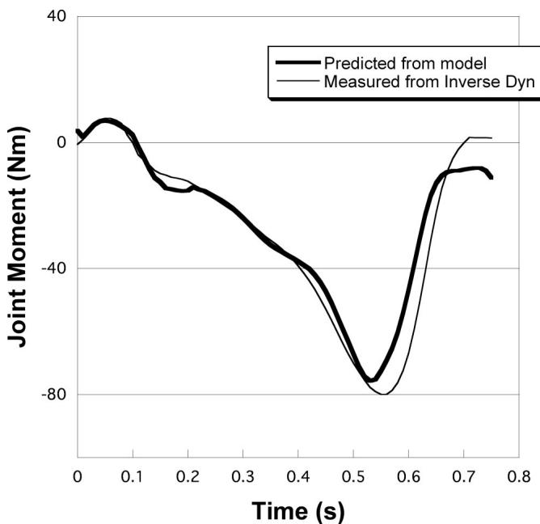
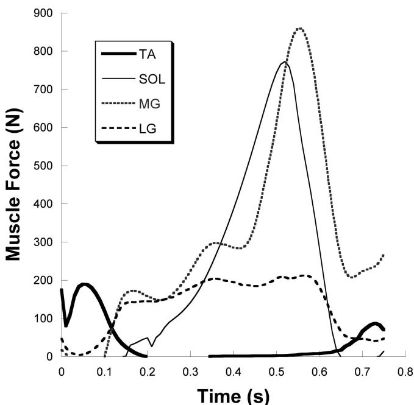

# 基于正-逆动力学模型的肌肉力和关节力矩估算

THOMAS S. BUCHANAN1、DAVID G. LLOYD2、KURT MANAL1 和 THOR F. BESIER2

1Center for Biomedical Engineering Research, Department of Mechanical Engineering, University of Delaware, Newark, DE；2School of Human Movement and Exercise Science, University of Western Australia, AUSTRALIA

## 摘要

BUCHANAN, T. S., D. G. LLOYD, K. MANAL, and T. F. BESIER. Estimation of Muscle Forces and Joint Moments Using a Forward-Inverse Dynamics Model. Med. Sci. Sports Exerc., Vol. 37, No. 11, pp. 1911–1916, 2005. 目的：本文提出了一种正向动力学神经肌肉骨骼模型，可用于估算和预测关节力矩及肌肉力。该模型以 EMG（肌电图）信号作为输入，并通过逆动力学对预测的关节力矩进行验证。该模型的目的是根据健康受试者和损伤受试者激活肌肉的方式，估算或预测关节周围的肌肉力，进而可用于估算相应的关节压应力及/或韧带拉力。方法：关节力矩的估算需要三个步骤。第一步，肌肉激活力学控制从 EMG 信号到肌肉激活度（一个介于 0 和 1 之间的时变参数）的转化。第二步，肌肉收缩力学表征肌肉激活度如何转化为肌肉力。最后一步需要建立肌肉骨骼几何模型，将肌肉力转化为关节力矩。这些步骤均涉及复杂的非线性关系。结果：文中提供了一个应用示例，展示如何利用该模型研究测力计测试期间以及步态中健康踝关节的受力情况。研究发现，模型预测的关节力矩估计值与实验测定值高度吻合。结论：以 EMG 作为输入的神经肌肉骨骼模型可用于精确估算关节力矩。通过这些模型预测的肌肉力可用于更深入地了解关节内的组织负荷，并在动态任务中提供韧带拉力和软骨压应力的体内估计。该工具在辅助研究运动损伤机制方面具有巨大潜力。关键词：EMG（肌电图）、HILL MODEL（希尔模型）、TENDON（肌腱）、PENNATION ANGLE（羽状角）、ANKLE（踝关节）

研究人体运动生物力学：正向动力学与逆动力学。这两种方法均可用于确定关节动力学（例如估算运动过程中的关节力矩），但若用于研究肌肉对特定运动或锻炼的贡献，则各自存在局限性。

在前向动力学中，人们从神经指令的测量或估计开始。然后通过一个三步过程将其转换为关节力矩（图 1）。肌肉激活力学将神经信号转换为肌肉激活度，肌肉激活度是一个介于 0 到 1 之间的时变参数。肌肉收缩动力学将肌肉激活度转换为肌肉力。最后，肌肉骨骼几何结构将肌肉力转换为关节力矩。一旦确定了关节力矩，运动方程就可以将关节力矩转换为关节运动。这些步骤中的每一步都包含复杂的非线性关系。

在逆向动力学中，问题的处理方式则截然相反（图 1）。在此，我们从测量位置以及作用于身体的外力开始。例如，在步态分析中，使用基于摄像机的视频系统记录附着在受试者肢体上的跟踪标记的位置，并使用测力台记录外力。利用相邻肢体节段上的跟踪标记来计算各节段的相对位置和方向，并据此计算出关节角度。对这些数据进行微分以获得速度和加速度。加速度以及施加在身体上的其他力的信息（例如测力台的记录数据）可输入到运动方程中，以计算相应的关节反作用力和力矩。如果纳入肌肉骨骼几何结构，理论上就可以从关节力矩中估算出肌肉力。然而，协同收缩和冗余性问题使这一过程变得十分困难。

尽管逆向动力学应用广泛，但如果想研究体育和运动中的肌肉功能，使用该方法存在几个缺点。首先，力矩和合关节反作用力都是净值。例如，如果一个人激活其腘绳肌产生 25-N m 的屈曲力矩，同时激活股四头肌产生 20-N m 的伸展力矩，那么逆向动力学方法（假设其完全精确）得出的膝关节净屈曲力矩将为 5 N m。这一点非常重要，因为肌肉的协同收缩十分普遍；然而该方法仍被广泛用于估算肌肉贡献。其次，逆向动力学方法的另一个局限性出现在尝试估算肌肉力时。由于每个关节都有多块肌肉跨越，从关节力矩到肌肉力的转换会产生大量可能的解，无法轻易确定。最后，如果希望研究肌肉激活度，即使肌肉力首先能够被估算出来，目前也没有可用的模型能够实现从肌肉力到肌肉激活度的这种逆转换。因此，如果希望在模型中纳入神经激活，逆向动力学并不是一个好方法。

  
FIGURE 1—估计关节力矩的正向-逆动力学混合方法。从左侧开始，正向动力学方法从神经指令出发，随后利用肌肉激活力学、肌肉收缩动力学和肌肉骨骼几何构型来估计关节力矩。这些关节力矩也可以通过逆动力学（从右侧开始）进行估计。在模型的训练阶段，关节力矩的误差被用于调整模型参数。

正向动力学方法也存在局限性。首先，它们需要对肌肉激活度进行估计。研究者要么必须从基于实验测量的肌电图（EMG）开始，要么使用基于数学的优化方法来估计神经指令。近年来，不同复杂程度的 EMG 驱动模型已被用于估计膝关节 (12,13,18)、下背部 (17,21)、腕关节 (3) 和肘关节 (16) 周围的力矩。优化方法虽然应用日益广泛 (1,19)，但由于其不包含对特定个体如何激活其肌肉的任何测量，因而在病理学研究中受到限制。也就是说，所选择的代价函数可能无法反映个体（尤其是运动功能受损者）所使用的实际肌肉激活模式。

其次，从肌肉激活到肌肉力量的转换十分困难，因为这一过程尚未被完全阐明。大多数相关模型都是基于源自 A. V. Hill 经典工作 (10) 的唯象模型。另一个困难在于确定肌腱力臂和作用线。这些参数在尸体标本中就很难测量，在活人体内更难精确确定。最后，关节力矩的估计容易产生误差，因为很难获得每块肌肉力量的精确估计，而且通常无法验证预测的力量是否正确。

在本文中，我们提出了一种混合方法，该方法使用 EMG 驱动的正向动力学模型来估计肌肉力量，并由此估计踝关节处的关节力矩。同时还使用逆动力学估计了关节力矩，并对模型中的参数进行了调整，使得正向和逆向动力学方法得出的关节力矩高度吻合。参数调整完毕后，该模型即可用于估计新任务下踝关节周围的肌肉力量。通过掌握踝关节周围所有肌肉的力量及其作用线，便可以估计压应力（即软骨中）和软组织中的拉应力（即韧带中）。

## 方法

在本节中，将首先介绍该模型的理论背景，随后描述数据采集流程。

肌肉激活动力学。从 EMG 到肌肉激活的转换过程非常复杂。采集后，肌电信号的初始处理需要对信号进行整流和低通滤波（四阶巴特沃斯滤波器，截止频率 8 Hz）以形成线性包络。随后，通过将信号除以最大自主收缩期间获得的 EMG 来进行归一化。所得信号平滑，幅值介于 0 和 1 之间。然而，出于以下三个原因，它作为肌肉激活的表征仍显不足。首先，该信号与肌肉力量不同步，因为肌电信号出现与相应力量产生之间存在必须考虑的延迟。据报道，这种机电延迟范围在 10 ms 到约 100 ms 之间 (4)。

其次，已知肌肉激活是其近期历史状态的函数 (24)。也就是说，该转换可以建模为二阶微分方程。其离散化形式表示为 (11,21)：

$$
\mathrm{u} (\mathrm{t}) = \alpha \mathrm{e} (\mathrm{t} - \mathrm{d}) - \beta_ {1} \mathrm{u} (\mathrm{t} - 1) - \beta_ {2} \mathrm{u} (\mathrm{t} - 2)\tag{[1]}
$$

其中 d 为机电延迟，$\alpha , \beta _ { 1 } ,$ 和 $\beta _ { 2 }$ 是定义二阶动力学的系数。这些参数 (d, -, $\beta _ { 1 }$ , and $\beta _ { 2 } )$ 将归一化的 EMG 值 e(t) 映射为神经激活值 u(t)。该滤波器应具有单位增益，以确保神经激活不超过 1，为满足此要求，必须满足以下等式：$\alpha \ : - \ : \beta _ { 1 } \ : - \ : \beta _ { 2 } = 1$。此外，为了保证方程的稳定性，还应包含若干约束条件（关于方程稳定性判据的讨论见 Buchanan et al. (2)）。

最后，研究表明等长 EMG 与肌肉力量之间并不一定呈线性关系 (8,22,26)。上述 u(t) 项并未表征这种非线性特性。例如，Woods 和 Bigland-Ritchie (22) 表明，尽管某些肌肉具有非常线性的等长 EMG–力量关系，但其他肌肉的关系是非线性的，特别是在较低力量水平下（最高约 30%）。Manal 和 Buchanan (14) 将力量低于 30% 时的这种关系表征为对数关系，而在更高力量水平下表征为线性关系。

$$
\begin{array}{l l} \mathrm {a(t) = d\ln(cu(t) + 1),} & 0 \leq \mathrm {u(t) <   \sim 0.3} \\ \mathrm {a(t) = mu(t) + b,} & \sim 0. 3 \leq \mathrm {u(t) <   1} \end{array}\tag{[2]}
$$

其中 u(t) 为神经激活（来自上文），a(t) 为肌肉激活。系数 c、d、m 和 b 可以联立求解，并简化为单一参数 A (14)。

肌肉收缩动力学。采用 Hill-type 肌肉模型来估计肌纤维收缩元件所能产生的力，其函数的通用形式如下：

$$
F ^ {\mathrm{m}} (\mathrm{t}) = f (\mathrm{v}) f (\mathrm{l}) \mathrm{a} (\mathrm{t}) F _ {\mathrm{o}} ^ {\mathrm{m}}\tag{[3]}
$$

式中，${ \cal F } ^ { \mathrm { m } }$ 为随时间变化的肌纤维力，f(v) 为归一化的速度相关肌纤维力（即力-速度关系），f(l) 为归一化的长度相关肌纤维力（即长度-张力关系），a(t) 为随时间变化的肌肉激活度（如上所述），${ F _ { \mathrm { ~ o ~ } } } ^ { \mathrm { ~ m ~ } }$ 为最大等长肌纤维力。

当然，这些函数各自都具有一定的复杂性。例如，归一化长度-张力关系 f(l) 在经典上仅针对处于最大等长力状态下的肌肉进行表征。然而已有报道指出，最佳肌纤维长度——即力达到峰值时的肌纤维长度——会随着激活度的降低而增加 (7)。这导致了长度-张力关系的偏移，Lloyd and Besier 对此进行了数学表征 (11)。

必须考虑的另一个复杂因素是肌腱刚度。当肌肉收缩时，肌腱被拉伸，从而对肌肉施加负荷并使其伸长。因此，正如 Buchanan et al. (2) 所述，肌肉力必须通过迭代求解。

羽状角也应予以考虑，因为它会影响力的传递角度。已有研究表明，假设肌肉在收缩过程中保持恒定厚度和体积的模型能够很好地表征羽状角行为 (20)。

肌骨几何结构。为了计算肌腱单位的长度和力臂，需要一个肌骨模型。这些模型必须考虑肌腱长度和力臂随关节角度变化的方式，并包含有关骨骼几何结构以及与关节运动学相关的复杂关系的信息 (5,6)。

一旦计算出所有的肌肉力并估计出相应的力臂，就可以通过相乘求出它们对关节力矩的贡献。如果对特定关节处的所有肌肉都进行这一计算，则可以通过对这些值求和来估计出相应的关节力矩。

模型参数。模型需要若干生理参数。肌肉力臂和长度使用 Delp et al. (6) 的模型进行计算。最佳肌纤维长度、肌腱松弛长度以及羽状角来自尸体研究的测量 (23)。在这三个参数中，肌腱松弛长度最难测量，但可以使用数值方法进行估算 (15)。最大肌肉力可以通过测量肌肉的生理横截面积来估算，随后可以进行统一缩放，以匹配测力计上测得的最大关节力量 (12)。

模型中的其他参数无法轻易确定，例如描述肌肉激活力学的参数。这些参数必须通过将正向动力学计算得出的估计关节力矩与逆向动力学确定的关节力矩进行比较，以数学方法确定。两者理应一致，模型参数可进行调整，直到二者之间的误差最小化。这一过程通过非线性优化来完成。我们使用了模拟退火（simulated annealing）算法，因为该算法旨在降低收敛到局部极小值的概率。

一旦调整了模型参数使误差最小化，该模型便可用于预测新任务——即未用于最小化模型误差的任务——中的关节力矩和肌肉力。模型的准确性可以通过将其对关节力矩的预测估计值与实验测定值进行对比来确定。

调整参数以针对每个受试者微调或校准模型（Fig. 2）。使用该方法每块肌肉需要调整的参数确切数量大约在 1 到 6 个不等 (9)。在接下来针对踝关节的应用中，共调整了 22 个参数。这些参数包括公式 1 和公式 2 中的系数，以及每块肌肉的最佳肌纤维长度（长度-张力曲线达到峰值时的长度）、肌腱松弛长度（肌腱开始承受负荷时的长度），以及用于屈曲和伸展的两个全局增益因子。基于生理学的参数允许在文献报道值的一个标准差范围内变化 (23)；其他参数则受稳定性准则限制 (2)。

实验流程。采集了三名受试者的肌电信号（EMG），其中胫骨前肌、腓肠肌内侧头和腓肠肌外侧头使用表面电极，比目鱼肌则使用微细丝肌内电极。所有受试者均签署了书面知情同意书，且实验方案获得了我们人体受试者审查委员会的批准。使用无线遥测系统（Noraxon 9000）将 EMG 信号传输至定制放大器，并进行 30–500 Hz 的带通滤波。随后以 1 kHz 的采样率对信号进行数字化采样。

  
FIGURE 2—建模流程的简化流程图。处理肌电信号（EMG）以获得肌肉激活度，而关节角度数据用于获取肌骨长度、速度和力臂。将这些数据共同输入到 Hill 模型（Hill-type model）中以估算肌腱力，随后将肌腱力乘以其力臂并求和以获得关节力矩。在训练阶段（虚线框），将估算的力矩与测量的力矩进行比较。调整模型中的参数以最小化测量关节力矩与预测关节力矩之间的差异。一旦找到最优参数并且针对受试者完成了模型调优，便移除模型的训练部分；该模型可用于预测新任务的关节力矩。

在两类试验中采集了 EMG：在测力计中进行的试验和步态试验。测力计试验包括在 60、120 和 $1 5 0 ^ { \circ } { \cdot } \mathrm { s } ^ { - 1 } \ ( 1 5 0 ^ { \circ } { \cdot } \mathrm { s } ^ { - 1 }$ 为站立相踝关节角速度的最大值）下的等速向心试验。等速试验中的活动范围为背屈 $5 ^ { \circ }$ 至跖屈 $2 0 ^ { \circ }$，这是步态中踝关节的平均活动范围。在最大自主收缩期间采集了初步数据以进行归一化。

为了在步态试验期间采集数据，我们使用了配备 6 台 Pro-reflex 摄像机的 Qualisys 动作捕捉系统以及 AMTI 测力台。使用测力台和运动分析系统计算了地面反作用力以及足部、小腿和大腿的空间位置。踝关节力矩使用逆向动力学进行计算。受试者被指示仅以自选步速行走。

## 结果

在本研究中，从四块肌肉采集了 EMG 并估算了由此产生的关节力矩。随后调整模型参数，以最小化估算力矩（来自正向动力学）与测量力矩（来自逆向动力学）之间的差异（Fig. 3）。均方根误差为 1.4 N m $( \mathbf { R } ^ { 2 } = 0 . 9 9 7 )$。

该模型还用于预测新任务期间的力矩。在不改变模型参数的情况下，将新步态试验的 EMG 和关节角度输入模型，预测出相应的力矩，并将其与使用逆向动力学确定的测量力矩进行比较（Fig. 4）。均方根误差为 7.1 N m $( \mathrm { R } ^ { 2 } = 0 . 9 4 )$。相应的肌肉力是模型中的一个中间步骤（Fig. 5）。

## 讨论

我们提出了一种利用混合正-逆动力学方法从 EMG（肌电）信号估计关节力矩的模型。该方法使用了一个考虑力-长度和力-速度关系的 Hill 型模型。通过将预测的关节力矩与测量力矩进行比较，验证了模型的结果。

这些模型在估计各种任务期间的肌肉力量方面具有极其重要的意义——而这是其他建模方法难以实现的。例如，基于优化的模型或许能够预测肌力，但它们不易考虑个体受试者神经肌肉控制系统的差异（该系统可能已受损）。

  
FIGURE 3—模型在 Biodex 等速测力计上进行向心收缩测试训练后立即估计踝关节力矩的能力。对模型参数进行了调整，以使估计力矩与测量力矩之间的误差最小化。请注意，尽管拟合良好，但为实现这种拟合而调整的参数数量相对较少。

  
FIGURE 4—模型在步态过程中预测踝关节力矩的能力。正关节力矩对应背屈。在本例中，使用来自不同测试的数据调整了模型参数，然后使用该模型预测了本次步态测试中的力矩。这展示了模型仅使用 EMG 和运动学信息（即无需重新调整参数）预测新任务力矩的能力。

该方法的准确性在很大程度上受解剖数据准确性和完整性的影响，这些数据必须包含肌肉骨骼几何结构的完整模型。在本例中，踝关节使用了一个仅包含 4 块肌肉和单个自由度的简单模型。在其他关节上已经开发出了更为复杂的模型。例如，Lloyd and Besier (11) 在其膝关节模型中使用了 13 块肌肉，Manal et al. (16) 在其肘关节模型中使用了 7 块肌肉。关节力矩预测的误差与模型的完整性有关，本踝关节模型在预测步态期间的关节力矩时产生了约 7 N m 的误差，而该步态期间的踝关节峰值力矩约为 80 N m。相比之下，Lloyd and Besier (11) 提出的更详细模型在要求更高的跑步和变向切入任务中表现出约 12 N m 的误差，这些任务的膝关节峰值力矩约为 200 N m。

  
FIGURE 5—各肌肉对总关节力矩的力贡献。肌肉力量乘以其各自的力臂并求和，即可得出 Figure 4 中预测的力矩。所示肌肉为胫骨前肌（TA）、腓肠肌内侧头（MG）、腓肠肌外侧头（LG）和比目鱼肌（SOL）。

允许变化的参数越多，估计的关节力矩与测量的关节力矩之间的拟合就越好。然而，这并不意味着尽可能多地改变参数就是最好的选择 (9)。包含大量参数的模型通常几乎没有预测能力。Zheng et al. (25) 建立了一个通过 EMG（肌电图）估计肌肉力的模型，该模型生成的预测关节力矩与使用逆向动力学确定的关节力矩非常接近。但他们的模型要求在每个时间瞬间都对参数进行确定或重新评估。也就是说，模型在每个时间步长都被精确调整以拟合数据。但在包含许多时间步长的情况下，在单次运动过程中可能要调整成百上千个参数，能够做出准确预测并不令人意外。这种方法的问题在于模型出现了“过拟合”。这意味着该模型无法以任何预测性的方式使用。如果每次试验都必须重新计算或调整参数，该模型就无法用于预测新数据。尽管这可能对 Zheng et al. 的应用来说不是问题，但这表明此类模型的预测能力将受到限制，尤其是在用于预测各种不同任务（如步行、慢跑和跳跃）时。

预测模型是一种可以用部分数据进行校准并在合理范围内调整相应参数的模型。那些与已确立的物理测量值相对应的参数不应允许被调整到超出正常生理范围。接着，一旦参数调整完毕，该模型即可用于新数据，而无需进一步调整参数。通过这种方式，可以确定该模型预测正确结果能力的稳健性。

本文提出的混合方法的优势在于，来自逆向解的关节力矩可用于交叉验证正向建模解，当然这是在与逆向动力学方法相关的误差范围内。校准后的正向模型对踝关节屈伸力矩的逆向解给出了良好的预测。在使用该方法对膝关节 (11) 和肘关节 (16) 进行的研究中也报道了类似的结果。在 Lloyd and Besier 的研究 (11) 中发现，通过保持肌肉-肌腱参数恒定，仅允许调整肌电至激活（EMG-to-activation）参数，该模型能够预测相隔 2 周的试验，且预测能力没有下降。一旦模型经过校准并被证明能够很好地预测关节力矩，他们就对肌肉力和关节力矩的估计有了信心。随后，他们便能够利用校准后的模型来估计受试者在执行任务期间膝关节韧带所承受的载荷。

该建模方法目前正用于确定步行、跑步和变向切入动作中的韧带力与关节压应力。（关节接触力

## 参考文献

1. ANDERSON, F. C., and M. G. PANDY. Dynamic optimizationof human walking. J. Biomech. Eng. 123:381–390, 2001.

2. BUCHANAN, T. S., D. G. LLOYD, K. MANAL, and T. F. BESIER. Neuromusculoskeletal modeling: estimation of muscle forces and joint moments and movements from measurements of neural command. J. Appl. Biomech. 20:367–395, 2004.

3. BUCHANAN, T. S., M. J. MONIZ, J. P. DEWALD, and W. ZEV RYMER. Estimation of muscle forces about the wrist joint during isometric tasks using an EMG coefficient method. J. Biomech. 26:547–560, 1993.

4. CORCOS, D. M., G. L. GOTTLIEB, M. L. LATASH, G. L. ALMEDIA, and G. C. AGARWAL. Electromechanical delay: An experimental artifact. J. Electromy. Kines. 2:59–68, 1992.

5. DELP, S. L., and J. P. LOAN. A graphics-based software system to develop and analyze models of musculoskeletal structures. Comput. Biol. Med. 25:21–34, 1995.

6. DELP, S. L., J. P. LOAN, M. G. HOY, F. E. ZAJAC, E. L. TOPP, and J. M. ROSEN. An interactive graphics-based model of the lower extremity to study orthopaedic surgical procedures. IEEE Trans. Biomed. Eng. 37:757–767, 1990.

7. GUIMARAES, A. C., W. HERZOG, T. L. ALLINGER, and Y. T. ZHANG. The EMG-force relationship of the cat soleus muscle and its association with contractile conditions during locomotion. J. Exp. Biol. 198(Pt 4):975–987, 1995.

8. HECKATHORNE, and CW, D. S. CHILDRESS, Relationships of the surface electromyogram to the force, length, velocity, and contraction rate of the cineplastic human biceps. Am. J. Phys. Med. 60:1–19, 1981.

9. HEINE, R., K. MANAL, and T. S. BUCHANAN. Using Hill-type muscle models and EMG data in a forward dynamic analysis of joint moment: evaluation of critical parameters. J. Mech. Med. Biol. 3:169–186, 2003.

10. HILL, A. V. The heat of shortening and the dynamic constants of muscle. Proc. Royal Soc. London B. 126:136–195, 1938.

11. LLOYD, D. G., and T. F. BESIER. An EMG-driven musculoskeletal model to estimate muscle forces and knee joint moments in vivo. J. Biomech. 36:765–776, 2003.

12. LLOYD, D. G., and T. S. BUCHANAN. A model of load sharing between muscles and soft tissues at the human knee during static tasks. J. Biomech. Eng. 118:367–376, 1996.

13. LLOYD, D. G., and T. S. BUCHANAN. Strategies of muscular support of varus and valgus isometric loads at the human knee. J. Biomech. 34:1257–1267, 2001.

与通过逆动力学计算出的地面反作用力不同。）这作为一种在体育运动和锻炼过程中研究体内组织力的方法，具有广阔的应用前景。

本项工作得到了美国国立卫生研究院（NIH）基金（资助号：R01-AR46386、R01-HD38582 和 P20-RR16458）、澳大利亚国家健康与医学研究委员会（NHMRC，资助号：NHMRC-991134 和 NHMRC-254565）、西澳大利亚 MHRIF 以及 AFL 研发委员会的部分资助。我们感谢 Shay Cohen 在数据采集和踝关节模型开发方面提供的技术协助。

14. MANAL, K., and T. S. BUCHANAN. 一种单参数神经激活至肌肉激活模型：基于肌电图估算等长关节力矩. J. Biomech. 36:1197–1202, 2003.

15. MANAL, K., and T. S. BUCHANAN. 肌腱松弛长度的个体特异性估算：一种数值方法. J. Appl. Biomech. 20: 195–203, 2004.

16. MANAL, K., R. V. GONZALEZ, D. G. LLOYD, and T. S. BUCHANAN. 实时肌电驱动虚拟手臂. Comput. Biol. Med. 32:25–36, 2002.

17. MCGILL, S. M., and R. W. NORMAN. 举重过程中 L4-L5 动态力矩向椎间盘、韧带及肌肉成分的分解. Spine 11:666–678, 1986.

18. OLNEY, S. J., and D. A. WINTER. 基于肌电和运动学数据预测步行中的膝关节与踝关节力矩. J. Biomech. 18:9–20, 1985.

19. PANDY, M. G., and F. E. ZAJAC. 跳跃动作的最佳肌肉协调策略. J. Biomech. 24:1–10, 1991.

20. SCOTT, S. H., and D. A. WINTER. 三种肌肉羽状角假设的比较及其对等长和等张肌力的影响. J. Biomech. 24:163–167, 1991.

21. THELEN, D. G., A. B. SCHULTZ, S. D. FASSOIS, and J. A. ASHTON-MILLER. 腰部肌肉等长收缩过程中动态肌电信号-肌力模型的辨识. J. Biomech. 27:907–919, 1994.

22. WOODS, J. J., and B. BIGLAND-RITCHIE. 人体肌肉中线性与非线性表面肌电/肌力关系：关于两者存在的解剖学/功能学论证. Am. J. Phys. Med. 62:287–299, 1983.

23. YAMAGUCHI, G. T., A. G. U. SAWA, D. W. MORAN, M. J. FESSLER, and J. M. WINTERS. 人体肌腱执行器参数调查. In: Multiple Muscle Systems: Biomechanics and Movement Organization, J. M. Winters and S. L. Woo (Eds.). New York: Springer-Verlag, 1990, pp. 717–773.

24. ZAJAC, F. E. 肌肉与肌腱：特性、模型、尺度缩放及其在生物力学和运动控制中的应用. Crit. Rev. Biomed. Eng. 17:359–411, 1989.

25. ZHENG, N., G. S. FLEISIG, R. F. ESCAMILLA, and S. W. BARRENTINE. 用于估算运动过程中内部受力的膝关节解析模型. J. Biomech. 31:963–967, 1998.

26. ZUNIGA, E. N., and E. G. SIMONS. 正常受试者平均肌电图电位与肌肉张力之间的非线性关系. Arch. Phys. Med. Rehabil. 50:613–620, 1969.