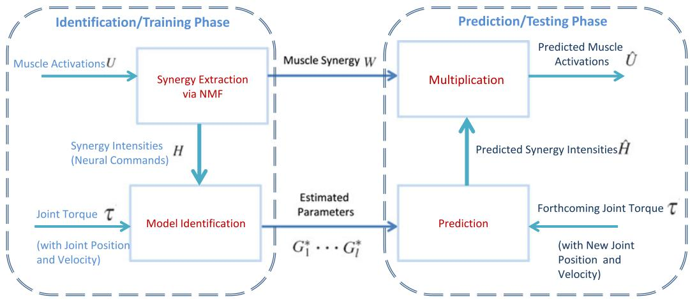
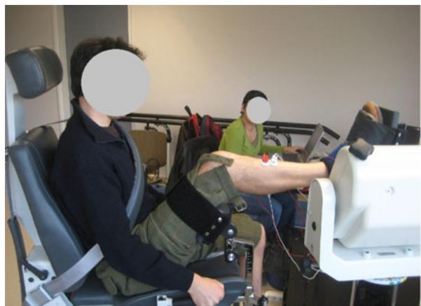
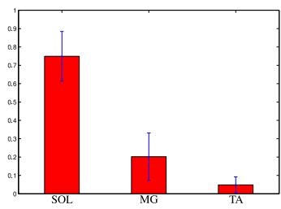
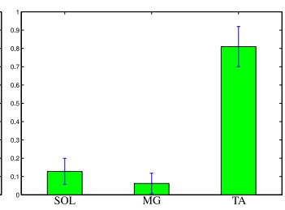
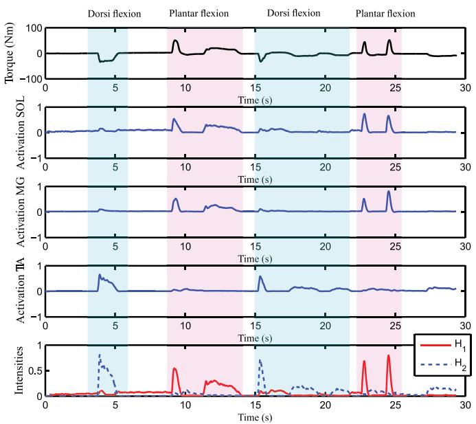
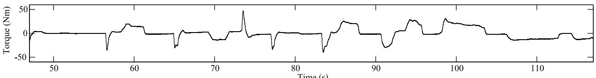
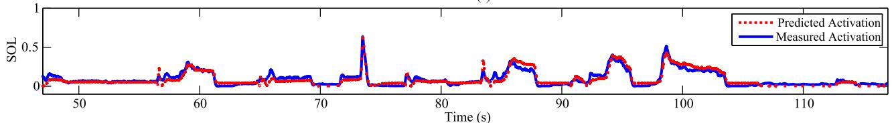
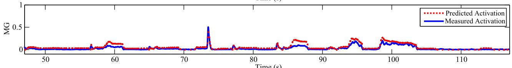
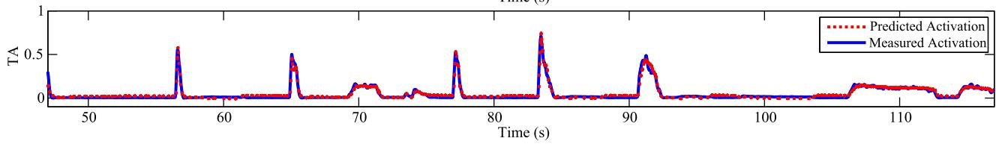
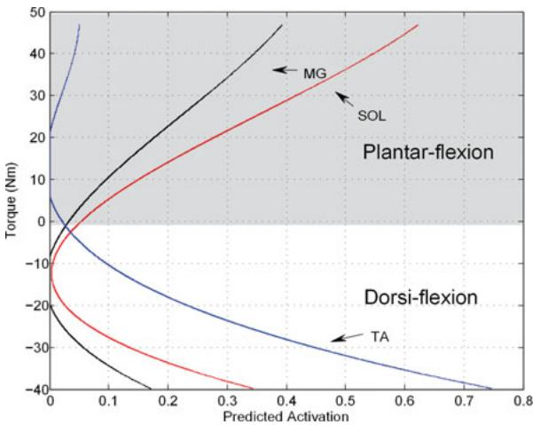

# 基于肌肉协同提取的关节力矩多肌肉激活度逆向估计

Zhan Li, David Guiraud, Member, IEEE, and Mitsuhiro Hayashibe, Senior Member, IEEE

摘要—人体运动是由多块肌肉收缩的协同组合产生的。由相关的多肌肉活动可以估计出所产生的关节运动，这一过程被表述为正向问题。神经假体应用可受益于主动肌与拮抗肌肌对的共同收缩，以实现更加稳定和稳健的关节运动。因此，有必要从期望的关节力矩中估计每块独立肌肉的激活度，这就是逆向问题。针对单自由度任务，本文提出了一种基于协同的从关节运动逆向估计多肌肉激活度的方法。该方法包括通过非负矩阵分解（nonnegative matrix factorization）算法提取肌肉协同。基于十名健全受试者的实验数据进行了交叉验证，以评估该方法的预测精度。结果表明，该方法成功地从给定的关节力矩序列中逆向估计出了多肌肉活动。此外，采用留一交叉验证的方式，将其他受试者的平均协同比例应用于肌肉激活度估计，在所有受试者中获得了 9.3% 的估计误差。所得结果为基于通用肌肉协同的神经假体控制概念提供了支持。

索引词—肌电图（EMG），逆向问题，肌肉激活度，肌肉协同。

## I. 引言

在世界各地的老龄化社会中，需要康复、辅助和神经假体（neuroprosthetics）的患者日益增加。降低老龄化社会的预期医疗保健成本确实是一个关键问题 [1]。先进计算方法在运动康复中所能带来的社会效益将十分显著，因为借助神经假体恢复肌肉运动能力有助于改善运动功能障碍患者在日常活动中的生活质量。冗余的肌肉收缩产生人体多关节的协调运动。研究运动协调对于探究多肌肉激活之间的最优化关系至关重要。在肌肉协调研究中，收缩肌肉的电活动可以通过肌电图（electromyography，EMG）进行测量，处理后的 EMG 信号通常用于表示肌肉激活度 [2]。由于 EMG 与关节运动高度相关，肌群引起的关节运动可以从正向和逆向两个角度进行双向分析。正向问题包括从多肌肉激活中确定合成关节力矩，在过去的几十年中，学者们提出了多项研究以建立 EMG 与关节力矩之间的正向关系 [3]–[7]。例如，Clancy 等人 [4], [5] 总结了几种基于多路伸肌和屈肌 EMG 信号的基础正向线性和非线性模型，用以估计恒定姿势下的肘关节力矩。Sinkjaer 等人 [6] 测量了伸肌和屈肌，以追踪不同收缩水平下的踝关节力矩。Kent [7] 应用神经遗传方法（neurogenetic method）建立了从 EMG 到踝关节力矩的非线性映射。明确 EMG 与关节运动之间的正向关系，有助于通过 EMG 驱动的方法确定受试者针对目标运动的力学意图，从而为某些康复应用提供支持，例如人机交互机器人 [8]、假肢 [9] 或外骨骼 [10] 的控制。

相反，在基于功能性电刺激（FES）的神经假体（neuroprosthetics）领域 [11], [12]，必须确定用于关节运动的肌群活动以满足期望的关节力矩，这被表述为一个逆问题。由于相关关节固有的肌肉冗余性，该逆问题包含不定解，且在单一自由度（DOF）与跨越该关节的共收缩肌肉之间不存在双射关系。可以尝试应用数据库技术从运动中恢复/估计肌肉活动 [13]。针对这一目标，肌肉协同（muscle synergy）是一个有用且富有洞察力的概念，可用于研究共收缩及其之间的协调模式 [14]。从生理学意义上讲，肌肉协同揭示了中枢神经系统（CNS）如何以协调的方式募集冗余肌群。它可以通过降维技术从多肌肉激活中获取，旨在将较高维的信号空间缩减为较低维的特征空间。

通常，目前大多数 FES 系统针对每个 DOF 仅激活一个主动肌群。然而，与仅刺激单块肌肉相比，如果能通过激活多块肌肉来分散所需承受的力，将有助于最大程度地减少快速疲劳——这是 FES 系统中常见的临床问题。为了协助未来具备多肌肉分布式控制能力的 FES 系统设计，可以利用肌肉协同信息来自然地遵循 CNS 的调节方式，并充分优化利用肌肉冗余性 [15]– [18]。通过从健康受试者中提取肌肉协同信息，并同时测量相应的动力学/运动学数据，可以深入了解单个肌肉对关节屈肌/伸肌的贡献。随后，从健康受试者中提取的协同信息连同其关节力矩数据，可用于为部分功能受损肌肉仍保留自主收缩能力的不完全性脊髓损伤受试者设计多肌肉刺激模式 [18]。经皮 FES 中的募集顺序呈非生理学方式，与自然自主收缩相比，这会导致更快的肌肉疲劳 [19]。在 FES 中采用多个冗余肌肉激活，可以通过拮抗肌的共收缩来促进减少受刺激肌肉的疲劳并提高关节连接的稳定性 [20]。深入理解健全受试者中多肌肉激活如何协同产生期望的关节力矩序列，将有助于减少对瘫痪患者耗时的经验性 FES 调试 [21]。因此，多肌肉激活的计算逆向估计在 FES 应用中具有广泛的研究价值，并将有助于进一步阐明潜在的生理过程，这也是本项研究的主要动机。

  
Fig. 1. 从关节运动逆向估计多肌肉激活度过程的原理框图。

在我们前期的工作 [22], [23] 中，提出了一种基于多元回归的高效方法，用于从踝关节运动逆向估计三种肌肉的激活度。该方法在不提取协同模式的情况下分别估计多种肌肉的激活度。然而，为了进一步研究自然的肌肉共收缩（cocontraction）模式，可能有必要在等长和等张收缩期间的不同关节屈曲/伸展状态下提取主动肌群和拮抗肌群的肌肉协同（muscle synergy）。“等长”（Isometric）意味着在关节角度保持不变时肌肉发生收缩，而“等张”（isotonic）是指伴随关节角度（肌肉长度）改变但在恒定张力下发生的肌肉收缩。举起物体时的运动就是日常生活中经常采用的等张收缩的一个例子。在本文中，我们提出了一种基于协同的框架，用于从关节力矩逆向估计多肌肉激活度。该方法包括两个连续的步骤：肌肉协同提取，以及协同强度与关节力矩之间的多项式模型辨识。如果具备肌肉协同的先验知识，就能够在不同的肌肉激活水平下控制关节力矩，这表明基于协同辅助的估计器可作为利用 FES（功能性电刺激）进行关节力矩控制的潜在应用。我们在十名健全受试者身上完成了实验验证，受试者在等长和等张条件下围绕踝关节进行随机自主收缩。该方法成功实现了从踝关节逆向估计三种肌肉的激活度，并提供了跖屈和背屈期间的肌肉共收缩信息。

本文的组织结构如下：第二节介绍了实验设置以及肌肉激活度逆向估计的方法。第三节展示了验证结果与讨论。第四节给出了详细讨论。第五节得出了最终结论。

## II. 材料与方法

整个逆向估计过程的总体原理图如 Fig. 1 所示。首先，通过非负矩阵分解（NMF）从多肌肉激活度中提取肌肉协同和协同强度。其次，在提取的协同强度与相应的关节运动之间进行模型辨识。为了进行预测（交叉验证），仅使用关节力矩信息（在非等长情况下还结合关节位置和速度信息），通过辨识出的模型来预测肌肉激活度。

## A. 实验设置与数据处理

在征得受试者同意的情况下，从十名健全受试者（七名男性和三名女性，年龄 $2 8 . 5 \pm 3$ 岁，体重 $6 7 . 5 \pm 8 . 8$ kg，身高 $1 7 0 . 7 \pm 6 . 1$ cm）处采集了 EMG 和关节力矩数据。该研究已获得由 CHRU Montpelier 管理的人员保护伦理委员会的批准（2011-A01033-38），专门用于 ANR SoHuSim 项目框架下的下肢生物力学研究。实验装置如图 Fig. 2 所示。受试者坐在椅子上，右脚固定在 Biodex Dynamometer（Biodex Medical Systems Inc., Shirley, NY, USA）上。踝关节角度设置为 $9 0 ^ { \circ }$，膝关节设置为 $1 1 0 ^ { \circ }$，同时关节中心与测力计的轴线对齐。骨盆和肩部使用束带将受试者的位置固定在椅子上。大腿的运动也通过束带进行了限制。根据 SENIAM 关于基于小腿解剖结构的电极放置建议 [24]，将 EMG 电极放置在 SOL（比目鱼肌）、MG（腓肠肌内侧头）和 TA（胫骨肌）的肌腹上。双极 $\mathrm { A g C l }$ EMG 电极（半径为 2-cm 的圆形）沿肌纤维方向排列，电极间距为 20-mm。参考电极放置在对侧腿的髌骨上。受试者被要求在跖屈和背屈方向上各进行两次最大自主收缩（MVC）。随后，他们被要求随机自主进行踝关节跖屈和背屈运动，包括两个方向的收缩以及快速短暂（1–2 s）和缓慢持久（>2 s）的收缩。随机实验环节持续约 2–3 min，包含约 8–20 次随机收缩，在等长条件下重复两次，在等张条件下重复另外两次。关节力矩和差分 EMG 信号的同步采集由 EMG100c 放大器（增益 1000）和 Biopac MP100 系统（Biopac Systems, Inc., Santa Barbara, CA, USA）执行，采样频率为 2048 Hz。Biopac EMG100c 硬件具有截止频率为 1-Hz 的高通滤波器。采集完成后，对原始 EMG 信号进行整流，并使用截止频率为 2-Hz 的低通滤波器进行滤波。接下来，将处理后的 EMG 信号分别根据肌肉各自的 MVC 值进行比例缩放，并进行归一化以表示肌肉激活度 $U \in [ 0 1 ]$。在每个实验环节中采集的数据被分为两个阶段，比例约为 2:3，即一个是辨识（训练）阶段，另一个是预测（测试）阶段。每个阶段均包含一系列由受试者随机产生的快速短暂和缓慢持久的收缩。

  
Fig. 2. 其中一名受试者的实验装置。EMG（肌电图）采集系统的电极放置在肌肉（SOL、MG 和 TA）上。各 EMG 信号与踝关节力矩测量同步采集。

## B. 肌肉协同提取

考虑在辨识时间段 $[ 0 , t _ { i d } ]$ 内 SOL、MG 和 TA 肌肉的多肌肉激活度 uSOL、uMG 和 uTA（此处使用这些肌肉的符号进行说明，但它们也可以是参与关节运动的任何其他肌群组合）。

$$
U = \left[ \begin{array}{c} u _ {\mathrm{SOL}} \\ u _ {\mathrm{MG}} \\ u _ {\mathrm{TA}} \end{array} \right] = \left[ \begin{array}{c c c c} u _ {\mathrm{SOL}} (0) & u _ {\mathrm{SOL}} (1) & \ldots & u _ {\mathrm{SOL}} (t _ {i d}) \\ u _ {\mathrm{MG}} (0) & u _ {\mathrm{MG}} (1) & \ldots & u _ {\mathrm{MG}} (t _ {i d}) \\ u _ {\mathrm{TA}} (0) & u _ {\mathrm{TA}} (1) & \ldots & u _ {\mathrm{TA}} (t _ {i d}) \end{array} \right],\tag{1}
$$

可以使用 NMF 对 U 进行分解，如下式所示 [14]：

$$
U = W H + E \approx W H\tag{2}
$$

其中 W 表示肌肉协同比例矩阵，H 表示提取的协同强度向量（神经指令），E 为分解残差项。用于更新 H 和 W 的元素 $h _ { l m }$ 与 $w _ { n l }$ 的分解过程通过以下迭代算法进行 [14]：

$$
h _ {l m} \leftarrow h _ {l m} \frac {[ W ^ {T} U ] _ {l m}}{[ W ^ {T} W H ] _ {l m}}\tag{3}
$$

$$
w _ {n l} \leftarrow w _ {n l} \frac {[ U H ^ {T} ] _ {n l}}{[ W H H ^ {T} ] _ {n l}}.\tag{4}
$$

此处需要指出的是，对于单 DOF（自由度）的踝关节矢状面运动，存在两种关节活动类型：跖屈和背屈 [6], [20]。因此，针对单 DOF，对应于关节的屈曲和伸展，肌肉协同的数量可最终确定为两个，即在本研究中降维后的合成子空间维度选择为 l = 2。

## C. 辨识

通过驱动不同水平的肌肉协同强度，可以实现不同的关节力矩水平。为此，首先在关节力矩与协同强度之间建立辨识模型。在文献 [4], [5], [25] 中，激活度到力矩（ui 到 τ ）的正向映射被描述为通用的非线性形式 $f _ { i } ( \cdot ) , i \in \{ \mathrm { S O L } , \mathrm { M G } , \mathrm { T A } \}$：

$$
\tau = \sum_ {i} f _ {i} (u _ {i}).
$$

这表明存在从力矩到激活度的非线性关系。在本文中，我们假设这种逆关系可以表示为以下通用非线性形式 $g _ { i } ( \cdot )$：

$$
u _ {i} = g _ {i} (\tau).
$$

根据 (2) 和上述非线性关系，这三种肌肉的激活度可以重写为

$$
\left[ \begin{array}{c} u _ {\text {SOL}} \\ u _ {\text {MG}} \\ u _ {\text {TA}} \end{array} \right] = \left[ \begin{array}{c} g _ {\text {SOL}} (\tau) \\ g _ {\text {MG}} (\tau) \\ g _ {\text {TA}} (\tau) \end{array} \right] \approx W \left[ \begin{array}{c} H _ {1} \\ \vdots \\ H _ {l} \end{array} \right].\tag{5}
$$

在解析上，提取的协同强度向量为

$$
\left[ \begin{array}{c} H _ {1} \\ \vdots \\ H _ {l} \end{array} \right] \approx W ^ {\dagger} \left[ \begin{array}{c} g _ {\mathrm{SOL}} (\tau) \\ g _ {\mathrm{MG}} (\tau) \\ g _ {\mathrm{TA}} (\tau) \end{array} \right]\tag{6}
$$

其中 $W ^ { \dagger }$ 是肌肉协同矩阵 W 的 Moore–Penrose 伪逆 [26]。因此，每个单独的协同强度向量通常可以估计如下：

$$
\begin{array}{c} \tilde {H} _ {1} = G _ {1} ^ {*} \Phi_ {i d} \\ \vdots \\ \tilde {H} _ {l} = G _ {l} ^ {*} \Phi_ {i d} \end{array}\tag{7}
$$

其中

$$
\Phi_ {i d} = \left[ \begin{array}{c c c c c} \tau_ {0} & \tau_ {0} & \tau_ {0} & \ldots & \tau_ {0} \\ \tau (0) & \tau (1) & \tau (2) & \ldots & \tau (t _ {i d}) \\ \tau^ {2} (0) & \tau^ {2} (1) & \tau^ {2} (2) & \ldots & \tau^ {2} (t _ {i d}) \\ \vdots & \vdots & \vdots & \ddots & \vdots \\ \tau^ {q} (0) & \tau^ {q} (1) & \tau^ {q} (2) & \ldots & \tau^ {q} (t _ {i d}) \end{array} \right]
$$

在等长情况下

$$
o r \Phi_ {i d} = \left[ \begin{array}{c c c c c} \tau_ {0} & \tau_ {0} & \tau_ {0} & \ldots & \tau_ {0} \\ \tau (0) & \tau (1) & \tau (2) & \ldots & \tau (t _ {i d}) \\ \tau^ {2} (0) & \tau^ {2} (1) & \tau^ {2} (2) & \dots & \tau^ {2} (t _ {i d}) \\ \vdots & \vdots & \vdots & \ddots & \vdots \\ \tau^ {q} (0) & \tau^ {q} (1) & \tau^ {q} (2) & \ldots & \tau^ {q} (t _ {i d}) \\ p (0) & p (1) & p (2) & \dots & p (t _ {i d}) \\ v (0) & v (1) & v (2) & \ldots & v (t _ {i d}) \end{array} \right]
$$

在等张情况下

且估计的参数为

$$
\begin{array}{c} G _ {1} ^ {*} = H _ {1} \Phi_ {i d} ^ {\dagger} \\ \vdots \\ G _ {l} ^ {*} = H _ {l} \Phi_ {i d} ^ {\dagger} \end{array}\tag{8}
$$

其中 $\Phi _ { i d } ^ { \dagger }$ 是 $\Phi _ { i d }$ 的 Moore–Penrose 伪逆，$\tau _ { 0 }$ 表示基线关节力矩值，而 $p ( \cdot )$ 和 $v ( \cdot )$ 分别表示关节位置和速度信息。

## D. 肌肉激活度预测

肌肉协同强度与关节力矩之间关系的非线性模型参数 $G _ { 1 } ^ { * } , \ldots , G _ { l } ^ { * }$ 在辨识阶段确定。在预测时间段 $[ t _ { i d } + 1 , t ]$ 内的预测阶段，仅使用即将到来的关节力矩信息（以及关节位置和速度信息）来评估模型的预测能力，以此对辨识出的模型进行交叉验证。预测的各个协同强度由下式得出：

$$
\begin{array}{c} \hat {H} _ {1} = G _ {1} ^ {*} \Phi_ {p r} \\ \vdots \\ \hat {H} _ {l} = G _ {l} ^ {*} \Phi_ {p r} \end{array}\tag{9}
$$

其中

$$
\Phi_ {p r} = \left[ \begin{array}{c c c c} \tau_ {0} & \tau_ {0} & \ldots & \tau_ {0} \\ \tau (t _ {i d} + 1) & \tau (t _ {i d} + 2) & \ldots & \tau (t) \\ \tau^ {2} (t _ {i d} + 1) & \tau^ {2} (t _ {i d} + 2) & \ldots & \tau^ {2} (t) \\ \vdots & \vdots & \ddots & \vdots \\ \tau^ {q} (t _ {i d} + 1) & \tau^ {q} (t _ {i d} + 2) & \ldots & \tau^ {q} (t) \end{array} \right]   \text { in   isometric   case }
$$

$$
o r \Phi_ {p r} = \left[ \begin{array}{c c c c} \tau_ {0} & \tau_ {0} & \ldots & \tau_ {0} \\ \tau (t _ {i d} + 1) & \tau (t _ {i d} + 2) & \ldots & \tau (t) \\ \tau^ {2} (t _ {i d} + 1) & \tau^ {2} (t _ {i d} + 2) & \ldots & \tau^ {2} (t) \\ \vdots & \vdots & \ddots & \vdots \\ \tau^ {q} (t _ {i d} + 1) & \tau^ {q} (t _ {i d} + 2) & \ldots & \tau^ {q} (t) \\ p (t _ {i d} + 1) & p (t _ {i d} + 2) & \ldots & p (t) \\ v (t _ {i d} + 1) & v (t _ {i d} + 2) & \ldots & v (t) \end{array} \right]   \text {in isotonic case.}
$$

根据原始的肌肉激活度分解公式 (2)，每个受试者的预测肌肉激活度可表示为

$$
\hat {U} \approx W \hat {H}.\tag{10}
$$

处理冗余肌肉组合的能力在神经假体系统控制中具有实际应用价值。重要的是，如何利用个体化辨识模型，根据目标任务定量地逆向生成多肌肉激活度，以跟踪所需的关节力矩序列（结合关节位置和速度信息）。

## III. 结果

在本节中，我们展示了基于从十名健全受试者处采集的实验数据，采用上述方法获得的逆向估计/预测结果。在辨识/训练阶段，通过 NMF（非负矩阵分解）算法在辨识时间段 $[ 0 , t _ { i d } ]$ 内提取肌肉协同和激活强度。随后通过公式 (8) 估计映射踝关节力矩与协同强度的参数 $G _ { 1 } ^ { * } , G _ { 2 } ^ { * }$ 2。在预测/测试阶段，仅以未来的踝关节力矩信息作为唯一输入，进一步预测肌肉激活度。评估在等长和等张条件下均进行，以展示在静态和动态情况下的预测性能。

所有十名受试者的肌肉协同均从相应的一对跖屈和背屈运动中的肌肉激活记录中提取。为了定量评估每块肌肉对这些跖屈和背屈合力矩的贡献，每个协同对 l 的归一化协同比例定义如下。

$$
\begin{array}{l} \text {Ratio} _ {\text {SOL}} = \frac {w _ {1 l}}{w _ {1 l} + w _ {2 l} + w _ {3 l}} \\ \text {Ratio} _ {\text {MG}} = \frac {w _ {2 l}}{w _ {1 l} + w _ {2 l} + w _ {3 l}} \\ \text {Ratio} _ {\text {TA}} = \frac {w _ {3 l}}{w _ {1 l} + w _ {2 l} + w _ {3 l}}. \end{array}
$$

授权许可使用受限于：中南民族大学（South-Central Minzu University）。于 2026 年 10 月 1 日 09:36:43 UTC 从 IEEE Xplore 下载。受相关限制条款约束。

  
(a)

  
(b)

Fig. 3. 十名健全受试者所获得的肌肉协同及其标准差。图中展示了归一化肌肉协同比例的均值。(a) 跖屈时的协同比例模式。(b) 背屈时的协同比例模式。  
  
Fig. 4. 从上至下依次为：(a) 踝关节力矩，(b) SOL 激活度，(c) MG 激活度，(d) TA 激活度，以及 (e) 通过 NMF 从肌肉激活度 U 中提取的协同强度分量 $H _ { 1 }$ 和 $H _ { 2 }$。请注意正力矩周期与负力矩周期之间肌肉激活的随机模式，它们分别对应于跖屈和背屈。

Fig. 3 展示了十名受试者归一化协同比例的均值与标准差，呈现出受试者三块肌肉的两种不同类型的肌肉协同。

Fig. 3(a) 表明 SOL（比目鱼肌）是驱动踝关节跖屈的主要主动肌，而 Fig. 3(b) 表明 TA（胫骨前肌）是踝关节背屈的主要主动肌。在两个屈曲方向上均可观察到主动肌与拮抗肌的共同收缩。为了进行更详细的观察，我们以受试者 V1 为例进行说明，如 Fig. 4 所示。从三块肌肉的肌肉激活度中提取出的两个协同强度（神经指令）向量 $H _ { 1 }$ 和 $H _ { 2 }$ 分别对应于协同 1 和协同 2。在 Fig. 4 中，可以直观地观察到，正踝关节力矩（即跖屈力矩）与协同强度 $H _ { 1 }$ 高度相关，而负踝关节力矩（即背屈力矩）与协同强度 $H _ { 2 }$ 高度相关。由于提取的协同强度是神经指令的直接反映 [14]，这可能表明 CNS（中枢神经系统）可能通过分别激活两组不同的肌肉组合来发放两种不同的神经指令，从而控制关节的伸展与屈曲。

为了评估这种基于协同的方法（synergy-based approach）的预测/测试性能，在十名受试者中通过交叉验证展示了多肌肉激活的逆向估计。在我们先前的研究 [22], [23] 中，多元回归方法对于多肌肉激活的逆向估计是有效的。多元回归分析不进行降维。为了对比基于协同的方法与上述多元回归方法之间的评估结果，此处也给出了使用多元回归方法 [22], [23] 的预测结果。为了评估预测（交叉验证）的全局性能，我们将以下均方根误差（RMSE）和方差解释率（VAF）定义为性能指标：

$$
\begin{array}{c} \mathrm{RMSE} _ {i d} = \sqrt {\frac {\| \tilde {U} _ {i} - U _ {i , \mathrm{m}} \| ^ {2}}{N _ {i d}}}, \mathrm{RMSE} _ {p r} = \sqrt {\frac {\| \hat {U} _ {i} - U _ {i , \mathrm{m}} \| ^ {2}}{N _ {p r}}} \\ \mathrm{VAF} = 1 - \frac {\operatorname{var} (\hat {U} _ {i} - U _ {i , \mathrm{m}})}{\operatorname{var} (U _ {i , \mathrm{m}})}, \quad i \in \{\text {SOL}, \text {MG}, \text {TA} \} \end{array}
$$

其中 $U _ { i , \mathrm { m } }$ 表示肌肉 i 的测量激活向量，$N _ { i d }$ 和 $N _ { p r }$ 分别表示辨识阶段和预测阶段的采样点数。

图 5 说明了受试者 V1 的等长收缩情况。辨识在 0 s 至约 47 s 的时间段内完成，从 47 s 开始，仅提供辨识出的模型以及接下来的踝关节力矩信息来进行肌肉激活预测。从图 5 中我们可以看到，从 47 s 到结束，三块肌肉的预测肌肉激活程度与测量值均吻合良好。即使背屈和跖屈随机包含短期（1–2 s）和长期 $( > 2 \ \mathrm { s } )$ 收缩，所提出的方法也能以高精度根据踝关节运动生成相应的多肌肉激活。表 I 呈现了更详细的调查结果，列出了在等长条件下通过基于协同的方法和多元回归方法 [22], [23] 进行肌肉激活估计的 RMSE 和 VAF。对于等长条件下基于协同方法的交叉验证，RMSE 约为 $4 . 0 3 \pm 2 . 3 1$，VAF 约为 $8 2 . 6 0 \pm 1 3 . 2 5$；而多元回归方法的 RMSE 约为 $4 . 2 0 \pm 2 . 6 0$，VAF 约为 $8 2 . 1 5 \pm 1 5 . 0 0$。从这一对比中可以看出，基于协同的方法与多元回归方法一样，成功地逆向估计了多肌肉激活。

通过互相关度量对两种方法的误差进行相似性分析所获得的 p 值小于 0.05，表明它们具有高度相似性。这表明，尽管在肌肉协同提取后进行了降维，基于协同的方法与多元回归方法仍具有相同的估计质量。我们还使用这两种方法估计了等张条件下的三种肌肉激活度。在这种情况下，关节位置和速度也被纳入反向估计中，以考虑力-长度-速度关系引起的肌肉响应变化。Table II 显示两种方法在等张条件下的表现相似，表明在等张条件下基于协同的方法在估计质量上与多元回归方法相似（通过相似性分析得出 p-value $< 0 . 0 5$）。在 Table II 中，括号内的数值表示未包含关节位置和速度信息时的反向估计性能结果，而括号外的数值则是考虑了关节位置和速度信息的结果。我们可以看到，在等张情况下，通过纳入踝关节位置和速度信息，两种方法的反向估计均有所改善（即更小的 RMSE 和更大的 VAF）。尽管额外的关节位置和速度信息可以改善反向估计，但未观察到均值之间存在显著的统计学差异（通过单因素方差分析 (ANOVA) 得出 p-value > 0.05）。

  
Fig. 5. 受试者 V1 的交叉验证：从大约 $t = 4 7 \mathrm { ~ s ~ }$ 开始，利用辨识出的模型和输入的关节力矩进行预测。红色虚线表示预测的激活度，蓝色实线表示测量的激活度。基线下方和上方的力矩分别表示背屈和跖屈。

TABLE I  
十位受试者在等长条件下的估计肌肉激活度 RMSE (%) 与 VAF (%)

<table><tr><td colspan="2">方法</td><td colspan="3">基于协同的方法</td><td colspan="3">多元回归方法 [22], [23]</td></tr><tr><td colspan="2">特征曲线</td><td> $RMSE_{id}$ </td><td> $RMSE_{pr}$ </td><td>VAF</td><td> $RMSE_{id}$ </td><td> $RMSE_{pr}$ </td><td>VAF</td></tr><tr><td rowspan="3">V1</td><td>SOL</td><td>4.14</td><td>3.82</td><td>82.78</td><td>3.75</td><td>3.83</td><td>82.75</td></tr><tr><td>MG</td><td>3.83</td><td>3.83</td><td>58.36</td><td>2.67</td><td>3.08</td><td>58.66</td></tr><tr><td>TA</td><td>3.18</td><td>2.68</td><td>92.70</td><td>3.18</td><td>2.65</td><td>92.80</td></tr><tr><td rowspan="3">V2</td><td>SOL</td><td>6.55</td><td>5.47</td><td>70.13</td><td>6.55</td><td>5.69</td><td>65.51</td></tr><tr><td>MG</td><td>2.51</td><td>1.90</td><td>66.80</td><td>2.49</td><td>1.55</td><td>75.27</td></tr><tr><td>TA</td><td>4.55</td><td>4.19</td><td>93.45</td><td>4.55</td><td>4.15</td><td>93.55</td></tr><tr><td rowspan="3">V3</td><td>SOL</td><td>3.31</td><td>4.27</td><td>79.66</td><td>2.95</td><td>4.03</td><td>83.80</td></tr><tr><td>MG</td><td>7.32</td><td>4.54</td><td>72.26</td><td>6.82</td><td>4.97</td><td>34.68</td></tr><tr><td>TA</td><td>3.33</td><td>3.03</td><td>91.84</td><td>3.29</td><td>2.90</td><td>92.62</td></tr><tr><td rowspan="3">V4</td><td>SOL</td><td>4.95</td><td>5.09</td><td>83.94</td><td>5.11</td><td>5.41</td><td>81.33</td></tr><tr><td>MG</td><td>3.73</td><td>3.77</td><td>84.98</td><td>3.82</td><td>4.10</td><td>81.45</td></tr><tr><td>TA</td><td>3.82</td><td>6.07</td><td>94.93</td><td>3.27</td><td>6.53</td><td>94.54</td></tr><tr><td rowspan="3">V5</td><td>SOL</td><td>3.14</td><td>3.16</td><td>67.09</td><td>3.14</td><td>3.16</td><td>61.09</td></tr><tr><td>MG</td><td>0.49</td><td>0.50</td><td>71.13</td><td>0.41</td><td>0.45</td><td>75.55</td></tr><tr><td>TA</td><td>4.69</td><td>7.49</td><td>95.98</td><td>4.69</td><td>7.49</td><td>95.99</td></tr><tr><td rowspan="3">V6</td><td>SOL</td><td>7.39</td><td>7.73</td><td>60.72</td><td>6.85</td><td>9.29</td><td>57.21</td></tr><tr><td>MG</td><td>5.36</td><td>5.36</td><td>45.37</td><td>3.33</td><td>5.32</td><td>63.98</td></tr><tr><td>TA</td><td>5.19</td><td>5.19</td><td>93.72</td><td>5.10</td><td>5.87</td><td>93.66</td></tr><tr><td rowspan="3">V7</td><td>SOL</td><td>4.55</td><td>4.79</td><td>90.56</td><td>4.55</td><td>4.80</td><td>90.56</td></tr><tr><td>MG</td><td>0.87</td><td>0.77</td><td>84.32</td><td>0.86</td><td>0.69</td><td>85.92</td></tr><tr><td>TA</td><td>0.85</td><td>0.90</td><td>94.80</td><td>0.85</td><td>0.90</td><td>94.79</td></tr><tr><td rowspan="3">V8</td><td>SOL</td><td>0.58</td><td>0.63</td><td>90.74</td><td>0.58</td><td>0.63</td><td>90.76</td></tr><tr><td>MG</td><td>0.16</td><td>0.31</td><td>73.30</td><td>0.16</td><td>0.29</td><td>76.14</td></tr><tr><td>TA</td><td>1.96</td><td>2.04</td><td>94.29</td><td>1.96</td><td>2.04</td><td>94.28</td></tr><tr><td rowspan="3">V9</td><td>SOL</td><td>5.86</td><td>6.56</td><td>86.72</td><td>4.72</td><td>8.22</td><td>82.26</td></tr><tr><td>MG</td><td>6.02</td><td>3.16</td><td>93.43</td><td>5.93</td><td>3.66</td><td>94.12</td></tr><tr><td>TA</td><td>3.07</td><td>4.02</td><td>95.80</td><td>3.06</td><td>3.82</td><td>96.42</td></tr><tr><td rowspan="3">V10</td><td>SOL</td><td>5.03</td><td>9.09</td><td>88.31</td><td>4.88</td><td>8.04</td><td>90.89</td></tr><tr><td>MG</td><td>3.23</td><td>7.71</td><td>86.16</td><td>2.41</td><td>9.61</td><td>89.61</td></tr><tr><td>TA</td><td>2.66</td><td>3.03</td><td>93.86</td><td>2.66</td><td>2.92</td><td>94.32</td></tr><tr><td colspan="2">总体平均</td><td>3.74 ± 1.96</td><td>4.03 ± 2.31</td><td>82.60 ± 13.25</td><td>3.48 ± 1.85</td><td>4.20 ± 2.60</td><td>82.15 ± 15.00</td></tr></table>

TABLE II  
10 名受试者在恒定跖屈载荷 10 N · M 和背屈载荷 5 N·M 的等张条件下估算肌肉激活度的 RMSE (%) 与 VAF (%)∗

<table><tr><td colspan="2">方法</td><td colspan="3">基于协同的方法</td><td colspan="3">多元回归方法 [22], [23]</td></tr><tr><td colspan="2">曲线</td><td> $RMSE_{id}$ </td><td> $RMSE_{pr}$ </td><td>VAF</td><td> $RMSE_{id}$ </td><td> $RMSE_{pr}$ </td><td>VAF</td></tr><tr><td rowspan="3">V1</td><td>SOL</td><td>1.44 (1.53)</td><td>4.90 (5.12)</td><td>79.44 (77.75)</td><td>1.43 (1.53)</td><td>4.93 (5.12)</td><td>79.15 (77.77)</td></tr><tr><td>MG</td><td>0.98 (1.15)</td><td>4.59 (4.83)</td><td>44.14 (37.99)</td><td>0.95 (1.15)</td><td>4.52 (4.84)</td><td>45.74 (37.72)</td></tr><tr><td>TA</td><td>2.28 (2.96)</td><td>5.66 (6.90)</td><td>92.66 (89.13)</td><td>2.47 (3.21)</td><td>6.14 (7.48)</td><td>92.66 (89.14)</td></tr><tr><td rowspan="3">V2</td><td>SOL</td><td>7.86 (7.90)</td><td>16.69 (16.69)</td><td>61.69 (61.96)</td><td>7.83 (7.89)</td><td>16.66 (16.65)</td><td>61.66 (62.06)</td></tr><tr><td>MG</td><td>5.64 (5.72)</td><td>11.83 (11.91)</td><td>56.07 (55.53)</td><td>5.52 (5.70)</td><td>11.61 (11.91)</td><td>57.68 (55.48)</td></tr><tr><td>TA</td><td>7.86 (10.84)</td><td>12.28 (14.97)</td><td>78.03 (68.24)</td><td>7.80 (10.83)</td><td>12.29 (14.98)</td><td>77.99 (68.19)</td></tr><tr><td rowspan="3">V3</td><td>SOL</td><td>3.17 (3.67)</td><td>4.22 (3.66)</td><td>59.65 (71.97)</td><td>2.99 (3.52)</td><td>3.78 (3.17)</td><td>65.58 (76.65)</td></tr><tr><td>MG</td><td>4.77 (5.54)</td><td>6.55 (6.74)</td><td>75.14 (74.34)</td><td>4.65 (5.44)</td><td>6.58 (6.74)</td><td>77.62 (77.21)</td></tr><tr><td>TA</td><td>8.72 (10.73)</td><td>11.63 (12.71)</td><td>81.86 (78.45)</td><td>8.72 (10.73)</td><td>11.53 (12.28)</td><td>82.00 (78.59)</td></tr><tr><td rowspan="3">V4</td><td>SOL</td><td>5.18 (5.29)</td><td>7.33 (7.57)</td><td>70.54 (69.14)</td><td>5.14 (5.29)</td><td>7.42 (7.50)</td><td>69.66 (69.50)</td></tr><tr><td>MG</td><td>4.01 (3.97)</td><td>5.97 (5.91)</td><td>69.09 (69.82)</td><td>3.93 (3.96)</td><td>5.74 (5.98)</td><td>71.57 (69.27)</td></tr><tr><td>TA</td><td>4.40 (5.49)</td><td>5.79 (5.04)</td><td>87.35 (90.05)</td><td>4.40 (5.49)</td><td>5.79 (5.03)</td><td>87.31 (90.06)</td></tr><tr><td rowspan="3">V5</td><td>SOL</td><td>14.03 (14.19)</td><td>12.95 (13.12)</td><td>87.33 (86.88)</td><td>14.76 (14.96)</td><td>13.17 (13.44)</td><td>85.37 (84.84)</td></tr><tr><td>MG</td><td>3.25 (3.10)</td><td>3.59 (3.47)</td><td>84.45 (85.43)</td><td>2.56 (2.71)</td><td>3.46 (3.57)</td><td>85.19 (83.83)</td></tr><tr><td>TA</td><td>9.57 (11.12)</td><td>12.17 (12.50)</td><td>92.68 (91.77)</td><td>12.26 (13.44)</td><td>20.10 (21.85)</td><td>92.57 (91.50)</td></tr><tr><td rowspan="3">V6</td><td>SOL</td><td>9.39 (11.27)</td><td>10.34 (10.63)</td><td>64.30 (63.97)</td><td>9.36 (11.83)</td><td>10.71 (10.94)</td><td>56.07 (55.11)</td></tr><tr><td>MG</td><td>9.01 (9.63)</td><td>7.14 (7.58)</td><td>81.77 (79.18)</td><td>9.28 (10.21)</td><td>7.52 (7.61)</td><td>81.02 (80.98)</td></tr><tr><td>TA</td><td>6.52 (16.66)</td><td>6.35 (11.67)</td><td>80.68 (35.39)</td><td>6.68 (17.10)</td><td>6.23 (12.40)</td><td>82.72 (27.91)</td></tr><tr><td rowspan="3">V7</td><td>SOL</td><td>2.94 (3.03)</td><td>4.63 (4.77)</td><td>52.64 (51.92)</td><td>2.94 (3.03)</td><td>4.65 (4.80)</td><td>53.51 (52.16)</td></tr><tr><td>MG</td><td>3.09 (3.13)</td><td>4.31 (4.36)</td><td>43.43 (43.09)</td><td>3.10 (3.13)</td><td>4.27 (4.31)</td><td>42.90 (42.83)</td></tr><tr><td>TA</td><td>3.00 (3.65)</td><td>3.16 (3.88)</td><td>78.49 (63.50)</td><td>3.02 (3.67)</td><td>3.29 (4.00)</td><td>76.47 (61.12)</td></tr><tr><td rowspan="3">V8</td><td>SOL</td><td>0.55 (0.62)</td><td>0.86 (0.92)</td><td>80.69 (78.62)</td><td>0.56 (0.63)</td><td>0.89 (0.93)</td><td>79.53 (77.90)</td></tr><tr><td>MG</td><td>0.34 (0.35)</td><td>0.20 (0.21)</td><td>79.87 (77.78)</td><td>0.33 (0.35)</td><td>0.20 (0.21)</td><td>81.06 (77.56)</td></tr><tr><td>TA</td><td>1.77 (1.86)</td><td>2.22 (2.25)</td><td>96.11 (95.80)</td><td>1.79 (1.87)</td><td>2.18 (2.23)</td><td>96.21 (95.87)</td></tr><tr><td rowspan="3">V9</td><td>SOL</td><td>8.27 (9.81)</td><td>16.07 (17.65)</td><td>49.43 (36.79)</td><td>8.15 (9.78)</td><td>16.43 (18.06)</td><td>47.27 (34.16)</td></tr><tr><td>MG</td><td>10.04 (12.48)</td><td>14.28 (16.39)</td><td>68.02 (55.25)</td><td>9.94 (12.46)</td><td>13.87 (15.98)</td><td>69.73 (57.21)</td></tr><tr><td>TA</td><td>2.49 (2.57)</td><td>3.61 (3.61)</td><td>90.92 (90.92)</td><td>2.18 (2.57)</td><td>3.55 (3.56)</td><td>91.19 (91.17)</td></tr><tr><td rowspan="3">V10</td><td>SOL</td><td>4.54 (4.55)</td><td>5.45 (4.86)</td><td>74.82 (79.66)</td><td>5.47 (5.48)</td><td>5.50 (5.46)</td><td>73.87 (74.25)</td></tr><tr><td>MG</td><td>6.14 (7.28)</td><td>8.00 (8.46)</td><td>89.88 (88.34)</td><td>6.75 (7.56)</td><td>8.17 (9.12)</td><td>89.43 (86.63)</td></tr><tr><td>TA</td><td>3.26 (3.46)</td><td>3.85 (4.13)</td><td>93.49 (92.53)</td><td>3.46 (3.72)</td><td>4.22 (4.45)</td><td>92.35 (91.46)</td></tr><tr><td>总体</td><td></td><td>5.15 ± 3.34</td><td>7.23 ± 4.42</td><td>74.82 ± 15.07</td><td>5.28 ± 3.59</td><td>7.51 ± 4.94</td><td>74.83 ± 15.03</td></tr><tr><td>平均</td><td></td><td>(6.11 ± 4.34)</td><td>(7.73 ± 4.88)</td><td>(71.37 ± 17.68)</td><td>(6.30 ± 4.57)</td><td>(8.15 ± 5.48)</td><td>(70.60 ± 18.44)</td></tr></table>

∗括号内的数值表示不含关节位置和速度信息，括号外的数值表示包含关节位置和速度信息。

表 III 展示了留一交叉验证（leave-one-out cross validation），即在等张条件下使用其他九名受试者的平均协同来进行交叉验证，以评估受试者之间在协同模式上的差异。每位受试者分别采用其他受试者的归一化平均协同比例进行各自的交叉验证，从表 III 中我们可以观察到，尽管在这种留一交叉验证中性能有所下降，但与表 II 相比，准确率的差异并不大。

## IV. 讨论

所提出的框架涉及用于从关节力矩进行逆向估计的多肌肉激活的肌肉协同提取。在该框架内，应用 NMF（非负矩阵分解）从多肌肉激活中提取肌肉协同，以获得对应于不同程度和方向的关节屈/伸的肌肉共同收缩模式。在本研究中，选择了两种协同模式来解释单自由度（one-DOF）矢状面运动的两种关节运动类型（跖屈和背屈）。类似地，对于主要关注单自由度任务的其他关节（如膝关节或肘关节）的屈曲和伸展，可以使用两种协同模式以系统的方式将肌肉群划分为屈肌群和伸肌群。提取的协同强度向量有助于分析个体相关性及其对关节空间的驱动影响。图 4 显示协同强度矩阵 H 的各个分量与关节力矩之间可以具有不同程度的相关性，即 $H _ { 1 }$ 与跖屈关节力矩高度相关，而 $H _ { 2 }$ 与背屈关节力矩高度相关。这表明 $H _ { 1 }$ 和 $H _ { 2 }$ 可能是 CNS（中枢神经系统）固有传递的双重神经指令，用于潜在控制踝关节力矩。协同强度的分析还可以进一步应用于 FES（功能性电刺激），通过调节跖屈肌和背屈肌驱动器的共同激活，在控制踝关节运动力矩的同时控制共同收缩水平和关节刚度。

TABLE III  
等张条件下基于协同方法的逆向估计 RMSE (%) 和 VAF (%)：分别应用每组其他九名受试者的归一化平均协同比例替代剩余一名受试者自身的协同进行留一交叉验证

<table><tr><td colspan="2">方法</td><td colspan="2">基于协同的方法</td></tr><tr><td colspan="2">特征曲线</td><td> $RMSE_{pr}$ </td><td>VAF</td></tr><tr><td rowspan="4">V1</td><td>SOL</td><td>7.89</td><td>50.75</td></tr><tr><td>MG</td><td>3.72</td><td>73.64</td></tr><tr><td>TA</td><td>7.99</td><td>86.27</td></tr><tr><td>SOL</td><td>22.52</td><td>42.79</td></tr><tr><td rowspan="3">V2</td><td>MG</td><td>12.97</td><td>59.96</td></tr><tr><td>TA</td><td>13.82</td><td>72.15</td></tr><tr><td>SOL</td><td>3.45</td><td>41.10</td></tr><tr><td rowspan="3">V3</td><td>MG</td><td>9.39</td><td>52.64</td></tr><tr><td>TA</td><td>11.52</td><td>76.36</td></tr><tr><td>SOL</td><td>12.21</td><td>36.57</td></tr><tr><td rowspan="3">V4</td><td>MG</td><td>8.95</td><td>61.11</td></tr><tr><td>TA</td><td>6.15</td><td>88.09</td></tr><tr><td>SOL</td><td>18.01</td><td>81.51</td></tr><tr><td rowspan="3">V5</td><td>MG</td><td>3.57</td><td>84.47</td></tr><tr><td>TA</td><td>11.87</td><td>92.36</td></tr><tr><td>SOL</td><td>10.21</td><td>59.98</td></tr><tr><td rowspan="3">V6</td><td>MG</td><td>21.64</td><td>43.79</td></tr><tr><td>TA</td><td>4.57</td><td>89.14</td></tr><tr><td>SOL</td><td>3.87</td><td>64.42</td></tr><tr><td rowspan="3">V7</td><td>MG</td><td>6.41</td><td>25.90</td></tr><tr><td>TA</td><td>3.21</td><td>74.75</td></tr><tr><td>SOL</td><td>1.28</td><td>68.09</td></tr><tr><td rowspan="3">V8</td><td>MG</td><td>0.55</td><td>39.96</td></tr><tr><td>TA</td><td>2.78</td><td>95.80</td></tr><tr><td>SOL</td><td>17.99</td><td>24.30</td></tr><tr><td rowspan="3">V9</td><td>MG</td><td>12.71</td><td>77.57</td></tr><tr><td>TA</td><td>6.39</td><td>82.16</td></tr><tr><td>SOL</td><td>6.10</td><td>84.42</td></tr><tr><td rowspan="2">V10</td><td>MG</td><td>23.55</td><td>38.30</td></tr><tr><td>TA</td><td>3.75</td><td>93.56</td></tr><tr><td colspan="2">总体均值</td><td> $9.30 \pm 6.40$ </td><td> $65.39 \pm 21.32$ </td></tr></table>

从 Fig. 4 中，如果我们再次直观地观察单个肌肉激活（EMG）层面，SOL 和 MG 的激活均与跖屈力矩高度相关。如果不进行协同提取，就没有系统的方法来定量评估主动肌之间的贡献比例，或与拮抗肌的自然协同收缩利用情况。因此，肌肉协同提取对于所提出的框架至关重要，因为单独观察肌肉激活可能不足以发现肌肉激活之间的自然相关性。从 10 名受试者获得的肌肉协同（如图 Fig. 3 所示）来看，定量分析表明 SOL 肌肉是关节跖屈过程中的主要主动肌，而 MG 肌肉则不是。考虑到每块肌肉的实际激活状态，针对 FES（功能性电刺激）诱导的肌肉建模与控制进行了疲劳跟踪与评估 [19]。作为迈向先进神经假体 [27] 的未来方向，来自健全受试者的肌肉协同信息——即由 CNS（中枢神经系统）自然分配的固有生理运动模式——应应用于设计兼顾多肌肉协同收缩的 FES 系统，以驱动不同的关节屈肌并稳定关节运动。

关于估计性能，如 Table I 和 Table II 所示，协同空间方法（synergy-space method）在逆向估计肌肉激活度方面的准确性与多元回归方法 [22], [23] 相当。在等张条件下，我们对比了包含与不包含关节位置和速度信息时的性能，以观察其影响。尽管均方根误差（RMSE）之间没有显著差异（ANOVA 检验，p-value > 0.05），但鉴于经典的肌肉长度与肌肉速度关系 [25]，我们建议在逆向估计中加入关节位置和速度信息。不包含关节角度和速度信息的估计仍然具有一定的准确性，但我们推测这是由于踝关节的运动范围较小所致。因此，我们认为对于大多数关节，通常都应考虑关节位置和速度。其实际影响可能比我们所展示的案例更大。虽然无创测量实际的肌肉长度及其速度是非常不现实的，但反映肌肉长度和速度关系的关节位置和速度却很容易获取。事实上，这一假设在功能性电刺激（FES）建模中得到了广泛应用 [28]。由于我们希望未来通过利用平均肌肉协同信息来实现神经假体肌肉控制，因此探讨是否可以将从他人处获取的协同信息平均值应用于特定受试者是很有意义的。Table II 展示了当我们用其他九名受试者的平均值替换该受试者归一化的协同比例时，逆向估计的性能结果。从表中可以看出，性能虽有一定程度的下降，但仍在可接受范围内。这表明健全受试者之间的肌肉协同模式可能存在某些相似性。这提示我们，可以通过利用来自完整中枢神经系统（CNS）的自然且最优的肌肉控制，将他人的平均协同模式应用于未知受试者以实现神经假体控制。Table III 中的结果可以支持利用泛化的肌肉协同模式通过神经假体在患者体内重现自然肌肉组合的设想。最近的一项研究 [11] 开始引起广泛关注，在该研究中，一名完全性脊髓损伤患者通过对脊髓施加电刺激恢复了部分运动功能。在他们的研究中，他们应用机器学习来辅助优化设计刺激模式。基于计算机的智能技术有潜力在康复应用中发挥更积极的作用，并提高运动障碍人群的生活质量。

从生理学角度来看，单块肌肉与关节扭矩之间的个体关系值得深入研究。图 6 展示了通过所提出方法获得的预测激活度与扭矩之间的个体关系（以受试者 V1 为例说明）。肌肉激活度与关节扭矩之间的关系是非线性的，因为关节扭矩可以通过基于多项式的模型非线性映射到各个肌肉（SOL、MG 和 TA），每块肌肉都具有其相关的系数。这意味着肌肉激活度与扭矩之间存在非线性关系，这与 [25] 中指出的观点一致。如图 6 所示，踝关节在跖屈和背屈过程中可能会出现不同的协同收缩模式 [20]。在关节扭矩范围 [0, 50 N · m] 内，SOL 和 MG 作为跖屈的主动肌，而在关节扭矩范围 [−40, 0 N · m] 内，TA 作为背屈的主动肌。另一个有趣的发现是，当主动肌的总激活度达到较高水平时，拮抗肌的激活度会增加，这可能是因为关节在高收缩状态下变得不稳定，从而需要稳定关节。

  
Fig. 6. 各单块肌肉（SOL、MG 和 TA）预测激活度与关节扭矩之间的关系：阴影区域对应跖屈情况，明亮区域对应背屈情况。

## V. 结论

本文提出了一种用于逆向估计多肌肉激活的基于协同的计算框架，并通过实验分析对其进行了评估。在这项初步试验中，实验验证针对踝关节在等长和等张条件下进行，并对三种肌肉的激活（SOL、MG 和 TA）进行了估计。通过 NMF 提取的协同有助于降低表示肌肉激活模式的维度，十名受试者中提取的协同表明多肌肉激活模式既具有受试者特异性，又具有相似性。为了评估该方法的性能，模型在十名健全受试者的多肌肉激活预测上进行了交叉验证。结果表明，该方法在等长和等张收缩中，均有望用于从关节力矩逆向估计预期的肌肉活动。尽管进行了降维，但与多元回归的结果相比，性能并未下降。统计分析表明各方法之间具有显著的相似性。这表明肌肉协同对于逆向求解非常有用，因为它可以在降维空间操作中利用自然的肌肉协调信息保持相同的预测性能。此外，以留一交叉验证的方式应用其他受试者的平均协同比例进行肌肉激活估计，在所有受试者中获得了 9.3% 的估计误差。该结果支持了基于通用肌肉协同的神经假体控制概念。

在未来的工作中，我们打算研究多关节情况下的逆问题，最终目标是实现全身肌肉活动估计。在这种情况下提取的信息无疑将对神经假体系统的控制非常有用。在提取的协同信息的辅助下，健全受试者中多块肌肉的典型运用模式将被再现，用于通过多通道 FES（功能性电刺激）对肌肉进行人工控制。再现的肌肉共同收缩将使关节保持稳定，类似于 CNS（中枢神经系统）所采用的自然运动情况。

## 参考文献

[1] European Commission Directorate-General for Economic and Financia Affairs, “The impact of ageing on public expenditure: Projections for the EU25 Member States on pensions, health care, longterm care, education and unemployment transfers (2004–2050),” Spec. Report, 2006.

[2] C. J. De Luca, “The use of surface electromyography in biomechanics,” J. Appl. Biomech., vol. 13, no. 2, pp. 135–163, 1997.

[3] T. S. Buchanan, G. P. Rovai, and W. Z. Rymer, “Strategies for muscle activation during isometric torque generation at the human elbow,” J. Neurophysiol., vol. 62, no. 6, pp. 1201–1212, 1989.

[4] E. A. Clancy, L. Liu, P. Liu, and D. V. Z. Moyer, “Identification of constant-posture EMG-torque relationship about the elbow using nonlinear dynamic models,” IEEE Trans. Biomed. Eng., vol. 59, no. 1, pp. 205–212, Jan. 2012.

[5] E. A. Clancy and N. Hogan, “Relating agonist-antagonist electromyograms to joint torque during isometric, quasi-isotonic, nonfatiguing contractions,” IEEE Trans. Biomed. Eng., vol. 44, no. 10, pp. 1024–1028, Oct. 1997.

[6] T. Sinkjaer, E. Toft, K. Larsen, and S. Andreassen, “EMG-torque dynamics at different contraction levels in human ankle muscles,” J. Electromyogr. Kinesiol. vol. 3, no. 2, pp. 67–77, 1993.

[7] L. Kent, “A neurogenetic model of muscle EMG to torque,” in Proc. Int. Joint Conf. Neural Netw., Washington, DC, USA, Jul. 10–16, 1999, pp. 3597–3600.

[8] P. K. Artemiadis and K. J. Kyriakopoulos, “EMG-based control of a robot arm using low-dimensional embeddings,” IEEE Trans. Robot., vol. 26, no. 2, pp. 393–398, Apr. 2010.

[9] S. A. Dalley, H. A. Varol, and M. Goldfarb, “A method for the control of multigrasp myoelectric prosthetic hands,” IEEE Trans. Neural Syst. Rehabil. Eng., vol. 20, no. 1, pp. 58–67, Jan. 2012.

[10] M. Carrozza, S. D. Rossi, T. Lenzi, and N. Vitiello, “Intention-based EMG control for powered exoskeletons,” IEEE Trans. Biomed. Eng., vol. 59, no. 8, pp. 2180–2190, Aug. 2012.

[11] E. Waltz, “An electrifying awakening electrical stimulation of the spinal cord could let paralyzed people move again,” IEEE Spectr., vol. 50, no. 11, pp. 46–52, Nov. 2013.

[12] D. Borton, S. Micera, J. D. R. Millan, and G. Courtine, “Personalized´ neuroprosthetics,” Sci. Transl. Med., vol. 5, no. 210, p. 210rv2, 2013.

[13] K. Yamane, A. Murai, S. Takaya, and Y. Nakamura, “Muscle tension database for contact-free estimation of human somatosensory information,” in Proc. IEEE Int. Conf. Robot. Autom., Kobe, Japan, May 12–17, 2009, pp. 633–638.

[14] A. d’Avella, P. Saltiel, and E. Bizzi, “Combinations of muscle synergies in the construction of a natural motor behavior,” Nature Neurosci., vol. 6, no. 3, pp. 300–308, 2003.

[15] M. Hayashibe, Q. Zhang, D. Guiraud, and C. Fattal, “Evoked EMG-based torque prediction under muscle fatigue in implanted neural stimulation,” J. Neural Eng., vol. 8, no. 6, p. 064001, 2011.

[16] N. Hoshimiya, A. Naito, M. Yajima, and Y. Handa, “A multichannel FES system for the restoration of motor functions in high spinal cord injury patients: A respiration-controlled system for multijoint upper extremity,” IEEE Trans. Biomed. Eng., vol. 36, no. 7, pp. 756–760, Jul. 1989.

[17] H. C. Wu, S. T. Young, and T. S. Kuo, “A versatile multichannel directsynthesized electrical stimulator for FES applications,” IEEE Trans. Instrum. Meas, vol. 51, no. 1, pp. 2–9, Feb. 2002.

[18] J. P. Giuffrida and P. E. Crago, “Utilizing remaining voluntary muscle synergies to control FES elbow extension after spinal cord injury,” in Proc. IEEE 26th Annu. Int. Conf. Eng. Med. Biol. Soc., San Francisco, CA, U.S., Sep. 1–5, 2004, pp. 4118–4121.

[19] Q. Zhang, M. Hayashibe, P. Fraisse, and D. Guiraud, “FES-induced torque prediction with evoked EMG sensing for muscle fatigue tracking,” IEEE/ASME Trans. Mechatronics, vol. 16, no. 5, pp. 816–826, Oct. 2011.

[20] J. Nielsen, T. Sinkjaer, E. Tort, and Y. Kagamihara, “Segmental reflexes and ankle joint stiffness during co-contraction of antagonistic ankle muscles in man,” Exp. Brain Res., vol. 102, no. 2, pp. 350–358, 1994.

[21] R. Kobetic, R. J. Triolo, and E. B. Marsolais, “Muscle selection and walking performance of multichannel FES systems for ambulation in paraplegia,” IEEE Trans. Rehabil. Eng., vol. 5, no. 1, pp. 23–29, Mar. 1997.

[22] Z. Li, M. Hayashibe, and D. Guiraud, “Inverse estimation of multiple muscle activations under isokinetic condition,” presented at the Int. Conf. NeuroRehabil., Toledo, Spain, Sep., 2012.

[23] Z. Li, M. Hayashibe, and D. Guiraud, “Inverse estimation of muscle activations from joint torque via local multiple regression,” in Proc. 35th Annu. Int. Conf. IEEE Eng. Med. Biol. Soc., Osaka, Japan, Jul. 3–7, 2013, pp. 6639–6642.

[24] H. J. Hermens, B. Freriks, R. Merletti, D. Stegeman, J. Blok, G. Rau, C. Disselhorst-Klug, and G. Hagg,¨ European Recommendationsfor Surface Electromyography, Results ofthe Seniam Project. Enschede, The Netherlands: Roessingh Research and Development, 1999.

[25] T. S. Buchanan, D. G. Lloyd, K. Manal, and T. F. Besier, “Neuromusculoskeletal modeling: estimation of muscle forces and joint moments and movements from measurements of neural command,” J. Appl. Biomech., vol. 20, no. 4, pp. 367–395, 2006.

[26] C. L. Lawson and R. J. Hanson, Solving Least Squares Problems. Houston, TX, USA: Visual Numerics, Inc., 1995.

[27] Z. Li, M. Hayashibe, C. Fattal, and D. Guiraud, “Muscle fatigue tracking with evoked EMG via recurrent neural network: Toward personalized neuroprosthetics,” IEEE Comput. Intell. Mag., vol. 9, no. 2, pp. 38–46, May. 2014.

[28] M. Ferrarin, F. Palazzo, R. Riener, and J. Quintern, “Model-Based control of FES-Induced single joint movements,” IEEE Trans. Neural Syst. Rehabil. Eng., vol. 9, no. 3, pp. 245–257, Sep. 2001.

[29] Z. Z. Karu, W. K. Durfee, and A. M. Barzilai, “Reducing muscle fatigue in FES applications by stimulating with N-let pulse train,” IEEE Trans. Biomed. Eng., vol. 42 , no. 8, pp. 809–817, Aug. 1995.

  
Zhan Li 分别于 2009 年和 2011 年在中国广州的中山大学（Sun Yat-sen (Zhongshan) University）获得学士和硕士学位。他目前在法国蒙彼利埃的 INRIA DEMAR 团队攻读博士学位，该团队隶属于 LIRMM/CNRS 以及蒙彼利埃第二大学（University of Montpellier II）。  
他的研究兴趣包括基于 FES（功能性电刺激）和 EMG（肌电）技术的神经康复。

David Guiraud（M’09）于 1990 年在法国沙特奈-马拉布里的巴黎中央理工学院（Ecole Centrale de Paris）获得生物医学工程硕士学位及工程师文凭，并于 1993 年在法国巴黎的法国国家健康与医学研究院（Institut National de la Sante Et de la Recherche Medicale）获得生物医学工程博士学位。

他于 1994 年至 2000 年在贝济耶大学技术学院（IUT de Beziers）担任讲师。自 2001 年起，他一直担任法国国家信息与自动化研究所（INRIA）的研究主任。在参与了蒙彼利埃医学院和 INSERM 实验室的多个欧洲项目后，他于 2004 年在 INRIA Sophia-Antipolis Mediterranee 和 LIRMM 创立了 DEMAR 团队。十多年来，他一直参与从事基于 FES 的康复研究的项目与团队。他的研究兴趣包括感觉运动系统建模（特别是横纹肌建模），以及设计用于恢复运动功能的高级植入式神经假体。他定期与外科医生及物理治疗师保持密切合作并参与临床研究活动。这促成了康复方案的制定，以及针对截瘫患者的静态站立、疲劳评估、运动合成和控制等应用临床研究活动。

Guiraud 博士于 2005 年荣获法国国家科学研究中心（CNRS）通信与信息技术部门颁发的铜牌。他是国际功能性电刺激学会（International Functional Electrical Stimulation Society）的终身会员，以及 IEEE 医学与生物工程学会（IEEE Engineering in Medicine and Biology Society）的会员。他因在信息技术、医学以及向工业和临床转化之间的卓有成效的合作，于 2010 年荣获法国科学院（French Academie des Sciences）颁发的 EADS 奖。他担任《Journal of Neural Engineering》的编委会成员，并担任 2015 年 IEEE 神经工程大会（IEEE Neural Engineering Conference）的总主席。

Mitsuhiro Hayashibe（M’04–SM’14）于 1999 年在日本东京的东京工业大学（Tokyo Institute of Technology）获得机械航空工程学士学位，并分别于 2001 年和 2005 年在东京大学（University of Tokyo）工学系研究科获得硕士和博士学位。

2001年至2006年，他担任慈惠会医科大学（Jikei University School of Medicine）医学部助理教授。2007年，他在法国国家信息与自动化研究所（INRIA）索菲亚·安提波利斯分所（Sophia Antipolis）以及法国国家科学研究中心/蒙彼利埃大学（CNRS/University of Montpellier）蒙彼利埃信息、机器人与微电子实验室（LIRMM）担任博士后研究员。自2008年起，他一直担任 INRIA 和 LIRMM 计算医学与神经科学 DEMAR 项目的终身研究员（Research Scientist）。自2012年起，他担任理化学研究所脑科学综合研究中心（RIKEN Brain Science Institute）及丰田合作中心（TOYOTA Collaboration Center）的客座研究员。他的研究兴趣包括神经肌肉动力学建模与辨识以及计算康复学。

Hayashibe 博士曾获《日本计算机辅助外科学会杂志》（Journal of Japanese Society for Computer-Aided Surgery）最佳论文奖、CAS 青年学者奖（CAS Young Investigator Award）以及日立医疗系统金奖（Hitachi Medical Systems Gold Prize）。他是 IEEE 工程医学与生物学学会（IEEE Engineering in Medicine and Biology Society）会员。他还担任《国际先进机器人系统杂志》（International Journal of Advanced Robotic Systems）医疗机器人专栏编委，以及 IEEE 机器人与自动化学会人体运动理解技术委员会（IEEE Robotics and Automation Society Technical Committee on Human Movement Understanding）联合主席。