# 基于预测地面反作用力的步态逆向动力学肌骨模拟中肌肉激活度估计的有效性

Ryo Ueno a,b,\*, Yasuaki Tsuyuki a, Harukazu Tohyama b

a Department of Research and Development, ORGO, Sapporo, Japan

b Faculty of Health Sciences, Hokkaido University, Sapporo, Japan

## 论文信息

关键词：肌骨模型 地面反作用力 预测

## 摘要

基于逆向动力学的肌骨模拟需要地面反作用力（GRF）作为外力输入。GRF 可以根据运动学数据进行预测。然而，使用预测的 GRF 估计肌肉激活度的有效性仍不明确。因此，本研究的目的是确定在基于逆向动力学的肌骨模拟中，使用预测的 GRF 估计肌肉激活度的有效性。为了进行肌骨模拟，使用了包含 50 名健康受试者步态数据的开源动作捕捉数据集。使用 CusToM 进行肌骨模拟。共进行了两组逆向动力学和静态优化计算，一组使用预测的 GRF（PRED），另一组使用实验测量的 GRF（EXP）。计算皮尔逊相关系数（Pearson’s correlation）以评估 PRED 和 EXP 两种情况下肌电图（EMG）与估计肌肉激活度之间的相似性。为了比较 PRED 和 EXP，使用配对 t 检验比较各试验的肌肉激活度相似性和残差。还测试了关节力矩与残差之间的关系。PRED（R = 0.477）和 EXP（R = 0.475）的总体肌肉激活度相似性相当。与 PRED 相比，EXP 中的残差高出 2–4 倍 $( P < 0 . 0 0 1 )$。髋关节屈曲–伸展力矩与矢状面残余力矩相关 $( R = 0 . 4 6 7 )$。在基于逆向动力学的肌骨模拟中，使用预测 GRF 估计的肌肉激活度与使用测量 GRF 估计的结果相当。GRF 的预测有助于在无法使用测力台的情况下进行肌骨模拟。

## 1. 引言

肌肉骨骼建模常用于模拟各种人体运动中的神经肌肉控制（Delp and Loan, 2000; Dembia et al., 2020; Hatze, 1976; Falisse et al., 2019; Heinrich et al., 2022; Navacchia et al., 2019; Uchida et al., 2016）。这些信息有助于理解健康及病理性运动中的神经肌肉控制策略（Afschrift et al., 2018; Falisse et al., 2020, 2019; Navacchia et al., 2019; Pitto et al., 2019）。通常，肌肉骨骼建模所需的运动学和动力学数据是在实验室环境中利用包含测力板的基于标记点的三维动作捕捉系统获取的（Sylvester et al., 2021）。这些设备是生物力学测量的金标准（Winter, 2009）。然而对于临床评估而言，并非所有的医院和诊所都能配备并运行昂贵的带测力板动作捕捉系统。为了解决这一问题，既往研究提出了预测地面反作用力（ground reaction force, GRF）的方法（Dijkstra and Gutierrez-Farewik, 2015; Fluit et al., 2014; Muller et al., 2020; Skals et al., 2017）。

此前的一项研究利用足-地接触模型在基于正向动力学的肌肉骨骼仿真中预测 GRF（Falisse et al., 2019; Koelewijn and van den Bogert, 2020）。当接触模型穿透地面时会施加一个力。据报道，估算出的肌肉激活度与实测肌电图（electromyography, EMG）高度一致（Falisse et al., 2019）。这表明在没有测力板的情况下，也可以成功估算出肌肉激活度和肌肉力。然而，该方法在执行仿真时存在一定的困难。它是一个包含大量状态、控制和约束的最优控制问题。尽管其性能和鲁棒性已有所提高，但仍非常耗时（半个步态周期需要 36 min（Falisse et al., 2019）），且可能难以收敛以找到合理的解（Anderson and Pandy, 2001; Dembia et al., 2020）。相比之下，基于逆向动力学的仿真（特别是静态优化）在寻找最优解时相对容易且稳定（Erdemir et al., 2007）。

在先前的研究中，肌肉骨骼仿真通常采用基于逆动力学的方法进行 (De Groote et al., 2016; Mokhtarzadeh et al., 2013; Ueno et al., 2020; Zargham et al., 2019)。基于逆动力学的仿真面临的一大挑战是测量运动学与力数据之间的误差 (Erdemir et al., 2007)，即所谓的残差力和力矩。这些残差会影响逆动力学计算结果，并进而影响静态优化的结果，例如肌肉激活度和肌肉力 (Faber et al., 2018)。先前的一项研究提出了一种利用接触模型和优化技术从运动数据中预测地面反作用力（GRF）的方法 (Muller et al., 2020)。在此接触力优化步骤中，在满足多体动力学约束的同时，最小化接触力的平方和。在该步骤中，残差基本被消除。他们报道称，在一项人工物料搬运任务中，屈/伸方向上基于预测 GRF 和实测 GRF 计算得出的 L5/S1 关节力矩在整个任务中的平均相关系数和均方根误差分别为 0.95 和 14 Nm。由于其消除了残差力和力矩且具有较高精度，该方法似乎可以通过肌肉骨骼建模中的静态优化获得准确的结果。然而，利用预测 GRF 估算的肌肉激活度的有效性尚未见报道。对于步态试验，使用 Muller 等人的方法预测的 GRF 和关节力矩的有效性也尚不明确。由于其目标函数相比 Fluit et al. (2014) 解决双支撑相不定性问题的方法进行了简化，因此步态双支撑相期间预测的 GRF 精确度可能较低。因此，本研究的目的是确定在步态过程中基于逆动力学的肌肉骨骼仿真中，预测 GRF 和关节力矩的有效性，以及利用预测 GRF 估算的肌肉激活度的有效性。本研究假设，预测的 GRF 和关节力矩将是准确的，并且能够推导出与基于实测 GRF 相当的肌肉激活度估算结果。

方法。

## 1.1. 实验数据

本研究采用了一个包含 50 名健康受试者（24 名女性和 26 名男性，37.0 ± 13.6 岁，1.74 ± 0.09 m，71.0 ± 12.3 kg）步态数据的开源动作捕捉数据集作为实验数据（Schreiber and Moissenet, 2019）。简而言之，参与者以五种不同的速度行走：0 至 $0 . 4 \ : \mathrm { m } . s ^ { - 1 } ;$ 之间、0.4 至 $0 . 8 \ : \mathrm { m } . s ^ { - 1 } ;$ 之间、0.8 至 $1 . 2 ~ \mathrm { m } . s ^ { - 1 }$ 之间、自选自然步速以及自选快速步速。使用采样频率为 100 Hz 的 10 摄像机光电系统（OQUS4, Qualisys, Sweden）记录了 52 个标记点轨迹。使用采样频率为 1500 Hz 的两块测力板（OR6-5, AMTI, USA）记录三维地面反作用力和力矩。遵循 SENIAM 的建议，使用采样频率为 1500 Hz 的无线 EMG 系统（Desktop DTS, Noraxon, USA）记录了右腿的 8 块肌肉：臀大肌、臀中肌、股直肌、股内侧肌、半腱肌、腓肠肌内侧头、比目鱼肌和胫骨前肌。所有这些系统均使用 Qualisys Track Manager 软件（QTM 2.8.1065, Qualisys, Sweden）进行同步。受试者未能用每只脚准确踏上测力板的数据被排除在分析之外。

## 1.2. 数据处理

本研究使用了数据集中分发的存储有预处理标记点轨迹和测力板数据的 C3D 文件。根据 Schreiber and Moissenet (2019) 的研究，标记点轨迹采用截止频率为 6 Hz 的四阶巴特沃斯低通滤波器进行平滑，而地面反作用力和力矩则采用截止频率为 15 Hz 的二阶巴特沃斯低通滤波器进行平滑。参考先前的研究（Navacchia et al., 2019），本研究中随 CSV 文件分发的原始 EMG 数据经过了 10–400 Hz 的带通滤波、全波整流以及 6 Hz 的低通滤波。由于数据集中未包含最大自主收缩期间的 EMG 信号，与先前的研究（Rajagopal et al., 2016）类似，将 EMG 归一化为估计肌肉激活度的峰值。当将 EMG 与 PRED 进行比较时，将其归一化为试验中 PRED 估计的肌肉激活度峰值；而当将 EMG 与 EXP 进行比较时，则将 EMG 归一化为 EXP 估计的肌肉激活度峰值。

## 1.3. 肌肉骨骼建模

肌骨骼模拟流程的概述如图 1 所示。CusToM 是一个 MATLAB 工具箱，用于进行肌骨骼模拟（Muller et al., 2019）。包含 42 个自由度、82 块下肢肌肉和足部 28 个接触点的全身模型被用作通用模型。受试者模型通过优化通用模型的环节长度和标记点放置进行校准（Andersen et al., 2010）。随后进行了逆向运动学、外力预测、逆向动力学和静态优化。CusToM 中的外力预测旨在执行先前研究提出的方法（Muller et al., 2020）。它首先检测处于与地面接触状态的接触点。当接触点的高度和速度分别低于 0.05 m 和 0.8 m/s 时，该接触点被视为与地面接触。然后，通过最小化接触点受力的平方和，对处于接触状态的每只足部的接触点进行优化。在优化的等式约束中，根据接触力向量和骨盆-接触点距离简单计算出的骨盆周围力和力矩，被设置为等于仅根据运动学在无外力情况下通过逆向动力学计算得出的骨盆力和力矩。每个接触点的最大力被限制为受试者体重的 40 %。预测的 GRF 用于逆向动力学的计算。在进行逆向动力学之前，关节运动学和 GRF 数据使用 6 Hz 的四阶巴特沃斯（Butterworth）低通滤波器在正反两个方向各滤波一次。逆向动力学推导出了关节力矩以及残余力和力矩。最后，进行静态优化以模拟肌肉激活度和肌肉力。在静态优化中最小化了肌肉激活度的立方和，因为这是 CusToM 中的默认设置。在本研究中，执行了两组逆向动力学和静态优化，一组使用预测的 GRF（PRED），另一组使用实验测量的 GRF（EXP）。

## 1.4. 统计分析

为了评估有效性，评估了 PRED 与 EXP 之间在所有时间帧上的 GRF（地面反作用力）和关节力矩的均方根误差（RMSE）以及皮尔逊相关系数（Pearson’s correlation coefficient）。力和力矩值分别根据受试者的体重（BW）以及体重乘以身高（BW\*BH）进行了归一化。与以往的研究（Zargham et al., 2019）类似，计算了 PRED 和 EXP 的 EMG 与估计肌肉激活度之间的皮尔逊相关系数，以所有时间帧作为分析样本来评估有效性。为了评估 PRED 和 EXP 之间的差异，对估计肌肉激活度的试验级皮尔逊相关系数以及残余力和力矩的均方根采用了配对 t 检验。为了探究残差与关节力矩计算之间的关系，计算了所有时间帧下残差与关节力矩之间的皮尔逊相关系数。残差和关节力矩的值计算为 PRED 与 EXP 之差的绝对值。统计中包括了 GRF 的支撑相、关节力矩和肌肉激活度的完整右侧步态周期。关于残差，承重反应期（第一次双腿支撑相）因缺少另一只脚的 GRF 测量而被排除在统计分析之外。需要注意的是，第二次双腿支撑相（摆动前期）被纳入了分析中。图中显示的是完整的步态周期。

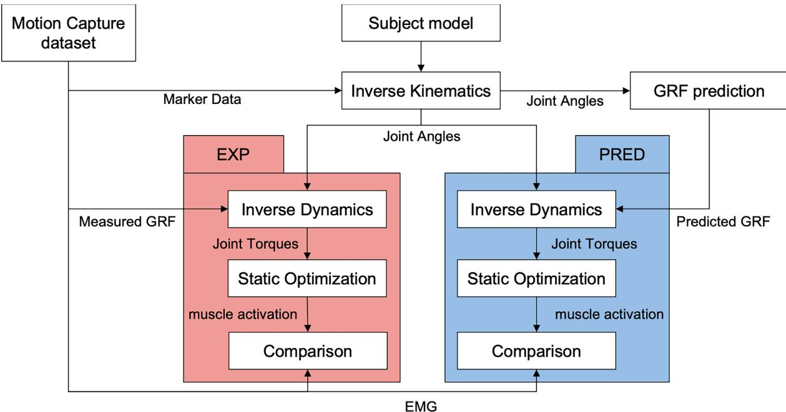  
Fig. 1. 骨骼肌肉模拟流程概述。

## 2. 结果

PRED 与 EXP 在 GRF 和地面反作用力矩（GRM）中的 RMSE 分别为 0.021–0.084 BW 和 0.009–0.034 BW\*BH（Fig. 2，Table1）。PRED 与 EXP 在 GRF 和 GRM 中的皮尔逊相关系数为 0.750–0.983（Fig. 2，Table1）。PRED 与 EXP 在关节力矩中的 RMSE 为 0.002–0.023 BW\*BH（Fig. 3，Table2）。PRED 与 EXP 在关节力矩中的皮尔逊相关系数为 0.794–0.933（Fig. 3，Table2）。来自 8 块肌肉的 EMG 与估计肌肉激活度之间的相关系数平均值在 PRED 中为 $R = 0 . 4 7 7 \ : ( P < 0 . 0 0 1 )$，在 EXP 中为 R 0.475 $( P < 0 . 0 0 1 )$（Fig. 4，Table 3）。配对 t 检验未检测到 PRED 与 EXP 之间的相关系数存在显著差异 $( P = 0 . 0 8 7 )$。与 PRED 相比，EXP 中的残差高出 2–4 倍 $( P < 0 . 0 0 1$ ，Fig. 5，Table 4）。残差与关节力矩之间的最高相关系数出现在髋关节屈伸力矩与矢状面残余力矩之间 $( R =$ 0.458，Table 5）。

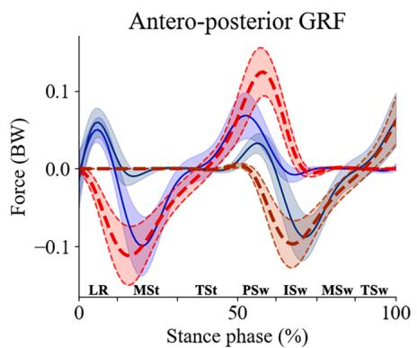

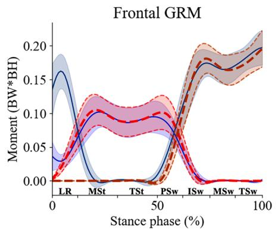

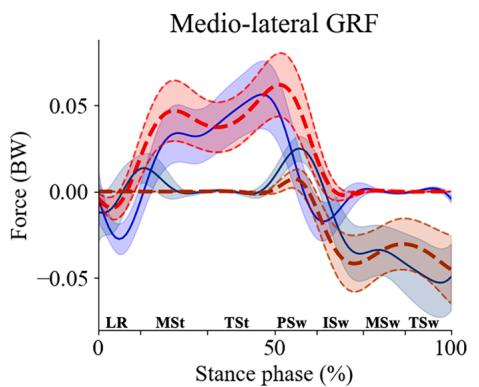

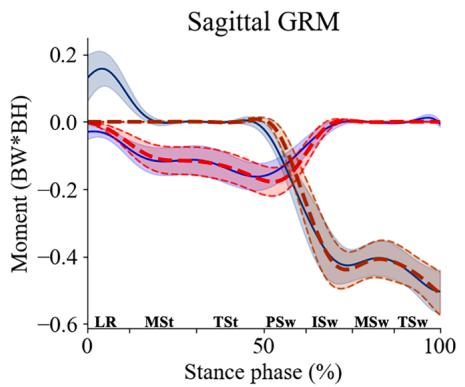

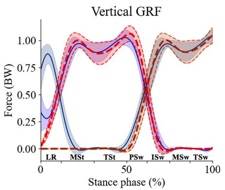

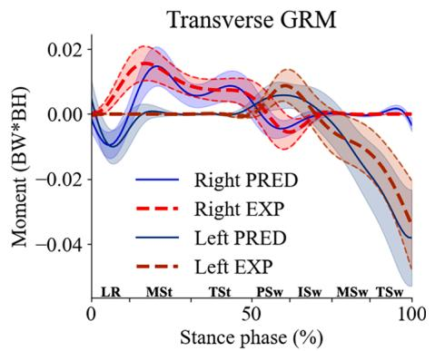  
Fig. 2. PRED（蓝色：右侧，深蓝色：左侧）与 EXP（红色：右侧，深红色：左侧）之间地面反作用力与力矩的均值及标准差曲线对比。数值均在全局坐标系中表示。该图仅使用第一步为右脚的数据生成。（关于本图图例中颜色的解读，请读者参阅本文的网络版。）

Table 1  
PRED 与 EXP 之间地面反作用力及力矩的均方根误差（RMSE）和皮尔逊相关系数 R。

<table><tr><td rowspan="2"></td><td colspan="2">RMSE</td><td colspan="2">R</td></tr><tr><td>左侧</td><td>右侧</td><td>左侧</td><td>右侧</td></tr><tr><td>前后向 GRF</td><td>0.051</td><td>0.051</td><td>0.765</td><td>0.768</td></tr><tr><td>内外侧 GRF</td><td>0.021</td><td>0.021</td><td>0.823</td><td>0.833</td></tr><tr><td>垂直 GRF</td><td>0.083</td><td>0.084</td><td>0.969</td><td>0.968</td></tr><tr><td>额状面 GRM</td><td>0.013</td><td>0.013</td><td>0.975</td><td>0.975</td></tr><tr><td>矢状面 GRM</td><td>0.034</td><td>0.031</td><td>0.982</td><td>0.983</td></tr><tr><td>横截面 GRM</td><td>0.012</td><td>0.009</td><td>0.750</td><td>0.819</td></tr></table>

GRF 和 GRM 的 RMSE 单位分别为体重（BW）和体重乘以身高（BW\*BH）。

## 3. 讨论

本研究的目的在于确定在基于逆动力学的步态肌肉骨骼仿真中，预测的 GRF、关节力矩以及利用预测 GRF 估算的肌肉激活度的有效性。尽管 GRF 和关节力矩存在一定误差，但 Fig. 4 显示，利用预测 GRF 估算的肌肉激活度与 EMG 一致。从 8 块肌肉中利用预测 GRF 估算的肌肉激活度与 EMG 之间的总体相关系数，与利用实测 GRF 估算的肌肉激活度相当。这些结果表明，在基于逆动力学的步态肌肉骨骼仿真中，预测 GRF 可用于估算肌肉激活度，其效果与使用实测 GRF 相似。尽管相关系数相当，但 PRED 与 EXP 之间估算的肌肉激活度幅度以及肌肉力存在差异，且未通过 EMG 进行验证。这一点可能会限制其在肌肉力或关节反作用力大小至关重要的临床场景中的应用。

在大多数步态周期中，PRED 与 EXP 的 GRF 及关节力矩波形表现出相似性（Fig. 2、Fig. 3）。然而，在双支撑相期间（约 0–15% 和 50–65%），前后向和内外向 GRF 出现了较大误差。这可能是由于本研究中使用的 Muller 方法的局限性所致。在双支撑相期间，双腿的水平 GRF 可能会在相反方向上发生抵消平衡。仅最小化接触力平方和的优化方法可能并不是步态试验的最佳方法，因为被低估的接触力仍能满足多体动力学方程。Fluit et al. (2014) 通过同时最小化肌肉激活度与接触力的加权平方和解决了这一问题。如果通过降低关节力矩来最小化肌肉激活度，该方法可能会估计出更大的水平 GRF。这一因素应纳入优化过程中，特别是在步态试验中。

本研究中估计的激活度与 EMG 之间的相关系数与以往进行基于逆向动力学仿真的研究报告（Zargham et al., 2019）相似。这是一项新颖的发现，表明在某些情况下，使用预测的 GRF 估计肌肉激活度的效果可与实测 GRF 相媲美。这可以通过 EXP 中较高的残差来解释。当与运动学结合时（运动学在标记点轨迹处理过程中可能会失真）

PRED 与 EXP 之间关节力矩的均方根误差 (RMSE) 和皮尔逊相关系数 R。

<table><tr><td></td><td>RMSE</td><td>R</td></tr><tr><td>髋屈曲</td><td>0.030</td><td>0.803</td></tr><tr><td>髋内收</td><td>0.010</td><td>0.889</td></tr><tr><td>髋内旋</td><td>0.003</td><td>0.736</td></tr><tr><td>膝伸展</td><td>0.022</td><td>0.466</td></tr><tr><td>踝背屈</td><td>0.015</td><td>0.843</td></tr></table>

RMSE 单位为体重乘以身高 (BW\*BH)。

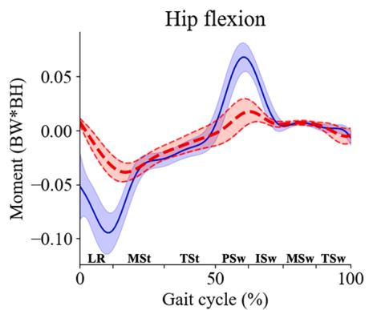

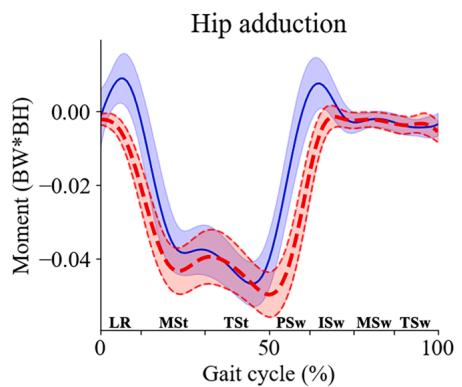

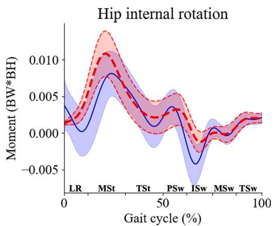

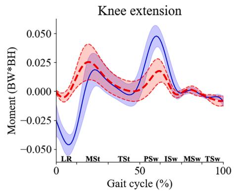

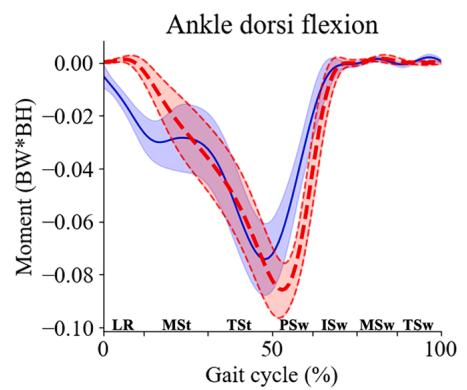  
Fig. 3. PRED（蓝色）与 EXP（红色）之间关节力矩的均值与标准差曲线比较。该图仅使用第一步为右脚的数据生成。（关于本图例中颜色的解释，请参阅本文的网络版。）

EMG \_ PRED - - EXP

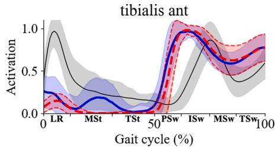

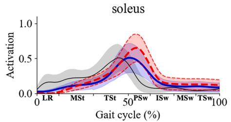

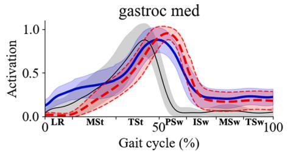

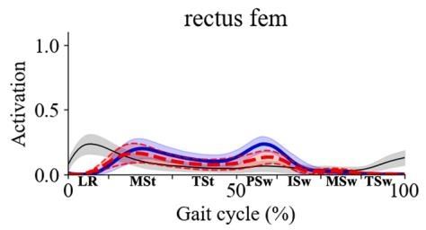

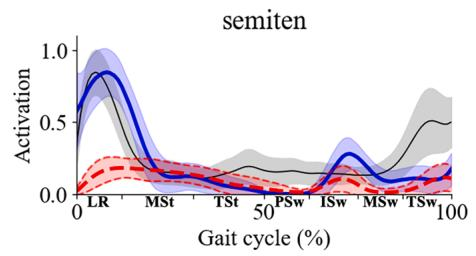

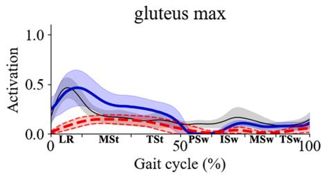

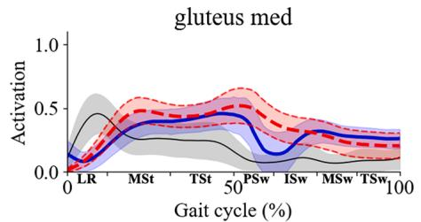  
Fig. 4. 使用预测 GRF（PRED）和实测 GRF（EXP）估计的肌肉激活度与 EMG 的对比。该图仅根据第一步为右脚的数据生成。

使用预测（PRED）或实测（EXP）GRF 时，EMG 与估计肌肉激活度之间的 Pearson 相关系数。P 值来自比较 PRED 和 EXP 之间各试验 R 值的配对 t 检验。

<table><tr><td></td><td>PRED</td><td>EXP</td><td>t 检验 P 值</td></tr><tr><td>胫骨前肌</td><td>0.239</td><td>0.327</td><td>&lt; 0.001</td></tr><tr><td>比目鱼肌</td><td>0.547</td><td>0.512</td><td>0.872</td></tr><tr><td>腓肠肌内侧头</td><td>0.617</td><td>0.577</td><td>0.002</td></tr><tr><td>股内侧肌</td><td>- 0.137</td><td>0.028</td><td>&lt; 0.001</td></tr><tr><td>股直肌</td><td>- 0.048</td><td>0.109</td><td>&lt; 0.001</td></tr><tr><td>半腱肌</td><td>0.431</td><td>0.217</td><td>&lt; 0.001</td></tr><tr><td>臀大肌</td><td>0.533</td><td>0.311</td><td>&lt; 0.001</td></tr><tr><td>臀中肌</td><td>0.173</td><td>0.270</td><td>&lt; 0.001</td></tr><tr><td>全部</td><td>0.477</td><td>0.475</td><td>0.087</td></tr></table>

处理、模型缩放和逆向运动学（逆向运动学中的平均标记点误差为 1.14 cm），运动学与实测 GRF 之间的不匹配可能会在多体动力学中引入更大的误差，并影响 EXP 中肌肉激活度的估计（Erdemir et al., 2007; Faber et al., 2018; Hicks et al., 2015）。在具备测力台数据的情况下，应通过精细的实验测量以及可能采用的前人研究所用的优化技术来尽量减小残差（Faber et al., 2018; Hicks et al., 2015）。包含人工运动学和 GRF 误差的合成数据可能有助于研究残差如何影响估计的肌肉激活度。这些研究结果表明，无需测力台即可估计肌肉激活度。这为未来在没有测力台但可测量运动学数据的情况下开展肌肉骨骼仿真工作提供了支持。

残差与关节力矩之间的最高相关系数出现在髋伸展力矩与矢状面残差力矩之间（Table 3）。这一结果与先前的一项研究相似，该研究报告了在消除残差后髋关节力矩发生了更大的改变（Faber et al., 2018）。这可以解释 EXP 中髋伸肌（如半腱肌和臀大肌）相关系数较低的原因。在本研究中，股四头肌的相关系数非常低。这一结果与先前报道股直肌相关系数较低（- 0.175）的研究相似（Zargham et al., 2019）。在先前的研究中未发现股内侧肌的相关系数。尽管如此，行走过程中股四头肌的激活程度非常低，可能不适合用于评估股四头肌。在未来的研究中，应在股四头肌起主导作用的不同任务中测试股四头肌激活的准确性与有效性。

本研究存在一些局限性需要指出。首先，如前所述，与 Fluit 的方法相比，Muller 的方法可能并不是双腿支撑期的最佳解决方案。未来的研究应采用更好的优化方法来解决双腿支撑期的不定问题。其次，本研究仅调查了健康受试者的行走情况。为了更好地实现临床应用，病理与健康受试者之间的差异或治疗后肌肉激活的变化应使用包含病理病例的数据集进行验证。对于股四头肌激活，数据集中最好也能包含深蹲或跳跃任务。第三，研究结果未与其他方法进行比较。先前的研究采用了诸如残差减少算法（Residual Reduction Algorithm, RRA）等方法，通过在优化过程中改变关节运动学和躯干质心位置来减少残差（Delp et al., 2007; Faber et al., 2018; Remy and Thelen, 2009）。使用预测的 GRF 结合实测运动学所估算的肌肉激活，是否优于使用实测 GRF 结合经 RRA 修改后的运动学，目前尚不明确。在先前的一项研究中（Falisse et al., 2019），基于前向动力学的动态优化中的肌肉激活波形似乎比本研究更符合 EMG。应考虑更多生理动力学因素以改进肌肉激活的估算。最后，GRF 的预测仅使用光学动作捕捉数据进行。本研究中用于预测 GRF 的方法依赖于运动学数据。预测 GRF 在基于 IMU 或基于计算机视觉的动作捕捉上的有效性尚未经过测试。当这些流程结合使用时，应测试这一方面。

使用预测 GRF 估算的肌肉激活为

Table 4  
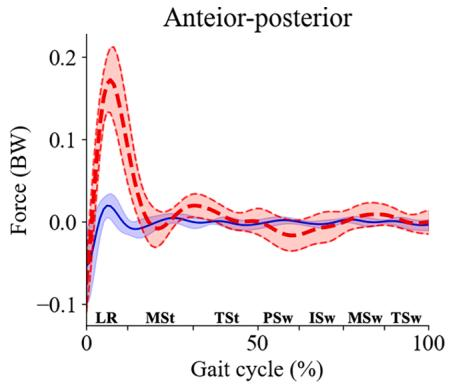

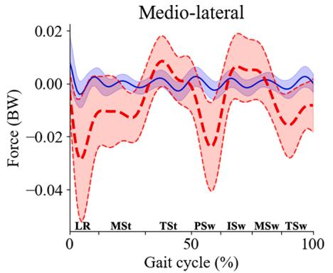

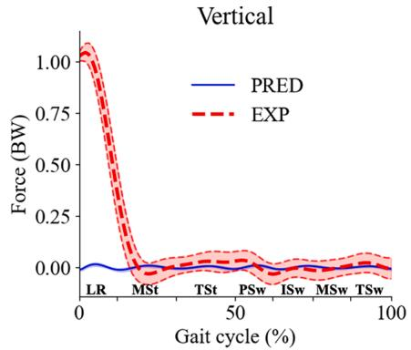

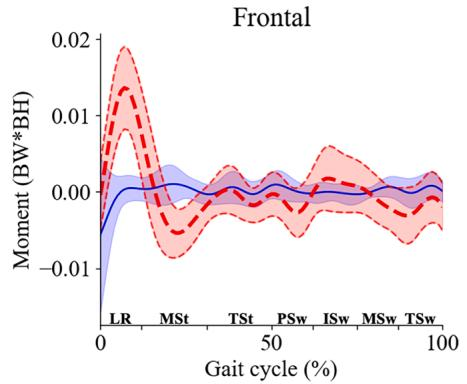

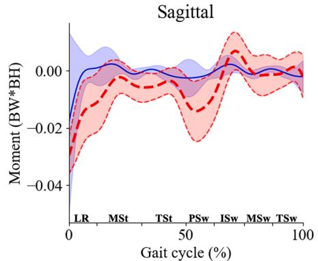

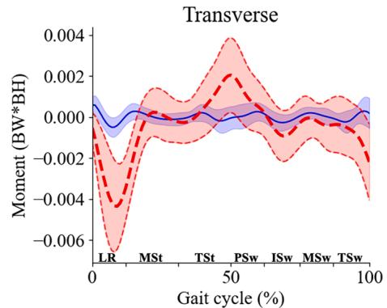  
Fig. 5. PRED（蓝色）与 EXP（红色）残余量平均波形的比较。该图仅使用第一步为右脚的数据生成。（关于本图图例中颜色的解读，读者可参阅本文的网络版。）

PRED 与 EXP 残余力和力矩均方根的比较以及逐次试验配对 t 检验的 P 值。

<table><tr><td>残余力和力矩</td><td>PRED</td><td>EXP</td><td>t 检验 P 值</td></tr><tr><td>前后向力</td><td>0.009</td><td>0.039</td><td>&lt; 0.001</td></tr><tr><td>内外向力</td><td>0.008</td><td>0.022</td><td>&lt; 0.001</td></tr><tr><td>垂直向</td><td>0.007</td><td>0.018</td><td>&lt; 0.001</td></tr><tr><td>冠状面力矩</td><td>0.002</td><td>0.006</td><td>&lt; 0.001</td></tr><tr><td>矢状面力矩</td><td>0.002</td><td>0.006</td><td>&lt; 0.001</td></tr><tr><td>水平面力矩</td><td>0.002</td><td>0.006</td><td>&lt; 0.001</td></tr></table>

残余量的均方根单位为体重乘以身高（BW\*BH）。

残余量的 PRED-EXP 差异与右腿关节力矩的 PRED-EXP 差异之间的相关系数。

<table><tr><td>残余量</td><td>髋关节屈伸</td><td>髋关节内收-外展</td><td>髋关节内旋-外旋</td><td>膝关节伸屈</td><td>踝关节背屈-跖屈</td></tr><tr><td>前后向力</td><td>0.162</td><td>0.088</td><td>0.159</td><td>0.151</td><td>0.149</td></tr><tr><td>内外向力</td><td>0.188</td><td>0.188</td><td>0.195</td><td>0.182</td><td>0.173</td></tr><tr><td>垂直向力</td><td>0.044</td><td>0.136</td><td>0.102</td><td>0.077</td><td>0.105</td></tr><tr><td>冠状面力矩</td><td>0.000</td><td>0.058</td><td>0.139</td><td>0.019</td><td>-0.017</td></tr><tr><td>矢状面力矩</td><td>0.458</td><td>0.306</td><td>0.240</td><td>0.417</td><td>0.359</td></tr><tr><td>水平面力矩</td><td>0.058</td><td>0.032</td><td>0.067</td><td>0.045</td><td>0.001</td></tr></table>

CRediT 作者贡献声明

在基于逆向动力学的肌骨模拟中与使用测量得到的 GRF 相当。残余量会影响肌肉激活度的估算。矢状面内的残余力矩与髋伸肌估算肌肉激活度质量的下降相关。GRF 的预测有助于在无法使用测力台的情况下进行肌骨模拟。

Ryo Ueno：撰写——初稿，软件，方法论，概念构思。Yasuaki Tsuyuki：撰写——审阅与编辑，调查研究。Harukazu Tohyama：撰写——审阅与编辑，指导监督，资源支持。

## 利益冲突声明

作者声明存在以下可能被视为潜在利益冲突的财务利益/个人关系：Ryo Ueno 和 Yasuaki Tsuyuki 为 ORGO Inc. 的员工。

## 致谢

本研究是 ORGO Inc. 与 Hokkaido University（北海道大学）联合开展的合作项目（PC87220003）的一部分。

## 参考文献

Afschrift, M., Pitto, L., Aerts, W., van Deursen, R., Jonkers, I., De Groote, F., 2018. Modulation of gluteus medius activity reflects the potential of the muscle to meet the mechanical demands during perturbed walking. Sci. Rep. 8 (1), 11675.

Andersen, M.S., Damsgaard, M., MacWilliams, B., Rasmussen, J., 2010. A computationally efficient optimisation-based method for parameter identification of kinematically determinate and over-determinate biomechanical systems. Comput. Methods Biomech. Biomed. Eng. 13 (2), 171 183.

Anderson, F.C., Pandy, M.G., 2001. Static and dynamic optimization solutions for gait are practically equivalent. J. Biomech. 34 (2), 153–161.

De Groote, F., Kinney, A.L., Rao, A.V., Fregly, B.J., 2016. Evaluation of direct collocation optimal control problem formulations for solving the muscle redundancy problem. Ann. Biomed. Eng. 44 (10), 2922 2936.

Delp, S.L., Anderson, F.C., Arnold, A.S., Loan, P., Habib, A., John, C.T., Guendelman, E., Thelen, D.G., 2007. OpenSim: open-source software to create and analyze dynamic simulations of movement. I.E.E.E. Trans. Biomed. Eng. 54 (11), 1940 1950.

Delp, S.L., Loan, J.P., 2000. A computational framework for simulating and analyzing human and animal movement. Comput. Sci. Eng. 2 (5), 46–55.

## R. Ueno et al.

Dembia, C.L., Bianco, N.A., Falisse, A., Hicks, J.L., Delp, S.L., 2020. OpenSim Moco: Musculoskeletal optimal control. PLoS Comput. Biol. 16, 1–21.

Dijkstra, E.J., Gutierrez-Farewik, E.M., 2015. Computation of ground reaction force using Zero Moment Point. J. Biomech. 48 (14), 3776–3781.

Erdemir, A., McLean, S., Herzog, W., van den Bogert, A.J., 2007. Model-based estimation of muscle forces exerted during movements. Clin. Biomech. 22 (2), 131 154.

Faber, H., van Soest, A.J., Kistemaker, D.A., 2018. Inverse dynamics of mechanical multibody systems: An improved algorithm that ensures consistency between kinematics and external forces. PLoS One 13 (9), e0204575.

Falisse, A., Serrancolí, G., Dembia, C.L., Gillis, J., Jonkers, I., De Groote, F., 2019. Rapid predictive simulations with complex musculoskeletal models suggest that diverse healthy and pathological human gaits can emerge from similar control strategies J. Roy. Soc., Interface/Roy. Soc. 16 (157) https://doi.org/10.1098/rsif.2019.0402.

Falisse, A., Pitto, L., Kainz, H., Hoang, H., Wesseling, M., Van Rossom, S., Papageorgiou, E., Bar-On, L., Hallemans, A., Desloovere, K., Molenaers, G., Van Campenhout, A., De Groote, F., Jonkers, I., 2020. 基于物理的模拟预测脑瘫患者运动控制和肌肉骨骼缺陷对步态功能障碍的差异性影响：一项回顾性病例研究（Physics-based simulations to predict the differential effects of motor control and musculoskeletal deficits on gait dysfunction in cerebral palsy: a retrospective case study）. Front. Hum. Neurosci. 14, 40.

Fluit, R., Andersen, M.S., Kolk, S., Verdonschot, N., Koopman, H.F.J.M., 2014. 日常生活各种活动中地面反作用力及力矩的预测（Prediction of ground reaction forces and moments during various activities of daily living）. J. Biomech. 47 (10), 2321–2329.

Hatze, H., 1976. 人体运动的完全优化（The complete optimization of a human motion）. Math. Biosci. 28 (1–2), 99–135.

Heinrich, D., Van den Bogert, A.J., Nachbauer, W., 2022. 基于三维肌肉骨骼滑雪者模型和正向动力学优化框架的高山滑雪转弯动作关节力矩估计（Estimation of joint moments during turning maneuvers in alpine skiing using a three dimensional musculoskeletal skier model and a forward dynamics optimization framework）. Front. Bioeng. Biotechnol. 10, 894568.

Hicks, J.L., Uchida, T.K., Seth, A., Rajagopal, A., Delp, S.L., 2015. 我的模型足够好吗？肌肉骨骼模型与运动模拟验证和确认的最佳实践（Is my model good enough? Best practices for verification and validation of musculoskeletal models and simulations of movement）. J. Biomech. Eng. 137 (2), 020905.

Koelewijn, A.D., van den Bogert, A.J., 2020. 随机环境中预测性模拟的求解方法（A solution method for predictive simulations in a stochastic environment）. J. Biomech. 104, 109759.

Mokhtarzadeh, H., Yeow, C.H., Hong Goh, J.C., Oetomo, D., Malekipour, F., Lee, P.-V.-S., 2013. 单腿着地过程中比目鱼肌和腓肠肌对前交叉韧带载荷的贡献（Contributions of the soleus and gastrocnemius muscles to the anterior cruciate ligament loading during single-leg landing）. J. Biomech. 46 (11), 1913–1920.

Muller, A., Pontonnier, C., Puchaud, P., Dumont, G., 2019. CusToM：用于肌肉骨骼模拟的 Matlab 工具箱（CusToM: a Matlab toolbox for musculoskeletal simulation）. J. Open Source Software 4 (33), 927.

Muller, A., Pontonnier, C., Robert-Lachaine, X., Dumont, G., Plamondon, A., 2020. 手工物料搬运任务中基于运动的外力和力矩及背部载荷预测（Motion-based prediction of external forces and moments and back loading during manual material handling tasks）. Appl. Ergon. 82, 102935.

Navacchia, A., Ueno, R., Ford, K.R., DiCesare, C.A., Myer, G.D., Hewett, T.E., 2019. 基于肌电（EMG）信息的肌肉骨骼建模以估计女性运动员垂直下落跳跃中真实的膝关节前向剪切力（EMGinformed musculoskeletal modeling to estimate realistic knee anterior shear force during drop vertical jump in female athletes）. Ann. Biomed. Eng. https://doi.org/ 10.1007/s10439-019-02318-w.

Pitto, L., Kainz, H., Falisse, A., Wesseling, M., Van Rossom, S., Hoang, H., Papageorgiou, E., Hallemans, A., Desloovere, K., Molenaers, G., Van Campenhout, A., 2019. SimCP：用于预测脑瘫儿童骨科手术后步态表现的模拟平台（SimCP: A simulation platform to predict gait performance following orthopedic intervention in children with cerebral palsy）. Front. neurorobot. 13, 54.

Rajagopal, A., Dembia, C.L., DeMers, M.S., Delp, D.D., Hicks, J.L., Delp, S.L., 2016. 用于人体步态肌肉驱动模拟的全身肌肉骨骼模型（Full body musculoskeletal model for muscle-driven simulation of human gait）. I.E.E.E. Trans. Biomed. Eng. 63 (10), 2068–2079

Remy, C.D., Thelen, D.G., 2009. 用于步态正向动力学模拟的动态一致运动学和动力学最优估计（Optimal estimation of dynamically consistent kinematics and kinetics for forward dynamic simulation of gait）. J. Biomech. Eng. 131 (3), 031005.

Schreiber, C., Moissenet, F., 2019. A multimodal dataset of human gait at different walking speeds established on injury-free adult participants. Sci. Data 6 (1), 1–7.

Skals, S., Jung, M.K., Damsgaard, M., Andersen, M.S., 2017. Prediction of ground reaction forces and moments during sports-related movements. Multibody Sys.Dyn. 39 (3), 175–195.

Sylvester, A.D., Lautzenheiser, S.G., Kramer, P.A., 2021. A review of musculoskeletal modelling of human locomotion. Interface Focus 11 (5), 20200060.

Uchida, T.K., Hicks, J.L., Dembia, C.L., Delp, S.L., 2016. Stretching your energetic budget: how tendon compliance affects the metabolic cost of running. PLoS One 11 (3), e0150378.

Ueno, R., Navacchia, A., DiCesare, C.A., Ford, K.R., Myer, G.D., Ishida, T., Tohyama, H., Hewett, T.E., 2020. Knee abduction moment is predicted by lower gluteus medius force and larger vertical and lateral ground reaction forces during drop vertical jump in female athletes. J. Biomech. 103, 109669.

Winter, D.A., 2009. Biomechanics and motor control of human movement, (4th ed.). Wiley & Sons Inc.

Zargham, A., Afschrift, M., De Schutter, J., Jonkers, I., De Groote, F., 2019. Inverse dynamic estimates of muscle recruitment and joint contact forces are more realistic when minimizing muscle activity rather than metabolic energy or contact forces. Gait Posture 74, 223 230.