# 步态模拟中受试者特异性模型对Hill肌腱模型参数的敏感性

V. Carbone a,n, M.M. van der Krogt a,b, H.F.J.M. Koopman a, N. Verdonschot a,c

a 荷兰特温特大学（University of Twente）MIRA研究所生物力学工程实验室，恩斯赫德，荷兰

b 阿姆斯特丹自由大学医学中心（VU University Medical Center）MOVE阿姆斯特丹研究所康复医学科，阿姆斯特丹，荷兰

c 拉德堡德大学医学中心（Radboud University Medical Centre）骨科研究实验室，奈梅亨，荷兰

## 文章信息

文章历史：2016年4月2日接收

关键词：敏感性分析 肌腱参数 受试者特异性建模 下肢 步态

## 摘要

下肢受试者特异性肌肉骨骼（MS）模型对于预测骨科手术效果等应用至关重要。我们进行了全面的敏感性分析，以评估最先进的MS模型中包含的全部56个肌腱（MT）部位的Hill肌腱模型参数潜在误差所产生的影响。我们使用了两个指标，即局部敏感性指数（LSI）和总体敏感性指数（OSI），以分别区分在模拟步态周期中扰动对受扰动MT部位以及所有其余MT部位预测产生的肌肉力的影响。结果表明，模型的敏感性取决于步态过程中每个MT部位的具体功能作用，而不仅仅取决于其尺寸和长度。肌腱松弛长度是最敏感的参数，其次是最大等长肌力和最佳肌纤维长度，而标称羽状角表现出极低的敏感性。在作为步态原动肌（比目鱼肌：平均OSI为5.27%，股直肌：平均OSI为4.47%，腓肠肌：平均OSI为3.77%，股外侧肌：平均OSI为1.36%，股二头肌长头：平均OSI为1.06%）和髋关节稳定肌（臀中肌：平均OSI为3.10%，闭孔内肌：平均OSI为1.96%，臀小肌：平均OSI为1.40%，梨状肌：平均OSI为0.98%）的MT部位中发现了最高的敏感性值，其次是腓骨肌群（平均OSI为2.20%）和胫骨前肌（平均OSI为1.78%），其中部分肌肉在先前的敏感性研究中未被纳入。最后，所提出的优先级列表提供了定量信息，指明了应最准确地估计哪些MT部位和哪些MT参数，以建立详细且可靠的受试者特异性MS模型。

© 2016 Elsevier Ltd. 保留所有权利。

## 1. 引言

下肢肌骨（MS）模型是探索复杂生物力学问题（例如预测骨科手术的功能性结果）极具前景的工具（Piazza et al., 2003; Reinbolt et al., 2009; Taddei et al., 2012）。对于这些应用而言，特定受试者（subject-specific）模型对于获得可靠的模型预测至关重要（Lenaerts et al., 2009; Scheys et al., 2011; Gerus et al., 2013）。尤其是肌腱（MT）参数，它们对模型输出有极大影响（Brand et al., 1986; Hoy et al., 1990; Out et al., 1996），且难以直接测量，并已知会随年龄、性别和运动水平而变化（Friederich and Brand, 1990）。

开发能够估计受试者特异性 MT 参数的高效方法是一项重大挑战（Garner and Pandy, 2003; Winby et al., 2008; Van Campen et al., 2014）。然而，在使用最先进的精细模型时（Klein Horsman et al., 2007; Arnold et al., 2010; Modenese et al., 2011），明确哪些肌肉需要进行更详细的描述，以及测量技术所需的精度应当达到何种程度，是至关重要的。以往的研究探讨了 MS 模型预测对 MT 参数变化的敏感性，遗憾的是，这些分析要么使用了简化模型（Hoy et al., 1990），要么报告的是所分析肌肉的平均结果（Scovil and Ronsky, 2006），抑或仅侧重于单个关节（Out et al., 1996; De Groote et al., 2010）或一小部分代表性肌肉（Redl et al., 2007; Xiao and Higginson, 2010; Ackland et al., 2012）。据我们所知，目前关于 MS 模型预测的唯一广泛敏感性研究分析的是 MS 几何参数的不确定性（Carbone et al., 2012; Valente et al., 2014），但尚未有全面分析来研究单个肌肉对 MT 参数扰动的敏感性。

本研究的目的是评估先进精细 MS 模型对 Hill 肌腱模型参数中潜在误差的敏感性。我们进行了广泛的分析，以量化模型中每块肌肉的肌腱松弛长度、最优肌纤维长度、最大等长肌力以及标称羽状角扰动所产生的影响。研究结果提供了定量信息，以指明在建立满足特定应用精度要求的可靠受试者特异性 MS 模型时，应最精确地估计哪些肌肉的哪些 MT 参数。

## 2. 方法

我们使用了在 AnyBody Modeling System™ 4.2.1 版（AnyBody Technology A/S，丹麦 Aalborg）中实现的特温特下肢模型（Twente Lower Extremity Model, TLEM）（Klein Horsman et $\mathrm { a l . }$ 2007）（Damsgaard et al., 2006）。该模型由 12 个身体环节、11 个关节和 21 个自由度（Degrees of Freedom）组成（Fig. 1A）。为了准确描述肌骨（MS）系统的功能，每条腿包含 56 个肌腱单位（MT）部分，其力学效应由 159 个三元件 Hill 型 MT 元件描述（Zajac, 1989）（Fig. 1B）。

逆动力学仿真基于在平地上进行步态试验期间记录的三维运动分析和测力台数据。一名男性受试者的年龄、身高和体重分别为 26 岁、1.73 cm 和 63 kg（AnyBody Managed Model Repository Ver. 1.3）。基于光学标记点的相对位置，对模型进行线性缩放以匹配受试者的人体测量特征。求解了一个静态优化问题以计算 MT 力，在每个时间步最小化肌肉激活度的三次方之和（Crowninshield and Brand, 1981）。MT 力受动力学平衡方程的约束，同时考虑了每个 MT 元件中收缩元件 CE 的力-长度和力-速度特性以及被动元件 PE 弹性所施加的生理边界。肌腱 T 弹性的影响通过允许肌腱的长度和力随肌肉活动变化来进行近似。假设肌腱伸长量相对较小，肌腱力对肌肉活动的依赖性通过线性关系进行近似，该线性关系可以有效地整合到 AnyBody Modeling System™（AnyBody Technology A/S，丹麦 Aalborg）中实现的肌肉募集求解器中。

我们的灵敏度分析重点关注在创建受试者特异性模型时可能在体内（in vivo）测量（Narici et al., 1996; Fukunaga et al., 1997）或估计（Garner and Pandy 2003; Van Campen et al. 2014）的四个 MT 参数：肌腱松弛长度 $L _ { T } ^ { s } ,$ 最优肌纤维长度 ${ \overline { { L _ { f } } } } ,$ 最大等长肌力 $\overline { { F ^ { M } } }$ 和标称羽状角 γ。对于每个 MT 部分和四个 MT 参数中的每一个，基于 Ward et al. (2009) 计算的平均解剖变异性，对其标称值施加了两次扰动：具体而言，对于 Ls、Lf 和 $\overline { { F ^ { M } } }$ 为 20% 和 20%，对于 γ 为 10° 和 10°（对于非羽状 MT 元件仅施加 10°）。

在每次扰动之后，求解一个新的静态优化问题以计算预测 MT 力的相应变化。出于对称性的考虑，扰动仅在右腿进行。与我们之前关于 MS 几何结构的研究（Carbone et al., 2012）一致，我们使用两个指标计算了模型的灵敏度：

1. 局部灵敏度指数（Local Sensitivity Index, LSI），用于量化扰动对受扰动 MT 部分所产生力的影响：

$$
\mathrm{LSI} = \frac {\sum_ {i = p e r t} \int_ {0} ^ {T} | F _ {n e w , i} ^ {M T} (t) - F _ {o l d , i} ^ {M T} (t) | d t}{\sum_ {i = p e r t} \int_ {0} ^ {T} F _ {o l d , i} ^ {M T} (t) d t} \cdot 100 \%\tag{1}
$$

2. 全局灵敏度指数（Overall Sensitivity Index, OSI），用于量化扰动对其余所有 MT 部分所产生力的影响：

$$
\mathrm{OSI} = \frac {\sum_ {i \neq p e r t} \int_ {0} ^ {T} | F _ {n e w , i} ^ {M T} (t) - F _ {o l d , i} ^ {M T} (t) | d t}{\sum_ {i \neq p e r t} \int_ {0} ^ {T} F _ {o l d , i} ^ {M T} (t) d t} \cdot 100 \%\tag{2}
$$

其中 $F _ { o l d , i } ^ { M T } ( t )$ 和 $F _ { n e w , i } ^ { M T } ( t )$ 分别是在时间步长 t 时，受扰动（i pert）和未受扰动（iapert）MT 部分所产生力的标称值与扰动值，T 是模拟步态周期的终止时间。

A

最后，计算了 Pearson 积矩相关系数 r，以评估模型是否分别对具有最大 $L _ { T } ^ { s } , \overline { { { L _ { f } } } } , \overline { { { F ^ { M } } } }$ 和 ${ \overline { { \gamma } } } ,$ 的 MT 部分中的潜在误差最为敏感；评估表现出最高 LSI 值的 MT 部分是否也倾向于表现出最高的 OSI 值；并评估最敏感的 MT 部分是否在所有受到扰动的四个 MT 参数中都倾向于表现出最高的灵敏度值。根据 Altman (1990)，Pearson's r 的分类标准如下：r o0.20 为弱相关（poor correlation），0.21o r o0.40 为较弱相关（fair correlation），$0 . 4 1 < | r | < 0 . 6 0 ,$ 为中度相关（moderate correlation），$0 . 6 1 < | r | < 0 . 8 0 ,$ 为强相关（good correlation），$0 . 8 1 < | r | < 1 . 0 0 .$ 为极强相关（very good correlation）。

B  
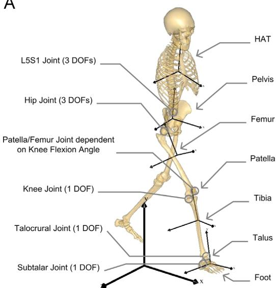

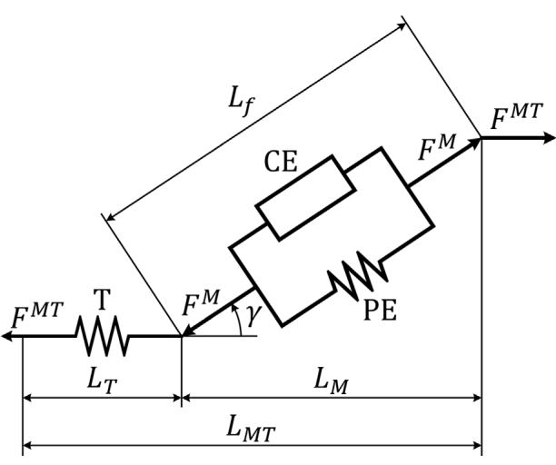  
Fig, 1. A：包含 12 个身体节段的 TLEM 模型：HAT（头、手臂和躯干）、骨盆，以及左右股骨、髌骨、胫骨、距骨和足部。腓骨与胫骨合并为一个单元。该模型包含 11 个关节：L5S1 以及左右髋关节、膝关节、髌股关节、距小腿关节和距下关节。L5S1 和髋关节被建模为球窝关节，由一个旋转中心和三个正交轴定义。膝关节、距小腿关节和距下关节被定义为铰链关节，具有固定的旋转中心和旋转轴。髌骨可绕具有固定旋转中心的旋转轴相对于股骨旋转。髌腱被定义为连接髌骨与胫骨的非形变元件。因此，在不引入额外自由度（DOF）的情况下，髌骨的取向和位置仅取决于膝关节屈曲角度。骨盆质心相对于 3D 全局坐标系的取向和位置，结合 L5S1、髋关节、膝关节、距小腿关节和距下关节的关节旋转，构成了一个具有 21 个 DOF 的模型。B：三元素 Hill 型肌腱单元的示意图（Zajac, 1989）。MT 单元由主动肌（由与被动元件 $P E ,$ 并联的收缩元件 CE 表示）与串联的弹性肌腱 $T ,$（建模为非线性弹簧）组成。$L _ { f }$ 为肌纤维长度，$L _ { T }$ 为肌腱长度，$\cdot \gamma$ 为肌纤维与肌腱之间的羽状角。$L _ { M T }$ 为 MT 单元的总长度，等于肌腱长度 L 与经羽状角 $\gamma$ 校正后的肌纤维长度 $. L _ { f }$ 之和 $\left( \mathrm { i . e . } L _ { M T } = L _ { T } + L _ { f } \cos \gamma \right)$。肌腱中的力 $F ^ { M \breve { T } }$ 等于经羽状角校正后的肌纤维合力 $F ^ { M }$ $( \mathrm { i } . { \mathsf { e } } . \ \bar { F } ^ { M T } = F ^ { \bar { M } } \cos \gamma )$。

## 3. 结果

MS 模型预测对 Hill MT 模型参数潜在误差的敏感性表现出较大的变异性。所有实施扰动的详细结果均列于电子附录中的 Table A1。

LSI 值代表受扰动 MT 部分的敏感性，其高度依赖于所扰动的 MT 部分和 MT 参数（图 2A 和 B）。$L _ { T } ^ { s }$ 是最敏感的参数（平均 LSI 为 93.83%；股外侧肌下部（Vastus Lateralis Inferior）的最大 LSI 为 899.89%；耻骨肌（Pectineus）的最小 $\mathrm { L S I } { = } 0 . 7 7 \%$），其次是 $\overline { { F ^ { M } } }$（平均 LSI 为 23.08%；上孖肌（Gemellus Superior）的最大 LSI 为 30.36%；胫骨前肌（Tibialis Anterior）的最小 $\mathrm { L S I } { = } 5 . 9 0 \%$）、$\overline { { L _ { f } } }$（平均 $\mathrm { { L S I } } = 1 3 . 9 3 \% $；股内侧肌下部（Vastus Medialis Inferior）的最大 $\mathrm { L S I } { = } 5 3 . 9 3 \%$；耻骨肌（Pectineus）的最小 $\mathrm { L S I } { = } 0 . 7 6 \%$）以及 $\bar { \gamma }$（平均 ${ \mathrm { L S I } } = 3 . 3 3 \%$；腓肠肌内侧头（Gastrocnemius Medialis）的最大 $\mathrm { L S I } { = } 1 7 . 5 9 \%$；胫骨前肌（Tibialis Anterior）的最小 $\mathrm { L S I } { = } 0 . 2 9 \%$）。

类似地，代表所有其余 MT 部分敏感性的 OSI 值也高度依赖于所扰动的 MT 部分和 MT 参数（图 2C 和 D）。同样，$L _ { T } ^ { s }$ 是最敏感的参数（平均 $0 \mathrm { S I } { = } 3 . 1 6 \% $；腓肠肌内侧头（Gastrocnemius Medialis）的最大 $0 S \mathrm { I } { = } 2 1 . 7 3 \%$；耻骨肌（Pectineus）的最小 $0 S \mathrm { I } < 0 . 0 1\%$），其次是 $\overline { { F ^ { M } } }$（平均 OSI 为 0.64%；比目鱼肌外侧部（Soleus Lateralis）的最大 OSI 为 3.32%；腘肌（Popliteus）的最小 $0 S \mathrm { I } { = } 0 . 0 3 \% $）、$\overline { { L _ { f } } }$（平均 $0 \mathrm { S I } { = } 0 . 4 0 \% $；股直肌

B  
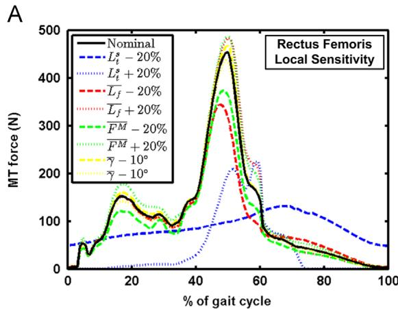

C  
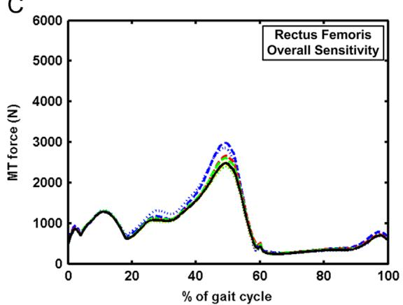  
D

（Rectus Femoris）的最大 OSI 为 2.95%；大收肌近端（Adductor Magnus Proximal）的最小 $0 S \mathrm { I } < 0 . 0 1\%$）以及 $\bar { \gamma }$（平均 OSI 为 0.13%；股直肌（Rectus Femoris）的最大 OSI 为 1.86%；短收肌中部（Adductor Brevis Mid）的最小 $0 S \mathrm { I } < 0 . 0 1\%$）。

最高的 OSI 值不仅出现在步态过程中作为原动肌的 MT 部分（小腿三头肌、股四头肌、臀肌、股二头肌长头，这些肌肉被认为是最具代表性的肌肉），而且还出现在通常被敏感性研究排除在外的 MT 部分，例如腓骨长肌和腓骨短肌、闭孔内肌、胫骨前肌以及梨状肌。

我们发现 OSI 值与 $\overline { { F ^ { M } } } \ ( r = 0 . 7 2 )$ 和 $\overline { { \gamma } } \ ( r { = } 0 . 6 7 )$ 的标称值之间存在良好相关性，因此更强健且羽状角更大的 MT（musculotendon，肌肉-肌腱）部分表现出最高的灵敏度，而对于 $L _ { T } ^ { s }$ 和 $\overline { { L _ { f } } } ( - 0 . 1 7 < r < 0 . 3 4 )$ 仅发现较差至尚可的相关性（Fig. 3A–D）。此外，我们发现同一 MT 参数的 LSI 与 OSI 值之间存在较差甚至负相关 $\left( - 0 . 5 5 < r < 0 . 3 9 \right)$，因此表现出最高 LSI 值的 MT 部分并不一定表现出最高的 OSI 值（Fig. 3E–H）。最后，我们发现同一 MT 部分在不同 MT 参数之间的 LSI 值呈现中度甚至负相关 $\left( - 0 . 3 3 < r < 0 . 5 5 \right)$，但 OSI 值之间呈现良好至极好的相关性 $( 0 . 6 1 < r < 0 . 9 1 )$，表明对于所有受扰动的四种 MT 参数，最敏感的 MT 部分往往均表现出最高的 OSI 值。相关性分析的详细结果见 Table 1。

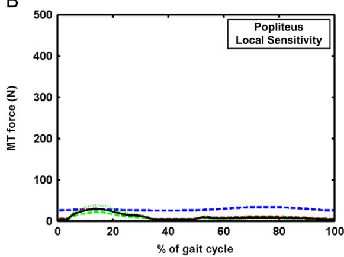

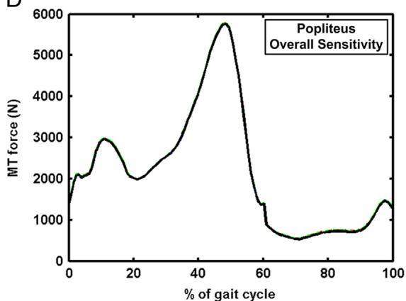  
Fig. 2. 步态过程中 MT 参数扰动对预测 MT 力的影响。黑色实线为扰动前的标称 MT 力；蓝、红、绿和黄色线分别为肌腱松弛长度 $L _ { T } ^ { s } ,$、最佳肌纤维长度 ${ \overline { { L _ { f } } } } ,$、最大等长肌力 $\overline { { F ^ { M } } }$ 以及标称羽状角 $\overline { { \gamma } } ,$ 扰动后的预测 MT 力。A：股直肌（Rectus Femoris）MT 参数扰动后由股直肌产生的力；B：腘肌（Popliteus）MT 参数扰动后由腘肌产生的力；C：股直肌 MT 参数扰动后由所有其余 MT 部分产生的力之和；D：腘肌 MT 参数扰动后由所有其余 MT 部分产生的力之和。局部灵敏度指数（Local Sensitivity Index, LSI）通过在模拟步态周期内对标称和扰动 MT 力之间的绝对差值进行积分，然后在所有受扰动的 MT 部分上对这些积分量求和计算得出（见 Eq. (1)）。整体灵敏度指数（Overall Sensitivity Index, OSI）通过在模拟步态周期内对标称和扰动 MT 力之间的绝对差值进行积分，然后在所有未受扰动的 MT 部分上对这些积分量求和计算得出（见 Fa. (2)）。请注意，子图 A–B 和 C–D 使用了不同的刻度。（关于本图图注中颜色引用的解读，读者可参阅本文的网络版）。

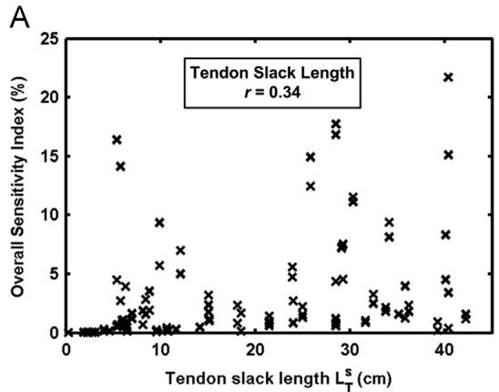

B  
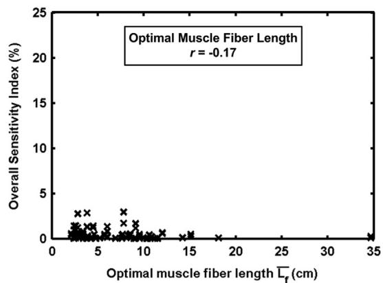

C  
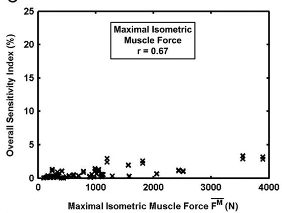

D  
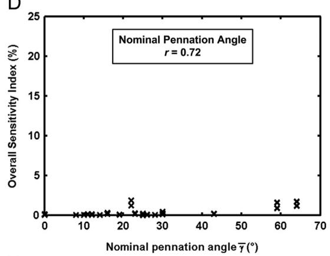

E  
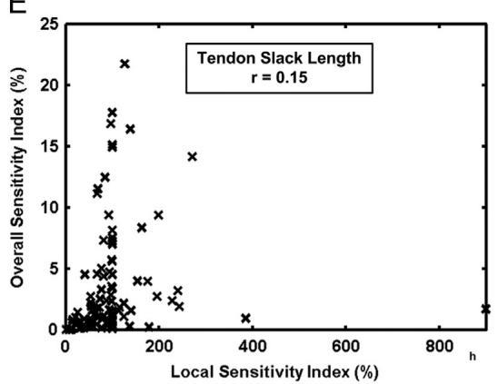

F  
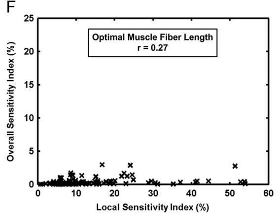

G  
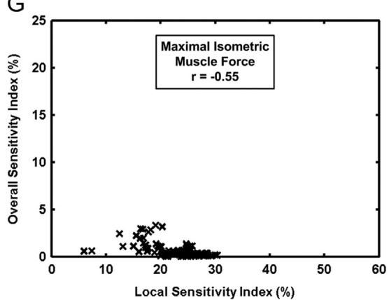

H  
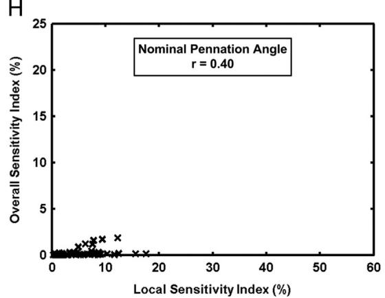  
Fig. 3. A–D：整体灵敏度指数（OSI）值与所扰动的相应 MT 参数名义值的关系图（用于评估模型是否分别对具有最大 $L _ { T } ^ { s } , \overline { { L _ { f } } } , \overline { { F ^ { M } } }$ 和 γ 的 MT 部位中的潜在误差最为敏感）。E–H：整体灵敏度指数（OSI）值与相同 MT 部位对应的局部灵敏度指数（LSI）值的关系图（用于评估显示出最高 LSI 值的 MT 部位是否也倾向于显示出最高的 OSI 值）。

## 4. 讨论

这项广泛的灵敏度分析旨在评估 Hill 型 MT（肌肉-肌腱）模型参数中的潜在误差对精细的前沿下肢 MS（肌肉骨骼）模型预测结果的影响。与以往研究的结果（Hoy et al., 1990; Out et al., 1996; Redl et al., 2007）一致，$L _ { T } ^ { s }$ 被发现是最敏感的参数，对其进行扰动会极大地影响模型的肌力预测结果，其次是 $\overline { { { F } ^ { M } } }$ 和 ${ \overline { { L _ { f } } } } ,$ 而 $\bar { \gamma }$ 则表现出极低的灵敏度值。然而，与 Ackland et al. (2012) 一致，灵敏度结果也在很大程度上取决于受扰动的 MT 部位的具体功能（Fig. 2）。与 LSI 值相比，OSI 值大幅降低，这表明复杂的 MS 系统比单独受扰动的 MT 部位能够更好地补偿扰动，这与 Scovil and Ronsky (2006) 的结论一致。此外，一些 MT 部位表现出非常高的 LSI 值但非常低的 OSI 值（例如腘肌，Fig. 2B–D），这表明对关节力矩贡献很小的 MT 部位所发生的较大相对变化并不会影响模型的其余部分，这与 De Groote et al. (2010) 的发现相似。另一方面，高 OSI 值表明这些 MT 部位在步态过程中发挥着重要作用，其潜在误差会影响其余的 MT 部位（例如股直肌，Fig. 2A–C）。此外，对于所有四个受扰动的 MT 参数，最敏感的 MT 部位往往表现出最高的 OSI 值。出于这些原因，OSI 值被用作建立优先级列表的指标，以确定在构建精细的受试者特异性 MS 模型时应最谨慎估计的 MT 参数和 MT 部位（Table 2）。

最高的敏感性值出现在步态原动肌（小腿三头肌、股直肌、股外侧肌、股二头肌长头）和髋关节稳定肌（臀肌、闭孔内肌和梨状肌），其次是腓骨肌和胫骨前肌。值得注意的是，某些在先前的敏感性研究（Redl et al., 2007; Xiao and Higginson, 2010; Ackland et al., 2012）中未包含的 MT 部位，如腓骨肌、闭孔内肌、胫骨前肌和梨状肌，其敏感性高于通常被认为更具代表性的其他 MT 部位，例如髂肌、内收肌、半腱肌和

## 表 1

计算 Pearson 积矩相关系数 $r$，以衡量 LSI 或 OSI 值与受扰动 MT 参数标称值之间的线性相关性（用于评估模型是否分别对具有最大 $L _ { T } ^ { s } , \overline { { { L _ { f } } } } , \overline { { { F ^ { M } } } }$ 和 $\overline { { \gamma } } ,$ 的 MT 部位中的潜在误差最为敏感）、同一 MT 部位的 LSI 与 OSI 值之间的线性相关性（用于评估表现出最高 LSI 值的 MT 部位是否也倾向于表现出最高的 OSI 值），以及同一 MT 部位对不同受扰动 MT 参数的敏感性之间的线性相关性（用于评估对某一 MT 参数表现出最高 OSI 值的 MT 部位是否也倾向于对其他 MT 参数表现出最高 OSI 值）。

LSI 值与受扰动 MT 参数标称值之间的相关性

<table><tr><td> $L_T^s$ </td><td> $\overline{L_f}$ </td><td> $\overline{F^M}$ </td><td> $\overline{\gamma}$ </td></tr><tr><td>0.21</td><td>-0.14</td><td>-0.50</td><td>0.58</td></tr></table>

OSI 值与受扰动 MT 参数标称值之间的相关性

<table><tr><td> $L_T^S$ </td><td> $\overline{L_f}$ </td><td> $\overline{F^M}$ </td><td> $\overline{\gamma}$ </td></tr><tr><td>0.34</td><td>-0.17</td><td>0.72</td><td>0.67</td></tr></table>

同一受扰动 MT 参数的 LSI 与 OSI 之间的相关性

<table><tr><td> $L_T^s$ </td><td> $\overline{L_f}$ </td><td> $\overline{F^M}$ </td><td> $\overline{\gamma}$ </td></tr><tr><td>0.15</td><td>0.26</td><td>-0.55</td><td>0.40</td></tr></table>

不同受扰动 MT 参数的 LSI 值之间的相关性

<table><tr><td>LSI</td><td> $L_T^s$ </td><td> $\overline{L_f}$ </td><td> $\overline{F^M}$ </td><td> $\overline{\gamma}$ </td></tr><tr><td> $L_T^s$ </td><td>1.00</td><td></td><td></td><td></td></tr><tr><td> $\overline{L_f}$ </td><td>0.55</td><td>1.00</td><td></td><td></td></tr><tr><td> $\overline{F^M}$ </td><td>-0.18</td><td>0.05</td><td>1.00</td><td></td></tr><tr><td> $\overline{\gamma}$ </td><td>0.18</td><td>0.07</td><td>-0.33</td><td>1.00</td></tr></table>

不同受扰动 MT 参数的 OSI 值之间的相关性

<table><tr><td>OSI</td><td> $L_T^s$ </td><td> $\overline{L_f}$ </td><td> $\overline{F^M}$ </td><td> $\overline{\gamma}$ </td></tr><tr><td> $L_T^s$ </td><td>1.00</td><td></td><td></td><td></td></tr><tr><td> $\overline{L_f}$ </td><td>0.79</td><td>1.00</td><td></td><td></td></tr><tr><td> $\overline{F^M}$ </td><td>0.91</td><td>0.77</td><td>1.00</td><td></td></tr><tr><td> $\overline{\gamma}$ </td><td>0.68</td><td>0.61</td><td>0.80</td><td>1.00</td></tr></table>

<table><tr><td>-1.00</td><td>-0.80</td><td>-0.60</td><td>-0.40</td><td>-0.20</td><td>0.00</td><td>0.20</td><td>0.40</td><td>0.60</td><td>0.80</td><td>1.00</td></tr></table>

对 MT 参数潜在误差最敏感的 MT 部位优先级列表。对于每个 MT 部位和每个 MT 参数，均标明了在两次扰动下的局部敏感性指数（Local Sensitivity Index, LSI）和总体敏感性指数（Overall Sensitivity Index, OSI）的平均值。蓝色单元格底纹与 LSI 值成比例，红色单元格底纹与 OSI 值成比例。

<table><tr><td rowspan="2"></td><td colspan="2">肌腱松弛长度 $L_f^2$ </td><td colspan="2">最佳肌纤维长度 $L_f$ </td><td colspan="2">最大等长肌力 $F_M$ </td><td colspan="2">标称羽状角 $\bar{y}$ </td><td rowspan="2">平均 OSI</td></tr><tr><td>LSI</td><td>OSI</td><td>LSI</td><td>OSI</td><td>LSI</td><td>OSI</td><td>LSI</td><td>OSI</td></tr><tr><td>外侧比目鱼肌</td><td>97.83%</td><td>17.30%</td><td>7.15%</td><td>1.22%</td><td>17.90%</td><td>3.11%</td><td>6.34%</td><td>1.23%</td><td>5.72%</td></tr><tr><td>腓肠肌内侧头</td><td>113.09%</td><td>18.43%</td><td>7.50%</td><td>1.08%</td><td>16.63%</td><td>2.41%</td><td>9.11%</td><td>0.12%</td><td>5.51%</td></tr><tr><td>内侧比目鱼肌</td><td>91.75%</td><td>13.69%</td><td>7.55%</td><td>1.19%</td><td>19.23%</td><td>3.01%</td><td>8.50%</td><td>1.43%</td><td>4.83%</td></tr><tr><td>股直肌</td><td>68.36%</td><td>11.33%</td><td>12.69%</td><td>2.34%</td><td>14.36%</td><td>2.69%</td><td>9.26%</td><td>1.53%</td><td>4.47%</td></tr><tr><td>臀中肌前部</td><td>89.13%</td><td>10.46%</td><td>17.73%</td><td>2.09%</td><td>16.54%</td><td>1.95%</td><td>1.19%</td><td>0.14%</td><td>3.66%</td></tr><tr><td>腓骨长肌</td><td>95.94%</td><td>8.76%</td><td>7.51%</td><td>0.66%</td><td>14.98%</td><td>1.25%</td><td>1.63%</td><td>0.19%</td><td>2.72%</td></tr><tr><td>臀小肌前部</td><td>162.06%</td><td>8.44%</td><td>37.27%</td><td>1.99%</td><td>19.96%</td><td>1.07%</td><td>1.99%</td><td>0.11%</td><td>2.90%</td></tr><tr><td>臀中肌后部</td><td>148.89%</td><td>7.55%</td><td>23.21%</td><td>1.32%</td><td>18.36%</td><td>1.04%</td><td>6.31%</td><td>0.26%</td><td>2.54%</td></tr><tr><td>股外侧肌上部</td><td>90.17%</td><td>7.27%</td><td>18.76%</td><td>1.41%</td><td>16.15%</td><td>1.16%</td><td>0.53%</td><td>0.05%</td><td>2.47%</td></tr><tr><td>腓肠肌外侧头</td><td>131.12%</td><td>6.43%</td><td>8.10%</td><td>0.39%</td><td>25.12%</td><td>1.11%</td><td>3.81%</td><td>0.24%</td><td>2.04%</td></tr><tr><td>闭孔内肌</td><td>88.09%</td><td>6.01%</td><td>6.87%</td><td>0.48%</td><td>18.18%</td><td>1.27%</td><td>1.09%</td><td>0.08%</td><td>1.96%</td></tr><tr><td>腓骨短肌</td><td>96.51%</td><td>5.17%</td><td>7.91%</td><td>0.46%</td><td>18.75%</td><td>0.94%</td><td>3.97%</td><td>0.20%</td><td>1.69%</td></tr><tr><td>胫骨前肌</td><td>83.31%</td><td>6.04%</td><td>4.89%</td><td>0.45%</td><td>6.66%</td><td>0.59%</td><td>5.99%</td><td>0.04%</td><td>1.78%</td></tr><tr><td>股二头肌长头</td><td>74.89%</td><td>2.90%</td><td>13.76%</td><td>0.47%</td><td>16.77%</td><td>0.54%</td><td>7.41%</td><td>0.33%</td><td>1.06%</td></tr><tr><td>梨状肌</td><td>75.94%</td><td>2.73%</td><td>6.79%</td><td>0.25%</td><td>25.19%</td><td>0.90%</td><td>1.59%</td><td>0.06%</td><td>0.98%</td></tr><tr><td>臀大肌上部</td><td>76.77%</td><td>2.07%</td><td>22.48%</td><td>0.62%</td><td>24.03%</td><td>0.65%</td><td>1.34%</td><td>0.04%</td><td>0.85%</td></tr><tr><td>闭孔外肌上部</td><td>76.59%</td><td>2.20%</td><td>13.15%</td><td>0.43%</td><td>22.34%</td><td>0.65%</td><td>0.82%</td><td>0.02%</td><td>0.83%</td></tr><tr><td>胫骨后肌内侧部</td><td>90.40%</td><td>2.79%</td><td>10.95%</td><td>0.12%</td><td>23.37%</td><td>0.28%</td><td>8.61%</td><td>0.10%</td><td>0.82%</td></tr><tr><td>臀小肌中部</td><td>107.56%</td><td>2.41%</td><td>11.77%</td><td>0.27%</td><td>22.17%</td><td>0.51%</td><td>0.84%</td><td>0.02%</td><td>0.80%</td></tr><tr><td>𧿹长屈肌</td><td>126.61%</td><td>2.61%</td><td>9.54%</td><td>0.14%</td><td>23.63%</td><td>0.33%</td><td>10.78%</td><td>0.13%</td><td>0.80%</td></tr><tr><td>股中间肌</td><td>169.61%</td><td>2.15%</td><td>42.96%</td><td>0.50%</td><td>25.87%</td><td>0.29%</td><td>5.52%</td><td>0.08%</td><td>0.76%</td></tr><tr><td>缝匠肌远端</td><td>20.03%</td><td>1.13%</td><td>3.98%</td><td>0.22%</td><td>24.66%</td><td>1.33%</td><td>1.55%</td><td>0.09%</td><td>0.69%</td></tr><tr><td>半腱肌</td><td>85.42%</td><td>2.09%</td><td>5.13%</td><td>0.11%</td><td>19.87%</td><td>0.47%</td><td>1.21%</td><td>0.03%</td><td>0.67%</td></tr><tr><td>第三腓骨肌</td><td>76.27%</td><td>1.89%</td><td>8.00%</td><td>0.15%</td><td>21.54%</td><td>0.35%</td><td>6.27%</td><td>0.09%</td><td>0.62%</td></tr><tr><td>阔筋膜张肌</td><td>119.19%</td><td>2.00%</td><td>22.59%</td><td>0.36%</td><td>20.46%</td><td>0.34%</td><td>1.15%</td><td>0.02%</td><td>0.68%</td></tr><tr><td>缝匠肌近端</td><td>17.48%</td><td>0.81%</td><td>2.65%</td><td>0.13%</td><td>25.56%</td><td>1.14%</td><td>1.72%</td><td>0.08%</td><td>0.54%</td></tr><tr><td>半膜肌</td><td>96.75%</td><td>1.58%</td><td>8.85%</td><td>0.14%</td><td>21.64%</td><td>0.34%</td><td>6.34%</td><td>0.10%</td><td>0.54%</td></tr><tr><td>胫骨后肌外侧部</td><td>147.90%</td><td>1.78%</td><td>10.19%</td><td>0.07%</td><td>23.82%</td><td>0.20%</td><td>9.95%</td><td>0.17%</td><td>0.55%</td></tr><tr><td>股内侧肌上部</td><td>163.84%</td><td>1.59%</td><td>39.05%</td><td>0.34%</td><td>26.42%</td><td>0.22%</td><td>2.19%</td><td>0.02%</td><td>0.54%</td></tr><tr><td>臀小肌后部</td><td>76.81%</td><td>1.43%</td><td>5.88%</td><td>0.12%</td><td>24.39%</td><td>0.49%</td><td>0.67%</td><td>0.01%</td><td>0.51%</td></tr><tr><td>大收肌远端</td><td>106.47%</td><td>1.43%</td><td>15.99%</td><td>0.22%</td><td>20.98%</td><td>0.28%</td><td>0.73%</td><td>0.01%</td><td>0.49%</td></tr><tr><td>趾长屈肌</td><td>100.00%</td><td>1.90%</td><td>16.20%</td><td>0.06%</td><td>20.55%</td><td>0.08%</td><td>6.54%</td><td>0.04%</td><td>0.52%</td></tr><tr><td>趾长伸肌</td><td>120.20%</td><td>1.38%</td><td>15.82%</td><td>0.19%</td><td>25.48%</td><td>0.31%</td><td>6.42%</td><td>0.03%</td><td>0.48%</td></tr><tr><td>股内侧肌中部</td><td>170.14%</td><td>1.30%</td><td>53.24%</td><td>0.39%</td><td>26.94%</td><td>0.20%</td><td>5.39%</td><td>0.04%</td><td>0.48%</td></tr><tr><td>臀大肌下部</td><td>26.11%</td><td>0.64%</td><td>14.71%</td><td>0.39%</td><td>25.00%</td><td>0.55%</td><td>1.62%</td><td>0.04%</td><td>0.41%</td></tr><tr><td>髂肌中部</td><td>87.53%</td><td>1.11%</td><td>7.95%</td><td>0.08%</td><td>27.64%</td><td>0.36%</td><td>0.60%</td><td>0.01%</td><td>0.39%</td></tr><tr><td>长收肌</td><td>24.97%</td><td>0.57%</td><td>18.50%</td><td>0.41%</td><td>21.89%</td><td>0.46%</td><td>1.72%</td><td>0.04%</td><td>0.37%</td></tr><tr><td>𧿹长伸肌</td><td>112.28%</td><td>0.97%</td><td>29.65%</td><td>0.27%</td><td>26.68%</td><td>0.24%</td><td>2.23%</td><td>0.02%</td><td>0.37%</td></tr><tr><td>股方肌</td><td>61.59%</td><td>0.91%</td><td>12.35%</td><td>0.19%</td><td>24.50%</td><td>0.35%</td><td>0.69%</td><td>0.01%</td><td>0.36%</td></tr><tr><td>下孖肌</td><td>68.40%</td><td>0.92%</td><td>6.30%</td><td>0.09%</td><td>27.47%</td><td>0.37%</td><td>1.74%</td><td>0.02%</td><td>0.35%</td></tr><tr><td>股薄肌</td><td>64.90%</td><td>0.72%</td><td>6.93%</td><td>0.08%</td><td>26.28%</td><td>0.29%</td><td>1.39%</td><td>0.02%</td><td>0.28%</td></tr><tr><td>股外侧肌下部</td><td>499.94%</td><td>0.92%</td><td>33.19%</td><td>0.05%</td><td>21.17%</td><td>0.04%</td><td>2.73%</td><td>0.00%</td><td>0.25%</td></tr><tr><td>大收肌中部</td><td>91.32%</td><td>0.46%</td><td>20.87%</td><td>0.11%</td><td>26.56%</td><td>0.13%</td><td>1.22%</td><td>0.01%</td><td>0.18%</td></tr><tr><td>跖肌</td><td>242.64%</td><td>0.58%</td><td>13.29%</td><td>0.03%</td><td>24.79%</td><td>0.05%</td><td>1.37%</td><td>0.00%</td><td>0.17%</td></tr><tr><td>股二头肌短头</td><td>53.10%</td><td>0.34%</td><td>6.83%</td><td>0.04%</td><td>26.88%</td><td>0.21%</td><td>1.69%</td><td>0.01%</td><td>0.15%</td></tr><tr><td>髂肌内侧部</td><td>52.40%</td><td>0.32%</td><td>4.92%</td><td>0.03%</td><td>28.79%</td><td>0.18%</td><td>1.47%</td><td>0.01%</td><td>0.13%</td></tr><tr><td>上孖肌</td><td>64.56%</td><td>0.31%</td><td>11.32%</td><td>0.06%</td><td>29.11%</td><td>0.14%</td><td>1.62%</td><td>0.01%</td><td>0.13%</td></tr><tr><td>闭孔外肌下部</td><td>32.61%</td><td>0.19%</td><td>7.84%</td><td>0.05%</td><td>27.61%</td><td>0.15%</td><td>1.33%</td><td>0.01%</td><td>0.10%</td></tr><tr><td>股内侧肌下部</td><td>106.59%</td><td>0.23%</td><td>34.63%</td><td>0.07%</td><td>28.12%</td><td>0.06%</td><td>5.89%</td><td>0.01%</td><td>0.09%</td></tr><tr><td>髂肌外侧部</td><td>33.99%</td><td>0.15%</td><td>3.93%</td><td>0.02%</td><td>29.08%</td><td>0.14%</td><td>4.51%</td><td>0.06%</td><td>0.09%</td></tr><tr><td>耻骨肌</td><td>0.79%</td><td>0.01%</td><td>3.23%</td><td>0.02%</td><td>27.58%</td><td>0.17%</td><td>1.55%</td><td>0.01%</td><td>0.05%</td></tr><tr><td>短收肌中部</td><td>8.56%</td><td>0.04%</td><td>7.85%</td><td>0.03%</td><td>27.80%</td><td>0.11%</td><td>0.91%</td><td>0.00%</td><td>0.05%</td></tr><tr><td>短收肌近端</td><td>8.05%</td><td>0.03%</td><td>7.55%</td><td>0.03%</td><td>27.82%</td><td>0.11%</td><td>0.95%</td><td>0.00%</td><td>0.04%</td></tr><tr><td>腘肌</td><td>138.89%</td><td>0.17%</td><td>12.65%</td><td>0.01%</td><td>24.34%</td><td>0.03%</td><td>1.29%</td><td>0.00%</td><td>0.05%</td></tr><tr><td>短收肌远端</td><td>9.90%</td><td>0.04%</td><td>6.80%</td><td>0.03%</td><td>27.79%</td><td>0.10%</td><td>1.02%</td><td>0.00%</td><td>0.04%</td></tr><tr><td>大收肌近端</td><td>10.09%</td><td>0.03%</td><td>2.65%</td><td>0.01%</td><td>27.27%</td><td>0.08%</td><td>1.86%</td><td>0.01%</td><td>0.03%</td></tr><tr><td></td><td colspan="9">最小值 0.79% 0.01% 2.65% 0.01% 6.66% 0.03% 0.53% 0.00%</td></tr><tr><td></td><td colspan="9">最大值 499.94% 18.43% 53.24% 2.34% 29.11% 3.11% 10.78% 1.53%</td></tr><tr><td></td><td colspan="9">均值 93.83% 3.16% 13.93% 0.40% 23.08% 0.64% 3.33% 0.13%</td></tr></table>

半膜肌（Semimembranosus），突显了在使用详细 MS 模型（肌骨模型）时进行广泛敏感性分析的重要性。

敏感性结果显示与 $\overline { { F ^ { M } } }$ 和 ${ \overline { { \gamma } } } ,$ 的标称值具有很强的相关性，但与 $L _ { T } ^ { s }$ 和 ${ \overline { { L _ { f } } } } ,$ 的相关性较差，这表明所提出的优先级列表顺序不仅仅取决于 MT（肌肉-肌腱）部件的大小和长度。此外，高敏感性值与肌肉活动的高标称值并不直接相关，而是很大程度上取决于受扰动的 MT 部件在步态过程中的具体作用，以及模型补偿各种特定扰动的能力。MT 参数的差异会影响受扰动 MT 部件的产力能力，进而影响肌肉招募问题所预测的力的分布。例如，胫骨前肌（Tibialis Anterior）是踝关节背屈的最大贡献者，对其产生扰动将需要其他同时作用于距下关节的次要背屈 MT 部件来进行补偿，例如𧿹长伸肌（Extensor Hallucis Longus）、趾长伸肌（Extensor Digitorum Longus）和第三腓骨肌（Peroneus Tertius）。这将导致作用于踝/距下关节以及通过腓肠肌（Gastrocnemius）作用于膝关节的其他 MT 部件所产生的力发生重新分布，以重现标称的净关节力矩并使静态优化问题的目标函数最小化。对腓骨肌（Peroneal muscles，距下关节外翻的最大贡献者）产生扰动也会导致类似的情况。此外，对仅作为髋关节外旋肌发挥作用的闭孔内肌（Obturator Internus）产生扰动，将需要其他

同时兼作髋关节外展/内收肌的 MT 部件（如臀大肌下部、梨状肌和股方肌）进行补偿，从而再次导致肌力发生新的最优重新分布以重现标称的净关节力矩。此外，敏感性结果还可用于指示在正常行走受到影响之前能够承受多大程度的扰动，这表明步态对踝关节跖屈肌和髋关节外展肌的无力最为敏感，而对其余肌肉的无力则更具鲁棒性，这与 van der Krogt et al. (2012) 的发现相似。

由于本研究基于与我们先前对 MS 几何结构进行的广泛敏感性分析（Carbone et al., 2012）相同的 MS 模型和评价指标，因此可以直接比较这两个优先级排序列表。$L _ { T } ^ { s }$ 是最敏感的参数，而 MT 附着点的扰动所表现出的敏感性值与 $\overline { { F ^ { M } } }$ 和 ${ \overline { { L _ { f } } } } .$ 相似。然而，需要注意的是，MS 几何结构对 MT 元件的总长度有着直接影响，进而影响其力生成特性。因此，我们建议应同时考虑 MS 几何结构和 MT 参数，以获得可靠且详细的受试者特异性模型。此外，尽管这两项研究基于相同的模型，但一些 MT 部位（如髂肌（Iliacus）和长收肌（Adductor Longus））对 MS 几何结构表现出相对较高的敏感性，而对 MT 参数的敏感性较低；另一些 MT 部位（如臀大肌（Gluteus Maximus））则表现出相反的特征。这种排序上的差异可归因于：MT 参数的扰动仅影响受扰动 MT 部位的力生成特性，而 MT 附着点的扰动则会影响受扰动 MT 部位的力臂和功能，进而影响其力矩生成特性。这表明，对不同参数进行广泛的敏感性分析对于更好地理解 MS 模型的复杂性确实至关重要。

此外需要注意的是，本研究仅应用于正常步态，正如 Scovil and Ronsky (2006) 先前所示，在分析慢速或快速步态以及跑步等不同运动时，敏感性结果预计会发生改变。此外，本研究基于使用通用模型对单名健康受试者进行的步态模拟，参数扰动基于健康受试者之间的解剖学变异。使用受试者特异性模型的步态模拟预计在最敏感 MT 部位的排序上会表现出极大的相似性，但在分析患有影响其 MS 系统和运动的病理疾病的患者时，结果可能会有所不同。最后，尽管敏感性取决于用于预测 MT 力的方法，但正如 De Groote et al. (2010) 所指出的，当使用动态优化或前向模拟代替静态优化时，排序预计是相似的。

总而言之，本研究表明，在文献测量的解剖变异范围内，Hill 肌腱（MT）模型参数的潜在误差可能会对 MT 力的预测产生显著影响，这取决于受扰动 MT 部位的具体作用。因此，有必要通过精确测量和详细优化，获得最敏感 MT 部位中最敏感 MT 参数的良好估计值，以获取可靠的模型结果。所提出的优先级列表提供了定量信息，结合我们之前对肌肉骨骼（MS）几何结构的大量敏感性分析（Carbone et al., 2012），可用于确定合适的测量方案，从而建立满足特定应用所需精度的详细个体特异性模型。

## 利益冲突声明

作者与可能不当影响其工作的其他人或组织之间不存在任何财务或个人利益关系。

## 致谢

我们衷心感谢欧盟第七框架计划（FP7）（资助协议编号：247860）对 TLEMsafe 项目（http://www.tlemsafe.eu/）提供的资金支持。

## 附录 A. 补充材料

与本文相关的补充数据可在在线版本中找到，网址为 http://dx.doi.org/10.1016/j.jbiomech. 2016.04.008。

## 参考文献

Ackland, D.C., Lin, Y.C., Pandy, M.G., 2012. Sensitivity of model predictions of muscle function to changes in moment arms and muscle-tendon properties: a Monte-Carlo analysis. J. Biomech. 45, 1463–1471.

Altman, D.G., 1990. Practical Statistics for Medical Research. Taylor & Francis, London.

Arnold, E.M., Ward, S.R., Lieber, R.L., Delp, S.L., 2010. A model of the lower limb fo analysis of human movement, Ann. Biomed. Eng. 38 269–279

Brand, R.A., Pedersen, D.R., Friederich, J.A., 1986. The sensitivity of muscle force predictions to changes in physiologic cross-sectional area. J. Biomech. 19, 589-596.

Carbone, V., van der Krogt, M.M., Koopman, H.F.J.M., Verdonschot, N., 2012. Sensitivity of subject-specific models to errors in musculo-skeletal geometry. J. Biomech. 45, 2476–2480.

Crowninshield, R.D., Brand, R.A., 1981. A physiologically based criterion of muscle force prediction in locomotion. J. Biomech. 14, 793–801.

Damsgaard, M., Rasmussen, J., Christensen, S.T., Surma, E., de Zee, M., 2006. Analysis of musculoskeletal systems in the AnyBody Modeling System. Simul. Model Pract. Theory 14, 1100–1111

De Groote, F., Van Campen, A., Jonkers, I., De Schutter, J., 2010. Sensitivity of dynamic simulations of gait and dynamometer experiments to hill muscle model parameters of knee flexors and extensors. J. Biomech. 43, 1876–1883.

Friederich, J.A., Brand, R.A., 1990. Muscle fiber architecture in the human lower limb. L Biomech. 23. 91-95

Fukunaga, T., Ichinose, Y., Ito, M., Kawakami, Y., Fukashiro, S., 1997. Determination of fascicle length and pennation in a contracting human muscle in vivo. J. Appl. Physiol. 82, 354–358.

Garner, B.A., Pandy, M.G., 2003. Estimation of musculotendon properties in the human upper limb. Ann. Biomed. Eng. 31, 207–220.

Gerus, P., Sartori, M., Besier, T.F., Fregly, B.J., Delp, S.L., Banks, S.A., Pandy, M.G., D'Lima, D.D., Lloyd, D.G., 2013. Subject-specific knee joint geometry improves predictions of medial tibiofemoral contact forces. J. Biomech. 46, 2778–2786.

Hoy, M.G., Zajac, F.E., Gordon, M.E., 1990. A musculoskeletal model of the human lower extremity: The effect of muscle, tendon, and moment arm on the moment-angle relationship of musculotendon actuators at the hip, knee, and ankle. J. Biomech. 23, 157–169.

Klein Horsman, M.D., Koopman, H.F.J.M., van der Helm, F.C.T., Prosé, L.P., Veeger, H. E.J., 2007. Morphological muscle and joint parameters for musculoskeletal modelling of the lower extremity. Clin. Biomech. 22 239–247

Lenaerts, G., Bartels, W., Gelaude, F., Mulier, M., Spaepen, A., Van der Perre, G., Jonkers, I., 2009. Subject-specific hip geometry and hip joint centre location affects calculated contact forces at the hip during gait. J. Biomech. 42, 1246-1251

Modenese, L., Phillips, A.T.M., Bull, A.M.J., 2011. An open source lower limb model: Hip joint validation. I. Biomech. 44. 2185–2193.

Narici, M.V.. Binzoni, T.. Hiltbrand. E.. Fasel. I.. Terrier. E.. Cerretelli. P.. 1996. In vivo human gastrocnemius architecture with changing joint angle at rest and during graded isometric contraction. I. Physiol, 496 287-297.

Out, L., Vrijkotte, T.G.M., Van Soest, A.J., Bobbert, M.F., 1996. Influence of the parameters of a human triceps surae muscle model on the isometric torqueangle relationship. J. Biomech. Eng. 118, 17–25.

Piazza, S.J., Adamson, R.L., Moran, M.F., Sanders, J.O., Sharkey, N.A., 2003. Effects of tensioning errors in split transfers of tibialis anterior and posterior tendons. J. Bone Joint Surg. Ser. A 85, 858 865.

Redl, C., Gfoehler, M., Pandy, M.G., 2007. Sensitivity of muscle force estimates to variations in muscle-tendon properties. Hum. Mov. Sci. 26, 306–319

Reinbolt, J.A., Fox, M.D., Schwartz, M.H., Delp, S.L., 2009. Predicting outcomes of rectus femoris transfer surgery. Gait Posture 30, 100–105.

Scheys, L., Desloovere, K., Suetens, P., Jonkers, I., 2011. Level of subject-specific detail in musculoskeletal models affects hip moment arm length calculation during gait in pediatric subjects with increased femoral anteversion. J. Biomech. 44, 1346–1353.

Scovil, C.Y., Ronsky, J.L., 2006. Sensitivity of a Hill-based muscle model to perturbations in model parameters. L Biomech 39 2055-2063

Taddei, F., Martelli, S., Valente, G., Leardini, A., Benedetti, M.G., Manfrini, M., Viceconti, M., 2012. Femoral loads during gait in a patient with massive skeletal reconstruction. Clin. Biomech. 27, 273–280.

Valente, G., Pitto, L., Testi, D., Seth, A., Delp, S.L., Stagni, R., Viceconti, M., Taddei, F., 2014. Are Subject-Specific Musculoskeletal Models Robust to the Uncertainties in Parameter Identification? PLoS One 9, e112625

Van Campen, A., Pipeleers, G., De Groote, F., Jonkers, I., De Schutter, J., 2014. A new method for estimating subject-specific muscle-tendon parameters of the knee joint actuators: a simulation study. Int. J. Num. Methods Biomed. Eng. 30, 969–987.

van der Krogt, M.M., Delp, S.L., Schwartz, M.H., 2012. How robust is human gait to muscle weakness? Gait Posture 36, 113–119.

Ward, S.R., Eng, C.M., Smallwood, L.H., Lieber, R.L., 2009. Are current measurements of lower extremity muscle architecture accurate? Clin. Orthop. Related Res. 467, 1074–1082.

Winby, C.R., Lloyd, D.G., Kirk, T.B., 2008. Evaluation of different analytical methods for subject-specific scaling of musculotendon parameters. J. Biomech. 41, 1682–1688.

Xiao, M., Higginson, J., 2010. Sensitivity of estimated muscle force in forward simulation of normal walking. J. Applied Biomech. 26, 142–149.

Zajac, F.E., 1989. Muscle and tendon: properties, models, scaling, and application to biomechanics and motor control. Crit. Rev. Biomed. Eng. 17, 359–411.