最终编辑版本发表于：IEEE Trans Biomed Eng. 2009 April ; 56(4): 941–948. doi:10.1109/TBME.2008.2005946.

# 用于手臂运动动态仿真的实时三维肌骨骼模型

Edward K. Chadwick, 凯斯西储大学（Case Western Reserve University）生物医学工程系

Dimitra Blana, 凯斯西储大学（Case Western Reserve University）生物医学工程系

Antonie J. van den Bogert, 克利夫兰诊所（The Cleveland Clinic）生物医学工程系

Robert F. Kirsch [IEEE 会员] 凯斯西储大学（Case Western Reserve University）生物医学工程系；退伍军人事务部康复研发服务处（Dept. of Veterans Affairs Rehabilitation Research and Development Service）研究职业科学家

## 摘要

神经假体可用于恢复高位脊髓损伤患者的上肢运动。此类设备的指令与控制方案的开发和评估通常需要进行实时的“患者在环”（patient-in-the-loop）实验。本研究开发了一个用于仿真环境的实时三维上肢肌骨骼模型，以实现非侵入性测试。该模型提供人体手臂动力学的实时反馈，并可在虚拟现实环境中向用户显示。该模型具有一个三自由度的盂肱关节以及肘关节屈/伸和旋前/旋后自由度，并包含细分为多个单元的 22 块肩部和肘部肌肉。该模型能够在普通台式机硬件上实时运行，并证明了大规模三维模型可以实现实时运行。这是构建实时全臂模型的先决条件，该全臂模型将作为动态手臂仿真器的一部分，用于神经假体系统的开发、测试和用户培训。

## 索引词

功能性电刺激（Functional electrical stimulation）；生物力学（biomechanics）；肌骨骼建模（musculoskeletal modelling）；肩部（shoulder）；上肢（upper limb）；仿真（simulation）

## I. 引言

功能性电刺激（Functional electrical stimulation, FES）可通过对神经和肌肉进行电刺激以在瘫痪肢体中产生运动，从而用于恢复高位脊髓损伤（spinal cord injury, SCI）患者的上肢功能。已有许多研究团队报道了上肢 FES 系统 [1]–[5]，但这些系统更常应用于中颈段（C5-C6 SCI）或胸段损伤患者 [6]。与较低位损伤患者相比，高位（C1-C4 SCI）损伤患者可用的 FES 指令源更少，而较低位损伤患者通常可以利用保留的自主功能来控制基于 FES 的神经假体。

运行 FES（功能性电刺激）系统需要从有限的人工指令源出发，利用冗余的非线性执行器，对多自由度、运动学耦合的关节系统进行复杂的控制。对于上肢的目标导向运动，包含用户输入的反馈控制至关重要，而面向用户的指令接口则成为控制系统不可或缺的一部分。许多学者已成功利用肌骨模型来辅助设计 FES 控制系统 [7]–[10]。这些建模研究主要包括对模型和控制器行为的离线分析，而非实时仿真。它们既不能为用户生成实时反馈，也不允许实时调整控制信号。开展能够为受试者提供手臂模拟运动实时反馈的“患者在环”（patient-in-the-loop）实验，需要一个具备手臂动力学实时仿真能力的虚拟现实环境。

脑机接口（BMI）就是此类指令接口的一个范例，并为神经假体控制提供了极具前景的指令来源，但迄今为止，BMI 研究往往侧重于非动力学任务的控制，例如 2D 计算机鼠标移动 [11]，或在某些情况下的模拟 3D 目标到达任务 [12]。对于将大脑信号用于真实手臂控制（即通过神经假体）而言，考虑手臂和肌肉动力学对提取信号本质的影响可能是必不可少的。例如，Carmena et al. [13] 通过解码包括手部力量和肌肉激活在内的多种运动参数（而不仅是运动轨迹），展示了利用 BMI 实现的运动控制。

为了有助于解答手臂动力学是否会影响所需运动指令本质这一问题，并促进 FES 控制器的开发，一种用于手臂运动实时动态仿真的工具将非常有用。文献中已描述了许多大型上肢模型 [14]–[17]，但这些模型的重点始终是解剖学保真度，而非仿真速度。实时仿真并非这些研究的目标，且文中未提供任何关于仿真速度的数据。其他研究团队描述了极具前景的仿真环境，这些环境确实具备实时仿真功能，并集成了肌骨建模与可视化 [18]，但迄今为止，尚无关于可在实时状态下进行仿真的模型复杂度的详细信息。Davoodi et al. [19] 较为详细地描述了仿真环境的虚拟现实方面，但未在生物力学建模方面提供太多细节。

因此，这项工作的长期目标是开发一个能够实时运行的复杂的上肢三维（3D）生物力学模型。所描述的模型模拟了逼真的手臂动力学特性（惯性、运动学耦合、肌肉动力学），用于所谓的动态手臂模拟器（Dynamic Arm Simulator, DAS）。该实时动力学模型与使用 Game Studio（Conitec Data Systems, Inc.）开发的可视化环境进行交互。这为模拟器的使用者提供了有关其虚拟手臂运动的直接视觉反馈，并允许开发神经假体控制器和脑机接口（brain-machine interfaces），同时为这些系统的潜在用户提供训练环境。该模型完全可定制，例如允许对与脊髓损伤相关的肌力受损进行精确建模。因此，这项工作的临床相关性在于它能够为脊髓损伤或其他神经系统受损患者快速开发康复技术。

本研究的目的是开发一个能够实时运行且具有足够复杂性的人体上肢动力学模型，以实现对手臂运动的逼真模拟。该实时模型是动态手臂模拟器（Dynamic Arm Simulator）的先决条件，可用于神经假体系统的开发、测试和用户培训。

## II. 方法

## A. SIMM 中的肌肉骨骼模型

该模型的结构最初是使用图形化肌肉骨骼建模软件包 SIMM（MusculoGraphics Inc.）构建的。该模型具有五个自由度：盂肱关节处有三个自由度，肘关节屈曲/伸展有一个自由度，前臂旋前/旋后有一个自由度。肩胛骨被视为该模型的基座并保持固定。盂肱关节被建模为三个正交铰链，或在 SIMM 中被称为销钉关节（pin joints）。肘关节屈曲轴和前臂旋前轴也被建模为销钉关节，其方向向量由尸体运动学测量确定 [20]。根据 Gûnal 等人 [21] 的数据对关节的活动度施加了限制，他们测量了大量男性受试者的上肢活动范围。在必要时对这些角度进行了微调限制，以确保 SIMM 模型中肌肉的正确包裹，最终数值如 Table I 所示。由于肩胛骨固定，与完整的上肢模型相比，肱骨相对于胸廓的活动范围自然有所减小。

跨越盂肱关节（gleno-humeral joint）近端关节的肌肉具有正确的作用线和绕附路径，但被视为起始于肩胛骨刚体。实时模型中共包含22块肌肉及肌束部分，分为102个独立建模的肌肉单元。肌肉建模采用了准确模拟各部分力学作用线所需的最少单元数。对于跨度较广的发散性肌肉（例如三角肌），单元数多达11个。各肌肉所使用的单元数量及其跨越的自由度如 Table II 所示。

实时模型的几何数据取自 Klein-Breteler 等人 [20] 的尸体研究。在这些研究中，控制肩部和肘部运动的肌肉及肌束部分被划分为多个单元，并测量了它们的起止点。关节面和其他骨骼轮廓被数字化，以便使用几何形状进行建模，同时测量了大量的肌肉构筑学参数。这包括肌腱长度、生理横截面积（physiological cross-sectional area, PCSA）、羽状角、肌小节长度和肌纤维长度。所有这些数据均可通过 International Shoulder Group（国际肩关节学组）网站（http://internationalshouldergroup.org）获取。

## B. 运动方程

运动方程是使用 SDFAST（Symbolic Dynamics and Parametric Technology Corporation, Needham, MA, USA）推导的。利用 SIMM 的动力学导出功能生成了 SDFAST 的模型描述文件 model.sd。该文件由 SDFAST 处理，生成用于仿真的 C 代码形式的运动方程。运动方程表示为如下形式的二阶微分方程：

$$
M (q) \ddot {q} = Q _ {M} (q, \dot {q}, t) + Q _ {E} (q, \dot {q}) + Q _ {C} (q, \dot {q})\tag{1}
$$

其中 M 为质量矩阵，q 为广义坐标，$Q _ { M } , Q _ { E }$ 和 $Q _ { C }$ 分别是由肌肉、外力以及科氏力与离心力引起的广义力项。

## C. 肌肉绕附与作用线

在 SIMM 文件中定义了肌肉绕附对象（wrapping objects），以便在模型的所有位置下计算肌肉的作用线和力臂。这些对象基于上述尸体研究 [20] 中测量并在 [22] 中使用的几何结构，包括用于肱骨头的球体、用于胸廓的椭球体以及用于肱骨、尺骨和桡骨的圆柱体。然而，对于实时应用而言，肌肉绕附的运行时计算过于耗时。在本研究中，对肌肉力臂和作用线进行了预处理，以实现更快的运行时运行。

从 SIMM 中导出了在模型整个运动范围内跨越各个自由度的每个肌肉单元的肌肉力臂。在实时模型中，肌肉-骨骼耦合由一个将肌肉长度表示为运动学自由度函数的多项式模型来呈现。相比于直接拟合力臂，采用这种方法是因为它可以减少所需的模型系数数量，从而缩短仿真时间。这也避免了直接拟合力臂时可能出现的数据过拟合，防止导致模型在力学上不一致。随后使用来自 SIMM 模型的力臂数据来评估拟合精度。向模型中添加多项式项，直到每个单元的力臂误差小于最大力臂值的 10% 或 2mm（取两者中的较大值）。这在精确描述力臂与限制该描述所需的多项式项数量之间取得了良好的平衡。采用类似的过程来近似肌肉的作用线。对于作用线的情况，路径的每个正交分量都需要一个多项式。肌肉的作用线用于计算关节反作用力，并随后用于 II-E 节中所述的盂肱关节稳定性评估。

## D. 肌肉模型

采用三成分 Hill 型肌肉模型来模拟肌肉力的产生。该模型由用于产生主动力的收缩元（contractile element）、代表肌腱和其他串联刚度的串联弹性元（series elastic element, SEE），以及代表肌腹被动刚度的并联弹性元（parallel elastic element, PEE）组成。激活力学特性由一阶微分方程控制：

$$
\dot {a} (t) = \left(c _ {1} u (t) + c _ {2}\right) \left(u (t) - a (t)\right)\tag{2}
$$

其中 a 为激活状态，u 为神经指令，项 $c _ { 1 }$ 和 $c _ { 2 }$ 的选择旨在提供由肌肉中快肌纤维和慢肌纤维比例所决定的激活与去激活时间常数（源自 [23]）。

收缩元产生一个力 $F _ { c e } ,$ ，该力取决于缩短速度 $V _ { c e } ,$ 、肌纤维长度 $L _ { c e } ,$ 和激活状态 a：

$$
F _ {c e} = f (L _ {c e}) \cdot g (V _ {c e}, a) \cdot a\tag{3}
$$

其中 f 描述力-长度关系，g 描述 Hill 缩短方程（详见 McLean 等人 [24]）。为了防止在零激活时出现无限大的肌肉速度，在低激活（小于 0.02）状态下，与收缩元并联建模了一个 10 N/m/s 的被动阻尼器。该值处于 Kirsch 等人 [25] 发现的范围内，并允许手臂以逼真的速度下落。

串联和并联弹性元件的刚度特性由力和伸长量之间的二次关系给出（其中 $L _ { s l a c k }$ 是归一化为最佳肌纤维长度的元件松弛长度）：

$$
F = k (L - L _ {s l a c k}) ^ {2}\tag{4}
$$

SEE 的刚度参数 k 设定为施加最大等长肌力时达到 4% 的伸长量（来自 [24]）。串联弹性元件的 $L _ { s l a c k }$

由尸体解剖研究中测得的肌腱松弛长度近似得出。PEE 的 $L _ { s l a c k }$ 是一个更难估计的参数，因为缺乏可用于此的数据。参照 McLean 等人 [24] 的做法，采用默认值 1.0（归一化为最佳肌纤维长度），但有少数肌肉元件除外，因为该值会导致过高的被动肌力。对于这些元件，$L _ { s l a c k }$ 的值是根据肌肉跨越关节的预期运动范围估算的。文献中没有足够的数据以任何其他方式获取该值。这些值见附录中的 Table V。

## E. 盂肱关节稳定性的计算

盂肱关节（gleno-humeral joint）由关节周围被动结构提供的稳定性极小，在运动过程中需要肩袖肌群的主动稳定。监测该关节稳定性的能力对于设计功能性电刺激系统（FES systems）的控制器至关重要，而这正是本模型的一个主要应用。

在仿真的每个主时间步长中，计算肱骨头与关节盂之间的合力向量。这是对关节反作用力所有贡献的向量和：肢体上的外力以及跨越盂肱关节的所有肌肉肌力的总和。盂肱关节的稳定性定义为关节盂内合力角度相对于关节脱位前所能达到的最大角度的函数。具体而言，稳定性值定义为：

$$
G H _ {s t a b} = (\theta / \theta_ {a}) ^ {2} + (\varphi / \varphi_ {a}) ^ {2}\tag{5}
$$

其中 $\theta$ 和 $\phi$ 是该向量沿椭圆长轴和短轴偏离关节盂法线的夹角，$\theta _ { a }$ 和 $\phi _ { a }$ 是该向量到达关节盂边缘时的夹角。因此，当反作用力向量到达定义盂窝（glenoid fossa）的椭球体边缘时，$G H _ { s t a b }$ 的值达到 1，而当向量恰好位于盂窝中心时，其值为 0。小于 1 的值表示作用力位于窝缘以内且关节稳定；大于 1 的值则表示反作用力向量指向窝外，容易引起关节脱位。

## F. Simulink 与 xPC target

为了保证模型的实时运行，使用了 Matlab 的 xPC Target 操作系统。这是 Real-Time Workshop 的一项专门应用，支持在 x86 硬件上快速开发实时应用程序。该模型首先在 Simulink 的仿真模式下开发，然后编译为实时可执行文件，以便在实时操作系统（RTOS）上执行。这种方法可以实现代码的快速开发，在给定硬件上最大化模型性能，并保证实时运行。

在实时系统 xPC Target 上运行模型时，需要使用定步长求解器以保证实时运行。系统完成一次完整积分所需的时间由 xPC Target 报告为任务执行时间（Task Execution Time, TET）。给定模型所能使用的最小步长即为此 TET（再加上少量时间以应对执行时间的波动）。如果对于给定的积分器或求解器，仿真在该步长下是稳定的，则可以实现实时运行。

在本研究中，比较了两种求解器的性能和稳定性：$1 ^ { s t }$ 阶欧拉求解器和 $4 ^ { t h }$ 阶龙格-库塔求解器。

## G. 肌肉刺激实验

开展了简单肌肉刺激实验的仿真，以测试模型对各肌肉群激活的响应。在模型中按顺序激活各肌肉群，并观察所产生的运动。在这些仿真过程中，记录了模型的任务执行时间，以评估模型在模拟运动过程中的实时能力。

Table III 显示了仿真期间使用的基线激活水平。这些是确保盂肱关节在静止位置保持稳定所需的最小激活。在这种状态下，仅肩袖肌群（冈下肌、小圆肌、冈上肌和肩胛下肌）处于激活状态，且这些激活的最大值为 0.07。这些值是通过迭代增加激活值获得的，直到找到一种组合，使盂肱关节稳定性约束 $( G H _ { s t a b } )$ 的值降低到小于 0.5（提供两倍的安全系数），并允许手臂悬挂在自然中立位置（即没有过度的内旋或外旋）。如前所述，$G H _ { s t a b }$ 必须小于 1 以确保关节的稳定性。

随后在这些基线激活的基础上施加各肌肉群的激活以产生运动。定义了三组激活。第一组测试了模型的肘关节屈曲/伸展以及前臂旋前/旋后响应。第二组通过在肩胛骨平面抬高上肢来测试肱骨外展响应，第三组重复了该运动，但增加了肩袖肌肉活动以稳定盂肱关节。

## III. 结果

Fig. 1 显示了激活肘部屈肌（肱二头肌、肱肌、肱桡肌）、伸肌（肱三头肌）和旋前肌（旋前圆肌和旋前方肌）的组合对模型产生的影响。A 部分显示了肘部屈肌的激活（在 4 s 时）、屈肌和伸肌的共同收缩（在 10 s 时）以及屈肌、伸肌和旋前肌的同时激活（在 14 s 时）。B 部分显示了由 A 部分中所施加的激活所产生的运动：肘部屈曲至 $1 4 0 ^ { \circ }$ 并伴随完全旋后，随后伸展回到 $1 0 0 ^ { \circ }$，接着前臂旋前至 160°。最后，所有肌肉的去激活使模型恢复到其初始位置（$5 ^ { \circ }$ 屈曲和 $\dot { 7 } 0 ^ { \circ }$ 旋前）。

Fig. 2 显示了在恒定肩袖肌基线激活的基础上，激活肱骨外展肌（三角肌中束和前束）的效果（A 部分）。模型由此产生的运动（B 部分）显示肱骨大致在肩胛骨平面内发生外展（介于侧方外展和前屈之间）。在这些运动过程中未对肩袖肌的活动进行调整，图中的 C 部分显示 $G H _ { s t a b }$ 的值增加到 1 以上，表明盂肱关节处于不稳定状态。

Fig. 3 显示了与前一图相同的三角肌活动，但此时伴随着肩袖肌活动的同步增加。选择该激活水平仅是为了足以维持盂肱关节的稳定性。由此产生的运动非常相似，这些肌肉的外展趋势提供了略微增加的肱骨抬高。然而，C 部分显示 $G H _ { s t a b } ,$ 的值大幅降低至 0.5 以下，表明在整个运动过程中均保持了盂肱关节的稳定性（具有两倍的安全系数）。

Fig. 4 显示了在仿真过程中两种不同求解器对模型稳定性的影响。A 部分显示，在给定相同输入激活的情况下，两种求解器在整体上产生相同的运动。B 部分展示了放大的 y 轴，以说明与 $1 ^ { s t }$ 阶 Euler 求解器相比，$4 ^ { t h }$ 阶 Runge-Kutta 求解器具有更稳定的性能。

Table IV 显示了模型在实时系统上的性能。任务执行时间（task execution time, TET）是处理器完成系统单次积分所需的计算时间。如果模型最大稳定步长大于该 TET，则可以实现实时运行。表格显示，两种求解器均能够使该模型实现实时运行。

## IV. 讨论

## A. 模型评估

本研究的目标是开发一种用于动态手臂模拟器的人体上肢实时肌肉骨骼模型。本研究中描述的实时模型基于 [20] 中描述的解剖学参数和结构，此前曾使用 SIMM [22] 在大型模型中实现。对模型在肌肉激活下响应的验证表明，即使在将数据转换为适合实时执行的格式之后，该模型的表现仍然符合预期。因此，这项工作的主要成果是其实时性能，这使得该模型可用于神经假体系统的“患者在环”（patient-in-the-loop）测试。

肌肉刺激实验表明，该模型对不同程度的肌肉刺激均能以可预测的方式做出响应。在静息位置时，仅需肩袖肌群的低水平基线激活来稳定盂肱关节，模型即可保持稳定；同时，在肘关节屈曲、前臂旋前和肱骨外展的任意中间位置（Fig. 1 和 2），模型也均能保持稳定。此外，在肱骨外展期间，通过肩袖肌群的激活维持了盂肱关节的稳定性，而当这些肌肉未同时激活时，其稳定性明显受损（Fig. 2 和 3）。不过，这些实验的主要成果在于，所有这些运动都成功实现了实时模拟。

## B. 计算性能

Simulink 提供了可与 xPC Target 配合使用的各种定步长求解器，阶数从 $1 ^ { s t }$ 阶到 $5 ^ { t h }$ 阶不等。$1 ^ { s t }$ 阶 Euler 求解器的计算成本最低，但也需要最小的步长来维持给定的精度水平。相比之下，Runge-Kutta $4 ^ { t h }$ 阶求解器虽然计算成本较高，但在给定步长下产生的误差较小。这意味着高阶求解器能够以更大的步长执行仿真，从而在仍保持实时运行的同时允许更长的任务执行时间（TET）。这是在评估求解器时必须权衡的因素。未发现介于所述阶数之间的求解器能带来任何性能优势，因此未予采用。求解器的最佳选择还受到系统中遇到的刚度范围的影响。

在我们的系统中，高刚度是由高刚度肌肉单元（具有较短串联弹性成分的单元，即较短的肌腱松弛长度，如旋前方肌）与低惯量自由度（如前臂旋前/旋后）的结合所引入的。这种刚度需要使用 Table IV 中所示的小步长以确保解的稳定性。研究发现，Runge-Kutta $4 ^ { t h }$ 阶求解器在该系统的积分求解中实现了速度与精度之间的最佳折衷。该求解器在 1.8GHz Pentium 4 上以 1ms 的求解器步长实现了模型的实时运行。Euler $1 ^ { s t }$ 阶求解器也能够以 0.5ms 的步长实时运行，但在这种情况下仿真的稳定性稍差，如 Fig. 4 所示。

根据我们的经验，肌肉单元的计算是仿真中最耗时的部分，而运动学中增加的自由度影响相对较小。因此，我们预期随着包含更多肌肉单元的更复杂模型的引入，仿真时间会有所增加，但这种增加往往与用于肌肉建模的多项式项数量及肌肉单元数量呈线性关系。因此，我们确信作为本项工作长期目标的全臂模型也将适用于实时仿真，因为复杂度的增加倍数应在两倍左右或更低。

## C. 模型局限性

该模型是对盂肱关节和肘关节的完全三维表征，包含了所有相关肌肉和自由度。从现有文献来看，这是同等规模下唯一测试过其实时运行能力的模型。然而，我们的模型确实存在肩胛骨固定的局限性。采用这一简化是为了使我们能够在不直接陷入闭链肩胛带复杂性的情况下开发实时框架，并专注于必要的开发工作，例如监测和确保盂肱关节的稳定性。这在一定程度上限制了手臂的运动范围，因为肩胛带通常对手臂的运动范围有所贡献。这还会导致某些肌肉必须工作的长度范围增大，因为盂肱关节必须提供原本由肩胛骨和肱骨联合运动所提供的全部运动。尽管在这些条件下，该模型仍能运行并提供手臂运动的实时三维仿真，但各个独立关节处的运动可能比包含肩胛带的完整模型略微不够逼真。

模型中的解剖学参数取自基于单具尸体的测量数据，但我们的模型可以使用描述肩部和肘部机制的任何内部一致的参数集。文献中描述的许多其他模型基于所有可用数据的平均值（例如，[16]）或参数优化（例如，[26]），这两种方法各有其优点。使用单具尸体的测量数据可以保持结构之间的关系，例如肌肉附着点、力臂、最适肌纤维长度等，而使用其他方法可能会丢失这些关系。对于实时的“患者在环”（patient-in-the-loop）实验，通过使用患者实际数据（如肌肉起止点）将模型与患者相匹配将是非常理想的。目前这还不太可行，但随着成像模式的改进，未来可能会实现。尽管实际受试者与模型之间存在差异，但该实时仿真器仍然提供了一个极其有用的工具，使我们能够检验用户对复杂神经假体的控制能力，以及不同指令界面和控制器对该控制的影响。

## D. 应用

能够提供手臂运动实时反馈的逼真人肢 3D 模型，使我们能够以一种以往无法实现的方式进行患者在环实验。例如，在植入式 FES（功能性电刺激）系统控制算法的开发中，在对受试者施加任何实际 FES 干预之前，可以先对各种虚拟系统展开研究。可以尝试不同肌群的模拟，测试刺激强度，并进行控制器设计。可以在对受试者造成最小风险和不便的前提下，评估潜在用户对该系统的控制水平。在脑机接口领域，可以通过测试解码算法来评估多自由度控制的可行性，并在以往不可能实现的条件下解答关于控制机制的基础问题。

## V. 结论

我们开发了一个实时的、5 自由度（5 DOF）人体肩部和肘部动力学模型。该模型与以往这些关节模型的不同之处在于，它计算相应时间跨度内动力学的速度快于该时间跨度本身，即“实时”运行。这是通过使用高效的预计算多项式拟合替代计算量庞大的计算（肌肉力臂和肌肉作用线）来实现的。我们的模型在配置非常普通的计算硬件上实现了实时性能，证明了我们方法的实用性，并为未来增加模型的复杂性提供了广阔的空间。

本研究证明了构建一个足够复杂且能够实时运行的模型的行性，这是动态手臂模拟器（Dynamic Arm Simulator）的先决条件，该模拟器将允许开展用于 FES（功能性电刺激）命令与控制开发的“患者在环”（patient-in-the-loop）实验。未来的工作将侧重于将肩带和手部整合到模型中。也就是说，将增加额外的自由度以对胸锁关节和肩锁关节进行建模，并增加一个简单手部模型。这将构成一个完整的上肢模拟器，用于神经假体控制器和脑机接口的设计与测试。

## 致谢

本工作得到美国国立卫生研究院（National Institutes of Health）合同项目 N01-HD-5-3403 和 N01-NS-5-2365 的资助。

## 附录：肌肉刚度参数

表 V 显示了从默认值 1.0 修改后的 $P E E _ { s l a c k }$（并联弹性元件松弛长度）值，以基于肢体静息位置为肌肉提供合理的静息长度。

TABLE V  
与默认值 1.0 不同的肌肉单元的 $P E E _ { s l a c k }$ 值（归一化为最佳肌纤维长度）

<table><tr><td>肌肉名称</td><td>单元编号</td><td> $PEE_{slack}$ </td></tr><tr><td>冈下肌</td><td>[4 5 6]</td><td>[1.1 1.2 1.1]</td></tr><tr><td>小圆肌</td><td>[1 2 3]</td><td>[1.3 1.4 1.4]</td></tr><tr><td>冈上肌</td><td>[1]</td><td>[1.1]</td></tr><tr><td>肱二头肌长头</td><td>[1]</td><td>[1.3]</td></tr><tr><td>肱二头肌短头</td><td>[1 2]</td><td>[1.5 1.6]</td></tr><tr><td>肱三头肌长头</td><td>[1 2 3 4]</td><td>[1.5 1.5 1.4 1.2]</td></tr><tr><td>肱三头肌内侧头</td><td>[1 2 3 4 5]</td><td>[1.3 1.3 1.4 1.3 1.2]</td></tr><tr><td>肱肌</td><td>[1 2 3 4 5 6 7]</td><td>[1.2 1.2 1.1 1.4 1.3 1.2 1.3]</td></tr><tr><td>肱桡肌</td><td>[1 2 3]</td><td>[1.2 1.2 1.3]</td></tr><tr><td>旋前圆肌</td><td>[1]</td><td>[1.3]</td></tr><tr><td>旋后肌</td><td>[2 3 4 5]</td><td>[1.2 1.3 1.2 1.3]</td></tr><tr><td>旋前方肌</td><td>[1]</td><td>[1.1]</td></tr><tr><td>肱三头肌外侧头</td><td>[1 2 3 4]</td><td>[1.2 1.2 1.2 1.2]</td></tr></table>

## 参考文献

1. Keith MW, Peckham PH, Thrope GB, Stroh KC, Smith B, Buckett JR, Kilgore KL, Jatich JW. Implantable functional neuromuscular stimulation in the tetraplegic hand. J Hand Surg [Am] May; 1989 14:524–530.

2. Bryden AM, Memberg WD, Crago PE. Electrically stimulated elbow extension in persons with c5/c6 tetraplegia: a functional and physiological evaluation. Arch Phys Med Rehabil Jan;2000 81:80–88. [PubMed: 10638881]

3. Thorsen R, Spadone R, Ferrarin M. A pilot study of myoelectrically controlled fes of upper extremity. IEEE Trans Neural Syst Rehabil Eng Jun;2001 9:161–168. [PubMed: 11474969]

4. Popovic MR, Popovic DB, Keller T. Neuroprostheses for grasping. Neurol Res Jul;2002 24:443–452. [PubMed: 12117312]

5. Ragnarsson KT. Functional electrical stimulation after spinal cord injury: current use, therapeutic effects and future directions. Spinal Cord. Sep;2007

6. Rupp R, Gerner HJ. Neuroprosthetics of the upper extremity–clinical application in spinal cord injury and challenges for the future. Acta Neurochir Suppl 2007;97:419–426. [PubMed: 17691405]

7. Kirsch R, Acosta A, van der Helm F, Rotteveel R, Cash L. Model-based development of neuroprostheses for restoring proximal arm function. J Rehabil Res Dev Dec;2001 38:619–626. [PubMed: 11767969]

8. Ferrarin M, Palazzo F, Riener R, Quintern J. Model-based control of fes-induced single joint movements. IEEE Trans Neural Syst Rehabil Eng Sep;2001 9:245–257. [PubMed: 11561660]

9. Giuffrida JP, Crago PE. Functional restoration of elbow extension after spinal-cord injury using a neural network-based synergistic fes controller. IEEE Trans Neural Syst Rehabil Eng Jun;2005 13:147–152. [PubMed: 16003892]

10. Heilman, BP.; Kirsch, RF. Model-based development of a user control algorithm for postural control via a fes-based standing neuroprosthesis. Conf Proc IEEE Eng Med Biol Soc; 2004. p. 4614-4617.xx

11. Pistohl T, Ball T, Schulze-Bonhage A, Aertsen A, Mehring C. Prediction of arm movement trajectories from ecog-recordings in humans. J Neurosci Methods Jan;2008 167:105–114. [PubMed: 18022247]

12. Taylor DM, Tillery SIH, Schwartz AB. Direct cortical control of 3d neuroprosthetic devices. Science Jun;2002 296:1829–1832. [PubMed: 12052948]

13. Carmena J, Lebedev M, Crist R, O'Doherty J, Santucci D, Dimitrov D, Patil P, Henriquez C, Nicolelis M. Learning to control a brainmachine interface for reaching and grasping by primates. PLoS Bio Nov;2003 1:e42. [PubMed: 14624244]

14. van der Helm FC. A finite element musculoskeletal model of the shoulder mechanism. J Biomech May;1994 27:551–569. [PubMed: 8027090]

15. Garner BA, Pandy MG. Musculoskeletal model of the upper limb based on the visible human male dataset. Comput Methods Biomech Biomed Engin Feb;2001 4:93–126. [PubMed: 11264863]

16. Holzbaur KRS, Murray WM, Delp SL. A model of the upper extremity for simulating musculoskeletal surgery and analyzing neuromuscular control. Ann Biomed Eng Jun;2005 33:829–840. [PubMed: 16078622]

17. Charlton IW, Johnson GR. A model for the prediction of the forces at the glenohumeral joint. Proc Inst Mech Eng [H] Nov;2006 220:801–812.

18. Hauschild M, Davoodi R, Loeb GE. A virtual reality environment for designing and fitting neural prosthetic limbs. IEEE Trans Neural Syst Rehabil Eng Mar;2007 15:9–15. [PubMed: 17436870]

19. Davoodi R, Urata C, Hauschild M, Khachani M, Loeb GE. Model-based development of neural prostheses for movement. IEEE Trans Biomed Eng Nov;2007 54:1909–1918. [PubMed: 18018686]

20. Klein Breteler MD, Spoor CW, Van der Helm FC. Measuring muscle and joint geometry parameters of a shoulder for modeling purposes. J Biomech Nov;1999 32:1191–1197. [PubMed: 10541069]

21. Gûnal I, Köse N, Erdogan O, Göktürk E, Seber S. Normal range of motion of the joints of the upper extremity in male subjects, with special reference to side. J Bone Joint Surg Am Sep;1996 78:1401– 1404. [PubMed: 8816658]

22. Blana D, Hincapie JG, Chadwick EK, Kirsch RF. A musculoskeletal model of the upper extremity for use in the development of neuroprosthetic systems. J Biomech 2008;41:1714–1721. [PubMed: 18420213]

23. Winters JM, Stark L. Analysis of fundamental human movement patterns through the use of in-depth antagonistic muscle models. IEEE Trans Biomed Eng Oct;1985 32:826–839. [PubMed: 4054926]

24. McLean SG, Su A, van den Bogert AJ. Development and validation of a 3-d model to predict knee joint loading during dynamic movement. J Biomech Eng Dec;2003 125:864–874. [PubMed: 14986412]

25. Kirsch RF, Boskov D, Rymer WZ. Muscle stiffness during transient and continuous movements of cat muscle: perturbation characteristics and physiological relevance. IEEE Trans Biomed Eng Aug; 1994 41:758–770. [PubMed: 7927398]

26. Garner BA, Pandy MG. Estimation of musculotendon properties in the human upper limb. Ann Biomed Eng Feb;2003 31:207–220. [PubMed: 12627828]

作者简介

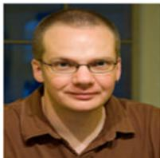

Edward Chadwick 于 1993 年在英国 The University of Nottingham 获得机械工程工学学士学位，并于 1999 年因在上肢生物力学建模方面的研究工作被英国 University of Strathclyde 授予生物工程博士学位。此后，他在荷兰 Technical University of Delft 完成了肩部生物力学领域的为期四年的博士后研究。自 2003 年起，他一直在俄亥俄州克利夫兰的 Case Western Reserve University 生物医学工程系担任高级副研究员（Senior Research Associate）。他的研究兴趣包括上肢生物力学建模、运动分析与运动控制，以及将建模和生物力学应用于神经肌肉损伤患者的康复。

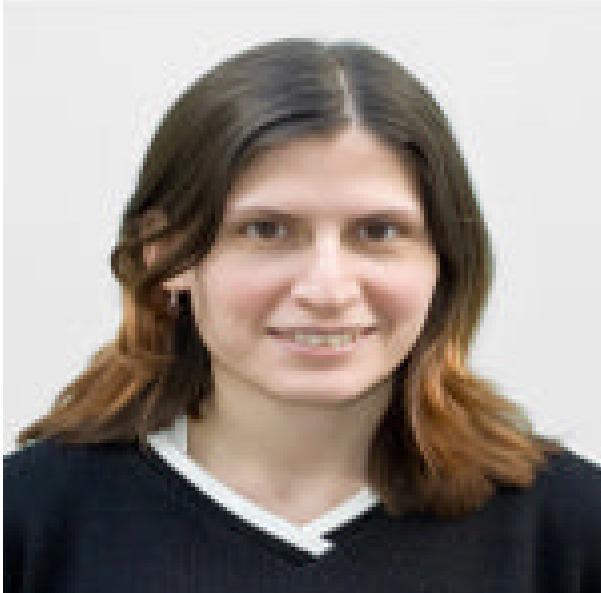

Dimitra Blana 于 2001 年在希腊 National Technical University of Athens 获得电气与计算机工程理学学士学位。随后，她于 2003 年在俄亥俄州克利夫兰的 Case Western Reserve University 获得生物医学工程理学硕士学位，并于 2008 年在同一机构获得博士学位。她目前是 Case Western Reserve University 生物医学工程专业的副研究员（Research Associate）。她的研究兴趣包括上肢神经假体的生物力学建模和控制器设计。

Antonie J. (Ton) van den Bogert 在 University of Utrecht（乌得勒支大学）获得物理学和应用数学学士及硕士学位，并于 1989 年在同一大学因马运动的计算建模获得兽医学博士学位。在 University of Calgary（卡尔加里大学）从事运动生物力学博士后研究后，他于 1993 年成为人体运动学系（Kinesiology）教师。他于 1998 年迁往克利夫兰，目前担任 Cleveland Clinic（克利夫兰诊所）Lerner Research Institute 的副研究员，以及 Case Western Reserve University（凯斯西储大学）的副教授。他当前的研究兴趣是人体生物力学与运动控制，应用于肌肉骨骼损伤的预防与康复以及残障人士辅助技术的开发。该工作得到了人体运动分析和肌肉骨骼系统动力学计算建模创新方法的支持。他是国际生物力学学会（International Society of Biomechanics）计算机仿真专业组（Technical Group Computer Simulation, TGCS）的创始成员，自 1988 年起担任互联网讨论组 BIOMCH-L 的版主。  

Robert Kirsch（M'82）于 1982 年在俄亥俄州 University of Cincinnati（辛辛那提大学）获得电气工程学士学位，并分别于 1986 年和 1990 年在 Northwestern University（西北大学）获得生物医学工程硕士和博士学位。1990 年至 1993 年，他在加拿大魁北克省蒙特利尔的 McGill University（麦吉尔大学）生物医学工程系从事博士后研究。他目前是俄亥俄州克利夫兰 Case Western Reserve University（凯斯西储大学）生物医学工程教授，以及 Cleveland VA FES Center 的科研副主任。他的研究重点是利用功能性电刺激（functional electrical stimulation, FES）恢复残障人士的运动功能，并通过自然神经指令控制 FES 动作。利用基于计算机的人体上肢模型来开发新的 FES 方法。目前正在开发包括基于大脑记录的 FES 用户界面，以使 FES 使用者能够指令自身手臂的运动。

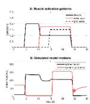  
Fig. 1.

A 部分显示了肘屈肌的激活 $( \operatorname { a t 4 s } ) ,$、屈肌与伸肌的协同收缩（在 10 s 时）以及屈肌、伸肌和旋前肌的激活（在 14 s 时）。B 部分显示了肘部屈曲至 $1 4 0 ^ { \circ }$ 并伴随完全旋后，随后伸展回 $1 0 0 ^ { \circ }$，紧接着旋前至 $1 6 0 ^ { \circ }$。最后，所有肌肉的去激活使模型恢复到屈曲 $5 ^ { \circ }$ 和旋前 $7 0 ^ { \circ }$ 的初始位置。

A: 肌肉激活模式  
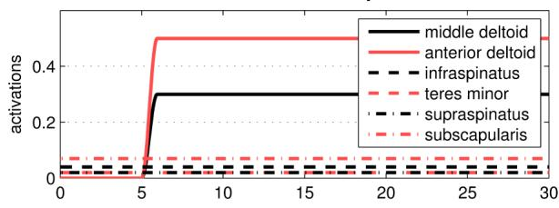

B: 仿真模型运动  
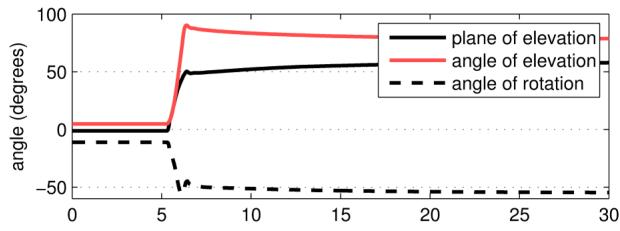

C: 盂肱关节稳定性值  
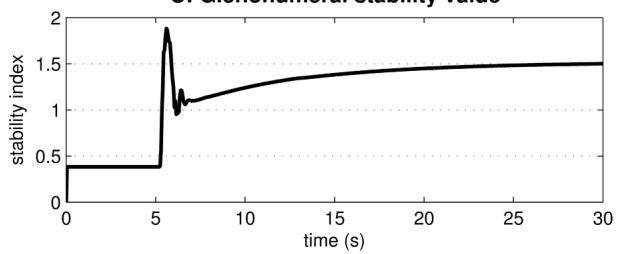  
Fig. 2.  
A 部分显示了三角肌中束和前束的激活情况，B 部分显示了响应这些激活的模型运动。在整个运动过程中，肩袖肌群的活动保持在基线水平，C 部分显示 $G H _ { s t a b }$ 的值增加到 1 以上，表明关节存在潜在脱位风险。

A: 肌肉激活模式  
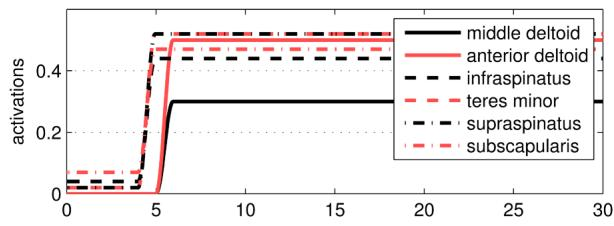

B: 仿真模型运动  
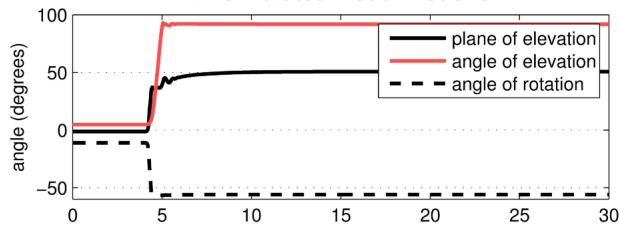

C: 盂肱关节稳定性值  
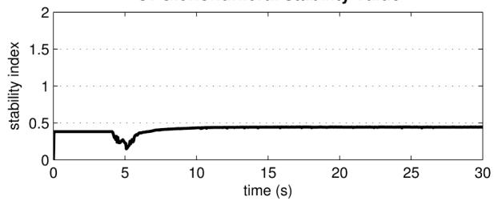  
Fig. 3.  
A 部分显示了三角肌中束和前束的激活，以及肩袖肌群刺激的增加。B 部分显示了由此产生的模型运动。注意盂肱关节稳定性的提高，如 C 部分中稳定性值 < 0.5 所示。

A: 求解器稳定性比较  
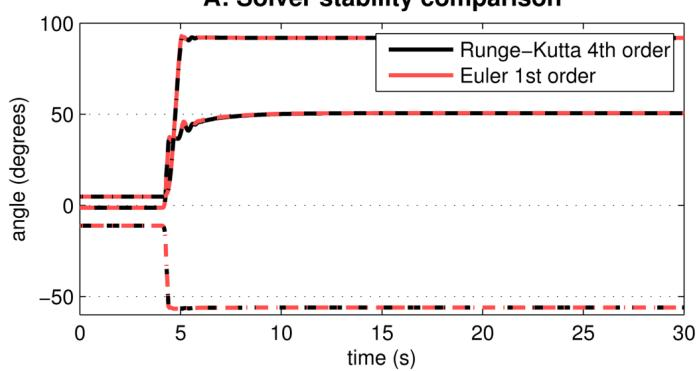

B: 求解器稳定性比较放大图  
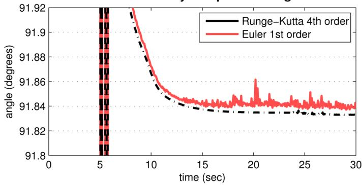  
Fig. 4.  
两种不同求解器在其最小步长下的仿真稳定性。A 部分表明，在两种求解器下，模型对给定输入的响应极其相似。B 部分显示了四阶 Runge-Kutta 求解器相比于一阶 Euler 求解器具有更高的稳定性。

TABLE I 每个自由度的角度限制（度）

<table><tr><td>自由度</td><td>最小角度</td><td>最大角度</td></tr><tr><td>抬升平面</td><td>-90</td><td>90</td></tr><tr><td>抬升角</td><td>5</td><td>90</td></tr><tr><td>内旋</td><td>-55</td><td>70</td></tr><tr><td>屈肘</td><td>5</td><td>140</td></tr><tr><td>前臂旋前</td><td>5</td><td>160</td></tr></table>

TABLE II

实时模型中包含的肌肉，显示了每块肌肉跨越的关节（盂肱关节：GH，肱尺关节：HU 或桡尺关节：RU）以及用于对肌肉建模的单元数量

<table><tr><td>肌肉</td><td>关节</td><td>元件数</td></tr><tr><td>三角肌肩胛部</td><td>GH</td><td>11</td></tr><tr><td>三角肌锁骨部</td><td>GH</td><td>4</td></tr><tr><td>喙肱肌</td><td>GH</td><td>3</td></tr><tr><td>冈下肌</td><td>GH</td><td>6</td></tr><tr><td>小圆肌</td><td>GH</td><td>3</td></tr><tr><td>大圆肌</td><td>GH</td><td>4</td></tr><tr><td>冈上肌</td><td>GH</td><td>4</td></tr><tr><td>肩胛下肌</td><td>GH</td><td>11</td></tr><tr><td>肱二头肌长头</td><td>GH、HU 和 RU</td><td>1</td></tr><tr><td>肱二头肌短头</td><td>GH、HU 和 RU</td><td>2</td></tr><tr><td>肱三头肌长头</td><td>GH 和 HU</td><td>4</td></tr><tr><td>背阔肌</td><td>GH</td><td>6</td></tr><tr><td>胸大肌胸部</td><td>GH</td><td>6</td></tr><tr><td>胸大肌锁骨部</td><td>GH</td><td>2</td></tr><tr><td>肱三头肌内侧头</td><td>HU</td><td>5</td></tr><tr><td>肱肌</td><td>HU</td><td>7</td></tr><tr><td>肱桡肌</td><td>HU 和 RU</td><td>3</td></tr><tr><td>旋前圆肌</td><td>HU 和 RU</td><td>2</td></tr><tr><td>旋后肌</td><td>HU 和 RU</td><td>5</td></tr><tr><td>旋前方肌</td><td>RU</td><td>3</td></tr><tr><td>肱三头肌外侧头</td><td>HU</td><td>5</td></tr><tr><td>肘肌</td><td>HU</td><td>5</td></tr></table>

TABLE III

在安全系数为 2 时确保盂肱关节稳定性所需的肩袖肌群最小激活度。$( G H _ { s t a b } < 0 . 5 )$

<table><tr><td>冈下肌</td><td>小圆肌</td><td>冈上肌</td><td>肩胛下肌</td></tr><tr><td>0.04</td><td>0.02</td><td>0.02</td><td>0.07</td></tr></table>

TABLE IV  
模型在实时系统（1.8GHz Pentium 4）上的性能，三项任务的平均值

<table><tr><td>求解器</td><td>任务执行时间</td><td>稳定步长</td></tr><tr><td>4阶 Runge-Kutta</td><td>0.51ms</td><td>1.0ms</td></tr><tr><td>1阶 Euler</td><td>0.13ms</td><td>0.5ms</td></tr></table>