# 2011 Symposium on Human Body Dynamics

# Implicit methods for efficient musculoskeletal simulation and optimal control

Antonie J. van den Bogerta,b,\*, Dimitra Blanab,c, Dieter Heinrichd

aOrchard Kinetics LLC, Cleveland, OH, USA

bDepartment of Biomedical Engineering, Case Western Reserve University, Cleveland, OH, USA cDepartment of Sport and Exercise Science, Aberystwyth University, Aberystwyth, Wales, UK dDepartment of Sport Science, University of Innsbruck, Innsbruck, Austria

## Abstract

The ordinary differential equations for musculoskeletal dynamics are often numerically stiff and highly nonlinear. Consequently, simulations require small time steps, and optimal control problems are slow to solve and have poor convergence. In this paper, we present an implicit formulation of musculoskeletal dynamics, which leads to new numerical methods for simulation and optimal control, with the expectation that we can mitigate some of these problems. A first order Rosenbrock method was developed for solving forward dynamic problems using the implicit formulation. It was used to perform real-time dynamic simulation of a complex shoulder arm system with extreme dynamic stiffness. Simulations had an RMS error of only 0.11 degrees in joint angles when running at real-time speed. For optimal control of musculoskeletal systems, a direct collocation method was developed for implicitly formulated models. The method was applied to predict gait with a prosthetic foot and ankle. Solutions were obtained in well under one hour of computation time and demonstrated how patients may adapt their gait to compensate fo limitations of a specific prosthetic limb design. The optimal control method was also applied to a state estimation problem in sports biomechanics, where forces during skiing were estimated from noisy and incomplete kinematic data. Using a full musculoskeletal dynamics model for state estimation had the additional advantage that forward dynamic simulations, could be done with the same implicitly formulated model to simulate injuries and perturbation responses. While these methods are powerful and allow solution of previously intractable problems, there are still considerable numerical challenges, especially related to the convergence of gradient-based solvers

© 2011 Published by Elsevier Ltd. Open access under CC BY-NC-ND license. Peer-review under responsibility of John McPhee and József Kövecses Keywords: Biomechanics; Musculoskeletal dynamics; Real-time simulation; Optimal control

Nomenclature
q Vector of generalized coordinates describing skeleton pose.
M(q) Mass matrix of the multibody system
τ Vector containing joint moments $L_{\text{M}}$ Muscle-tendon length $L_{\text{CE}}$ Length of the muscle contractile element
φ Pennation angle of muscle fibers
s State variable for muscle contraction dynamics ( $s = L_{\text{CE}} \cos \phi$ )
a Activation state of a muscle
x Vector containing all musculoskeletal system state variables $x = (q, \dot{q}, s, a)^T$ u Vector containing all musculoskeletal system controls (neural excitations for each muscle)
X Vector of unknowns for collocation methods in optimal control, containing states and controls for an entire movement, and any model parameters that must be optimized or estimated.

## 1. Introduction

Musculoskeletal modeling has become an important tool in research on human movement. Multibody models have long been used to solve inverse dynamics problems for human gait [1], and models of musculoskeletal anatomy were added to allow estimation of forces in joints and orthopedic implants [2]. These inverse dynamics approaches, however, require data collection on human subjects performing the movements of interest. Muscle-driven forward dynamic approaches were developed simultaneously, and these allow simulation of novel and hypothetical movements. Pioneering work on models of musculoskeletal dynamics, and methods for simulation and optimal control, was done by Hatze [3]. Subsequent applications include rehabilitation [4] and basic research in motor control [5], where simulation allows the testing of general hypotheses. Forward dynamics has also been applied in orthopedics and sports medicine to study the effect of neuromuscular control on injuries [6,7] and to design neuromuscular strategies for reducing joint loads in osteoarthritis [8].

Despite the broad range of potentially important applications, musculoskeletal modeling has not been as widely applied as we might expect. Part of this is due to the lack of user-friendly software tools, which is currently being remedied by the Opensim group at Stanford University [9]. But even when software is available, the computation time required for simulation can be an obstacle. The differential equations for musculoskeletal dynamics are often stiff, which requires the standard ODE solvers to perform many small time steps. Such stiffness was, for example, a problem in a model of a walking horse, due to the interaction between an almost massless hoof with the high stiffness of ground contact [10]. One second of simulation required 10 hours of computation on a 25 MHz M68000 processor. The problem is less extreme in human movement, but it again becomes an issue when many simulations must be performed to solve an optimal control problem. Anderson and Pandy [11] used about 10,000 hours of computation, divided among the nodes of a Cray T3E parallel supercomputer, to find optimal controls for a half gait cycle. Ten years later, this is still the best published solution for optimal control of gait using a full 3D musculoskeletal model. In our own work on sports injuries, we were able to find reasonable optimal control solutions by doing several hundred thousand simulations, requiring several days of computation, but these movements were not required to be periodic, were only 200 ms long, and optimizations made use of kinematic data collected on humans [7,12]. Still, several days of computation is too long for effective interactive use of models in research, and also is not acceptable for clinical applications.

In recent years, the use of musculoskeletal dynamics has shifted once more towards solving the inverse problem of neuromuscular control, which can be done very efficiently, and with dynamic consistency, from measured kinematics and ground reaction forces [13]. Unfortunately, this approach does not allow the use of contact models instead of measured ground reaction forces, which eliminates certain applications that are both scientifically interesting and clinically relevant, such as simulation of impact related injuries during active movements, and predictive simulations with optimal control.

In this paper, we will first review the elements of musculoskeletal dynamics, with special attention to potential causes of numerical problems in conventional solution methods. We then present an implicit formulation which reduces the computation time for model dynamics and aims to improve the numerical conditioning of the model equations. Solution methods are presented for forward dynamic simulation, which will be demonstrated on a 3D arm and shoulder model, and for optimal control, which will be demonstrated on the problems of prosthesis design for walking, and state estimation for skiing.

## 2. Musculoskeletal dynamics

## 2.1. Multibody dynamics

The skeletal part of the musculoskeletal system is modeled using rigid bodies connected by joints which impose kinematic constraints on the multibody system. We formulate the multibody dynamics using generalized coordinates q:

$$
\mathbf {M} (\mathbf {q}) \cdot \ddot {\mathbf {q}} + \mathbf {B} (\mathbf {q}, \dot {\mathbf {q}}) - \boldsymbol {\tau} = 0,\tag{1}
$$

where M(q) is the mass matrix, IJ the vector of generalized forces, and $\mathbf { B } ( \mathbf { q } , { \dot { \mathbf { q } } } )$ contains gravity, centrifugal and coriolis effects, and other passive forces such as contact forces which are known as a function of generalized coordinates and their velocities. The vector IJ contains generalized forces which are either zero (for un-actuated degrees of freedom) or generated by muscles according to models that will be presented in sections 2.2, 2.3 and 2.4. The latter are known as joint moments. The formulation (1) is not unique, because it can be pre-multiplied by any non-singular matrix. When formulated as in (1), however, it is easy to see that the terms in the equation of motion can be computed in $O ( N )$ time when the multibody system has a tree structure, with N being the number of body segments in the model. For example, this can be done using forward kinematics to compute inertial terms in the Newton-Euler equations, followed by a conventional recursive inverse dynamics approach to solve joint moments and residual loads from kinematics and external forces [1].

For forward dynamic simulation, equation (1), or its equivalent, must be solved for the generalized accelerations:

$$
\ddot {\mathbf {q}} = \mathbf {M} (\mathbf {q}) ^ {- 1} \left(\boldsymbol {\tau} - \mathbf {B} (\mathbf {q}, \dot {\mathbf {q}})\right).\tag{2}
$$

Standard differential equation solvers are then used to integrate this equation and simulate movement.

Even before introducing muscles, we can already point out that simulation will not be possible if the mass matrix M is singular. It is quite common in musculoskeletal systems that a mass matrix is nearsingular because some body segments have small mass and moment of inertia. This problem is compounded by the presence of elements in B with high stiffness and damping. The Jacobian matrix of the right hand side of (2) will then have high eigenvalues, indicating that the differential equation is stiff and will require small time steps to solve with explicit methods. This was, for example, evident in a model of a walking horse, with elastic contact between the small hoof segments and hard pavement [10]. Another source of numerical stiffness is in ligaments which can be short and stiff.

In models of machines, there is usually a clear distinction between elements with high stiffness and elements with low stiffness. Stiff differential equations can then be avoided by replacing the high stiffness elements by kinematic constraints, which effectively have infinite stiffness, and degrees of freedom are removed. With some additional bookkeeping, this can also be done for contact between rigid bodies, where the constraints are complementarity constraints that can be activated and deactivated during a simulation. In biomechanical modeling, however, there is not always a clear distinction between kinematic elements and force-generating elements, and replacing stiff force elements by hard constraints is not always justifiable or desirable. For instance, we would no longer be able to change ground surface contact properties to simulate the effect of walking on sand vs. pavement, or the effect of sport shoes on running performance. In the case of stiff ligaments, these can sometimes be replaced by kinematic constraints in joints, for example, it is common to restrict the knee motion to a single rotational degree of freedom. This would, however, be undesirable if we wanted to simulate the effect of variations in knee laxity on injury risk during sports activities. Another example would be a model of the human hand, where extremely small masses of the fingers are coupled to stiff tendons. The numerical stiffness could be eliminated by modeling the tendons as infinitely stiff. This would be appropriate for simulating unloaded movements such as sign language communication, but not for manipulation of objects, where tendon compliance is essential. The root of the problem is, perhaps, that ligaments and tendons have highly nonlinear mechanical properties: stiffness is almost zero when unloaded, and very high when maximall loaded. Stiff differential equations are, unfortunately, inevitable in models of musculoskeletal dynamics.

## 2.2. Muscle contraction dynamics

The standard method for modeling the dynamics of muscle contraction is with a three-element structure (Fig. 1). The contractile element (CE) represents the muscle fibers. The series elastic element (SEE) represents the tendon and other tissue that transmits force from the muscle fibers to the skeleton.

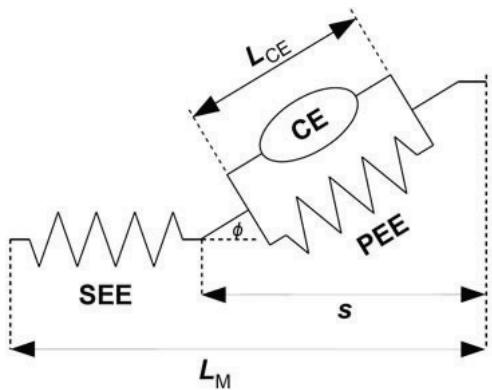  
Fig. 1. Three-element muscle model, consisting of contractile element (CE), series elastic element (SEE), and parallel elastic element (PEE). Pennation angle Iis the angle between the muscle fibers in the CE and the line of action of the muscle. s is the state variable for the muscle contraction dynamics.

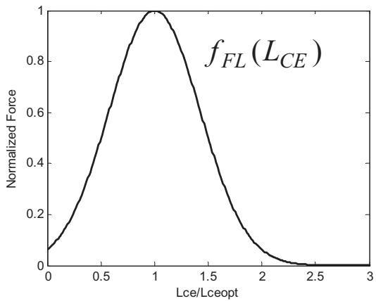  
(a)

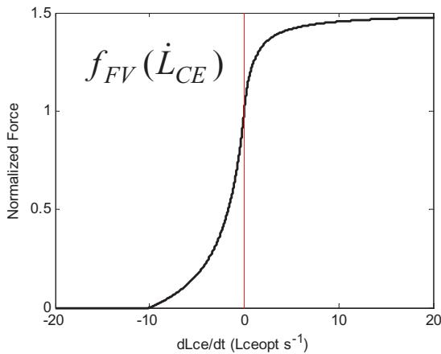  
(b)  
Fig. 2. (a) Typical force-length relationship for muscle fibers. Lceopt is the fiber length at which the highest force can be generated; (b) Typical force-velocity relationship for muscle fibers. Negative velocities represent shortening (concentric contraction), positive velocities represent lengthening (eccentric contractions). The maximum shortening velocity is typically around 10 fiber lengths per second [15], and the force does not exceed 150% of the (isometric) force at zero velocity.

The parallel elastic element (PEE) represents the passive elastic tissue that surrounds the muscle fibers. Properties of these elements have been extensively described in the literature (e.g. [14]) and here we will present only a summary, with a specific implementation of the model equations that we have used in the applications presented in this paper.

Based on muscle physiology, we can model the CE as producing a force $F _ { \mathrm { C E } }$ that depends on the maximal isometric force $F _ { \mathrm { m a x } }$ , activation $^ { a , }$ fiber length $\left( L _ { \mathrm { C E } } \right)$ and fiber lengthening velocity $( \dot { L } _ { \mathrm { C E } } )$ . As others have done [14,15], we assume a multiplicative interaction of these effects:

$$
F _ {C E} = a \cdot F _ {\max} \cdot f _ {F L} (L _ {C E}) \cdot f _ {F V} (\dot {L} _ {C E}).\tag{3}
$$

The functions $f _ { \mathrm { F L } }$ and $f _ { \mathrm { F V } }$ are dimensionless force-length and force-velocity relationships [14,15]. Typical examples are shown in Fig. 2. The elastic elements are represented by separate passive forcelength relationships $f _ { \mathrm { S E F } }$ and $f _ { \mathrm { P E E } }$ . The state equation for the muscle is the force balance equation for the three-element structure:

$$
\left[ a \cdot F _ {\max} \cdot f _ {F L} (L _ {C E}) \cdot f _ {F V} (\dot {L} _ {C E}) + f _ {P E E} (L _ {C E}) \right] \cos \phi - f _ {S E E} (L _ {M} - L _ {C E} \cos \phi) = 0.\tag{4}
$$

The pennation angle $\phi$ is eliminated from the model by the assumption of constant volume [16]:

$$
L _ {\mathrm{CE}} \sin \phi = L _ {\mathrm{CEref}} \sin \phi_ {\mathrm{ref}},\tag{5}
$$

where the right hand side is a constant derived from a reference fiber length and reference pennation angle that were measured in one particular state, e.g. post mortem in a cadaveric specimen. Such architecture parameters, as well as muscle attachment points on the skeleton, have been measured for many muscles [17,18] and have been incorporated in models that are part of commercial and open-source software systems [9]. For muscle contraction dynamics, muscle activation a and muscle length $L _ { \mathrm { M } }$ are external inputs which we will model in sections 2.3 and 2.4. Equation $( 4 )$ is now a differential equation for the state variable $L _ { \mathrm { C E } }$ . The state equation $( 4 )$ is usually made explicit by solving $\dot { L } _ { \mathrm { C E } }$ , but there are several potential singularities. First, the force-velocity relationship $f _ { \mathrm { F V } }$ is not invertible because it has both a minimum force (zero) and a maximum force. Second, division by zero will occur when the muscle is not activated $( a ~ = ~ 0 )$ . Third, the muscle will lock up when fibers have shortened to a length of

$L _ { \mathrm { C E r e f } } \sin \phi _ { \mathrm { r e f } }$ . In typical software implementations, these singularities are replaced by near-singularities that approximate the actual muscle properties well enough [12] but will cause numerical stiffness and slow down the differential equation solvers.

To eliminate the pennation singularity, we adopt instead $s = L _ { \mathrm { C E } } \cos \phi ( \mathrm { F i g . ~ } 1 )$ as the state variable, from which the fiber length and cosine of the pennation angle can always be solved without singularities:

$$
\begin{array}{c} L _ {\mathrm{CE}} = \sqrt {s ^ {2} + \left(L _ {\mathrm{CEref}} \sin \phi_ {\mathrm{ref}}\right) ^ {2}} \\ \cos \phi = \frac {s}{L _ {\mathrm{CE}}} \end{array}\tag{6}
$$

When these are substituted in the state equation (4), we obtain an implicit first order differential equation for the state variable s. This equation still cannot be solved for s in all circumstances, so we leave it as an implicit differential equation for now.

## 2.3. Muscle activation dynamics

The activation a of a muscle (also known as active state) cannot be directly controlled by the nervous system because it is the result of a relatively slow electro-chemical process. The nervous system sends a control signal u(t), also known as neural excitation, into the muscle, which results in changes in activation via a first-order nonlinear activation-deactivation process. Activation is faster than deactivation, which is commonly modeled as [19]:

$$
\dot {a} = (u - a) (c _ {1} u + c _ {2}),\tag{7}
$$

where $c _ { 1 } { + } c _ { 2 }$ is the rate constant for activation and $c _ { 2 }$ is the rate constant for deactivation, typically in the range of $2 0 { - } 5 0 \ \mathrm { s } ^ { - 1 }$ , depending on muscle fiber type [17,19].

## 2.4. Muscle-skeleton coupling

Endpoints of the muscles are attached to the skeleton, which implies that each muscle length is a function of the skeleton pose:

$$
L _ {\mathrm{M}} = L _ {\mathrm{M}} (\mathbf {q})\tag{8}
$$

The relationship between muscle length and joint angles can be modeled geometrically, with straight lines or more realistic muscle paths which wrap around underlying anatomical structures [9]. The relationship can also be directly measured, in vivo via imaging techniques, or post mortem by the tendon travel method [20]. Once this length-angles relationship is known and modeled such that differentiation is possible, the joint moment $\tau _ { i j } ,$ produced by muscle i at joint j can be derived using the principle of virtua work [21] and written as a function of state variables q and $L _ { \mathrm { C E } } { \mathrm { : } }$

$$
\tau_ {i j} = - \frac {\partial L _ {\mathrm{M} , i}}{\partial q _ {j}} f _ {S E E, i} \left(L _ {\mathrm{M}, i} (\mathbf {q}) - L _ {\mathrm{CE}, i}\right)\tag{9}
$$

The partial derivative in this equation is the moment arm of the muscle i at joint j. The negative sign arises from the fact that muscles produce positive work when shortening, i.e. when $L _ { \mathrm { M } }$ is decreasing. Joint moments from (9) are now substituted in the equations of motion (1) to complete the muscle-skeleton coupling.

In our own work, we usually obtain moment arms for a large number of poses q by kinematic simulations with the Opensim software ([9], http://www.simtk.org/home/opensim). A polynomial lengthangles relationship is then generated which, when differentiated, fits this moment arm data with sufficient accuracy [7,22]. Once this preprocessing is done, the polynomials can be computed and differentiated much faster than geometry-based muscle paths, and this helps simulations run more quickly. The simplest such polynomial is linear:

$$
L _ {\mathrm{M}} (\mathbf {q}) = L _ {0} + d _ {1} q _ {1} + d _ {2} q _ {2} + \dots\tag{10}
$$

which implies that the muscle has a constant moment arm at each joint, or in a geometric sense, wraps around a cylinder that is centered at the rotation axis of the joint. This is often adequate for planar models, but in 3D models, the posture often affects moment arms in a critical manner and more general higher order polynomials are necessary:

$$
L _ {\mathrm{M}} (\mathbf {q}) = \sum_ {i = 1} ^ {N} c _ {i} \prod_ {j = 1} ^ {M} q _ {j} ^ {e _ {i j}},\tag{11}
$$

where N is the number of polynomial terms, and M is the number of kinematic degrees of freedom spanned by the muscle. Model parameters are N coefficients $c _ { i }$ and NM non-negative integer exponents $e _ { i j } .$

## 2.5. Implicit state equation for musculoskeletal dynamics

After reviewing the elements of the musculoskeletal model, we will formulate the combined system dynamics using a state vector x:

$$
\mathbf {x} = (\mathbf {q}, \dot {\mathbf {q}}, \mathbf {s}, \mathbf {a}) ^ {T}\tag{12}
$$

There are two state variables $( q$ and $\dot { q } )$ for each kinematic degree of freedom, and two state variables (s and a) for each muscle. The dynamic equilibrium equations $( l )$ and (4) can now be combined with activation model (7) into a single implicit state equation of the form:

$$
\mathbf {f} (\mathbf {x}, \dot {\mathbf {x}}, \mathbf {u}) = 0\tag{13}
$$

with u containing the neural excitations for all muscles. Conventional simulation methods require that this equation is solved for x to obtain an ordinary differential equation (ODE), but this leads to numerical stiffness as described above, and small simulation time steps. One possible remedy is to use implicit ODE solvers [23], but the computational cost of numerically estimating the Jacobian matrix of the ODE is often higher than the cost of using an explicit solver with smaller time steps. If, however, we leave the differential equation in its implicit form (13), it has a simpler symbolic internal structure and it becomes possible to obtain exact analytical Jacobians $\hat { \ b { \mathrm { o } } } \mathbf { f } / \hat { c } \mathbf { x }$ , ww xf  , and ${ \partial \mathbf { f } } / { \partial \mathbf { u } }$

In the work presented in this paper, we used Autolev (Symbolic Dynamics Inc., Sunnyvale, CA) to generate symbolic expressions and C code for the multibody equations (1) in f and their derivatives with respect to $\mathbf { q } , { \dot { \mathbf { q } } }$ , and $\ddot { \bf q }$ . The muscle dynamics equations and their derivatives were hand-coded in C. The combined C source code for each model was then wrapped in a MEX function interface for Matlab (Mathworks, Inc., Natick, MA), such that applications could be developed on the Matlab platform and benefit from Matlab’s plotting and powerful sparse linear algebra capabilities.

Due to the implicit formulation, the Jacobian matrices $\hat { \alpha } \mathbf { f } / \hat { \alpha } \mathbf { x } , \hat { \alpha } \mathbf { f } / \hat { \alpha } \dot { \mathbf { x } }$ , and ${ \partial \mathbf { f } } / { \partial \mathbf { u } }$ are not only easy to compute but also sparse, which increases the efficiency of the linear algebra operations in the solvers for simulation and optimal control. The sparsity structures for a 2D gait model with 50 state variables and 16 controls [24] are shown in Fig. 3.

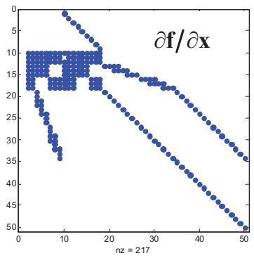

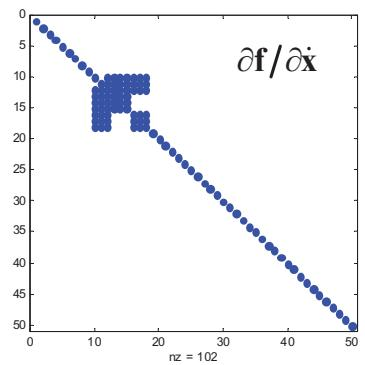

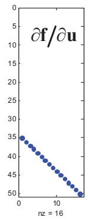  
Fig. 3. Sparsity structures of the Jacobians $\hat { \alpha } \mathbf { f } / \hat { \alpha } \mathbf { x } , \hat { \alpha } \mathbf { f } / \hat { c } \dot { \mathbf { x } }$ , and ${ \hat { c } } \mathbf { f } / { \hat { c } } \mathbf { u }$ of the implicit dynamics equation $\mathbf { f } \left( \mathbf { x } , \dot { \mathbf { x } } , \mathbf { u } \right) = 0$ for the 2D gait model with 9 degrees of freedom and 16 muscles [24]. Columns correspond to the state variables defined in (12). The dense blocks in rows 10-18 are due to multibody dynamics (equation 1). The $3 \mathrm { x } 3$ holes in these blocks are due to the limbs, each of which has three degrees of freedom, being decoupled in the implicit formulation. The stair stepping pattern in these rows is due to muscle skeleton coupling, which only produces non-zero Jacobian elements when the muscle actually crosses the joint. Explicit formulations will have fully dense blocks in those parts of the Jacobian, due to dynamic coupling which causes each force generating element to affect each generalized acceleration in the system.

## 3. Simulation

## 3.1. Methods

Simulation of a musculoskeletal system model involves solving the state trajectory $\mathbf { x } ( t ) .$ , given an initial state $\mathbf { x } ( 0 )$ and controls u as functions of time and/or state. Equation (13) is a differential-algebraic equation (DAE) of index zero when ${ \partial \mathbf { f } } / { \partial \dot { \mathbf { x } } }$ is non-singular. This means that x could be solved and integrated, but we will also allow situations where this matrix is singular, which can be the result of a singular mass matrix or zero muscle activation. In those cases, the DAE has index 1. Numerical methods for solving DAEs of index 0 or 1 are well known, and usually based on backwards differentiation formulae [23]. It will be illustrative to present one of these, the implicit Midpoint Euler (ME) method. We will only consider the open-loop control case here, where u is a function of time. The ME method advances the system from state ${ \bf { X } } _ { n }$ at time t to the new state ${ \bf X } _ { n + 1 }$ at time $t { + } h ,$ by solving ${ \bf X } _ { n + 1 }$ from the dynamics equation at the midpoint:

$$
\mathbf {f} \left(\frac {1}{2} (\mathbf {x} _ {n} + \mathbf {x} _ {n + 1}), \frac {1}{h} (\mathbf {x} _ {n + 1} - \mathbf {x} _ {n}), \frac {1}{2} (\mathbf {u} _ {n} + \mathbf {u} _ {n + 1})\right) = 0.\tag{14}
$$

ME is a second order method without numerical damping artifacts. It is A-stable but not L-stable. The nonlinear equation (14) must be solved using some variation of Newton’s method, which leads to an iterative process:

$$
\mathbf {x} _ {n + 1} ^ {(k + 1)} = \mathbf {x} _ {n + 1} ^ {(k)} - \left(\frac {1}{2} \frac {\partial \mathbf {f}}{\partial \mathbf {x}} + \frac {1}{h} \frac {\partial \mathbf {f}}{\partial \dot {\mathbf {x}}}\right) ^ {- 1} \mathbf {f} \left(\frac {1}{2} (\mathbf {x} _ {n} + \mathbf {x} _ {n + 1} ^ {(k)}), \frac {1}{h} (\mathbf {x} _ {n + 1} ^ {(k)} - \mathbf {x} _ {n}), \frac {1}{2} (\mathbf {u} _ {n} + \mathbf {u} _ {n + 1})\right).\tag{15}
$$

The requirements for solvability are immediately evident. We do not require that ${ \cal \hat { o } } { \bf f } / { \cal \hat { o } } { \bf \dot { x } }$ , which can be loosely termed “mass matrix”, is invertible, but that its linear combination with the “stiffness matrix” $\hat { \ b { \mathrm { o } } } \mathbf { f } / \hat { c } \mathbf { x }$ is invertible. So we must have stiffness where there is no mass, and mass where there is no stiffness. The same reasoning applies also to the near-singularities that we have identified earlier. If there are any perturbation directions in state space with high stiffness and low mass, this was a liability for solving the explicitly formulated model (2), but is actually an advantage for implicit solution methods applied to the implicit formulation of the model. This complementarity between mass and stiffness is often already a natural feature of musculoskeletal models, where small masses (foot, scapula, fingers) often interact with stiff tissue elements. When the time step h goes to infinity, the ME method produces the static equilibrium state, and this requires that the stiffness matrix is invertible. We have indeed verified that the ME method, applied to the implicit model formulation, is stable even when the mass matrix is singular and muscle activation is zero.

The ME method is not ideal for real-time simulation because the number of required Newton iterations was found to vary from one time step to the next, even when the Jacobians are exact, so computation time is not predictable. For real-time simulation, we therefore use a Rosenbrock method, which is the class of linearly implicit methods. Rosenbrock methods perform only one Newton iteration in each time step, but require exact Jacobian matrices, which we have. High order Rosenbrock methods for DAE systems of index one or zero, with error control, have been described by Roche [25]. For our needs, it was sufficient to implement a first order method with constant step size h:

$$
\begin{array}{l} \Delta \mathbf {x} = \left(\frac {\partial \mathbf {f}}{\partial \mathbf {x}} + \frac {1}{h} \frac {\partial \mathbf {f}}{\partial \dot {\mathbf {x}}}\right) ^ {- 1} \left(\frac {\partial \mathbf {f}}{\partial \dot {\mathbf {x}}} \dot {\mathbf {x}} _ {n} - \mathbf {f} (\mathbf {x} _ {n}, \dot {\mathbf {x}} _ {n}, \mathbf {u} _ {n}) - \frac {\partial \mathbf {f}}{\partial \mathbf {u}} \cdot (\mathbf {u} _ {n + 1} - \mathbf {u} _ {n})\right) \\ \mathbf {x} _ {n + 1} = \mathbf {x} _ {n} + \Delta \mathbf {x} \\ \dot {\mathbf {x}} _ {n + 1} = \Delta \mathbf {x} / h \end{array} .\tag{16}
$$

The full derivation of equation (16) is presented in Appendix A. Note that the solvability requirements, with complementarity between mass and stiffness matrices, are the same as for the ME method.

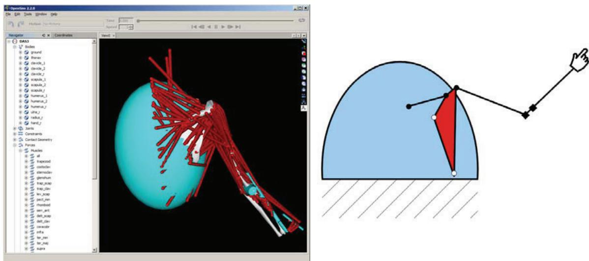  
Fig. 4. Model of the shoulder-arm system, visualized in Opensim [9] (left). The schematic representation (right) shows the kinematic structure, consisting of clavicle, scapula, humerus, ulna, and radius. Closed circles are ball joints and squares are hinge joints. Open circles are points where the thorax (blue ellipsoid) exerts elastic contact forces on the scapula.

## 3.2. Real-time simulation of an arm-shoulder model

Functional electrical stimulation (FES) of muscles can restore function in individuals with spinal cord injury. A major challenge in this work is the development of intelligent controllers and natural command interfaces. In order to test controllers and command interfaces with a human user in the loop, a virtual arm, or Dynamic Arm Simulator (DAS) was developed. The DAS allows users to practice using a command interface on a predictable dynamic system, and allows research on control systems and human interaction to be conducted before introducing the unpredictability of the biological musculoskeletal system. Because the human user is in the control loop, dynamic simulations must be performed in real time. DAS version 2 was presented in [22] and consisted of an arm that moved relative to an immobilized scapula. It was formulated as an ODE and simulated with a $4 ^ { \mathrm { t h } }$ order explicit Runge-Kutta (RK) method at fixed time steps of 1 ms. The next version (DAS3) includes movement of scapula and clavicle, which have low mass and are balanced between large and stiff force-generating structures. Initial experiments with the ODE formulation of DAS3 revealed that explicit methods required extremely small time steps and it could not run in real time.

The DAS3 model was developed based on the general model structure described in [26]. The model consisted of a thorax, fixed to the ground, and a kinematic chain consisting of clavicle, scapula, humerus, ulna, radius, and hand. The wrist joint was immobilized, and there are 11 kinematic degrees of freedom. Gliding contact between scapula and thorax was implemented using an elastic model with a stiffness of 20 kN/m. The model was implemented in SIMM (Musculographics Inc., Santa Rosa, CA) and 138 muscle elements were added, based on data by Klein Breteler et al. [18]. Kinematic simulations were carried out in SIMM to obtain polynomial models (11) for the muscle paths. The model was imported in Opensim [9] for visualization (Fig. 4). The model has $2 \mathrm { x } 1 1 + 2 \mathrm { x } 1 3 8 = 2 9 8$ state variables.

The model was formulated in implicit form (13) and implemented as a Matlab MEX function that computes the dynamic residuals f and its three Jacobians. The execution time for this MEX function was 1.2 ms on an Intel i5-450M processor at 2.4 GHz. The first order Rosenbrock method was implemented, and it was found that it required an additional 1.5 ms per time step to solve the linear system (16). This means that real-time simulations must be done with time steps of 2.7 ms or larger. Test simulations were carried out in which the system started in its passive equilibrium state (with the arm hanging down). Neural excitations in all muscles were ramped up to reach a maximum at $t = 0 . 2$ seconds, then kept constant until $t = 2 . 0$ , after which the excitations were switched off. The simulation was continued until t $= 4 . 0 \ \mathrm { s . \ A }$ second order explicit RK method (Matlab ODE23) was used with default tolerance settings to first establish the “correct” result. At each ODE evaluation, x was solved from (13) using Newton’s method with a tolerance of $1 0 ^ { - 8 }$ in the norm of f. ODE23 required an average step size of about 2 microseconds to perform the simulation, confirming the extreme stiffness of the ODE formulation. The main (but not the only) reason for this stiffness was the stiff and short conoid ligament, which connects the coracoid process of the scapula to the clavicle, and controls the axial rotation of the clavicle which has a very low moment of inertia.

The simulated movement is shown in Fig. 5a. The muscles move the joints quickly to a new equilibrium position. In the final two seconds, when the muscles relax, there is a damped oscillation, when the arm acts like a pendulum. Simulations were then done with the Rosenbrock method (16) using various time steps of up to 6 ms, when the method became unstable (Fig. 5b). At small step size, the error was proportional to step size, which confirms that this is a first order method. At 3 ms, which can be done in real time, the RMS error in joint angles was just 0.11 degrees, which means that the result was identical to the correct result (Fig. 5a), for all practical purposes. This is a remarkable level of accuracy, considering that the simulation was done in time steps that were 1500 times larger than with the RK method.

Even when real-time simulation is not needed, or already achieved with conventional methods, this new implicit method will allow simulations to be done much faster, and this is important when optimal control problems are solved by performing a large number of simulations [11,12].

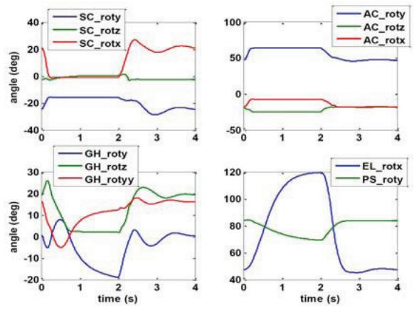  
(a)

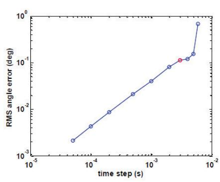  
(b)  
Fig. 5. (a) Results for the test simulation of the arm-shoulder model, showing the eleven joint angles in the sternoclavicular (SC), acromioclavicular (AC), glenohumeral (GH), elbow (EL) and pronation-supination (PS) joints; (b) RMS error in simulated join angles as a function of time step in the first order Rosenbrock method. The 3 ms time step, which is the smallest that can be done in real time, is shown in red

## 4. Optimal control

## 4.1. Problem statement and related work

Optimal control problems arise in many applications of musculoskeletal modeling. Often, we wish to determine controls u(t) which will produce a movement that is in some sense “optimal”. In fully predictive simulations, no observations on humans are used, and optimality is defined as either maximal performance, or as minimal effort for a given submaximal task. Such optimizations can be used to design optimal sports techniques, or to test hypotheses about human motor control [3,24]. In other applications, we wish to find controls u(t) that make the system reproduce an actual observed human movement. Simulations driven by these controls, can then be used to simulate new movements, for instance in response to perturbations which can cause injuries [7]. Regardless of the nature of the optimal control problem, it can always be formulated as follows:

$$
\begin{array}{l l} \text {Find state trajectories \mathbf {x} (t) and control trajectories \mathbf {u} (t)} \\ \text {Which minimize a cost functional:} \\ \mathcal {F} (\mathbf {x} (t), \mathbf {u} (t)) \\ \text {And satisfy these constraints:} \\ \mathbf {f} (\mathbf {x}, \dot {\mathbf {x}}, \mathbf {u}) = 0 & \text {(system dynamics)} \\ \mathbf {u} _ {L} \leq \mathbf {u} \leq \mathbf {u} _ {U} & \text {(bounds on controls)} \\ \mathcal {T} _ {i} (\mathbf {x} (t), \mathbf {u} (t)) = 0 & \text {(task requirements)} \end{array}\tag{17}
$$

Typical examples of cost functionals are: energy cost, distance to a reference trajectory, or (the negative of) performance variables such as running speed and jump height. These may also be combined as a weighted sum to do a multi-objective optimization. There can be any number of task constraints, or none at all. Some typical examples of task constraints are: initial state, final state, periodicity, or walking speed.

Methods for solving musculoskeletal optimal control problems have evolved considerably over time. Early work on relatively small musculoskeletal models was done with indirect methods such as differential dynamic programming [3]. These methods did not scale well to the more complex 3D full body models, and were replaced by direct shooting methods in which the control trajectories were parameterized and repeated forward dynamic simulations were done, to search for optimal controls in parameter space. Gradient-based search in parameter space was found to be time consuming [11] and prone to finding local extrema [27], and has been mostly replaced by heuristic methods such as simulated annealing [7,12,27] and genetic algorithms [28].

More recently, collocation algorithms have been used in which the state and control trajectories are both discretized on a temporal mesh, resulting in a large scale constrained optimization problem described by (17). These methods were first applied in computer animation [29], resulting in the wellknown Pixar animation of a jumping Luxo lamp. The same methods were also very successful in aerospace trajectory optimization [30]. Collocation methods seem especially suited to optimal control problems where task constraints apply at the end of the simulation. In shooting methods, the final state can be too sensitive to initial conditions and controls, especially for intrinsically unstable systems such as bipedal humans. Collocation methods have become increasingly popular tools for optimal control of human movement [24,31-33]. We have extensively evaluated the direct collocation method for predictive simulation of symmetric bipedal locomotion using musculoskeletal dynamics in explicit (ODE) form. By successive mesh refinement, it was determined that solutions are sufficiently accurate at a resolution of 50 nodes for a half gait cycle [24,34,35]. We also identified significant challenges. Computation time was still too long for effective research, ranging from 30 minutes (planar model) to one week (3D model), even with a good initial guess [35]. The major part of computation time was spent on computing the Jacobian matrices of the ODE with finite differences. Convergence was still problematic unless a good initial guess was available, which might take days or weeks of experimentation to obtain. We expect to overcome some of these challenges if the explicit ODE form is replaced by the implicit formulation introduced in this paper.

## 4.2. Solution method

Direct collocation methods for optimal control are relatively easy to implement with our implicit formulation of musculoskeletal dynamics. We discretize the unknown state and control trajectories on temporal nodes $t _ { 1 } , t _ { 2 } , \ldots t _ { \mathrm { N } } ,$ resulting in unknowns $\mathbf { X } _ { 1 } , \mathbf { X } _ { 2 } . . . \mathbf { X } _ { \mathrm { N } }$ and $\mathbf { u } _ { 1 } , \mathbf { u } _ { 2 } , . . . \mathbf { u } _ { \mathrm { N } } .$ The cost functional $\mathcal { F }$ is now a function $F$ of these unknowns. The system dynamics constraint is translated into a series of algebraic constraints by replacing the state derivative $\dot { \mathbf { x } }$ with a finite difference approximation. In the work presented here we use the midpoint rule, which leads to the following N 1 constraints:

$$
\mathbf {C} _ {i} \equiv \mathbf {f} \left(\frac {\mathbf {x} _ {i + 1} + \mathbf {x} _ {i}}{2}, \frac {\mathbf {x} _ {i + 1} - \mathbf {x} _ {i}}{t _ {i + 1} - t _ {i}}, \frac {\mathbf {u} _ {i + 1} + \mathbf {u} _ {i}}{2}\right) = 0 \qquad f o r i = 1 \dots N - 1\tag{18}
$$

Each of these constraints has the dimension of f, i.e. the number of state variables. For predictive simulation of gait, we also define the additional task constraints of speed and periodicity:

$$
\mathbf {x} _ {N} = \mathbf {x} _ {1} + v T \hat {\mathbf {x}},\tag{19}
$$

where v is the walking speed, T is the duration of the gait cycle, and $\hat { \bf x }$ is a unit vector in state space in the direction of pure forward translation. Speed and duration may either be prescribed, or optimized along with the optimal control and state trajectories. The original optimal control problem has now been transformed into a large scale constrained optimization problem, or nonlinear program (NLP). We collect all unknowns (discretized state and control trajectories, and any additional unknowns that must be solved) into a large vector X, and we minimize the function $F ( \mathbf { X } )$ , subject to equality constraints $\mathbf { C } _ { i } ( \mathbf { X } ) { = } 0$ from (18) and (19) and bounds $\mathbf { L } \leq \mathbf { X } \leq \mathbf { U }$

Standard large scale NLP solvers can be used to solve this type of problem. We have good experience with SNOPT [36], which uses the active set method, and IPOPT [37], which uses an interior point method. Both are available for the Matlab platform and were used in the work presented in this paper. In our experience, which is consistent with the recommendations of Betts [30], interior point methods are preferred when a good initial guess is not available, while active set methods are better when a series of related problems is solved, and initial guesses are already close to the solution. All NLP solvers require the gradient of the cost function $F$ and the Jacobian of the constraints C with respect to the unknowns X. The cost function is often a simple function of states and controls, and analytical derivatives can be generated. The Jacobian of constraints is sparse, since each constraint (18) only involves the states and controls at two neighboring nodes. Derivatives of (18) with respect to states and controls of either node are easy to compute because the Jacobians of the function f are already available as described in section 2.5. The nonzero blocks in the constraint Jacobian matrix consist of linear combination of the “mass” and “stiffness” matrices ${ \partial \mathbf { f } } / { \partial \dot { \mathbf { x } } }$ and $\hat { \ b { \mathrm { o } } } \mathbf { f } / \hat { c } \mathbf { x }$ , so the same solvability conditions apply as in the forward dynamic simulation methods presented in section 3.1.

## 4.3. Predictive simulation of prosthetic gait

Design of prosthetic limbs, or other assistive devices and man-machine systems, is a problem that naturally lends itself to a musculoskeletal optimal control approach. Before a prototype of the mechanical device exists, a computational model is often made as an initial test of its functionality and to optimize the design. This is, however not straightforward when a device is mechanically coupled to a human body, and has the specific purpose of affecting human movement. Human movement will be affected directly via mechanical effects, or indirectly when the user adapts their neuromuscular control to make better use of the device. The performance of the device can therefore not be predicted very well with a computation model that does not include musculoskeletal dynamics and adaptive human behavior

To demonstrate such an application, we will attempt to predict how the gait of a transtibial amputee is affected by a prosthetic foot. We use the planar musculoskeletal model described in [24], which has nine kinematic degrees of freedom and sixteen muscles, a total of 50 state variables and 16 control variables. Ground contact was represented by unidirectional viscoelastic elements with friction, on the heels and toes. We simulate cyclic gait with a prescribed speed of 1.1 m/s and a gait cycle duration of 1.28 s. The problem was time-discretized on 100 nodes for a full gait cycle, resulting in a total of 6600 unknowns. Dynamics and periodicity were represented by 5000 constraints using equations (18) and (19). Optimizations were carried out with the following weighted cost function:

$$
F (\mathbf {x} (t), \mathbf {u} (t)) = \frac {1}{T} \int_ {0} ^ {T} \left[ \frac {1}{1 0} \sum_ {i = 1} ^ {1 0} \left(\frac {s _ {i} (\mathbf {x} (t)) - m _ {i} (t)}{\sigma_ {i}}\right) ^ {2} + \frac {W}{1 6} \sum_ {i = 1} ^ {1 6} u _ {i} (t) ^ {2} \right] d t\tag{20}
$$

in which $m _ { i } ( \mathrm { t } )$ are reference trajectories of ten variables: three joint angles and the horizontal and vertical ground reaction forces, in each limb, measured during able-bodied gait [1]. The corresponding variables in the model are $s _ { i } ,$ which are either state variables or functions of the system state. The difference between simulated and measured variables is normalized to the human standard deviations $\sigma _ { i }$ , making it dimensionless. The first, “tracking”, term in (20) will encourage the model to stay close to normal gait, and the second, “effort”, term will encourage it to use its muscles efficiently. The weighting W was set to 100, which implies that the cost of full muscle activation $\scriptstyle ( u = 1 )$ is equal to the cost of a tracking error of ten standard deviations. We do not know that this is the actual cost function which governs human behavior, but it was found to produce sensible predictions and these predictions were not overly sensitive to the weighting W. Nevertheless, rigorous validation of these theoretical cost functions must still be done with human subject experiments.

The optimal control model was first solved on the original model, and this resulted in a cost function value of 2.04, with contributions of 0.49 from tracking and 1.55 from effort. The movement and ground reaction forces were, on average, within half a standard deviation of normal gait, and muscle activity was phasic and consistent with normal EMG patterns. Joint angles and ground reaction forces generated by the simulation, compared to the normal mean and standard deviation, and muscle forces and excitations, are shown in Fig. 6a.

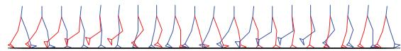

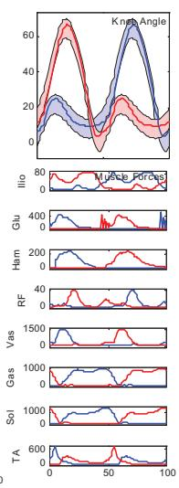

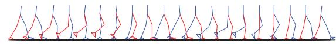

(a)  
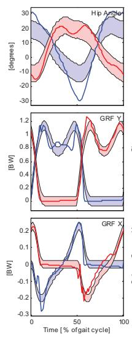

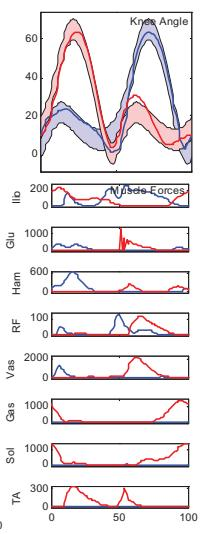  
(b)  
Fig. 6. (a) Optimal control solution for the able-bodied gait model (solid lines) tracking able-bodied joint angles and ground reaction forces (shaded areas). (b) Optimal control solution for a model with a stiff prosthetic foot and ankle on the right leg. Note the ankle stiffness and absence of ankle muscle forces on the right leg (blue curves), with compensatory increase in hip angular motion.

The model was then “amputated” by removing the ankle muscles on the right side. A rotational spring (5 kN m rad-1) was placed at the ankle to simulate a very stiff prosthetic device. The optimal control problem was solved again, resulting in a cost function value of $2 . 7 8 = 1 . 5 2$ (tracking) + 1.26 (effort). Details of the optimal control solution are shown in Fig. 6b. Because of the stiff prosthesis, there is almost no motion in the right ankle joint, and the model compensates by increasing the motion in the right hip joint. These compensations, and loss of ankle motion, caused a substantial increase in the tracking term of the cost function. The knee angle pattern and ground reaction forces remained almost normal. Average muscular effort, the second term of the cost function, actually decreased, mainly because three of the sixteen muscles were removed and no longer activated, while the denominator in this term of the cost function was still 16. The asymmetrical gait adaptation becomes especially noticeable when the result is visualized in an animation that runs at real time speed. When this approach is used in a design project, we would repeatedly solve the optimal control problem, with different prosthetic stiffnesses and perhaps different geometries, until we find one that allows the model to remain close to able-bodied gait without excessive compensatory effort. Alternatively, the NLP approach makes it possible to add these design parameters to the vector X of unknowns, such that the device parameters and the patient’s movement will be simultaneously optimized.

## 4.4. State estimation from noisy measurements

Musculoskeletal systems are not fully observable. Some state variables, such as skeletal rotations and translations, can be measured, while others, such as muscle activations and fiber lengths can only be obtained indirectly. In rehabilitation and sports biomechanics, it is often desirable to estimate joint moments or muscle forces because these are relevant to injury. The conventional approaches are based on inverse dynamics [1,38], but this requires full measurement of all kinematic variables and external forces, with high accuracy, which is only possible in a laboratory environment with optical motion capture and force platforms. Outside of the laboratory, measurements are usually noisy and possibly incomplete. In such conditions, Kalman filters are typically used for real-time state estimation with dynamic models [39], but these are not expected to perform well with the high-dimensional state spaces and strong nonlinearities of complex musculoskeletal system models. Kalman filters also are suboptimal when used for off-line data processing because they only use data from the past, not the future.

We can, however, use the basic concept of Kalman filtering which is that an optimal estimate is based on a balance between the conflicting goals of consistency with measurements and consistency with a model of the system’s passive dynamics. This concept is, surprisingly, equivalent to an optimal control problem with a cost function as used earlier in equation (20):

$$
F (\mathbf {x} (t), \mathbf {u} (t)) = \frac {1}{T} \int_ {0} ^ {T} \left[ \frac {1}{N _ {\text { sensors }}} \sum_ {i = 1} ^ {N _ {\text { sensors }}} \left(\frac {s _ {i} (\mathbf {x} (t)) - m _ {i} (t)}{\sigma_ {i}}\right) ^ {2} + \frac {W}{N _ {\text { muscles }}} \sum_ {i = 1} ^ {N _ {\text { muscles }}} u _ {i} (t) ^ {2} \right] d t\tag{21}
$$

The second term in the cost function penalizes the musculoskeletal system for not following its passive dynamics. When properly weighted, this term will prevent the model from trying to fit the noise in the measured data because noisy movements have high accelerations, which require high muscular effort and are therefore penalized by the optimization. This has a smoothing effect similar to the effect of a Kalman filter. The first term in the cost function can contain any data that is available, the set of sensors may be overcomplete or incomplete, and may even change over time, as long as we can calculate differences between the measurements and the corresponding variables in the musculoskeletal model. Sensor signals may include data from optical motion capture and load cells, but may also be obtained from bodymounted sensors such as goniometers, MEMS accelerometers and gyroscopes, magnetometers, and others. All of these are now becoming available at low cost, and we expect that state estimation techniques based on musculoskeletal dynamic models will become powerful tools to process such data, effectively using the model to fuse the information from diverse data sources and to enforce consistency with the known laws of physics and muscle physiology.

We applied this concept to downhill skiing, where it is difficult to obtain accurate data. The movement of downhill skiers is very fast, and this requires cameras to have either a very large field of view, and therefore a poor spatial resolution, or follow the skier by panning and zooming, which requires per-frame calibration and introduces significant noise. Furthermore, instrumentation with force sensors is not possible during competition. A pan and zoom technique was used to collect video data during the 1994 Olympic downhill race in Lillehammer, Norway [40]. From this data, we used a data segment of one second, collected at 180 frames per second, from a single competitor performing a landing movement. 3D coordinates of points on the body were translated into planar (sagittal plane) joint angles and absolute position and orientation of the trunk. The data contained significant noise but were not smoothed prior to being used in the cost function (21). A planar musculoskeletal model was developed, with the same skeleton and muscles as in the gait simulations. The model was made suitable for skiing by adding aerodynamic forces, deformable skis, and a nearly frictionless and sloping ground contact surface. No task constraints were used, and dynamics constraints were implemented using the midpoint rule as in equation (18).

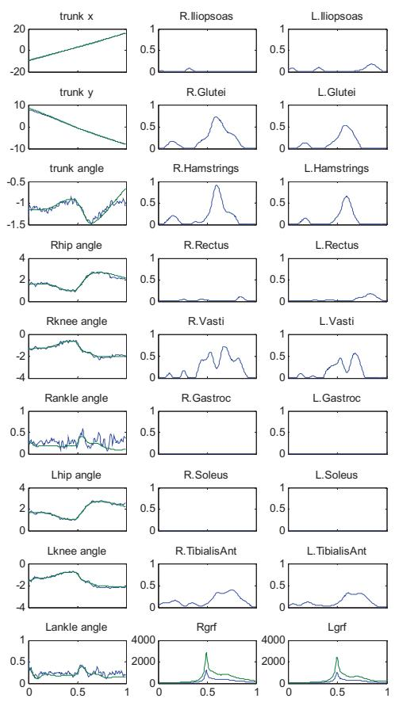

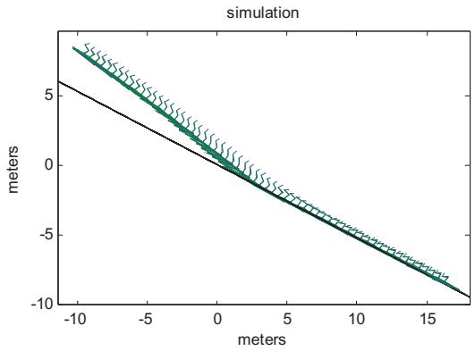

(b)  
(a)  
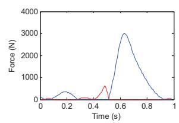

(c)  
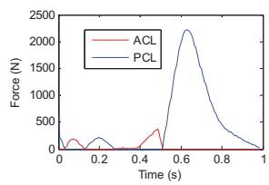  
Fig. 7. (a) Optimal control solution for the skiing model. Left column shows simulated kinematic variables in meters and radians (solid lines) compared to data collected during the 1994 Olympic downhill race (noisy thin lines). The other columns show neural excitations for the 16 muscles, and the horizontal and vertical ground reaction forces. (b) Stick figure rendering of the same movement, beginning in the aerial phase. Black line is the snow surface. (c) Forces in the anterior cruciate ligament (ACL) and posterior cruciate ligament (PCL) in the left and right knee.

The optimal control problem was solved first on a coarse mesh of 10 nodes with IPOPT, and then successive optimizations on finer meshes were done with SNOPT until a solution with 180 nodes was obtained. The simulated movement tracked the data well, ignored the noise, and produced sensible estimates of muscle activations and ground reaction forces (Fig. 7ab). Having all muscle forces, kinematics, and external forces available, we were then able to use simple planar knee model to estimate the forces in the knee ligaments (Fig. 7c), so that the potential for injury could be assessed.

Doing state estimation with a full musculoskeletal dynamic model provided other opportunities in this project. We perturbed the initial state by a small counterclockwise rotation of the body, and did forward simulations with the original optimal controls, using the ME solver, to create simulations of off-balance landing movements. This produced much larger knee ligament forces, approaching injurious levels. This was done with different values for the ski stiffness parameters, and it was found that in this particular situation, a reduction of 50% in ski stiffness was necessary to reduce the peak ligament forces by 10%. These simulations are completed in a matter of seconds, which allows exploration of a large parameter space to do multi-factorial simulation studies on injury prevention.

## 5. Discussion

The implicit formulation of musculoskeletal dynamics, using the force balance equations for joint moments (1) and for muscle forces (4) made it possible to implement efficient implicit solution methods for forward dynamic simulation and for optimal control. These new methods produce results that are identical to conventional methods, but are computed faster, sometimes orders of magnitude faster, and will help overcome some of the computational bottlenecks that have existed in certain applications of musculoskeletal modeling. While the work presented here demonstrates the potential of these methods, there are still considerable challenges. The conventional methods, while slower, were robust and easy to use and will always produce an answer when given enough computation time. The new methods are more challenging to use.

The forward dynamic simulation with the implicit Rosenbrock method had to be started with the solver in a consistent initial state $\left( \mathbf { \delta X } , \dot { \mathbf { X } } , \mathbf { u } \right)$ ), that satisfied the implicit dynamics equation. Conventional explicit methods only require an initial state x. We used the passive equilibrium state $\mathbf { x } _ { e q }$ as initial condition, which is the solution of $\mathbf { f } ( \mathbf { x } _ { e q } , 0 , 0 ) = 0$ . This equilibrium was harder to find than expected, possibly because of contact and contact-like elements. We used the Levenberg-Marquardt method, which is more robust than Newton’s method but still required several attempts to find an initial guess that led to convergence. Fortunately, for our application, this had to be done only once because we start the arm simulator always from the same initial state. In other applications, the need to find consistent initial conditions before a simulation may be a significant limitation. Also it should be noted that our simulation methods presently use fixed time steps, so accuracy and stability must be determined experimentally as we have done in Fig. 5b. Error control and variable step size can possibly be added, to make the methods more robust. We used fixed steps for real-time simulation because this keeps computation time predictable.

The new optimal control methods are similarly challenging: when they work, they work well, but they sometimes fail to produce an answer. Computation speed was excellent. For the gait optimization problem, IPOPT produced several iterations of the solution X per second, while SNOPT had more internal overhead and produced about one iteration per second. On the other hand, SNOPT tended to require around 100 iterations, vs. about 1000 for IPOPT, when a good initial guess was available. Convergence depended critically on the availability of a good initial guess. When a good initial guess was available, SNOPT was fast and robust, while IPOPT occasionally lost convergence even with a good initial guess. When a good initial guess was not available, SNOPT never converged, but IPOPT would often find a good solution if the mesh had few nodes. Successive mesh refinement with SNOPT was then used to refine the solution. After the first problem with a particular model has been solved, a new problem can always be solved as a series of optimization problems, such that the initial guess for each is good enough for convergence.

These practical difficulties illustrate that these methods may not yet be ready for use by non-experts, where failure of a numerical method is not acceptable. Further improvements in the algorithms and model formulations are still needed before more widespread use is justified. With sufficient patience and care, however, these new methods already allow problems to be solved that could not be solved before.

## Acknowledgements

This work was financially supported by the National Institutes of Health (grants R01-EB006735, R43- AR058074, contract N01-HD53403), by the E.U. through the INTERREG IV project SkiProTech, and by adidas AG (Germany). We acknowledge the help of Marko Ackermann during the initial development of optimal control algorithms.

## References

[1] Winter DA. The biomechanics and motor control of human gait: normal, elderly and pathological. 2nd ed. University of Waterloo Press: Waterloo, Canada; 1991.

[2] Crowninshield RD, Brand RA. The prediction of forces in joint structures; distribution of intersegmental resultants. Exerc Sport Sci Rev 1981;9:159-81.

[3] Hatze H. The complete optimization of a human motion. Math Biosci 1976;28:99-135.

[4] Zajac FE, Neptune RR, Kautz SA. Biomechanics and muscle coordination of human walking: part II: lessons from dynamical simulations and clinical implications. Gait Posture 2003;17(1):1-17.

[5] Vaughan CL.Theories of bipedal walking: an odyssey. J Biomech 2003;36(4):513-23.

[6] van den Bogert AJ. Analysis and simulation of mechanical loads on the human musculoskeletal system: a methodologica overview. Exerc Sport Sci Rev 1994;22:23-51.

[7] McLean SG, Huang X, Su A, van den Bogert AJ. Sagittal plane biomechanics cannot injure the ACL during sidestep cutting. Clin Biomech 2004;19(8):828-38

[8] Fregly BJ, Reinbolt JA, Rooney KL, Mitchell KH, Chmielewski TL. Design of patient-specific gait modifications for knee osteoarthritis rehabilitation. IEEE Trans Biomed Eng 2007;54(9):1687-95.

[9] Delp SL, Anderson FC, Arnold AS, Loan P, Habib A, John CT, Guendelman E, Thelen DG. OpenSim: open-source

software to create and analyze dynamic simulations of movement. IEEE Trans Biomed Eng 2007;54(11):1940-50.

[10] van den Bogert AJ, Schamhardt HC. Multi-body modelling and simulation of animal locomotion. Acta Anat 1993;146(2- 3):95-102.

[11] Anderson FC, Pandy MG. Dynamic optimization of human walking. J Biomech Eng 2001;123(5):381-90.

[12] McLean SG, Su A, van den Bogert AJ. Development and validation of a 3-D model to predict knee joint loading during dynamic movement. J Biomech Eng 2003;125(6):864-74.

[13] Thelen DG, Anderson FC. Using computed muscle control to generate forward dynamic simulations of human walking from experimental data. J Biomech 2006;39(6):1107-15.

[14] Zajac FE. Muscle and tendon: properties, models, scaling, and application to biomechanics and motor control. Crit Rev Biomed Eng 1989;17(4):359-411.

[15] Herzog W. Muscle. In: Nigg BM, Herzog W, editors. Biomechanics of the Musculoskeletal System. 2nd ed., pp. 148-88. New York: Wiley; 1999.

[16] Otten E. Concepts and models of functional architecture in skeletal muscle. Exerc Sport Sci Rev 1988;16:89-137.

[17] Yamaguchi GT, Sawa AG-U, Moran D, Fessler M, Winters JM. A survey of human musculotendon parameters. In: Winters J, Woo SL-Y, editors. Multiple Muscle Systems: Biomechanics and Movement Organization, pp. 717í773. New York: Springer-Verlag; 1990.

[18] Klein Breteler MD, Spoor CW, Van der Helm FC. Measuring muscle and joint geometry parameters of a shoulder fo modeling purposes. J Biomech 1999;l32(11):1191-7.

[19] He J, Levine WS, Loeb GE. Feedback gains for correcting small perturbations to standing posture. IEEE Trans Autom Control 1991;36:322-32.

[20] Spoor CW, van Leeuwen JL. Knee muscle moment arms from MRI and from tendon travel. J Biomech 1992;25(2):201-6

[21] An KN, Takahashi K, Harrigan TP, Chao EY. Determination of muscle orientations and moment arms. J Biomech Eng 1984;106(3):280-2.

[22] Chadwick EK, Blana D, van den Bogert AJ, Kirsch RF. A real-time, 3-D musculoskeletal model for dynamic simulation of arm movements. IEEE Trans Biomed Eng 2009;56(4):941-8.

[23] Ascher UM, Petzold LR. Computer Methods for Ordinary Differential Equations and Differential-Algebraic Equations. Philadelphia, PA: Society for Industrial and Applied Mathematics; 1998.

[24] Ackermann M, van den Bogert AJ. Optimality principles for model-based prediction of human gait. J Biomech 2010;43(6):1055-60.

[25] Roche M. Rosenbrock methods for differential algebraic equations. Num Math 1988:52(1):45-63.

[26] van der Helm FC. A finite element musculoskeletal model of the shoulder mechanism. J Biomech 1994;27(5):551-69

[27] Neptune RR. Optimization algorithm performance in determining optimal controls in human movement analyses. J Biomech Eng 1999;121(2):249-52.

[29] Witkin A, Kass M. Spacetime constraints. Computer Graphics 1988;22:159-168.

[30] Betts JT. Practical Methods for Optimal Control and Estimation Using Nonlinear Programming. 2nd edition. Philadelphia, PA: Society for Industrial and Applied Mathematics; 2010

[31] Kaplan ML, Heegaard JH. Predictive algorithms for neuromuscular control of human locomotion. J Biomech 34(8):1077- 83.

[32] Stelzer M, von Stryk O. Efficient forward dynamics simulation and optimization of human body dynamics. ZAMM 2006;86(10):828–840.

[33] Kaphle M, Eriksson A. Optimality in forward dynamics simulations. J Biomech 2008;41(6):1213-1221.

[34] van den Bogert AJ, Ackermann M. Direct collocation for simulation and optimization of human movement. 12th International Symposium on Computer Simulation in Biomechanics. Cape Town, South Africa; 2009.

[35] Ackermann M, van den Bogert AJ. Simulation of gait using a 3D musculoskeletal model. American Society of Biomechanics annual meeting. State College, PA; 2009.

[36] Gill PE, Murray W, Saunders MA. SNOPT: An SQP algorithm for large-scale constrained optimization, SIAM J. Optim 2002;12:979-1006.

[37] Wächter A, Biegler LT. On the implementation of a primal-dual interior point filter line search algorithm for large-scale nonlinear programming, Math Prog 2006;106(1):25-57.

[38] Erdemir A, McLean S, Herzog W, van den Bogert AJ. Model-based estimation of muscle forces exerted during movements. Clin Biomech 2007;22(2):131-54.

[39] Simon D. Optimal State Estimation. Wiley; 2006.

[40] Nachbauer W, Kaps P, Nigg B, Brunner F, Lutz A, Obkircher G, Mössner M. A video technique for obtaining 3-D coordinates in alpine skiing. J Appl Biomech 1996;12:104-115.

## Appendix A. First order Rosenbrock method to simulate the implicit model.

The first order Rosenbrock method advances the state x at time t to a state $\mathbf { x } + \Delta \mathbf { x }$ at $t + h$ , while controls change from u to $\mathbf { u } + \Delta \mathbf { u }$ . If we approximate the state derivative by the backwards Euler formula, and attempt to satisfy the implicit state equation (13) at $t + h$ , we obtain:

$$
\mathbf {f} (\mathbf {x} + \Delta \mathbf {x}, \frac {\Delta \mathbf {x}}{h}, \mathbf {u} + \Delta \mathbf {u}) = 0.\tag{A1}
$$

We rewrite this such that the function arguments are written as changes relative to the state x, state derivative x , and controls u at the previous time t:

$$
\mathbf {f} (\mathbf {x} + \Delta \mathbf {x}, \dot {\mathbf {x}} + \frac {\Delta \mathbf {x}}{h} - \dot {\mathbf {x}}, \mathbf {u} + \Delta \mathbf {u}) = 0.\tag{A2}
$$

A first order Taylor expansion leads to:

$$
\mathbf {f} (\mathbf {x}, \dot {\mathbf {x}}, \mathbf {u}) + \frac {\partial \mathbf {f}}{\partial \mathbf {x}} \Delta \mathbf {x} + \frac {\partial \mathbf {f}}{\partial \dot {\mathbf {x}}} \left(\frac {\Delta \mathbf {x}}{h} - \dot {\mathbf {x}}\right) + \frac {\partial \mathbf {f}}{\partial \mathbf {u}} \Delta \mathbf {u} = 0\tag{A3}
$$

which is a linear equation in 'x :

$$
\left(\frac {\partial \mathbf {f}}{\partial \mathbf {x}} + \frac {1}{h} \frac {\partial \mathbf {f}}{\partial \dot {\mathbf {x}}}\right) \Delta \mathbf {x} = \frac {\partial \mathbf {f}}{\partial \dot {\mathbf {x}}} \dot {\mathbf {x}} - \mathbf {f} (\mathbf {x}, \dot {\mathbf {x}}, \mathbf {u}) - \frac {\partial \mathbf {f}}{\partial \mathbf {u}} \Delta \mathbf {u}.\tag{A4}
$$

Solving for 'x produces the algorithm (15). The algorithm must not only store the state x in memory, but also the state derivative x and controls u because all three are needed, with the three Jacobians of f, to perform a time step. $\mathrm { A t } ~ t = 0$ , state, state derivative, and controls must be given as initial conditions and these initial conditions must satisfy the state equation (13).

No formal analysis of accuracy and stability was performed, but the method should be of first order (which was confirmed by the results in Fig. 5b) and should be L-stable because it was derived using the backwards Euler formula.