# REVIEW Progress in Motor Control

# Muscle coactivation: definitions, mechanisms, and functions

Mark L. Latash

Department of Kinesiology, The Pennsylvania State University, University Park, Pennsylvania

Submitted 1 February 2018; accepted in final form 16 March 2018

Latash ML. Muscle coactivation: definitions, mechanisms, and functions. J Neurophysiol 120: 88–104, 2018. First published March 28, 2018; doi:10.1152/ jn.00084.2018.—The phenomenon of agonist-antagonist muscle coactivation is discussed with respect to its consequences for movement mechanics (such as increasing joint apparent stiffness, facilitating faster movements, and effects on action stability), implication for movement optimization, and involvement of different neurophysiological structures. Effects of coactivation on movement stability are ambiguous and depend on the effector representing a kinematic chain with a fixed origin or free origin. Furthermore, coactivation is discussed within the framework of the equilibrium-point hypothesis and the idea of hierarchical control with spatial referent coordinates. Relations of muscle coactivation to changes in one of the basic commands, the c-command, are discussed and illustrated. A hypothesis is suggested that agonist-antagonist coactivation reflects a deliberate neural control strategy to preserve effector-level control and avoid making it degenerate and facing the necessity to control at the level of signals to individual muscles. This strategy, in particular, allows stabilizing motor actions by covaried adjustments in spaces of control variables. This hypothesis is able to account for higher levels of coactivation in young healthy persons performing challenging tasks and across various populations with movement impairments.

agonist-antagonist; apparent stiffness; coactivation; referent coordinate; stability; synergy

## HISTORY, DEFINITIONS, AND INDICES OF COACTIVATION

Animals, including humans, frequently show nonzero simultaneous activation of muscles with opposing actions. This phenomenon has been addressed as agonist-antagonist coactivation or simply coactivation (reviewed in Smith 1981). Muscle coactivation has been known for over 100 years, starting at least with classical papers by Demeny (1890) and Babinski (1899), with a review on this phenomenon written nearly 100 years ago (Tilney and Pike 1925). Most commonly, coactivation is analyzed at the level of individual joint rotations. Since muscles are unidirectional actuators—they can pull but not push— each joint rotational degree of freedom is served by at least two muscles with opposing actions. These are commonly addressed as agonist-antagonist pairs (reviewed in Gottlieb et al. 1989a). The agonist is producing force and/or moment of force in a direction prescribed by the task, while the antagonist opposes this action. As a result, one of the direct mechanical effects of coactivation within an agonist-antagonist pair is reduction in the resultant forces and moments as compared with those that could be expected in the absence of coactivation.

Patterns of antagonist muscle coactivation show task-specific characteristics that can vary across populations. Figure 1 (Aruin et al. 1996) shows an example of the muscle activation patterns during fast flexion movement of the wrist when the subject was sitting in front of a table with the upper arm resting on the table and the forearm and hand vertical. The left panels show electromyographic (EMG) patterns in a typical person (control subject), while the right panels show the EMG patterns in a young adult with Down syndrome. Note the typical alternating EMG patterns (the so-called triphasic pattern, reviewed in Gottlieb et al. 1989a) in the flexor-extensor muscle pairs crossing both the wrist and elbow joints of the control subject. In contrast, the person with Down syndrome shows simultaneous EMG bursts in both muscle pairs, which could be described as a coactivation pattern, associated with a slower movement (reviewed in Latash 2000).

Coactivation is not limited to muscle pairs. In a number of recent studies of activation patterns in large muscle groups, matrix factorization methods have been used to identify groups of muscles with parallel scaling of EMG signals (reviewed in Ting and McKay 2007; Tresch et al. 2006). Such groups have been addressed as muscle synergies (d’Avella et al. 2003; Ivanenko et al. 2004) or muscle modes (Krishnamoorthy et al. 2003). Studies of actions performed by standing persons reproduced reciprocal patterns of activation in both the muscle pair and the modes. In contrast, the perturbation in the forward direction produced coactivation patterns at both the muscle and mode levels. Note also that the mode-level coactivation is not joint specific; it acts at the whole body level.

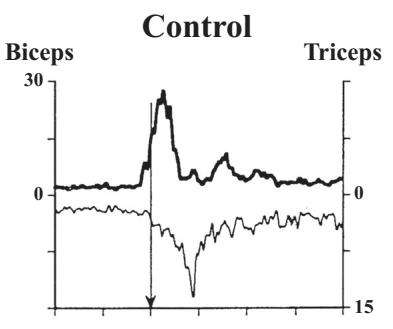

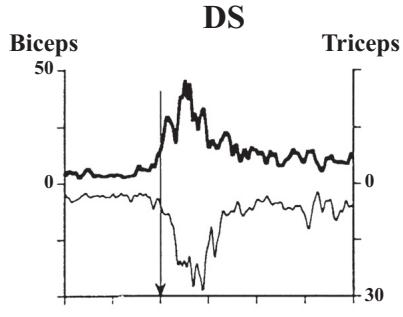

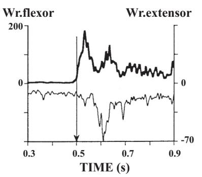

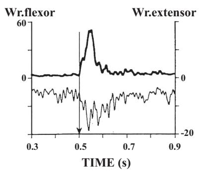  
Fig. 1. Examples of the muscle activation patterns during fast flexion movement of the wrist when the subject was sitting with the upper arm resting on the table, and the forearm and hand vertical. Left: EMG patterns in a typical person (Control). Right: EMG patterns in a young adult with Down syndrome (DS). Arrows at 0.5 s show the initiation of the first agonist EMG burst. Note the typical alternating EMG bursts (the so-called, triphasic pattern) in the flexor-extensor muscle pairs crossing both the wrist and elbow joints of the control subject. In contrast, the person with Down syndrome shows simulta neous EMG bursts in both muscle pairs, which can be described as a coactivation pattern. From Aruin et al. (1996); copyrighted by American Association on Intellectual and Developmental Disabilities. Used by permission.  
vealed two stable muscle modes with opposing action: One of the modes united muscles on the dorsal side of the body (such as triceps surae, hamstrings, and erector spinae) while the other mode united muscles on the ventral side of the body (such as tibialis anterior, quadriceps, and rectus abdominis). A recent study has revealed reciprocal or coactivation involvement of these two modes during responses to unexpected body perturbation depending on the direction of the perturbation. In this study, the person stood quietly and held in the extended arms  
a horizontal object with two loads attached through electromagnetic locks. The loads created moments of force with respect to the mediolateral axis passing through the two ankle joints, acting in a sagittal plane in the anterior and posterior directions (see the insert in Fig. 2). Then, an experimenter released one of the loads unexpectedly for the subject. Figure 2 shows muscle activation patterns for a pair of muscles crossing the ankle joint and the patterns for two muscle modes. Note that perturbation in the backward direction (BP in Fig. 2)

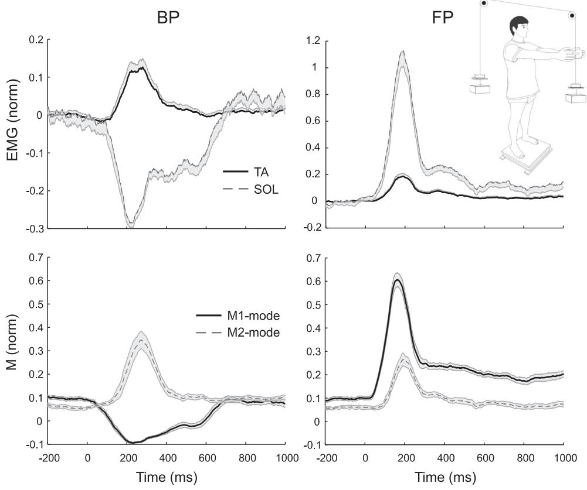  
Fig. 2. Muscle activation patterns for a pair of muscles crossing the ankle joint (tibialis anterior, TA, and soleus, SOL) and the patterns of two muscle modes (M1 and M2) in response to an unexpected load perturbation of a standing person. The perturbation in the backward direction (BP) produced reciprocal patterns of activation, while the perturbation in the forward direction (FP) produced coactivation patterns in both muscles and modes. Zero level corresponds to the EMG and Mmode values during steady state. Note that Mmodes can attain negative values. The insert shows the subject’s posture before load release. (Courtesy of Ms. Momoko Yamagata.)  
J Neurophysiol • doi:10.1152/jn.00084.2018 • www.jn.org

In some cases, coactivation may involve unusual patterns of muscle activation. For example, during pressing with the fingertips, the agonist is an extrinsic finger flexor—flexor digitorum profundus (FDP)—a multitendon muscle with the belly in the forearm and four tendons that insert in the distal phalanges of the four fingers. This muscle produces flexor action in all the joints it spans, from the wrist to the distal interphalangeal joint. Typically, activation of this muscle is accompanied by activation of intrinsic muscles of the hand that combine flexor action at the metacarpophalangeal joints with extensor action at more distal finger joints via the so-called extensor mechanism (Landsmeer and Long 1965; Long 1968). This may also be viewed as an example of coactivation at the level of the fingertip action despite the fact that FDP and intrinsic muscles are not explicitly spanning the same joints and are both commonly classified as flexors.

Coactivation has been quantified using a variety of indices, typically based on direct recording of muscle activation from both muscles within an agonist-antagonist pair although indices of coactivation at the level of muscle modes have also been introduced (Piscitelli et al. 2017; Slijper and Latash 2000). All such indices compare activation of the antagonist muscle (or muscle group) to the activation of the agonist muscle (or muscle group) or to the combined activation of both agonist and antagonist. In animal experiments, presence of coactivation can be established more accurately by recording spiking activity in motoneurons during natural movements (e.g., Gorassini et al. 2000; Hoffer et al. 1987). Despite the availability of numerous methods, overall, the consensus has been that there is no gold standard to assess coactivation (Granata and Marras 2000; Rosa et al. 2014; Souissi et al. 2017).

Quantifying coactivation is nontrivial given that muscle activation signals from different muscles are not directly comparable because of the unavoidable differences in the conditions of recording, such as the distance from the recording electrodes to muscle fibers and the resistance of tissues. Other factors that contribute to problems with quantitative analysis of coactivation include possible cross-talk among neighboring muscles and the unavoidable background noise in EMG recordings. Comparing indices of muscle activation across persons is even more challenging. To circumvent these problems, muscle activation signals have to be normalized, sometimes by the levels of muscle activation observed in maximal voluntary contraction (MVC) trials and sometimes using more natural tasks matched to the task of interest. Typical indices of coactivation compare normalized integrated activation levels of two opposing muscles, for example expressed as fractions of their maximal activation. An example is the following index: $C _ { \mathrm { E M G } } = \mathrm { m i n } [ \mathrm { J E M G _ { A G } } ; \mathrm { \Delta J E M G _ { A N T } ] } / [ \mathrm { J E M G _ { A G } } + \mathrm { \Delta J E M G _ { A N T } ] }$ where the subscripts AG and ANT refer to the agonist and antagonist muscle, respectively, and all the indices are expressed as fractions of their maximal values (Piscitelli et al. 2017). For this particular index, the value of 0.5 corresponds to maximal coactivation while the value of zero corresponds to no coactivation.

A potentially more serious problem is that muscle activation is nonnegative. This means that, when activation of one of the muscles within an agonist-antagonist pair is zero, coactivation quantified with any method based on EMG signals becomes zero independently of the activation level of the other muscle within the pair. This creates problems with both statistical behavior of coactivation indices and their understanding. Indeed, for nonzero, even very low, activation levels of both muscles within an agonist-antagonist pair, coactivation index, such as $C _ { \mathrm { E M G } } ,$ is a function of activation of both muscles, but when one of the muscles becomes quiescent, the index stops being a function of the other muscle activation level. We will refer to this problem in more detail later in this paper.

While muscle coactivation is a very common phenomenon, its interpretation has been typically limited to analysis of movement mechanics with little attention to motor control mechanisms. The main purpose of this review is to make a step from mechanical consequences of coactivation to its place and possible functional role within theories on the neural control of movement. We will try to answer the following questions: What neural control processes could be reflected by coactivation within agonist-antagonist pairs? Why do healthy people coactivate agonist-antagonist muscles? What are the advantages and disadvantages of coactivation from the point of view of action mechanics? Why do populations with impaired movements commonly demonstrate increased coactivation?

Within this paper, we primarily focus on agonist-antagonist coactivation assuming pairs of muscles with exactly opposing action. This assumption is a rather crude approximation because typical joints in animals (including humans) are spanned by uniarticular, biarticular, and polyarticular muscles with varying lines of action. Within such, more natural systems, even the notions of “agonist” and “antagonist” are sometimes hard to define. Analysis of coactivation in such multimuscle systems is beyond the scope of this review.

## COACTIVATION PATTERNS ACROSS POPULATIONS

Studies of coactivation focus on EMG patterns of the involved muscles, which is understandable given the definition of this phenomenon. Analysis and interpretation of such patterns, however, is nontrivial and has to move beyond the language of muscle activations. Muscle activation reflects multiple factors including both descending signals from the brain and reflex effects from peripheral receptors. Such reflex effects may be very strong. For example, if a person is asked to press with the hand against a stop with maximal force and then, suddenly, the stop is removed, a short-latency drop in the activation of the agonist muscles is seen (unloading reflex, Angel et al. 1965; Crago et al. 1976); commonly the muscle becomes quiescent for a short time. This means that reflexes are able to cancel out 100% of the maximal muscle EMG level.

The importance of reflexes for the natural patterns of muscle activation over a variety of actions has been demonstrated in many studies (reviewed in Feldman 2015). These findings mean, in particular, that the brain cannot in principle prescribe muscle activation levels, including muscle coactivation, because muscle activation reflects both descending signals from the brain and activity in reflex feedback loops. Since external force fields are never perfectly predictable, reflex-mediated contribution to muscle activation is also unpredictable. Of course, given visual (or other) feedback on a performance variable, e.g., on muscle activation level, subjects can produce any desired value of that variable. However, any brief change in the external conditions would produce a quick change in muscle activation, which will take time to be corrected based on the feedback. During the reaction time, the neural control signals from the brain may be viewed as unchanged while muscle activation levels may show large changes. Even in isometric conditions, when apparent effector motion is impossible, muscle activation leads to changes in the tendon force, geometry of muscle fibers, and activation of gamma-motoneurons. All these factors affect the observed levels of muscle activation via reflex loops, in particular those originating from Golgi tendon organs and sensory endings in muscle spindles. Within the following few sections, we will focus on EMG patterns typical of coactivation. Later, we will try to interpret those patterns within a motor control hypothesis, which acknowledges the importance of reflexes and views patterns of muscle activation as consequences of changes in reflex parameters specified by the brain.

Coactivation in healthy persons. At the single-joint level, muscle coactivation is seen in healthy persons across a variety of actions ranging from steady-state tasks to quick movement and force production tasks. For example, if a person is asked to maintain a constant level of joint torque in isometric conditions, commonly a low level of the antagonist muscle activation may be seen (Corcos et al. 1990; Ghez and Gordon 1987). During fast single-joint actions, both movements and force generation in isometric conditions, the typical triphasic EMG pattern shows an increase in the antagonist activation at the time of action initiation simultaneously with the first burst of activation of the agonist muscle, which produces torque in the desired direction (Gottlieb et al. 1989a; see also the patterns for the control subject in Fig. 1). The magnitude of this early coactivation increases with action speed and with inertial load (Corcos et al. 1989; Gottlieb et al. 1989b). Within the simplified scheme accepted in this paper, this initial antagonist coactivation reduces the net torque and may be seen as detrimental for performance if the person is instructed to move as fast as possible. Of course, the initial coactivation may serve various purposes, in particular those related to complexity of muscle action in natural joints and ensuring sufficient joint apparent stiffness (see Hasan 1986). Following a quick action, an elevated level of muscle coactivation is seen, which takes a relatively long time to disappear (on the order of a few seconds; Gottlieb et al. 1989b; Suzuki and Yamazaki 2005).

Similar patterns of muscle coactivation are seen during more natural tasks involving multiple joints and muscles (e.g., Almeida et al. 1995; Latash et al. 1995). A special example is the task of standing in the field of gravity. Low levels of muscle coactivation may be seen during natural standing, and the magnitude of muscle coactivation increases during standing in challenging conditions such as those involving reduced support area or low friction between the feet and the supporting surface (Asaka et al. 2008, 2011; Berger et al. 1992; Krishnamoorthy et al. 2004; Shiratori and Latash 2000). As illustrated in Fig. 2, healthy persons may show coactivation patterns in reactions to postural perturbations. During postural tasks associated with predictable perturbations, both anticipatory and compensatory postural adjustments can show coactivation patterns (Chen et al. 2017).

Agonist-antagonist coactivation in arm muscles has been reported in preparation to catching and in the reaction to impact (Dietz et al. 1985; Lacquaniti and Maioli 1989). When the load was caught by a standing subject, coactivation patterns in arm muscles could be accompanied by reciprocal patterns in leg and trunk muscles (Shiratori and Latash 2001).

Coactivation in populations with impaired movements. Populations with impaired motor abilities commonly show increased levels of muscle coactivation. These observations make understanding the origins and functional role of coactivation important for applied areas such as movement disorders and motor rehabilitation.

In particular, young adults with Down syndrome show atypical muscle activation patterns with predominance of coactivation during fast limb actions (as illustrated in Fig. 1; Aruin et al. 1996) as well as during adjustments to perturbations, both anticipatory (Aruin and Almeida 1997) and corrective (Latash et al. 1993). A number of studies reported increased levels of coactivation during movements performed by healthy older adults (Lee et al. 2015; Nagai et al. 2011; Rozand et al. 2017). Patients with a variety of neurological disorders show increased levels of muscle coactivation. In particular, increased coactivation has been described as typical of Parkinsonian rigidity (Arias et al. 2012; Hirai et al. 2015), spasticity of both spinal and supraspinal origin (Hammond et al. 1988; Hirai et al. 2015; Rinaldi et al. 2017), cerebral palsy (Richards and Malouin 2013), dystonic disorders (Hughes and McLellan 1985), vestibular disorders (Keshner et al. 1987), cerebellar disorders (Mari et al. 2014), and stroke (Kitatani et al. 2016). In particular, Rinaldi et al. (2017) have documented correlation between indices of muscle coactivation and the Ashworth index of spasticity. Elevated levels of coactivation have also been described in patients with orthopedic problems and those with low-back pain (Boudreau and Falla 2014; Hubley-Kozey et al. 2008; Jones et al. 2012), suggesting that coactivation may reflect neural processes adaptive to an original disorder. Reduction in coactivation is sometimes thought of as a goal of therapy (Hu et al. 2007).

While many of the aforementioned studies interpreted muscle coactivation as an adaptive pattern that allowed performing functional movements in challenging conditions, there are also reports that increased levels of coactivation in healthy persons may be a potentially dangerous factor, in particular, a predictor of developing low-back pain (Nelson-Wong and Callaghan 2010).

So, is coactivation adaptive or maladaptive? While there is no unambiguous answer to this question, a number of observations point at its maladaptive role. These include better performance after practice, accompanied by lower coactivation (Asaka et al. 2008) and higher coactivation in tasks that are perceived as more challenging and associated with worse performance (e.g., Fig. 2). This conclusion has also been corroborated by a drop in muscle coactivation indices that accompanied improved performance with practice in healthy persons, motor development in infants, and therapy in stroke survivors (Bazzucchi et al. 2008; Kitatani et al. 2016; Teulier et al. 2012; Ziegler et al. 2010). Is there a clear benefit of coactivation? The answer seems to depend on the task.

## NEUROPHYSIOLOGICAL MECHANISMS OF COACTIVATION

Information on the role of different neurophysiological mechanisms in muscle coactivation comes from studies that form three main groups. Most direct information comes from invasive animal studies with direct stimulation of and/or recording from neurophysiological structures (e.g., Frysinger et al. 1984; Gorassini et al. 2000; Hoffer et al. 1987). Other studies assume, sometimes implicitly, that changes in EMG patterns with pathology in a specific neurophysiological structure reflect the role of that structure in the observed patterns (e.g., Ebner et al. 1982). The third group of studies draws similar conclusion based on correlations between activity in specific brain structures and levels of muscle coactivation (e.g., Wetts et al. 1985) or on muscle activation patterns induced by stimulation of specific brain areas (e.g., Neige et al. 2017; Penn et al. 1978; Sangani et al. 2011). All three groups provide inconclusive information. First, generalization of conclusions drawn based on studies of animals to neurophysiological mechanisms in humans is questionable. Second, correlation between activation levels recorded in two objects, e.g., a brain structure and an agonist-antagonist pair, does not mean that one of them is causally linked to the other. Third, there may be contributions to muscle activation patterns not directly related to the manipulation with a specific brain structure: for example, caused by reflex contributions and adaptive changes in other parts of the central nervous system.

Spinal mechanisms of coactivation. Contribution of spinal cord circuitry to muscle coactivation is likely small (reviewed in Nielsen 2016). In particular, spinal reflexes typically lead to reciprocal effects on activation of muscles within agonistantagonist pairs of muscles or muscle groups. In healthy persons, monosynaptic reflexes (such as the H-reflex and tendon tap reflex) are typically limited to only one of the muscle groups (including synergistic muscles) within agonistantagonist pairs, commonly with suppression of activity in the antagonist muscle group. Polysynaptic reflexes, such as stretch reflex, flexor reflex, crossed extensor reflex, and tonic vibration reflex, commonly lead to activation of multiple muscle groups. However, at the individual joint level, these reflexes typically lead to activation of only one muscle group from the agonistantagonist pair without activation of the antagonists or even with suppression of the antagonist EMG.

Coactivation is commonly considered as a complementary and competitive mechanism to reciprocal inhibition (reviewed in Nielsen 2016). In has been shown that during muscle coactivation, reciprocal inhibition is reduced (Nielsen and Kagamihara 1992). This effect is possibly mediated by facilitation of the Renshaw cells (Nielsen and Pierrot-Deseilligny 1996), which inhibit Ia-interneurons (Hultborn et al. 1971) and hence reduce reciprocal inhibition.

Observations in patients with spasticity, which is characterized by exaggerated reflexes, most commonly show alternating patterns of muscle activation (as in clonus) or activation of only one of the muscles within a pair leading to flexor or extensor spasms. On the other hand, spasticity may lead to excessive muscle coactivation (Morita et al. 2001), which can be reduced by drug therapy such as intrathecal baclofen injection (Chow et al. 2017).

Spinal central pattern generators, such as those involved in the generation of locomotion, wiping, and scratching, also typically produce alternating bursts of muscle activation with no major coactivation (e.g., Hiebert and Pearson 1999). Taken together, these observations suggest that the commonly observed patterns involving muscle coactivation depend crucially on supraspinal processes involved in the control of movement. This conclusion is also corroborated by a study of changes in muscle coactivation with fatigue (Lévenez et al. 2008).

Cortical involvement in coactivation. Studies of Humphrey (Humphrey 1982; Humphrey and Reed 1983) provided the most direct evidence for involvement of the motor cortex in the phenomenon of coactivation. In those studies, two populations of neurons in the primary motor cortex of nonhuman primates were described. Activation of neurons within one of the populations produced reciprocal changes in activation within an agonist-antagonist muscle pair, while activation of neurons in the other population produced parallel changes in the activation of agonist and antagonist, which is equivalent to modulating the level of their coactivation. These observations, however, remain controversial because they have not been reproduced in later studies. Most studies of the effects of activation of cortical neurons produced evidence for reciprocal effects: Activation of a muscle group was accompanied by no changes in or suppression of activation of antagonist muscles (e.g., Ikai et al. 1996). Other studies using transcranial magnetic stimulation, however, have provided evidence for both reciprocal and nonreciprocal effects on corticospinal excitability (Neige et al. 2017; Sangani et al. 2011).

Potential role of the cerebellum and basal ganglia in coactivation. The first suggestion on the importance of the cerebellum for muscle coactivation was probably made by Tilney and Pike (1925). Relations between cerebellar activity and coactivation have been emphasized in later studies (Bourbonnais et al. 1986; Ebner et al. 1982; Wetts et al. 1985). A hypothesis has been suggested that changes in Purkinje cell activity are related to coactivation (Frysinger et al. 1984), possibly related to stabilization of nontask joints of the extremity. Importance of the cerebellum for coactivation has received support in clinical studies. In particular, patients with cerebellar ataxia show excessive agonist-antagonist coactivation (Mari et al. 2014). Cerebellar stimulation was also shown to reduce coactivation in patients with spasticity (Penn et al. 1978). Modeling of cerebellar control of upright balance has suggested that adding small amounts of coactivation improved fit to human data (Jo and Massaquoi 2004).

A number of studies have documented correlations between indices of coactivation and clinical signs of Parkinson’s disease such as rigidity (Arias et al. 2012; Mink and Thach 1991; Wickens et al. 1991). Overall, the two major circuits, corticocerebellar-thalamo-cortical and corticobasal-thalamo-cortical, seem to play a major role in defining coactivation patterns. Using the terminology suggested by Houk (2005), one may say that distributed processing modules in the brain define coactivation patterns observed in the periphery.

## RELATION OF COACTIVATION TO MOVEMENT MECHANICS

Typical interpretations of the phenomenon of muscle coactivation focus on its role in the mechanics of action. These interpretations focus on two effects of coactivation on movement mechanics, action speed, and stability. Both are presumably mediated by changes in the stiffnesslike properties of the involved effectors $( \mathrm { e . g . }$ ., Frysinger et al. 1984; Hirokawa et al. 1991; Tal’nov and Kostiukov 1991), i.e., their ability to generate resistive forces (moments) per unit of displacement.

Relaxed muscles resist externally imposed stretch similarly to relatively compliant springs (Feldman 1966; Ralston et al. 1947; reviewed in Zatsiorsky and Prilutsky 2012); such a characteristic is illustrated in Fig. 3A with the shallow dashed line. This dependence can be locally linearized and expressed using a coefficient $k ,$ termed “apparent stiffness”: $\Delta F \stackrel { - } { = } - k \Delta L$ where F stands for force and L for length. Activating a muscle leads to a much steeper dependence F(L) or, in other words, to higher magnitudes of $k .$ This increase in k can be seen in deafferented muscles, i.e., muscles without reflexes. Intact muscles with reflexes show even higher values of k, and the whole F(L) characteristic becomes more linear (cf. thick solid and dashed lines in Fig. 3A; see also Nichols and Houk 1976).

If one considers an effector, e.g., a joint, with a single kinematic degree of freedom crossed by several muscles acting in parallel (it does not matter whether they are agonists or antagonists), in a linear approximation, apparent stiffness of the effector will represent the sum of the apparent stiffness values for the individual muscles: $k _ { \mathrm { E F F } } = \Sigma k _ { \mathrm { M } }$ where the subscripts stand for effector and muscle. This is one of the reasons coactivation leads to an increase of the apparent stiffness of the effector, such as a joint (cf. Nielsen and Kagamihara 1992). Figure 3B illustrates this phenomenon. It shows two variables, torque (T) and angle (-), that characterize a joint crossed by two muscles, agonist and antagonist, balancing an external load at a specific position (e.g., zero load as in Fig. 3B). If only one muscle is active (no coactivation), the apparent rotational stiffness of the joint, $k _ { J } ,$ , would be defined by the T(-) characteristic of that muscle. If the antagonist muscle shows nonzero coactivation, the overall joint characteristic becomes steeper, corresponding to higher $k _ { J } .$

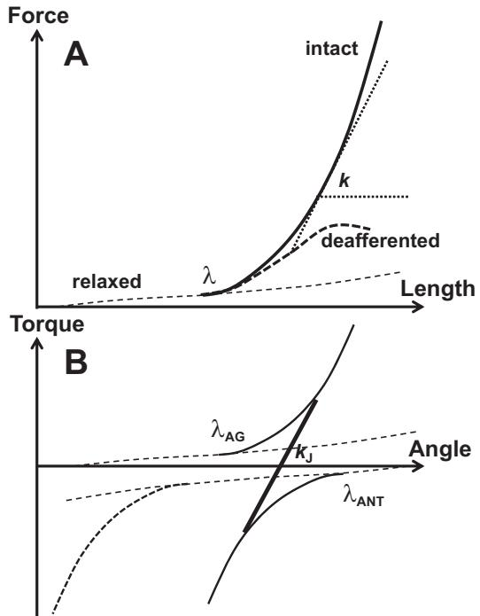  
Fig. 3. A schematic illustration of muscle force-length and torque-angle characteristics. A: the shallow dashed line shows the force-length characteristic of a relaxed muscle. When the muscle is stretched beyond the stretch reflex threshold (), its force-length characteristic becomes steeper (thick, solid line). A muscle without reflexes (deafferented) shows a less linear force-length characteristic (thick dashed curve). Apparent stiffness (k) is defined as the angle of the tangent of the characteristic with the x-axis. B: if the antagonist muscle shows nonzero coactivation (solid curve), the overall joint characteristic (black, thick line) becomes steeper as compared with no coactivation (the dashed antagonist characteristic). This corresponds to higher apparent stiffness, $k _ { J } . ~ \spadesuit$ gonist produces positive torque values; antagonist produces negative torque values.

Since muscles have springlike properties (as illustrated in Fig. 3), speed of movement produced by a muscle contraction is defined by both changes in neural control variables to that muscle (such as  within the equilibrium-point hypothesis, Feldman 1966) and by the apparent stiffness of the effector (defined by the c-command, Feldman 1980). Indeed, a linear mass-spring system is characterized by natural frequency: $\omega _ { 0 } = \sqrt { k m }$ , where m is mass (cf. Milner and Cloutier 1993). Fast transitions (movements) are only possible in systems with sufficiently high $\omega _ { 0 } ,$ which requires high k. In accordance with this simple analysis, increased coactivation levels have been reported for both very fast movements and isometric contractions (Bennett et al. 1992; Corcos et al. 1989; Ghez and Gordon 1987). An increase in the inertial load (m) requires a proportional increase in k to keep movement speed comparably high. Indeed, movements against increased inertial loads are characterized by higher indices of muscle coactivation (Gottlieb et al. 1989b). This simplified analysis is only applicable to systems that can be adequately expressed using second-order linear approximations. This is highly questionable with respect to muscles and human joints and limbs (reviewed in Feldman 2015; Zatsiorsky and Prilutsky 2012).

The relations between joint apparent stiffness and postural stability are more ambiguous. If one considers a single joint, indeed, coactivating muscles and increasing k is expected to lead to stronger resistance to displacements caused by external forces. If one defines joint postural stability as an ability to show small deviations from a desired posture under changes in external forces, joints with higher k would show smaller kinematic deviations under a given external force change, i.e., higher stability. There is a slightly more subtle consequence of increasing k, which is a drop in the damping ratio: $\sigma =$ $b 2 \diamondsuit$ , where b is damping (within the inadequate linear, second-order approximation!). So, a joint with higher coactivation may be expected to be more underdamped and show longer-lasting oscillations following a brief external force perturbation, which may be viewed as a sign of poor stability. This problem may be mitigated by an increase in the damping coefficient, b, which has been reported in parallel to an increase in muscle activation and k such that the damping ratio is kept nearly unchanged (Heitmann et al. 2012; Lee and Ashton-Miller 2011; Milner and Cloutier 1998; Milner 2002; Perreault et al. 2004).

The previous analysis is applicable to effectors, such as joints and multijoint limbs, with a fixed origin. Indeed, in most studies of single-joint actions, the subject was sitting in a chair and the trunk was prevented from moving. As a result, transmission of perturbing forces from the limb to the trunk was not considered as a potentially destabilizing factor. The situation changes dramatically if the origin of a multijoint chain is free to move.

Consider, for example, the human body standing in the field of gravity. The feet are not glued to the surface and, as a result, effects of muscle coactivation along the vertical body axis on postural stability become complex and potentially detrimental. Here we define postural stability as an ability to stay within a vicinity of a desired body position, without falling or making a step, under brief external force perturbations and spontaneous changes in the intrinsic body states. Consider the most direct effect of agonist-antagonist muscle coactivation, that is, an increase in the joint apparent stiffness. Coactivating muscles across all the major joints along the vertical body axis is expected to make the body more rigid (cf. Lee et al. 2006). Is this good for postural stability? The answer is no. Consider two examples. First, a long log placed on one of its flat ends is very rigid and very unstable: A brief force pulse applied to its upper end can easily tip it over. Note that if the log were glued or nailed to the floor, it would show very high stability. Second, persons who practice t’ai chi commonly stand with their joints slightly flexed and muscles relaxed. They show better postural stability compared with the general population (e.g., Gatts 2008). So, excessive muscle coactivation may not be such a good idea from the point of view of postural stability in the field of gravity. However, humans do coactivate muscle excessively while standing in challenging conditions. What could be the reason for this strategy? To analyze this issue, we have to explore the phenomenon of coactivation within a motor control theory, namely the equilibrium-point hypothesis (Feldman 1966, 1986).

## RELATION OF COACTIVATION TO OPTIMIZATION

Muscle coactivation looks unreasonable within many optimization approaches to motor control. Optimization methods have been used broadly to address problems of motor redundancy (Bernstein 1967). There are two classes of such problems, state redundancy and trajectory redundancy. The first reflects the redundant design of the human body: At any level of analysis, more elements contribute to motor actions compared with the number of constraints associated with typical tasks. For example, the number of kinematic degrees of freedom (such as joint rotations) during reaching tasks is typically larger than the number of parameters that define target location, the number of muscles crossing every kinematic degree of freedom is typically larger than one and even two, the number of kinetic variables produced by the digits of the human hand is typically larger than the number of kinetic constraints, etc. (reviewed in Latash and Zatsiorsky 2016). This means that there are an infinite number of solutions for any given motor task. The second class of problems of motor redundancy (trajectory redundancy) reflects the fact that even a single element can reach a desired state from a certain initial state via an infinite number of trajectories.

Optimization approaches assume that specific solutions to problems of motor redundancy emerge in the process of biological evolution and/or motor learning (Prilutsky and Zatsiorsky 2002). Why some solutions are preferred over other, apparently equivalent, solutions is unclear. Preference for specific solutions has been formalized using the idea of keeping certain cost functions at minimal values; in particular, it has been commonly assumed that neural computational processes are used to find such solutions in real time. Numerous cost functions have been considered, and a number of those try to minimize costs related to muscle activations and/or forces (e.g., Alexander 2002; Crowninshield and Brand 1981; reviewed in Prilutsky and Zatsiorsky 2002). In typical situations, muscle coactivation has no effect on resultant mechanical variables, forces and moments of force, that lead to accelerations and changes in other kinematic variables.

Consider, as an example, a simple redundant system consisting of two elements that contribute to a task that requires a change in the difference between their outputs from a certain initial value to a certain target value (Fig. 4). The elements act against each other, and their outputs are nonnegative, as is typical for an agonist-antagonist muscle pair. Let us assume, for simplicity, that only one element (agonist) was active in the initial state (point A). The thin dashed slanted line in Fig. 4 shows the solutions space for the task variable. The shortest distance from the initial state to the target line is associated with zero coactivation (thick dashed line in Fig. 4). Any other solution (e.g., point B) may be viewed as the sum of motion corresponding to this, optimal, solution and motion within the solution space that, by definition, has no effect on performance (motor equivalent motion, Mattos et al. 2011; thick solid line in Fig. 4). Motor equivalent motion may be viewed as wasteful because it does not change task-related performance variables. As such, it is expected to violate typical optimization criteria.

So, from the point of view of behavior-related resultant mechanics, coactivation seems wasteful, since the associated muscle activations consume energy, which is not contributing to the task. On the other hand, coactivation leads to modulation of joint apparent stiffness, which may be useful if one considers action mechanics within the mass-spring approximation. In particular, Hasan (1986) explored an optimization approach based on minimizing an “effort” cost and showed that some nonzero, optimal magnitude of joint apparent stiffness is needed to match experimentally observed trajectories. Studies of comparably fast movements against different inertial loads presented evidence for an increase in coactivation (and apparent stiffness) with the inertial load (Lestienne 1979) in line with Hasan’s conclusions.

Optimization methods have been used to account for muscle coactivation patterns (Brookham et al. 2011; Zeinali-Davarani et al. 2008). In particular, a study using stability-based optimization showed an increase in the antagonist muscle activation, which led to a reduction in the whole-body response to self-generated perturbations and also reduced reflex effects from muscle spindles (Zeinali-Davarani et al. 2008). Another possible role of coactivation is facilitating proprioception, in particular Ia afferent output, which may be beneficial in accuracy tasks (Hulliger et al. 1989; Llewellyn et al. 1990).

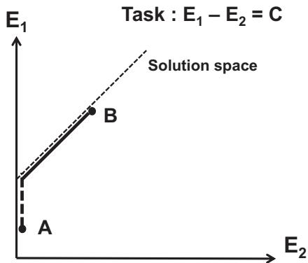  
Fig. 4. A schematic illustration of a simple redundant system consisting of two elements acting against each other. The task requires a change in the difference between their magnitudes from a certain initial value to a certain target value. The thin slanted line shows the solutions space. The outputs of the elements are nonnegative. Only one element (agonist) was active in the initial state (point A). The shortest distance from the initial state to the target line is associated with zero coactivation (thick dashed line). Any other solution (e.g., point B) is the sum of this, “optimal,” solution and motion within the solution space (motor equivalent motion, solid black line).

The previous brief analysis suggests that there is no clear and unambiguous interpretation of the phenomenon of coactivation within the approaches to motor coordination based on mechanics and computation of optimal solutions. Further, this phenomenon is considered within one of the influential hypotheses in the field of motor control, the equilibrium-point (EP) hypothesis (Feldman 1966, 1986), which has been developed into a scheme of hierarchical control with referent coordinates (Feldman 2015; Latash 2010). This hypothesis has been developed within the physical approach to the neural control of biological movement (reviewed in Latash 2016, 2017). According to this approach, biological movements are consequences of laws of nature that link salient state variables with the help of parameters. Within the classical Newtonian mechanics, movements of material inanimate objects are produced by changes in forces acting on those objects while parameters of the respective laws of nature are typically assumed constant or changing slowly. In contrast, biological movements are produced by changes in parameters of the respective laws of nature, and all the state variables, including forces and muscle activations, change according to those laws. Such parameters have been associated with subthreshold depolarization of neuronal pools, including alpha-motoneuronal pools, which translate into referent coordinates for the involved effectors (Feldman 2015). This qualitative shift in the mode of control (for more on parametric control see Feldman 2015, Latash 2016) allows biological systems to show active behaviors unusual in the natural inanimate world, such as walking uphill and flying against the wind. Of course, human-made and human-controlled objects can show all the mentioned behaviors, but motion of natural inanimate objects obeys unambiguously the external forces.

There is a qualitative difference between human-made machines, such as robots, even those that show behaviors very similar to those of biological systems, and natural biological systems that evolved in the process of evolution. The control of robots is based on using powerful torque motors that can implement the prescribed torque profiles independently of the external load. This is obviously impossible in animals, which produce movements with muscle forces and joint torques that are functions not only of neural control signals but also of muscle length and velocity, which depend on the external load. Both biological and inanimate systems obey basic laws of nature, but biological systems are special in their ability to unite these basic laws in chains and clusters leading to pervasive relations among salient variables and involving new parameters: an example is presented in the next subsection (see Eq. 1). Furthermore, biological systems are able to modify these parameters to produce actions (Latash 2016, 2017).

Within the physical approach, muscle activations (including coactivations) cannot be directly prescribed by the central nervous system but reflect changes in specific neural variables that encode parameters of relevant laws of nature. The clearest experimental evidence for this is the aforementioned unloading reflex that leads to a drop in the muscle activation at a delay that is much shorter than the shortest reaction time, \~50 ms in human limbs (Angel et al. 1965; Sinkjaer et al. 2000). During the unloading reflex, the animal (human) has no time to change the ongoing neural control process. Nevertheless, muscle activation changes show that they reflect both the voluntary control process and the unpredictable external force field. To understand the origin and function of muscle coactivation, one has to interpret the observable patterns of muscle activation as reflections of changes in parameters prescribed by the neural controller.

## COACTIVATION WITHIN THE EQUILIBRIUM-POINTHYPOTHESIS

The EP hypothesis was introduced by Anatol Feldman (1966) about half a century ago based on experiments involving both animal preparations and intact humans (Asatryan and Feldman 1965; Matthews 1959). Elements of EP control, such as the control with shifting muscle force-length characteristics, had been discussed in earlier studies (Bernstein 1947), but those discussions fell short of offering a coherent hypothesis that would be compatible with the known neurophysiology. Arguably the closest predecessor of the EP hypothesis, the servo-hypothesis of Merton (1953), assumed unrealistically high gains in the stretch reflex loop and was falsified in later studies (Vallbo 1981).

Over the past 60 years, the EP hypothesis has been neither disproven nor embraced by the motor control research community. In particular, it has been criticized based on experimental studies reporting violations of movement equifinality (Hinder and Milner 2003; Lackner and Dizio 1994) and poorly reproducible equilibrium trajectories (Gomi and Kawato 1996). Rebuttals to these criticisms have been published suggesting that the interpretations of the mentioned experiments were based on grossly simplified versions of the EP hypothesis (Feldman and Latash 2005; Gribble et al. 1998). The lukewarm attitude to the EP hypothesis is partly due to confusing its two versions, the original -model (Feldman 1966) and the later -model (Bizzi et al. 1982) developed based on experiments with deafferented monkeys. In this review, we accept the original -model of the EP hypothesis, which, according to the author’s opinion, remains not only viable but arguably the strongest motor control hypothesis in the field.

According to the EP hypothesis, the central nervous system specifies magnitude of the threshold of the stretch reflex (), which is equivalent to defining subthreshold depolarization of the corresponding --motoneuronal pool. Muscle state variables (force, length, and level of activation) emerge as results of interactions between the muscle with its reflex connections and the external load. Figure 5 illustrates the main points of the EP hypothesis for a single muscle. For a given value of $\lambda ,$ there is a relation between muscle force (F) and length (L), which is defined by passive tissue properties for $\lambda > L$ (shown in Fig. 3, but not in Fig. 5) and by the stretch reflex for $\lambda < L :$

$$
\begin{array}{l l} F = F _ {\text { PASSIVE }}, & \text { for } (L - \lambda) \leq 0 \\ F = f (L - \lambda), & \text { for } (L - \lambda) > 0 \end{array}\tag{1}
$$

where $f$ is a monotonically increasing function.

Equation 1 may be seen as a law of nature common for skeletal muscles across individual and species, which unites two state variables, F and $L ,$ with the help of one parameter, . When  and the external load do not change, the “muscle  load” system comes to an equilibrium state illustrated as an equilibrium point $\mathrm { E P _ { 1 } }$ in Fig. 5. Note that, for a given , all the points on the $F ( L )$ characteristic are possible as equilibrium states. So, a central neural command () cannot in principle specify magnitudes of such muscle output characteristics as $F ,$ $L ,$ and level of muscle activation (EMG), only a relation among those variables, which all increase along the $F ( L )$ characteristic for larger values of $L ,$ when $( L { - } \lambda ) > 0$ . Equation 1 is similar to that of a nonlinear spring with modifiable zero length; note that if one specifies zero length of the spring, this procedure does not define its force and length, only a relation between the two.

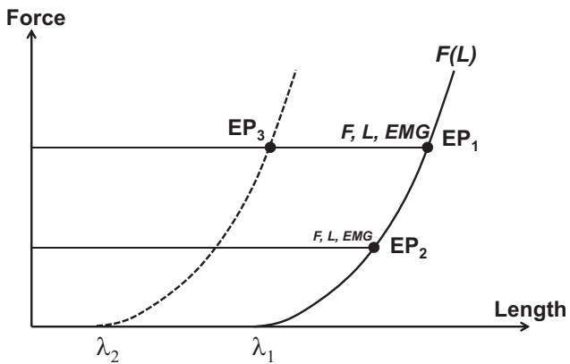  
Fig. 5. A schematic illustration of the basics of the equilibrium-point (EP) hypothesis for a single muscle. A value of the stretch reflex threshold () defines a relation between muscle force (F) and length (L). For a given , all the points on the $F ( L )$ characteristic are possible as equilibrium states. Changes in the external load without a change in  lead to involuntary movements associated with changes in F, L, and muscle activation level, EMG $( \mathrm { e . g . }$ , from point EP to $\operatorname { E P } _ { 2 } ) .$ . A change in  leads to voluntary movement with changes in F and L that depend on the external load characteristic $( \mathrm { e . g . }$ , from $\mathrm { E P _ { 1 } }$ to $\mathrm { E P } _ { 3 }$ in isotonic conditions). Passive muscle characteristic is not shown for simplic ity (cf. Figure 3).

Changes in the external load without a change in  lead to involuntary movements associated with changes in F, L, and EMG (e.g., from point $\mathrm { E P _ { 1 } }$ to $\mathrm { E P } _ { 2 }$ in Fig. 5). A change in  leads to voluntary movements with changes in F and $L$ that depend on the external load characteristic $( \mathrm { e . g . }$ , from $\mathrm { E P _ { 1 } }$ to $\mathrm { E P } _ { 3 }$ in Fig. 5). Such movements can lead to positional changes (in isotonic conditions, illustrated in Fig. 5), to force changes (in isometric conditions), or to both for more natural load characteristics.

The neural control of a pair of opposing muscles crossing a joint can be described as a combination of $\lambda _ { \mathrm { A G } }$ and $\lambda _ { \mathrm { A N T } } ,$ where the subscripts refer to the agonist and antagonist muscles. Another pair of variables has been suggested reflecting the coordinate of the midpoint between the two s (reciprocal command, r in Fig. 6A) and the spatial range between $\lambda _ { \mathrm { A G } }$ and $\lambda _ { \mathrm { A N T } } ,$ where both muscles can be active simultaneously (coactivation command, c in Fig. 6A) (Feldman 1980). Formally, the two commands can be expressed as

$$
r = (\lambda_ {\mathrm{AG}} + \lambda_ {\mathrm{ANT}}) / 2
$$

$$
c = (\lambda_ {\mathrm{AG}} - \lambda_ {\mathrm{ANT}})\tag{2a}
$$

(2b)

The names of the r-command and c-command suggest that these commands are directly related to reciprocal activation and coactivation recorded within agonist-antagonist muscle pairs. Relations between changes in the two basic commands and muscle activation patterns are, however, complex. The two basic commands, r and $^ { c , }$ can be continuously intermixed during natural movements, leading to a variety of patterns of muscle activation (reviewed in Feldman 2015). In contrast, reciprocal inhibition and coactivation within agonist-antagonist muscle pairs have been commonly viewed as competitive, if not mutually exclusive (reviewed in Nielsen 2016). In particular, it has been argued that segmental reciprocal inhibition is suppressed during agonist-antagonist coactivation via facilitation of Renshaw cells (Nielsen and Pierrot-Deseilligny 1996). Furthermore, we will discuss in more detail the ambiguous relations between the c-command and traditional indices of muscle coactivation based on measuring EMGs, such as $C _ { \mathrm { E M G ^ { \prime } } }$

Note that the $r -$ and c-commands are introduced at a different level of the hypothetical control hierarchy, joint level rather than muscle level, and can be used to describe the control of a joint spanned by multiple muscles, as is typical for most natural joints. When multiple muscles cross a joint, $E q . \ 2$ become inapplicable and the problem of mapping the r- and c-commands on individual s becomes ill posed, redundant, or abundant (Latash 2012).

A similar pair of commands (we will address them as R- and C-commands) has been introduced at the level of an arbitrary effector, $\mathrm { e . g . }$ , the fingertip or the end point of a limb (Latash 2010; Feldman 2015). The R-command defines an equilibrium coordinate of the effector in the absence of external forces, and the C-command defines the spatial range where opposing muscles are activated simultaneously leading to larger restoring forces if the effector is displaced from the equilibrium coordinate by external forces. The C-command may be viewed as defining the apparent stiffness ellipsoid of the end point of a multijoint effector (Flash 1987) or, in more general terms, elements of its impedance (cf. impedance control, Hogan 1985).

So far, there have been no reliable methods of measuring or reconstructing R- and C-commands during natural movements (although see Ambike et al. 2015). Attempts to measure r- and c-commands at the single-joint level were made using linear, second-order models of the joint (Latash and Gottlieb 1991; Latash et al. 1999), which were later criticized as too simple and potentially misleading (Gribble et al. 1998). Those studies, however, documented changes in the c-command compatible with observations of muscle activation patterns and joint mechanics. In particular, a transient increase in the c-command during fast movements was reported followed by its elevated level, likely responsible for the long-lasting increased levels of muscle coactivation observed after such movements (cf. Gottlieb et al. 1989b).

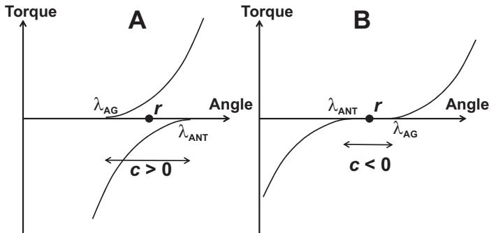  
Fig. 6. A: The neural control of a pair of opposing muscles can be described as a combination of  values for the agonist $( \lambda _ { \mathrm { A G } } )$ and antagonist $( \lambda _ { \mathrm { A N T } } )$ muscles. Alternatively, it can be described with the reciprocal command (r) and the coactivation command (c). B: formally, c-command can be negative when there is a range of joint angle where both muscles are quiescent.

The formal definition of the c-command reflected in $E q .$ . 2b allows negative values of this command. Such an example is illustrated in Fig. 6B where there is a range of joint angle values where none of the two muscles is activated. Intuitively, negative coactivation makes no sense; for example, $C _ { \mathrm { E M G } }$ cannot be negative by definition. In the next section, we consider in more detail how the framework of the EP hypothesis handles such issues as “negative coactivation” and related controversial concepts.

In a deafferented animal, the stretch reflex is absent, and muscle $F ( L )$ characteristic is defined by its level of activation, as in the --model (Bizzi et al. 1984). Due to the preserved springlike properties of deafferented muscles, such preparations show certain features typical of movements in intact animals, such as equifinality in cases of transient perturbations and gradual shift of the equilibrium states (Bizzi et al. 1978, 1982; Polit and Bizzi 1978, 1979). Since in deafferented animals muscle activation levels are independent of actual movement kinematics, muscle coactivation becomes defined exclusively by the central input to the respective alpha-motoneuronal pools. While the --model remains influential (Shadmehr and Wise 2005; Van Acker et al. 2014), in this review, we consider only the control of movements in intact animals, including humans, not in deafferented preparations.

Control of a joint without coactivation. Consider a joint spanned by two opposing muscles when both muscles are relaxed (Fig. 7A). Mechanical behavior of such a joint would be defined by the properties of the passive tissues (shown with dashed shallow lines). Note that both muscle control variables are undefined for a relaxed joint; indeed, the only information available from observing a relaxed muscle is that its  is larger than the actual muscle length. One can move the joint by applying an external force to a new coordinate where one of the muscles enters its activation zone; then  for that muscle becomes defined and starts affecting muscle activation and force. This is a common manipulation when a physical therapist tries to assess “muscle tone.” This method and the concept of muscle tone have been discussed recently (Latash and Zatsiorsky 2016). Bernstein and Kots (1963) defined muscle tone as state of a muscle reflecting its preparation to a future action. If a person is asked to relax, and then an examiner moves the joint, no preparation to an action by the person is implied. So, this method is incompatible with Bernstein’s definition.

Consider Fig. 7B, which illustrates possible effects of moving a joint in three persons who are all relaxed in the initial state corresponding to the joint angle $\alpha _ { 1 } .$ . In one of them, $\lambda _ { \mathrm { A G } }$ is very close to the initial joint coordinate $( \lambda _ { \mathrm { A G 1 } } ) ;$ in the second person,  is farther away from the joint coordinate $( \lambda _ { \mathrm { A G 2 } } ) ;$ in the third person,  is beyond the biomechanical range of joint rotation $( \lambda _ { \mathbf { A G } 3 } )$ . Now, if another person, a clinician, moves the joint to a new position (- ), resistance will be the highest in the first person $( \mathrm { T _ { 1 } }$ in Fig. 7), smaller in the second person $( \mathrm { T } _ { 2 }$ in Fig. 7), and close to zero in the third person. It makes little sense to address muscle tone of the first person as elevated, of the second as normal, and of the third as decreased. All three persons in this mental experiment are perfectly healthy; they simply interpreted the imprecise instruction “to relax” differently.

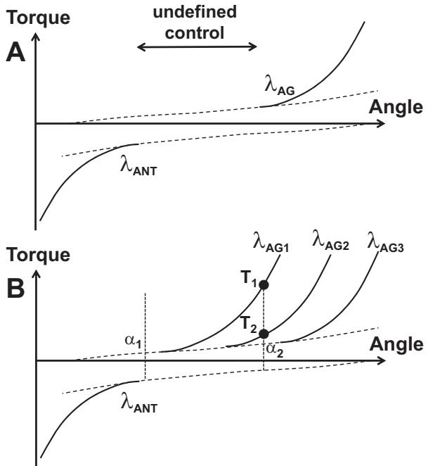  
Fig. 7. A: a schematic illustration of a joint spanned by two relaxed muscles. Mechanical behavior of such a joint would be defined by the properties of the passive tissues. Both muscle control variables (s) are undefined for a relaxed joint making both r-command and c-command undefined. B: possible effects of moving a joint in three persons who are all relaxed in the initial state $( \alpha _ { 1 } ) .$ . Note that the different subthreshold values of  for the agonist muscle $( \lambda _ { \mathrm { A G } } )$ correspond to different resistance at the new position (- ). In particular, active torque produced by the joint is zero for $\lambda _ { \mathrm { A G } 3 } , \mathrm { T } _ { 2 }$ for $\lambda _ { \mathbf { A G } 2 } ,$ and $\mathrm { T _ { 1 } }$ for $\lambda _ { \mathrm { A G 1 } } .$

Typically, if a person is asked to relax muscles acting at a joint, s of the opposing muscles stay close to the actual muscle length, so that small passive angular deviations of the joint from its initial angular position lead to muscle activation (e.g., Fig. 3 in Foisy and Feldman 2006). This observation suggests that, in a typical everyday situation, a person with relaxed muscles keeps the magnitudes of  for those muscles close to their actual length values. It takes special instruction and training to become able to relax deeper, which is well known to athletes and masseurs. Indeed, under “deep relaxation,” passive motion does not lead to muscle activation changes (Raptis et al. 2010).

If a person keeps s for both muscles crossing a joint at their actual length values, both r- and c-commands are defined; in particular, $c = 0$ (Fig. 8A). Changing the r-command leads to effective movement and/or torque generation without visible coactivation (Fig. 8A), while increasing the c-command leads to an increase in the joint apparent stiffness (cf. the solid and dashed thick lines representing joint characteristics in Fig. 8B) without motion (if the external load is zero) or with motion (if the external load is nonzero). As a result, if a person holds a position in a joint against a nonzero load and tries to coactivate the muscles without moving the joint, he or she has to change both c- and r-commands in a coordinated fashion. Such patterns were indeed reported in an experiment with smooth joint perturbations (Latash 1992). So, within the framework of the EP hypothesis, an increase in muscle coactivation, for example as quantified by the aforementioned index $C _ { \mathrm { E M G } }$ , may require a change in both basic commands, r and c. We come to a conclusion that, for an intact muscle acting against a nonzero external load, c-command and muscle coactivation are not synonyms.

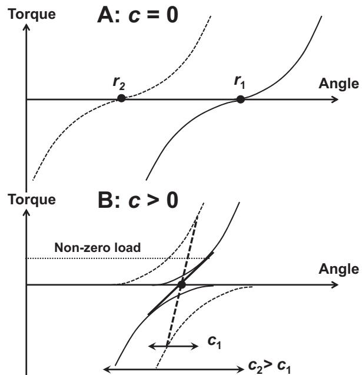  
Fig. 8. A: an illustration of a case with the c-command - 0. Changing the r-command leads to effective movement and/or torque generation without visible coactivation. B: a change in the c-command leads to an increase in the joint apparent stiffness without motion if the external load is zero. If the external load is nonzero, a change in the c-command leads to motion. If a person tries to coactivate the muscles while keeping the angular joint position unchanged, he or she has to change both c- and r-commands in a coordinated fashion.

Hierarchical control and coactivation. As described in previous sections, the idea of control with referent coordinates (RCs) can be applied at different levels of a movement control hierarchy, from the whole-body movements to single-muscle control (reviewed in Feldman 2015). Figure 9 illustrates a hypothetical control hierarchy with a sequence of few-to-many mappings starting from a low-dimensional set of RCs for action by an effector (e.g., a limb) to a potentially very high-dimensional set of s at the level of muscle control. Of course, this is a simplified scheme with levels selected rather arbitrarily: One can introduce a higher level corresponding to whole-body action and/or a lower level corresponding to recruitment of individual motor units. In principle, the controller may specify variables at any of the levels illustrated in Fig. 9 (and at levels not illustrated in that figure). However, since the classical statement by Hughlings Jackson (1889; “...the central nervous system knows nothing about muscles, it knows only movements,” p. 358), it has been commonly assumed that control variables, such as RCs for salient variables, are manipulated at meaningful, task-specific levels, not at levels of individual muscles. Such sets of salient control variables may include $\{ R ; C \}$ at the effector level or $\{ r ; c \}$ at the joint level. Control with individual s at the muscle level may be seen as atypical.

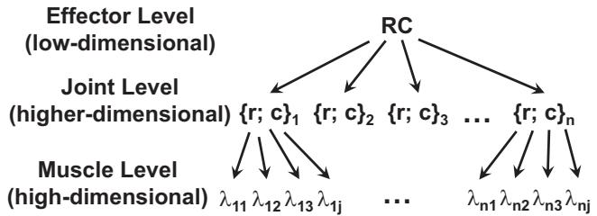  
Fig. 9. A hypothetical control hierarchy with a sequence of few-to-many mappings starting from a low-dimensional set of referent coordinates (RCs) for action by an effector (e.g., a limb) to a potentially very high-dimensional set of s at the level of muscle control.

Indeed, consider the neural control of a joint with a single kinematic degree of freedom. Imagine this joint in some initial state. How can a person change the state of this joint if the joint is free to move? There are only two options: 1) produce joint rotation to a new angle; and 2) stiffen the joint. These two basic actions map naturally on changes in the r-command and c-command, respectively. Note that, if there is external resistance, then a change in the r-command translates into torque change. A typical joint is crossed by more than two muscles. As such, muscle level control potentially involves manipulation of multiple s. However, this level of control is not used: Humans cannot do more than two “different things” with a single kinematic degree-of-freedom joint.

Main hypothesis. Agonist-antagonist coactivation is a reflection of the strategy by the central nervous system to preserve effector-level control, {R; C} or $\lbrace r ; ~ c \rbrace$ , without making it degenerate and facing the necessity to move to muscle-level control (s).

Let us consider a number of advantages of keeping control at the level of joint- or effector-specific variables. First, this allows keeping control at a function-specific level. This may be seen as offering the advantage of relying on learned patterns of control variables and parametrizing such learned patterns to specific motor tasks. It also allows using within-a-level hierarchies, such as, for example, the primary role of changing the r-command to perform movements and adjusting the subordinate c-command as required by specific external conditions (cf. Feldman 2015).

The second advantage is less obvious. It relies on the notion of performance-stabilizing synergies (reviewed in Latash 2008). According to this idea, elemental variables at any level of analysis may be organized by the central nervous system into structures for selective stabilization of task-specific salient variables. Given that controlled stability of action is crucial for everyday natural movements, synergic control plays a major role and its violations in neurological disorders are associated with major movement disorders (reviewed in Latash and Huang 2015). In particular, a drop in the index of stability of salient performance variables, such as total force produced by a set of digits, has been documented for multidigit tasks in patients with Parkinson’s disease (Jo et al. 2015; Park et al. 2012), multisystem brain atrophy (Park et al. 2013), and multiple sclerosis (Jo et al. 2017). A drop in stability of the center of pressure coordinate, analyzed within the space of activations of major muscle groups, has been reported in patients with Parkinson’s disease (Falaki et al. 2016, 2017).

Action stability has been studied using a variety of tools including those from nonlinear time series analysis (reviewed in Stergiou 2016). Dynamical stability of salient performance variables produced by covaried involvement of elements within abundant systems has been explored within the framework of the uncontrolled manifold hypothesis (Scholz and Schöner 1999). This approach uses such proxies of stability as intertrial variance in different directions in high-dimensional spaces of elemental variables (reviewed in Latash et al. 2007). In particular, a study of joint kinematics during quiet standing has shown a surprisingly high degree of covariation among joint rotation along the vertical body axis that kept the coordinate of the center of mass relatively invariant (Hsu et al. 2007).

Recently, this framework has been applied to analysis of action stability within abundant sets of hypothetical control variables (Ambike et al. 2016a, 2016b; Reschechtko and Latash 2017). Those studies documented strong synergies reflected in across-trial coadjustment of the referent coordinate (RC) and apparent stiffness (k) stabilizing task-specific variables, such as total force produced by the human hand. When stability of this variable was compromised (by removing salient visual feedback), indices of those synergies in the {RC; k} space dropped dramatically.

Note that, if one of the muscles within an agonist-antagonist pair is quiescent, changing  to that muscle within the subthreshold range formally is associated with coadjusted changes in both r- and c-commands, but it has no effect on behavior. Consider the schematic in Fig. 10. A joint controlled by two muscles is in an EP, characterized by a combination of torque and angle, T and -. The antagonist muscle is quiescent because its stretch reflex threshold $( \lambda _ { \mathrm { A N T , 1 } } )$ corresponds to a much longer muscle length than that at -. Changes in $\lambda _ { \mathrm { A N T } } ,$ for example to $\lambda _ { \mathrm { A N T } , 2 } ,$ are formally associated with changes in both r-command and c-command. However, as long as  stays at values subthreshold for muscle activation, any changes in $\lambda _ { \mathrm { A N T } }$ would lead to no behavioral effects. As a result, the only way to produce meaningful changes in RC and k is to manipulate a single variable,  for the agonist muscle. This makes the control degenerate, the number of variables manipulated at the control level becomes nonabundant (one), and this does not allow using control-level synergies stabilizing behavior. Keeping both s within the activation range makes it possible to vary two variables at the control level (r- and c-commands) independently of each other and thus stabilize desired task-specific variables.

A third advantage is linked to the fact that all processes within the central nervous system run at a limited speed, in particular, due to the limited speed of transmission of action potentials. If a muscle is relaxed, the distance from its  to activation zone is undefined and may be large. Shifts of  proceed at a limited speed (maximal speed in angular units was estimated at \~800°/s, Latash et al. 1991; Latash 1993). So, if  for a muscle is $1 0 0 ^ { \circ }$ away from its actual length, it can take over 100 ms before neural processes produce visible changes in muscle activation. This is a very long time delay, potentially incompatible with successful performance of everyday motor tasks, such as standing, which rely on quick reactions to unexpected perturbation. Keeping  close to the activation zone or within the activation zone potentially reduces the latency of quick postural corrections such as those addressed as long-latency stretch reflexes or preprogrammed reactions (reviewed in Prochazka et al. 2000).

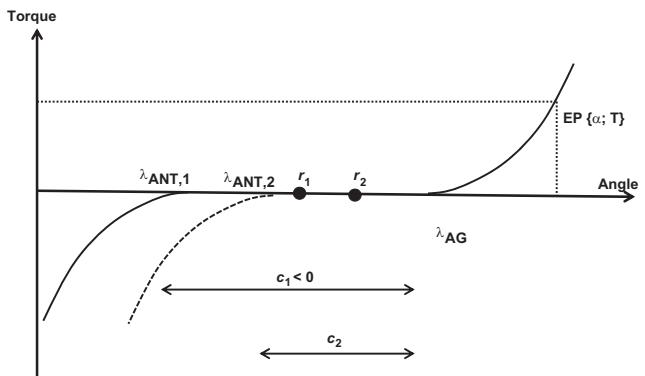  
Fig. 10. A schematic illustration of a joint controlled with two muscles, agonist (subscript AG) and antagonist (subscript ANT). If one of the muscles within an agonist-antagonist pair is quiescent (the antagonist, in this illustration), changing  to that muscle within the subthreshold range formally is associated with coadjusted changes in both r- and c-commands, without any measurable effect on the equilibrium state of the system (EP).

Our main hypothesis does not imply that visible muscle coactivation is expected in all conditions and across all species. For example, a number of studies of locomotion and scratching in intact and decerebrate animals showed no visible signs of muscle coactivation (Berkinblit et al. 1980; Gorassini et al. 2000; Hoffer et al. 1987; Lafreniere-Roula and McCrea 2005). There are many factors that can account for these observations. In particular, this can be a reflection of different stability requirements during bipedal and quadrupedal locomotion. Note that recent studies have documented qualitatively different patterns of the indices of foot (paw) stability during cat and human locomotion (Klishko et al. 2014; Krishnan et al. 2013). In addition, avoiding negative values of the c-command may be associated with very low muscle coactivation magnitudes that may not be obvious in EMG recordings.

## CONCLUDING COMMENTS: ANSWERS TO THE QUESTIONS

Now, I will try to answer questions formulated in former sections of this paper and related to possible functional role of coactivation and its characteristics.

What is the purpose of coactivation? The main hypothesis suggests that the primary purpose is to keep the neural control of action at a function-specific level and avoid the necessity to use degenerate, muscle-level control. This hypothesis is compatible with mechanical advantages of coactivation such as increasing apparent stiffness and movement speed. Effects of coactivation on movement stability may be advantageous, but primarily with respect to kinematic chains with fixed origin. Stiffening joints does not seem to give any advantage during standing.

Why do healthy persons coactivate more in challenging conditions? A common feature of challenging motor tasks is increased unpredictability of changes in external conditions and in intrinsic body states. This means that corrective actions are more likely required and such corrections have to deal with stronger destabilizing effects. First, destabilizing factors (such as force perturbations) increase joint position ambiguity and can move joints to zones characterized by zero coactivation, which makes control at the $\{ r ; c \}$ level impossible and forces shifting to the degenerate -level control. Increased coactivation increases the size of the spatial range where both muscles are within the activation zone and, therefore, unpredictable changes in muscle length are less likely to drive them outside this zone. Second, in cases of kinematic chains with fixed origins, higher coactivation improves stability by increasing apparent stiffness of the joints. Third, quick corrective actions, similarly to voluntary movements, require an increase in the apparent stiffness of the effector.

As mentioned earlier, stronger coactivation does not improve stability in kinematic chains with free origin (as during standing). Nevertheless, humans show increased coactivation in challenging postural tasks. This is reflected, in particular, in atypical composition of muscle modes, which involve significantly loaded agonist-antagonist muscle pairs (Krishnamoorthy et al. 2004). Note that, with practice, such atypical muscle modes disappear and are replaced with more typical modes with reciprocal organization (Asaka et al. 2008). So, coactivation patterns reflect not the objective conditions of performance but the subjective perception of those conditions by the actor. Moreover, given the questionable contribution of coactivation pattern to stability in tasks such as standing, these patterns may be viewed as “strategy of desperation,” which is ineffective and has to be replaced by more efficient patterns with modest coactivation with practice (cf. Bazzucchi et al. 2008; Kitatani et al. 2016).

Why do persons with impaired movements coactivate agonist-antagonist muscles more compared with healthy person? There may be more than one answer. The first is similar to that to the previous question: Persons with impaired movements perceive everyday tasks as challenging. This perception by itself may lead to patterns similar to those observed in healthy persons in challenging situations. It is also possible, however, that coactivation patterns are produced by involuntary mechanisms, e.g., those reflecting reorganization of spinal mechanisms typical of spasticity.

Is coactivation mechanically advantageous? The answer depends on the system of interest and task. If the task is to move as quickly as possible, increasing apparent stiffness by coactivation is advantageous (cf. Hasan 1986). If the task is to improve task stability, the answer is yes only for systems with fixed origin; otherwise, for example during standing, coactivation is counterproductive. Moderate coactivation may be useful but only if one moves beyond the mechanical analysis and considers the neural control of the involved effectors, which may ensure stability of their action.

Some of the conclusions drawn in this review can be tested experimentally. For example, the main hypothesis suggests that increased coactivation during standing might lead to deterioration of postural stability. This can be tested using indices of postural sway (cf. Błaszczyk 2016) and/or those of multimuscle synergies stabilizing center of pressure coordinate (cf. Krishnamoorthy et al. 2003, 2004). This line of thinking can be further explored by using EMG-based biofeedback in patients with excessive muscle coactivation to reduce the coactivation and thus, potentially, improve postural stability. Another experiment could explore natural relaxation in healthy persons, for example, one minute after a quick action. At that time, when no obvious muscle activation is seen, small positional perturbations applied to the effector are expected to produce visible changes in muscle activation reflecting the fact that the thresholds for muscle activation are naturally kept close to the actual muscle length values thus avoiding negative values of the c-command. Exploring stability of an effector in the absence of coactivation (see Fig. 10) might be challenging and requiring specialized training of the subjects. However, if this is achieved, poor stability of action can be expected as quantified, for example, by indices of the {RC; k} synergies.

## ACKNOWLEDGMENTS

The author is grateful to Momoko Yamagata for help with illustrations and to all the members of the Motor Control Laboratory at Penn State for productive discussions.

## GRANTS

The study was in part supported by a grant from the National Institutes of Health R21 NS095873.

## DISCLOSURES

No conflicts of interest, financial or otherwise, are declared by the authors.

## AUTHOR CONTRIBUTIONS

M.L.L. conceived and designed research; M.L.L. interpreted results of experiments; M.L.L. prepared figures; M.L.L. drafted manuscript; M.L.L. edited and revised manuscript; M.L.L. approved final version of manuscript.

## REFERENCES

Alexander RM. Energetics and optimization of human walking and running: the 2000 Raymond Pearl memorial lecture. Am J Hum Biol 14: 641–648, 2002. doi:10.1002/ajhb.10067.

Almeida GL, Hong DA, Corcos D, Gottlieb GL. Organizing principles for voluntary movement: extending single-joint rules. J Neurophysiol 74: 1374–1381, 1995. doi:10.1152/jn.1995.74.4.1374.

Ambike S, Mattos D, Zatsiorsky VM, Latash ML. Synergies in the space of control variables within the equilibrium-point hypothesis. Neuroscience 315: 150–161, 2016a. doi:10.1016/j.neuroscience.2015.12.012.

Ambike S, Mattos D, Zatsiorsky VM, Latash ML. Unsteady steady-states: central causes of unintentional force drift. Exp Brain Res 234: 3597–3611, 2016b. doi:10.1007/s00221-016-4757-7.

Ambike S, Zhou T, Zatsiorsky VM, Latash ML. Moving a hand-held object: Reconstruction of referent coordinate and apparent stiffness trajectories. Neuroscience 298: 336–356, 2015. doi:10.1016/j.neuroscience.2015.04. 023.

Angel RW, Eppler W, Iannone A. Silent period produced by unloading of muscle during voluntary contraction. J Physiol 180: 864–870, 1965. doi: 10.1113/jphysiol.1965.sp007736.

Arias P, Espinosa N, Robles-García V, Cao R, Cudeiro J. Antagonist muscle co-activation during straight walking and its relation to kinematics: insight from young, elderly and Parkinson’s disease. Brain Res 1455: 124–131, 2012. doi:10.1016/j.brainres.2012.03.033.

Aruin AS, Almeida GL. A coactivation strategy in anticipatory postural adjustments in persons with Down syndrome. Mot Contr 1: 178–191, 1997. doi:10.1123/mcj.1.2.178.

Aruin AS, Almeida GL, Latash ML. Organization of a simple two-joint synergy in individuals with Down syndrome. Am J Ment Retard 101: 256–268, 1996.

Asaka T, Wang Y, Fukushima J, Latash ML. Learning effects on muscle modes and multi-mode postural synergies. Exp Brain Res 184: 323–338, 2008. doi:10.1007/s00221-007-1101-2.

Asaka T, Yahata K, Mani H, Wang Y. Modulations of muscle modes in automatic postural responses induced by external surface translations. J Mot Behav 43: 165–172, 2011. doi:10.1080/00222895.2011.552079.

Asatryan DG, Feldman AG. Functional tuning of the nervous system with control of movements or maintenance of a steady posture. I. Mechano graphic analysis of the work of the limb on execution of a postural task. Biophysics (Oxf) 10: 925–935, 1965.

Babinski J. De l’asynergie cerebelleuse. Rev Neurol (Paris) 7: 806 – 816, 1899.

Bazzucchi I, Riccio ME, Felici F. Tennis players show a lower coactivation of the elbow antagonist muscles during isokinetic exercises. J Electromyogr Kinesiol 18: 752–759, 2008. doi:10.1016/j.jelekin.2007.03.004.

Bennett DJ, Hollerbach JM, Xu Y, Hunter IW. Time-varying stiffness of human elbow joint during cyclic voluntary movement. Exp Brain Res 88: 433–442, 1992. doi:10.1007/BF02259118.

Berger W, Trippel M, Discher M, Dietz V. Influence of subjects’ height on the stabilization of posture. Acta Otolaryngol 112: 22–30, 1992. doi:10. 3109/00016489209100778.

Berkinblit MB, Deliagina TG, Orlovsky GN, Feldman AG. Activity of motoneurons during fictitious scratch reflex in the cat. Brain Res 193: 427–438, 1980. doi:10.1016/0006-8993(80)90175-4.

Bernstein NA. On the Construction of Movements. Moscow: Medgiz, 1947. (In Russian).

Bernstein NA. The Co-ordination and Regulation ofMovements. Oxford, UK: Pergamon, 1967.

Bernstein NA, Kots YM. Tone. In: Grand Medical Encyclopaedia. Moscow: State Encyclopaedia, 1963, vol. 32, p. 418 – 422.

Bizzi E, Accornero N, Chapple W, Hogan N. Arm trajectory formation in monkeys. Exp Brain Res 46: 139–143, 1982. doi:10.1007/BF00238107.

Bizzi E, Accornero N, Chapple W, Hogan N. Posture control and trajectory formation during arm movement. J Neurosci 4: 2738–2744, 1984. doi:10. 1523/JNEUROSCI.04-11-02738.1984.

Bizzi E, Dev P, Morasso P, Polit A. Effect of load disturbances during centrally initiated movements. J Neurophysiol 41: 542–556, 1978. doi:10. 1152/jn.1978.41.3.542.

Błaszczyk JW. The use of force-plate posturography in the assessment of postural instability. Gait Posture 44: 1– 6, 2016. doi:10.1016/j.gaitpost. 2015.10.014.

Boudreau SA, Falla D. Chronic neck pain alters muscle activation patterns to sudden movements. Exp Brain Res 232: 2011–2020, 2014. doi:10.1007/ s00221-014-3891-3.

Bourbonnais D, Krieger C, Smith AM. Cerebellar cortical activity during stretch of antagonist muscles. Can J Physiol Pharmacol 64: 1202–1213, 1986. doi:10.1139/y86-204.

Brookham RL, Middlebrook EE, Grewal TJ, Dickerson CR. The utility of an empirically derived co-activation ratio for muscle force prediction through optimization. J Biomech 44: 1582–1587, 2011. doi:10.1016/j. jbiomech.2011.02.077.

Chen B, Lee Y-J, Aruin AS. Role of point of application of perturbation in control of vertical posture. Exp Brain Res 235: 3449–3457, 2017. doi:10. 1007/s00221-017-5069-2.

Chow JW, Yablon SA, Stokic DS. Intrathecal baclofen bolus reduces exaggerated extensor coactivation during pre-swing and early-swing of gait after acquired brain injury. Clin Neurophysiol 128: 725–733, 2017. doi:10.1016/ j.clinph.2017.02.017.

Corcos DM, Agarwal GC, Flaherty BP, Gottlieb GL. Organizing principles for single-joint movements. IV. Implications for isometric contractions. J Neurophysiol 64: 1033–1042, 1990. doi:10.1152/jn.1990.64.3.1033.

Corcos DM, Gottlieb GL, Agarwal GC. Organizing principles for singlejoint movements. II. A speed-sensitive strategy. J Neurophysiol 62: 358 – 368, 1989. doi:10.1152/jn.1989.62.2.358.

Crago PE, Houk JC, Hasan Z. Regulatory actions of human stretch reflex. J Neurophysiol 39: 925–935, 1976. doi:10.1152/jn.1976.39.5.925.

Crowninshield RD, Brand RA. A physiologically based criterion of muscle force prediction in locomotion. J Biomech 14: 793–801, 1981. doi:10.1016/ 0021-9290(81)90035-X.

d’Avella A, Saltiel P, Bizzi E. Combinations of muscle synergies in the construction of a natural motor behavior. Nat Neurosci 6: 300–308, 2003. doi:10.1038/nn1010.

Demeny G. Du role mécanique des muscles antagonists. Archives de Physiologie Ser. 5 2: 747, 1890.

Dietz V, Quintern J, Berger W. Neuronal control of ballistic finger movements in man: task specific electromyographic patterns. Neurosci Lett 60: 369–374, 1985. doi:10.1016/0304-3940(85)90605-6.

Ebner TJ, Bloedel JR, Vitek JL, Schwartz AB. The effects of cerebellar stimulation on the stretch reflex in the spastic monkey. Brain 105: 425– 442, 1982. doi:10.1093/brain/105.3.425.

Falaki A, Huang X, Lewis MM, Latash ML. Impaired synergic control of posture in Parkinson’s patients without postural instability. Gait Posture 44: 209–215, 2016. doi:10.1016/j.gaitpost.2015.12.035.

Falaki A, Huang X, Lewis MM, Latash ML. Motor equivalence and structure of variance: multi-muscle postural synergies in Parkinson’s disease. Exp Brain Res 235: 2243–2258, 2017. doi:10.1007/s00221-017-4971-y.

Feldman AG. Functional tuning of the nervous system with control of movement or maintenance of a steady posture. II. Controllable parameters of the muscle. Biophysics (Oxf) 11: 565–578, 1966.

Feldman AG. Superposition of motor programs—I. Rhythmic forearm movements in man. Neuroscience 5: 81–90, 1980. doi:10.1016/0306-4522(80) 90073-1.

Feldman AG. Once more on the equilibrium-point hypothesis ( model) for motor control. J Mot Behav 18: 17–54, 1986. doi:10.1080/00222895.1986. 10735369.

Feldman AG. Referent Control of Action and Perception: Challenging Con ventional Theories in Behavioral Science. New York: Springer, 2015. doi:10.1007/978-1-4939-2736-4.

Feldman AG, Latash ML. Testing hypotheses and the advancement of science: recent attempts to falsify the equilibrium point hypothesis. Exp Brain Res 161: 91–103, 2005. doi:10.1007/s00221-004-2049-0.

Flash T. The control of hand equilibrium trajectories in multi-joint arm movements. Biol Cybern 57: 257–274, 1987. doi:10.1007/BF00338819.

Foisy M, Feldman AG. Threshold control of arm posture and movement adaptation to load. Exp Brain Res 175: 726–744, 2006. doi:10.1007/s00221- 006-0591-7.

Frysinger RC, Bourbonnais D, Kalaska JF, Smith AM. Cerebellar cortical activity during antagonist cocontraction and reciprocal inhibition of forearm muscles. J Neurophysiol 51: 32–49, 1984. doi:10.1152/jn.1984.51.1.32.

Gatts S. Neural mechanisms underlying balance control in Tai Chi. Med Sport Sci 52: 87–103, 2008. doi:10.1159/000134289.

Ghez C, Gordon J. Trajectory control in targeted force impulses. I. Role of opposing muscles. Exp Brain Res 67: 225–240, 1987. doi:10.1007/ BF00248545.

Gomi H, Kawato M. Equilibrium-point control hypothesis examined by measured arm stiffness during multijoint movement. Science 272: 117–120, 1996. doi:10.1126/science.272.5258.117.

Gorassini M, Eken T, Bennett DJ, Kiehn O, Hultborn H. Activity of hindlimb motor units during locomotion in the conscious rat. J Neurophysiol 83: 2002–2011, 2000. doi:10.1152/jn.2000.83.4.2002.

Gottlieb GL, Corcos DM, Agarwal GC. Strategies for the control of voluntary movements with one mechanical degree of freedom. Behav Brain Sci 12: 189–250, 1989a. doi:10.1017/S0140525X00048238.

Gottlieb GL, Corcos DM, Agarwal GC. Organizing principles for singlejoint movements. I. A speed-insensitive strategy. J Neurophysiol 62: 342– 357, 1989b. doi:10.1152/jn.1989.62.2.342.

Granata KP, Marras WS. Cost-benefit of muscle cocontraction in protecting against spinal instability. Spine 25: 1398–1404, 2000. doi:10.1097/ 00007632-200006010-00012.

Gribble PL, Ostry DJ, Sanguineti V, Laboissière R. Are complex control signals required for human arm movement? J Neurophysiol 79: 1409–1424, 1998. doi:10.1152/jn.1998.79.3.1409

Hammond MC, Fitts SS, Kraft GH, Nutter PB, Trotter MJ, Robinson LM. Co-contraction in the hemiparetic forearm: quantitative EMG evaluation. Arch Phys Med Rehabil 69: 348–351, 1988.

Hasan Z. Optimized movement trajectories and joint stiffness in unperturbed, inertially loaded movements. Biol Cybern 53: 373–382, 1986. doi:10.1007 BF00318203.

Heitmann S, Ferns N, Breakspear M. Muscle co-contraction modulates damping and joint stability in a three-link biomechanical limb. Front Neurorobot 5: 5, 2012. doi:10.3389/fnbot.2011.00005.

Hiebert GW, Pearson KG. Contribution of sensory feedback to the generation of extensor activity during walking in the decerebrate Cat. J Neuro physiol 81: 758–770, 1999. doi:10.1152/jn.1999.81.2.758.

Hinder MR, Milner TE. The case for an internal dynamics model versus equilibrium point control in human movement. J Physiol 549: 953–963, 2003. doi:10.1113/jphysiol.2002.033845.

Hirai H, Miyazaki F, Naritomi H, Koba K, Oku T, Uno K, Uemura M, Nishi T, Kageyama M, Krebs HI. On the origin of muscle synergies: invariant balance in the co-activation of agonist and antagonist muscle pairs. Front Bioeng Biotechnol 3: 192, 2015. doi:10.3389/fbioe.2015.00192.

Hirokawa S, Solomonow M, Luo Z, Lu Y, D’Ambrosia R. Muscular co-contraction and control of knee stability. J Electromyogr Kinesiol 1: 199–208, 1991. doi:10.1016/1050-6411(91)90035-4.

Hoffer JA, Sugano N, Loeb GE, Marks WB, O’Donovan MJ, Pratt CA. Cat hindlimb motoneurons during locomotion. II. Normal activity patterns. J Neurophysiol 57: 530–553, 1987. doi:10.1152/jn.1987.57.2.530.

Hogan N. The mechanics of multi-joint posture and movement control. Biol Cybern 52: 315–331, 1985. doi:10.1007/BF00355754.

Houk JC. Agents of the mind. Biol Cybern 92: 427–437, 2005. doi:10.1007/ s00422-005-0569-8.

Hsu WL, Scholz JP, Schöner G, Jeka JJ, Kiemel T. Control and estimation of posture during quiet stance depends on multijoint coordination. J Neu rophysiol 97: 3024–3035, 2007. doi:10.1152/jn.01142.2006.

Hu X, Tong KY, Song R, Tsang VS, Leung PO, Li L. Variation of muscle coactivation patterns in chronic stroke during robot-assisted elbow training. Arch Phys Med Rehabil 88: 1022–1029, 2007. doi:10.1016/j.apmr.2007.05. 006.

Hubley-Kozey C, Deluzio K, Dunbar M. Muscle co-activation patterns during walking in those with severe knee osteoarthritis. Clin Biomech (Bristol, Avon) 23: 71–80, 2008. doi:10.1016/j.clinbiomech.2007.08.019.

Hughes M, McLellan DL. Increased co-activation of the upper limb muscles in writer’s cramp. J Neurol Neurosurg Psychiatry 48: 782–787, 1985. doi:10.1136/jnnp.48.8.782.

Hughlings Jackson J. Address in medicine. On the comparative study of diseases of the nervous system. Br Med J 2: 355–362, 1889.

Hulliger M, Dürmüller N, Prochazka A, Trend P. Flexible fusimotor control of muscle spindle feedback during a variety of natural movements. Prog Brain Res 80: 87–101, 1989. doi:10.1016/S0079-6123(08)62202-5.

Hultborn H, Jankowska E, Lindström S. Recurrent inhibition from motor axon collaterals of transmission in the Ia inhibitory pathway to motoneurones. J Physiol 215: 591–612, 1971. doi:10.1113/jphysiol.1971.sp009487.

Humphrey DR. Separate cell systems in the motor cortex of the monkey for the control ofjoint movement and ofjoint stiffness. Electroencephalogr Clin Neurophysiol Suppl 36: 393–408, 1982.

Humphrey DR, Reed DJ. Separate cortical systems for control of joint movement and joint stiffness: reciprocal activation and coactivation of antagonist muscles. Adv Neurol 39: 347–372, 1983.

Ikai T, Findley TW, Izumi S, Hanayama K, Kim H, Daum MC, Andrews JF, Diamond BJ. Reciprocal inhibition in the forearm during voluntary contraction and thinking about movement. Electromyogr Clin Neurophysiol 36: 295–304, 1996.

Ivanenko YP, Poppele RE, Lacquaniti F. Five basic muscle activation patterns account for muscle activity during human locomotion. J Physiol 556: 267–282, 2004. doi:10.1113/jphysiol.2003.057174.

Jo HJ, Mattos D, Lucassen EB, Huang X, Latash ML. Changes in multidigit synergies and their feed-forward adjustments in multiple sclerosis. J Mot Behav 49: 218–228, 2017. doi:10.1080/00222895.2016.1169986.

Jo HJ, Park J, Lewis MM, Huang X, Latash ML. Prehension synergies and hand function in early-stage Parkinson’s disease. Exp Brain Res 233: 425–440, 2015. doi:10.1007/s00221-014-4130-7.

Jo S, Massaquoi SG. A model of cerebellum stabilized and scheduled hybrid long-loop control of upright balance. Biol Cybern 91: 188–202, 2004. doi:10.1007/s00422-004-0497-z.

Jones SL, Henry SM, Raasch CC, Hitt JR, Bunn JY. Individuals with non-specific low back pain use a trunk stiffening strategy to maintain upright posture. J Electromyogr Kinesiol 22: 13–20, 2012. doi:10.1016/j.jelekin. 2011.10.006.

Keshner EA, Allum JH, Pfaltz CR. Postural coactivation and adaptation in the sway stabilizing responses of normals and patients with bilateral vestibular deficit. Exp Brain Res 69: 77–92, 1987. doi:10.1007/BF00247031.

Kitatani R, Ohata K, Sakuma K, Aga Y, Yamakami N, Hashiguchi Y, Yamada S. Ankle muscle coactivation during gait is decreased immediately after anterior weight shift practice in adults after stroke. Gait Posture 45: 35–40, 2016. doi:10.1016/j.gaitpost.2016.01.006.

Klishko AN, Farrell BJ, Beloozerova IN, Latash ML, Prilutsky BI. Stabilization of cat paw trajectory during locomotion. J Neurophysiol 112: 1376–1391, 2014. doi:10.1152/jn.00663.2013.

Krishnamoorthy V, Goodman S, Zatsiorsky V, Latash ML. Muscle synergies during shifts of the center of pressure by standing persons: identification of muscle modes. Biol Cybern 89: 152–161, 2003. doi:10.1007 s00422-003-0419-5.

Krishnamoorthy V, Latash ML, Scholz JP, Zatsiorsky VM. Muscle modes during shifts of the center of pressure by standing persons: effect of instability and additional support. Exp Brain Res 157: 18–31, 2004. doi:10. 1007/s00221-003-1812-y.

Krishnan V, Rosenblatt NJ, Latash ML, Grabiner MD. The effects of age on stabilization of the mediolateral trajectory of the swing foot. Gait Posture 38: 923–928, 2013. doi:10.1016/j.gaitpost.2013.04.023.

Lackner JR, Dizio P. Rapid adaptation to Coriolis force perturbations of arm trajectory. J Neurophysiol 72: 299–313, 1994. doi:10.1152/jn.1994.72.1. 299.

Lacquaniti F, Maioli C. The role of preparation in tuning anticipatory and reflex responses during catching. J Neurosci 9: 134–148, 1989. doi:10.1523/ JNEUROSCI.09-01-00134.1989.

Lafreniere-Roula M, McCrea DA. Deletions of rhythmic motoneuron activity during fictive locomotion and scratch provide clues to the organization of the mammalian central pattern generator. J Neurophysiol 94: 1120 –1132, 2005. doi:10.1152/jn.00216.2005.

Landsmeer JMF, Long C. The mechanism of finger control, based on electromyograms and location analysis. Acta Anat (Basel) 60: 330 –347, 1965. doi:10.1159/000142668.

Latash ML. Independent control of joint stiffness in the framework of the equilibrium-point hypothesis. Biol Cybern 67: 377–384, 1992. doi:10.1007/ BF02414893.

Latash ML. Control ofHuman Movement. Urbana, IL: Human Kinetics, 1993.

Latash ML. Motor coordination in Down syndrome: the role of adaptive changes. In: Perceptual-Motor Behavior in Down Syndrome, edited by Weeks DJ, Chua R, Elliott D. Urbana, IL: Human Kinetics, 2000, p. 199–223.

Latash ML. Synergy. New York: Oxford University Press, 2008. doi:10.1093/ acprof:oso/9780195333169.001.0001.

Latash ML. Motor synergies and the equilibrium-point hypothesis. Mot Contr 14: 294–322, 2010. doi:10.1123/mcj.14.3.294.

Latash ML. The bliss (not the problem) of motor abundance (not redundancy). Exp Brain Res 217: 1–5, 2012. doi:10.1007/s00221-012-3000-4.

Latash ML. Towards physics of neural processes and behavior. Neurosci Biobehav Rev 69: 136–146, 2016. doi:10.1016/j.neubiorev.2016.08.005.

Latash ML. Biological movement and laws of physics. Mot Contr 21: 327–344, 2017. doi:10.1123/mc.2016-0016.

Latash ML, Almeida GL, Corcos DM. Preprogrammed reactions in individ uals with Down syndrome: the effects of instruction and predictability of the perturbation. Arch Phys Med Rehabil 74: 391–399, 1993.

Latash ML, Aruin AS, Shapiro MB. The relation between posture and movement: a study of a simple synergy in a two-joint task. Hum Mov Sci 14: 79–107, 1995. doi:10.1016/0167-9457(94)00046-H.

Latash ML, Aruin AS, Zatsiorsky VM. The basis of a simple synergy: reconstruction of joint equilibrium trajectories during unrestrained arm movements. Hum Mov Sci 18: 3–30, 1999. doi:10.1016/S0167-9457(98)00029-3.

Latash ML, Gottlieb GL. Reconstruction of elbow joint compliant charac teristics during fast and slow movements. Neuroscience 43: 697–712, 1991. doi:10.1016/0306-4522(91)90328-L.

Latash ML, Gutman SR, Gottlieb GL. Relativistic effects in single-joint voluntary movements. Biol Cybern 65: 401–406, 1991. doi:10.1007 BF00216974.

Latash ML, Huang X. Neural control of movement stability: Lessons from studies of neurological patients. Neuroscience 301: 39 – 48, 2015. doi:10. 1016/j.neuroscience.2015.05.075.

Latash ML, Scholz JP, Schöner G. Toward a new theory of motor synergies. Mot Contr 11: 276–308, 2007. doi:10.1123/mcj.11.3.276.

Latash ML, Zatsiorsky VM. Biomechanics and Motor Control: Defining Central Concepts. New York: Academic, 2016.

Lee PJ, Rogers EL, Granata KP. Active trunk stiffness increases with co-contraction. J Electromyogr Kinesiol 16: 51–57, 2006. doi:10.1016/j. jelekin.2005.06.006.

Lee Y, Ashton-Miller JA. The effects of gender, level of co-contraction, and initial angle on elbow extensor muscle stiffness and damping under a step increase in elbow flexion moment. Ann Biomed Eng 39: 2542–2549, 2011. doi:10.1007/s10439-011-0308-3.

Lee YJ, Chen B, Aruin AS. Older adults utilize less efficient postural control when performing pushing task. J Electromyogr Kinesiol 25: 966–972, 2015. doi:10.1016/j.jelekin.2015.09.002.

Lestienne F. Effects of inertial load and velocity on the braking process of voluntary limb movements. Exp Brain Res 35: 407–418, 1979. doi:10.1007/ BF00236760.

Lévénez M, Garland SJ, Klass M, Duchateau J. Cortical and spinal modulation of antagonist coactivation during a submaximal fatiguing contraction in humans. J Neurophysiol 99: 554–563, 2008. doi:10.1152/jn. 00963.2007.

Llewellyn M, Yang JF, Prochazka A. Human H-reflexes are smaller in difficult beam walking than in normal treadmill walking. Exp Brain Res 83: 22–28, 1990. doi:10.1007/BF00232189.

Long C II. Intrinsic-extrinsic muscle control of the fingers. Electromyographic studies. J Bone Joint Surg Am 50: 973–984, 1968. doi:10.2106/00004623- 196850050-00009.

Mari S, Serrao M, Casali C, Conte C, Martino G, Ranavolo A, Coppola G, Draicchio F, Padua L, Sandrini G, Pierelli F. Lower limb antagonist muscle co-activation and its relationship with gait parameters in cerebellar ataxia. Cerebellum 13: 226–236, 2014. doi:10.1007/s12311-013-0533-4.

Matthews PBC. The dependence of tension upon extension in the stretch reflex of the soleus muscle of the decerebrate cat. J Physiol 147: 521–546, 1959. doi:10.1113/jphysiol.1959.sp006260.

Mattos DJ, Latash ML, Park E, Kuhl J, Scholz JP. Unpredictable elbow joint perturbation during reaching results in multijoint motor equivalence. J Neurophysiol 106: 1424–1436, 2011. doi:10.1152/jn.00163.2011.

Merton PA. Speculations on the servo-control of movements. In: The Spinal Cord, edited by Malcolm JL, Gray JAB, Wolstenholm GEW. Boston, MA: Little, Brown, 1953, p. 183–198.

Milner TE. Adaptation to destabilizing dynamics by means of muscle cocontraction. Exp Brain Res 143: 406–416, 2002. doi:10.1007/s00221-002- 1001-4.

Milner TE, Cloutier C. Compensation for mechanically unstable loading in voluntary wrist movement. Exp Brain Res 94: 522–532, 1993. doi:10.1007/ BF00230210.

Milner TE, Cloutier C. Damping of the wrist joint during voluntary movement. Exp Brain Res 122: 309–317, 1998. doi:10.1007/s002210050519.

Mink JW, Thach WT. Basal ganglia motor control. III. Pallidal ablation: normal reaction time, muscle cocontraction, and slow movement. J Neurophysiol 65: 330–351, 1991. doi:10.1152/jn.1991.65.2.330.

Morita H, Crone C, Christenhuis D, Petersen NT, Nielsen JB. Modulation of presynaptic inhibition and disynaptic reciprocal Ia inhibition during voluntary movement in spasticity. Brain 124: 826–837, 2001. doi:10.1093/ brain/124.4.826.

Nagai K, Yamada M, Uemura K, Yamada Y, Ichihashi N, Tsuboyama T. Differences in muscle coactivation during postural control between healthy older and young adults. Arch Gerontol Geriatr 53: 338–343, 2011. doi:10. 1016/j.archger.2011.01.003.

Neige C, Massé-Alarie H, Gagné M, Bouyer LJ, Mercier C. Modulation of corticospinal output in agonist and antagonist proximal arm muscles during motor preparation. PLoS One 12: e0188801, 2017. doi:10.1371/journal. pone.0188801.

Nelson-Wong E, Callaghan JP. Is muscle co-activation a predisposing factor for low back pain development during standing? A multifactorial approach for early identification of at-risk individuals. J Electromyogr Kinesiol 20: 256–263, 2010. doi:10.1016/j.jelekin.2009.04.009.

Nichols TR, Houk JC. Improvement in linearity and regulation of stiffness that results from actions of stretch reflex. J Neurophysiol 39: 119 –142, 1976. doi:10.1152/jn.1976.39.1.119.

Nielsen J, Kagamihara Y. The regulation of disynaptic reciprocal Ia inhibition during co-contraction of antagonistic muscles in man. J Physiol 456: 373–391, 1992. doi:10.1113/jphysiol.1992.sp019341.

Nielsen J, Pierrot-Deseilligny E. Evidence of facilitation of soleus-coupled Renshaw cells during voluntary co-contraction of antagonistic ankle muscles in man. J Physiol 493: 603–611, 1996. doi:10.1113/jphysiol.1996. sp021407.

Nielsen JB. Human spinal motor control. Annu Rev Neurosci 39: 81–101, 2016. doi:10.1146/annurev-neuro-070815-013913.

Park J, Lewis MM, Huang X, Latash ML. Effects of olivo-ponto-cerebellar atrophy (OPCA) on finger interaction and coordination. Clin Neurophysiol 124: 991–998, 2013. doi:10.1016/j.clinph.2012.10.021.

Park J, Wu Y-H, Lewis MM, Huang X, Latash ML. Changes in multifinger interaction and coordination in Parkinson’s disease. J Neurophysiol 108: 915–924, 2012. doi:10.1152/jn.00043.2012.

Penn RD, Gottlieb GL, Agarwal GC. Cerebellar stimulation in man. Quantitative changes in spasticity. J Neurosurg 48: 779–786, 1978. doi:10.3171/ jns.1978.48.5.0779.

Perreault EJ, Kirsch RF, Crago PE. Multijoint dynamics and postural stability of the human arm. Exp Brain Res 157: 507–517, 2004. doi:10.1007/ s00221-004-1864-7.

Piscitelli D, Falaki A, Solnik S, Latash ML. Anticipatory postural adjustments and anticipatory synergy adjustments: preparing to a postural perturbation with predictable and unpredictable direction. Exp Brain Res 235: 713–730, 2017. doi:10.1007/s00221-016-4835-x.

Polit A, Bizzi E. Processes controlling arm movements in monkeys. Science 201: 1235–1237, 1978. doi:10.1126/science.99813.

Polit A, Bizzi E. Characteristics of motor programs underlying arm movements in monkeys. J Neurophysiol 42: 183–194, 1979. doi:10.1152/jn.1979. 42.1.183.

Prilutsky BI, Zatsiorsky VM. Optimization-based models of muscle coordination. Exerc Sport Sci Rev 30: 32–38, 2002. doi:10.1097/00003677- 200201000-00007.

Prochazka A, Clarac F, Loeb GE, Rothwell JC, Wolpaw JR. What do reflex and voluntary mean? Modern views on an ancient debate. Exp Brain Res 130: 417–432, 2000. doi:10.1007/s002219900250.

Ralston HJ, Inman VT, Strait LA, Shaffrath MD. Mechanics of human isolated voluntary muscle. Am J Physiol 151: 612–620, 1947.

Raptis H, Burtet L, Forget R, Feldman AG. Control of wrist position and muscle relaxation by shifting spatial frames of reference for motoneuronal

recruitment: possible involvement of corticospinal pathways. J Physiol 588: 1551–1570, 2010. doi:10.1113/jphysiol.2009.186858.

Reschechtko S, Latash ML. Stability of hand force production. I. Hand level control variables and multifinger synergies. J Neurophysiol 118: 3152–3164, 2017. doi:10.1152/jn.00485.2017.

Richards CL, Malouin F. Cerebral palsy: definition, assessment and rehabilitation. Handb Clin Neurol 111: 183–195, 2013. doi:10.1016/B978-0-444- 52891-9.00018-X.

Rinaldi M, Ranavolo A, Conforto S, Martino G, Draicchio F, Conte C, Varrecchia T, Bini F, Casali C, Pierelli F, Serrao M. Increased lower limb muscle coactivation reduces gait performance and increases metabolic cost in patients with hereditary spastic paraparesis. Clin Biomech (Bristol, Avon) 48: 63–72, 2017. doi:10.1016/j.clinbiomech.2017.07. 013.

Rosa MC, Marques A, Demain S, Metcalf CD, Rodrigues J. Methodologies to assess muscle co-contraction during gait in people with neurological impairment - a systematic literature review. J Electromyogr Kinesiol 24: 179–191, 2014. doi:10.1016/j.jelekin.2013.11.003.

Rozand V, Senefeld JW, Hassanlouei H, Hunter SK. Voluntary activation and variability during maximal dynamic contractions with aging. Eur J Appl Physiol 117: 2493–2507, 2017. doi:10.1007/s00421-017-3737-3.

Sangani SG, Raptis HA, Feldman AG. Subthreshold corticospinal control of anticipatory actions in humans. Behav Brain Res 224: 145–154, 2011. doi:10.1016/j.bbr.2011.05.041.

Scholz JP, Schöner G. The uncontrolled manifold concept: identifying control variables for a functional task. Exp Brain Res 126: 289–306, 1999. doi:10. 1007/s002210050738.

Shadmehr R, Wise SP. The Computational Neurobiology of Reaching and Pointing. Cambridge, MA: MIT Press, 2005.

Shiratori T, Latash M. The roles of proximal and distal muscles in antici patory postural adjustments under asymmetrical perturbations and during standing on rollerskates. Clin Neurophysiol 111: 613–623, 2000. doi:10. 1016/S1388-2457(99)00300-4.

Shiratori T, Latash ML. Anticipatory postural adjustments during load catching by standing subjects. Clin Neurophysiol 112: 1250–1265, 2001. doi:10.1016/S1388-2457(01)00553-3.

Sinkjaer T, Andersen JB, Ladouceur M, Christensen LO, Nielsen JB. Major role for sensory feedback in soleus EMG activity in the stance phase of walking in man. J Physiol 523: 817–827, 2000. doi:10.1111/j.1469- 7793.2000.00817.x.

Slijper H, Latash M. The effects of instability and additional hand support on anticipatory postural adjustments in leg, trunk, and arm muscles during standing. Exp Brain Res 135: 81–93, 2000. doi:10.1007/s002210000492.

Smith AM. The coactivation of antagonist muscles. Can J Physiol Pharmacol 59: 733–747, 1981. doi:10.1139/y81-110.

Souissi H, Zory R, Bredin J, Gerus P. Comparison of methodologies to assess muscle co-contraction during gait. J Biomech 57: 141–145, 2017. doi:10.1016/j.jbiomech.2017.03.029.

Stergiou N. Nonlinear Analysis of Human Movement Variability. Abingdon, UK: CRC, 2016.

Suzuki M, Yamazaki Y. Velocity-based planning of rapid elbow movements expands the control scheme of the equilibrium point hypothesis. J Comput Neurosci 18: 131–149, 2005. doi:10.1007/s10827-005-6555-2.

Tal’nov AN, Kostiukov AI. [The manifestation of the hysteresis effects of muscle contraction in the cortically evoked coactivation of muscle antagonists]. Neirofiziologiia 23: 481–484, 1991.

Teulier C, Sansom JK, Muraszko K, Ulrich BD. Longitudinal changes in muscle activity during infants’ treadmill stepping. J Neurophysiol 108: 853–862, 2012. doi:10.1152/jn.01037.2011.

Tilney F, Pike FH. Muscular coordination experimentally studied in its relation to the cerebellum. Arch Neurol Psychiatry 13: 289 –334, 1925. doi:10.1001/archneurpsyc.1925.02200090003001.

Ting LH, McKay JL. Neuromechanics of muscle synergies for posture and movement. Curr Opin Neurobiol 17: 622–628, 2007. doi:10.1016/j.conb. 2008.01.002.

Tresch MC, Cheung VC, d’Avella A. Matrix factorization algorithms for the identification of muscle synergies: evaluation on simulated and experimental data sets. J Neurophysiol 95: 2199–2212, 2006. doi:10.1152/jn.00222.2005.

Vallbo AB. Basic patterns of muscle spindle discharge in man. In: Muscle Receptors and Movement, edited by Taylor A, Prochazka A. London: MacMillan, 1981, p. 263–275.

Van Acker GM 3rd, Amundsen SL, Messamore WG, Zhang HY, Luchies CW, Cheney PD. Equilibrium-based movement endpoints elicited from primary motor cortex using repetitive microstimulation. J Neurosci 34: 15722–15734, 2014.

Wetts R, Kalaska JF, Smith AM. Cerebellar nuclear cell activity during antagonist cocontraction and reciprocal inhibition of forearm muscles. J Neurophysiol 54: 231–244, 1985. doi:10.1152/jn.1985.54.2.231.

Wickens JR, Alexander ME, Miller R. Two dynamic modes of striatal function under dopaminergic-cholinergic control: simulation and analysis of a model. Synapse 8: 1–12, 1991. doi:10.1002/syn.890080102.

Zatsiorsky VM, Prilutsky BI. Biomechanics ofSkeletal Muscles. Urbana, IL: Human Kinetics, 2012.

Zeinali-Davarani S, Hemami H, Barin K, Shirazi-Adl A, Parnianpour M. Dynamic stability of spine using stability-based optimization and muscle spindle reflex. IEEE Trans Neural Syst Rehabil Eng 16: 106–118, 2008. doi:10.1109/TNSRE.2007.906963.

Ziegler MD, Zhong H, Roy RR, Edgerton VR. Why variability facilitates spinal learning. J Neurosci 30: 10720–10726, 2010. doi:10.1523/JNEUROSCI. 1938-10.2010

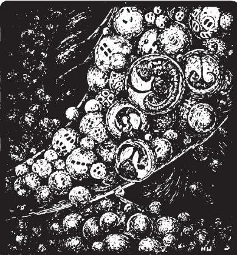