# 融合物理信息的肌肉骨骼建模深度学习：基于表面肌电预测肌肉力和关节运动学

Jie Zhang , Member IEEE, Yihui Zhao , Fergus Shone, Zhenhong Li , Member IEEE, Alejandro F. Frangi , Fellow, IEEE, Sheng Quan Xie , Senior Member, IEEE, and Zhi-Qiang Zhang , Member, IEEE

— 肌肉骨骼模型已被广泛用于详细的生物力学分析以表征各种功能障碍，因其能够估计无法在体内直接测量的运动变量（即肌肉力和关节力矩）。基于物理的计算神经肌肉骨骼模型能够解释肌肉神经驱动、肌肉动力学、身体与关节运动学以及动力学之间的动态相互作用。然而，此类方法存在计算速度慢的问题，尤其是对于复杂模型而言，从而阻碍了其在实时应用中的使用。近年来，数据驱动方法因其快速且实现简单的优势而成为一种很有前景的替代方案，但它们无法反映潜在的神经力学过程。本文提出了一种用于肌肉骨骼建模的物理信息深度学习框架，其中基于物理的领域知识作为软约束引入数据驱动模型中，以对数据驱动模型进行惩罚/正则化。我们以基于表面肌电图（sEMG）同步预测肌肉力和关节运动学为例，对所提出的框架进行了说明。卷积神经网络（CNN）被用作实现该框架的深度神经网络。同时，肌肉力与关节运动学之间的物理规律被用作软约束。针对两组数据进行了实验验证，包括一个基准数据集和一个采集自六名健康受试者的数据集。实验结果证明了该框架的有效性和鲁棒性。

— 肌肉骨骼建模，深度神经网络，基于物理的领域知识，肌肉力和关节运动学预测。

## I. 引言

神经肌肉系统[1]。作为一种强大的计算仿真工具，肌肉骨骼模型可用于详细的生物力学分析以理解这些相互作用，这将有益于从评估康复治疗[2]、提升运动员表现[3], [4]、为残障人士优化机器人设计[5]，到手术规划与干预[6]等各种应用。

迄今为止，大多数肌肉骨骼模型都是基于基于物理的建模技术，用于解释神经兴奋、肌肉动力学以及关节运动学与动力学之间的转换 [7], [8], [9]。通过使用实验记录（例如肌电图（EMGs）、足-地反应力（GRFs）和人体环节运动学），这些模型可以对肌肉力和关节力矩等生理学参数提供非侵入式估计 [10]。然而，由于可以采用无数种潜在的神经解决方案来执行单个动作，这些模型往往面临冗余性问题。因此，静态优化常被用于解决该冗余问题，其涉及利用逆动力学追踪外部关节力矩和/或关节运动学，并估计肌肉力以满足预选的目标准则，例如肌肉激活度平方和最小化 [11], [12]。另一种方法是采用 EMG 驱动的神经肌肉骨骼模型，该模型由神经驱动的正向动力学模型和静态优化单元组成 [13], [14]。通过优化程序使实验测得与估计的关节力矩达到最佳匹配，EMG 可用于根据个体特征校准模型的肌腱参数（即肌腱松弛长度和最佳肌纤维长度等）。它还通过调整实验 EMG 信号并合成肌肉兴奋度，利用静态优化增强了关节力矩的估计 [15]。尽管 EMG 驱动模型克服了静态优化的局限性，并且在过去几年中易于获取，但它们计算耗时且运行延迟高 [16]。这因而限制了此类模型在实时应用中的效用。

为了解决基于物理的肌肉骨骼模型耗时较长的问题，研究人员还探索了数据驱动模型，以建立运动变量与神经肌肉状态之间的关系，即从肌电图（EMG）到关节运动学和肌肉力 [17], [18], [19], [20]。与基于物理的模型相比，这些数据驱动模型的一个主要优势在于速度。尽管模型训练可能耗时较长，但由于推理过程仅涉及网络相对简单的前向传播，其计算开销低，因而速度非常快。例如，Hu et al. [21] 利用长短期记忆（LSTM）网络，从高密度表面肌电图（sEMG）中估计抓握力。Geng et al. [22] 提出了一种带注意力机制的卷积神经网络（CNN-Attention），用于从 sEMG 连续预测手指运动学。Rane et al. [23] 采用深度神经网络学习从运动空间到肌肉空间的特征映射，从而能够根据运动学预测肌肉骨骼力。类似的思想在 [24], [25], [26], [27] 中也有报道。除了分别预测肌肉力或关节运动学之外，还有一些工作同时预测肌肉力和关节负荷/运动。例如，Burton et al. [28] 实现了四种机器学习/深度学习方法，包括循环神经网络（RNN）、卷积神经网络（CNN）、全连接神经网络和主成分回归，用于预测估计的关节接触力和肌肉力的趋势与大小。Johnson et al. [29] 利用 CNN 在实验室环境之外预测地面反作用力与力矩。然而，所有这些模型在建立时均未对潜在的神经力学过程进行显式物理建模，它们本质上属于“黑盒”工具，其中所有的中间函数关系都无法反映观测变量背后的底层机制 [30], [31]。

为解决上述基于物理的模型和数据驱动模型的缺陷，本文提出了一种物理融合深度学习（physics-informed deep learning）肌肉骨骼模型框架，该框架能够将现有的基于物理的领域知识无缝集成到数据驱动模型中。因此，它将在克服两类肌肉骨骼模型局限性的同时保留各自的优势。我们以基于表面肌电信号（sEMG）同步预测肌力和关节运动学为例，对所提出的框架进行说明。主要贡献可总结如下：1）提出了一种知识嵌入的数据驱动框架，将基于物理的领域知识融入数据驱动模型中；2）将基于物理的领域知识作为软约束，对深度神经网络的损失函数进行惩罚/正则化。在我们的案例中应用了与肌力和关节运动学相关的物理定律。在不失一般性的前提下，本文采用 CNN 作为深度神经网络来实现所提出的框架。为了验证所提框架在肌力和关节运动学估计中的有效性，采用了一个包含大量步行试验的基准数据集和一个包含手腕运动的自采数据集。结果表明，采用更简单神经网络架构的所提框架性能优于所选的基准方法，包括 CNN、多层极限学习机（ML-ELM）、支持向量回归（SVR）以及极限学习机（ELM）。

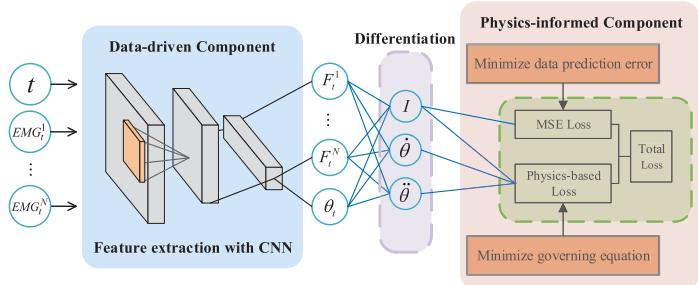  
Fig. 1. 物理融合深度学习的主框架。在本研究中，CNN 的输入为时间步和 EMG 信号，而 CNN 的输出为肌力 $F _ { t } ^ { n }$ 和关节角度 $\theta _ { t } ( n \mathbf { \bar { = } } 1 , \ldots , N , t { = } \dot { 1 } , \ldots , T )$

本文其余部分的结构组织如下：第二节详细介绍了方法，包括所提出的物理融合深度学习方法的主框架、CNN 的架构与训练以及损失函数的设计。第三节介绍了实验材料和实验方法。第四节汇报了实验结果。最后，第五节展开了讨论，第六节给出了结论。

## II. 方法

在本节中，我们首先在基于 sEMG 预测肌力和关节运动学的背景下，描述所提出的用于肌肉骨骼建模的物理融合深度学习方法的主框架。下文将详细阐述主框架、CNN 架构与训练以及所设计的损失函数。

## A. 物理融合深度学习框架

Fig. 1 展示了所提出的用于肌肉骨骼建模的物理信息深度学习方法的主要框架，应用于基于 sEMG 预测肌肉力和关节运动学的场景。具体而言，在数据驱动部分中，利用 CNN 自动提取高层特征，并建立 EMG 信号与关节运动/肌肉力之间的关系；而物理信息部分则包含关节运动与肌肉力之间的潜在物理关系。通过这种方式，在数据驱动部分，记录的 EMG 信号和时间步长首先被输入到 CNN 中。利用 CNN 提取的特征，可以得到预测的肌肉力和关节角度。这些预测还应满足物理运动方程，该方程随后被用作软约束来惩罚/正则化 CNN。最后，通过整合传统的均方误差（MSE）损失和基于物理的损失构建了一个改进的总损失函数，用于模型训练。

## B. CNN 的架构与训练

为了证明所提出的物理信息深度学习框架的有效性，本文采用了一种非常简单的 CNN 架构。它仅由一个卷积块、两个全连接块和一个回归块组成。具体来说，卷积块包含一个卷积层、一个 ReLU 层、一个批量归一化（batch normalisation）层和一个 dropout 层。它在卷积层中使用了 $^ { 3 , }$ 的卷积核大小、3 的边界填充以及 1 的步长。卷积层中有 128 个卷积核，且在卷积层之后添加了一个 ReLU 层。同时引入了批量归一化层以减轻卷积层带来的变化。与卷积块类似，每个全连接块中都有一个 ReLU 层、一个归一化层和一个 dropout 层。隐藏节点数为 128。第二个全连接块的输出随后被输入到回归块中，用于预测肌肉力和关节运动学。

在模型训练阶段，批次大小（batch size）设置为 1，CNN 采用带动量的随机梯度下降（stochastic gradient descent with momentum）进行训练。此外，最大迭代次数为 1200，初始学习率设置为 0.01，dropout 率为 0.3。

## C. 损失函数的设计

与现有最先进的方法不同，所提框架的损失函数由 MSE 损失和基于物理的损失组成。MSE 损失用于最小化真实值与预测值之间的均方误差，而基于物理的损失则在运动过程中保持物理约束。在本文中，优化的 CNN 参数是基于以下总损失获得的：

$$
L _ {t o t a l} = L _ {F} + L _ {\theta} + L _ {P}\tag{1}
$$

$$
L _ {F} = M S E (F)\tag{2}
$$

$$
L _ {\theta} = M S E (\theta)\tag{3}
$$

$$
L _ {P} = \Phi (F, \theta)\tag{4}
$$

其中 $L _ { F }$ 分别表示肌肉力量的损失，而 $L _ { \theta }$ 表示关节角度的损失。$L _ { P }$ 代表由物理定律施加的损失函数，其可以通过惩罚/正则化 CNN 以提升性能。$( F , \theta )$ 表示预测变量的函数。

MSE 损失的计算公式为：

$$
\mathrm{MSE} (F) = \frac {1}{T} \sum_ {t = 1} ^ {T} \sum_ {n = 1} ^ {N} (F _ {t} ^ {n} - \hat {F} _ {t} ^ {n}) ^ {2}\tag{5}
$$

$$
\mathrm{MSE} (\theta) = \frac {1}{T} \sum_ {t = 1} ^ {T} (\theta_ {t} - \hat {\theta} _ {t}) ^ {2}\tag{6}
$$

其中 $F _ { t } ^ { n }$ 表示肌肉 n 在时间步 t 的力量，$\theta _ { t }$ 表示时间步 t 的关节角度，而 $\hat { F } _ { t } ^ { n }$ 和 $\widehat { \theta } _ { t }$ 分别是网络对应的预测值。此外，T 表示总样本数，N 是目标关节处的肌肉总数。

反映人体运动中肌肉力量与运动学之间潜在关系的基于物理的控制规律，在 CNN 训练阶段被转换为约束条件。在本文中，利用运动方程来设计基于物理的损失，其数学表达为：

$$
\Phi (F, \theta) = \frac {1}{T} \sum_ {t = 1} ^ {T} (M (\theta_ {t}) \ddot {\theta} _ {t} + C (\theta_ {t}, \dot {\theta} _ {t}) + G (\theta_ {t}) - \tau_ {t}) ^ {2}\tag{7}
$$

其中 $M ( \theta _ { t } ) , C ( \theta _ { t } , \dot { \theta } _ { t } )$ 和 $G ( \theta _ { t } )$ 分别表示质量矩阵、离心力与科里奥利力（Coriolis force）以及重力。$\theta _ { t }$ 表示关节角度。$\tau$ 代表关节力矩，它是通过力臂与肌肉力量乘积的总和计算得出的：

$$
\tau_ {t} = \sum_ {n = 1} ^ {N} r _ {n} F _ {t} ^ {n}\tag{8}
$$

其中 $r _ { n }$ 是从 OpenSim 导出的肌肉 n 的力臂。

通过这种方式，与数据驱动的损失相结合，基于物理的领域知识实际上起到了正则化作用，增强了所构建模型的鲁棒性；即使在训练数据较少的情况下，将此类物理信息编码到深度神经网络中也可以增强所提出框架的泛化性能。

## III. MATERIAL AND EXPERIMENTAL METHODS

利用两个数据集（包括一个步行试验基准数据集和一个自主采集的手腕运动数据集）来验证所提出框架的可行性。

## A. Benchmark Dataset

步行试验数据获取自一项真实世界模拟 [32]。本实验招募了六名健康受试者。这些受试者的平均年龄为 $1 2 . 9 \pm 3 . 3$ 岁，平均体重为 $5 1 . 8 \pm \ : 1 9 . 2 \ : \mathrm { \ K g }$。受试者被告知以四种不同的步行速度行走，包括极慢速 $( 0 . 5 3 \pm 0 . 0 4 ~ \mathrm { m / s } )$、慢速 $( 0 . 7 5 \pm 0 . 1 0$ m/s)、自由步速 $( 1 . 1 5 \pm 0 . 0 8 ~ \mathrm { m } / \mathrm { s } )$ 和快速 $( 1 . 5 6 \pm 0 . 2 1 ~ \mathrm { m / s } )$。

数据（包括地面反作用力（GRF）和标记点数据）首先分别经过带通滤波（20 Hz 和 450 Hz）、全波整流以及低通滤波（6 Hz）。随后，使用了一个具有 23 个自由度（DoF）的通用肌肉骨骼模型（“Gait2392”）[33]。实验数据被导入至 OpenSim 中，以针对每位受试者缩放该通用肌肉骨骼模型 [34]。关节运动学和关节力矩分别通过逆运动学（IK）和逆动力学（ID）工具计算得出。肌肉力则使用计算肌肉控制（CMC）工具进行计算，以确保肌肉兴奋程度与测得的肌电信号（EMG）相符 [35]。每个步态周期被归一化为 100 帧。我们选择利用 EMG 来估计不同步行速度下膝关节的关节角度和肌肉力。选取股二头肌短头（BFS）和股直肌（RF），是因为它们是膝关节的主要屈肌和伸肌 [36]。

每次步行试验均构成一个 100×7 的矩阵，包含时间步长、步态周期、包络 EMG 信号以及 BFS 和 RF 肌肉力。每位受试者的所有步行试验均被拼接成一个单一的长矩阵，用于所提出的框架。

## B. 自采数据集

本实验经由利兹大学（University of Leeds）数学与物理科学及工程联合学院研究伦理委员会（MaPS and Engineering Joint Faculty Research Ethics Committee）批准（MEEC 18-002），共招募了六名受试者参与。所有受试者均签署了知情同意书。在实验中，受试者被要求保持躯干完全直立，肩关节外展 90°，肘关节屈曲 $9 0 ^ { \circ }$。使用 VICON 动作捕捉系统记录连续的腕部屈曲/伸展运动。通过上肢模型利用 16 个反光标记点（采样频率为 250 Hz）计算关节运动。同时，通过 Avanti Sensors（采样频率为 2000 Hz）记录主要腕部肌肉 $( n ~ = ~ 1 , 2 , . . . , 5 )$ 的肌电（EMG）信号，包括桡侧腕屈肌（flexor carpi radialis, FCR）、尺侧腕屈肌（flexor carpi ulnaris, FCU）、桡侧腕长伸肌（extensor carpi radialis longus, ECRL）、桡侧腕短伸肌（extensor carpi radialis brevis, ECRB）以及尺侧腕伸肌（extensor carpi ulnaris, ECU）。电极通过触诊定位，并在实验前通过观察受试者收缩时的信号进行评估。此外，EMG 信号与运动数据进行了同步，并重采样至 1000 Hz。每位受试者进行五次重复试验，各试验之间休息三分钟以防止肌肉疲劳。

对采集到的 EMG 信号进行带通滤波（20 Hz 和 450 Hz）、全波整流以及低通滤波（6 Hz）。然后，根据实验前记录的最大自主收缩对其进行归一化处理，从而获得包络 EMG 信号。根据上肢末端模型 [37]，利用 IK 工具通过标记点数据计算腕部运动学。随后通过 ID 和 CMC 工具获得关节力矩和腕部肌力，以确保计算出的运动与测量的关节运动相一致。

每个腕部运动试验均由时间步、滤波后的 EMG 信号、腕部肌力以及腕关节角度组成，构成一个 t by 12 的矩阵。

## C. 基线方法与参数设置

为了验证所提出的物理信息深度学习框架的有效性，将包括 CNN、ML-ELM [38]、SVR [39] 和 ELM [40] 在内的几种最先进的方法作为对比的基线方法。具体而言，CNN 包含三个卷积块、三个全连接块和一个回归块。CNN 训练采用带动量的随机梯度下降优化器，批大小（batch size）设置为 1，最大迭代次数设置为 1200，初始学习率为 0.01。ML-ELM 具有五个隐藏层，每个隐藏层中的隐藏节点数通过网格搜索法确定。ELM 是一种单隐藏层前馈神经网络，采用 Sigmoid 函数作为激活函数。

## D. 评估指标

为了量化所提出框架的估计性能，首先使用均方根误差（root mean square error, RMSE）作为评估指标。还进行了单因素方差分析（one-way analysis of variance, ANOVA）以对所提出的框架和基线方法进行统计分析。RMSE 为响应变量。具体而言，RMSE 表示估计变量与真实值之间在幅值上的差异，其计算公式为：

$$
\mathrm{RMSE} = \sqrt {\frac {1}{T} \sum_ {t = 1} ^ {T} (y _ {t} - \hat {y} _ {t}) ^ {2}}\tag{9}
$$

其中 $y _ { t }$ 和 $\hat { y } _ { t }$ 分别表示真实值和相应的预测值。

皮尔逊相关系数（Pearson’s correlation coefficient, CC）也被用作另一个指标，其计算公式为：

$$
C C = \frac {\sum_ {t = 1} ^ {T} (y _ {t} - \overline {{y _ {t}}}) (\hat {y} _ {t} - \overline {{\hat {y} _ {t}}})}{\sqrt {\sum_ {t = 1} ^ {T} (y _ {t} - \overline {{y _ {t}}}) ^ {2}} \sqrt {\sum_ {t = 1} ^ {T} (\hat {y} _ {t} - \overline {{\hat {y} _ {t}}}) ^ {2}}}\tag{10}
$$

其中 $\overline { { y _ { t } } }$ 和 $\overline { { \hat { y } _ { t } } }$ 分别表示真实值和预测值的均值。

## IV. 结果

在本节中，我们通过与选定的基线方法进行对比，验证所提出的框架在膝关节和腕关节场景下的性能。具体而言，首先展示了所提出框架的训练过程。随后进行了全面对比，以展示所提出框架与基线方法的预测结果，包括肌肉力和关节角度预测的代表性结果，以及六名健康受试者的详细和平均预测结果。此外，还考虑了会话内（intrasession）场景和跨会话（intersession）场景，以评估所提出框架的鲁棒性和泛化性能。最后，研究了训练数据集大小、网络架构和超参数对性能的影响。所提出框架和基线方法的训练均在配备 GeForce RTX 2080 Ti 显卡和 128G 内存的工作站上使用 PyTorch 进行。

## A. 所提出框架的训练过程

为了证明所提出框架的收敛性，我们在图 2（Fig. 2）中以腕关节案例为例，展示了训练阶段总损失的收敛过程。对于腕关节场景下的腕部角度和肌肉力预测，随着迭代的进行，总损失在 200 次迭代后便处于极低水平且伴有微小的局部震荡，并在 600 次迭代后实际收敛。我们推测主要原因是在训练 CNN 时将批大小（batch size）设置为了 1。这样的批大小有助于 CNN 更好地学习数据分布，但也会导致局部震荡。我们还想指出的是，膝关节案例也取得了相同的收敛过程。

TABLE I  
膝关节案例中所提框架与基线方法的 RMSE 和 CC

<table><tr><td>受试者</td><td>方法</td><td>RF(N)</td><td>BFS(N)</td><td>膝关节角度(°)</td><td>受试者</td><td>方法</td><td>RF(N)</td><td>BFS(N)</td><td>膝关节角度(°)</td></tr><tr><td rowspan="5">S1</td><td>本文方法</td><td>18.19/0.92</td><td>14.16/0.99</td><td>5.69/0.99</td><td rowspan="5">S4</td><td>本文方法</td><td>21.51/0.95</td><td>15.95/0.99</td><td>7.07/0.99</td></tr><tr><td>CNN</td><td>20.04/0.89</td><td>9.75/0.99</td><td>2.17/0.97</td><td>CNN</td><td>31.66/0.94</td><td>16.34/0.99</td><td>7.59/0.99</td></tr><tr><td>ML-ELM</td><td>25.31/0.86</td><td>17.96/0.92</td><td>6.01/0.97</td><td>ML-ELM</td><td>29.74/0.94</td><td>19.61/0.99</td><td>12.39/0.97</td></tr><tr><td>ELM</td><td>35.93/0.82</td><td>23.85/0.90</td><td>16.82/0.94</td><td>ELM</td><td>35.80/0.91</td><td>26.58/0.93</td><td>15.97/0.93</td></tr><tr><td>SVR</td><td>33.20/0.81</td><td>27.99/0.90</td><td>15.33/0.93</td><td>SVR</td><td>33.29/0.92</td><td>23.23/0.93</td><td>14.74/0.97</td></tr><tr><td rowspan="5">S2</td><td>本文方法</td><td>17.15/0.94</td><td>19.83/0.93</td><td>4.30/0.99</td><td rowspan="5">S5</td><td>本文方法</td><td>13.24/0.97</td><td>15.52/0.94</td><td>4.71/0.99</td></tr><tr><td>CNN</td><td>23.96/0.92</td><td>20.95/0.94</td><td>3.55/0.98</td><td>CNN</td><td>15.31/0.95</td><td>15.39/0.94</td><td>6.97/0.99</td></tr><tr><td>ML-ELM</td><td>21.37/0.91</td><td>29.62/0.91</td><td>9.28/0.94</td><td>ML-ELM</td><td>19.26/0.95</td><td>20.28/0.90</td><td>6.05/0.99</td></tr><tr><td>ELM</td><td>29.21/0.88</td><td>36.25/0.83</td><td>17.66/0.91</td><td>ELM</td><td>30.98/0.90</td><td>23.92/0.91</td><td>10.22/0.96</td></tr><tr><td>SVR</td><td>31.03/0.89</td><td>31.53/0.85</td><td>14.31/0.90</td><td>SVR</td><td>25.73/0.89</td><td>25.37/0.92</td><td>11.36/0.97</td></tr><tr><td rowspan="5">S3</td><td>本文方法</td><td>15.51/0.94</td><td>13.27/0.92</td><td>5.13/0.98</td><td rowspan="5">S6</td><td>本文方法</td><td>18.71/0.95</td><td>15.47/0.95</td><td>5.63/0.98</td></tr><tr><td>CNN</td><td>13.20/0.96</td><td>17.56/0.92</td><td>4.25/0.99</td><td>CNN</td><td>19.73/0.96</td><td>12.55/0.94</td><td>7.37/0.98</td></tr><tr><td>ML-ELM</td><td>16.77/0.93</td><td>21.38/0.93</td><td>7.99/0.97</td><td>ML-ELM</td><td>25.36/0.93</td><td>21.34/0.92</td><td>8.96/0.97</td></tr><tr><td>ELM</td><td>26.35/0.90</td><td>26.78/0.90</td><td>19.66/0.94</td><td>ELM</td><td>29.75/0.93</td><td>22.53/0.92</td><td>12.31/0.94</td></tr><tr><td>SVR</td><td>24.60/0.89</td><td>22.97/0.90</td><td>9.39/0.97</td><td>SVR</td><td>27.38/0.88</td><td>28.70/0.89</td><td>15.29/0.95</td></tr></table>

TABLE II  
腕关节案例中所提框架与基线方法的 RMSE 和 CC

<table><tr><td>受试者</td><td>方法</td><td>FCR(N)</td><td>FCU(N)</td><td>ECRL(N)</td><td>ECRB(N)</td><td>ECU(N)</td><td>腕关节角度(°)</td><td>受试者</td><td>方法</td><td>FCR(N)</td><td>FCU(N)</td><td>ECRL(N)</td><td>ECRB(N)</td><td>ECU(N)</td><td>腕关节角度(°)</td></tr><tr><td rowspan="5">S1</td><td>本文方法</td><td>3.25/0.99</td><td>2.51/0.98</td><td>0.79/0.99</td><td>2.21/0.99</td><td>0.24/0.98</td><td>3.76/0.99</td><td rowspan="5">S4</td><td>本文方法</td><td>3.91/0.98</td><td>2.79/0.99</td><td>0.57/0.99</td><td>3.26/0.97</td><td>0.33/0.99</td><td>4.31/0.97</td></tr><tr><td>CNN</td><td>2.81/0.99</td><td>2.32/0.99</td><td>0.90/0.99</td><td>1.66/0.99</td><td>0.16/0.99</td><td>2.30/0.99</td><td>CNN</td><td>2.89/0.99</td><td>3.03/0.99</td><td>0.81/0.99</td><td>3.36/0.98</td><td>0.20/0.99</td><td>4.25/0.97</td></tr><tr><td>ML-ELM</td><td>5.78/0.97</td><td>3.10/0.98</td><td>3.51/0.97</td><td>3.03/0.96</td><td>0.69/0.99</td><td>6.98/0.98</td><td>ML-ELM</td><td>6.33/0.98</td><td>4.93/0.97</td><td>1.38/0.99</td><td>4.90/0.97</td><td>0.88/0.99</td><td>5.89/0.97</td></tr><tr><td>ELM</td><td>10.55/0.93</td><td>6.21/0.95</td><td>4.77/0.96</td><td>3.87/0.96</td><td>1.73/0.98</td><td>12.33/0.93</td><td>ELM</td><td>8.27/0.96</td><td>7.38/0.95</td><td>3.55/0.97</td><td>5.73/0.95</td><td>1.03/0.99</td><td>10.55/0.94</td></tr><tr><td>SVR</td><td>6.34/0.97</td><td>7.92/0.95</td><td>5.32/0.93</td><td>5.10/0.96</td><td>0.99/0.97</td><td>8.57/0.94</td><td>SVR</td><td>9.36/0.95</td><td>7.62/0.95</td><td>4.30/0.97</td><td>5.46/0.96</td><td>1.52/0.99</td><td>9.33/0.93</td></tr><tr><td rowspan="5">S2</td><td>本文方法</td><td>4.21/0.99</td><td>2.63/0.99</td><td>0.71/0.99</td><td>3.25/0.98</td><td>0.58/0.99</td><td>2.77/0.99</td><td rowspan="5">S5</td><td>本文方法</td><td>2.53/0.98</td><td>3.52/0.99</td><td>1.21/0.98</td><td>2.91/0.99</td><td>0.65/0.99</td><td>3.45/0.99</td></tr><tr><td>CNN</td><td>4.29/0.99</td><td>3.96/0.99</td><td>0.99/0.99</td><td>2.98/0.99</td><td>0.37/0.99</td><td>2.59/0.99</td><td>CNN</td><td>2.31/0.98</td><td>3.49/0.98</td><td>1.79/0.98</td><td>2.03/0.99</td><td>0.71/0.99</td><td>2.99/0.99</td></tr><tr><td>ML-ELM</td><td>7.30/0.98</td><td>3.27/0.98</td><td>2.38/0.97</td><td>3.57/0.99</td><td>0.95/0.99</td><td>4.30/0.96</td><td>ML-ELM</td><td>6.38/0.94</td><td>4.33/0.97</td><td>3.59/0.98</td><td>3.87/0.98</td><td>1.01/0.99</td><td>7.56/0.96</td></tr><tr><td>ELM</td><td>11.25/0.94</td><td>7.99/0.98</td><td>2.95/0.97</td><td>7.98/0.98</td><td>2.09/0.99</td><td>7.62/0.96</td><td>ELM</td><td>9.22/0.94</td><td>6.27/0.93</td><td>8.26/0.97</td><td>5.66/0.98</td><td>2.89/0.99</td><td>10.30/0.92</td></tr><tr><td>SVR</td><td>11.03/0.94</td><td>9.28/0.98</td><td>4.17/0.94</td><td>6.22/0.98</td><td>1.28/0.99</td><td>6.53/0.97</td><td>SVR</td><td>8.89/0.93</td><td>9.35/0.92</td><td>6.30/0.96</td><td>7.27/0.97</td><td>2.50/0.99</td><td>11.28/0.93</td></tr><tr><td rowspan="5">S3</td><td>本文方法</td><td>5.18/0.98</td><td>3.77/0.98</td><td>0.97/0.99</td><td>4.96/0.97</td><td>0.41/0.99</td><td>4.30/0.97</td><td rowspan="5">S6</td><td>本文方法</td><td>6.20/0.98</td><td>4.17/0.98</td><td>0.91/0.99</td><td>3.89/0.99</td><td>0.33/0.99</td><td>5.81/0.97</td></tr><tr><td>CNN</td><td>3.99/0.99</td><td>4.59/0.98</td><td>1.23/0.99</td><td>6.83/0.98</td><td>0.47/0.99</td><td>3.94/0.98</td><td>CNN</td><td>4.27/0.98</td><td>5.35/0.96</td><td>0.99/0.99</td><td>5.36/0.97</td><td>0.56/0.99</td><td>6.21/0.98</td></tr><tr><td>ML-ELM</td><td>7.89/0.96</td><td>4.51/0.97</td><td>4.37/0.98</td><td>7.31/0.96</td><td>0.92/0.99</td><td>6.88/0.99</td><td>ML-ELM</td><td>6.34/0.97</td><td>7.95/0.96</td><td>2.57/0.99</td><td>7.90/0.95</td><td>0.79/0.99</td><td>8.30/0.96</td></tr><tr><td>ELM</td><td>12.33/0.93</td><td>8.26/0.95</td><td>6.25/0.95</td><td>7.15/0.96</td><td>2.02/0.99</td><td>9.37/0.94</td><td>ELM</td><td>10.28/0.94</td><td>9.21/0.96</td><td>4.43/0.98</td><td>5.21/0.95</td><td>2.37/0.98</td><td>10.22/0.96</td></tr><tr><td>SVR</td><td>11.76/0.94</td><td>7.93/0.95</td><td>7.01/0.95</td><td>8.89/0.94</td><td>1.78/0.98</td><td>7.55/0.93</td><td>SVR</td><td>10.04/0.94</td><td>8.89/0.94</td><td>4.21/0.98</td><td>5.12/0.96</td><td>2.17/0.99</td><td>8.95/0.97</td></tr></table>

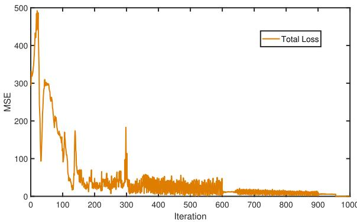  
Fig. 2. 腕关节案例的总损失示意图。

## B. 总体比较

首先对所提出的框架与基线方法进行总体比较。Fig. 3 和 Fig. 4 分别描绘了所提出的框架在膝关节案例和腕关节案例中的代表性结果，包括膝关节屈曲角、RF 肌肉力、BFS 肌肉力、腕关节屈曲角、FCR 肌肉力、FCU 肌肉力、ECRL 肌肉力、ECRB 肌肉力和 ECU 肌肉力。从 Fig. 3 和

Fig. 4 可以看出，肌肉力和关节角度的预测值能够很好地拟合真实值（ground truths），表明所提出的框架具有出色的动态跟踪能力。

为了定量评估所提出框架的性能，Table I 和 Table II 给出了所有受试者在所提框架与基线方法之间的详细对比。需要说明的是，在膝关节案例中，我们使用相同步行速度的数据来训练和测试所提出的框架及基线方法。根据 Table I 和 Table II，所提出的框架在大多数情况下均能获得更小的 RMSE 和更高的 CC，这进一步验证了所提框架的鲁棒性。具体而言，基于深度学习的方法（包括所提出的框架、CNN 和 ML-ELM）比基于机器学习的方法（包括 SVR 和 ELM）取得了更好的预测性能。这是因为这些基于深度学习的方法能够从采集的数据中自动提取高层特征。在基于深度学习的方法中，所提出的框架取得了最佳的预测性能，因为所嵌入的物理定律可以对框架中使用的 CNN 进行惩罚/正则化，其性能不仅依赖于传统的 MSE 损失，还可以通过基于物理的损失得到提升。

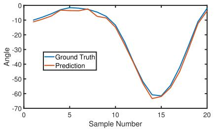  
(a) 膝关节角度的预测结果

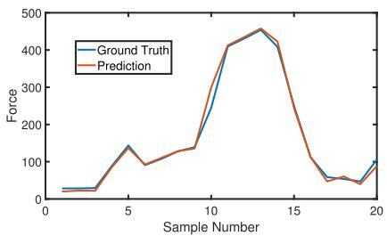  
(b) BFS 的预测结果

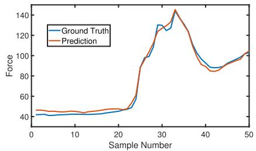  
(c) RF 的预测结果

Fig. 3. 所提出的物理信息融合数据驱动模型在膝关节案例中的代表性结果。膝关节案例的预测输出包括膝关节角度、BFS 肌肉力和 RF 肌肉力。  
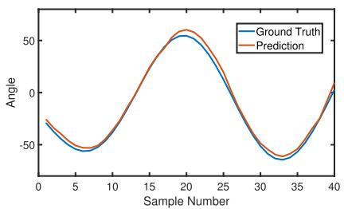  
(a) 腕关节角度的预测结果

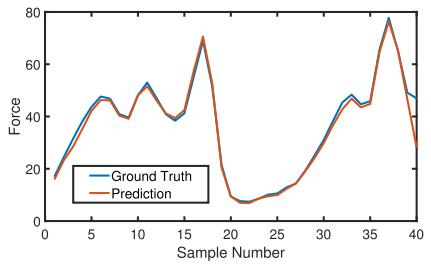  
(b) FCR 的预测结果

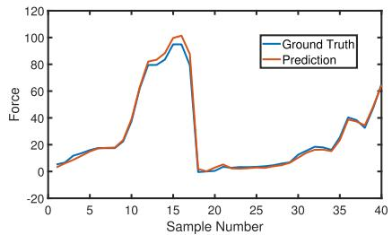  
(c) FCU 的预测结果

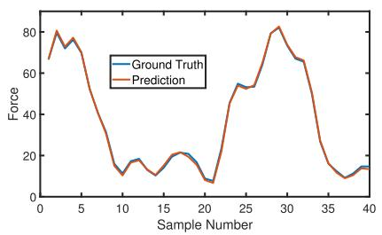  
(d) ECRL 的预测结果

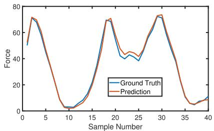  
(e) ECRB 的预测结果

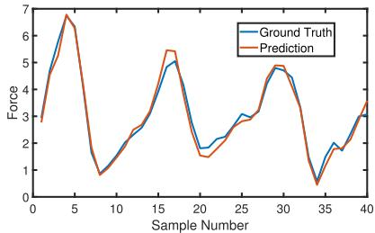  
(f) ECU 的预测结果  
Fig. 4. 基于知识嵌入数据驱动模型的手腕关节案例代表性结果。手腕关节案例的预测输出包括手腕角度、FCR 肌肉力、FCU 肌肉力、ECRL 肌肉力、ECRB 肌肉力和 ECU 肌肉力。

除了对五种方法进行总体比较之外，我们还在两个数据集上进一步对所提出的框架与各对比方法进行了两两分析。采用 Tukey 显著性差异检验（Tukey’s Honest Significant Difference test）进行事后分析。显著性水平设定为 $p \ < \ 0 . 0 5$。Fig. 5 展示了所提出的框架和基线方法在所有受试者中膝关节和腕关节的平均 RMSE。从 Fig. 5 可以看出，所提出的框架取得了令人满意的性能，标准差更低，且其预测结果的波动较小。此外，通过将预测变量之间的潜在物理相互作用嵌入到数据驱动模型中，所提出的框架仅凭借简单的神经网络架构，就能取得与网络架构更复杂的纯 CNN 相当的性能。这激励我们在未来的工作中引入更多约束，以将肌肉骨骼建模的知识更深入地集成到深度神经网络中，从而提升性能。

## C. 会话内场景评估

我们还考虑了会话内（intrasession）场景，以验证所提出框架的鲁棒性。对于每个受试者，将不同步行速度的数据融合成一个完整数据集，其中 80% 用于训练，其余 20% 用于测试。Fig. 6 描绘了相应的实验结果，其中所提出的框架优于大多数基线方法。根据 Fig. 6，所提出的框架不受步行速度的影响，但一些基线方法的预测结果出现退化。例如，在 Fig. 5(a) 中所示的 RF 肌肉力预测中，SVR 的预测性能优于 ELM，但在会话内场景下，由于不同步行速度的影响，其预测性能变差。

## D. 会话间场景评估

为了研究本文所提出的框架在未见数据（unseen data）上的性能，我们在跨会话（intersession）场景下对所提框架进行了评估。训练数据集由来自5名受试者的数据组成，第6名受试者的数据构成测试数据集。表 III（TABLE III）展示了详细结果，我们可以发现所提框架仍能取得令人满意的性能，这表明其具有出色的泛化能力。

## E. 训练数据集规模的影响

为了评估训练数据集规模对预测性能的影响，我们在

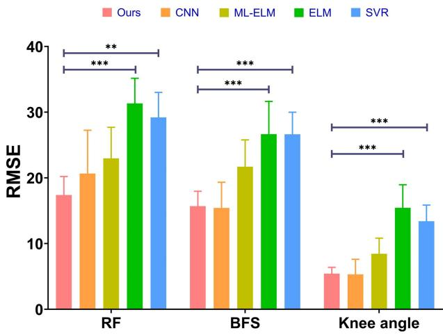

(a) 膝关节案例的平均 RMSE  
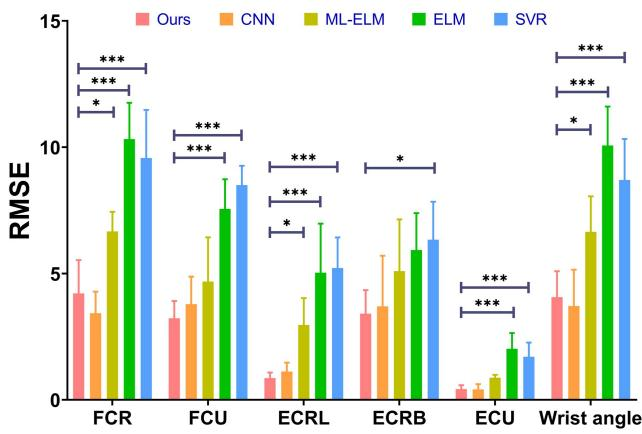  
(b) 腕关节案例的平均 RMSE

Fig. 5. 分别在 (a) 膝关节和 (b) 腕关节场景下所有受试者的平均 RMSE。与纯 CNN 相比，所提框架以更简单的 CNN 架构取得了相当的 RMSE。与 ML-ELM、ELM 和 SVR 相比，所提框架取得了更好且更稳定的预测性能。显著性水平设置为 0.05 $( ^ { * * * } p < 0 . 0 0 1 , ^ { * * } p < 0 . 0 1$ , and $^ { * } p < 0 . 0 5 )$ 。  
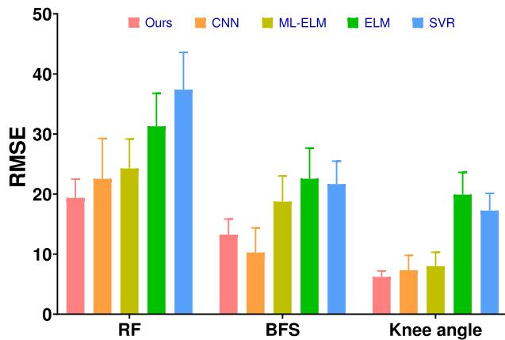  
Fig. 6. 会话内（intrasession）场景的对比结果。

图 7 中展示了所提框架与基线方法在手腕关节案例中不同训练数据集规模下的归一化 RMSE。随着训练数据集规模的增加，所提框架和基线方法的归一化 RMSE 均有所降低；但另一方面，所提框架能够在较少的训练样本下实现更低的归一化 RMSE。实验结果表明，所提框架对训练数据集规模的敏感度较低。将基于物理的领域知识作为惩罚/正则化项嵌入 CNN 的损失函数中，能够带来更快的收敛速度，并在达到给定性能的前提下降低对训练数据的需求。

TABLE III  
跨会话场景下所提框架与基线方法的对比 (RMSE)

<table><tr><td>变量</td><td>Ours</td><td>CNN</td><td>ML-ELM</td><td>ELM</td><td>SVR</td></tr><tr><td>RF</td><td>23.77</td><td>25.15</td><td>29.91</td><td>38.29</td><td>37.03</td></tr><tr><td>BFS</td><td>22.30</td><td>23.98</td><td>27.02</td><td>30.99</td><td>31.21</td></tr><tr><td>Angle</td><td>7.82</td><td>7.76</td><td>10.65</td><td>14.51</td><td>13.29</td></tr></table>

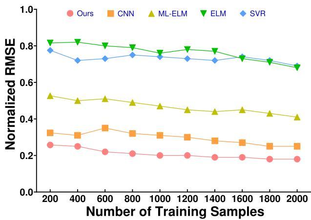  
Fig. 7. 训练数据集规模对腕关节案例预测性能的影响。所提框架以更简单的网络架构实现了更快的收敛速度。

## F. 网络架构的影响

为了进一步评估所提出的框架，我们在图 8 中展示了所提框架与 CNN 在相同网络架构下（即所提框架中的 CNN 和纯 CNN 均包含三个卷积块、三个全连接块和一个回归块）针对腕关节案例的对比结果。如图 8 所示，所提框架能够取得比 CNN 更好的预测性能，这进一步表明了所提框架中嵌入物理定律的有效性。

为了进一步探究网络架构对所提框架性能的影响，我们针对膝关节案例，实现了具有不同网络架构的所提框架，包括一个卷积块（命名为 PINN-1）、两个卷积块（命名为 PINN-2）、三个卷积块（命名为 PINN-3）、四个卷积块（命名为 PINN-4）以及五个卷积块（命名为 PINN-5）。表 IV 列出了详细的对比结果，我们可以发现所提框架在包含三个卷积块时能够取得最佳性能，且其精度随着卷积块数量的增加而提升，这是因为适当数量的卷积块（如 PINN-3）可以提取出更具代表性的特征，但如果继续增加卷积块数量（如 PINN-5），所提框架可能会出现过拟合。

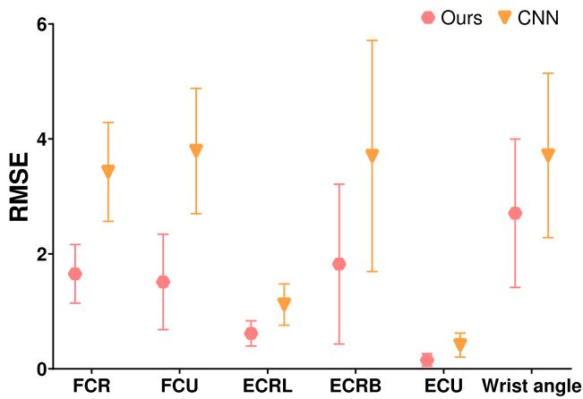  
Fig. 8. 相同网络架构下所提框架与 CNN 的对比结果。在不考虑网络架构影响的情况下，所提框架取得了更好的预测结果。

TABLE IV  
不同网络架构下所提框架的对比 (RMSE)

<table><tr><td>变量</td><td>PINN-1</td><td>PINN-2</td><td>PINN-3</td><td>PINN-4</td><td>PINN-5</td></tr><tr><td>RF</td><td>19.32</td><td>15.51</td><td>13.39</td><td>15.01</td><td>21.89</td></tr><tr><td>BFS</td><td>15.27</td><td>8.82</td><td>7.93</td><td>8.95</td><td>12.72</td></tr><tr><td>Angle</td><td>5.73</td><td>2.36</td><td>2.02</td><td>2.87</td><td>7.56</td></tr></table>

## G. 超参数的影响

我们还利用腕关节案例研究了包括学习率、激活函数类型和批大小（batch size）在内的超参数对所提框架性能的影响，详细结果如表 V、表 VI 和表 VII 所示。具体而言，我们考虑了三种不同的学习率，即 0.01、0.001 和 0.0001，最大迭代次数设置为 400。由表 V 可知，所提框架在较小的学习率下取得了更好的性能。从表 VI 可以观察到，所提框架在使用 ReLU 和 Leaky ReLU 时可以取得相当的性能，但均优于使用 Sigmoid 作为激活函数的情况。在表 VII 中，所提框架的性能随着批大小的增加而提升，这是因为较大的批大小可以减少训练过程中的局部振荡，从而保证深度神经网络的性能。

## V. 讨论与未来方向

在本节中，我们首先讨论所提框架的灵活性，随后分别阐述物理信息深度学习（physics-informed deep learning）在肌骨建模中的核心优势。最后，探讨了本工作的局限性以及未来的研究方向。

TABLE V  
所提框架在不同学习率下的对比 (RMSE)

<table><tr><td>学习率</td><td>FCR</td><td>FCU</td><td>ECRL</td><td>ECRB</td><td>ECU</td><td>角度</td></tr><tr><td>0.01</td><td>15.25</td><td>12.51</td><td>10.79</td><td>12.21</td><td>3.24</td><td>10.06</td></tr><tr><td>0.001</td><td>9.03</td><td>11.19</td><td>8.68</td><td>9.09</td><td>1.22</td><td>8.29</td></tr><tr><td>0.0001</td><td>6.69</td><td>9.76</td><td>8.52</td><td>8.67</td><td>1.92</td><td>6.51</td></tr></table>

TABLE VI

所提框架在不同类型激活函数下的对比 (RMSE)

<table><tr><td>激活函数</td><td>FCR</td><td>FCU</td><td>ECRL</td><td>ECRB</td><td>ECU</td><td>角度</td></tr><tr><td>Sigmoid</td><td>5.37</td><td>4.50</td><td>1.21</td><td>3.63</td><td>0.77</td><td>5.29</td></tr><tr><td>ReLU</td><td>3.25</td><td>2.51</td><td>0.79</td><td>2.21</td><td>0.24</td><td>3.76</td></tr><tr><td>Leaky ReLU</td><td>3.22</td><td>2.56</td><td>0.73</td><td>2.25</td><td>0.39</td><td>3.97</td></tr></table>

TABLE VII

所提框架在不同批大小下的对比 (RMSE)

<table><tr><td>激活函数</td><td>FCR</td><td>FCU</td><td>ECRL</td><td>ECRB</td><td>ECU</td><td>角度</td></tr><tr><td>1</td><td>3.25</td><td>2.51</td><td>0.79</td><td>2.21</td><td>0.24</td><td>3.76</td></tr><tr><td>32</td><td>3.17</td><td>2.32</td><td>0.65</td><td>2.01</td><td>0.20</td><td>3.55</td></tr><tr><td>64</td><td>3.19</td><td>2.29</td><td>0.66</td><td>1.97</td><td>0.21</td><td>3.37</td></tr></table>

## A. 所提框架的灵活性

所提出的框架是用于纳入机理性肌肉骨骼约束的通用范式。在本文中，我们利用一个具体案例，即关节角度和肌肉力量预测，作为范例来展示该方法的可行性。在此，具有更简单架构的 CNN（卷积神经网络）被用作数据驱动建模技术，分别从运动学提取到肌肉力量、以及从 EMG（肌电信号）提取到运动的特征图。然而，我们也可以改变深度网络的输入和输出以满足不同的应用场景，例如：使用 EMG/运动学来预测机器人辅助康复中的肌肉力量和激活度，使用运动学数据预测肌肉骨骼疾病诊断中的肌肉力量和激活度，以及使用 EMG 预测假肢控制中的运动学。

此外，所提框架中的所有组件均可根据应用需求撤除或调整，并且可以引入新的组件。例如，除 CNN 外，当我们希望从运动学测量中提取空间和时间表征时，数据驱动组件中的深度神经网络可以替换为 CNN+LSTM [41]；当需要领域无关特征时，可以替换为生成对抗网络（GAN）[42]。此外，当仅有少量训练数据可用时，应考虑少样本学习（few-shot learning）[43]；而在解决数据隐私问题时，更推荐使用联邦学习（federated learning）[44]。

对于基于物理的组件，我们在本文中仅使用了运动方程。然而，物理定律还可以进一步扩展。例如，我们还可以将

Hill 肌肉模型（Hill muscle model）纳入所提出的框架中，预测的力量应等于 Hill 肌肉模型的预测值，这可用作网络中的第二物理定律。此外，还可以施加更多的软约束，例如人体几何约束和多关节协调等，以提升深度神经网络的性能。

尽管我们仅将腕关节和膝关节案例作为示例，但我们可以设想，所提出的框架也将适用于更复杂的肌肉骨骼模型，例如用于步行的完整下肢模型。唯一的区别在于增加网络的输入/输出维度，并在模型中纳入更多的物理定律。

## B. 理解用于肌肉骨骼建模的物理信息数据驱动方法

机器学习/深度学习方法已被用于肌肉骨骼建模，因为它们在概念上直观简便且实现迅速 [23], [45], [46], [47]。然而，尽管它们在训练阶段可能非常好地拟合运动学测量数据，但其预测结果可能不满足与肌肉骨骼生物力学相关的物理学规律。这可能会导致鲁棒性和泛化能力较差。此外，纯数据驱动方法基于运动学测量数据所提供的可解释性有限。相比之下，物理信息深度学习（physics-informed deep learning）将基于物理的领域知识无缝整合到深度学习中，从而引入富含信息的约束以提升性能 [48], [49], [50]。在物理信息深度学习中，我们结合了来自运动学测量以及对神经肌肉骨骼耦合物理理解的领域知识。通过这种方式，深度学习方法具有可解释性，能够反映物理或生理机制，并且在训练数据有限的情况下也更具鲁棒性与更好的泛化能力。

## C. 局限性与未来方向

在本研究中，我们仅以腕关节和膝关节案例为范例来实现所提出的框架并验证其可行性。我们将进一步研究物理信息深度学习框架在肌肉骨骼建模中的特性。例如，我们计划探索施加在两个损失分量上的权重对性能的影响。我们还将改变所提出框架中数据驱动组件的输入和输出，以满足不同的应用场景。此外，还将通过涉及多关节运动的更复杂运动来评估所提出框架的可靠性与准确性。

## VI. 结论

本文开发了一种知识嵌入式数据驱动框架用于肌肉骨骼建模，该框架将基于物理的领域知识无缝整合到数据驱动模型中。具体而言，基于物理的领域知识被用作软约束来惩罚/正则化深度神经网络，以增强鲁棒性和泛化性能，同时显著降低了模型构建中的计算需求。在用于肌力和关节角度预测的两组数据上进行的全面实验表明了所提出框架的可行性。我们预见，所提出的框架是一种适用于肌力和关节角度预测以及肌肉骨骼建模领域其他应用的通用方法，有望缩小实验室原型与临床应用之间的差距。

## 参考文献

[1] A. Rajagopal, C. L. Dembia, M. S. DeMers, D. D. Delp, J. L. Hicks, and S. L. Delp, “Full-body musculoskeletal model for muscle-driven simulation of human gait,” IEEE Trans. Biomed. Eng., vol. 63, no. 10, pp. 2068–2079, Oct. 2016.

[2] J. Berning, G. E. Francisco, S.-H. Chang, B. J. Fregly, and M. K. O’Malley, “Myoelectric control and neuromusculoskeletal modeling: Complementary technologies for rehabilitation robotics,” Curr. Opin. Biomed. Eng., vol. 19, pp. 1–7, Sep. 2021.

[3] R. Zaman, Y. Xiang, R. Rakshit, and J. Yang, “Hybrid predictive model for lifting by integrating skeletal motion prediction with an OpenSim musculoskeletal model,” IEEE Trans. Biomed. Eng., vol. 69, no. 3, pp. 1111–1122, Mar. 2022.

[4] S. A. McErlain-Naylor, M. A. King, and P. J. Felton, “A review of forward-dynamics simulation models for predicting optimal technique in maximal effort sporting movements,” Appl. Sci., vol. 11, no. 4, pp. 1450–1469, 2021.

[5] T. Akbas, R. R. Neptune, and J. Sulzer, “Neuromusculoskeletal simulation reveals abnormal rectus femoris-gluteus medius coupling in poststroke gait,” Frontiers Neurol., vol. 10, pp. 1–10, Apr. 2019.

[6] L. S. Persad, B. I. Binder-Markey, A. Y. Shin, K. R. Kaufman, and R. L. Lieber, “In vivo human gracilis whole-muscle passive stress– sarcomere strain relationship,” J. Experim. Biol., vol. 224, no. 17, pp. 1–9, Sep. 2021.

[7] Q. Zhang, W. H. Clark, J. R. Franz, and N. Sharma, “Personalized fusion of ultrasound and electromyography-derived neuromuscular features increases prediction accuracy of ankle moment during plantarflexion,” Biomed. Signal Process. Control, vol. 71, Jan. 2022, Art. no. 103100.

[8] M. K. Jung et al., “Intramuscular EMG-driven musculoskeletal modelling: Towards implanted muscle interfacing in spinal cord injury patients,” IEEE Trans. Biomed. Eng., vol. 69, no. 1, pp. 63–74, Jan. 2022.

[9] Y. Zhao et al., “Computational efficient personalised EMG-driven musculoskeletal model of wrist joint,” IEEE Trans. Instrum. Meas., early access, Nov. 28, 2022, doi: 10.1109/TIM.2022.3225023.

[10] K. J. Bennett et al., “EMG-informed neuromusculoskeletal models accurately predict knee loading measured using instrumented implants,” IEEE Trans. Biomed. Eng., vol. 69, no. 7, pp. 2268–2275, Jul. 2022.

[11] V. Chambers and P. Artemiadis, “A model-based analysis of supraspinal mechanisms of inter-leg coordination in human gait: Toward modelinformed robot-assisted rehabilitation,” IEEE Trans. Neural Syst. Rehabil. Eng., vol. 29, pp. 740–749, 2021.

[12] S. Park, G. E. Caldwell, and B. R. Umberger, “A direct collocation framework for optimal control simulation of pedaling using OpenSim,” PLoS ONE, vol. 17, no. 2, pp. 1–17, 2022.

[13] J. Zhao, Y. Yu, X. Wang, S. Ma, X. Sheng, and X. Zhu, “A musculoskeletal model driven by muscle synergy-derived excitations for hand and wrist movements,” J. Neural Eng., vol. 19, no. 1, Feb. 2022, Art. no. 016027.

[14] Y. Zhao, Z. Zhang, Z. Li, Z. Yang, A. A. Dehghani-Sanij, and S. Xie, “An EMG-driven musculoskeletal model for estimating continuous wrist motion,” IEEE Trans. Neural Syst. Rehabil. Eng., vol. 28, no. 12, pp. 3113–3120, Dec. 2020.

[15] M. Sartori, D. Farina, and D. G. Lloyd, “Hybrid neuromusculoskeletal modeling to best track joint moments using a balance between muscle excitations derived from electromyograms and optimization,” J. Biomechanics, vol. 47, no. 15, pp. 3613–3621, Nov. 2014.

[16] C. Pizzolato, M. Reggiani, D. J. Saxby, E. Ceseracciu, L. Modenese, and D. G. Lloyd, “Biofeedback for gait retraining based on real-time estimation of tibiofemoral joint contact forces,” IEEE Trans. Neural Syst. Rehabil. Eng., vol. 25, no. 9, pp. 1612–1621, Sep. 2017.

[17] G. Hajian and E. Morin, “Deep multi-scale fusion of convolutional neural networks for EMG-based movement estimation,” IEEE Trans. Neural Syst. Rehabil. Eng., vol. 30, pp. 486–495, 2022.

[18] C. Wu, H. Zeng, A. Song, and B. Xu, “Grip force and 3D push-pull force estimation based on sEMG and GRNN,” Frontiers Neurosci., vol. 11, pp. 1–15, Jun. 2017.

[19] C. G. McDonald, J. L. Sullivan, T. A. Dennis, and M. K. O’Malley, “A myoelectric control interface for upper-limb robotic rehabilitation following spinal cord injury,” IEEE Trans. Neural Syst. Rehabil. Eng., vol. 28, no. 4, pp. 978–987, Apr. 2020.

[20] T. Bao, S. Q. Xie, P. Yang, P. Zhou, and Z.-Q. Zhang, “Toward robust, adaptiveand reliable upper-limb motion estimation using machine learning and deep learning—A survey in myoelectric control,” IEEE J. Biomed. Health Informat., vol. 26, no. 8, pp. 3822–3835, Aug. 2022.

[21] R. Hu, X. Chen, H. Zhang, X. Zhang, and X. Chen, “A novel myoelectric control scheme supporting synchronous gesture recognition and muscle force estimation,” IEEE Trans. Neural Syst. Rehabil. Eng., vol. 30, pp. 1127–1137, 2022.

[22] Y. Geng et al., “A CNN-attention network for continuous estimation of finger kinematics from surface electromyography,” IEEE Robot. Autom. Lett., vol. 7, no. 3, pp. 6297–6304, Jul. 2022.

[23] L. Rane, Z. Ding, A. H. McGregor, and A. M. J. Bull, “Deep learning for musculoskeletal force prediction,” Ann. Biomed. Eng., vol. 47, no. 3, pp. 778–789, Mar. 2019.

[24] T. Bao, S. A. R. Zaidi, S. Xie, P. Yang, and Z.-Q. Zhang, “Inter-subject domain adaptation for CNN-based wrist kinematics estimation using sEMG,” IEEE Trans. Neural Syst. Rehabil. Eng., vol. 29, pp. 1068–1078, 2021.

[25] Y. Huang et al., “Real-time intended knee joint motion prediction by deep-recurrent neural networks,” IEEE Sensors J., vol. 19, no. 23, pp. 11503–11509, Aug. 2019.

[26] A. Ameri, M. A. Akhaee, E. Scheme, and K. Englehart, “Real-time, simultaneous myoelectric control using a convolutional neural network,” PLoS ONE, vol. 13, no. 9, pp. 1–13, 2018.

[27] H. Su, W. Qi, Z. Li, Z. Chen, G. Ferrigno, and E. De Momi, “Deep neural network approach in EMG-based force estimation for human– robot interaction,” IEEE Trans. Artif. Intell., vol. 2, no. 5, pp. 404–412, Oct. 2021.

[28] W. S. Burton, C. A. Myers, and P. J. Rullkoetter, “用于日常生活活动中下肢肌肉与关节载荷快速估算的机器学习,” J. Biomechanics, vol. 123, Jun. 2021, Art. no. 110439.

[29] W. R. Johnson, J. Alderson, D. Lloyd, and A. Mian, “基于时空驱动 CNN 模型预测运动员地面反作用力与力矩,” IEEE Trans. Biomed. Eng., vol. 66, no. 3, pp. 689–694, Mar. 2019.

[30] G. E. Karniadakis et al., “物理信息机器学习,” Nat. Rev. Phys., vol. 3, no. 6, pp. 422–440, 2021.

[31] M. Raissi, P. Perdikaris, and G. E. Karniadakis, “物理信息神经网络：用于求解涉及非线性偏微分方程的正问题和反问题的深度学习框架,” J. Comput. Phys., vol. 378, pp. 686–707, Feb. 2019.

[32] M. Q. Liu, F. C. Anderson, M. H. Schwartz, and S. L. Delp, “不同步行速度下肌肉对身体支撑与前进的贡献,” J. Biomech., vol. 41, no. 15, pp. 3243–3252, Nov. 2008.

[33] S. L. Delp, J. P. Loan, M. G. Hoy, F. E. Zajac, E. L. Topp, and J. M. Rosen, “用于研究矫形外科手术的基于交互式图形学的下肢模型,” IEEE Trans. Biomed. Eng., vol. 37, no. 8, pp. 757–767, Aug. 1990.

[34] A. Seth et al., “OpenSim：通过模拟肌骨动力学和神经肌肉控制来研究人类与动物运动,” PLoS Comput. Biol., vol. 14, no. 7, pp. 1–20, Jul. 2018.

[35] D. G. Thelen, F. C. Anderson, and S. L. Delp, “使用计算肌肉控制生成运动动力学仿真,” J. Biomech., vol. 36, no. 3, pp. 321–328, 2003.

[36] Y. Ma, S. Xie, and Y. Zhang, “面向仿生步态康复机器人潜在应用的患者特异性 EMG 驱动神经肌肉模型,” Comput. Biol. Med., vol. 70, pp. 88–98, Mar. 2016.

[37] D. C. McFarland, E. M. McCain, M. N. Poppo, and K. R. Saul, “动态单手与双手推拉过程中盂肱关节稳定性的空间依赖性,” J. Biomech. Eng., vol. 141, no. 5, May 2019, Art. no. 051006.

[38] J. Zhang, Y. Li, W. Xiao, and Z. Zhang, “非迭代快速深度学习：多层极限学习机,” J. Franklin Inst., vol. 357, no. 13, pp. 8925–8955, 2020.

[39] H. Zhang, Y. Guo, and D. Zanotto, “基于机器学习模型的步行与跑步精准动态步态分析,” IEEE Trans. Neural Syst. Rehabil. Eng., vol. 28, no. 1, pp. 191–202, Dec. 2020.

[40] J. Zhang, W. Xiao, Y. Li, and S. Zhang, “用于回归的残差补偿极限学习机,” Neurocomputing, vol. 311, pp. 126–136, Oct. 2018.

[41] T. Bao, S. A. R. Zaidi, S. Xie, P. Yang, and Z.-Q. Zhang, “基于表面肌电信号进行手腕运动学估计的 CNN-LSTM 混合模型,” IEEE Trans. Instrum. Meas., vol. 70, pp. 1–9, 2020.

[42] A. Creswell, T. White, V. Dumoulin, K. Arulkumaran, B. Sengupta, and A. A. Bharath, “Generative adversarial networks: An overview,” IEEE Signal Process., vol. 35, no. 1, pp. 53–65, Jan. 2018.

[43] Y. Wang, Q. Yao, J. T. Kwok, and L. M. Ni, “Generalizing from a few examples: A survey on few-shot learning,” ACM Comput. Surv., vol. 53, no. 3, pp. 1–34, 2020.

[44] T. Li, A. K. Sahu, A. Talwalkar, and V. Smith, “Federated learning: Challenges, methods, and future directions,” IEEE Signal Process. Mag., vol. 37, no. 3, pp. 50–60, May 2020.

[45] J. Zhang, Y. Li, and W. Xiao, “Adaptive online sequential extreme learning machine for dynamic modeling,” Soft Comput., vol. 25, no. 3, pp. 2177–2189, Feb. 2021.

[46] T. T. Dao, “From deep learning to transfer learning for the prediction of skeletal muscle forces,” Med. Biol. Eng. Comput., vol. 57, no. 5, pp. 1049–1058, 2019.

[47] D. J. Saxby et al., “Machine learning methods to support personalized neuromusculoskeletal modelling,” Biomech. Model Mechanobiol., vol. 19, no. 4, pp. 1169–1185, 2020.

[48] S. Wang, X. Yu, and P. Perdikaris, “When and why PINNs fail to train: A neural tangent kernel perspective,” J. Comput. Phys., vol. 449, pp. 1–28, Jan. 2022.

[49] A. D. Jagtap, E. Kharazmi, and G. E. Karniadakis, “Conservative physics-informed neural networks on discrete domains for conservation laws: Applications to forward and inverse problems,” Comput. Methods Appl. Mech. Eng., vol. 365, pp. 1–27, Jun. 2020.

[50] L. Von Rueden et al., “Informed machine learning—A taxonomy and survey of integrating knowledge into learning systems,” IEEE Trans. Knowl. Data Eng., early access, May 12, 2021, doi: 10.1109/TKDE.2021.3079836.