REVIEW ARTICLE

# The moment arms of the muscles spanning the glenohumeral joint: a systematic review

Freya Hik and David C. Ackland

Department of Biomedical Engineering, University of Melbourne, Parkville, VIC, Australia

## Abstract

The moment arm of a muscle represents its leverage or torgue-producing capacity, and is indicative of the role of the muscle in joint actuation. The objective of this study was to undertake a systematic review of the moment arms of the major muscles spanning the glenohumeral joint during abduction, flexion and axial rotation. Moment arm data for the deltoid, pectoralis major, latissimus dorsi, teres major, supraspinatus, infraspinatus, subscapularis and teres minor were reported when measured using the geometric and tendon excursion methods The anterior and middle sub-regions of the deltoid had the largest humeral elevator moment arm values of all muscles during coronal- and scapular-plane abduction, as well as during flexion. The pectoralis major, latissimus dorsi and teres major had the largest depressor moment arms, with each of these muscles exhibiting prominent leverage in shoulder adduction, and the latissimus dorsi and teres maior also in extension. The rotator cuff muscles had the largest axial rotation moment arms regardless of the axial position of the humerus. The supraspinatus had the most prominent elevator moment arms during early abduction in both the coronal and scapular planes as well as in flexion. This systematic review shows that the rotator cuff muscles function as humeral rotators and weak humeral depressors or elevators, while the three sub-regions of the deltoid behave as substantial humeral elevators throughout the range of humeral motion. The pectoralis major, latissimus dorsi and teres major are significant shoulder depressors, particularly during abduction. This study provides muscle moment arm data on functionally relevant shoulder movements that are involved in tasks of daily living, including lifting and pushing. The results may be useful in quantifying shoulder muscle function during specific planes of movement, in designing and validating computational models of the shoulder, and in planning surgical procedures such as tendon transfer surgery.

Key words: biomechanics; deltoid; lever; musculoskeletal model; rotator cuff; shoulder; upper limb.

## Introduction

The moment arm of a muscle force is defined by the perpendicular distance between the muscle’s line of action and the instantaneous centre of rotation of the joint in which it spans, and represents the capacity of that muscle to exert a joint torque (Pandy, 1999). A muscle’s moment arm is indicative of the role of the muscle in joint actuation, as the moment arm magnitude represents the muscle’s leverage about a joint, while the moment arm direction determines whether joint movement is associated with muscle shortening or lengthening (Jensen & Davy, 1975; Dostal & Andrews, 1981; Wood et al. 1989; Otis et al. 1994; Graichen et al. 2001; Ackland et al. 2010). Thus, a muscle with a positive moment arm through a given movement has agonistic function, while a negative moment arm is indicative of antagonist muscle function. Muscles with large moment arms have greater mechanical advantage and potential to generate joint torque, often functioning as prime movers, while muscles with smaller moment arms tend to exhibit stabilising function, such as intrinsic muscles (An et al. 1984; Liu et al. 1998; Graichen et al. 2001).

The two techniques employed extensively in derivation of muscle moment arm data are the geometric method and the tendon excursion method. The geometric method involves direct measurement of the perpendicular distance between the muscle’s path and the joint centre of rotation in which it spans (Poppen & Walker, 1978; Howell et al.

1986; Garner & Pandy, 2001; Graichen et al. 2001; De Wilde et al. 2002; Herrmann et al. 2011; Greiner et al. 2013; Hamilton et al. 2013, 2015; Walker et al. 2016). This necessitates locating the muscle-tendon unit line of action relative to a functional or anatomical joint centre (Data S1). Because the geometric method is typically performed in vivo using data from imaging modalities such as x-ray, computed tomography or magnetic resonance imaging (An et al. 1984; Ackland et al. 2008), it is most often employed for just a small number of joint configurations. The accuracy of the geometric method is limited by the reliability of joint centre of rotation location identification, and correct estimation of the muscle’s line of action (McGill & Norman, 1986). For example, the glenohumeral joint centre is often approximated as the centre of a sphere fitted to the humeral head, but the glenohumeral joint may translate by up to 7 mm during abduction and 12 mm during internal rotation (Werner et al. 2004), which may have impact on the moment arms of the spanning muscles. The geometric method is commonly used for evaluating muscle moment arms in the intervertebral joints, which have a much smaller range of motion (McGill & Norman, 1986; McGill et al. 1988; Dumas et al. 1991; Suderman & Vasayada, 2017).

The tendon excursion method evaluates the moment arm quantity from the instantaneous gradient of the muscletendon-unit-length vs. joint-angle curve over a range of joint movement in a given plane (Data S1; Ackland & Pandy, 2011). Unlike the geometric method, knowledge of the joint centre location is not explicitly required in the calculation, and moment arms may be computed through a continuous range of joint motion (An et al. 1984; Otis et al. 1994; Hughes et al. 1998; Kuechle et al. 2000; Ackland et al. 2008). This approach lends itself well to in vitro measurements and computational simulations, as tendon excursion and joint angle data can often be evaluated with relatively high accuracy (Otis et al. 1994; Kuechle et al. 1997, 2000; Liu et al. 1997, 1998; Hughes et al. 1998; Nakajima et al. 1999; Adams et al. 2007; Ackland et al. 2008; Schwartz et al. 2013).

Moment arms have been recorded for muscles spanning numerous joints in the human body, including the neck, spine, ankle, knee, hip, fingers, wrist, elbow and shoulder (Ketchum et al. 1978; Vasavada et al. 1998; Delp et al. 1999; Jorgensen et al. 2001; Kodek & Munih, 2003; Krevolin et al. 2004; Lee et al. 2008; Ackland et al. 2011; McCullough et al. 2011). The objective of this study was to provide a systematic review of the moment arms of the major muscles and muscle sub-regions spanning the glenohumeral joint, including those of the deltoid, pectoralis major, latissimus dorsi, teres major and the rotator cuff muscles. Moment arm quantities were reviewed for functionally relevant shoulder movements, including abduction in the scapular and coronal planes, flexion in the sagittal plane and axial rotation in the neutral position. The data presented may be useful for evaluating the function of individual muscles, and for developing and validating computational models of the upper limb (Pandy, 1999; Ackland et al. 2010).

## Materials and methods

## Literature search strategy

A literature search was conducted to identify previously published experimentally derived moment arm data for the muscles spanning the glenohumeral joint. The study was conducted with reference to the guidelines outlined by the Preferred Reporting Items for Systematic Review and Meta-analysis (PRISMA) statement (Moher et al. 2010). The online database MEDLINE, via OVID, was systematically searched for English titles with no date restrictions. Keywords included shoulder, moment arm, glenohumeral joint, biomechanical model, mechanical advantage and muscle line of action.

## Selection criteria and quality assessment

An initial online search in MEDLINE was performed with the following inclusion criteria: moment arm data reported for muscles spanning the glenohumeral joint, including the deltoid, pectorals major, latissimus dorsi, supraspinatus, infraspinatus, teres minor and subscapularis; moment arm data derived using geometric or tendon excursion methods; planes of motion including coronal plane abduction, scapular plane abduction, flexion and axial rotation in the neutral position. Exclusion criteria included: moment arm data reported for wheelchair propulsion, lifting or throwing activities, sports, or movements not described in the inclusion criteria; moment data for the pathological or non-native shoulder joint including the prosthetic glenohumeral joint; moment arm data derived from non-human studies and from computational models. After removal of duplicates, full texts were retrieved. References of all full-text articles were then manually checked for other relevant titles.

The quality of each publication was quantified as described previously (Hart et al. 2016). Briefly, included studies were rated using a modified version of the Downs and Black checklist, with a maximum score of 12 (Downs & Black. 1998). A total score > 9 indicated high methodological quality, a score of 6–8 indicated moderate quality, and a score ≤ 5 indicated low quality. Two reviewers (DCA and FCH) independently rated each study on the 12-item criteria and inter-rater disagreement was discussed in a consensus meeting.

## Data analysis

Continuous muscle moment arm data as well as moment arm peaks were reported during coronal plane abduction, scapular plane abduction (scaption) saggital-plane flexion and axial rotation of the glenohumeral joint. The plane of scaption was defined parallel to the scapular plane, and 30 ° anterior to the coronal plane. All elevation movements assumed 0 ° of axial rotation. Moment arm data for axial rotation were included for internal and external rotation of the shoulder in the neutral position (approximately 0°of arm elevation), as data for this joint position are most widely reported. Each moment arm study was categorised according to technique (geometric or tendon excursion method).

## Results

Search strategy, methodological quality and risk of bias

The initial literature search identified 34 805 titles, which was reduced down to 25 280 after the removal of duplicates (Fig. 1). The full texts of 40 articles were retrieved after employing inclusion/exclusion criteria, with 16 articles meeting the selection criteria, and an additional four articles included, sourced from cited references in these articles (Table 1). The methodological quality scores ranged from 5 to 12 (of 12), with an average score of 9. There were 11 studies of high quality, seven studies of moderate quality, and two studies of low quality. All 20 studies clearly described their main study outcome measures in either the ‘Introduction’ or ‘Materials and Methods’ sections. No other criteria from the quality assessment were met by all included articles.

## Muscle moment arms, coronal plane abduction

The anterior deltoid, middle deltoid, supraspinatus and infraspinatus had the largest abductor moment arms throughout coronal plane abduction, while the pectoralis major, latissimus dorsi, teres major and subscapularis had the largest adductor moment arms. The posterior deltoid and teres minor had biphasic function, and acted as either an abductor or adductor depending on the humeral position (Fig. 2).

The abduction moment arm of the anterior deltoid increased with abduction angle, and had a peak value ranging between 26 and 30 mm at abduction angles > 90 ° (Kuechle et al. 1997; Ackland et al. 2008; Schwartz et al. 2013; Fig. 3); however, one high-quality paper reported that the anterior deltoid was an adductor at low abduction angles and became an abductor beyond $4 5 ^ { \circ }$ of abduction, with a maximum abduction moment arm value of 60 at 90 ° of abduction (Walker et al. 2016). The mean maximum moment arm of the anterior deltoid was $3 6 . 2 \pm 8 . 0$ mm (n $= 4 ;$ Table 2).

Three studies demonstrated that the middle deltoid had an abductor moment arm that increased with abduction angle, peaking close to the mid-range of motion with a mean magnitude of $2 6 . 8 \pm 1 . 7$ mm (Kuechle et al. 1997; Ackland et al. 2008; Walker et al. 2016). One high-quality study reported a continuously increasing abductor moment arm for the middle deltoid throughout the entire range of abduction (Schwartz et al. 2013).

The latissimus dorsi was a prominent adductor throughout abduction (Kuechle et al. 1997; Ackland et al. 2008). Its moment arm trends were parabolic through the range of abduction, with a mean maximum adductor moment arm magnitude of $3 7 . 3 \pm 1 . 7$ mm (n = 2) occurring beyond $6 9 ^ { \circ }$ of abduction.

The abduction moment arm of the supraspinatus had a mean peak magnitude of 28.2 1.6 mm (n = 3) in very early abduction, with the abduction moment arm then tending to decrease with increasing abduction angle (Kuechle et al. 1997; Liu et al. 1998; Ackland et al. 2008; Fig. 2). In contrast, the subscapularis had an abduction moment arm that increased with increasing abduction angle, with a peak adductor moment arm occurring in mid-late abduction with a magnitude ranging between 7 and 13 mm (Kuechle et al. 1997; Ackland et al. 2008; Herrmann et al. 2011; Greiner et al. 2013). One moderate-quality study reported a peak adduction moment arm for the subscapularis of just 2 mm (Herrmann et al. 2011). The mean maximum moment arm of subscapularis was $8 . 1 \pm 2 . 3$ mm $( n = 4 )$

The teres minor was an adductor in early-mid abduction and an abductor beyond 45 ° of abduction (Kuechle et al. 1997; Ackland et al. 2008; Herrmann et al. 2011; Greiner et al. 2013). It had a mean maximum abduction moment arm magnitude of 6.4 2.6 mm (n = 4) at abduction angles > 60 °. The teres major had large abductor moment arms increasing in early abduction to a peak of 49 mm, then steadily decreasing with abduction angle.

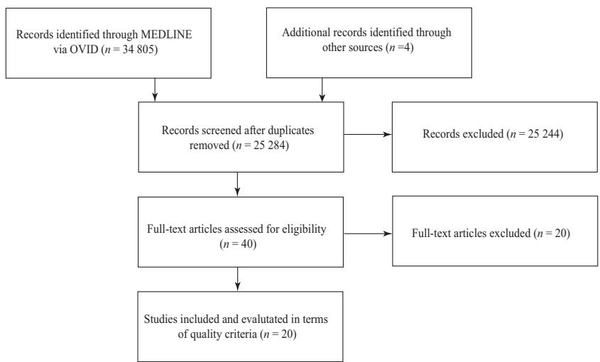  
Fig. 1 Flow chart illustrating inclusion of studies in the present review.

Table 1 Details of studies included in the present review where applicable, including author, sample size, gender ratio, mean age and range, moment arm measurement method used (tendon excursion method or geometric method), study type (in vitro or in vivo) and study quality rating based on the checklist of Downs & Black (1998).

<table><tr><td>Author</td><td>Sample size (n)</td><td>Gender ratio (male : female)</td><td>Age (range)</td><td>Measurement method</td><td>Study type</td><td>Quality rating</td></tr><tr><td>Ackland et al. (2008)</td><td>8</td><td>4 : 04</td><td>87 (81–98)</td><td>Tendon excursion</td><td>In vitro</td><td>11</td></tr><tr><td>Adams et al. (2007)</td><td>1</td><td></td><td></td><td>Tendon excursion</td><td>In vitro</td><td>6</td></tr><tr><td>De Wilde et al. (2002)</td><td>65</td><td></td><td></td><td>Geometric</td><td>In vitro</td><td>9</td></tr><tr><td>Garner &amp; Pandy (2001)</td><td>1</td><td>1 : 00</td><td>25</td><td>Geometric</td><td>In vitro</td><td>7</td></tr><tr><td>Graichen et al. (2001)</td><td>10</td><td>4 : 06</td><td>(22–34)</td><td>Geometric</td><td>In vivo</td><td>11</td></tr><tr><td>Greiner et al. (2013)</td><td>7</td><td></td><td>74 (61–82)</td><td>Geometric</td><td>In vitro</td><td>11</td></tr><tr><td>Hamilton et al. (2013)</td><td>1</td><td></td><td></td><td>Geometric</td><td>In vitro</td><td>5</td></tr><tr><td>Hamilton et al. (2015)</td><td>1</td><td></td><td></td><td>Geometric</td><td>In vitro</td><td>7</td></tr><tr><td>Herrmann et al. (2011)</td><td>7</td><td></td><td>77 (63–84)</td><td>Geometric</td><td>In vitro</td><td>8</td></tr><tr><td>Howell et al. (1986)</td><td>10</td><td>10 : 00</td><td></td><td>Geometric</td><td>In vivo</td><td>8</td></tr><tr><td>Hughes et al. (1998)</td><td>10</td><td>5 : 05</td><td>(40–89)</td><td>Tendon excursion</td><td>In vitro</td><td>12</td></tr><tr><td>Kuechle et al. (1997)</td><td>12</td><td></td><td>59 (33–80)</td><td>Tendon excursion</td><td>In vitro</td><td>10</td></tr><tr><td>Kuechle et al. (2000)</td><td>12</td><td></td><td>59 (33–80)</td><td>Tendon excursion</td><td>In vitro</td><td>8</td></tr><tr><td>Liu et al. (1997)</td><td>10</td><td>4 : 05</td><td>67 (40–89)</td><td>Tendon excursion</td><td>In vitro</td><td>11</td></tr><tr><td>Liu et al. (1998)</td><td>10</td><td>4 : 05</td><td>67 (40–89)</td><td>Tendon excursion</td><td>In vitro</td><td>11</td></tr><tr><td>Nakajima et al. (1999)</td><td>10</td><td>4 : 05</td><td>67 (40–89)</td><td>Tendon excursion</td><td>In vitro</td><td>11</td></tr><tr><td>Otis et al. (1994)</td><td>10</td><td></td><td>(70–80)</td><td>Tendon excursion</td><td>In vitro</td><td>7</td></tr><tr><td>Poppen &amp; Walker (1978)</td><td>37</td><td></td><td></td><td>Geometric</td><td>In vivo</td><td>8</td></tr><tr><td>Schwartz et al. (2013)</td><td>8</td><td>6 : 02</td><td>(46–68)</td><td>Tendon excursion</td><td>In vitro</td><td>9</td></tr><tr><td>Walker et al. (2016)</td><td>12</td><td></td><td></td><td>Geometric</td><td>In vivo</td><td>9</td></tr></table>

## Muscle moment arms, scaption

The most substantial differences in elevation moment arms between the scapular- and coronal plane occurred for the subscapularis: this muscle was an adductor in the coronal plane and an abductor in the scapular plane (Figs 2 and 4). The teres minor acted as an abductor during scaption, but in the coronal plane at abduction angles < 45 ° this muscle was an adductor (Ackland et al. 2008; Greiner et al. 2013; Walker et al. 2016).

The anterior deltoid, middle deltoid, supraspinatus, infraspinatus, subscapularis and teres minor had the largest abduction moment arms during scaption, while the pectoralis major, latissimus dorsi and the teres major were the major adductors. The posterior deltoid had biphasic function, acting as an abductor or adductor depending on the humeral position (Fig. 4).

The anterior deltoid had an abductor moment arm that increased with scaption angle, with a mean peak of $3 3 . 9 \pm$ 5.0 mm (n = 5; Poppen & Walker, 1978; Kuechle et al. 1997; Liu et al. 1997; De Wilde et al. 2002; Fig. 5). The middle deltoid also had prominent function in scaption, with a mean peak abductor moment arm of 33.4 1.5 mm (n = 6;

Poppen & Walker, 1978; Kuechle et al. 1997; Liu et al. 1997; Garner & Pandy, 2001; De Wilde et al. 2002; Hamilton et al. 2015). All studies that reported moment arms of the posterior deltoid during scaption showed that this muscle acted as an adductor at low abduction angles and as an abductor in late abduction (Kuechle et al. 1997; Liu et al. 1997; Garner & Pandy, 2001; De Wilde et al. 2002). Its mean peak abduction moment arm was 16.9 4.8 mm (n = 6).

The supraspinatus was an abductor in the scapular plane, and had a mean maximum moment arm of 26.4 1.3 mm (n = 10). Three medium-quality studies and one high-quality study demonstrated for the supraspinatus a relatively con stant abductor moment arm throughout scaption (Poppen & Walker, 1978; Howell et al. 1986; Otis et al. 1994; Graichen et al. 2001).

## Muscle moment arms, flexion

The muscles with the largest flexion moment arms were the anterior deltoid, middle deltoid, pectoralis major and supraspinatus, while the posterior deltoid, latissimus dorsi, teres minor and teres major had the largest extensor moment arms (Fig. 6). The peak flexor moment arm of the anterior deltoid was between 29 and 40 mm (Fig. 7). Two high-quality studies showed that its moment arm values decreased with increasing flexion angle, while another high-quality study showed its moment arm increased with flexion angle (Kuechle et al. 1997;

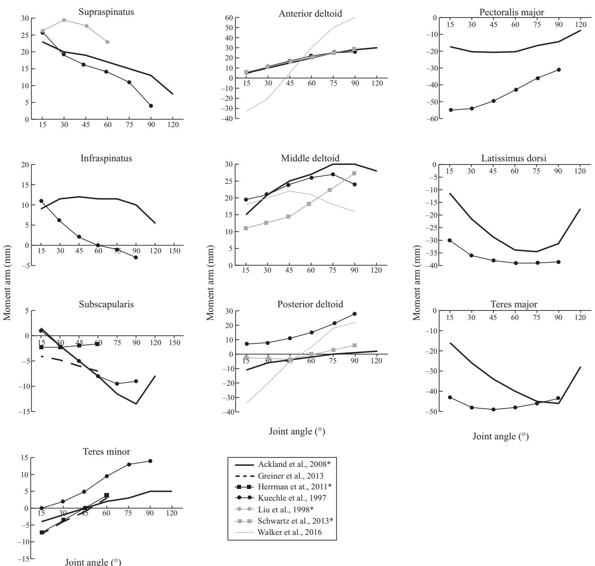

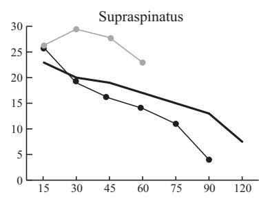

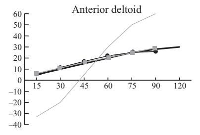

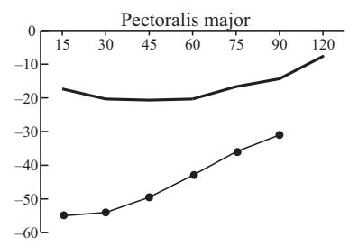

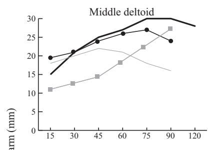

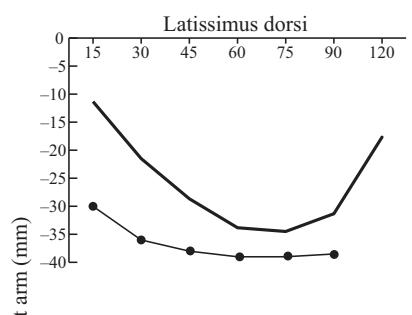

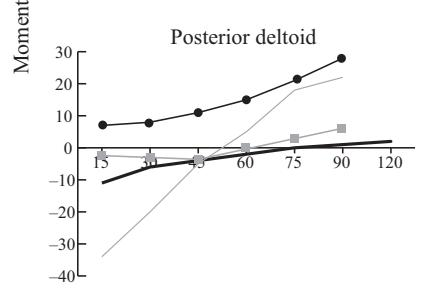

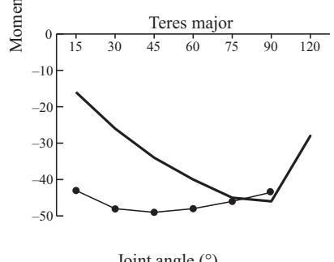  
Fig. 2 Moment arms of muscles spanning the glenohumeral joint during coronal plane abduction. Positive moment arm values indicate abduction while negative values indicate adduction. Moment arm units are millimetres. An asterisk indicates moment arm data that were averaged across two or more muscle sub-regions.

Ackland et al. 2008; Schwartz et al. 2013). Similarly, the middle deltoid had a large range of reported maximum flexor moment arm throughout the range of shoulder flexion (12 to 28 mm). The mean peak extensor moment arm of the posterior deltoid was 36.4 10.5 mm (n = 3). Maximum values occurred during early flexion, after which its moment arm decreased with increasing flexion (Kuechle et al. 1997; Ackland et al. 2008; Schwartz et al. 2013).

The flexor moment arm of the pectoralis major was greatest at $7 0 ^ { \circ }$ of flexion (21 mm), while the extensor moment arm of the latissimus dorsi peaked at $4 5 ^ { \circ }$ of flexion with reported values of 14 and 40 mm (Kuechle et al. 1997; Ackland et al. 2008). The teres major had the largest extensor moment arm, with Ackland et al. (2008) and Kuechle et al. (1997) reporting a moment arm peak of between 49 and 54 mm, respectively, occurring toward the mid-range of flexion.

The supraspinatus and subscapularis had a peak flexion moment arm of 43 and 23 mm, respectively (Ackland et al. 2008), while the teres minor was generally an extensor throughout flexion and had a peak moment arm of between 10 and 21 mm (Ackland et al. 2008; Greiner et al. 2013).

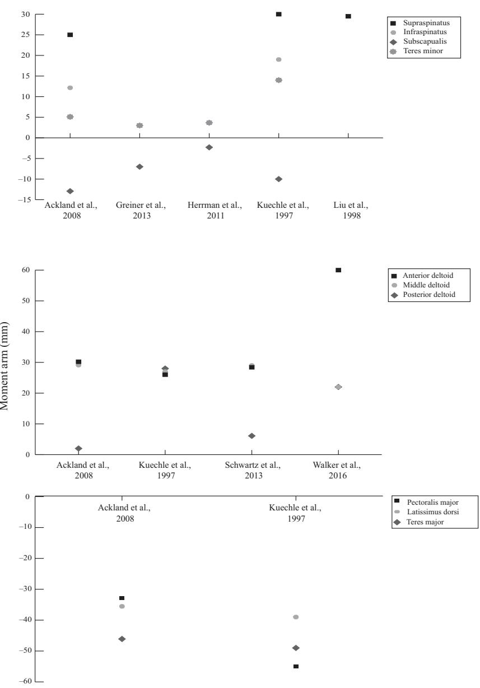

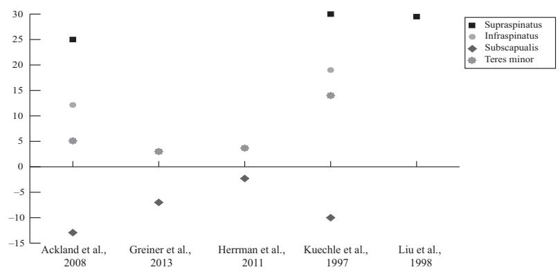

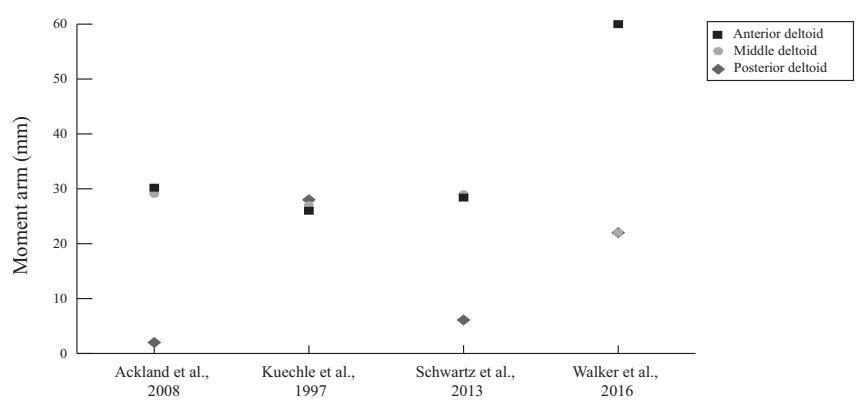  
Fig. 3 Maximum moment arm values for muscles spanning the glenohumeral joint during coronal plane abduction. See legend of Fig. 2.

## Muscle moment arms, axial rotation

The pectoralis major, latissimus dorsi, teres major, infraspinatus and teres minor were external rotators in the neutrally aligned humerus, while the anterior deltoid, middle deltoid, posterior deltoid, supraspinatus and subscapularis were internal rotators (Fig. 8).

The anterior deltoid was an external rotation agonist. It had internal rotation moment arm that increased with external rotation to a peak of 16 and 28 mm (Fig. 9; Kuechle et al. 2000; Schwartz et al. 2013). While one highquality study reported that the middle deltoid was an internal rotator during external rotation (Schwartz et al. 2013), a moderate-quality study reported a negligible moment arm in this muscle through the range of axial rotation (Kuechle et al. 2000). One moderate-quality study and one low-quality study showed the posterior deltoid had an internal rotator moment arm throughout axial rotation (Kuechle et al. 2000; Hamilton et al. 2013); however, a high-quality study suggested that the posterior deltoid acted as both an external and internal rotator, depending on the degree of external rotation of the humerus (Schwartz et al. 2013).

The infraspinatus was a prominent external rotator throughout axial rotation, and had a relatively constant moment arm between 20 and 26 mm (Kuechle et al. 2000; Adams et al. 2007; Hamilton et al. 2013). The mean maximum moment arm for this muscle was $2 4 . 5 \pm 0 . 9$ mm (n = 3). The subscapularis was an internal rotator during axial rotation, with a mean maximum moment arm of 20.6 2.8 mm (n = 3; Table 2) occurring during external rotation (Kuechle et al. 2000; Herrmann et al. 2011; Greiner et al. 2013). The teres minor was an internal rotator throughout axial rotation, with a relatively constant rotational moment arm that ranged between 17 and 25 mm (Kuechle et al. 2000; Adams et al. 2007; Herrmann et al. 2011; Greiner et al. 2013; Hamilton et al. 2015).

Table 2 Average muscle maximum moment arms and standard error values for shoulder muscles calculated across all relevant studies for corona plane abduction, scapular plane abduction, flexion and axial rotation.

<table><tr><td rowspan="2"></td><td colspan="2">Coronal plane abduction</td><td colspan="2">Scapular plane abduction</td><td colspan="2">Flexion</td><td colspan="2">Axial rotation</td></tr><tr><td>Moment arm</td><td>SE</td><td>Moment arm</td><td>SE</td><td>Moment arm</td><td>SE</td><td>Moment arm</td><td>SE</td></tr><tr><td>Anterior deltoid</td><td>36.2</td><td>8.0</td><td>33.9</td><td>5.0</td><td>35.5</td><td>3.3</td><td>-22.2</td><td>6.2</td></tr><tr><td>Middle deltoid</td><td>26.8</td><td>1.7</td><td>33.4</td><td>1.5</td><td>21.5</td><td>4.8</td><td>-14.6</td><td>12.6</td></tr><tr><td>Posterior deltoid</td><td>14.5</td><td>6.2</td><td>-16.9</td><td>4.8</td><td>-36.4</td><td>10.5</td><td>-7.3</td><td>1.3</td></tr><tr><td>Pectoralis major</td><td>-44.0</td><td>11.1</td><td>35.1</td><td>4.9</td><td>21.1</td><td>0.9</td><td>20.0</td><td></td></tr><tr><td>Latissimus dorsi</td><td>-37.3</td><td>1.7</td><td>-35.6</td><td>8.4</td><td>-26.8</td><td>13.2</td><td>9.0</td><td></td></tr><tr><td>Teres major</td><td>-47.6</td><td>1.5</td><td>-51.7</td><td>4.4</td><td>-51.7</td><td>2.7</td><td>7.5</td><td></td></tr><tr><td>Supraspinatus</td><td>28.2</td><td>1.6</td><td>26.4</td><td>1.3</td><td>27.1</td><td>15.6</td><td>-4.0</td><td></td></tr><tr><td>Infraspinatus</td><td>15.6</td><td>3.4</td><td>11.2</td><td>2.4</td><td>7.1</td><td>4.1</td><td>24.5</td><td>0.9</td></tr><tr><td>Subscapularis</td><td>-8.1</td><td>2.3</td><td>9.7</td><td>0.8</td><td>9.5</td><td>4.7</td><td>-20.6</td><td>2.8</td></tr><tr><td>Teres minor</td><td>6.4</td><td>2.6</td><td>8.5</td><td>6.5</td><td>-14.8</td><td>1.8</td><td>20.9</td><td>1.6</td></tr></table>

Axial rotation data are provided for humerus in its neutral position. All data are given in mm.

## Discussion

The objective of this study was to systematically review experimentally measured muscle moment arm data reported for shoulder abduction, flexion and axial rotation, which are motions commonly performed during activities of daily living including lifting, pushing, brushing hair, eating, driving, as well as sporting activities (Khadilkar et al. 2014). While there was notable between-study variation in moment arm magnitudes reported, even for the same muscles and joint positions, there was consensus that the anterior and middle deltoid had the greatest elevator leverage of all muscles, with the anterior deltoid the most prominent flexor, and the middle deltoid and anterior deltoid both the most significant elevators in scaption and coronal plane abduction. The subscapularis was an internal rotator, while the infraspinatus and teres minor were external rotators. In contrast, the supraspinatus had little leverage in axial rotation, but was a prominent elevator in early coronal plane abduction, scaption and flexion. The latissimus dorsi was a depressor in coronal plane abduction, scaption and flexion, while the pectoralis major was a prominent depressor in abduction and scaption, and also a flexor.

The anterior and middle deltoids demonstrated large humeral torque capacity in elevation, and were relatively weak axial rotators. The anterior deltoid exhibited an increasing abductor and flexor moment arm with increasing humeral abduction and flexion angle, respectively, thus demonstrating greater leverage in the later stages of humeral elevation when more torque is required to lift the upper limb against its own weight. While the moment arms of the middle and anterior deltoid were similar in the coronal plane and scapular planes, the posterior deltoid had more depressor function during coronal plane abduction compared with scaption, particular during mid to late elevation. Given that all three heads of the deltoid are active during humeral elevation (Kronberg et al. 1990; Wattanaprakornkul et al. 2011), these results suggest greater combined leverage may be generated in the coronal plane, which may make lifting tasks with the upper limb more efficient in this plane of motion.

The most prominent shoulder depressors were the pectoralis major, latissimus dorsi and teres major. In particular, the latissimus dorsi and teres major had large shoulder adductor and extensor moment arms, while the pectoralis major was a prominent adductor. The inferiorly directed lines of action of these muscles, together with their insertions far from the glenohumeral joint centre of rotation (on the proximal humeral shaft), give these muscles exceptional depressor function and significant mechanical advantage during tasks requiring both humeral depression and internal rotation, such as climbing and swimming (Marchetti & Uchida, 2011). In particular, the teres major, which is a frequently neglected muscle, has been shown from electromyographic data to play a significant role in shoulder function by being active as an antagonist and agonist during shoulder elevation and depression movements, respectively (Steenbrink et al. 2010; Marchetti & Uchida, 2011). The results suggest that both the latissimus dorsi and teres major have the greatest mechanica advantage during early to mid-range elevation in the coronal plane, scapular plane and saggital plane (between 30 and 50  of elevation), and may therefore be able to provide greater torque capacity with the upper limb in these shoulder joint configurations.

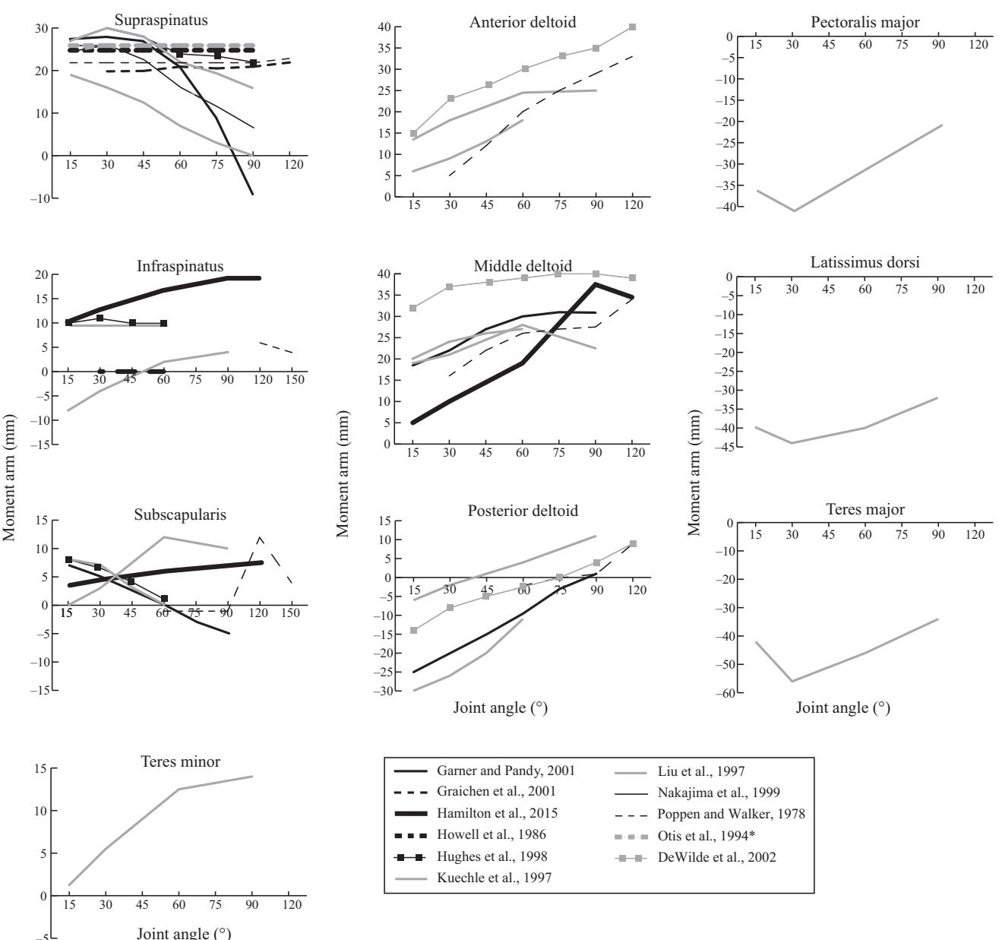  
Fig. 4 Moment arms of muscles spanning the glenohumeral joint during scaption (scapular plane abduction). See legend of Fig. 2.

The results demonstrated that the subscapularis was an internal rotator, while the infraspinatus and teres minor were external rotators. Because these muscles are simultaneously activated during upper limb movement (Jenp et al. 1996), their opposing action forms a transverse plane force couple that generates compressive joint loading to stabilise the humeral head in the glenoid fossa (Jenp et al. 1996; Silldorff et al. 2014). The supraspinatus, while having less axial rotation leverage than the other rotator cuff muscles, was shown to have a large elevator moment arm in early coronal plane abduction, scaption and flexion. Because the deltoid sub-regions have relatively small moment arms at these joint positions, this prominent leverage of the supraspinatus suggests that it may behave as an initiator of upper limb elevation (Ackland et al. 2008). Ultimately, the frequent execution of arm elevation during activities of daily living, and the active role of the supraspinatus in generating the required torque, may contribute to supraspinatus tendon degeneration and tearing, which has greater prevalence than that of any other rotator cuff tendon (Steinbacher et al. 2010; Silldorff et al. 2014).

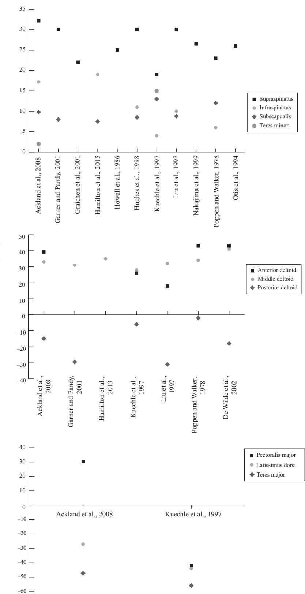  
Fig. 5 Maximum moment arm values for muscles spanning the glenohumeral joint during scaption (scapular plane abduction). See legend of Fig. 2.

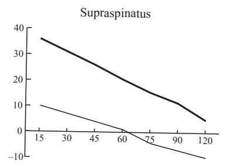

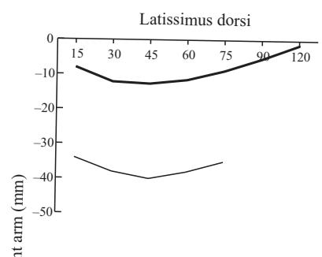

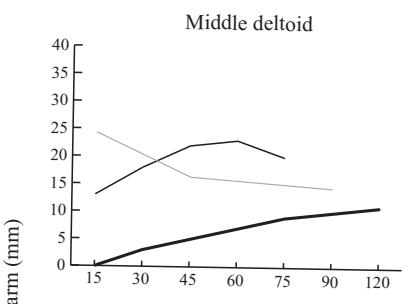

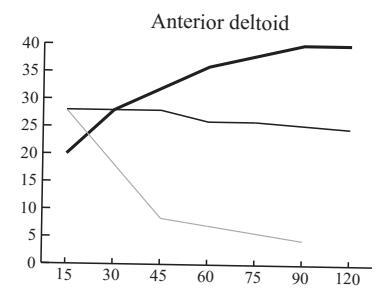

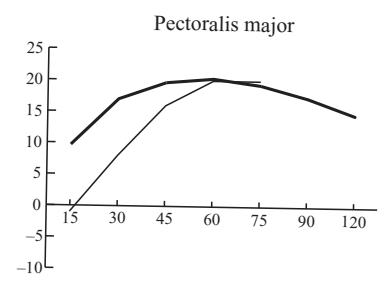

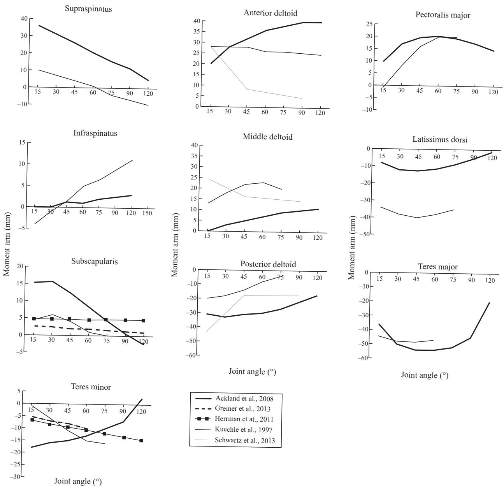  
Fig. 6 Moment arms of muscles spanning the glenohumeral joint during flexion in the sagittal plane. Positive moment arm values indicate flexion negative values indicate extension. Moment arm units are millimetres. An asterisk indicates moment arm data that were averaged across two or more muscle sub-regions.

There are a number of limitations of this review that ought to be considered when interpreting the results. First, while there were no clearly discernible differences in moment arms measured using the tendon excursion method or geometric method, these strategies present significant challenges in experimental reproduction of pure single-degree-of-freedom joint motion and evaluation of joint rotation axes, respectively. Variability in joint centre location and joint angular motion may translate to moment arm errors in both the in vivo and in vitro setting. Second, some studies subdivided muscles into multiple sub-regions, as a number of broad and multi-pennate muscles have been shown to have different activation patterns across their muscle belly (O’Connell et al. 2006), or the potential to generate a moment across their attachment site. To compare and pool datasets between different study designs, the moment arms for some muscles across their sub-regions, such as those of the pectoralis major, were averaged. Therefore, the reported average moment arm may not necessarily be representative of that of a functionally independent sub-region. Finally, a number of studies did not normalise moment arms to specimen or subject size, or may have used cadaveric specimens from elderly subjects. This may result in moment arm errors and discrepancies with data expected in healthy young adults.

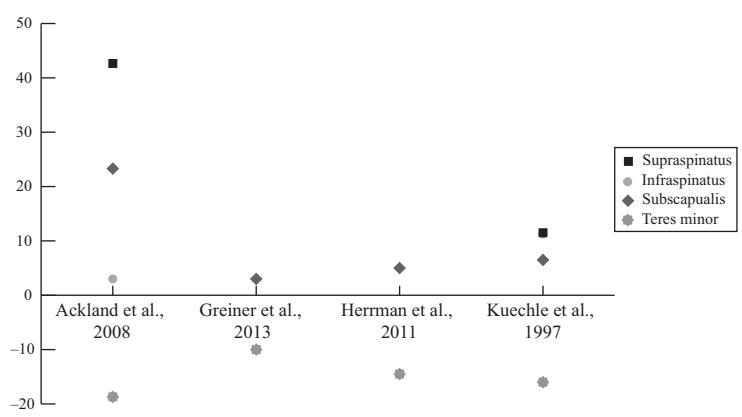

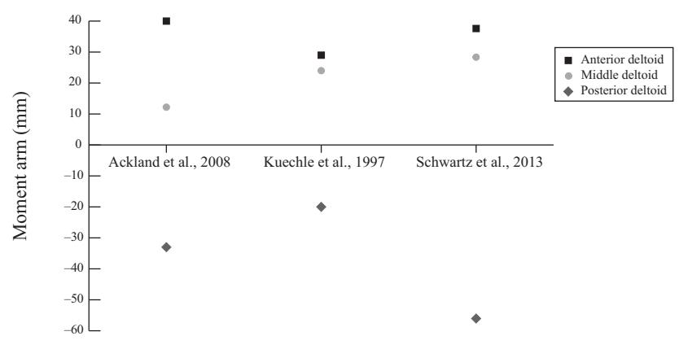

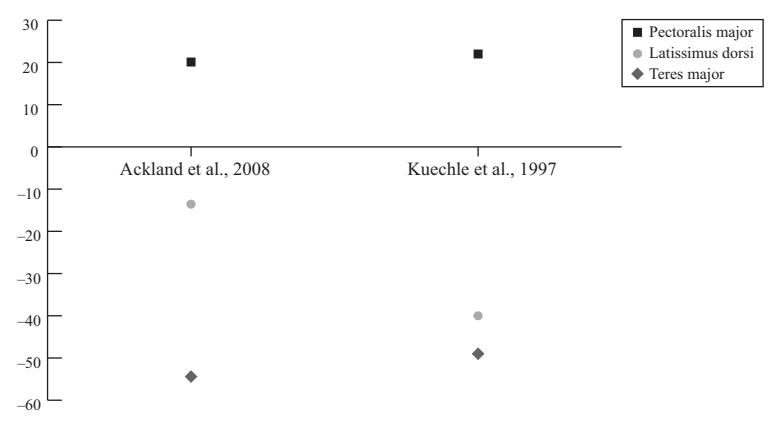  
Fig. 7 Maximum moment arm values for muscles spanning the glenohumeral joint during flexion in the sagittal plane. See legend of Fig. 6.

The studies examined in this review reported muscle moment arm data about specific joint motion axes in selected anatomical planes of upper limb motion (see Data S1 for details); however, activities of daily living and sports applications involve shoulder motion in a variety of joint motion planes not described in the literature. Notable gaps in the moment arm literature occur for shoulder hyperextension, hyperadduction, abduction and flexion beyond 120  of arm elevation, and horizontal flexion with the shoulder positioned at various elevation angles.

Furthermore, muscles may contribute torque about multiple joint axes simultaneously for given shoulder position, for example, the anterior deltoid as both an elevator and an internal rotator. Despite the many varied shoulder joint positions and potential muscle lever effects, it is most practical in the experimental setting to evaluate moment arms in anatomical planes of motion, as bone orientations and joint motion can be readily delineated and reproduced. This review concludes that specific anatomical planes of shoulder motion that are consistently used in the literature for reporting of moment arm data ought to be adopted as standardised joint positions used in future moment arm studies. These include, but are not limited to, elevation and depression in the scapular plane, coronal plane and sagittal plane, as well as axial rotation of the humerus in its neutral position, and horizontal flexion with the upper limb in $9 0 ^ { \circ }$ of elevation. Validated anatomical shoulder models may serve as a useful tool for estimating moment arm data in non-anatomical shoulder positions, or for various upper limb configurations in the case of multi-joint spanning muscles.

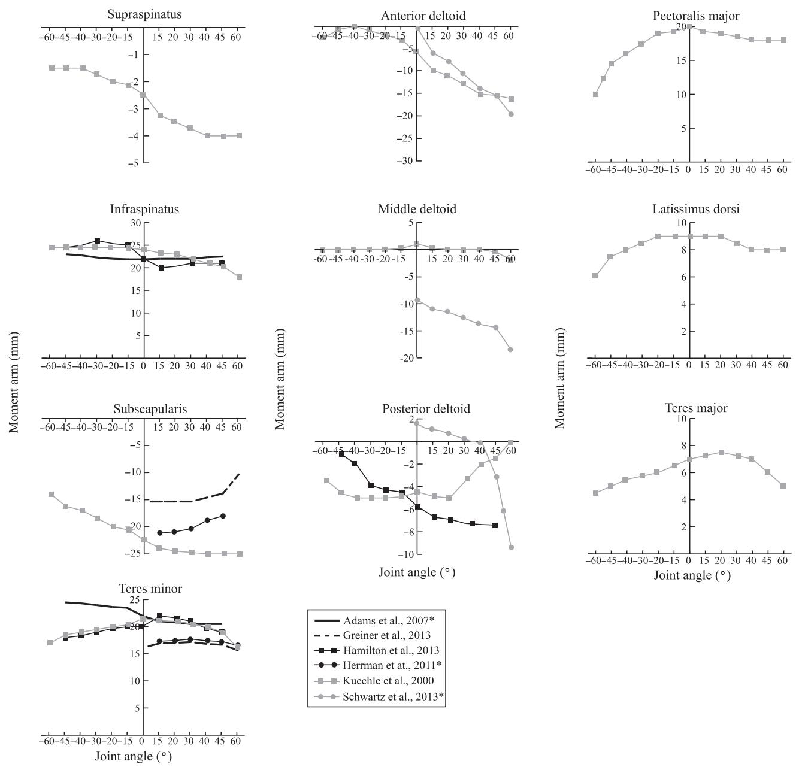  
Fig. 8 Moment arm trends of muscles spanning the glenohumeral joint during axial rotation with the humerus in the neutral position. Positive joint angles indicate external rotation, while negative angles represent internal rotation. A muscle with a positive moment arm externally rotates the humerus, while a muscle with a negative moment arm internally rotates the humerus. Moment arm units are millimetres. An asterisk indicate moment arm data that were averaged across two or more muscle sub-regions.

The results from this study may be used in developing and validating anatomical musculoskeletal models of the upper limb, which have previously been used to assess individual muscle contributions to joint loading and stability, as well as to evaluate the biomechanical influence of surgical procedures such as tendon transfer and joint replacement surgery on muscle and joint function (Ackland et al. 2010; Favre et al. 2010; de Witte et al. 2014; Wu et al. 2016). For example, shoulder muscle forces, which are frequently used to quantify muscle function, may be estimated using musculoskeletal models and the principal that the sum of muscle forces and their respective moment arms about a given joint during a task is equal to the net joint moment. Muscle force solutions must be determined computationally, as more muscles span the shoulder joint than the degrees of freedom of possible joint motion, and there is an infinite combination of possible muscle forces that may produce a joint torque.

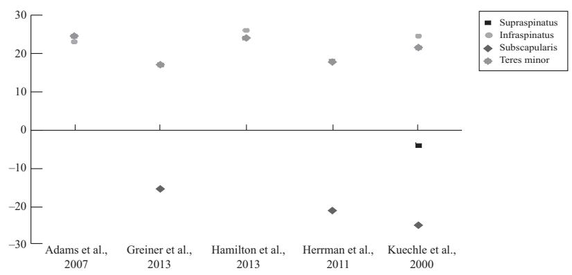

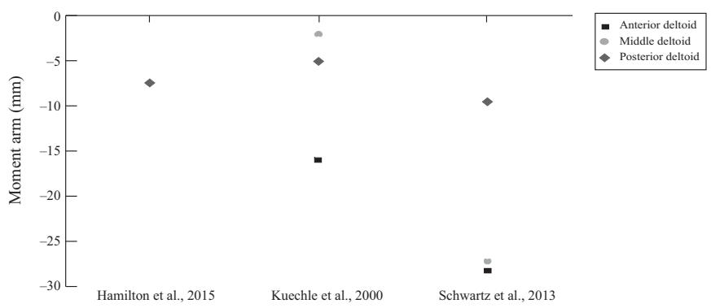

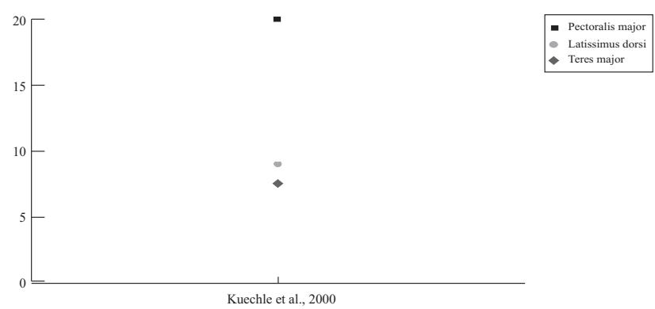  
Fig. 9 Maximum moment arm values for muscles spanning the glenohumeral joint during axial rotation with the humerus in the neutral position. See legend of Fig. 8.

In conclusion, the present study reports the function of the deltoid, latissimus dorsi, pectoralis major, teres major and rotator cuff muscles based on their moment arms during coronal plane abduction, scaption and axial rotation. The anterior and middle deltoid were the greatest humeral elevators, while the pectoralis major, latissimus dorsi and teres major were the most significant shoulder depressors. The rotator cuff muscles are responsible for both axial rotation and elevation of the humerus. The results of this study may be useful for classifying shoulder muscle function, and in developing musculoskeletal models for clinical and surgical applications.

## Acknowledgement

There are no existing conflicts of interest that the authors have to declare.

## References

Ackland DC, Pandy MG (2011) Moment arms of the shoulder muscles during axial rotation. J Orthop Res 29, 658–667.

Ackland DC, Pak P, Richardson M, et al. (2008) Moment arms of the muscles crossing the anatomical shoulder. J Anat 213, 383–390.

Ackland DC, Roshan-Zamir S, Richardson M, et al. (2010) Moment arms of the shoulder musculature after reverse total shoulder arthroplasty. J Bone Joint Surg Am 92, 1221–1230.

Ackland DC, Merritt JS, Pandy MG (2011) Moment arms of the human neck muscles in flexion, bending and rotation. J Biomech 44, 475–486.

Adams CR, Baldwin MA, Laz PJ, et al. (2007) Effects of rotator cuff tears on muscle moment arms: a computational study. J Biomech 40, 3373–3380.

An KN, Takahashi K, Harrigan TP, et al. (1984) Determination of muscle orientations and moment arms. J Biomech Eng 106, 280–282.

De Wilde L, Audenaert E, Barbaix E, et al. (2002) Consequences of deltoid muscle elongation on deltoid muscle performance: a computerised study. Clin Biomech (Bristol, Avon) 17, 499– 505.

de Witte PB, van der Zwaal P, van Arkel ER, et al. (2014) Pathologic deltoid activation in rotator cuff tear patients: normalization after cuff repair? Med Biol Eng Comput 52, 241–249.

Delp SL, Hess WE, Hungerford DS, et al. (1999) Variation of rotation moment arms with hip flexion. J Biomech 32, 493– 501.

Dostal WF, Andrews JG (1981) A three-dimensional biomechanical model of hip musculature. J Biomech 14, 803–812.

Downs SH, Black N (1998) The feasibility of creating a checklist for the assessment of the methodological quality both of randomised and non-randomised studies of health care interventions. J Epidemiol Community Health 52. 377–384

Dumas GA, Poulin MJ, Gagnon M, et al. (1991) Orientation and moment arms of some trunk muscles. Spine 16, 293–303.

Favre P, Sussmann PS, Gerber C (2010) The effect of component positioning on intrinsic stability of the reverse shoulder arthroplasty. J Shoulder Elbow Surg 19, 550–556.

Garner BA, Pandy MG (2001) Musculoskeletal model of the upper limb based on the visible human male dataset. Comput Methods Biomech Biomed Engin 4, 93–126.

Graichen H, Englmeier KH, Reiser M, et al. (2001) An in vivo technique for determining 3D muscular moment arms in different joint positions and during muscular activation – application to the supraspinatus. Clin Biomech 16, 389–394.

Greiner S, Schmidt C, Konig C, et al. (2013) Lateralized reverse shoulder arthroplasty maintains rotational function of the remaining rotator cuff. Clin Orthop Relat Res 471, 940–946.

Hamilton MA, Roche CP, Diep P, et al. (2013) Effect of prosthesis design on muscle length and moment arms in reverse total shoulder arthroplasty. Bull Hosp Jt Dis 71(Suppl 2), S31–S35.

Hamilton MA, Diep P, Roche C, et al. (2015) Effect of reverse shoulder design philosophy on muscle moment arms. J Orthop Res 33, 605–613.

Hart HF, Culvenor AG, Collins NJ, et al. (2016) Knee kinematics and joint moments during gait following anterior cruciate ligament reconstruction: a systematic review and meta-analysis. Br J Sports Med 50, 597–612.

Herrmann S, Konig C, Heller M, et al. (2011) Reverse shoulder arthroplasty leads to significant biomechanical changes in the remaining rotator cuff. J Orthop Surg Res 6, 42.

Howell SM, Imobersteg AM, Seger DH, et al. (1986) Clarification of the role of the supraspinatus muscle in shoulder function. J Bone Joint Surg Am 68, 398–404.

Hughes RE, Niebur G, Liu J, et al. (1998) Comparison of two methods for computing abduction moment arms of the rotator cuff. J Biomech 31, 157–160.

Jenp YN, Malanga GA, Growney ES, et al. (1996) Activation of the rotator cuff in generating isometric shoulder rotation torque. Am J Sports Med 24, 477–485.

Jensen KH, Davy DT (1975) An investigation of muscle lines of action about the hip: a centroid line approach vs the straight line approach. J Biomech 8, 103–110.

Jorgensen MJ, Marras WS, Granata KP, et al. (2001) MRI-derived moment-arms of the female and male spine loading muscles. Clin Biomech 16, 182–193.

Ketchum LD, Brand PW, Thompson D, et al. (1978) The determination of moments for extension of the wrist generated by muscles of the forearm. J Hand Surg Am 3, 205– 210.

Khadilkar L, MacDormid JC, Sinden KE, et al. (2014) An analysis of functional shoulder movements during task performance using Dartfish movement analysis software. Int J Shoulder Surg 8, 1–9.

Kodek T, Munih M (2003) Quantification of shoulder and elbow passive moments in the sagittal plane as a function of adjacent angle fixations. Technol Health Care 11, 89–103.

Krevolin JL, Pandy MG, Pearce JC (2004) Moment arm of the patellar tendon in the human knee. J Biomech 37, 785–788.

Kronberg M, Nemeth G, Brostrom LA (1990) Muscle activity and coordination in the normal shoulder. An electromyographic study. Clin Orthop Relat Res 257, 76–85.

Kuechle DK. Newman SR. Itoi E. et al. (1997) Shoulder muscle moment arms during horizontal flexion and elevation. J Shoulder Elbow Surg 6, 429–439.

Kuechle DK, Newman SR, Itoi E, et al. (2000) The relevance of the moment arm of shoulder muscles with respect to axial rotation of the glenohumeral joint in four positions. Clin Biomech 15, 322–329

Lee SW, Chen H. Towles JD. et al. (2008) Estimation of the effective static moment arms of the tendons in the index fin: ger extensor mechanism. J Biomech 41, 1567–1573.

Lindahl O, Movin A (1967) The mechanics of extension of the knee-joint. Acta Orthop Scand 38, 226–234.

Liu J, Hughes RE, Smutz WP, et al. (1997) Roles of deltoid and rotator cuff muscles in shoulder elevation. Clin Biomech 12, 32–38.

Liu J, Hughes RE, O’Driscoll SW, et al. (1998) Biomechanical effect of medial advancement of the supraspinatus tendon. A study in cadavera. J Bone Joint Surg Am 80, 853–859.

Marchetti PH, Uchida MC (2011) Effects of the pullover exercise on the pectoralis major and latissimus dorsi muscles as evaluated by EMG. J Appl Biomech 27, 380–384.

McCullough MB, Ringleb SI, Arai K, et al. (2011) Moment arms of the ankle throughout the range of motion in three planes. Foot Ankle Int 32, 300–306.

McGill SM, Norman RW (1986) Partitioning of the L4-L5 dynamic moment into disc, ligamentous, and muscular components during lifting. Spine 11, 666–678.

McGill SM, Patt N, Norman RW (1988) Measurement of the trunk musculature of active males using CT scan radiography: implications for force and moment generating capacity about the L4L5 joint. J Biomech 21. 329–341.

Moher D, Liberati A, Tetzlaff J, et al. (2010) Preferred reporting items for systematic reviews and meta-analyses: the PRISMA statement. Int J Surg 8, 336–341.

Nakajima T, Liu J, Hughes RE, et al. (1999) Abduction moment arm of transposed subscapularis tendon. Clin Biomech 14, 265–270.

O’Connell NE, Cowan J, Christopher T (2006) An investigation into EMG activity in the upper and lower portions of the subscapularis muscle during normal shoulder motion. Physiother Res /nt 11, 148–151.

Otis JC, Jiang CC, Wickiewicz TL, et al. (1994) Changes in the moment arms of the rotator cuff and deltoid muscles with abduction and rotation. J Bone Joint Surg Am 76, 667– 676.

Pandy MG (1999) Moment arm of a muscle force. Exerc Sport Sci Rev 27, 79–118.

Poppen NK, Walker PS (1978) Forces at the glenohumeral joint in abduction. Clin Orthop Relat Res 135, 165–170.

Schwartz DG, Kang SH, Lynch TS, et al. (2013) The anterior deltoid’s importance in reverse shoulder arthroplasty: a cadaveric biomechanical study. J Shoulder Elbow Surg 22, 357–364.

Silldorff MD, Choo AD, Choi AJ, et al. (2014) Effect of supraspinatus tendon injury on supraspinatus and infraspinatus muscle passive tension and associated biochemistry. J Bone Joint Surg Am 96, e175.

Steenbrink F, Nelissen RG, Meskers CG, et al. (2010) Teres major muscle activation relates to clinical outcome in tendon transfer surgery. Clin Biomech 25, 187–193.

Steinbacher P, Tauber M, Kogler S, et al. (2010) Effects of rotator cuff ruptures on the cellular and intracellular composition of the human supraspinatus muscle. Tissue Cell 42, 37–41.

Suderman BL, Vasavada AN (2017) Neck muscle moment arms obtained in-vivo from MRI: effect of curved and straight mod eled paths. Ann Biomed Eng 45, 2009–2024.

Vasavada AN, Li S, Delp SL (1998) Influence of muscle morphometry and moment arms on the moment-generating capacity of human neck muscles. Spine 23, 412–422.

Walker DR, Struck AM, Matsuki K, et al. (2016) How do deltoid muscle moment arms change after reverse total shoulder arthroplasty? J Shoulder Elbow Surg 25, 581–588.

Wattanaprakornkul D, Cathers I, Halaki M, et al. (2011) The rotator cuff muscles have a direction specific recruitment pattern during shoulder flexion and extension exercises. J Sci Med Sport 14, 376–382.

Werner CM, Nyffeler RW, Jacob HA, et al. (2004) The effect of capsular tightening on humeral head translations. J Orthop Res 22. 194–201.

Wood JE, Meek SG, Jacobsen SC (1989) Quantitation of human shoulder anatomy for prosthetic arm control–II. Anatomy matrices. J Biomech 22, 309–325.

Wu W, Lee PV, Bryant A, et al. (2016) Subject-specific muscu loskeletal modeling in the evaluation of shoulder muscle and joint function. J Biomech 49, 3623–3634.

## Supporting Information

Additional supporting information may be found online in the Supporting Information section at the end of the article. Data S1. Calculation of muscle moment arms.