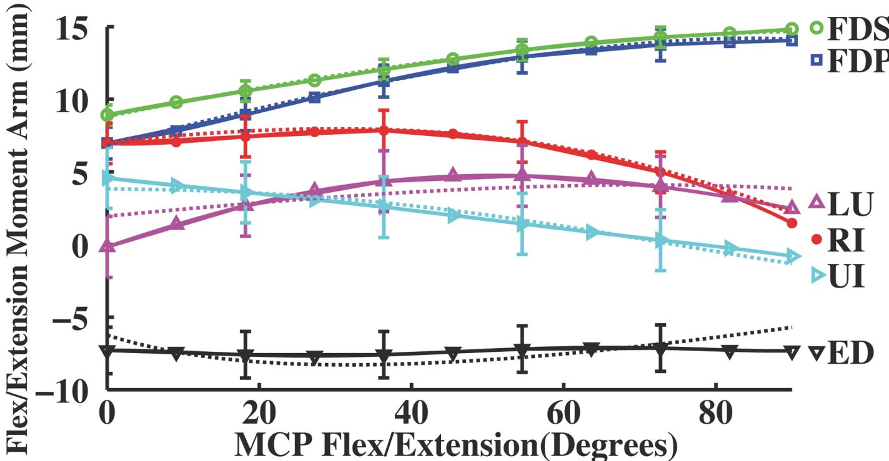
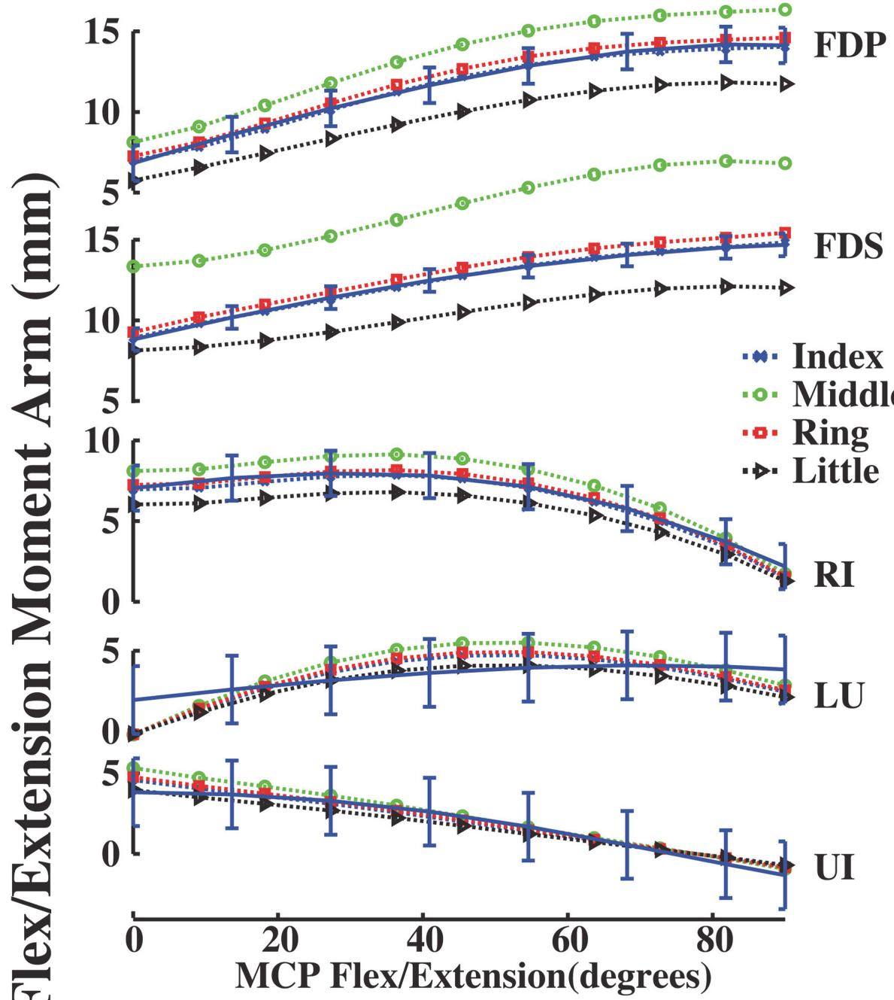
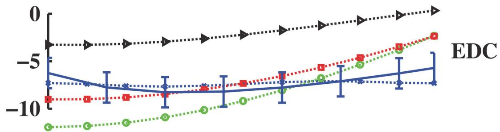
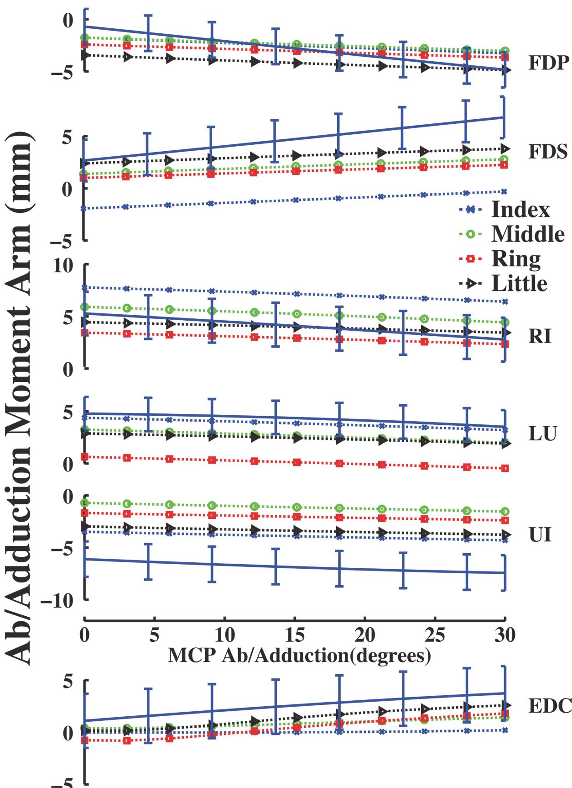
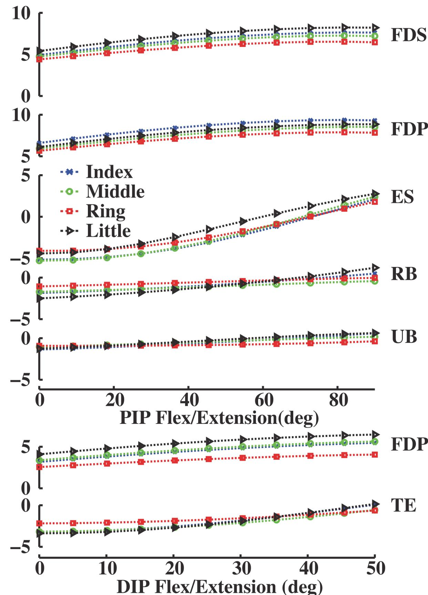
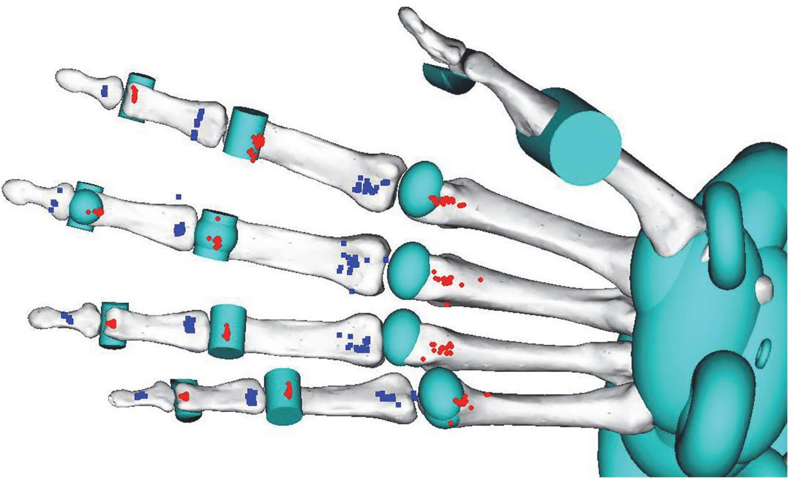
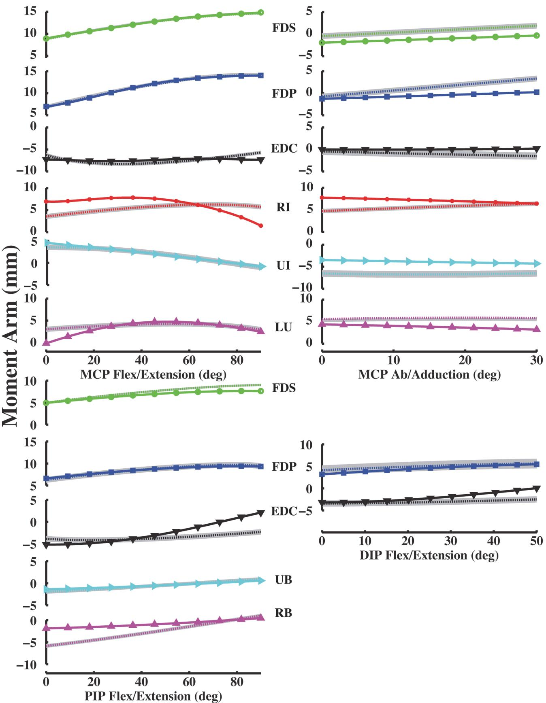
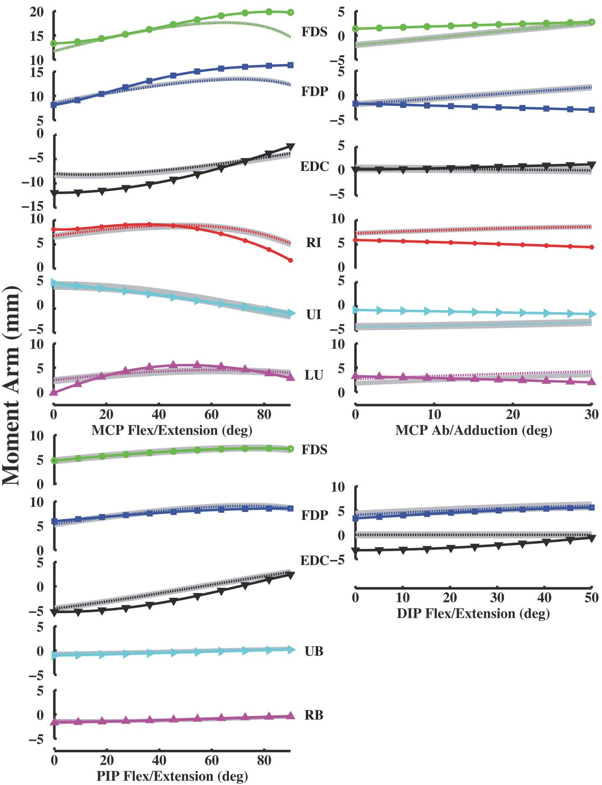
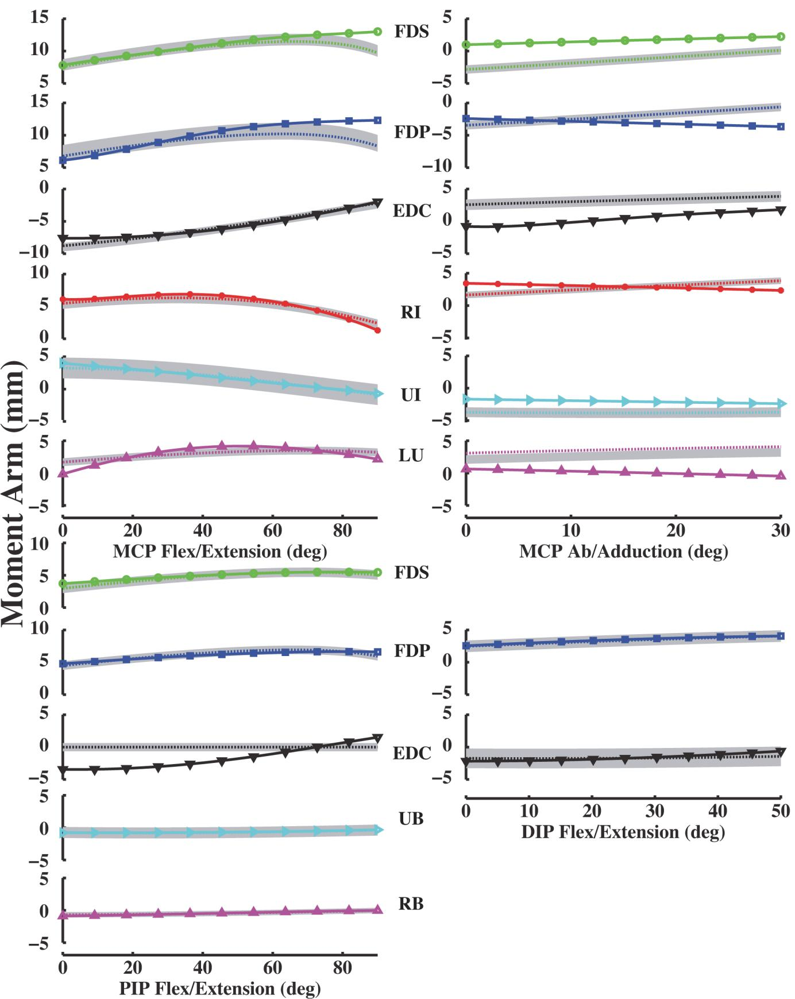
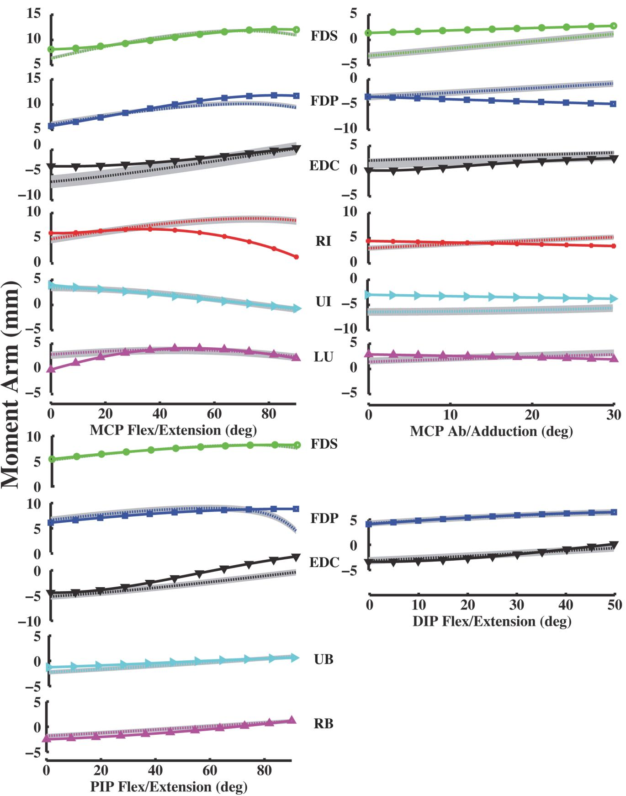

研究论文

# 面向 OpenSim 上肢模型的手指肌肉附着点

Jong Hwa Lee1, Deanna S. Asakawa2, Jack T. Dennerlein3, Devin L. Jindrich2\*

1 亚利桑那州立大学机械与航天工程系（Department of Mechanical and Aerospace Engineering, Arizona State University），美国亚利桑那州坦佩；2 加州州立大学圣马科斯分校运动机能学系（Department of Kinesiology, California State University, San Marcos），美国加利福尼亚州圣马科斯；3 东北大学布韦健康科学学院物理治疗、运动与康复科学系（Department of Physical Therapy, Movement, and Rehabilitation Sciences, Bouvé College of Health Sciences, Northeastern University），美国马萨诸塞州波士顿

\* djindrich@csusm.edu

CrossMark click for updates

## 开放获取（OPEN ACCESS）

引用格式：Lee JH, Asakawa DS, Dennerlein JT, Jindrich DL (2015) Finger Muscle Attachments for an OpenSim Upper-Extremity Model. PLoS ONE 10(4): e0121712. doi:10.1371/journal.pone.0121712

## 摘要

学术编辑：David Carrier，University of Utah，美国

收稿日期：2014年11月8日

录用日期：2015年2月14日

发表日期：2015年4月8日

版权：© 2015 Lee 等人。这是一篇依据知识共享署名许可协议（Creative Commons Attribution License）分发的开放获取文章，只要注明原作者和出处，允许在任何介质中不受限制地使用、分发和复制。

数据可用性声明：所有相关数据均包含在论文中。

资助信息：本研究得到了国家科学基金会（National Science Foundation, NSF 0964220）的资助。资助方在研究设计、数据收集与分析、发表决定或论文准备过程中未参与任何工作。

利益冲突：作者声明不存在任何利益冲突。

我们在 OpenSim 上肢模型中确定了示指、中指、无名指和小指的肌肉附着点。附着点的选择旨在同时匹配实验测量的解剖位置与力学功能（力臂）。尽管已有对手指肌肉附着点的实验测量，但模型在骨节段比例、关节运动学和坐标系等诸多方面与实体标本存在差异。同样，并非所有手指内在肌的力臂数据均可获取。因此，有必要在保持力学功能的同时，将肌肉附着点从一种实验或模型环境缩放并平移到另一种环境中。我们采用了两步法流程：首先，我们使用偏速度法（partial velocity method）计算所有内在肌和外在肌的力臂，以评估肌肉功能；其次，利用模拟退火（Simulated Annealing）和 Hooke-Jeeves 算法进行优化，寻找使实验力臂与模型力臂之间的均方根（RMS）误差最小化的肌腱路径。对于具备实测数据的示指内在肌和外在肌，偏速度法计算出的力臂与实测力臂之间的方差解释率（VAF）平均达到 75.5%（范围为 48.5% 至 99.5%）。实验值与优化值之间的 RMS 误差在实测力臂的一个标准差（S.D）以内（平均 RMS 误差 = 1.5 mm < 实测 S.D = 2.5 mm）。该技术两个步骤的验证，使得估算未测定力臂的肌肉附着点成为可能。模型与实验测量的肌肉附着点在所有手指关节上的平均差异小于 4.9 mm（在肌腱路径平均长度的 7.1% 以内）。由此建立的非专有人体手指肌骨模型可广泛用于多种应用场景，包括加深对复杂多点触控和手势运动的理解。

## 引言

灵巧的操作通常涉及多个手指的复杂运动。例如，抓握或捏取会涉及多块手部肌肉的协调激活 [1]。类似于捏取和抓握的动作常被用作智能手机和平板电脑触摸屏等人机交互界面（HCIs）的输入方式。这些设备的“多点触控”界面通常需要在触摸屏上进行复杂的多指手势或手势序列 [2]。然而，关于长期暴露的累积效应是否会导致肌骨疾患（MSDs）等损伤，我们目前知之甚少。识别可能导致损伤的受力暴露的一种方法是在重复性活动期间估算肌肉和肌腱的受力情况。然而，单块肌肉的张力或应力很难在活体（in vivo）内直接测量 [3,4]。

肌肉骨骼模型有助于理解生物力学和运动控制的诸多方面。生物力学模型有助于理解手部解剖结构 [5,6]。这些模型还促进了对上肢生物力学的理解，包括运动任务期间的内部肌肉负荷 [7–10]。肌肉骨骼模型同样有助于理解手部和手臂运动的神经控制。例如，模型有助于确定手部内在肌 [11,12] 以及拇指和食指肌肉 [13,14] 的功能，并用于研究指间关节的运动协调性 [15,16]。

然而，现有模型存在若干局限性。首先，许多模型是使用专有或商业软件开发的，通常无法公开使用。其次，许多模型是二维（2D）的，而运动通常发生在三维（3D）空间中。第三，许多模型仅侧重于特定关节或关节群，并未包含整个上肢。最后，即使是包含了手部和手臂所有主要骨骼节段的模型，目前也未包含驱动复杂手指运动可能涉及的所有肌肉。

手部的内在肌和外在肌的肌肉附着点均已有实验测量数据 [5]。然而，已发表的附着点不能直接应用于 OpenSim 模型 [9]。OpenSim 模型所采用的第 50 百分位数男性与用于实验测量的标本存在差异。例如，OpenSim 模型与实验标本在节段尺寸、节段比例、关节中心位置、旋转轴朝向以及解剖坐标系方面均有所不同。因此，直接将实验测量的肌肉附着点添加到 OpenSim 模型中，会导致所建模的肌肉力臂与相同肌肉实验测得的力臂不同。肌肉力臂是一项重要的功能性指标，因为它决定了由肌肉力产生的关节力矩。因此，为了建立能够评估肌肉功能的肌肉骨骼模型，有必要确定一组能够产生代表人类受试者力臂的肌肉附着点。

已有数项研究测量了体内（in vivo）[17–19] 和原位（in situ）[20–24] 的力臂。然而，据我们所知，中指、无名指和小指所有肌肉的力臂尚未见报道。此外，即使力臂已知，具体的肌肉附着点也是未知且不确定的：许多潜在的肌肉附着点都可以产生相似的力臂 [25]。

为了克服其中的一些局限性，我们试图在一个非专有的、三维上肢肌骨模型中添加手内在肌和外在肌 [9,26]。目前的 OpenSim 上肢模型包含了肩部和肘部的肌肉。添加手指肌肉是利用该模型更好地理解灵巧手指运动的必要组成部分。OpenSim 模型特别适用于帮助理解节段间相互作用的作用以及手指肌肉跨多关节运动的影响。

因此，我们试图在 OpenSim 上肢模型中确定手内在肌和外在肌的肌肉附着点，从而实现与实验测量的力臂相匹配这一功能上的重要特征。

我们用于确定肌肉附着点的程序包括两个步骤。首先，我们根据实验测量的肌腱位置确定了肌肉力臂 [5]。我们使用“偏速度（partial velocity）”计算方法 [27,28]，根据实验测量的肌肉附着点重现了解剖学力臂 [5]。计算得到的力臂处于实验测量值的一个标准差（S.D）以内（S.D = 2.5 mm；[6,20]），即被视为预测成功。其次，在给定力臂曲线的情况下，我们使用一种数据驱动的优化方法来确定肌腱路径，该方法能够确定肌肉附着点，使其产生的力臂与实验测量值相匹配 [25]。优化后的力臂在实验得出数值的 10% 以内，即被视为逼近成功 [29,30]。

## 方法

我们在 OpenSim 平台（2.3.2, Simbios, Stanford, CA; [9,31]）上扩展了现有的上肢肌骨模型，以包含手指肌肉。目前，肩部、肘部、前臂、手腕、拇指和示指均已建模，具有 15 个关节自由度（DOFs）和 50 个肌肉单元。现有模型由 50 个肌肉隔室驱动，其中包括拇指和示指的外在肌。拇指关节的旋转轴和中心基于测量值 [32,33]，而示指关节的旋转轴和中心则建模为拟合掌骨和指骨关节面的圆柱体长轴。

## 肌骨模型

由于目前 OpenSim 模型中仅有拇指和示指具有主动关节 [9]，我们在该模型的中指、无名指和小指上添加了自定义关节。每个手指被建模为具有四个自由度（DOFs），连接四个连续的骨骼：掌骨、近节指骨、中节指骨和远节指骨。这四个骨骼节段由三个关节连接：掌指关节（MCP）、近端指间关节（PIP）和远端指间关节（DIP）。MCP 关节作为万向节（2 个自由度），能够进行屈/伸和外展/内收运动。PIP 和 DIP 关节作为旋转关节（1 个自由度），仅限于屈/伸运动。我们将关节角度限制在基于实验测量的生理运动范围（RoM）内 [20,23,34]。MCP 关节建模的 RoM 为 0°（伸：-）至 90°（屈：+）以及 0°（内收：-）至 30°（外展：+）。PIP 和 DIP 关节建模的 RoM 分别为 0° 至 90°（屈：+）和 50°（屈：+）。

对于所有手指，我们对以下肌肉进行了建模：末端伸肌腱（TE）、伸肌腱中央束（ES）、桡侧束（RB）、尺侧束（UB）、骨间背侧肌或桡侧骨间肌（RI）、蚓状肌（LU）、骨间掌侧肌或尺侧骨间肌（UI）、指深屈肌（FDP）、指浅屈肌（FDS）以及指总伸肌或长伸肌（EDC）。所有手指的包裹面均基于先前的研究 [9,25,31,35]。我们修改了包裹面参数（例如尺寸、方向和位置），以防止肌肉在整个运动范围内穿入骨骼。

## 模型缩放与力臂

为了归一化不同数据集之间的差异，并根据 OpenSim 模型中的骨骼节段重构手部皮肤表面，我们假设所有线性尺寸均呈等比例缩放，这与指骨长度、各关节宽度和厚度之间的比例关系一致 [5,25,36–39]。我们将测量得到的人体测量数据缩放至 OpenSim 模型尺寸以

Table 1. 尸体标本 [20] 与 OpenSim 模型的示指人体测量尺寸 (mm)。

<table><tr><td></td><td>标本骨骼尺寸</td><td>OpenSim 骨骼尺寸</td><td>缩放后的皮肤表面</td></tr><tr><td>远节指骨长度</td><td>19.67±1.03</td><td>19.10(Δ0.57)</td><td>30.65</td></tr><tr><td>中节指骨长度</td><td>24.67±0.98</td><td>25.10(Δ0.43)</td><td>27.22</td></tr><tr><td>近节指骨长度</td><td>43.57±0.98</td><td>42.60(Δ0.97)</td><td>50.86</td></tr><tr><td>DIP 关节厚度</td><td>5.58±0.92</td><td>4.95(Δ0.63)</td><td>14.38</td></tr><tr><td>PIP 关节厚度</td><td>7.57±0.45</td><td>7.31(Δ0.26)</td><td>18.86</td></tr><tr><td>MCP 关节厚度</td><td>15.57±0.84</td><td>17.08(Δ1.51)</td><td>27.80</td></tr></table>

符号（±）表示标本间变异的标准差。OpenSim 模型中指骨的长度是通过三维（3D）笛卡尔空间中两个坐标系原点之间的距离计算的，例如 MCP（掌指关节）处的旋转中心与 PIP（近端指间关节）处的旋转中心。OpenSim 骨骼尺寸中的括号（Δ）表示模型尺寸与标本尺寸之间的差异。皮肤表面集在三维方向上进行缩放，以保持测得的解剖学比例 [36–39]。这些皮肤表面（外部尺寸）在优化过程中充当上边界约束。

doi:10.1371/journal.pone.0121712.t001

描述了 OpenSim 内的肌腱路径（Table 1），随后将力臂归一化为中节指骨的长度 [5,25]。

## 基于实验测量附着点重现力臂

由于仅有食指在 MCP 关节处的实验力臂曲线，因此有必要根据测量的肌肉附着点计算中指、无名指和小指的力臂值。我们使用“偏速度”（partial velocity）方法 [28] 根据肌腱附着位置 [5] 计算了力臂。偏速度法提供了一种一致的技术来计算跨越多种类型关节的肌肉力臂 [27]。

为了验证使用偏速度法计算的力臂，我们将根据食指肌肉附着点计算的力臂 [5] 与实测力臂 [20] 进行了比较。除 FDS 肌肉外 [40]，作为关节角度函数的实验测量力臂仅能获取食指的 MCP 关节数据。因此，我们将力臂曲线的比较局限于食指 MCP 关节以及所有手指的 FDS 肌肉。

## 肌肉附着点的确定

我们采用了一种数据驱动的优化方法来确定肌肉附着点位置，从而使得在关节活动度（range of motion, RoM）范围内产生的力矩臂最接近实验测得的曲线。我们使用与确定食指附着位置相同的方法进行了优化 [25]。该优化包含三个部分：1）目标函数，2）边界条件，以及 3）不等式约束。我们将目标函数定义为实验测得的力矩臂 $\Gamma _ { \mathrm { j } } ( \vec { \bf q } _ { \mathrm { i } } )$ 与模型估计的力矩臂 $\hat { \bf r } _ { \mathrm { j } } ( \vec { \bf q } _ { \mathrm { i } } , \vec { \bf x } )$ 之间的均方根（RMS）误差。优化在满足屈/伸和展/收力矩臂关系 $( { \bf g } _ { \mathrm { j } } \left( { \bf x } \right) )$ 的附着点 (x!) 和关节角度 (q!) 区域内，搜索 RMS 误差 $( f ( \vec { x } ) )$ 的最小值。各个关节处的力矩臂曲线在幅值和形状上均有所不同。然而，我们目前尚无对不同关节处的误差进行加权的标准。因此，我们在目标函数中对每块肌肉在所有关节上的 RMS 误差进行了求和。

最小化

$$
f (\vec {x}) = \sqrt {\sum_ {i = 1} ^ {m} \frac {\left[ r _ {j} (\vec {q} _ {i}) - \hat {r} _ {j} (\vec {q} _ {i} , \vec {x}) \right] ^ {2}}{m}}
$$

约束条件

$$
l b _ {j} \leq x _ {j} \leq u b _ {j}
$$

$$
\mathbf {g} _ {\mathrm{j}} (\vec {x}) - \varepsilon_ {\mathrm{j}} \leq 0
$$

我们将优化参数和变量定义为：

x! 肌肉附着点（远端和近端；$\vec { x } \in \mathcal { R } ^ { 6 } )$

q! 关节角度（覆盖 RoM 的 100 个增量 (m) 的分辨率 (i)）

$r _ { j } ( \vec { q } _ { i } )$ 实验测量的力矩臂

$\hat { r } _ { j } ( \vec { q } _ { i } , \vec { \bf x } )$ 模型估计的力矩臂

i 关节运动（屈/伸或展/收）

j 单块肌肉 $( j = 4 0 )$

$l b _ { j }$ 下界（骨表面）

ubj 上界（皮肤表面）

$\varepsilon _ { \mathrm { j } }$ 实验力矩臂的最大标准差

$\mathrm { g } _ { \mathrm { j } } ( \vec { x } )$ 屈/伸运动期间展/收力矩臂的 RMS 误差

其次，边界条件将肌肉附着点限制在骨骼（下界，$l b _ { j } \left[ \underline { { 9 } } \right] )$ 与皮肤表面（上界，$u b _ { j } [ { \underline { { 3 6 } } } , { \underline { { 3 8 } } } , { \underline { { 3 9 } } } ] )$ 之间。

第三，我们对外展/内收施加了不等式约束 $( g _ { j } ( \vec { x } ) \leq \varepsilon _ { \mathrm { j } } )$。肌腱路径在掌指关节（MCP 关节）处同时具有屈/伸和外展/内收力臂。然而，测量得到的外展/内收力臂比屈/伸力臂具有更大的不确定性。例如，外展/内收力臂的标准差高于屈/伸力臂，这反映了测量变异性或解剖结构变异性 [5,20,21,23]。此外，外展/内收力臂值取决于 MCP、PIP（近端指间）和 DIP（远端指间）关节的关节角度 [41]。然而，用于测量外展/内收力臂值的具体姿态无法获取。因此，我们在优化中通过使用不等式约束 $( g _ { j } ( \vec { x } ) \leq \varepsilon _ { \mathrm { j } } )$ 纳入了外展/内收，以寻找肌肉附着点 $( \vec { x } )$ 所产生的力臂位于实验测量力臂的标准差范围之内的解，即 $( g _ { j } ( \vec { x } ) \leq \mathfrak { s } _ { \mathrm { j } } )$。外展/内收的标准差 $\varepsilon _ { \mathrm { j } }$ 对于外在肌为 2.5 mm，对于内在肌为 1.7 mm [20]。我们的优化采用模拟退火（Simulated Annealing）[42] 和 Hooke-Jeeves [43] 算法实现。选择这两种算法是因为它们已成功应用于肌肉骨骼建模 [25]。

在复杂的搜索空间中，初始参数选择会影响优化结果 [13,25,43]。因此，我们对所有附着点 (x!j) 进行了敏感性分析。我们使用 26 个不同的起始点 $( \overrightarrow { x } _ { 0 } )$ 进行了优化。这些起始点包括实验估计的附着点位置 [5]，以及在可能的情况下采用的现有 OpenSim 模型附着点 [9]。从不同初始条件出发的优化可能会找到多个解，这需要制定一个标准来选择一组唯一的附着点 [25]。我们假设，最接近实验测量位置且能产生平滑肌腱路径的优化附着点在解剖学上是最合理的。

为了确定实验测量的附着点在 OpenSim 坐标系中的位置，我们将附着点从 An 等人（1979）的参考系转换到 OpenSim。我们构建了一个变换矩阵，用于映射三维（3D）笛卡尔坐标（3D 欧几里得空间）中的平移与旋转。我们近似估计了运动学参数：链节旋转 (θ)、链节间距 (d)、关节扭转角 (α) 和关节偏移量 (a)

来自 OpenSim 模型 [9]。在 OpenSim 坐标系中，X 坐标轴分配给关节轴（-：尺偏至 +：桡偏），Y 坐标轴分配给指骨（-：远端指骨至 +：近端指骨），Z 坐标轴由右手定则确定（-：掌侧至 +：背侧方向）。An 等人（1979）的主要坐标系位于远端、近端指骨头和掌骨头的大致旋转中心（参考系 2、4 和 6），分别平移至 OpenSim 的 PIP（近端指间）、MCP（掌指）关节以及掌骨中点坐标系。An 等人（1979）的次要坐标系是将近端系统平移至凹关节面中心（参考系 1、3 和 5），分别平移至 OpenSim 的 DIP（远端指间）、PIP 和 MCP 关节坐标系。

选择最接近实验测量值的附着点进行分析和展示。若数个候选附着点到实验测量点的欧几里得距离在实验测量的标准差范围内（中节指骨长度的 28% [5]），我们则选择曲率半径最大的路径（即“最平滑”的路径）。曲率是肌腱路径方向的变化率（即肌腱路径偏离直线的程度）。曲率半径由三个连续附着点确定，例如起点、途径点和止点 [25]。曲率半径最大的肌腱路径被认为是最平滑的路径，并被选用于分析和展示。为了衡量模型优化与实验测量的力臂曲线之间的一致性，我们使用以下公式估算了方差解释率（VAF）：

$$
\mathrm{VAF} = 1 0 0 \times \left[ 1 - \sqrt {\sum (\vec {r} - \vec {r}) ^ {2}} / \sqrt {\sum \vec {r} ^ {2}} \right]
$$

我们在 Matlab（2012a, Mathworks, Natick, MA）中使用 OpenSim 应用程序编程接口（API；OpenSim 2.0 Doxygen）进行优化以计算力臂。

## 结果

## 基于肌肉附着点计算的力臂与示指实验测量值相拟合

使用偏速度法（partial velocity method）计算的力臂与在示指掌指（MCP）关节处测得的力臂吻合（Fig 1；Table 2）。在整个运动范围内，由解剖学肌肉附着点推导出的计算力臂 [5] 均在实验测得力臂的一个标准差范围之内 [20]。所有示指肌肉的方差解释率（VAF）平均为 75.5%，范围从最低（min.）48.2%（UI）到最高（max.）99.5%（FDS）。UI 肌肉的 VAF 较低是因为该肌肉的力臂值较小。然而，UI 肌肉的均方根误差（RMS error）处于实验测得力臂的一个标准差（S.D）以内（RMS 误差 = 2.0 mm < 测量 S.D = 2.1 mm），表明计算出的力臂是合理的。外在肌腱的 VAF 为 96.5%，内在肌（屈/伸）的 VAF 为 86.9%。

## 基于肌肉附着点计算的力臂对所有手指肌肉均合理

基于力臂大小以及随关节角度的变化，中指、环指和小指肌肉的计算力臂是合理的。具体而言，所有计算出的屈/伸力臂在大小排序上均与手指尺寸的排序相当。中指的力臂最大，环指或示指次之，小指最小（Figs 2–4）。此外，计算出的力臂与关节角度呈现出一致的函数关系。对于示指、中指、环指和小指，FDP、FDS、RI、UI 和 LU 的计算力臂随手指屈曲而增大，而 TE、ES 和 EDC 的力臂随屈曲而减小。在所有手指关节中，力臂随屈/伸的变化规律保持一致。

  
Fig 1. 示指 MCP 关节处屈 (+)/伸 (-) 状态下测量和推导的屈/伸力臂（mm）。虚线力臂值由实验肌肉附着点推导得出 [5]，实线力臂值为直接测量值（n = 7 具标本，附均值和标准差（误差线）；[20]）。正值表示屈曲力臂，负值表示伸展力臂，0° 为完全伸展。  
doi:10.1371/journal.pone.0121712.g001

与屈/伸力臂不同，外展/内收力臂并未表现出与手指尺寸相对应的排序。例如，计算出的小指 FDS 和 EDC 外展/内收力臂大于中指（Fig 3）。然而，

Table 2. 由实验测量的肌肉附着点推导出的平均力臂（MA）[5]。

<table><tr><td>关节</td><td>RoM</td><td></td><td>FDP</td><td>FDS</td><td>EDC</td><td>LU</td><td>RI</td><td>UI</td></tr><tr><td rowspan="8">MCP2</td><td></td><td>MA</td><td>11.5</td><td>12.4</td><td>-7.4</td><td>3.5</td><td>6.6</td><td>2.0</td></tr><tr><td> $0^{\circ} \sim 90^{\circ}$ </td><td>(VAF)</td><td>(98.7%)</td><td>(99.5%)</td><td>(91.0%)</td><td>(77.0%)</td><td>(95.9%)</td><td>(87.9%)</td></tr><tr><td>屈/伸</td><td>RMS</td><td> $\Delta 0.2$ </td><td> $\Delta 0.1$ </td><td> $\Delta 0.7$ </td><td> $\Delta 0.8$ </td><td> $\Delta 0.3$ </td><td> $\Delta 0.3$ </td></tr><tr><td></td><td>(误差)</td><td>(1.2%)</td><td>(0.5%)</td><td>(8.0%)</td><td>(23.4%)</td><td>(4.3%)</td><td>(73.9%)</td></tr><tr><td></td><td>MA</td><td>-2.8</td><td>2.2</td><td>2.5</td><td>4.3</td><td>4.1</td><td>-6.8</td></tr><tr><td> $0^{\circ} \sim 30^{\circ}$ </td><td>(VAF)</td><td>(68.2%)</td><td>(63.0%)</td><td>(53.2%)</td><td>(68.1%)</td><td>(56.8%)</td><td>(48.2%)</td></tr><tr><td>外展/内收</td><td>RMS</td><td> $\Delta 0.8$ </td><td> $\Delta 3.4$ </td><td> $\Delta 2.6$ </td><td> $\Delta 1.5$ </td><td> $\Delta 3.1$ </td><td> $\Delta 2.0$ </td></tr><tr><td></td><td>(误差)</td><td>(31.2%)</td><td>(41.6%)</td><td>(99.4%)</td><td>(10.7%)</td><td>(79.6%)</td><td>(43.0%)</td></tr></table>

所有数值均以毫米（mm）表示，食指 MCP 关节角度（度）定义为屈曲（+）/伸展（-）以及外展（+）/内收（-）。(VAF) 代表方差解释率（Variance Accounted For），RMS 代表推导力臂 [5] 与实验测量值 [20] 之间的均方根误差（Δ），(Error) 分别代表百分比误差。

doi:10.1371/journal.pone.0121712.t002

  
Fig 2. 所有手指 MCP 关节屈/伸力臂（mm）随屈曲（+）/伸展（-）变化的关系。虚线力臂值由实验测量的肌肉附着点推导得出 [5]，实线力臂值为直接测量值（n = 7 个样本，包含均值和标准差；[20]）。正值表示屈曲力臂，负值表示伸展力臂，0° 为完全伸展。蓝色、绿色、红色和青色分别代表食指、中指、无名指和小指的力臂。  
doi:10.1371/journal.pone.0121712.g002

  
Fig 3. 所有手指 MCP 关节外展/内收力臂（mm）随外展（+）/内收（-）变化的关系。图例符号与 Fig 2 相同。

  
Fig 4. 所有手指 PIP 和 DIP 关节屈/伸力臂（mm）随屈曲（+）/伸展（-）变化的关系。图例符号与 Fig 2 相同。

小指力臂与 FDS 和 EDC 肌肉位置一致，这些位置距 MCP 关节的距离长于测得的中指肌肉位置（欧几里得距离，$d _ { l i t t l e } = 0 . 5 2 > d _ { m i d d l e } = 0 . 4 0 >$ 中节指骨长度）。因此，偏速度计算所预测的力臂曲线与基于手指解剖结构的预期相吻合。

## 优化后的力臂与基于解剖学附着点计算得出的数值相匹配

优化过程确定了使 RMS 误差达到局部最小值的多个肌肉附着点（Fig 5）。从实验测量的附着点到最接近、最平滑的优化肌肉附着点（即选用于分析和展示的点）的平均欧几里得距离为 4.9 mm，占沿肌腱通路平均长度的 7.1%。

在 MCP 关节处，食指、中指、无名指和小指的模型优化力臂与实验推导值一致（Figs 6–9）。食指、中指、无名指和小指的 VAF 平均值分别为 84.3%、80.4%、86.6% 和 84.1%（Table 3, 4, 5, 6）。在中指处（最小 VAF = 80.4%），RMS 误差范围在最小 0.3 mm (UI) 到最大 2.4 mm (EDC) 之间。由于除食指外尚未见其他手指力臂 S.D 的报道，我们将 RMS 误差与食指力臂的 S.D 进行了比较。对于所有肌肉，计算优化值与实验推导力臂值之间的最大 RMS 误差均在实验测得的食指力臂的一个 S.D 之内（平均 RMS 误差 = 1.5 mm < 测得的 S.D = 2.5 mm；[20]）。

对于 PIP 和 DIP 关节，模型优化力臂也与实验推导数据相吻合（Figs 6–9）。食指各肌肉的平均 VAF 分别为 67.4%、81.8%、92.2% 和 62.6%，

  
Fig 5. MCP、PIP 和 DIP 关节处建模的 FDP 肌肉附着点。红色圆圈和蓝色方块分别表示近端点和远端点。

doi:10.1371/journal.pone.0121712.g005

Fig 6. 食指力臂值（mm）。左侧 MCP 曲线、PIP 和 DIP 曲线表示屈/伸力臂随屈曲 (+)/伸展 (-) 变化的函数关系。右侧 MCP 曲线表示外展/内收力臂随外展 (+)/内收 (-) 变化的函数关系。实线（带绘图标记）表示根据解剖附着位置推导出的实验力臂，虚线表示通过数据驱动优化得到的最佳估计力臂。正值表示屈曲力臂，负值表示伸展力臂，0° 屈曲代表完全伸展。

doi:10.1371/journal.pone.0121712.g006

中指、无名指和小指的 PIP 关节分别对应相关数值。对于 DIP 关节，食指、中指、无名指和小指在所有肌肉中的 VAF 平均值分别为 73.5%、81.4%、87.1% 和 89.6%。所有肌肉的计算优化力臂值与实验推导力臂值之间的 RMS 误差均在实验测得的食指力臂的一个标准差（S.D）以内（平均 RMS 误差 = 0.7 mm < 测得的 S.D = 1.3 mm；[20]）。

## 讨论

本研究的目标是确定 OpenSim 上肢模型中食指、中指、无名指和小指肌肉的附着点。在附着点和力臂数据均具备的食指上，利用偏速度法根据实验测量的肌肉附着点计算出的力臂与实验测量的力臂相匹配。优化算法找到了 OpenSim 肌肉附着点，其产生的力臂与实验测量推导出的力臂相吻合。

## 局限性

我们的方法存在一些局限性。首先，我们在优化过程中使用的肌肉包裹对象（muscle wrapping objects）是简单的几何形状，在某些情况下可能会导致力臂曲线不连续 [9]。肌肉包裹可用于更好地描述肌腱的几何形状 [44,45]。然而，据我们所知，目前尚无针对手指肌肉包裹表面的定量实验数据。因此，我们选择使用最小化包裹表面，以防止肌腱路径穿透骨骼，但不对肌腱路径产生其他改变。

其次，将来自不同参考坐标系和数据源的数据汇编到同一个模型中可能会引入误差。我们试图通过主要基于从相同标本的所有手指采集的数据进行计算，来减轻这些潜在的误差来源 [5,20]。此外，我们不仅针对 PIP 和 DIP 关节的屈/伸力臂按中节指骨长度进行了归一化，还针对屈/伸力臂按 MCP 厚度以及对外展/内收值按 MCP 宽度进行了归一化。

第三，尽管在 OpenSim 中估计实验衍生的肌肉附着点位置是可行的，但坐标变换涉及若干假设或近似。附着点估计需要进行缩放以及从 2D 到 3D 的坐标变换。由于 2D 模型中缺乏 3D 旋转和平移的定量信息，坐标变换变得十分复杂。因此，我们必须对 3D 参考系的取向和原点做出假设。然而，所发现的与手指解剖结构相似的肌肉附着点表明我们的假设是合理的（即较低的 $\Delta R = 4.9\text{ mm}$，小于实验观察到的 $6.9\text{ mm}$ 的标本间指骨变异；表 7–10）。此外，优化得到的肌肉力臂与实验测量值相符。因此，尽管附着点位置针对的是假设的第 50 百分位数的男性，而非特定标本，但肌肉功能已尽可能地接近实验测量值。

最后，我们没有进行实验在功能层面上验证该模型 [13]。对完整模型进行验证超出了本研究的范围，因为这需要确定肌肉生理参数，并需要在进行

Fig 7. 中指力臂值（mm）。左侧 MCP 曲线、PIP 和 DIP 曲线表示屈/伸力臂随屈曲（+）/伸展（-）变化的函数关系。右侧 MCP 曲线表示外展/内收力臂随外展（+）/内收（-）变化的函数关系。实线（带有散点标记）表示基于解剖附着点位置实验导出的力臂，虚线表示基于数据驱动优化得到的最优估计力臂。

doi:10.1371/journal.pone.0121712.g007

各种任务期间测量肌肉激活。此外，对伸肌腱装置（extensor mechanism）等潜在复杂结构进行建模可能需要额外的数据、假设和验证 [46]。因此，我们将模型验证限制在肌肉附着点位置的解剖层面上。未来的实验将致力于在功能层面验证该模型，并解决实验测量之间的差异 [20,21,40]。

## 力臂与肌肉附着点是合理的

基于力臂大小及其随关节角度的变化来看，使用偏速度法（partial velocity method）计算的中指、无名指和小指肌肉（这些肌肉缺乏实验测量的力臂数据）的力臂是合理的。屈/伸力臂的大小顺序与手指尺寸一致，例如中指力臂最大，无名指或食指次之，小指最小 [40]。关节厚度或指骨长度会影响肌肉力臂，例如力臂大小随指骨长度的增加而增加 [20,21,35,40]。此外，计算出的力臂随关节角度的变化在所有手指关节的肌肉间均表现一致。例如，计算出的屈肌力臂随手指屈曲而增加；计算出的伸肌力臂则随屈曲而减小。正如以往研究中所观察到的，实验测量的食指、中指、无名指和小指的外在屈肌（FDP/FDS）和内在屈肌（RI/UI/LU）力臂随屈曲而增加，而伸肌（TE/ES/EDC）力臂随伸展而增加 [5,6,20,23,24,36]。因此，偏速度法预测的力臂值及其与关节角度的关系与实验数据一致。

通过优化方法确定的肌肉附着点也是合理的。优化过程识别出了多个使均方根误差（RMS error）达到局部最小的肌肉附着点（Fig 5）。然而，至少有一组肌肉附着点与实验测量的附着点非常接近。模型构建的与测量得到的肌肉附着点之间的平均距离在肌肉路径平均长度的 7.1% 以内，且在标本指骨长度一个标准差的 71.0% 以内。此外，OpenSim 力臂与直接测量的力臂 [20] 以及根据肌肉附着点计算出的力臂 [5] 之间的高度一致性表明，在 OpenSim 坐标系下，OpenSim 肌肉附着点的设定是合理的。

尽管优化方法为大多数肌肉找到了与实验值紧密匹配的力臂曲线，但某些肌肉（如 UI）的拟合效果相对较差。VAF（方差解释率）的差异可能部分与实验测量数据的变异性有关。An 等人（1983）报道外展/内收力臂的变异性（S.D = 2.5 mm）大于屈/伸力臂（S.D = 2.1 mm）。外展/内收力臂受手指姿势的影响程度也可能大于屈/伸力臂 [41]。此外，尽管外展/内收和屈/伸的 RMS 误差相同，但由于外展/内收力臂的整体数值小于屈/伸力臂，其 VAF 较低。外展/内收力臂（mean MA = 3.4 mm）的大小不到屈/伸力臂数值（mean MA = 7.2 mm）的一半。因此，某些肌肉较低的 VAF 值可能反映了数据变异性、实验不确定性以及较小的总体力臂数值。

Fig 8. 无名指力臂值（mm）。左侧 MCP 曲线、PIP 和 DIP 曲线表示作为屈曲 (+)/伸展 (-) 函数的屈/伸力臂。右侧 MCP 曲线表示作为外展 (+)/内收 (-) 函数的外展/内收力臂。实线曲线（带绘图标记）表示从解剖附着位置通过实验获得的力臂，虚线曲线表示通过数据驱动优化获得的最优估计力臂。

doi:10.1371/journal.pone.0121712.g008

## 客观方法可促进肌肉骨骼模型之间的转换

我们提出的优化程序可能有助于将数据从一个肌肉骨骼模型转换到另一个肌肉骨骼模型。我们证明了可以使用肌肉功能（如力臂）作为约束条件来确定合理的肌肉附着点。肌肉骨骼模型的缩放（scaling）或个体化可能非常困难。通常，缩放基于身体节段长度或肢体周长。例如，基于手指中节指骨长度的缩放 [5]、通过截面积缩放肘部力臂 [47]，或其他线性尺寸 [48]。然而，仅靠缩放无法解释模型之间的其他差异，例如不同的旋转轴 [34]。结合缩放与功能参数的数据驱动优化，可以确定同时保持解剖比例性和肌肉功能的肌腱路径。

## 动力学模型的肌肉参数

我们仅在 OpenSim 模型中添加了解剖学信息。仅凭肌肉骨骼解剖学信息就可有助于理解某些方面的功能，例如关节稳定性 [49]。然而，为了动态模拟运动，还需要对肌肉解剖学、生理学和运动控制的其他方面进行建模。肌肉解剖特性可从文献值中获取，包括生理横截面积和最佳肌纤维长度 [22]、羽状角 [50–53] 以及肌腱松弛长度 [54,55]。同样，诸如被动和主动力-长度关系、串联弹性、力-速度关系、力-激活关系、最大等长肌力以及最佳肌纤维长度等生理特性，均可基于实验测量结果进行建模 [9,56,57]。来自实验测量的肌肉活动可用于预测关节负荷，并更好地理解特定任务期间的关节功能 [58,59]。我们报道的肌肉附着点将支持涉及多指或全手任务的动力学模型建立。

在 OpenSim 上肢模型中增加手指肌肉，将有助于利用该模型更好地表征灵巧的手指运动。结合实验数据，该模型将能够估算涉及多个手指的多点触控任务期间的内部肌肉骨骼负荷。因此，该模型将有助于理解复杂的多点触控和手势动作，并可能为降低损伤风险的技术设计提供指导。

## 致谢

我们感谢 Aaron Kociolek 和 Alexander MacIntosh（McMaster University）以及 Christopher Gatti（Rensselaer Polytechnic Institute）分享他们的 OpenSim 模型。我们谨对 Dr. Kai-Nan An（Mayo Clinic College of Medicine）和 Dr. John Z. Wu（National Institute for Occupational Safety）在坐标变换方面进行的有益探讨表示深切感谢。我们感谢 Dr. Joel Martin（George Mason University）在计算 FDS 力臂方面提供的帮助。此外，我们对 Dr. Panagiotis Artemiadis、Patrick Phelan、Veronica Santos 和 Huei-Ping Huang 为本研究所提出的宝贵意见表示感谢。

Fig 9. 小指力臂值（mm）。左侧 MCP 曲线、PIP 和 DIP 曲线表示随屈曲（+）/伸展（-）变化的屈/伸力臂。右侧 MCP 曲线表示随外展（+）/内收（-）变化的外展/内收力臂。实线（带数据点标记）表示根据解剖附着位置实验测得的力臂，虚线表示通过数据驱动优化得出的最佳估计力臂。

doi:10.1371/journal.pone.0121712.g009

Table 3. 食指的平均力臂（MA）。

<table><tr><td>关节</td><td>RoM</td><td></td><td>FDP</td><td>FDS</td><td>EDC(ES)</td><td>LU(RB)</td><td>RI</td><td>UI(UB)</td></tr><tr><td rowspan="8">MCP2</td><td></td><td>MA</td><td>11.4</td><td>12.4</td><td>-7.4</td><td>3.8</td><td>5.5</td><td>1.9</td></tr><tr><td> $0^{\circ} \sim 90^{\circ}$ </td><td>(VAF)</td><td>(98.9%)</td><td>(99.2%)</td><td>(91.2%)</td><td>(73.0%)</td><td>(57.4%)</td><td>(86.1%)</td></tr><tr><td>屈/伸</td><td>RMS</td><td>Δ0.1</td><td>Δ0.1</td><td>Δ0.7</td><td>Δ1.0</td><td>Δ2.4</td><td>Δ0.3</td></tr><tr><td></td><td>(Error)</td><td>(1.0%)</td><td>(0.7%)</td><td>(7.7%)</td><td>(19.8%)</td><td>(42.0%)</td><td>(28.6%)</td></tr><tr><td></td><td>MA</td><td>1.3</td><td>0.7</td><td>-1.0</td><td>6.5</td><td>5.6</td><td>-6.7</td></tr><tr><td> $0^{\circ} \sim 30^{\circ}$ </td><td>(VAF)</td><td>(5.3%)</td><td>(12.7%)</td><td>(89.9%)</td><td>(66.5%)</td><td>(76.6%)</td><td>(88.9%)</td></tr><tr><td>外展/内收</td><td>RMS</td><td>Δ1.7</td><td>Δ0.9</td><td>Δ0.1</td><td>Δ2.2</td><td>Δ1.3</td><td>Δ0.7</td></tr><tr><td></td><td>(Error)</td><td>(59.5%)</td><td>(53.2%)</td><td>(8.6%)</td><td>(50.4%)</td><td>(31.7%)</td><td>(9.3%)</td></tr><tr><td rowspan="4">PIP2</td><td></td><td>MA</td><td>8.5</td><td>7.4</td><td>-3.6</td><td>-2.6</td><td></td><td>0.6</td></tr><tr><td> $0^{\circ} \sim 90^{\circ}$ </td><td>(VAF)</td><td>(97.7%)</td><td>(89.5%)</td><td>(44.5%)</td><td>(33.5%)</td><td></td><td>(71.8%)</td></tr><tr><td>屈/伸</td><td>RMS</td><td>Δ0.2</td><td>Δ0.8</td><td>Δ2.0</td><td>Δ2.2</td><td></td><td>Δ0.3</td></tr><tr><td></td><td>(Error)</td><td>(0.5%)</td><td>(9.8%)</td><td>(32.8%)</td><td>(14.3%)</td><td></td><td>(10.8%)</td></tr><tr><td rowspan="4">DIP2</td><td></td><td>MA</td><td>5.0</td><td></td><td>-3.1</td><td></td><td></td><td></td></tr><tr><td> $0^{\circ} \sim 50^{\circ}$ </td><td>(VAF)</td><td>(88.9%)</td><td></td><td>(58.2%)</td><td></td><td></td><td></td></tr><tr><td>屈/伸</td><td>RMS</td><td>Δ0.6</td><td></td><td>Δ1.3</td><td></td><td></td><td></td></tr><tr><td></td><td>(Error)</td><td>(10.7%)</td><td></td><td>(37.4%)</td><td></td><td></td><td></td></tr></table>

在 OpenSim 中均以毫米（mm）表示：MCP、PIP 和 DIP 关节的屈曲(+)/伸展(-)以及外展(+)/内收(-)。(VAF)分别代表方差解释率（Variance Accounted For），RMS 代表 OpenSim 模型与实验测量值之间的均方根误差（Δ）[20]，(Error)代表百分比误差。

doi:10.1371/journal.pone.0121712.t003

Table 4. 中指的平均力臂（MA）。

<table><tr><td>关节</td><td>RoM</td><td></td><td>FDP</td><td>FDS</td><td>EDC(ES)</td><td>LU(RB)</td><td>RI</td><td>UI(UB)</td></tr><tr><td rowspan="8">MCP3</td><td></td><td>MA</td><td>11.8</td><td>15.7</td><td>-6.7</td><td>4.0</td><td>8.0</td><td>2.2</td></tr><tr><td> $0^{\circ} \sim 90^{\circ}$ </td><td>(VAF)</td><td>(83.6%)</td><td>(88.7%)</td><td>(65.3%)</td><td>(75.3%)</td><td>(81.5%)</td><td>(88.0%)</td></tr><tr><td>屈/伸</td><td>RMS</td><td> $\Delta 2.0$ </td><td> $\Delta 1.8$ </td><td> $\Delta 2.4$ </td><td> $\Delta 1.0$ </td><td> $\Delta 1.5$ </td><td> $\Delta 0.3$ </td></tr><tr><td></td><td>(Error)</td><td>(10.8%)</td><td>(6.9%)</td><td>(23.1%)</td><td>(23.0%)</td><td>(24.7%)</td><td>(6.2%)</td></tr><tr><td></td><td>MA</td><td>-0.1</td><td>0.3</td><td>0.4</td><td>3.9</td><td>8.1</td><td>-3.8</td></tr><tr><td> $0^{\circ} \sim 30^{\circ}$ </td><td>(VAF)</td><td>(8.9%)</td><td>(4.9%)</td><td>(29.8%)</td><td>(61.6%)</td><td>(63.2%)</td><td>(28.8%)</td></tr><tr><td>外展/内收</td><td>RMS</td><td> $\Delta 2.6$ </td><td> $\Delta 2.0$ </td><td> $\Delta 0.6$ </td><td> $\Delta 1.5$ </td><td> $\Delta 3.0$ </td><td> $\Delta 2.7$ </td></tr><tr><td></td><td>(Error)</td><td>(84.8%)</td><td>(36.7%)</td><td>(51.6%)</td><td>(54.2%)</td><td>(56.4%)</td><td>(69.4%)</td></tr><tr><td rowspan="4">PIP3</td><td></td><td>MA</td><td>7.9</td><td>6.5</td><td>-4.2</td><td>-1.1</td><td></td><td>-0.2</td></tr><tr><td> $0^{\circ} \sim 90^{\circ}$ </td><td>(VAF)</td><td>(94.5%)</td><td>(98.8%)</td><td>(42.6%)</td><td>(87.3%)</td><td></td><td>(86.0%)</td></tr><tr><td>屈/伸</td><td>RMS</td><td> $\Delta 0.4$ </td><td> $\Delta 0.1$ </td><td> $\Delta 2.4$ </td><td> $\Delta 0.1$ </td><td></td><td> $\Delta 0.3$ </td></tr><tr><td></td><td>(Error)</td><td>(3.2%)</td><td>(0.7%)</td><td>(52.5%)</td><td>(1.1%)</td><td></td><td>(67.3%)</td></tr><tr><td rowspan="4">DIP3</td><td></td><td>MA</td><td>5.2</td><td></td><td>-2.8</td><td></td><td></td><td></td></tr><tr><td> $0^{\circ} \sim 50^{\circ}$ </td><td>(VAF)</td><td>(90.6%)</td><td></td><td>(72.2%)</td><td></td><td></td><td></td></tr><tr><td>屈/伸</td><td>RMS</td><td> $\Delta 0.5$ </td><td></td><td> $\Delta 0.8$ </td><td></td><td></td><td></td></tr><tr><td></td><td>(Error)</td><td>(9.7%)</td><td></td><td>(22.6%)</td><td></td><td></td><td></td></tr></table>

在 OpenSim 中所有数值均以毫米（mm）表示：MCP、PIP 和 DIP 关节的屈曲(+)/伸展(-)以及外展(+)/内收(-)。(VAF) 代表解释方差比（Variance Accounted For），RMS 代表 OpenSim 模型与实验测量值之间的均方根误差（Δ）[20]，(Error) 分别代表百分比误差。  
doi:10.1371/journal.pone.0121712.t004

Table 5. 环指（无名指）的平均力臂（MA）。

<table><tr><td>关节</td><td>RoM</td><td></td><td>FDP</td><td>FDS</td><td>EDC(ES)</td><td>LU(RB)</td><td>RI</td><td>UI(UB)</td></tr><tr><td rowspan="8">MCP4</td><td></td><td>MA</td><td>9.1</td><td>9.7</td><td>-5.8</td><td>3.0</td><td>5.4</td><td>1.7</td></tr><tr><td> $0^{\circ} \sim 90^{\circ}$ </td><td>(VAF)</td><td>(83.0%)</td><td>(87.2%)</td><td>(93.3%)</td><td>(75.3%)</td><td>(91.5%)</td><td>(89.1%)</td></tr><tr><td>屈曲/伸展</td><td>RMS</td><td>Δ1.6</td><td>Δ1.3</td><td>Δ0.4</td><td>Δ0.7</td><td>Δ0.5</td><td>Δ0.2</td></tr><tr><td></td><td>(误差)</td><td>(9.6%)</td><td>(11.3%)</td><td>(1.1%)</td><td>(1.9%)</td><td>(3.8%)</td><td>(2.9%)</td></tr><tr><td></td><td>MA</td><td>-2.1</td><td>0.1</td><td>3.2</td><td>4.0</td><td>2.8</td><td>-3.8</td></tr><tr><td> $0^{\circ} \sim 30^{\circ}$ </td><td>(VAF)</td><td>(30.0%)</td><td>(84.1%)</td><td>(27.3%)</td><td>(1.6%)</td><td>(65.6%)</td><td>(53.4%)</td></tr><tr><td>外展/内收</td><td>RMS</td><td>Δ1.6</td><td>Δ1.6</td><td>Δ2.4</td><td>Δ4.0</td><td>Δ1.0</td><td>Δ1.8</td></tr><tr><td></td><td>(误差)</td><td>(38.8%)</td><td>(75.1%)</td><td>(71.8%)</td><td>(96.8%)</td><td>(5.1%)</td><td>(60.2%)</td></tr><tr><td rowspan="4">PIP4</td><td></td><td>MA</td><td>6.2</td><td>5.0</td><td>-2.9</td><td>-0.4</td><td></td><td>-0.7</td></tr><tr><td> $0^{\circ} \sim 90^{\circ}$ </td><td>(VAF)</td><td>(95.5%)</td><td>(95.0%)</td><td>(93.4%)</td><td>(84.1%)</td><td></td><td>(93.2%)</td></tr><tr><td>屈曲/伸展</td><td>RMS</td><td>Δ0.3</td><td>Δ0.3</td><td>Δ1.4</td><td>Δ0.1</td><td></td><td>Δ0.0</td></tr><tr><td></td><td>(误差)</td><td>(2.0%)</td><td>(4.6%)</td><td>(48.2%)</td><td>(16.3%)</td><td></td><td>(6.2%)</td></tr><tr><td rowspan="4">DIP4</td><td></td><td>MA</td><td>3.3</td><td></td><td>-1.7</td><td></td><td></td><td></td></tr><tr><td> $0^{\circ} \sim 50^{\circ}$ </td><td>(VAF)</td><td>(96.4%)</td><td></td><td>(77.8%)</td><td></td><td></td><td></td></tr><tr><td>屈曲/伸展</td><td>RMS</td><td>Δ0.1</td><td></td><td>Δ0.4</td><td></td><td></td><td></td></tr><tr><td></td><td>(误差)</td><td>(3.5%)</td><td></td><td>(3.0%)</td><td></td><td></td><td></td></tr></table>

所有数值均在 OpenSim 中以毫米（mm）表示：MCP、PIP 和 DIP 关节的屈曲(+)/伸展(-)以及外展(+)/内收(-)。(VAF) 分别代表方差解释率（Variance Accounted For），RMS 代表 OpenSim 模型与实验测量值之间的均方根误差（Δ）[20]，(Error) 代表百分比误差。  
doi:10.1371/journal.pone.0121712.t005

Table 7. 食指肌肉-肌腱位置，以 OpenSim 坐标系（mm）表示。

<table><tr><td>关节</td><td>肌肉</td><td>x</td><td>y</td><td>z</td><td>ΔR</td><td>x</td><td>y</td><td>z</td><td>ΔR</td></tr><tr><td></td><td></td><td colspan="3">近端点 (secondmc)</td><td></td><td colspan="3">远端点 (proxph2)</td><td></td></tr><tr><td></td><td>FDP</td><td>4.11(2.76)</td><td>-16.00(-21.47)</td><td>-4.21(-4.02)</td><td>5.6</td><td>3.34(1.00)</td><td>-20.24(-13.35)</td><td>-5.03(-9.54)</td><td>9.0</td></tr><tr><td></td><td>FDS</td><td>4.86(1.65)</td><td>-13.77(-21.47)</td><td>-0.66(-5.83)</td><td>9.8</td><td>1.32(-0.83)</td><td>-8.41(-13.35)</td><td>-12.01(-12.12)</td><td>5.4</td></tr><tr><td></td><td>RI</td><td>9.07(10.45)</td><td>-19.95(-19.21)</td><td>-4.88(-1.11)</td><td>4.1</td><td>7.04(7.20)</td><td>-6.72(-18.37)</td><td>-0.15(0.50)</td><td>11.7</td></tr><tr><td>MCP2</td><td>LU</td><td>10.17(10.63)</td><td>-26.47(-19.21)</td><td>-0.01(-7.10)</td><td>10.2</td><td>8.38(6.69)</td><td>-8.29(-18.37)</td><td>0.04(-3.66)</td><td>10.9</td></tr><tr><td></td><td>UI</td><td>-3.32(-4.36)</td><td>-29.39(-19.21)</td><td>-0.12(-0.39)</td><td>10.2</td><td>-4.31(-6.96)</td><td>-15.93(-18.37)</td><td>2.41(-1.68)</td><td>5.5</td></tr><tr><td></td><td>EDC(LE)</td><td>3.05(2.96)</td><td>-29.51(-28.24)</td><td>12.43(15.05)</td><td>2.9</td><td>3.31(0.33)</td><td>-7.11(-10.84)</td><td>11.64(11.42)</td><td>4.8</td></tr><tr><td></td><td></td><td colspan="3">近端点 (proxph2)</td><td></td><td colspan="3">远端点 (midph2)</td><td></td></tr><tr><td></td><td>FDP</td><td>6.33(8.01)</td><td>-34.33(-36.25)</td><td>0.61(9.35)</td><td>3.3</td><td>0.61(0.68)</td><td>-8.81(-8.89)</td><td>-5.84(-7.66)</td><td>1.8</td></tr><tr><td></td><td>RB(LU)</td><td>11.30(10.79)</td><td>-33.93(-40.02)</td><td>9.35(9.86)</td><td>6.1</td><td>5.80(5.20)</td><td>-6.86(-6.38)</td><td>8.79(5.50)</td><td>3.3</td></tr><tr><td></td><td>UB</td><td>1.00</td><td>-39.44</td><td>11.14</td><td>3.3</td><td>-4.08</td><td>-6.55</td><td>3.75</td><td>3.5</td></tr><tr><td>PIP2</td><td>(UI)</td><td>(3.16)</td><td>(-40.02)</td><td>(8.78)</td><td></td><td>(-7.61)</td><td>(-6.38)</td><td>(3.74)</td><td></td></tr><tr><td></td><td>FDS</td><td>6.35(7.55)</td><td>-34.33(-36.25)</td><td>1.61(3.64)</td><td>3.0</td><td>-0.24(0.13)</td><td>-8.81(-8.89)</td><td>-4.08(-6.02)</td><td>2.0</td></tr><tr><td></td><td>ES(EDC)</td><td>6.88(7.02)</td><td>-38.72(-41.27)</td><td>10.95(10.84)</td><td>2.6</td><td>1.86(-0.90)</td><td>-0.10(-4.62)</td><td>7.41(7.35)</td><td>5.3</td></tr><tr><td></td><td></td><td colspan="3">近端点 (midph2)</td><td></td><td colspan="3">远端点 (distph2)</td><td></td></tr><tr><td></td><td>TE</td><td>2.83</td><td>-24.89</td><td>4.82</td><td>0.0</td><td>-0.48</td><td>-5.62</td><td>3.45</td><td>2.0</td></tr><tr><td>DIP2</td><td>(EDC)</td><td>(2.83)</td><td>(-24.89)</td><td>(4.82)</td><td></td><td>(-0.48)</td><td>(-5.62)</td><td>(5.45)</td><td></td></tr><tr><td></td><td>FDP</td><td>4.32(4.32)</td><td>-19.62(-19.62)</td><td>-3.52(-3.52)</td><td></td><td>-0.70(-0.70)</td><td>-5.62(-5.62)</td><td>-3.99(-3.99)</td><td>0.0</td></tr></table>

OpenSim 模型的坐标系附着在掌骨（secondmc）、近节指骨（proxph2）、中节指骨（midph2）和远节指骨（distph2）上。x、y 和 z 分量分别表示桡尺向（+ 向外，垂直于手掌平面）、轴向（+ 从远端指向近端）和背掌向（+ 向上，从手掌侧指向手背侧）。将 OpenSim 优化后的肌腱位置与实验测量值（括号内的数字）进行了对比。ΔR 是 OpenSim 模型与实验测量的附着点之间的欧几里得距离 [5]。

表 8. 中指肌腱位置，以 OpenSim 坐标系表示（mm）。

<table><tr><td>关节</td><td>肌肉</td><td>x</td><td>y</td><td>z</td><td>ΔR</td><td>x</td><td>y</td><td>z</td><td>ΔR</td></tr><tr><td></td><td></td><td colspan="3">近端点 (thirdmc)</td><td></td><td colspan="3">远端点 (proxph3)</td><td></td></tr><tr><td></td><td>FDP</td><td>1.86(0.53)</td><td>-15.09(-19.14)</td><td>-6.77(-3.07)</td><td>5.6</td><td>0.69(0.61)</td><td>-15.83(-14.58)</td><td>-8.10(-8.75)</td><td>1.4</td></tr><tr><td></td><td>FDS</td><td>2.24(0.69)</td><td>-10.87(-19.14)</td><td>-13.45(-5.55)</td><td>11.5</td><td>2.44(-1.03)</td><td>-19.19(-14.58)</td><td>-8.01(-10.41)</td><td>6.2</td></tr><tr><td></td><td>RI</td><td>9.91(6.88)</td><td>-24.00(-16.75)</td><td>-4.96(-5.34)</td><td>7.9</td><td>7.70(5.26)</td><td>-19.91(-19.88)</td><td>0.05(-1.01)</td><td>2.7</td></tr><tr><td>MCP3</td><td>LU</td><td>10.25(6.18)</td><td>-23.17(-16.75)</td><td>-0.83(-5.34)</td><td>9.6</td><td>6.84(5.22)</td><td>-21.96(-19.88)</td><td>7.26(-3.71)</td><td>11.3</td></tr><tr><td></td><td>UI</td><td>-3.11(-4.98)</td><td>-24.84(-16.75)</td><td>-3.45(-14.43)</td><td>13.8</td><td>-1.19(-5.68)</td><td>-18.29(-19.88)</td><td>-9.33(0.95)</td><td>11.3</td></tr><tr><td></td><td>EDC(LE)</td><td>-0.69(-0.69)</td><td>-26.29(-26.29)</td><td>10.04(11.15)</td><td>1.1</td><td>-1.18(-0.48)</td><td>-12.22(-11.93)</td><td>10.74(8.53)</td><td>2.3</td></tr><tr><td></td><td></td><td colspan="3">近端点 (proxph3)</td><td></td><td colspan="3">远端点 (midph3)</td><td></td></tr><tr><td></td><td>FDP</td><td>2.38(1.60)</td><td>-36.43(-38.91)</td><td>0.54(2.71)</td><td>3.4</td><td>1.58(-0.11)</td><td>-11.49(-10.34)</td><td>-5.12(-7.23)</td><td>2.9</td></tr><tr><td></td><td>RB(LU)</td><td>5.79(4.86)</td><td>-44.69(-42.89)</td><td>7.56(7.56)</td><td>2.0</td><td>4.92(6.20)</td><td>-11.61(-7.69)</td><td>3.54(4.56)</td><td>4.5</td></tr><tr><td></td><td>UB</td><td>-4.26(-2.05)</td><td>-42.83(-42.89)</td><td>6.94(7.24)</td><td>2.2</td><td>-5.36(-6.55)</td><td>-7.74(-7.69)</td><td>5.97(4.27)</td><td>1.2</td></tr><tr><td>PIP3</td><td>(UI)</td><td>4.54(1.44)</td><td>-37.60(-38.91)</td><td>2.13(3.35)</td><td>3.6</td><td>0.23(0.03)</td><td>-10.75(-10.34)</td><td>-5.41(-5.49)</td><td>4.6</td></tr><tr><td></td><td>ES(EDC)</td><td>1.69(1.40)</td><td>-41.39(-44.21)</td><td>11.27(9.36)</td><td>3.4</td><td>0.39(-0.64)</td><td>-4.23(-3.71)</td><td>6.25(6.55)</td><td>3.9</td></tr><tr><td></td><td></td><td colspan="3">近端点 (midph3)</td><td></td><td colspan="3">远端点 (distph3)</td><td></td></tr><tr><td></td><td>TE</td><td>1.09(1.09)</td><td>-29.05(-29.05)</td><td>5.07(5.07)</td><td>0.0</td><td>-0.58(-0.58)</td><td>-6.94(-5.83)</td><td>3.08(4.08)</td><td>1.5</td></tr><tr><td>DIP3</td><td>(EDC)</td><td>2.13(1.98)</td><td>-21.44(-23.48)</td><td>-2.13(-2.76)</td><td>0.0</td><td>0.06(-0.85)</td><td>-5.01(-3.18)</td><td>-4.19(-3.74)</td><td>2.0</td></tr></table>

括号 () 内的数值表示转换至 OpenSim 坐标系的实测肌肉-肌腱位置 [5]。ΔR 为 OpenSim 模型与实验测量的附着点位置之间的欧几里得距离 [5]。

doi:10.1371/journal.pone.0121712.t008

Table 9. 无名指肌肉-肌腱位置，以 OpenSim 坐标系表示（mm）。

<table><tr><td>关节</td><td>肌肉</td><td>X</td><td>y</td><td>z</td><td>ΔR</td><td>x</td><td>y</td><td>z</td><td>ΔR</td></tr><tr><td></td><td></td><td colspan="3">近端点 (fourthmc)</td><td></td><td colspan="3">远端点 (proxph4)</td><td></td></tr><tr><td></td><td>FDP</td><td>-0.62(-2.57)</td><td>-13.64(-16.97)</td><td>-6.29(-7.76)</td><td>4.1</td><td>-1.22(1.00)</td><td>-11.97(-10.96)</td><td>-8.80(-9.46)</td><td>2.5</td></tr><tr><td></td><td>FDS</td><td>2.02(-3.67)</td><td>-13.83(-16.97)</td><td>-6.02(-9.55)</td><td>6.7</td><td>0.08(-0.82)</td><td>-12.68(-10.96)</td><td>-7.47(-12.03)</td><td>5.0</td></tr><tr><td></td><td>RI</td><td>1.63(7.18)</td><td>-17.90(-14.73)</td><td>-9.78(-4.86)</td><td>8.1</td><td>9.87(7.14)</td><td>-16.29(-15.94)</td><td>0.53(0.50)</td><td>2.8</td></tr><tr><td>MCP4</td><td>LU</td><td>3.17(7.36)</td><td>-22.42(-14.73)</td><td>-0.81(-10.80)</td><td>13.3</td><td>0.17(6.63)</td><td>-14.60(-15.94)</td><td>0.62(-3.64)</td><td>7.9</td></tr><tr><td></td><td>UI</td><td>-4.85(-7.51)</td><td>-24.09(-14.73)</td><td>-4.39(-4.15)</td><td>9.7</td><td>-4.15(-6.90)</td><td>-21.18(-15.94)</td><td>-5.52(-1.67)</td><td>9.3</td></tr><tr><td></td><td>EDC(LE)</td><td>-0.42(-2.37)</td><td>-20.69(-23.69)</td><td>9.47(11.17)</td><td>4.0</td><td>-1.99(-0.32)</td><td>-8.36(-8.47)</td><td>8.76(11.33)</td><td>3.1</td></tr><tr><td></td><td></td><td colspan="3">近端点 (proxph4)</td><td></td><td colspan="3">远端点 (midph4)</td><td></td></tr><tr><td></td><td>FDP</td><td>-3.44(-3.04)</td><td>-33.34(-35.28)</td><td>-1.92(-3.32)</td><td>2.4</td><td>2.32(0.67)</td><td>-7.12(-7.84)</td><td>-6.00(-7.59)</td><td>2.4</td></tr><tr><td></td><td>RB(LU)</td><td>1.28(-0.28)</td><td>-40.33(-39.01)</td><td>4.10(3.86)</td><td>2.1</td><td>4.27(5.15)</td><td>-4.51(-5.35)</td><td>4.30(5.45)</td><td>1.6</td></tr><tr><td></td><td>UB</td><td>-8.87(-7.85)</td><td>-38.84(-39.01)</td><td>1.83(2.79)</td><td>1.6</td><td>-5.76(-7.55)</td><td>-4.01(-5.35)</td><td>3.39(3.71)</td><td>2.3</td></tr><tr><td>PIP4</td><td>(UI)</td><td>0.56(-3.49)</td><td>-36.10(-35.28)</td><td>-0.99(2.32)</td><td>4.3</td><td>0.04(0.12)</td><td>-11.94(-7.84)</td><td>-1.77(-5.98)</td><td>5.9</td></tr><tr><td></td><td>ES(EDC)</td><td>-3.85(-4.03)</td><td>-38.00(-40.26)</td><td>4.84(4.83)</td><td>2.5</td><td>-1.94(-0.90)</td><td>-5.82(-3.61)</td><td>8.82(7.30)</td><td>3.5</td></tr><tr><td></td><td></td><td colspan="3">近端点 (midph4)</td><td></td><td colspan="3">远端点 (distph4)</td><td></td></tr><tr><td></td><td>TE</td><td>0.49(-2.69)</td><td>-23.94(-24.79)</td><td>3.56(4.14)</td><td>3.3</td><td>-0.39(-0.47)</td><td>-2.72(-3.74)</td><td>3.58(5.40)</td><td>1.0</td></tr><tr><td>DIP4</td><td>(EDC)</td><td>-0.70(-1.34)</td><td>-19.70(-19.56)</td><td>-1.31(-4.14)</td><td>2.9</td><td>0.33(0.70)</td><td>-4.04(-3.74)</td><td>-3.05(-3.96)</td><td>1.4</td></tr></table>

括号 () 内的数值表示转换至 OpenSim 坐标系下的实测肌腱位置 [5]。ΔR 为 OpenSim 模型与实验测量的附着点之间的欧氏距离 [5]。

doi:10.1371/journal.pone.0121712.t009

Table 10. 小指肌腱位置，以 OpenSim 坐标系表示（mm）。

<table><tr><td>关节</td><td>肌肉</td><td>x</td><td>y</td><td>z</td><td>ΔR</td><td>x</td><td>y</td><td>z</td><td>ΔR</td></tr><tr><td></td><td></td><td colspan="3">近端点 (fifthmc)</td><td></td><td colspan="3">远端点 (proxph5)</td><td></td></tr><tr><td></td><td>FDP</td><td>0.95(-2.22)</td><td>-13.05(-15.76)</td><td>-8.70(-7.89)</td><td>4.3</td><td>-0.95(0.84)</td><td>-13.66(-12.39)</td><td>-5.11(-7.98)</td><td>3.6</td></tr><tr><td></td><td>FDS</td><td>-0.10(-3.15)</td><td>-13.08(-15.76)</td><td>-9.52(-9.40)</td><td>4.1</td><td>-1.67(-0.69)</td><td>-14.93(-12.39)</td><td>-8.12(-10.14)</td><td>3.4</td></tr><tr><td></td><td>RI</td><td>6.11(6.03)</td><td>-14.87(-13.87)</td><td>-6.60(-5.45)</td><td>1.5</td><td>4.72(6.02)</td><td>-14.34(-16.59)</td><td>2.33(0.42)</td><td>3.2</td></tr><tr><td>MCP5</td><td>LU</td><td>6.06(6.17)</td><td>-19.91(-13.87)</td><td>-0.17(-10.46)</td><td>11.7</td><td>3.51(5.59)</td><td>-13.13(-16.59)</td><td>1.96(-3.07)</td><td>5.2</td></tr><tr><td></td><td>UI</td><td>-5.13(-6.37)</td><td>-19.67(-13.87)</td><td>-7.63(-4.85)</td><td>6.5</td><td>-3.07(-5.82)</td><td>-17.71(-16.59)</td><td>-7.93(-1.41)</td><td>7.2</td></tr><tr><td></td><td>EDC(LE)</td><td>-1.26(-2.05)</td><td>-18.18(-21.43)</td><td>5.66(8.07)</td><td>4.1</td><td>-4.45(-0.27)</td><td>-12.53(-10.29)</td><td>6.29(9.56)</td><td>5.8</td></tr><tr><td></td><td></td><td colspan="3">近端点 (proxph5)</td><td></td><td colspan="3">远端点 (midph5)</td><td></td></tr><tr><td></td><td>FDP</td><td>-0.46(-4.87)</td><td>-29.14(-31.36)</td><td>-8.05(-6.82)</td><td>5.1</td><td>0.87(0.57)</td><td>-8.31(-7.46)</td><td>-7.69(-6.41)</td><td>1.6</td></tr><tr><td></td><td>RB(LU)</td><td>-3.16(-2.54)</td><td>-37.20(-34.51)</td><td>3.14(-0.76)</td><td>4.9</td><td>1.39(4.35)</td><td>-7.41(-5.36)</td><td>2.74(4.60)</td><td>4.1</td></tr><tr><td></td><td>UB</td><td>-10.71(-8.92)</td><td>-35.88(-34.51)</td><td>-3.16(-1.66)</td><td>2.7</td><td>-3.89(-6.36)</td><td>-7.41(-5.36)</td><td>2.74(3.13)</td><td>7.2</td></tr><tr><td>PIP5</td><td>(UI)</td><td>-2.51(-5.25)</td><td>-25.87(-31.36)</td><td>-5.41(-5.97)</td><td>6.2</td><td>2.11(0.11)</td><td>-5.50(-7.46)</td><td>-6.96(-5.04)</td><td>3.4</td></tr><tr><td></td><td>ES(EDC)</td><td>-7.94(-5.70)</td><td>-32.24(-35.56)</td><td>2.51(0.06)</td><td>4.7</td><td>-2.68(-0.76)</td><td>-7.36(-3.89)</td><td>4.66(6.15)</td><td>4.2</td></tr><tr><td></td><td></td><td colspan="3">近端点 (midph5)</td><td></td><td colspan="3">远端点 (distph5)</td><td></td></tr><tr><td></td><td>TE</td><td>0.20(-3.17)</td><td>-20.00(-20.68)</td><td>6.42(0.77)</td><td>6.6</td><td>1.48(-0.39)</td><td>-13.95(-4.41)</td><td>4.70(4.56)</td><td>9.7</td></tr><tr><td>DIP5</td><td>(EDC)</td><td>-1.01(-2.05)</td><td>-16.01(-16.27)</td><td>-4.87(-6.21)</td><td>3.3</td><td>0.19(0.59)</td><td>-11.35(-4.41)</td><td>-4.68(-3.34)</td><td>7.1</td></tr></table>

括号 () 中的数值表示测量得到的肌腱位置 [5]，已转换为 OpenSim 坐标。ΔR 为 OpenSim 模型与实验测量的附着位点之间的欧氏距离 [5]。

doi:10.1371/journal.pone.0121712.t010

## 作者贡献

构思并设计实验：JHL DLJ DSA JTD。执行实验：JHL。分析数据：JHL DLJ DSA。提供试剂/材料/分析工具：DLJ。撰写论文：JHL DLJ DSA JTD。

## 参考文献

1. Brochier T, Spinks RL, Umilta MA, Lemon RN (2004) Patterns of muscle activity underlying object-specific grasp by the macaque monkey. J Neurophysiol 92: 1770–1782. PMID: 15163676

2. Shin G, Zhu X (2011) User discomfort, work posture and muscle activity while using a touchscreen in a desktop PC setting. Ergonomics 54: 733–744. doi: 10.1080/00140139.2011.592604 PMID: 21846311

3. Dennerlein JT, Diao E, Mote CD Jr., Rempel DM (1998) Tensions of the flexor digitorum superficialis are higher than a current model predicts. J Biomech 31: 295–301. PMID: 9672082

4. Dennerlein JT, Diao E, Mote CD Jr., Rempel DM (1999) in vivo flexor tendon force while tapping on a keyswitch. Journal of orthopaedic research 17: 178–184. PMID: 10221833

5. An KN, Chao EY, Cooney WP, Linscheid RL (1979) Normative model of human hand for biomechanica analysis. J Biomech 12: 775–788. PMID: 489628

6. Biggs J, Horch K (1999) A three-dimensional kinematic model of the human long finger and the muscles that actuate it. Medical Engineering & Physics 21: 625–639.

7. Sancho-Bru JL, Pèrez-González A, Vergara-Monedoro M, Giurintano D (2001) A 3-D dynamic model of human finger for studying free movements. Journal of Biomechanics 34: 1491–1500. PMID: 11672724

8. Brook N, Mizrahi J, Shoham M, Dayan J (1995) A biomechanical model of index finger dynamics. Med Eng Phys 17: 54–63. PMID: 7704345

9. Holzbaur KR, Murray WM, Delp SL (2005) A model of the upper extremity for simulating musculoskele tal surgery and analyzing neuromuscular control. Ann Biomed Eng 33: 829–840. PMID: 16078622

10. Cholewicki J, McGill SM (1994) EMG assisted optimization: a hybrid approach for estimating muscle forces in an indeterminate biomechanical model, J Biomech 27: 1287–1289, PMID: 7962016

11. Spoor CW, Landsmeer JMF (1976) Analysis of the zigzag movement of the human finger under influence of the extensor digitorum tendon and the deep flexor tendon. J Biomech 9: 561–566. PMID: 965421

12. Leijnse JNAL (1995) A two-dimensional kinematic model of the lumbrical in the human finger. J Biomech 28: 237–249. PMID: 7730384

13. Valero-Cuevas FJ, Johanson ME, Towles JD (2003) Towards a realistic biomechanical model of the thumb:the choice of kinematic description may be more critical than the solution method or the variability/uncertainty of musculoskeletal parameters. J Biomech 36: 1019–1030. PMID: 12757811

14. Valero-Cuevas FJ, Zajac FE, Burgar CG (1998) Large index-fingertip forces are produced by subjectindependent patterns of muscle excitation. J Biomech 31: 693–703. PMID: 9796669

15. Buchner HJ, Hines MJ, Hemami H (1988) A dynamic model for finger interphalangeal coordination. J Biomech 21: 459–468. PMID: 3209591

16. Lee JW, Rim K (1990) Maximum finger force prediction using a planar simulation of the middle finger. Proc Inst Mech Eng H 204: 169–178. PMID: 2133783

17. Lopes MM, Lawson W, Scott T, Keir PJ (2011) Tendon and nerve excursion in the carpal tunnel in healthy and CTD wrists. Clin Biomech (Bristol, Avon) 26: 930–936. doi: 10.1016/j.clinbiomech.2011. 03.014 PMID: 21550703

18. Oh S, Belohlavek M, Zhao C, Osamura N, Zobitz ME, An KN, et al. (2007) Detection of differential gliding characteristics of the flexor digitorum superficialis tendon and subsynovial connective tissue using color Doppler sonographic imaging. J Ultrasound Med 26: 149–155. PMID: 17255175

19. Yoshii Y, Henderson J, Villarraga HR, Zhao C, An KN, Amadio PC (2011) Ultrasound assessment of the motion patterns of human flexor digitorum superficialis and profundus tendons with speckle track ing. J Orthop Res 29: 1465–1469. doi: 10.1002/jor.21428 PMID: 21469183

20. An KN, Ueba Y, Chao EY, Cooney WP, Linscheid RL (1983) Tendon excursion and moment arm of index finger muscles. J Biomech 16: 419–425. PMID: 6619158

21. Armstrong TJ, Chaffin DB (1978) An investigation of the relationship between displacements of the finger and wrist joints and the extrinsic finger flexor tendons. J Biomech 11: 119–128. PMID: 670246

22. Brand PW, Hollister AM (1999) Clinical mechanics of the hand. St. Louis: Mosby Year Book. 369 p.

23. Chao EYS, An K-N, Clooney WP III, Linscheid RL (1989) Biomechanics of the hand: a basic research study. Singapore: World Scientific.

24. Franko OI, Winters TM, Tirrell TF, Hentzen ER, Lieber RL (2011) Moment arms of the human digital flexors. J Biomech 44: 1987–1990. doi: 10.1016/j.jbiomech.2011.04.025 PMID: 21561624

25. Lee JH, Asakawa DS, Dennerlein JT, Jindrich DL (2014) Extrinsic and Intrinsic Index Finger Muscle Attachments in an OpenSim Upper-Extremity Model. Ann Biomed Eng.

26. Delp SL, Anderson FC, Arnold AS, Loan P, Habib A, John CT, et al. (2007) OpenSim: open-source software to create and analyze dynamic simulations of movement. IEEE Trans Biomed Eng 54: 1940– 1950. PMID: 18018689

27. Delp SL, Loan JP (1995) A software system to develop and analyze models of musculoskeletal structures. Computers in Biology and Medicine 25: 21–34. PMID: 7600758

28. Kane TR, Levinson DA (1985) Dynamics, Theory and Applications: McGraw Hill.

29. Arnold AS, Salinas S, Asakawa DJ, Delp SL (2000) Accuracy of muscle moment arms estimated from MRI-based musculoskeletal models of the lower extremity. Comput Aided Surg 5: 108–119. PMID: 10862133

30. Rankin JW, Neptune RR (2012) Musculotendon lengths and moment arms for a three-dimensional upper-extremity model. J Biomech 45: 1739–1744. doi: 10.1016/j.jbiomech.2012.03.010 PMID: 22520587

31. Saul KR, Hu X, Goehler CM, Vidt ME, Daly M, Velisar A, et al. (2014) Benchmarking of dynamic simulation predictions in two software platforms using an upper limb musculoskeletal model. Comput Methods Biomech Biomed Engin: 1–14.

32. Hollister A, Buford WL, Myers LM, Giurintano DJ, Novick A (1992) The axes of rotation of the thumb carpometacarpal joint. J Orthop Res 10: 454–460. PMID: 1569508

33. Hollister A, Giurintano DJ, Buford WL, Myers LM, Novick A (1995) The axes of rotation of the thumb interphalangeal and metacarpophalangeal joints. Clin Orthop Relat Res: 188–193.

34. Wohlman SJ, Murray WM (2013) Bridging the gap between cadaveric and in vivo experiments: a biomechanical model evaluating thumb-tip endpoint forces. J Biomech 46: 1014–1020. doi: 10.1016/j. jbiomech.2012.10.044 PMID: 23332233

35. Kociolek AM, Keir PJ (2011) Modelling tendon excursions and moment arms of the finger flexors: anatomic fidelity versus function. J Biomech 44: 1967–1973. doi: 10.1016/j.jbiomech.2011.05.002 PMID: 21596382

36. Fowler NK, Nicol AC, Condon B, Hadley D (2001) Method of determination of three dimensional index finger moment arms and tendon lines of action using high resolution MRI scans. J Biomech 34: 791– 797. PMID: 11470117

37. Gorden CC, Churchill T, Clauser CE, Bradtmiller B, McConville JT, Tebbetts I, et al. (1989) Anthropometic survey of U.S. army personnel: Summary statistics interim report. Natick, MA: United State Army Natick Research, Development and Engineering Center.

38. Greiner TM (1991) Hand Anthropometry of US Army Personnel. Natick, MA: United States Natick Research, Development and Engineering Center.

39. Li Z, Chang CC, Dempsey PG, Ouyang L, Duan J (2008) Validation of a three-dimensional hand scanning and dimension extraction method with dimension data. Ergonomics 51: 1672–1692. doi: 10.1080/ 00140130802287280 PMID: 18941974

40. Martin JR, Latash ML, Zatsiorsky VM (2012) Effects of the index finger position and force production on the flexor digitorum superficialis moment arms at the metacarpophalangeal joints—a magnetic resonance imaging study. Clin Biomech (Bristol, Avon) 27: 453–459. doi: 10.1016/j.clinbiomech.2011.11. 008 PMID: 22192658

41. Kamper DG, Fischer HC, Cruz EG (2006) Impact of finger posture on mapping from muscle activation to joint torque. Clin Biomech (Bristol, Avon) 21: 361–369. PMID: 16406192

42. Kirkpatrick S, Gelatt CD Jr., Vecchi MP (1983) Optimization by simulated annealing. Science 220: 671–680. PMID: 17813860

43. Kelley CT (1999) Iterative Methods for Optimization. Philadelphia: SIAM.

44. Garner BA, Pandy MG (2000) The Obstacle-Set Method for Representing Muscle Paths in Musculoskeletal Models. Comput Methods Biomech Biomed Engin 3: 1–30. PMID: 11264836

45. Gatti CJ, Hughes RE (2009) Optimization of muscle wrapping objects using simulated annealing. Ann Biomed Eng 37: 1342–1347. doi: 10.1007/s10439-009-9710-5 PMID: 19434495

46. Hu D, Howard D, Ren L (2014) Biomechanical analysis of the human finger extensor mechanism during isometric pressing. PLoS One 9: e94533. doi: 10.1371/journal.pone.0094533 PMID: 24732789

47. An KN, Hui FC, Morrey BF, Linscheid RL, Chao EY (1981) Muscles across the elbow joint: a biomechanical analysis. J Biomech 14: 659–669. PMID: 7334026

48. Murray WM, Buchanan TS, Delp SL (2002) Scaling of peak moment arms of elbow muscles with upper extremity bone dimensions. J Biomech 35: 19–26. PMID: 11747879

49. Johnson WL, Jindrich DL, Roy RR, Reggie Edgerton V (2008) A three-dimensional model of the rat hindlimb: musculoskeletal geometry and muscle moment arms. J Biomech 41: 610–619. PMID: 18061600

50. Lieber RL, Fazeli BM, Botte MJ (1990) Architecture of selected wrist flexor and extensor muscles. J Hand Surg Am 15: 244–250. PMID: 2324452

51. Lieber RL, Jacobson MD, Fazeli BM, Abrams RA, Botte MJ (1992) Architecture of selected muscles of the arm and forearm: anatomy and implications for tendon transfer. J Hand Surg Am 17: 787–798. PMID: 1401782

52. Jacobson MD, Raab R, Fazeli BM, Abrams RA, Botte MJ, Lieber RL (1992) Architectural design of the human intrinsic hand muscles. J Hand Surg Am 17: 804–809. PMID: 1401784

53. Wang K, McGlinn EP, Chung KC (2014) A biomechanical and evolutionary perspective on the function of the lumbrical muscle. J Hand Surg Am 39: 149–155. doi: 10.1016/j.jhsa.2013.06.029 PMID: 24369943

54. Garner BA, Pandy MG (2003) Estimation of musculotendon properties in the human upper limb. Ann Biomed Eng 31: 207–220. PMID: 12627828

55. Vilimek M (2007) Musculotendon forces derived by different muscle models. Acta Bioeng Biomech 9: 41–47. PMID: 18421942

56. Hu X, Murray WM, Perreault EJ (2011) Muscle short-range stiffness can be used to estimate the endpoint stiffness of the human arm. J Neurophysiol 105: 1633–1641. doi: 10.1152/jn.00537.2010 PMID: 21289133

57. Wu JZ, An KN, Cutlip RG, Krajnak K, Welcome D, Dong RG (2008) Analysis of musculoskeletal loading in an index finger during tapping. J Biomech 41: 668–676. PMID: 17991473

58. Manal K, Gonzalez RV, Lloyd DG, Buchanan TS (2002) A real-time EMG-driven virtual arm. Comput Biol Med 32: 25–36. PMID: 11738638

59. Kinney AL, Besier TF, D'Lima DD, Fregly BJ (2013) Update on grand challenge competition to predict in vivo knee loads. J Biomech Eng 135: 021012. doi: 10.1115/1.4023255 PMID: 23445057