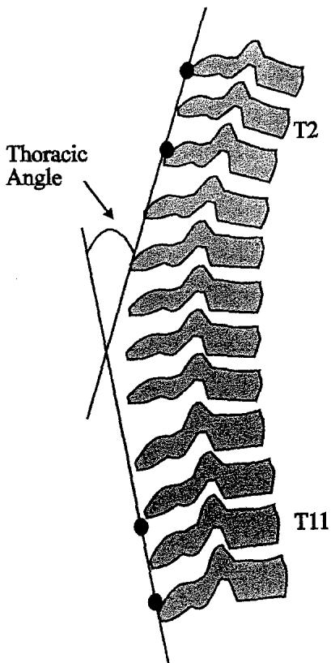

# 胸椎姿势对肩关节活动度、力量及三维肩胛骨运动学的影响

Maikutlo Kebaetse, MS, PT, Philip McClure, PhD, PT, OCS, Neal A. Pratt, PhD, PT

摘要. Kebaetse M, McClure P, Pratt NE. Thoracic position effect on shoulder range of motion, strength, and three-dimensional scapular kinematics. Arch Phys Med Rehabil 1999;80:945-50.

目的：确定胸椎姿势对肩胛骨运动模式、肩胛骨平面外展的主动活动度（ROM）以及肩胛骨平面等长外展肌力的影响。

研究设计与方法：重复测量设计。共有 34 名健康受试者（平均年龄 30.2 岁）。每位受试者分别在直立和含胸驼背（slouched）的躯干坐姿下进行定位和固定。在每种坐姿下，使用三维机电数字化仪测量胸椎屈曲度以及肩胛骨在三个平面内的位置和朝向。测量在手臂处于以下位置时进行：(1) 自然下垂于体侧，(2) 在肩胛骨平面外展至水平位，以及 (3) 处于最大肩胛骨平面外展位。在每种姿势下，分别在手臂处于体侧和肩胛骨平面外展至水平位时测量等长外展肌力。

结果：在含胸驼背姿势下，肩胛骨在 0° 至 90° 外展区间内的上提程度显著增加。在 90° 至最大外展区间内，含胸驼背姿势导致肩胛骨后倾显著减少。含胸驼背姿势下的肩关节主动外展 ROM 显著减小（平均差异 = 23.6° ± 10.7°）。手臂置于体侧时，含胸驼背与直立姿势之间的肌力无显著差异，但在手臂处于水平位时，含胸驼背姿势下的肌力下降了 16.2%。

结论：胸椎位置显著影响肩胛骨平面外展过程中的肩胛骨运动学，且含胸驼背姿势与肌力下降相关。

© 1999 by the American Congress of Rehabilitation Medicine and the American Academy of Physical Medicine and Rehabilitation

肩部肌肉骨骼问题的评估通常包括姿势评估。$^{1-5}$ 针对肩关节复合体的特定姿势评估涉及确定脊柱排列和肩胛骨位置。脊柱排列被认为会影响肩胛骨位置，且两者都被认为会影响整个肩带功能。$^{1-3,5-7}$ 脊柱排列、肩胛骨位置之间这种关系的基础，

与肩带功能归因于至少两个因素。首先，脊柱、肩胛骨、锁骨与肱骨之间存在大量的肌肉连接。因此，这些不同骨骼节段的位置可能会通过肌肉连接直接相互影响。骨骼位置会影响肌肉长度，从而影响产生张力的能力。其次，在肩胛骨平面外展期间，盂肱关节和肩胸关节之间存在一种已知的协调运动模式（通常称为肩肱节律）。在肩胛骨平面外展过程中，肩胛骨必须为盂肱关节的运动提供稳定的基底，同时又必须保持活动性，以便在手臂的整个活动度范围内对其进行定位。$^{5,8}$ 文献报道的肩关节外展期间盂肱关节与肩胸关节运动的比例各不相同，但通常可认为是 2:1。$^{9,10}$ 如果肩胛骨位置发生改变，有理由推测这种正常的协调运动模式可能会受到影响。

Kendall 及其同事 $^{11}$ 以及 Kelley 和 Clark $^{5}$ 均提出，胸椎屈曲（后凸）增加会改变肩肱关系。这些学者进一步指出，这种姿势可能会导致肩复合体肌力减弱以及盂肱关节活动度（range of motion, ROM）受限，从而可能导致肩撞击病症。

大多数关于胸椎排列、肩胛骨位置与肩关节功能之间关系的文献均基于个人观察而非研究数据，$^{5,11}$ 仅有少数研究对这种关系进行了部分探讨。$^{4,12,13}$ Culham 和 Peat $^{12}$ 研究了 91 名女性中年龄、胸椎姿势与肩胛骨位置之间的关系。姿势和肩胛骨位置使用三维电磁追踪设备 Isotrak 进行测量。结果表明，随着上胸椎倾斜度增加（表现出更大的前倾），肩胛骨也表现出更大的前倾。随着年龄和上胸椎倾斜度的增加，肩胛骨活动度和肩外展活动度均有所下降。肩胛骨外展（T1 与肩胛骨中心之间的直线距离）和下回旋则不受年龄或姿势的影响。

Greenfield 及其同事 $^{4}$ 比较了 30 名健康受试者与 30 名肩部过度使用损伤患者（年龄和性别相匹配）的肩胛骨位置和脊柱姿势变量。使用柔性尺测量了 T2 至 T12 之间的中胸段曲度。头部前倾姿势的测量方法是（通过受试者的侧面照片）确定水平线与 C7 棘突至耳屏连线之间的夹角。肩胛骨“前伸”（脊柱到肩胛骨脊柱缘的距离）和“旋转”是根据公制尺的测量结果计算得出的。肩胛骨旋转角是通过三角函数公式推导出来的。他们对旋转的测量是间接的，且可能存在缺陷，因为肩胛骨的纯侧向平移也会导致旋转角增大。使用标准量角器测量肩胛骨平面被动外展。结果显示，除患者的头部前倾姿势更明显（p < .001）且肩胛骨平面肩部外展较健康受试者更小（p < .001）之外，两组之间无显著差异。

综上所述，胸椎姿势与肩部功能之间的关系目前建立在源自解剖学关系和临床观察的理论基础之上。本研究的目的是确定胸椎姿势对以下方面的影响：(1) 肩胛骨运动学，(2) 肩胛骨平面肩关节主动外展活动度（ROM），以及 (3) 肩胛骨平面肩外展肌力。

## 方法

## 设计

本研究采用重复测量设计。所有受试者均在含胸驼背坐姿和挺直坐姿下接受测量。对于每种胸椎姿势，在手臂处于三种不同位置时记录肩胛骨的位置和朝向：(1) 静息位，(2) 肩胛骨平面外展至水平位，以及 (3) 肩胛骨平面最大肩外展位。在每种姿势下，还测量了手臂处于静息位和外展至水平位时的等长肩外展肌力。

## 受试者

采用方便抽样选取了 34 名健康受试者，其中男性 16 名，女性 18 名。受试者特征通过问卷调查确定，并在表 1 中总结。排除标准包括：有肩部疼痛或损伤史，或在主动或抗阻等长肩外展时主诉疼痛。所有受试者均签署了知情同意书。本研究获得了研究机构受试者保护委员会的批准。

## 仪器与测量

在一项预试验中设计了一个定制座椅，用于在所有测量过程中稳定受试者（图 1）。对于肩胛骨位置和肩外展活动度（ROM）测量，受试者前侧通过贴靠胸部的衬垫进行固定，后侧通过腰部衬垫进行固定。对于肌力测量，增加了一个后侧肩胛间衬垫以进一步稳定躯干。在研究过程中，在测力期间偶尔观察到轻微的躯干侧向偏移，但通过语言提示很容易得到纠正。一块与受试者肩胛骨平面（额状面前方 $45^{\circ}$）对齐的导板为手臂提供引导，从而使肩外展发生在肩胛骨平面内。

Metrecom 骨骼分析系统（Metrecom Skeletal Analysis System）$^{a}$ 用于测量肩胛骨位置、肩关节活动度以及胸椎姿势。它是一个计算机化测量系统，由装有精密电位计的六自由度机械连杆组成。末端连杆装有手持探针，用于对骨骼解剖标志进行数字化采集。信息传输至计算机，转换为定义数字化点位置的 x、y 和 z 坐标。根据这些点，可以计算出肩胛骨的三维位置。我们已确定该设备产生的角度误差通常小于 $2.2^{\circ}$。$^{14}$ 我们此前通过测试间隔至少 1 天的重复测试确定了肩胛骨和肩关节 ROM 测量的信度（组内相关系数为 0.82 至 0.99）。$^{15}$

Table 1: 受试者的描述性特征 (n = 36)

<table><tr><td></td><td>均值</td><td>标准差</td><td>范围</td></tr><tr><td>年龄</td><td>30.2</td><td>8.7</td><td>19-44</td></tr><tr><td>身高 (cm)</td><td>172.9</td><td>10.5</td><td>152.4-195.8</td></tr><tr><td>体重 (kg)</td><td>73.3</td><td>18.3</td><td>48.1-117.9</td></tr></table>

性别：16 名男性；18 名女性。

  
Fig 1. 受试者坐在固定架中进行数字化测量。使用朝向额状面前方 $45^{\circ}$ 的导板将手臂保持在肩胛骨平面内。

肩胛骨位置通过对下角（inferior angle）、肩胛冈根部（root of the spine of the scapula）和肩锁关节（acromioclavicular (AC) joint）进行数字化定位来确定。受试者以标准姿势坐在 Figure 1 所示的定制座椅上，全局参考坐标系建立在座椅上。X 轴为水平线（受试者左侧为正），Y 轴为纯垂直线（向上为正），Z 轴为 X 轴和 Y 轴的叉积，是一条向前为正的水平线。肩胛骨的方向和位置根据 Figure 2 所示的模型进行计算。内-外侧（M-L）平移表示从肩胛骨中心到穿过第七颈椎棘突（C7）的垂直线的水平距离（Figure 2A）。上-下（S-I）平移表示从肩胛骨中心到穿过 C7 的水平线的垂直距离（Figure 2B）。肩胛骨中心定义为三个肩胛骨数字化定位点的中点。向上旋转表示垂直线与穿过肩胛冈根部和肩胛骨下角的连线之间的夹角（Figure 2C）。肩胛骨内旋表示冠状面与穿过肩胛冈根部和 AC 关节的连线之间的夹角（Figure 2D）。肩胛骨倾斜度同时以上胸椎为参照（躯干参考）和以纯垂直线为参照（垂直参考）进行描述。肩胛骨倾斜度表示冠状面（垂直参考）或穿过 C7 和 T7 的连线（躯干参考）与穿过肩胛骨下角及肩胛冈根部的连线之间的夹角（Figure 2E）。为了测量肱骨位置，将带有两个相距 $10\mathrm{cm}$ 小孔的塑料夹板固定在上臂外侧，并与肱骨干对齐。对这两个孔进行数字化定位以代表肱骨。所有测量均在右侧进行，分别处于手臂静息状态、肱骨在肩胛骨平面外展至水平位置状态，以及肱骨在肩胛骨平面最大外展状态。胸椎角（Figure 3）通过对 T2 上下各 2 英寸处的点以及 T11 上下各 2 英寸处的点进行数字化定位来确定。由这些点构成的两个向量之间的夹角即代表胸椎角。

使用 Nicholas 手持式测力计 $^{b}$ 测量优势臂的肩外展肌力。最大外展等长肌力分别在手臂置于体侧以及在肩胛平面外展至水平位时进行测量。测力计放置在尺骨茎突上方 1 英寸处。受试者被要求逐渐对抗由测试者保持稳定的测力计用力推。测试在 50% 最大用力下练习两次，在最大用力下练习一次。每次收缩保持 3 至 5 秒。发出如下口令：“推，推，再用力，再用力！”声音逐渐变大。在练习测试之后，记录三次最大用力测试的平均值。如果前三次测试的差异大于 2kg，则额外进行两次测试，并采用五次测量的平均值。在研究过程中，对 9 名受试者（5 名女性，4 名男性）评估了肌力测量程序的检查者内信度。所有受试者均进行了两次测量，间隔为 2 至 6 天。计算了组内相关系数 (3,1) 和测量标准误差，如表 2 所示。这些结果反映了极佳的信度。$^{16}$

  
Fig 2. (A) 内侧-外侧平移：计算为 C7 与肩胛骨质心之间的水平距离。(B) 上-下平移：计算为 C7 与肩胛骨质心之间的垂直距离。(C) 向上旋转：肩胸旋转为脊柱与肩胛骨内侧缘之间的夹角。肩胛平面总外展角为脊柱与肱骨之间的夹角。(D) 肩胛骨内旋：冠状面与穿过肩胛冈根部和 AC 关节的连线之间的夹角。(E) 肩胛骨倾斜：冠状面（垂直参考）或穿过 C7 和 T7 的连线（躯干参考）与穿过肩胛骨下角和肩胛冈根部的连线之间的夹角。

## 流程

每位受试者通过掷硬币随机确定以直立或塌陷姿势就坐。对于直立姿势，要求受试者尽可能坐直以挺直上背部；对于塌陷姿势，则要求其通过含胸驼背尽可能使上背部弯曲。受试者在前方进行固定，并被要求始终保持与前胸垫接触。在数字化采集之前，用粘性圆贴标记脊柱和腕部的解剖标志。将外展架放置在 $45^{\circ}$ 线上，要求受试者将腕部桡侧贴在外展架的魔术贴标记上，使手臂外展至水平位置。将水平仪放置在手臂上以确定水平位置。然后如前所述，在每个手臂位置（静息、水平和最大外展）下对脊柱、肩胛骨和肱骨标志进行数字化采集。每个手臂位置之间允许休息 30 秒。整个过程重复进行两次，以便每种姿势获得两组完整的数字化点，并取其平均值用于计算。在完成某种姿势的 Metrecom 测量后，如前所述在相同姿势下对受试者进行后方进一步固定。随后如前所述，分别在手臂置于体侧和水平位置时测量最大等长肩胛骨平面外展肌力。每次力量测量之间允许休息 30 秒。在第一种姿势的所有测量完成后，受试者休息 2 分钟，之后针对第二种姿势重复整个过程。所有测量均由同一位研究人员完成。

  
Fig 3. 胸椎角：通过对 T2 上下 2 英寸处的点以及 T11 上下 2 英寸处的点进行数字化采集来确定。由这些点构成的两个向量之间的夹角即代表胸椎角。

## 数据分析

计算了每种坐姿下的胸椎角度、肩胛骨位置测量值、主动肩外展 ROM 以及肩外展肌力的均值和标准差。由于肩胛骨运动学变量之间可能存在相互关联，因此采用多元方差分析（MANOVA）评估了胸椎姿势对肩胛骨运动学变量的影响。此外，在特定的手臂位置对所有因变量使用单一检验，而非针对每个变量进行多次独立检验，有助于降低发生 I 类错误的概率。$^{16}$ 对于 MANOVA 中具有统计学显著性的结果，进一步对每个因变量进行了配对对比分析。显著性水平设定为 p < .05。采用配对 t 检验评估不同姿势之间在胸椎角度、最大肩外展 ROM 以及肩胛骨平面外展肌力方面的差异。

Table 2: 肌力测量的信度

<table><tr><td>位置</td><td>ICC (3, 1)</td><td>ICC 的 95% CI</td><td>SEM (kg)</td></tr><tr><td colspan="4">含胸坐姿</td></tr><tr><td> $0^{\circ}$ </td><td>.96</td><td>.82-.99</td><td>.65</td></tr><tr><td> $90^{\circ}$ </td><td>.97</td><td>.87-.99</td><td>.31</td></tr><tr><td colspan="4">挺直坐姿</td></tr><tr><td> $0^{\circ}$ </td><td>.94</td><td>.76-.99</td><td>.98</td></tr><tr><td> $90^{\circ}$ </td><td>.96</td><td>.85-.99</td><td>.52</td></tr></table>

## 结果

与胸椎角度、最大肩外展 ROM 和肩胛骨平面外展肌力相关的数据如 Table 3 所示。含胸坐姿下的平均胸椎角度明显比挺直坐姿更屈曲，平均差异为 $12.1^{\circ}$。含胸姿势下的最大主动肩外展 ROM 显著减小，平均差异为 $23.6^{\circ} \pm 10.7^{\circ}$。当手臂置于体侧时，不同胸椎姿势之间的等长肌力无差异。当手臂处于水平位时，含胸姿势下的肌力显著较低，平均差异为 $1.7\mathrm{kg}$ $(16.2\%)$。

MANOVA 检验（Hotelling's $T^{2}$）显示，在各个手臂位置（静息位、水平位和最大外展位）下，挺直姿势与含胸姿势在肩胛骨运动学变量上均存在差异。后续配对比较的结果除 $90^{\circ}$ 和最大肩外展时的内-外侧平移（M-L translation）外，其余均具有统计学显著性（Table 4）。

在两种姿势下，随着外展角度的增加，肩胛骨均表现出向上平移，且在手臂从中立位外展至 $90^{\circ}$ 的区间内，懒散姿势下的肩胛骨上提程度显著更高（平均差 $=1.05\pm1.13cm$ ）。在直立姿势下，肩胛骨在手臂从中立位外展至 $90^{\circ}$ 的区间内表现出向外侧平移，但在 $90^{\circ}$ 至最大手臂外展角度的区间内又回到了初始位置。在懒散姿势下，肩胛骨起始于极度向外侧平移的位置，但在两个区间内均向内侧移动，最终停留在与直立姿势相同的位置。

随着手臂抬高，肩胛骨向上旋转。在中立位至 $90^{\circ}$ 的区间内，两种姿势之间的旋转角度没有差异。然而，在 $90^{\circ}$ 至最大肩关节外展角度的区间内，懒散姿势下的肩胛骨向上旋转幅度显著较小（平均差 $=9.8^{\circ} \pm 6.6^{\circ}$ ）。肩胛骨内旋随着手臂外展角度的增加而增大。在两个区间内，懒散姿势下肩胛骨的内旋程度在统计学上均显著更高；然而，两种姿势之间的绝对差异较小。随着手臂外展，肩胛骨向后倾斜。然而，在 $90^{\circ}$ 至最大肩关节外展角度的区间内，懒散姿势下肩胛骨相对于胸椎的后倾幅度显著较小（平均差 = $10.2^{\circ} \pm 7.6^{\circ}$ ）。

Table 3: 直立和懒散姿势下胸椎位置、最大肩关节外展活动度（ROM）及肌力的结果

<table><tr><td rowspan="2">变量</td><td colspan="2">躯干直立</td><td colspan="2">躯干懒散</td><td rowspan="2">t</td><td rowspan="2">p</td></tr><tr><td>均值</td><td>SD</td><td>均值</td><td>SD</td></tr><tr><td>胸椎角度 (°)</td><td>26.4</td><td>11.5</td><td>38.5</td><td>10.8</td><td>-9.89</td><td>.000</td></tr><tr><td>最大肩关节外展角度 (°)</td><td>157.5</td><td>10.8</td><td>133.9</td><td>13.7</td><td>12.8</td><td>.000</td></tr><tr><td>肌力 (kg)</td><td></td><td></td><td></td><td></td><td></td><td></td></tr><tr><td>中立位</td><td>13.4</td><td>7</td><td>13.3</td><td>6.7</td><td>0.34</td><td>.738</td></tr><tr><td>水平位</td><td>10.4</td><td>4.5</td><td>8.7</td><td>3.5</td><td>7.05</td><td>.000</td></tr></table>

Table 4: 显示姿势对肩胛骨运动学影响的描述性统计值

<table><tr><td rowspan="2">变量/手臂位置</td><td colspan="3">躯干直立</td><td colspan="3">躯干驼背</td><td rowspan="2"> $p^*$ </td></tr><tr><td>均值</td><td>SD</td><td>范围</td><td>均值</td><td>SD</td><td>范围</td></tr><tr><td colspan="8">上下平移</td></tr><tr><td>静息位</td><td>103.6</td><td>15.2</td><td>76.0-135.8</td><td>94.8</td><td>15.2</td><td>61.7-132.0</td><td>.002</td></tr><tr><td>水平位</td><td>95.4</td><td>14.2</td><td>67.6-130.2</td><td>76.1</td><td>12.9</td><td>55.2-106.0</td><td>.000</td></tr><tr><td>最大位</td><td>88.6</td><td>16.3</td><td>62.0-118.1</td><td>71.7</td><td>13.7</td><td>49.4-98.2</td><td>.000</td></tr><tr><td colspan="8">内外平移</td></tr><tr><td>静息位</td><td>114.9</td><td>16.8</td><td>81.0-142.7</td><td>127.4</td><td>16.0</td><td>94.2-151.1</td><td>.000</td></tr><tr><td>水平位</td><td>119.3</td><td>13.2</td><td>92.5-147.2</td><td>120.6</td><td>14.2</td><td>94.0-141.3</td><td>.460</td></tr><tr><td>最大位</td><td>114.7</td><td>11.7</td><td>90.2-141.1</td><td>115.3</td><td>13.5</td><td>92.8-136.1</td><td>.597</td></tr><tr><td colspan="8">内旋</td></tr><tr><td>静息位</td><td>38.1</td><td>5.9</td><td>20.3-50.1</td><td>41.9</td><td>6.2</td><td>24.5-54.3</td><td>.000</td></tr><tr><td>水平位</td><td>41.4</td><td>6.5</td><td>23.9-56.9</td><td>44.9</td><td>4.7</td><td>32.2-52.9</td><td>.000</td></tr><tr><td>最大位</td><td>43.5</td><td>8.5</td><td>22.2-57.1</td><td>49.9</td><td>6.2</td><td>38.7-61.0</td><td>.000</td></tr><tr><td colspan="8">上旋</td></tr><tr><td>静息位</td><td>7.8</td><td>6.3</td><td>-11.2-15.5</td><td>12.8</td><td>9.3</td><td>-19.3-23.9</td><td>.000</td></tr><tr><td>水平位</td><td>22.8</td><td>5.5</td><td>10.9-37.1</td><td>27.5</td><td>7.8</td><td>12.5-45.8</td><td>.000</td></tr><tr><td>最大位</td><td>43.1</td><td>7.5</td><td>30.4-58.4</td><td>37.9</td><td>6.5</td><td>22.4-50.0</td><td>.000</td></tr><tr><td colspan="8">相对躯干倾斜</td></tr><tr><td>静息位</td><td>6.7</td><td>3.6</td><td>1.6-15.5</td><td>11.8</td><td>4.3</td><td>1.4-22.9</td><td>.000</td></tr><tr><td>水平位</td><td>19.4</td><td>4.6</td><td>9.3-29.3</td><td>25.5</td><td>5.4</td><td>16.1-36.1</td><td>.000</td></tr><tr><td>最大位</td><td>44.7</td><td>6.8</td><td>34.0-59.0</td><td>40.6</td><td>6.9</td><td>27.9-58.7</td><td>.001</td></tr><tr><td colspan="8">相对垂直方向倾斜</td></tr><tr><td>静息位</td><td>12</td><td>5.7</td><td>-1.9-20.6</td><td>28.9</td><td>6.6</td><td>11.1-40.4</td><td>.000</td></tr><tr><td>水平位</td><td>0.6</td><td>6.3</td><td>-10.4-10.4</td><td>15</td><td>6.2</td><td>0.7-25.3</td><td>.000</td></tr><tr><td>最大位</td><td>-27.6</td><td>8.7</td><td>-48.1--13.2</td><td>-0.4</td><td>9.3</td><td>-28.0-15.5</td><td>.000</td></tr></table>

平移值表示肩胛骨中心至 C7 棘突的绝对垂直（上下平移）和水平（内外平移）距离（mm）。  
\* 源自后续配对 t 检验。

## 讨论

## 肩外展活动度

胸椎姿势明显影响了肩胛骨平面肩外展活动度（ROM）和肌力。肩胛骨运动学也受到影响，并有助于解释在 ROM 和肌力方面所发现的差异。我们在含胸驼背姿势下 ROM 减小的发现与 Culham $^{12}$ 的研究结果高度吻合，Culham 在发现随着年龄和静息状态下上胸椎倾斜度的增加、肩外展度数下降后，得出胸椎伸展对于获得完整的肩关节 ROM 是必不可少的结论。然而需要注意的是，随着年龄增长，退行性变和软组织受限也在增加，$^{17,18}$ 这也可能解释老年人肩外展受限的原因。在含胸驼背姿势下最大肩外展减小 23.6° 表面上似乎并非真正的改变，因为当躯干进入含胸驼背体位时，手臂会自动随躯干“移动”，从而导致外展角度减小。然而，在含胸驼背姿势下胸椎曲度增加了 12.1°。因此，肩外展减少的 23.6° 并不能完全归因于含胸驼背姿势下胸椎屈曲的增加。在最大肩外展测试期间，受试者在两种姿势下进行数字化采样时偶尔会出现疲劳，导致手臂下垂。因此，该结果所反映的 ROM 数值可能略低于在未发生疲劳时测得的值。

## 肌力

在双臂处于中立位时，肌力不受姿势的影响。在含胸驼背姿势下手臂外展 90° 时肌力下降 16.2%，这可以通过肩胛骨运动学的改变来解释。在含胸驼背姿势下，手臂从中立位外展至 90° 之间肩胛骨向上平移增加，这可能使斜方肌上束处于缩短状态，从而降低了其产生张力的能力。也许更重要的是，在含胸驼背姿势下肩胛骨前倾更为明显。这种前倾影响了矢状面盂肱关节角度，该角度可以通过将手臂外展 90° 与肩胛骨倾斜度数值相加得出。在含胸驼背姿势下，平均盂肱关节角度为 105°，而在直立姿势下为 90.6°（fig 4）。因此，三角肌和冈上肌等盂肱关节肌肉处于过度缩短的位置，这会降低其产生张力的能力。$^{19}$ 当在手臂贴于体侧测试力量时，未发现不同姿势之间的肌力存在差异，这也支持了上述解释，因为在此位置下肌肉长度受胸椎姿势的影响可能较小。

手臂外展 $90^{\circ}$ 时肌力的下降具有临床意义，因为许多功能性活动都是在肩关节水平进行的。Hagberg $^{20}$ 指出，由职业性肌肉骨骼负荷引起的颈肩部疾患在产业工人中十分普遍，并且手臂抬高的工作姿势可能会加速肩部肌腱的退行性变。Wiker 及其同事 $^{21}$ 发现，即使在轻量级的装配作业中，手部高于头顶作业的产业工人的局部肌肉疲劳和姿势不适感也会显著增加。本研究的结果表明，在抬举物体或将手臂静态维持在肩关节水平时，必须处于胸椎屈曲姿势下工作的工人可能处于劣势。过度的胸椎屈曲可能是一种固定的姿势畸形，但也可能是由特定任务需求引起的短暂姿势，例如在手臂保持抬高位置的同时不得不低头看。

  
Fig 4. (A) 在直立姿势下，矢状面上的盂肱关节角度为 $90.6^{\circ}$。(B) 在含胸姿势下，该角度为 $105^{\circ}$。肩胛骨平面等长外展肌力的减弱，可以通过含胸姿势下三角肌和冈上肌的过度缩短来解释。

## 肩胛骨运动学

改变胸椎姿势会影响肩胛骨运动学。伴随肩关节外展出现的进行性上回旋和后倾模式，与 Cole $^{15}$ 以及 Ludewig 及其同事 $^{22}$ 报道的结果相一致。他们还发现，随着肩部抬高，肩胛骨发生后缩（外旋）。而我们发现，随着手臂抬高，肩胛骨表现出轻微的进行性内旋模式。与以往研究相比，肩胛骨内旋的差异可能归因于在胸椎姿势的极端终末范围进行的测试，以及在测试外展过程中使用了木制支架将肩关节维持在肩胛骨平面内。受试者似乎有使肩带前伸并将手臂保持靠前的倾向，这可能与没有固定导向的正常外展运动存在差异。

本研究表明，在含胸驼背姿势（slouched posture）下，肩胛骨运动的主要差异在于肩胛骨表现出：(1) 在手臂中立位至外展 90° 之间有更多的向上平移；(2) 在 90° 至最大外展度之间表现出更少的向上旋转和更少的后倾；(3) 在所有外展区间内均有略微增加的内旋。在含胸驼背姿势下肩关节外展 ROM 的减小，可能归因于肩胛骨后倾和向上旋转的减少。在这种方位下，肩峰可能会形成骨性阻挡，从而在重复性过头活动中引发或加剧撞击病理变化 $^{23,24}$。Cole $^{15}$ 研究了健康受试者与撞击综合征患者在外展过程中的肩胛骨运动学，发现撞击组在 90° 至最大外展度时的肩胛骨后倾较少，且总外展 ROM 减小。本研究的结果表明，该问题可能部分归因于胸椎屈曲程度的增加。

## 局限性

本研究得出了肩部肌力与胸椎姿势及肩胛骨方位之间关系的结论；然而，这些变量并未进行同步测量。尽管在这些测试中已注意保持手臂位置的一致性，但在测量肌力的同时测量肩胛骨方位会更为理想。肩胛骨运动学测量是在静态条件下进行的，这可能无法准确反映动态活动中所发生的情况。此外，我们选择评估胸椎姿势的极值状态，这不一定能反映普通人在许多日常生活活动中所采取的习惯性姿势。我们确实认为，在更具挑战性的活动中，或在其他关节（膝关节、髋关节或腰椎）运动可能受限的活动中，通常会出现极端姿势。

## 结论

本研究探讨了胸椎位置对肩胛骨平面内特定肩外展角度下的肩胛骨运动学、肩外展 ROM 以及肌力的影响。在含胸驼背（屈曲）姿势下，肩胛骨向上旋转和后倾减少，向上平移增加。在含胸驼背姿势下肌力和肩外展 ROM 下降，这可能是由于肩胛骨运动学的改变所致。这些发现表明，在肩部疾病的评估和治疗过程中，需要考虑静息状态及重复性功能活动中的胸椎位置。

## 参考文献

1. Bowling RW, Rockar PA, Erhard R. Examination of the shoulder complex. Phys Ther 1986;66:1866-77.

2. Braun BL, Amundson LR. Quantitative assessment of head and shoulder posture. Arch Phys Med Rehabil 1989;70:322-9.

3. Cailliet R. Shoulder pain. Philadelphia (PA): F.A. Davis Company; 1966.

4. Greenfield B, Catlin PA, Coats PW, Green E, McDonald JJ, North C. Posture in patients with overuse injuries and healthy individuals. J Orthop Sports Phys Ther 1995;21:287-95.

5. Kelly MJ, Clark WA. Orthopedic therapy of the shoulder. Philadelphia (PA): J.B. Lippincott Co.; 1995.

6. Kibler WB. Role of scapula in the overhead throwing motion. Contemp Orthop 1991;22:525-32.

7. Perry J. Muscle control of the shoulder. In: Rowe CR, editor. The shoulder. New York: Churchill Livingstone Inc; 1988. p. 1-17.

8. Mosely JB, Jobe FW, Pink M, Perry J, Tibone J. EMG analysis of the scapular muscles during a shoulder rehabilitation program. Am J Sports Med 1992;20:128-34.

9. Inman VT, Saunders JB, Abbott LC. Observations of the function of the shoulder joint. J Bone Joint Surg 1944;26:1-30.

10. Poppen NK, Walker PS. Normal and abnormal motion of the shoulder. J Bone Joint Surg 1976;58A:195-201.

11. Kendall FP, McCreary EK, Provance PG. Muscles—testing and function. 4th ed. Baltimore (MD): Williams & Wilkins; 1993.

12. Culham EG, Peat M. Functional anatomy of the shoulder complex. J Orthop Sports Phys Ther 1993;18:342-50.

13. Solem-Bertoft E, Thuomas K, Westerberg C. The influence of scapula retraction and protraction on the width of the subacromial space. Clin Orthop Rel Res 1993;296:99-103.

14. Michener L, Silfies S, Hutchinson D, McClure P. Accuracy of the metrecom skeletal analysis system for linear and angular measurements [abstract]. J Orthop Sport Phys Ther 1997;25:69.

15. Cole A, McClure P, Pratt N. Scapular kinematics during arm elevation in healthy subjects and patients with shoulder impingement syndrome [abstract]. J Orthop Sports Phys Ther 1996;23:68.

16. Portney LG, Watkins MP. Foundations of clinical research: applications to practice. East Norwalk (CT): Appleton & Lange; 1993.

17. Threlkeld AJ, Currier DP. Osteoarthritis: effects on synovial joint tissues. Phys Ther 1988;68:364-70.

18. Turek SL. Orthopedic principles and their application, Vol. 2. 4th ed. Philadelphia: J.B. Lippincott Company; 1984.

19. Lieber RL, Bodine-Fowlre SC. Skeletal muscle mechanics: implications for rehabilitation. Phys Ther 1993;73:844-56.

20. Hagberg A. Occupational musculoskeletal stress and disorders of the neck and shoulders: a review of possible pathophysiology. Int Arch Occup Environ Health 1984;53:269-78.

21. Wiker SF, Chaffin DB, Langolf GD. Shoulder posture and localized muscle fatigue and discomfort. Ergonomics 1989;32:211-37.

22. Ludewig PM, Cook TM, Nawoczenski DA. Three-dimensional scapular orientation and muscle activity at selected positions of humeral elevation. J Orthop Sports Phys Ther 1996;24:57-65.

23. Flatow EL, Soslowsky LJ, Ticker JB, Pawluk RJ, Hepler M, Ark J, et al. Excursion of the rotator cuff under the acromion: patterns of the subacromial contact. Am J Sports Med 1994;22:779-88.

24. Fu FH, Harner CD, Klein AH. Shoulder impingement syndrome: a critical review. Clin Orthop Rel Res 1991;269:162-73.

## 供应商

a. Faro Technologies Inc., 125 Technology Park, Lake Mary, FL 32746.

b. Lafayette Instruments, 3700 Sagamore Parkway North, Lafayette, IN 47905.