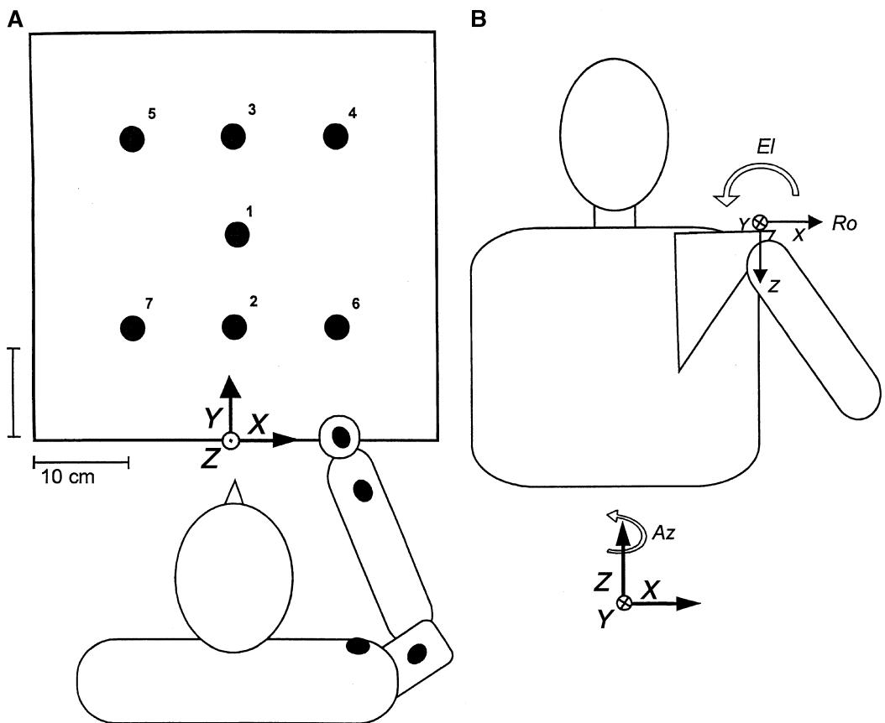
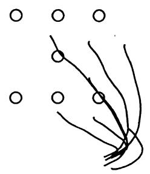
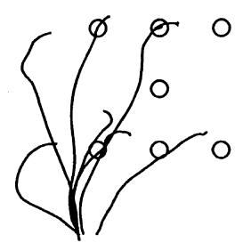
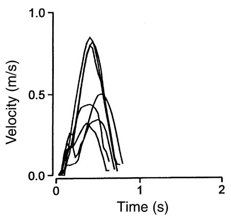
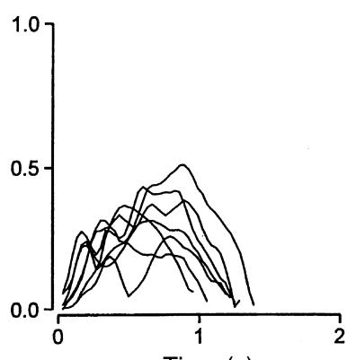
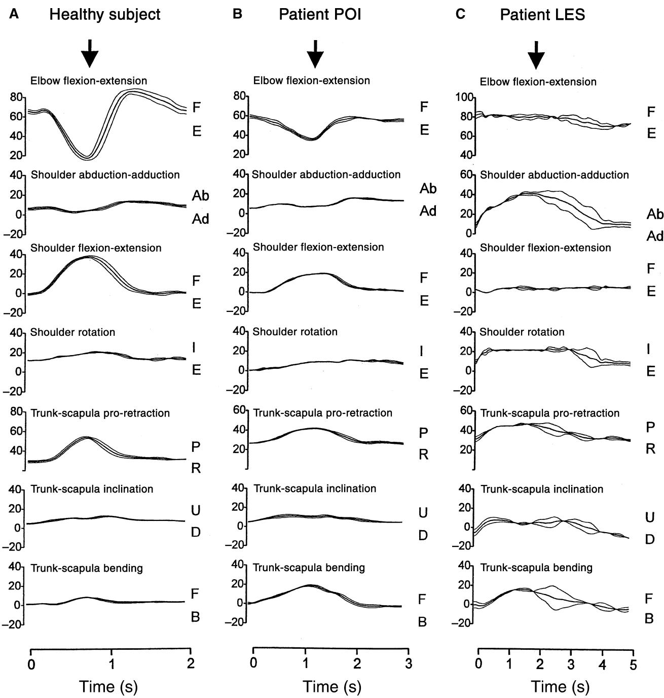
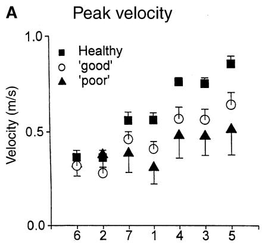
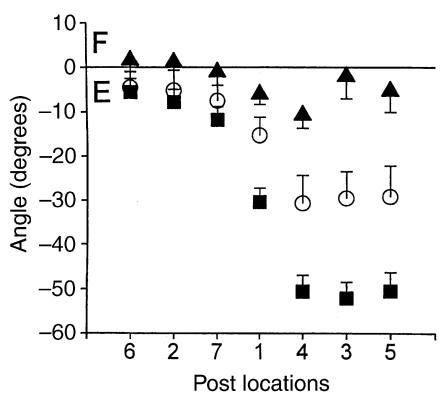
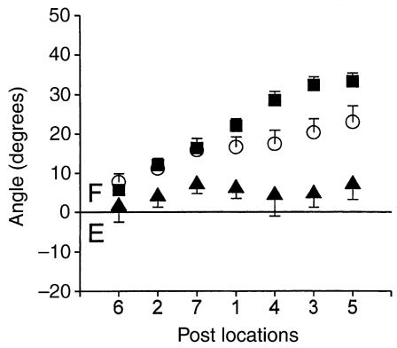
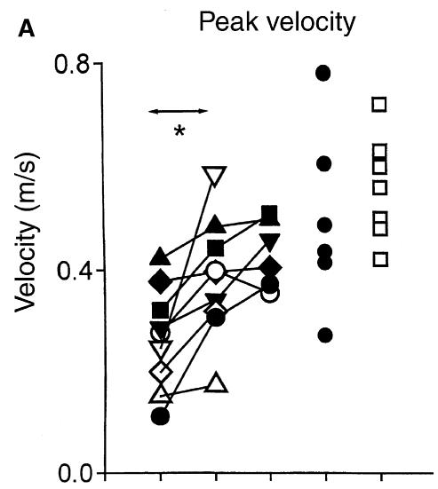

<!-- 本文件是 MinerU 自动抽取的**英文结构化正文**，不是中文翻译。 -->
<!-- 中文翻译若需要，须另走 06_附录/pdf2zh调用脚本/translate_all.py，不得把本文件当译文引用。 -->
<!-- 抽取来源：01_参考论文/整合系统/生物力学线/B3_上肢康复_代偿与临床评估/Roby-Brami2003-ActaNeurolScand：卒中患者伸手运动的代偿与恢复/Roby-Brami2003-ActaNeurolScand：卒中患者伸手运动的代偿与恢复.pdf -->
<!-- DOI：10.1034/j.1600-0404.2003.00021.x -->
<!-- 图片：18 张，位于同级 images/，已按正文引用相对路径改写。 -->

# Motor compensation and recovery for reaching in stroke patients

Roby-Brami A, Feydy A, Combeaud M, Biryukova EV, Bussel B, Levin MF. Motor compensation and recovery for reaching in stroke patients.

Acta Neurol Scand 2003: 107: 369–381.  Blackwell Munksgaard 2003.

Objectives – To examine the mechanisms of alternative strategies developed by stroke patients to compensate their motor impairment and their role in recovery. Material and methods – The threedimensional kinematics of the upper limb were quantified during unconstrained reaching movements in seven healthy individuals and in 15 stroke patients. Nine patients were followed-up. Individual observations were correlated with anatomical and functional brain imaging described elsewhere (Feydy et al. Stroke 2002;33:1610). Results – Healthy subjects used mainly elbow extension and shoulder flexion, scaled to movement distance. Patients with hemiparesis because of stroke used diferent patterns of joint recruitment with diferent scaling rules. Patients with the greatest impairment compensated by recruiting extra degrees of freedom, particularly trunk bending. Improvement was because of a restoration towards a normal movement pattern (recovery) and/or to a reinforcement of compensation, which led to a poorer outcome. Conclusion – Individual behavioural data are necessary to discuss the mechanisms of functional improvement following stroke with respect to recovery and/ or compensation.

About 50% of patients recover satisfactory motor function after damage to cerebral motor areas by stroke (1). However, the mechanisms contributing to the functional recovery and then to outcome remain controversial. Prognosis may be related to the nature, location and specifically to the size of the lesion (2–5) as well as to the plasticity and redundancy of motor pathways (6, 7). The quantitative analysis of prototypic gestures such as reaching and grasping is a means of determining the relationship between multiple motor impairments and functional disability in daily life. Following a stroke, the limbs contralateral to the side of the lesion classically present muscle weakness (8), spasticity (9), and pathological movement synergies (10–12). During multijoint reaching tasks, voluntary range of movement may be impaired because of limitations in the range of stretch reflex threshold regulation at the individual muscle level (13, 14). In addition, there may be a loss of inter-joint coordination (15), deficits in the regulation of interactive joint torques (16) and an incorrect timing of compo-

A. Roby-Brami1,2, A. Feydy3, M. Combeaud2, E. V. Biryukova4, B. Bussel2,3, M. F. Levin5

1CNRS UMR 8119, University Paris V, Paris, France; 2Department of Neurological Rehabilitation, H%pital Raymond Poincar', Garches, France; 3INSERM U483, Paris, France; 4Institute of Higher Nervous Activity, Russian Academy of Science, Moscow, Russian Federation; 5CRIR, Rehabilitation Institute of Montr'al, Montr'al, Canada

Key words: hemiplegia; disability; three-dimensional movement recording; prehension

A. Roby-Brami, \`Neurophysique et physiologie du syst7me moteur', UMR 8119 CNRS and University Paris V, 45 rue des Saints P7res, 75270 Paris cedex 6, France Tel.: +33 1 4286 2287   
Fax: +33 1 4927 9062   
e-mail: agnes.roby-brami@biomedicale.univ-paris5.fr e-mail: agnes.roby-brami@biomedicale.univ-paris5.fr

Accepted for publication August 28, 2002

nents within movement sequences of an action (17). These impairments contribute to alterations in the trajectories of goal-directed movement (18, 19). More recently, the quantification of unconstrained natural gestures has permitted the description of compensations used by patients to overcome motor impairments. Patients may develop alternative grasping strategies (20) and make increased use of the redundancy of the motor system, particularly by recruiting excessive trunk or scapular movement during reaching (20, 21).

A recent debate on therapeutic strategy questions whether functional improvement results from the recovery of normal coordination patterns or from the substitution of new patterns (22). Physiotherapeutic approaches may tolerate or even encourage compensatory movements for the sake of obtaining an immediate improvement of function (23), which, in the long-term, may be detrimental to outcome. Specifically, it has recently been suggested that the presence of excessive trunk movement in patients with hemiparesis while reaching may, indeed, limit recovery of ‘normal’ motor patterns of the arm (24, 25).

The present longitudinal study was designed to further examine the functional and neurological determinants of diferent strategies used in improvement of reaching: the recovery of a healthy pattern of joint recruitment and compensation via alternative joint recruitment.

## Materials and methods

## Subjects

Fifteen patients with stroke (12 men and three women, aged 36–69 years, mean 55.8 years) participated in this study. All were right-handed; six had a left-sided and nine had a right-sided hemiplegia. All were inpatients at the Raymond Poincare´ Rehabilitation Centre and volunteered after being informed of the aim of the study that had received the approval of the local Ethics Committee. All patients had an initially severe hemiplegia owing to a single ischaemic stroke (14 in the territory of the middle cerebral artery, one in the basilar artery territory) and characterized by (i) a complete or almost complete paralysis that persisted at least 1 month after stroke; (ii) a well-defined cortical and/or subcortical lesion visible on anatomical magnetic resonance imaging (MRI). Ten of the patients also participated in a parallel study of motor recovery involving functional MRI (fMRI) published elsewhere (26). According to Feydy et al. (26), we used anatomical MRI to distinguish stroke lesions that did not affect the upper precentral gyrus (C+) from those extending to the upper precentral gyrus or inducing cortical atrophy (C–). Exclusion criteria were the presence of multiple cerebral lesions, severe neuropsychological disorders with impaired comprehension, associated medical disease or orthopaedic complications such as severe algodystrophia or limitation of the passive joint range of the elbow. During the study, patients underwent standard rehabilitation with daily physiotherapeutic treatment consisting of one 45-min Bobath therapy session, one 45-min occupational therapy session and one 30-min speech therapy session if needed. Nine patients were included in the study at the onset of motor recovery (24–162 days post-stroke) as soon as they were able to perform a gross reaching movement and they were examined two or three times at 4-week intervals. Six additional patients were lost to follow-up and were therefore examined only once (48–153 days post-stroke). Patient data are summarized in Table 1.

The controls were seven right-handed healthy individuals, three men and four women, aged 22– 53 years (mean 35.8 years).

## Evaluation of upper limb capacity

Upper limb functional capacity was evaluated at the time of each recording session by an independent occupational therapist. The evaluation included the Frenchay Arm Test (FAT), a functional test evaluating the capacity to perform five simple arm and hand functions, which has proven reliability and validity (27, 28), the Box and Blocks Test (29), the Nine-Hole Peg Test (30) and grip force measured with a dynamometer.

Table 1 Main clinical and anatomical data in 15 stroke patients
<table><tr><td colspan="3">Patients</td><td colspan="3"></td></tr><tr><td>ID</td><td>Sex</td><td>Age</td><td>Deficit side</td><td>Vascular topography</td><td>Cerebral localization</td><td>Precentral gyrus</td></tr><tr><td>LEF</td><td>M</td><td>60</td><td>L</td><td>R MCA deep</td><td>Corona radiata, external capsule</td><td>C+</td></tr><tr><td>LES</td><td>M</td><td>40</td><td>L</td><td>R MCA global</td><td>Massive infarction involving 2/3 hemisphere, the central area, basal ganglia</td><td>C-</td></tr><tr><td>BOU</td><td>F</td><td>51</td><td>L</td><td>R MCA deep</td><td>Corona radiata, external capsule, caudate and lenticular nuclei</td><td>C+</td></tr><tr><td>HAV</td><td>F</td><td>67</td><td>R</td><td>L MCA global</td><td>Capsule, corona radiata</td><td>C+</td></tr><tr><td>POI</td><td>M</td><td>52</td><td>R</td><td>L MCA deep</td><td>Corona radiata, external capsule, caudate and lenticular nuclei</td><td>C+</td></tr><tr><td>SAN</td><td>M</td><td>69</td><td>L</td><td>R MCA global</td><td>Precentral gyrus</td><td>C-</td></tr><tr><td>HEM</td><td>M</td><td>60</td><td>L</td><td>R MCA deep</td><td>Fronto-insular precentral gyrus</td><td>C-</td></tr><tr><td>BEN</td><td>M</td><td>54</td><td>R</td><td>L MCA deep</td><td>Internal capsule</td><td>C+</td></tr><tr><td>THE</td><td>M</td><td>42</td><td>L</td><td>R MCA deep</td><td>Corona radiata, external capsule</td><td>C+</td></tr><tr><td>DRU</td><td>F</td><td>64</td><td>R</td><td>L MCA sup.</td><td>Corona radiata, precentral gyrus</td><td>C-</td></tr><tr><td>GUI</td><td>M</td><td>68</td><td>R</td><td>L MCA deep</td><td>Corona radiata, precentral gyrus</td><td>C-</td></tr><tr><td>BOJ</td><td>M</td><td>57</td><td>R</td><td>L MCA glob</td><td>Corona radiata</td><td>C+</td></tr><tr><td>VAL</td><td>M</td><td>36</td><td>R</td><td>L MCA deep</td><td>Corona radiata, internal capsule</td><td>C+</td></tr><tr><td>DUP</td><td>M</td><td>56</td><td>R</td><td>Basilar</td><td>Pedoncular</td><td>C+</td></tr><tr><td>NOC</td><td>M</td><td>59</td><td>R</td><td>L MCA deep</td><td>Capsular</td><td>C+</td></tr></table>

Side of the hemiparesis, vascular and hemispheric topography of the cerebral lesion, precentral gyrus included in the lesion (C–) or not (C+). MCA: middle cerebral artery.

Table 2 Evaluation of the motor disability [individual patient data indicating the time since the stroke when each evaluation was performed (delay) and results of clinical tests]
<table><tr><td></td><td>Session</td><td>Delay (days)</td><td>FAT (0–5), H=5</td><td>BBT (blocks), H=60–80</td><td>9HP (s), H&lt;18 s</td><td>Grip force (%), 100%</td><td>Success in lifting</td></tr><tr><td>LEF</td><td>1</td><td>77</td><td>0</td><td>Imp.</td><td>Imp.</td><td>Imp.</td><td>Imp.</td></tr><tr><td></td><td>2</td><td>111</td><td>0</td><td>Imp.</td><td>Imp.</td><td>Imp.</td><td>Imp.</td></tr><tr><td rowspan="3">LES</td><td>1</td><td>184</td><td>0</td><td>Imp.</td><td>Imp.</td><td>Imp.</td><td>Imp.</td></tr><tr><td>2</td><td>224</td><td>1</td><td>Imp.</td><td>Imp.</td><td>Imp.</td><td>Incst.</td></tr><tr><td>1</td><td>78</td><td>1</td><td>Imp.</td><td>Imp.</td><td>Imp.</td><td>Incst.</td></tr><tr><td>BOU</td><td>2</td><td>113</td><td>0</td><td>Imp.</td><td>Imp.</td><td>Imp.</td><td>Incst.</td></tr><tr><td rowspan="3">HAV</td><td>3</td><td>171</td><td>1</td><td>Imp.</td><td>Imp.</td><td>Imp.</td><td>Incst.</td></tr><tr><td>1</td><td>162</td><td>1</td><td>Imp.</td><td>Imp.</td><td>Imp.</td><td>Imp.</td></tr><tr><td>2</td><td>204</td><td>1</td><td>Imp.</td><td>Imp.</td><td>Imp.</td><td>Imp.</td></tr><tr><td>POI</td><td>1</td><td>57</td><td>1</td><td>Imp.</td><td>Imp.</td><td>Imp.</td><td>Incst.</td></tr><tr><td rowspan="3"></td><td>2</td><td>127</td><td>4</td><td>18</td><td>57</td><td>50</td><td>OK</td></tr><tr><td>3</td><td>154</td><td>4</td><td>33</td><td>54</td><td>67</td><td>OK</td></tr><tr><td>1</td><td>30</td><td>3</td><td>9</td><td>Imp.</td><td>45</td><td>OK</td></tr><tr><td></td><td>2</td><td>57</td><td>3</td><td>30</td><td>Imp.</td><td>73</td><td>OK</td></tr><tr><td rowspan="3">HEM</td><td>3</td><td>182</td><td>4</td><td>21</td><td>Imp.</td><td>一</td><td>OK</td></tr><tr><td>1</td><td>43</td><td>3</td><td>23</td><td>Imp.</td><td>一</td><td>OK</td></tr><tr><td>2</td><td>70</td><td>4</td><td>一</td><td>Imp.</td><td>一</td><td>OK</td></tr><tr><td>BEN</td><td>3</td><td>166</td><td>5</td><td>48</td><td>45</td><td>68</td><td>OK</td></tr><tr><td></td><td>1</td><td>24</td><td>1</td><td>8</td><td>一</td><td>42</td><td>OK</td></tr><tr><td></td><td>2</td><td>71</td><td>4</td><td>18</td><td>118</td><td>54</td><td>OK</td></tr><tr><td>THE</td><td>3</td><td>164</td><td>4</td><td>30</td><td>78</td><td>83</td><td>OK</td></tr><tr><td></td><td>1</td><td>89</td><td>5</td><td>43</td><td>44</td><td>64</td><td>OK</td></tr><tr><td></td><td>2</td><td>138</td><td>5</td><td>60</td><td>28</td><td>100</td><td>OK</td></tr><tr><td></td><td>3</td><td>180</td><td>5</td><td>一</td><td>一</td><td>一</td><td>OK</td></tr><tr><td>DRU</td><td>1</td><td>153</td><td>3</td><td>27</td><td>166</td><td>37</td><td>OK</td></tr><tr><td>GUI</td><td>1</td><td>70</td><td>5</td><td>11</td><td>83</td><td>一</td><td>OK</td></tr><tr><td>BOJ</td><td>1</td><td>84</td><td>5</td><td>34</td><td>66</td><td>42</td><td>OK</td></tr><tr><td>VAL</td><td>1</td><td>97</td><td>5</td><td>44</td><td>35</td><td>70</td><td>OK</td></tr><tr><td>DUP</td><td>1</td><td>85</td><td>5</td><td>52</td><td>100</td><td>一</td><td>OK</td></tr><tr><td>NOC</td><td>1</td><td>48</td><td>5</td><td>68</td><td>24</td><td>75</td><td>OK</td></tr></table>

FAT, Frenchay Arm test; BBT, Box and Blocks test (number of blocks); 9HP, Nine Hole Peg test (time to put and remove nine pegs); Grip force as a percentage of the force on the non-affected side; Success in lifting, imp: impossible, incst.: inconsistent, OK: consistent, –: missing data. Bold indicates the limit of normal (29, 30).

Table 2 gives the results of the clinical tests for each experimental session for all the patients. Patients with FAT scores of 4–5 (‘good’) were able to make functional movements and to use their upper limb in daily life. Those with FAT scores of 0–1 (‘poor’) were only able to make gross arm and hand movements and those with scores of 2–3 were considered to have moderately good function.

## Experimental set-up and task

The experimental set-up was designed to examine prehension movements performed in familiar surroundings. The goal was to take a hollow cardboard cone with a granular surface (10 g weight, 5 cm diameter and 17 cm height) and to lift it of a fixed post. Individuals sat in front of a wooden board under which was fixed an electromagnetic transmitter providing the origin of the reference frame for the measures (Fig. 1A). The board was placed horizontally at the level of the abdomen at about 15 cm from the individual so that his/her right shoulder was situated 35–40 cm behind the limit of the board. There were seven holes in the wooden board into which a wooden post could be inserted in order to receive the cone for grasping. These locations were situated within a $2 0 \times 2 0$ cm workspace, situated at 25–45 cm in front of the subject. Healthy participants reached with their right arm and patients with stroke used their hemiparetic arm. Target locations 3–5 were slightly beyond the limit of the arm reaching distance for most of the participants. Before attempting the task, the hand was placed comfortably in the initial position (see Fig. 1A) and the participant was instructed to look forward. The instruction was to take the cone and to return it to a final position located directly in front of the sternum. Movement was initiated in response to a verbal cue. Reaction time and execution time were not emphasized. All healthy individuals and participants with hemiparesis were able to reach and grasp the cone but the patients with the most severe clinical symptoms were not able to lift it consistently (last column in Table 2). For these participants, the instruction was to make an attempt to lift the cone and then to return the hand to the final position.

  
Figure 1. (A) Schema of the experimental set-up. The subject is represented with the arm in the initial position on which four remote sensors were affixed (black ovals). The board shows the target positions numbered 1–7 for right-hand performers. The position and orientation of the reference frame, corresponding to the transmitter are indicated (XYZ axes). (B) Position and orientation of the acromion sensor (xyz axes) viewed backwards. Schema of the nautical Euler angles: azimuth is the first rotation around the vertical Z-axis of the reference frame, elevation is the second rotation around the current orientation of the y-axis of the sensor, roll is the third rotation around the current orientation of the x-axis of the sensor. Accounting for the placement of the sensor, azimuth measures trunk–scapula protraction, elevation trunk–scapula inclination and roll trunk–scapula forward bending.

The cone was replaced on the post at the initial position by the experimenter after each trial. Five trials were recorded for each target location in the order presented in Fig. 1A for right-hand performers (the order was opposite for left hemiparetic patients). The session lasted about 40 min.

## Recording methods and data analysis

A three-dmensional motion analysis was performed with a FastrackTM Polhemus System (Polhemus, Colchester, VT, USA), which uses electromagnetic fields generated by a transmitter to determine the position and orientation of four remote sensors with a 30-Hz sampling frequency. The sensors were attached to the dorsum of the hand (middle part of the third metacarpal bone), the posterior part of the forearm, the lateral part of the arm and the ipsilateral acromion process.

The tangential velocity of the hand sensor was computed after derivation without filtering and the amplitude of the peak velocity during reaching was measured. The duration of the reaching movement was automatically measured between its onset (determined as a first point above a velocity threshold of 0.02 m/s) and the onset of the return movement, which corresponded to the minimum point in the velocity trace before the beginning of the return movement. In healthy subjects, this point also corresponded to a sharp reversal of the hand trajectory, whereas in some patients this point could be delayed by grasping impairment. The onset of the return movement thus corresponded to the time when the individual actually grasped the object and will be referred to as the ‘time of grasping’. The position of the hand sensor was measured at the onset of movement in order to monitor the initial posture and measure the distance between the initial hand position and the target.

The variations of the position and orientation of the sensor fixed on the acromion can be due to rotations of the trunk and/or to rotations of the scapula with regard to the trunk. Orientation in space is quantified by three ordered Euler angles directly given by the sensor: azimuth is the orientation of the sensor in the horizontal plane, elevation is an upward–downward angle around the y-axis of the sensor and roll is a rotation around the x-axis of the sensor [‘nautical’ Euler angles convention (31)]. Accounting for the placement of the sensor on the scapula, azimuth measured a rotation of the trunk around the spine and/or a protraction–retraction of the scapula; elevation measured a lateral inclination of the trunk and/or the scapula; and roll a forward– backward bending of the trunk and/or anterioposterior tipping of the scapula. For the sake of clarity, the rotations of the trunk–scapula complex were named protraction–retraction, upward– downward inclination and forward–backward bending. These rotations induce a linear displacement of the acromion sensor.

The angles describing the rotation of the shoulder and of the elbow during the movement were determined by using a biomechanical model and a protocol that have been fully described previously (32). The first step of the procedure is to compute the position and orientation of each rotation axis. For this purpose, we use the data given by the sensors placed above and below the joint during a series of alternating movements imposed by the experimenter. This gives the position and orientation of three shoulder axes (flexion–extension, abduction–adduction and rotation in the reference frame of the acromion) and of the elbow flexion– extension axis. In the second step, this calibration is used to compute the joint angles relative to each axis.

In brief, seven degrees of freedom (dof) that may participate in the reaching movement were analysed: three for the trunk–scapula complex, three for the shoulder and one for the elbow. The positive directions for the rotations were: protraction, upward inclination and forward bending of the trunk–scapula complex, flexion, abduction, internal rotation of the shoulder and flexion of the elbow. The amount of these rotations was calculated during reaching between the onset of movement and the time of grasping. The linear displacement of the acromion sensor was also measured during reaching.

Data from 30 experimental sessions in the 15 patients with hemiparesis (Table 2) and from seven experimental sessions in healthy individuals were analysed.

Statistical analyses were performed on kinematic parameters for reaching movements (peak velocity of the hand and movement duration, amount of acromion displacement and joint angular variations). The mean of three to five repeated movements to each target position were used for analysis of variance (ANOVA) with Fisher’s post hoc test and covariance (ANCOVA). ANOVA included the ‘group’ and ‘target location’ factors. ANCOVA included the ‘subject’ factor and movement distance as a covariate. A significance level of $P \ < \ 0 . 0 5$ was used for all analyses.

## Results

## Prehension movements in healthy subjects

In healthy subjects, the trajectories of the hand movement were smooth and reproducible with a bell-shaped velocity profile for both reaching and return movements. There was minimal acromion displacement (Fig. 2A). The kinematic parameters of the hand movement varied with target location. ANCOVA performed as a function of the factor ‘subject’ with the target distance as a covariate demonstrated that the peak velocity of the hand [F(1,35) ¼ 606, P ¼ 0.0001] and duration of the reaching to grasp movement [F(1,35) ¼ 78.8, P ¼ 0.0001] varied linearly with target distance. Table 3 indicates the values obtained for target location 1. The displacement of the acromion sensor was linearly scaled to target distance [F(1,35) ¼ 232.7, P ¼ 0.0001] without significant diferences between subjects.

The reaching movement was accomplished by a coordinated movement between the elbow, shoulder and trunk–scapula (Fig. 3A, Table 3). ANCOVA showed that elbow extension [F(1,35) ¼ 244.7, P ¼ 0.0001], shoulder flexion [F(1,35) ¼ 380.9, P ¼ 0.0001] and trunk–scapula protraction [F(1,35) ¼ 692, P ¼ 0.0001] were highly related to the target distance without diferences between subjects. When considered separately for each subject, the individual linear relationships were all significant. Shoulder abduction [F(1,35) ¼ 26.3, P ¼ 0.0001] and trunk–scapula inclination [F(1,35) ¼ 8.5, P ¼ 0.006] were also scaled to the target distance but the efects were not significant for each subject. Shoulder rotation was not significantly scaled to target distance [F(1,35) ¼ 109.7, P ¼ 0.0001]; trunk–scapula forward bending was scaled to movement distance with large diferences across subjects [F(1,35) ¼ 4.7, P ¼ 0.01] and large interaction [F(1,35) ¼ 10.8, P ¼ 0.0001].

A Healthy subject

Patient POI

Patient LES

  
Time (s)

  
Time (s)  
Figure 2. Prehension movements for the seven target locations. Upper part: superimposed mean trajectories of the hand and acromion sensors during the reaching movement. Lower part: superimposed velocity profiles during the reaching movements, the plot is stopped at the onset of the return movement. (A) Representative healthy subject. (B) Hemiparetic patient with a ‘good’ motor function (POI, second examination). (C) Hemiparetic patient with a ‘poor’ motor function (LES, second examination), the vertical marks indicate the onset of the return movement.

Table 3 Reaching movement parameters in the three subject groups
<table><tr><td></td><td colspan="3">Means for target location 1</td><td colspan="3">Post hoc test</td></tr><tr><td>Movement parameters</td><td>Healthy, H</td><td>`Good&#x27;, G</td><td> $\mathsf { P o o r } ^ { \prime } , \mathsf { P }$ </td><td>H- G</td><td>G-P</td><td>H - P</td></tr><tr><td>Peak velocity (m/s)</td><td> $0 . 6 0 \pm 0 . 0 4$ </td><td> $0 . 4 1 \pm 0 . 0 4$ </td><td> $0 . 3 1 \pm 0 . 0 8$ </td><td>关美美</td><td>NS</td><td>美关关</td></tr><tr><td>Movement duration (s)</td><td> $0 . 8 2 \pm 0 . 0 5$ </td><td> $1 . 5 9 \pm 0 . 3 4$ </td><td> $3 . 5 0 \pm 0 . 6 3$ </td><td>关美美</td><td>关美关</td><td>美关关</td></tr><tr><td>Acromion displacement (cm)</td><td> $3 . 1 \pm 0 . 6$ </td><td> $8 . 5 \pm 1 . 9$ </td><td> $1 7 . 0 \pm 1 . 9$ </td><td>关美美</td><td>关美美</td><td>善尝关</td></tr><tr><td>Elbow extension (°)</td><td> $- 3 0 . 3 \pm 3 . 1$ </td><td> $- 1 5 . 2 \pm 4 . 0$ </td><td> $- 6 . 7 \pm 2 . 1$ </td><td>关关美</td><td>关关荟</td><td>关关荟</td></tr><tr><td>Shoulder flexion (°)</td><td> $2 2 . 0 \pm 1 . 7$ </td><td> $1 6 . 6 \pm 2 . 5$ </td><td> $6 . 0 \pm 2 . 6$ </td><td>关美美</td><td>关美关</td><td>美关美</td></tr><tr><td>Shoulder abduction (°)</td><td> $0 . 6 \pm 2 . 6$ </td><td> $4 . 2 \pm 3 . 8$ </td><td> $1 1 . 8 \pm 4 . 3$ </td><td>NS</td><td>关关荟</td><td>关关荟</td></tr><tr><td>Shoulder rotation (°)</td><td> $4 . 7 \pm 2 . 9$ </td><td> $2 . 0 \pm 3 . 4 ^ { \circ }$ </td><td> $9 . 4 \pm 4 . 7$ </td><td>NS</td><td>关关荟</td><td>美关关</td></tr><tr><td>Trunk-scapula protraction (°)</td><td> $1 2 . 1 \pm 1 . 5$ </td><td> $1 2 . 4 \pm 1 . 1$ </td><td> $8 . 5 \pm 1 . 9$ </td><td>NS</td><td>关美美</td><td>美关美</td></tr><tr><td>Trunk-scapula inclination (°)</td><td> $4 . 9 \pm 1 . 6$ </td><td> $5 . 6 \pm 2 . 2$ </td><td> $8 . 9 \pm 2 . 5$ </td><td>NS</td><td>关美关</td><td>美关关</td></tr><tr><td>Trunk-scapula forward bending (°)</td><td> $0 . 9 \pm 0 . 9$ </td><td> $6 . 9 \pm 1 . 6$ </td><td> $1 1 . 3 \pm 2 . 1$ </td><td>关关美</td><td>关关关</td><td>美荟关</td></tr></table>

Mean values of the movement parameters for target location 1 in the different groups of subjects: Healthy (H), patients with hemiparesis having \`good' (G) or \`poor $( \mathsf { P } )$ moto function. ANOVA was computed including the effects of \`target location' and \`subjects group'; Post hoc tests, differences between groups: $^ { * * * } P < 0 . 0 0 0 1$ ; NS, not significant.

  
Figure 3. Time course of the angular variables during prehension. From top to bottom: elbow flexion–extension; shoulder abduction– adduction, flexion–extension and rotation; trunk–scapula protraction–retraction, inclination and forward–backward bending. The lines represent the mean and standard error to the mean of four to five trials. Direction of the angular movements: F, flexion; E, extension; Ab, abduction; Ad, adduction; I, internal rotation; E, external rotation; P, protraction; R, retraction; U, upward; D, downward; F, forward; B, backward. Note the different time scale. The arrows indicate the time of grasping. (A) Representative healthy subject. (B) Individual with hemiparesis having ‘good’ motor function (POI, second examination). (C) Individual with hemiparesis having ‘poor’ motor function (LES, second examination).

The amount of acromion displacement during reaching (from 1.1 - 0.3 to 9.9 - 1.4 cm varied according to the target location) shows that the rotations measured at the level of the scapula also involved the trunk, at least for the farthest target locations.

## Prehension movements in patients with hemiparesis

In patients with hemiparesis, hand trajectories were similar to those of the healthy group for patients with ‘good’ motor function (Fig. 2B). However, the movements were slower and more segmented and executed with a larger displacement of the acromion. In addition, elbow extension and shoulder flexion movements were slower and smaller than those made by healthy subjects (Fig. 3B). Hand trajectories in patients with ‘poor’ motor function were less smooth than in those with ‘good’ motor function and in healthy subjects. An example of a hand path in an individual with poor motor function is shown in Fig. 2C. The hand movement was characterized by marked variability and several velocity peaks. The displacement of the acromion sensor (about 30 cm) was almost equivalent to the total distance moved by the hand. In most of these patients, the elbow angular excursions were small and irregular, while shoulder joint movement mainly consisted of abduction and inner rotation with little flexion (Fig. 3C).

## Movement pattern and disability

An analysis of reaching movement parameters as a function of disability was performed on the data obtained at the first examination. The peak velocity of the hand was smaller in hemiparetic individuals than in healthy subjects but was the same in patients with ‘poor’ and ‘good’ motor function (Fig. 4A, Table 3). On the other hand, the movement duration was significantly increased in the patients with a ‘poor’ motor function (Table 3). Elbow extension and shoulder flexion were markedly smaller in patients with ‘poor’ motor function compared to those with ‘good’ motor function or healthy subjects (Fig. 4C,D, Table 3), while acromion displacement was significantly larger (Fig. 4B, Table 3). The larger acromion displacement in patients with hemiparesis was not linked to an increased trunk–scapula protraction, which was equal to or smaller than that in healthy subjects, but rather to a forward bending of the trunk (Table 3).

In patients with ‘good’ motor function, the hand peak velocity significantly scaled to movement distance [ANCOVA, $F ( 1 , 3 9 ) = 1 3 2 . 5 , P = 0 . 0 0 0 1 ]$ as did most of the angular variables: elbow extension $[ F ( 1 , 3 9 ) = 1 6 6 . 3 , \ : \ : \ : \ : \overline { { P } } = 0 . 0 0 0 1 ]$ , shoulder flexion $[ F ( 1 , 3 9 ) = 7 7 . 2 , \ P = 0 . 0 0 0 1 ]$ , shoulder abduction $\left[ F ( 1 , 3 9 ) = 3 4 . 7 , P = 0 . 0 0 0 1 \right]$ , shoulder rotation $[ F ( 1 , 3 9 ) = 2 4 . 3 , \ P = 0 . 0 0 0 1 ] _ { \cdot }$ , trunk–scapula protraction $[ F ( 1 , 3 9 ) = 6 6 . 4 , P = 0 . 0 0 0 1 ]$ , more weakly trunk forward bending $[ F ( 1 , 3 9 ) = 7 . 3 , \ P = 0 . 0 1 ] .$ but not trunk–scapula inclination. The resulting acromion displacement was scaled to movement distance [F(1,39) ¼ 92.2, P ¼ 0.0001].

C Elbow flexion-extension  

D  
  
Figure 4. Movement parameters obtained in healthy subjects and in those with hemiparesis at their first examination, for the different object locations. (A) Hand peak velocity; (B) acromion displacement; (C) elbow flexion–extension (F: flexion; E: extension); (D) shoulder flexion–extension. The object locations are arranged by distance from the initial hand position. Each point represents the mean (and SEM) in a group of subjects. Filled squares: healthy subjects $( n = 7 )$ ; open circles: patients with hemiparesis with ‘good’ motor function $( n = 8 ) ;$ filled triangles: patients with hemiparesis with ‘poor’ motor function $( n = 7 )$

In patients with ‘poor’ motor function, peak velocity of the hand was also significantly scaled to movement distance [F(1,24) ¼ 8.1, P ¼ 0.008]. However, angular and trunk displacement variables related to hand movement scaled diferently from that observed in healthy subjects and in patients with ‘good’ motor function in two ways. While forward bending $[ F ( 1 , 2 4 ) = 4 0 . 5 , \quad$ $P = 0 . 0 0 0 1 ]$ and shoulder abduction [F(1,24) ¼ 20.8, P ¼ 0.0001] scaled to movement distance, elbow extension did not. Other variables were more weakly scaled to movement distance: shoulder flexion [F(1,24) ¼ 4.3, P ¼ 0.05], shoulder rotation [F(1,24) ¼ 5.2, P ¼ 0.03], trunk–scapula protraction [F(1,24) ¼ 6.4, P ¼ 0.01]. The resulting acromion displacement was scaled to movement distance [F(1,24) ¼ 136.4, P ¼ 0.0001].

## Movement pattern recovery

The evolution of the movement pattern during recovery was followed in nine patients with hemiparesis (Table 2). Six of them initially had ‘poor’ motor function. During the follow-up, four had not achieved a functional level of motor ability and two improved from ‘poor’ to ‘good’ on the basis of FAT scores. Three other patients who initially had ‘moderate’ to ‘good’ function according to FAT scores showed improvement of their motor performance based on increased scores on the other tests (Box and Blocks test, Nine-Hole Peg Test, and grip force, Table 2).

The diferences in the movement parameters for target location 1 between the first and second sessions were compared statistically in the nine patients with hemiparesis who were examined at least twice (Fig. 5). The mean peak velocity obtained for the various target locations significantly increased on the second evaluation [ANOVA, F(1,99) ¼ 9.6, P ¼ 0.002]. Accordingly, the duration of the reaching to grasp movement decreased [F(1,99) ¼ 8.7, P ¼ 0.004]. However, there was no change in the mean amplitudes of the acromion displacement or elbow extension. The mean amplitude of shoulder flexion was slightly but significantly less at the second session [F(1,99) ¼ 4.3, P ¼ 0.04] as was the mean amplitude of the trunk–scapula forward bending [F(1,99) ¼ 6.8, P ¼ 0.01]. The amplitude of the angular movements of shoulder abduction, shoulder rotation, and trunk–scapula protraction and inclination were not significantly modified between the first and the second sessions.

Movement patterns related to functional improvement varied greatly from one patient to another. Patients POI, SAN, HEM, BEN and THE improved their scores on functional tests. In patients POI, SAN, BEN and THE, this improvement paralleled a decrease in the trunk displacement and an increase in elbow extension and/or shoulder flexion during reaching (Fig. 5). In patient HEM, reaching movement parameters were close to the normal range and did not show much improvement. In contrast, patients LEF, LES and HAV only recovered gross reaching movements by involving a pronounced displacement of the upper trunk while elbow and shoulder movements were small and irregular. Patient BOU, who was functionally similar with ‘poor’ motor function, recovered the ability to extend the elbow and flex the shoulder while reaching, but during the follow-up she also increased trunk movement.

The improvement in peak velocity and movement duration observed in the group of patients between the first and second sessions suggests an increased eficiency of upper-limb coordination for reaching to grasp, which is achieved diferently in patients with diferent motor ability. Two trends appeared. In some patients, the clinical improvement was linked to an evolution of the motor parameters towards normal values, while in others the clinical improvement was accompanied by the persistence of, or by the increase in, alternative motor patterns. Overall, among the six patients who initially had a ‘poor’ function, three developed motor compensations, two recovered towards a normal pattern and reached a satisfactory outcome and one showed a mixed pattern. Two of the three patients who initially had a ‘good’ motor function tended to recover a normal movement pattern.

## Relationship with brain lesions

The relations between neurological lesion, movement pattern and functional outcome showed great variability. Among the 15 patients, four patients had cortical lesions including the precentral gyrus, 10 had predominantly subcortical lesions, sparing the precentral gyrus and one patient had a massive hemispheric lesion. Overall, there was no direct correlation between lesion site and recovery of motor function or the motor pattern used for reaching (Table 4).

## Discussion

The present study provides experimental data on unconstrained prehension movements made by healthy subjects and in those with hemiparesis, and how they evolve over time in relation to the functional limitation of the arm and hand.

  
Figure 5. Evolution of the movement parameters for target location 1 in nine patients with hemiparesis during the follow-up (sessions 1–3). Each line represents one patient. Filled symbols represent the patients with a ‘good’ motor function and open symbols patients with a ‘poor’ motor function. These parameters are compared to those of the patients evaluated only once (O, black circles) and those in healthy subjects (H, open squares). The star indicates a significant group difference (P < 0.05).

Unconstrained conditions used in the present study permit the system to take advantage of the redundancy in the number of muscle and joints of the arm and trunk, so that diferent synergies can be used to generate reaching movements (33). With the present set-up and target disposition (Fig. 1), all the healthy subjects used a similar reaching synergy involving elbow extension, shoulder flexion and trunk–scapula protraction with a common time course. The analysis of the scaling of joint angular movement to hand movement distance confirmed constant relationships across targets for all subjects.

The kinematics of hand movement made by patients with hemiparesis difered markedly between those with ‘good’ or ‘poor’ recovery. First, patients with a mild disability produced trajectories that were not qualitatively diferent from those in healthy subjects despite a smaller peak velocity and some diferences in angular ranges. Secondly, patients with a severe disability produced trajectories that were clearly diferent from healthy ones showing both irregular and segmented velocity profiles (15, 18, 20).

Table 4 Comparison of behavioural and neurological data [The first three columns summarize data detailed in Tables 1 and 2. The behavioural pattern summarizes data presented in Fig. 5 and the fMRI activation pattern is taken from Feydy et al. (26)]
<table><tr><td></td><td></td><td></td><td colspan="2">Behavioural pattern</td><td></td></tr><tr><td>Patients</td><td>SMC lesion</td><td>Outcome</td><td>Follow-up</td><td>Single obs.</td><td>fMRI activation pattern</td></tr><tr><td>LEF</td><td>C+</td><td>Poor</td><td>COM</td><td></td><td>P_focus</td></tr><tr><td>LES</td><td>C-</td><td>Poor</td><td>COM</td><td></td><td></td></tr><tr><td>BOU</td><td>C+</td><td>Poor</td><td>Mixed</td><td></td><td>P_focus</td></tr><tr><td>HAV</td><td>C+</td><td>Poor</td><td>COM</td><td></td><td></td></tr><tr><td>POI</td><td>C+</td><td>Good</td><td>RES</td><td></td><td>P_focus</td></tr><tr><td>SAN</td><td>C-</td><td>Good</td><td>RES</td><td></td><td>P_focus</td></tr><tr><td>HEM</td><td>C-</td><td>Good</td><td>Mixed</td><td></td><td>Recru</td></tr><tr><td>BEN</td><td>C+</td><td>Good</td><td>RES</td><td></td><td>I_focus</td></tr><tr><td>THE</td><td>C+</td><td>Good</td><td>RES</td><td></td><td>I_focus</td></tr><tr><td>DRU</td><td>C-</td><td>Mod</td><td></td><td>COM</td><td>Recru</td></tr><tr><td>GUI</td><td>C-</td><td>Good</td><td></td><td>RES</td><td>Recru</td></tr><tr><td>BOJ</td><td>C+</td><td>Good</td><td></td><td>Mixed</td><td>Recru</td></tr><tr><td>VAL</td><td>C+</td><td>Good</td><td></td><td>RES</td><td></td></tr><tr><td>DUP</td><td>C+</td><td>Good</td><td></td><td>COM</td><td></td></tr><tr><td>NOC</td><td>C+</td><td>Good</td><td></td><td>RES</td><td></td></tr></table>

COM, recovery by compensation; RES, recovery by restoration towards the normal pattern; I\_focus, initial focusing; P\_focus, progressive focusing; Recru, persistent recruitment.

Nevertheless, regardless of the level of recovery, patients were able to produce a first, well-defined, velocity peak and to scale it as a function of movement distance. This implies that the central command producing trunk and arm coordination anticipated most of the mechanical constraints (inertia and torques because of segmental interactions) arising from the movement itself (16, 34). During recovery, the peak velocity increased moderately as was previously observed (18) but there was no difference between patients who had ‘poor’ or ‘good’ motor function. This suggests that the absolute value of the velocity peak does not reflect the upper limb functional limitation.

The analysis of the trunk and upper limb coordination for reaching confirmed that patients with hemiparesis used less elbow extension and shoulder flexion for reaching (20) and greater trunk displacement than healthy subjects (20, 21). In addition, the present study demonstrated that the scaling of the joint angular movement as a function of movement distance was performed differently in patients with hemiparesis having ‘good’ or ‘poor’ motor function. Thus, the functional ability in patients seems to be related not only to the capacity to generate a reaching synergy involving elbow extension, but also to scale it as a function of movement distance.

Analysis of reaching at the follow-up evaluation revealed two diferences in the evolution of recovery. In some patients, the increase in elbow extension and shoulder flexion became or remained scaled to movement distance, and acromion displacement simultaneously decreased. Other patients showed more variable motor patterns including the recruitment of extra dofs that could be scaled to movement distance. This supports the notion that reaching movements improve according to two modes: the recovery of a movement pattern tending towards the usual motor pattern observed in healthy subjects and the execution and improvement of compensatory movements (22). Recovery generally leads to a good functional outcome. Improvement by compensation was more limited and the outcome remained poor in half of the cases. In addition, functional status clearly depended on a selective impairment of grasping in some patients who were able to make subnormal reaching movements (27).

In a parallel study involving 10 of our patients, Feydy et al. (26) observed two different evolutions of the pattern of cortical activation with fMRI, when the subjects performed a voluntary movement of the hemiparetic arm. In some patients, the activation recruited several cortical areas (ipsi- and contralateral sensorimotor, frontal and parietal areas). In others, the activation was focused on the contralateral sensorimotor cortex, sometime after an initial recruitment of additional areas. In three patients with subcortical lesions (POI, BEN and THE), behavioural and neurological data were congruent as these patients recovered towards the normal pattern while brain activation became more focused on the sensorimotor cortex (Table 4). This suggested that the primary motor cortex is necessary for motor recovery to occur and is consistent with the idea that the primary motor cortex could be specifically involved in the synergic activation of the contralateral upper limb muscles leading to coordinated movement (35). Conversely, a persistent recruitment of brain activation over remote brain areas (6, 7) is congruent with the development of compensations in patients with cortical lesions (HEM and DRU). In addition, three individuals with hemiparesis (SAN, HEM and GUI) recovered, at least partially, towards a normal motor pattern despite a lesion involving the primary motor cortex and variable brain activation patterns. This supports suggestions that true recuperation would imply plasticity within or around the primary motor cortex (36, 37). However, it must be emphasized that neither the secondary mechanism of focusing of brain activation on the sensorimotor cortex (BOU and LEF) nor the ability to perform elbow extension for reaching (BOU) guarantees a good prognosis.

Both the mode of recovery and the resultant functional outcome were not unequivocally linked to the anatomical and functional neurological data. This may imply that the control of reaching movement after a cerebral lesion is unlikely to be because of the preservation of specific brain structures. It is more probably linked to cortical plasticity leading to a redistribution of activity within a widespread bilateral network of multiple motor areas functioning in parallel (4–7, 38, 39). The recruitment of remote cerebral areas seems to depend mainly on the fact that the primary motor cortex was lesioned, probably via a modification of the balance between cortico-cortical excitation and inhibition. Whatever the profile of brain activation, the functional prognosis seems to be related to the amount of remaining cortico-spinal fibres (2, 5, 26).

The question that remains is that of the limits of functional recovery and/or neural plasticity after rehabilitative training. Nudo et al. (37) demonstrated that functional recovery and cortical plasticity after a cortical lesion depended on the intensity of sensorimotor training. A thorough examination of the videotaped movements of their monkeys revealed that similar motor performance could be achieved according to either restoration or compensation (40). In the monkey experiment, the modes of functional improvement were related to the size and localization of the lesion within the primary motor cortex, whereas in our study human lesions were much larger and could include subcortical structures. Thus, in both monkeys and humans with brain lesions, use of compensatory movement patterns may improve motor function. However, this improvement may be limited, as evidenced by our data showing that the use of compensatory mechanisms was related to poorer functional outcome than when there was a genuine recovery of a ‘normal’ motor pattern.

Taub et al. (41) demonstrated that motor recovery in patients with hemiparesis could be limited by the lack of exercise of the impaired limb because of ‘learned disuse’. Thus, it is possible that, early after stroke, some patients develop strong and efficient motor compensations that prevent them from attempting to generate more ‘normal’ motor patterns in daily activities that may ultimately limit the final functional outcome. This factor could partly explain the great variability of the pattern of motor coordination among patients during the follow-up, and the poor anatomo-functional correspondence. Additional experimental and clinical studies are needed in order to test the therapeutic effect of specific training of reaching in patients with hemiparesis while restraining motor compensations (42).

## Acknowledgements

A. Roby-Brami is supported by INSERM. This work was supported by AP-HP PHRC AOM 96 163. The international cooperation was made possible thanks to a grant from INSERM for E.V. Biryukova, from the Government of Quebec for M.F. Levin and to collaborative grants from INSERM-CRM and INSERM-FRSQ.

## References

1. Jorgensen HS, Nakayama H, Raaschou HO, Vive-Larsen J, Stoier M, Olsen TS. Outcome and time course of recovery in stroke. Part I: outcome. The Copenhagen Stroke Study. Arch Phys Med Rehab 1995;76:399–405.

2. Binkowski F, Seitz RJ, Arnold S, Classen J, Benecke R, Freund HJ. Thalamic metabolism and corticospinal tract integrity determine motor recovery in stroke. Ann Neurol 1996;39:460–70.

3. Heald A, Bates D, Cartlidge NEF, French JM, Miller S. Longitudinal study of central motor conduction time following stroke. 2: Central motor conduction measured within 72 h after stroke as a predictor of functional outcome at 12 months. Brain 1993;116:1371–85.

4. Shelton FNAP, Redding MJ. Efect of lesion location on upper limb motor recovery after stroke. Stroke 2001;32:107–12.

5. Pineiro R, Pendlebury ST, Smith S et al. Relating MRI changes to motor deficit after ischemic stroke by segmentation of functional motor pathways. Stroke 2000;31:672–9.

6. Fries W, Danek A, Scheidtmann K, Hamburger C. Motor recovery following capsular stroke. Role of descending pathways from multiple motor areas. Brain 1993;116:369– 82.

7. Weiller C, Rijntjes M. Learning, plasticity and recovery in the central nervous system. Exp Brain Res 1999;128:134–8.

8. Colebatch JG, Gandevia SC. The distribution of muscular weakness in upper motor neuron lesions afecting the arm. Brain 1989;112:749–63.

9. O’Dwyer NJ, Ada L, Neilson PD. Spasticity and muscle contracture following stroke. Brain 1996;119:1737–49.

10. Bobath B. Adult hemiplegia evaluation and treatment, 2nd edn. London: Heinnemann, 1978.

11. Brunnstrm S. Movement therapy in hemiplegia: a neurophysiological approach. Philadelphia: Harper and Row, 1970.

12. Twitchell TE. The restoration of motor function following hemiplegia in man. Brain 1951;74:443–80.

13. Levin MF, Feldman AG. The role of stretch reflex threshold regulation in normal and impaired motor control. Brain Res 1994;637:23–30.

14. Levin MF, Selles RW, Verheul MH, Meijer OG. Deficits in the coordination of agonist and antagonist muscles in stroke patients: implications for normal motor control. Brain Res 2000;853:352–69.

15. Levin MF. Interjoint coordination during pointing movements is disrupted in spastic hemiparesis. Brain 1996;119:281–93.

16. Beer RF, Dewald JP, Rymer Z. Deficits in the coordination of multijoint arm movements in patients with hemiparesis: evidence for disturbed control of limb dynamics. Exp Brain Res 2000;131:305–19.

17. Archambault P, Pigeon P, Feldman A, Levin MF. Recruitment and sequencing of diferent degrees of freedom during pointing movements involving the trunk in healthy and hemiparetic subjects. Exp Brain Res 1999;126:55–67.

18. Trombly CA. Observations of improvement of reaching in five subjects with left hemiparesis. J Neurol Neurosurg Psychiatry 1993;56:40–5.

19. Wing AM, Lough S, Turton A, Fraser C, Jenner JR. Recovery of elbow function in voluntary positioning of the hand following hemiplegia due to stroke. J Neurol Neurosurg Psychiatry 1990;53:126–34.

20. Roby-Brami A, Fuchs S, Mokhtari M, Bussel B. Reaching and grasping strategies in hemiparetic patients. Motor Control 1997;1:72–91.

21. Cirstea MC, Levin MF. Compensatory strategies for reaching in stroke. Brain 2000;123:940–53.

22. Latash ML, Anson JG. What are ‘normal movements’ in atypical populations? Behav Brain Sci 1996;19:55–106.

23. Trombly CA, Wu C-Y. Efect of rehabilitation tasks on organization of movement after stroke. Am J Occup ther 1998;53:333–44.

24. Ada L, Canning CG, Carr JH, Kilbreath SL. Task-specific training of reaching and manipulation. In: Bennett KMB, Castiello U, eds. Insights into the reach to grasp movement. Amsterdam: Elsevier, 1994;239–64.

25. Cirstea CM, Ptito A, Forget R, Levin MF. Arm motor improvement in stroke patients may depend on type of training. Society for Neuroscience Abstracts, New Orleans, 2000.

26. Feydy A, Carlier R, Roby-Brami A et al. Longitudinal study of motor recovery after stroke: recruitment and focusing of brain activation. Stroke 2002;33:1610–17.

27. Heller A, Wade DT, Wood VA, Sunderland A, Langhton-Hewer R, Ward E. Arm function after stroke: measurement and recovery over the first three months. J Neurol Neurosurg Psychiatry 1987;50:714–19.

28. Wade DT. Measurement in neurological rehabilitation. Oxford: Oxford University Press, 1992.

29. Mathiowetz V, Volland G, Kashman N, Weber K. Adult norms for the box and block test of manual dexterity. Am J Occup ther 1985;39:386–91.

30. Mathiowetz V, Weber K, Kashman N, Volland G. Adult norms for the nine-hole peg test of finger dexterity. Occup Ther J Res 1985;5:24–38.

31. Zatsiorsky VM. Kinematics of human motion. Champaign, IL: Human Kinetics, 1997.

32. Biryukova EV, Roby-Brami A, Frolov AA, Mokhtari M. Kinematics of human arm reconstructed from spatial tracking system recordings. J Biomech 2000;33:985–95.

33. Bernstein N. The coordination and regulation of movements. New York: Pergamon Press, 1967.

34. Brooks VB. The neural basis of motor control. Oxford: Oxford University Press, 1986.

35. Capaday C, Devanne H, Bertrand L, Lavoie BA. Intracortical connections between motor cortical zones controlling antagonistic muscles in the cat: a combined anatomical and physiological study. Exp Brain Res 1998;120:223–32.

36. Liepert J, Bauder H, Wolfgang HR, Miltner WH, Taub E, Weiller C. Treatment-induced cortical reorganization after stroke in humans. Stroke 2000;31:1210–16.

37. Nudo RJ, Wise BM, Si Fuentes F, Milliken GW. Neural substrate for the efects of rehabilitative training on motor recovery after ischemic infarct. Science 1996;272:1791–4.

38. Aizawa H, Inase M, Mushiake H, Shima K, Tanji J. Reorganization of activity in the supplementary motor area associated with motor learning and functional recovery. Exp Brain Res 1991;84:668–71.

39. Liu Y, Rouiller EM. Mechanisms of recovery of dexterity following unilateral lesion of the sensory motor cortex in monkeys. Exp Brain Res 1999;128:149–59.

40. Friel KM, Nudo RJ. Recovery of motor function after focal cortical injury in primates: compensatory movement patterns used during rehabilitative training. Somatosens Mot Res 1998;15:173–89.

41. Taub E, Wolf S. Constraint induced movement techniques to facilitate upper extremity use in stroke patients. Top Stroke Rehabil 1997;4:38–61.

42. Michaelsen S, Luta A, Roby-Brami A, Levin M. The efect of trunk restraint on reaching movements in stroke patients. Stroke 2001;32:1875–83.