# 脑卒中患者伸手动作的运动代偿与恢复

Roby-Brami A, Feydy A, Combeaud M, Biryukova EV, Bussel B, Levin MF. Motor compensation and recovery for reaching in stroke patients.

Acta Neurol Scand 2003: 107: 369–381.   Blackwell Munksgaard 2003.

目的 – 探讨脑卒中患者为代偿其运动损伤而发展的替代策略机制及其在康复中的作用。材料与方法 – 对 7 名健康受试者和 15 名脑卒中患者在无约束伸手运动过程中的上肢三维运动学进行了量化分析。对其中 9 名患者进行了随访。个体观察结果与别处报道的脑部解剖和功能成像结果进行了关联分析 (Feydy et al. Stroke 2002;33:1610)。结果 – 健康受试者主要采用肘关节伸展和肩关节屈曲，且其活动幅度与运动距离成比例缩放。脑卒中偏瘫患者采用了不同的关节募集模式和不同的缩放规则。损伤最严重的患者通过募集额外的自由度进行代偿，尤其是躯干屈曲。改善归因于向正常运动模式的恢复（恢复）和/或代偿的强化，而代偿强化会导致较差的预后。结论 – 在从恢复和/或代偿的角度探讨脑卒中后功能改善的机制时，个体行为学数据是必不可少的。

在脑部运动区因脑卒中受损后，约有 50% 的患者可恢复令人满意的运动功能 (1)。然而，促成功能恢复进而影响预后的机制仍存在争议。预后可能与病灶的性质、部位、特别是大小有关 (2–5)，也与运动通路的塑性和冗余性有关 (6, 7)。对诸如伸手和抓握等典型动作进行定量分析，是明确日常生活中的多重运动损伤与功能障碍之间关系的一种手段。脑卒中后，病灶对侧肢体通常表现出肌无力 (8)、痉挛 (9) 和病理性运动协同 (10–12)。在多关节伸手任务中，由于单块肌肉水平上牵张反射阈值调节范围的局限性，自主运动范围可能会受到损害 (13, 14)。此外，还可能存在关节间协调性的丧失 (15)、交互关节力矩调节缺陷 (16) 以及各组成成分的时序错误——

A. Roby-Brami1,2, A. Feydy3, M. Combeaud2, E. V. Biryukova4, B. Bussel2,3, M. F. Levin5

1CNRS UMR 8119，University Paris V（巴黎第五大学），法国巴黎；2Department of Neurological Rehabilitation, Hôpital Raymond Poincaré，法国加尔什；3INSERM U483，法国巴黎；4Institute of Higher Nervous Activity, Russian Academy of Science（俄罗斯科学院高级神经活动研究所），俄罗斯联邦莫斯科；5CRIR, Rehabilitation Institute of Montréal，加拿大蒙特利尔

关键词：偏瘫；残疾；三维运动记录；抓握

A. Roby-Brami, ‘Neurophysique et physiologie du système moteur’, UMR 8119 CNRS and University Paris V, 45 rue des Saints Pères, 75270 Paris cedex 6, France 电话：+33 1 4286 2287 传真：+33 1 4927 9062 电子邮箱：agnes.roby-brami@biomedicale.univ-paris5.fr

2002年8月28日接受发表

某一动作的运动序列内的各成分 (17)。这些损伤导致了目标导向运动轨迹的改变 (18, 19)。最近，对不受约束的自然手势的量化使得描述患者为克服运动障碍所采用的代偿机制成为可能。患者可能会形成替代性抓握策略 (20)，并更多地利用运动系统的冗余性，尤其是在伸展到达（reaching）过程中动用过度的躯干或肩胛运动 (20, 21)。

近期关于治疗策略的一场争论提出了一个问题：功能改善究竟是源于正常协调模式的恢复，还是源于新模式的替代 (22)。物理治疗方法为了获得功能的即刻改善，可能会容许甚至鼓励代偿性运动 (23)，但从长远来看，这可能对预后不利。具体而言，近来有观点提出，偏瘫患者在伸展到达时出现的过度躯干运动，实际上可能会限制手臂“正常”运动模式的恢复 (24, 25)。

本纵向研究旨在进一步探讨改善伸展到达功能所采用的不同策略的功能与神经学决定因素：即健康关节募集模式的恢复，以及通过替代性关节募集实现的代偿。

## 材料与方法

## 受试者

15名脑卒中患者（12名男性和3名女性，年龄36–69岁，平均55.8岁）参与了本研究。所有受试者均为右利手；6名患有左侧偏瘫，9名患有右侧偏瘫。所有患者均为 Raymond Poincare´ 康复中心的住院患者，在获知本研究目的后自愿参与，该研究已获得当地伦理委员会的批准。所有患者最初均因单次缺血性脑卒中（14例位于大脑中动脉供血区，1例位于基底动脉供血区）而导致严重偏瘫，其特征为：(i) 卒中后持续至少1个月的完全或近乎完全瘫痪；(ii) 在结构磁共振成像（MRI）上可见明确的皮质和/或皮质下病变。其中10名患者还参与了一项涉及功能性磁共振成像（fMRI）的关于运动功能恢复的平行研究，该研究已发表于他处 (26)。根据 Feydy 等人 (26) 的方法，我们使用结构 MRI 将卒中病变区分为未累及中央前沟上部（C+）以及累及中央前沟上部或引起皮质萎缩（C–）。排除标准包括存在多发性脑病变、伴有理解力受损的严重神经心理障碍、伴发躯体疾病或骨科并发症（如严重反射性交感神经营养不良或肘关节被动关节活动度受限）。在研究期间，患者接受标准康复治疗，每日物理治疗包括一次45分钟的 Bobath 疗法、一次45分钟的作业疗法以及一次30分钟的言语疗法（如有需要）。9名患者在运动功能恢复初期（卒中后24–162天）一旦能够完成粗大的伸手动作即被纳入研究，并以4周为间隔接受了两到三次检查。另外6名患者失访，因此仅接受了一次检查（卒中后48–153天）。患者数据汇总于 Table 1。

对照组为7名右利手健康个体，3名男性和4名女性，年龄22–53岁（平均35.8岁）。

## 上肢功能评估

在每次记录采集时，由一名独立的作业治疗师对上肢功能进行评估。评估项目包括 Frenchay 手臂测试（FAT，一项评估完成五项简单手臂和手部功能能力的测试，具有已证实的信度和效度 (27, 28)）、盒与木块测试（Box and Blocks Test） (29)、九孔柱测试（Nine-Hole Peg Test） (30) 以及用测力计测量的握力。

Table 1 15名脑卒中患者的主要临床和解剖学数据

<table><tr><td colspan="4">患者</td><td colspan="3">脑部病变</td></tr><tr><td>编号</td><td>性别</td><td>年龄</td><td>缺损侧</td><td>血管分布</td><td>脑部定位</td><td>中央前回</td></tr><tr><td>LEF</td><td>M</td><td>60</td><td>L</td><td>R MCA 深支</td><td>放射冠、外囊</td><td>C+</td></tr><tr><td>LES</td><td>M</td><td>40</td><td>L</td><td>R MCA 全区</td><td>累及 2/3 半球、中央区、基底节的大面积梗死</td><td>C-</td></tr><tr><td>BOU</td><td>F</td><td>51</td><td>L</td><td>R MCA 深支</td><td>放射冠、外囊、尾状核和豆状核</td><td>C+</td></tr><tr><td>HAV</td><td>F</td><td>67</td><td>R</td><td>L MCA 全区</td><td>囊区、放射冠</td><td>C+</td></tr><tr><td>POI</td><td>M</td><td>52</td><td>R</td><td>L MCA 深支</td><td>放射冠、外囊、尾状核和豆状核</td><td>C+</td></tr><tr><td>SAN</td><td>M</td><td>69</td><td>L</td><td>R MCA 全区</td><td>中央前回</td><td>C-</td></tr><tr><td>HEM</td><td>M</td><td>60</td><td>L</td><td>R MCA 深支</td><td>额-岛叶中央前回</td><td>C-</td></tr><tr><td>BEN</td><td>M</td><td>54</td><td>R</td><td>L MCA 深支</td><td>内囊</td><td>C+</td></tr><tr><td>THE</td><td>M</td><td>42</td><td>L</td><td>R MCA 深支</td><td>放射冠、外囊</td><td>C+</td></tr><tr><td>DRU</td><td>F</td><td>64</td><td>R</td><td>L MCA 上支</td><td>放射冠、中央前回</td><td>C-</td></tr><tr><td>GUI</td><td>M</td><td>68</td><td>R</td><td>L MCA 深支</td><td>放射冠、中央前回</td><td>C-</td></tr><tr><td>BOJ</td><td>M</td><td>57</td><td>R</td><td>L MCA 全区</td><td>放射冠</td><td>C+</td></tr><tr><td>VAL</td><td>M</td><td>36</td><td>R</td><td>L MCA 深支</td><td>放射冠、内囊</td><td>C+</td></tr><tr><td>DUP</td><td>M</td><td>56</td><td>R</td><td>基底动脉</td><td>大脑脚</td><td>C+</td></tr><tr><td>NOC</td><td>M</td><td>59</td><td>R</td><td>L MCA 深支</td><td>囊区</td><td>C+</td></tr></table>

偏瘫侧、脑部病变的血管与半球分布、病变是否累及中央前回（C– 为累及，C+ 为未累及）。MCA：大脑中动脉。

Table 2 运动功能障碍评估 [个案患者数据，显示每次评估距卒中发生的时间（延迟）及临床测试结果]

<table><tr><td></td><td>测试期次</td><td>间隔时间（天）</td><td>FAT (0-5), H=5</td><td>BBT (块), H=60-80</td><td>9HP (秒), H&lt;18 秒</td><td>握力 (%), 100%</td><td>抓提成功情况</td></tr><tr><td rowspan="2">LEF</td><td>1</td><td>77</td><td>0</td><td>无法完成</td><td>无法完成</td><td>无法完成</td><td>无法完成</td></tr><tr><td>2</td><td>111</td><td>0</td><td>无法完成</td><td>无法完成</td><td>无法完成</td><td>无法完成</td></tr><tr><td rowspan="2">LES</td><td>1</td><td>184</td><td>0</td><td>无法完成</td><td>无法完成</td><td>无法完成</td><td>无法完成</td></tr><tr><td>2</td><td>224</td><td>1</td><td>无法完成</td><td>无法完成</td><td>无法完成</td><td>不稳定</td></tr><tr><td rowspan="3">BOU</td><td>1</td><td>78</td><td>1</td><td>无法完成</td><td>无法完成</td><td>无法完成</td><td>不稳定</td></tr><tr><td>2</td><td>113</td><td>0</td><td>无法完成</td><td>无法完成</td><td>无法完成</td><td>不稳定</td></tr><tr><td>3</td><td>171</td><td>1</td><td>无法完成</td><td>无法完成</td><td>无法完成</td><td>不稳定</td></tr><tr><td rowspan="2">HAV</td><td>1</td><td>162</td><td>1</td><td>无法完成</td><td>无法完成</td><td>无法完成</td><td>无法完成</td></tr><tr><td>2</td><td>204</td><td>1</td><td>无法完成</td><td>无法完成</td><td>无法完成</td><td>无法完成</td></tr><tr><td rowspan="3">POI</td><td>1</td><td>57</td><td>1</td><td>无法完成</td><td>无法完成</td><td>无法完成</td><td>不稳定</td></tr><tr><td>2</td><td>127</td><td>4</td><td>18</td><td>57</td><td>50</td><td>成功</td></tr><tr><td>3</td><td>154</td><td>4</td><td>33</td><td>54</td><td>67</td><td>成功</td></tr><tr><td rowspan="3">SAN</td><td>1</td><td>30</td><td>3</td><td>9</td><td>无法完成</td><td>45</td><td>成功</td></tr><tr><td>2</td><td>57</td><td>3</td><td>30</td><td>无法完成</td><td>73</td><td>成功</td></tr><tr><td>3</td><td>182</td><td>4</td><td>21</td><td>无法完成</td><td>-</td><td>成功</td></tr><tr><td rowspan="3">HEM</td><td>1</td><td>43</td><td>3</td><td>23</td><td>无法完成</td><td>-</td><td>成功</td></tr><tr><td>2</td><td>70</td><td>4</td><td>-</td><td>无法完成</td><td>-</td><td>成功</td></tr><tr><td>3</td><td>166</td><td>5</td><td>48</td><td>45</td><td>68</td><td>成功</td></tr><tr><td rowspan="3">BEN</td><td>1</td><td>24</td><td>1</td><td>8</td><td>-</td><td>42</td><td>成功</td></tr><tr><td>2</td><td>71</td><td>4</td><td>18</td><td>118</td><td>54</td><td>成功</td></tr><tr><td>3</td><td>164</td><td>4</td><td>30</td><td>78</td><td>83</td><td>成功</td></tr><tr><td rowspan="3">THE</td><td>1</td><td>89</td><td>5</td><td>43</td><td>44</td><td>64</td><td>成功</td></tr><tr><td>2</td><td>138</td><td>5</td><td>60</td><td>28</td><td>100</td><td>成功</td></tr><tr><td>3</td><td>180</td><td>5</td><td>-</td><td>-</td><td>-</td><td>成功</td></tr><tr><td>DRU</td><td>1</td><td>153</td><td>3</td><td>27</td><td>166</td><td>37</td><td>成功</td></tr><tr><td>GUI</td><td>1</td><td>70</td><td>5</td><td>11</td><td>83</td><td>-</td><td>成功</td></tr><tr><td>BOJ</td><td>1</td><td>84</td><td>5</td><td>34</td><td>66</td><td>42</td><td>成功</td></tr><tr><td>VAL</td><td>1</td><td>97</td><td>5</td><td>44</td><td>35</td><td>70</td><td>成功</td></tr><tr><td>DUP</td><td>1</td><td>85</td><td>5</td><td>52</td><td>100</td><td>-</td><td>成功</td></tr><tr><td>NOC</td><td>1</td><td>48</td><td>5</td><td>68</td><td>24</td><td>75</td><td>成功</td></tr></table>

FAT，Frenchay 手臂测试（Frenchay Arm test）；BBT，盒子与积木测试（Box and Blocks test，积木数量）；9HP，九孔插棒测试（Nine Hole Peg test，放置和拔出九根插棒的时间）；握力表示为非患侧肌力的百分比；提升成功率，imp：无法完成（impossible），incst.：不稳定（inconsistent），OK：稳定（consistent），–：数据缺失。粗体表示正常范围的极限（29, 30）。

Table 2 列出了所有患者在每个实验阶段的临床测试结果。FAT 评分为 4–5 分（“良好”）的患者能够进行功能性动作并在日常生活中使用其上肢。FAT 评分为 0–1 分（“较差”）的患者仅能进行粗大的手臂和手部动作，而评分为 2–3 分的患者则被认为具有中等良好的功能。

## 实验装置与任务

实验装置旨在检测在熟悉环境中执行的抓握动作。目标是抓取一个表面粗糙的空心纸板圆锥体（重量 10 g，直径 5 cm，高度 17 cm）并将其从固定柱上提起。受试者坐在木板前，木板下方固定有一个电磁发射器，为测量提供参考坐标系的原点（Fig. 1A）。木板水平放置在腹部水平，距离受试者约 15 cm，使其右肩位于木板边缘后方 35–40 cm 处。木板上有七个孔，可插入一根木柱以放置供抓取的圆锥体。这些位置分布在受试者前方 25–45 cm 处的一个 $2 0 \times 2 0$ cm 工作空间内。健康受试者使用右臂伸手够取，卒中患者则使用其偏瘫侧手臂。对大多数受试者而言，目标位置 3–5 略微超出了手臂伸手可及的极限距离。在尝试任务前，手部舒适地放置在初始位置（见 Fig. 1A），并指导受试者目视前方。指导语为抓取圆锥体并将其放回正对胸骨前方的最终位置。动作在听到口头提示后开始。未强调反应时间和执行时间。所有健康受试者和偏瘫受试者均能够伸手够取并抓握圆锥体，但临床症状最严重的患者无法稳定地将其提起（Table 2 最后一列）。对于这些受试者，指导语是尝试提起圆锥体，然后将手放回最终位置。

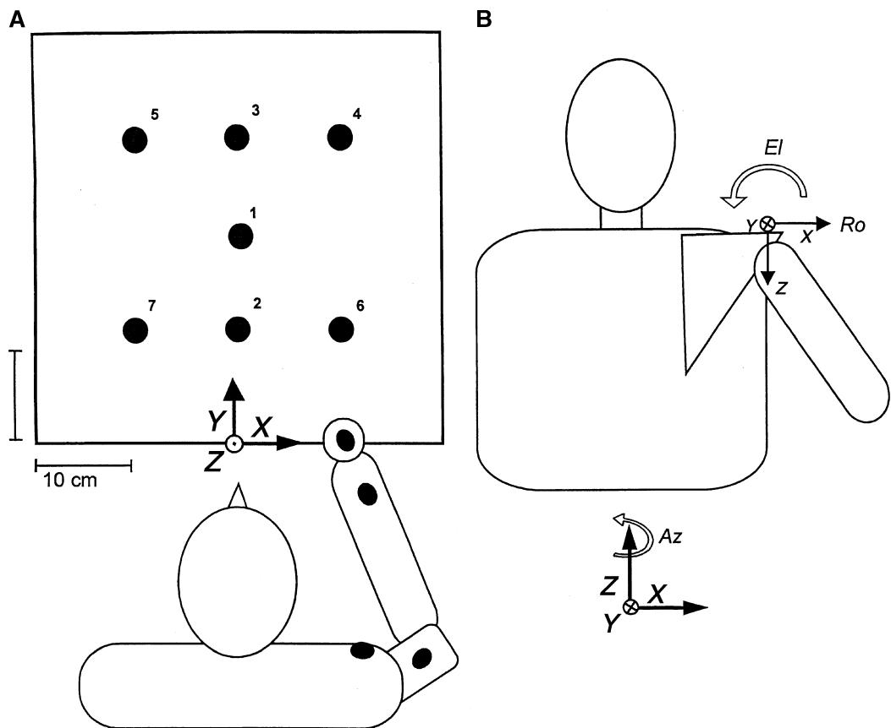  
Figure 1. (A) 实验装置示意图。图中显示了受试者处于手臂初始位置，其上固定有四个遥感传感器（黑色椭圆）。面板显示了右手执行者的目标位置（编号 1–7）。标出了对应于发射器的参考坐标系的位置和方向（XYZ 轴）。(B) 从后方观察的肩峰传感器位置和方向（xyz 轴）。航海欧拉角示意图：方位角（azimuth）是绕参考坐标系垂直 Z 轴的第一次旋转，俯仰角（elevation）是绕传感器当前 y 轴方向的第二次旋转，翻滚角（roll）是绕传感器当前 x 轴方向的第三次旋转。结合传感器的放置位置，方位角测量躯干-肩胛骨前伸，俯仰角测量躯干-肩胛骨侧倾，翻滚角测量躯干-肩胛骨前屈。

每次试验后，实验人员将圆锥体放回初始位置的立柱上。右手执行者按照图 1A 所示的顺序对每个目标位置记录五次试验（左侧偏瘫患者的顺序相反）。整个测试过程持续约 40 min。

## 记录方法与数据分析

使用 FastrackTM Polhemus 系统（Polhemus, Colchester, VT, USA）进行三维运动分析，该系统利用发射器产生的电磁场以 30-Hz 的采样频率确定四个遥感传感器的位置和方向。传感器固定在手背（第三掌骨中段）、前臂后侧、上臂外侧和同侧肩峰处。

手部传感器的切向速度通过无滤波求导计算，并测量伸手过程中的峰值速度幅度。伸手动作的持续时间是从其起始点（确定为超过 0.02 m/s 速度阈值的第一个点）到返回动作的起始点进行自动测量的，返回动作起始点对应于返回动作开始前速度轨迹上的极小值点。在健康受试者中，该点还对应于手部轨迹的急剧反转，而在部分患者中，由于抓握功能障碍，该点可能会延迟。因此，返回动作的起始对应于个体实际抓握物体的时刻，将被称作“抓握时间”（time of grasping）。在动作开始时测量手部传感器的位置，以监测初始姿势并测量手部初始位置与目标之间的距离。

固定在肩峰上的传感器的位置和方向变化可能是由躯干的旋转和/或肩胛骨相对于躯干的旋转引起的。空间中的方向由传感器直接给出的三个有序欧拉角（Euler angles）来量化：方位角（azimuth）是传感器在水平面内的方向，仰角（elevation）是绕传感器 y 轴的向上–向下角度，横滚角（roll）是绕传感器 x 轴的旋转 [“航海”欧拉角约定 (31)]。考虑到传感器在肩胛骨上的放置位置，方位角测量了躯干绕脊柱的旋转和/或肩胛骨的前伸–后缩；仰角测量了躯干和/或肩胛骨的侧向倾斜；横滚角测量了躯干的前–后屈曲和/或肩胛骨的前后倾斜。为了表述清晰，躯干-肩胛骨复合体（trunk–scapula complex）的旋转被命名为前伸–后缩、向上–向下倾斜和向前–向后屈曲。这些旋转会导致肩峰传感器产生线性位移。

描述运动过程中肩部和肘部旋转的角度是通过使用先前已完整描述的生物力学模型和方案确定的 (32)。该流程的第一步是计算每个旋转轴的位置和方向。为此，我们使用了在实验人员施加的一系列交替运动期间，放置在关节上方和下方的传感器所提供的数据。这给出了三个肩关节轴（肩峰参考系中的屈曲–伸展、外展–内收和旋转）以及肘关节屈曲–伸展轴的位置和方向。在第二步中，该校准用于计算相对于各个轴的关节角度。

简而言之，共分析了可能参与伸手到达（reaching）运动的七个自由度（dof）：躯干-肩胛骨复合体三个、肩部三个、肘部一个。旋转的正方向为：躯干-肩胛骨复合体的前伸、向上倾斜和前屈，肩部的屈曲、外展、内旋，以及肘部的屈曲。这些旋转幅度是在伸手到达过程中、从运动开始到抓握时刻之间计算的。在伸手到达过程中还测量了肩峰传感器的线性位移。

分析了 15 例偏瘫患者的 30 次实验数据（Table 2）以及健康个体的 7 次实验数据。

对伸展运动的运动学参数（手部峰值速度和运动持续时间、肩峰位移量以及关节角度变化）进行了统计分析。将每个目标位置 3 到 5 次重复运动的平均值用于带 Fisher 事后检验的方差分析（ANOVA）和协方差分析（ANCOVA）。ANOVA 包含了“组别”（group）和“目标位置”（target location）因素。ANCOVA 包含了“受试者”（subject）因素，并将运动距离作为协变量。所有分析均采用 $P \ < \ 0 . 0 5$ 的显著性水平。

## 结果

## 健康受试者的抓握运动

在健康受试者中，伸展和返回运动的手部运动轨迹均平滑且具有可重复性，呈现钟形速度分布曲线。肩峰位移极小（Fig. 2A）。手部运动的运动学参数随目标位置而变化。以“受试者”因素为自变量、目标距离为协变量进行的 ANCOVA 表明，手部峰值速度 [F(1,35) ¼ 606, P ¼ 0.0001] 和伸展抓握运动的持续时间 [F(1,35) ¼ 78.8, P ¼ 0.0001] 随目标距离呈线性变化。Table 3 列出了目标位置 1 所获得的值。肩峰传感器的位移与目标距离呈线性比例关系 [F(1,35) ¼ 232.7, P ¼ 0.0001]，受试者之间无显著差异。

伸展运动是通过肘部、肩部和躯干–肩胛骨之间的协调运动完成的（Fig. 3A, Table 3）。ANCOVA 显示，肘关节伸展 [F(1,35) ¼ 244.7, P ¼ 0.0001]、肩关节屈曲 [F(1,35) ¼ 380.9, P ¼ 0.0001] 和躯干–肩胛骨前伸 [F(1,35) ¼ 692, P ¼ 0.0001] 与目标距离高度相关，且受试者之间无差异。当对每个受试者单独考量时，个体的线性关系均具有显著性。肩关节外展 [F(1,35) ¼ 26.3, P ¼ 0.0001] 和躯干–肩胛骨倾斜 [F(1,35) ¼ 8.5, P ¼ 0.006] 也与目标距离成比例，但这些效应在个别受试者中并不显著。肩关节旋转与目标距离无显著的比例关系 [F(1,35) ¼ 109.7, P ¼ 0.0001]；躯干–肩胛骨前屈与运动距离成比例，但受试者间存在较大差异 [F(1,35) ¼ 4.7, P ¼ 0.01]，且存在显著的交互作用 [F(1,35) ¼ 10.8, P ¼ 0.0001]。

A 健康受试者

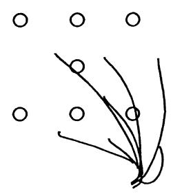

患者 POI

患者 LES

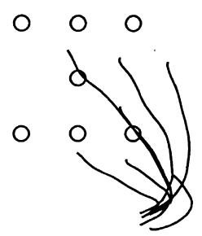

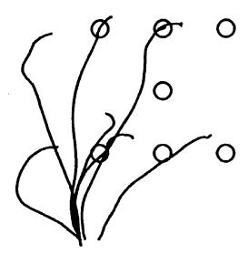

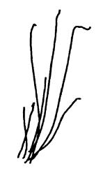

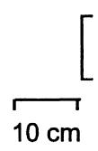

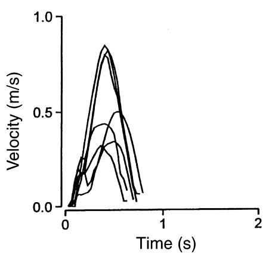

  
Time (s)

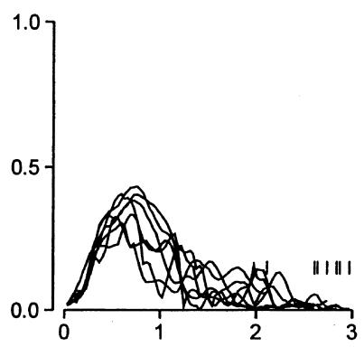  
Time (s)  
Figure 2. 七个目标位置的抓握动作。上部：伸展到达运动期间手部和肩峰传感器的重叠平均轨迹。下部：伸展到达运动期间的重叠速度曲线，图表在返回动作开始时停止。(A) 代表性健康受试者。(B) 具有“良好”运动功能的偏瘫患者（POI，第二次检查）。(C) 运动功能“较差”的偏瘫患者（LES，第二次检查），垂直标记表示返回动作的开始。

Table 3 三组受试者的伸展到达运动参数

<table><tr><td rowspan="2">运动参数</td><td colspan="3">目标位置 1 的均值</td><td colspan="3">事后检验</td></tr><tr><td>健康组，H</td><td>“良好”组，G</td><td>“较差”组，P</td><td>H – G</td><td>G – P</td><td>H – P</td></tr><tr><td>峰值速度 (m/s)</td><td>0.60 ± 0.04</td><td>0.41 ± 0.04</td><td>0.31 ± 0.08</td><td>***</td><td>NS</td><td>***</td></tr><tr><td>运动时长 (s)</td><td>0.82 ± 0.05</td><td>1.59 ± 0.34</td><td>3.50 ± 0.63</td><td>***</td><td>***</td><td>***</td></tr><tr><td>肩峰位移 (cm)</td><td>3.1 ± 0.6</td><td>8.5 ± 1.9</td><td>17.0 ± 1.9</td><td>***</td><td>***</td><td>***</td></tr><tr><td>肘关节伸展 (°)</td><td>-30.3 ± 3.1</td><td>-15.2 ± 4.0</td><td>-6.7 ± 2.1</td><td>***</td><td>***</td><td>***</td></tr><tr><td>肩关节屈曲 (°)</td><td>22.0 ± 1.7</td><td>16.6 ± 2.5</td><td>6.0 ± 2.6</td><td>***</td><td>***</td><td>***</td></tr><tr><td>肩关节外展 (°)</td><td>0.6 ± 2.6</td><td>4.2 ± 3.8</td><td>11.8 ± 4.3</td><td>NS</td><td>***</td><td>***</td></tr><tr><td>肩关节旋转 (°)</td><td>4.7 ± 2.9</td><td>2.0 ± 3.4°</td><td>9.4 ± 4.7</td><td>NS</td><td>***</td><td>***</td></tr><tr><td>躯干-肩胛骨前引 (°)</td><td>12.1 ± 1.5</td><td>12.4 ± 1.1</td><td>8.5 ± 1.9</td><td>NS</td><td>***</td><td>***</td></tr><tr><td>躯干-肩胛骨倾斜 (°)</td><td>4.9 ± 1.6</td><td>5.6 ± 2.2</td><td>8.9 ± 2.5</td><td>NS</td><td>***</td><td>***</td></tr><tr><td>躯干-肩胛骨前屈 (°)</td><td>0.9 ± 0.9</td><td>6.9 ± 1.6</td><td>11.3 ± 2.1</td><td>***</td><td>***</td><td>***</td></tr></table>

不同受试者组在目标位置 1 的运动参数平均值：健康组 (H)、具有“良好” (G) 或“较差” $( \mathsf { P } )$ 运动功能的偏瘫患者。计算了包含“目标位置”和“受试者组”效应的方差分析 (ANOVA)；事后检验，组间差异：$^ { * * * } P < 0 . 0 0 0 1$；NS，无统计学显著性。

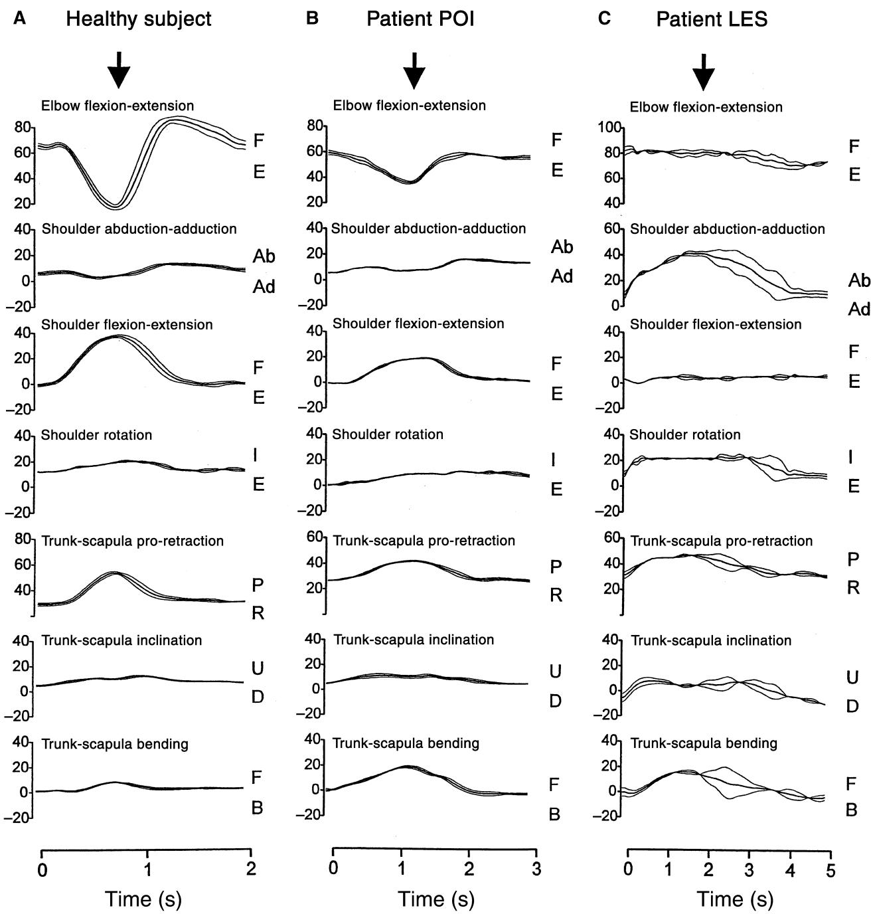  
Figure 3. 抓握过程中角度变量的时间进程。从上至下：肘关节屈曲–伸展；肩关节外展–内收、屈曲–伸展和旋转；躯干–肩胛骨前伸–后缩、倾斜以及向前–向后弯曲。线条代表四至五次试验的平均值与均值标准误。角运动方向：F，屈曲；E，伸展；Ab，外展；Ad，内收；I，内旋；E，外旋；P，前伸；R，后缩；U，向上；D，向下；F，向前；B，向后。注意不同的时间尺度。箭头指示抓取时刻。(A) 代表性健康受试者。(B) 具有“良好”运动功能的偏瘫个体（POI，第二次检查）。(C) 运动功能“较差”的偏瘫个体（LES，第二次检查）。

伸手过程中肩峰位移的幅度（从 1.1 - 0.3 到 9.9 - 1.4 cm 不等，因目标位置而异）表明，在肩胛骨水平测得的旋转也累及了躯干，至少对于最远的目标位置而言是如此。

## 偏瘫患者的抓握运动

在偏瘫患者中，具有“良好”运动功能的患者手部轨迹与健康组相似（Fig. 2B）。然而，这些动作更慢、更呈分节性，且执行时伴有更大的肩峰位移。此外，肘伸展和肩屈曲动作比健康受试者的更慢且幅度更小（Fig. 3B）。运动功能“较差”患者的手部轨迹不如运动功能“良好”者及健康受试者平滑。图 2C（Fig. 2C）展示了一名运动功能较差个体的手部路径示例。手部运动的特征是具有显著的变异性和多个速度峰值。肩峰传感器的位移（约 30 cm）几乎相当于手部移动的总距离。在这些患者中的大多数人身上，肘关节角度变化幅度较小且不规则，而肩关节运动主要由外展和内旋组成，屈曲极少（Fig. 3C）。

## 运动模式与残疾

对初次检查时获得的数据进行了分析，研究了伸手运动参数与功能障碍程度之间的函数关系。偏瘫患者的手部峰值速度小于健康受试者，但在运动功能“较差”与“良好”的患者之间并无差异（Fig. 4A，Table 3）。另一方面，运动功能“较差”患者的运动持续时间显著增加（Table 3）。与运动功能“良好”的患者或健康受试者相比，运动功能“较差”患者的肘关节伸展和肩关节屈曲明显较小（Fig. 4C,D，Table 3），而肩峰位移则显著较大（Fig. 4B，Table 3）。偏瘫患者较大的肩峰位移与躯干-肩胛骨前引的增加无关（其前引幅度与健康受试者相当或更小），而是与躯干前屈有关（Table 3）。

在运动功能“良好”的患者中，手部峰值速度与运动距离显著呈比例缩放 [ANCOVA, $F ( 1 , 3 9 ) = 1 3 2 . 5 , P = 0 . 0 0 0 1 ]$ ，大多数角度变量也是如此：肘关节伸展 $[ F ( 1 , 3 9 ) = 1 6 6 . 3 , \ : \ : \ : \ : \overline { { P } } = 0 . 0 0 0 1 ]$ 、肩关节屈曲 $[ F ( 1 , 3 9 ) = 7 7 . 2 , \ P = 0 . 0 0 0 1 ]$ 、肩关节外展 $\left[ F ( 1 , 3 9 ) = 3 4 . 7 , P = 0 . 0 0 0 1 \right]$ 、肩关节旋转 $[ F ( 1 , 3 9 ) = 2 4 . 3 , \ P = 0 . 0 0 0 1 ] _ { \cdot }$ 、躯干-肩胛骨前引 $[ F ( 1 , 3 9 ) = 6 6 . 4 , P = 0 . 0 0 0 1 ]$ ，较弱相关的躯干前屈 $[ F ( 1 , 3 9 ) = 7 . 3 , \ P = 0 . 0 1 ] .$ ，但躯干-肩胛骨倾斜则没有。由此产生的肩峰位移与运动距离成比例缩放 [F(1,39) ¼ 92.2, P ¼ 0.0001]。

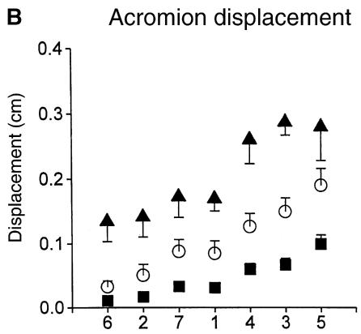

C 肘关节屈曲-伸展  
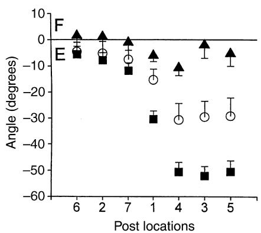

D  
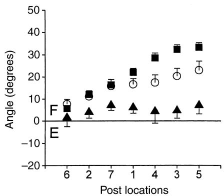  
Figure 4. 健康受试者和偏瘫患者在初次检查时针对不同目标物位置所测得的运动参数。(A) 手部峰值速度；(B) 肩峰位移；(C) 肘关节屈曲-伸展（F：屈曲；E：伸展）；(D) 肩关节屈曲-伸展。目标物位置按距手部初始位置的距离排列。每个数据点代表一组受试者的均值（及 SEM）。实心方块：健康受试者 $( n = 7 )$；空心圆圈：运动功能“良好”的偏瘫患者 $( n = 8 ) ;$ 实心三角：运动功能“较差”的偏瘫患者 $( n = 7 )$

在运动功能“较差”（poor）的患者中，手部峰值速度也与运动距离呈显著比例关系 [F(1,24) ¼ 8.1, P ¼ 0.008]。然而，与手部运动相关的角度和躯干位移变量在两个方面与在健康受试者及运动功能“良好”（good）患者中观察到的情况存在差异。虽然躯干前屈 $[ F ( 1 , 2 4 ) = 4 0 . 5 , \quad$ $P = 0 . 0 0 0 1 ]$ 和肩外展 [F(1,24) ¼ 20.8, P ¼ 0.0001] 与运动距离呈比例关系，但肘伸展则不然。其他变量与运动距离的比例关系较弱：肩屈曲 [F(1,24) ¼ 4.3, P ¼ 0.05]、肩旋转 [F(1,24) ¼ 5.2, P ¼ 0.03]、躯干–肩胛前伸 [F(1,24) ¼ 6.4, P ¼ 0.01]。由此产生的肩峰位移与运动距离呈比例关系 [F(1,24) ¼ 136.4, P ¼ 0.0001]。

## 运动模式恢复

对 9 例偏瘫患者在恢复过程中的运动模式演变进行了随访（Table 2）。其中 6 例初始运动功能“较差”。在随访期间，根据 FAT 评分，有 4 例未达到功能性运动能力水平，2 例从“较差”改善为“良好”。根据 FAT 评分最初处于“中等”至“良好”功能的另外 3 例患者，其运动表现根据其他测试（Box and Blocks test、Nine-Hole Peg Test 及握力，Table 2）得分的提高而显示出改善。

对至少接受过两次检查的 9 例偏瘫患者在第一次和第二次测试中目标位置 1 的运动参数差异进行了统计学比较（Fig. 5）。在第二次评估中，各目标位置获得的平均峰值速度显著增加 [ANOVA, F(1,99) ¼ 9.6, P ¼ 0.002]。相应地，伸手抓握动作的持续时间缩短 [F(1,99) ¼ 8.7, P ¼ 0.004]。然而，肩峰位移或肘伸展的平均幅度没有变化。在第二次测试中，肩屈曲的平均幅度略有但显著减小 [F(1,99) ¼ 4.3, P ¼ 0.04]，躯干–肩胛前屈的平均幅度亦是如此 [F(1,99) ¼ 6.8, P ¼ 0.01]。肩外展、肩旋转以及躯干–肩胛前伸和侧倾的角度运动幅度在第一次和第二次测试之间未发生显著改变。

与功能改善相关的运动模式在不同患者之间存在很大差异。患者 POI、SAN、HEM、BEN 和 THE 在功能测试中的评分有所提高。在患者 POI、SAN、BEN 和 THE 中，这种改善伴随着伸手时躯干位移的减少以及肘部伸展和/或肩部屈曲的增加（Fig. 5）。在患者 HEM 中，伸手运动参数接近正常范围，未表现出明显的改善。相比之下，患者 LEF、LES 和 HAV 仅通过显著的上躯干位移恢复了粗大的伸手动作，而肘部和肩部动作幅度较小且不规则。患者 BOU 在功能上同样属于“差”的运动功能水平，在伸手时恢复了伸肘和屈肩的能力，但在随访期间，她的躯干运动也有所增加。

在第一次和第二次评估之间观察到的患者组峰值速度和运动持续时间的改善，表明用于伸手抓握的上肢协调效率有所提高，而在运动能力不同的患者中，这一目标的实现方式各有不同。呈现出两种趋势：在一些患者中，临床改善与运动参数向正常值的发展相关；而在另一些患者中，临床改善则伴随着替代性运动模式的持续或增加。总体而言，在最初功能为“差”的 6 名患者中，3 名出现了运动代偿，2 名向正常模式恢复并取得了令人满意的结局，1 名表现为混合模式。在最初运动功能为“良好”的 3 名患者中，有 2 名倾向于恢复正常的运动模式。

## 与脑损伤的关系

神经损伤、运动模式与功能结局之间的关系表现出极大的变异性。在 15 名患者中，4 名患者存在累及中央前回的皮质病变，10 名患者主要为皮质下病变且未累及中央前回，1 名患者存在大面积半球病变。总体而言，病变部位与运动功能的恢复或伸手所采用的运动模式之间没有直接相关性（Table 4）。

## 讨论

本研究提供了健康受试者和偏瘫患者进行不受限制的抓握运动的实验数据，以及这些运动如何随着时间的推移，在与手臂和手部功能受限相关的情况下发生演变。

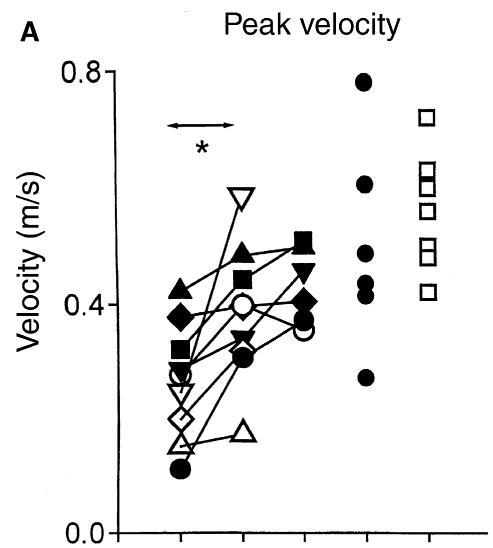

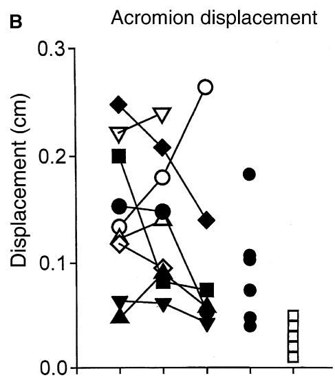

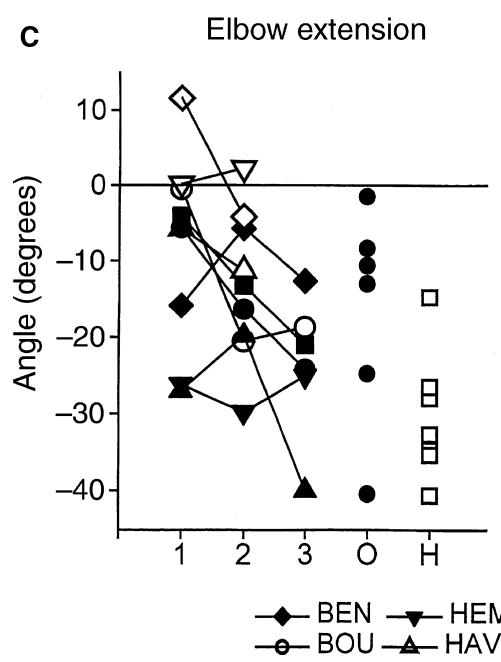

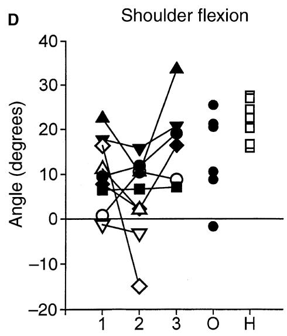  
Figure 5. 9例偏瘫患者在随访期间（第1–3次评估）针对目标位置1的运动参数演变。每条线代表一名患者。实心符号代表运动功能“良好”的患者，空心符号代表运动功能“较差”的患者。将这些参数与仅评估一次的患者（O，黑色实心圆）以及健康受试者（H，空心方块）的参数进行了比较。星号表示组间差异具有统计学意义（P < 0.05）。

本研究中采用的无约束条件使系统能够充分利用手臂和躯干肌肉及关节数量的冗余性，从而可以利用不同的协同作用来产生伸手动作 (33)。在目前的实验设置和目标配置下（Fig. 1），所有健康受试者均采用了相似的伸手协同作用，包括具有相同时间进程的肘关节伸展、肩关节屈曲以及躯干-肩胛骨前伸。对关节角度运动与手部运动距离比例关系的分析证实，所有受试者在不同目标间均表现出恒定的对应关系。

偏瘫患者手部运动的运动学特征在恢复“良好”与恢复“较差”的患者之间存在显著差异。首先，轻度功能障碍患者产生的运动轨迹与健康受试者相比在性质上没有差异，尽管其峰值速度较小且在关节活动范围上存在一些差异。其次，重度功能障碍患者产生的运动轨迹与健康受试者存在明显差异，表现出不规则且分段的速度轮廓 (15, 18, 20)。

Table 4 行为与神经学数据的比较 [前三列汇总了 Table 1 和 2 中详述的数据。行为模式汇总了 Fig. 5 中展示的数据，fMRI 激活模式取自 Feydy et al. (26)]

<table><tr><td rowspan="2">患者</td><td rowspan="2">SMC 病灶</td><td rowspan="2">预后</td><td colspan="2">行为模式</td><td rowspan="2">fMRI 激活模式</td></tr><tr><td>随访</td><td>单次观察</td></tr><tr><td>LEF</td><td>C+</td><td>差</td><td>COM</td><td></td><td>P_focus</td></tr><tr><td>LES</td><td>C-</td><td>差</td><td>COM</td><td></td><td></td></tr><tr><td>BOU</td><td>C+</td><td>差</td><td>混合型</td><td></td><td>P_focus</td></tr><tr><td>HAV</td><td>C+</td><td>差</td><td>COM</td><td></td><td></td></tr><tr><td>POI</td><td>C+</td><td>良好</td><td>RES</td><td></td><td>P_focus</td></tr><tr><td>SAN</td><td>C-</td><td>良好</td><td>RES</td><td></td><td>P_focus</td></tr><tr><td>HEM</td><td>C-</td><td>良好</td><td>混合型</td><td></td><td>Recru</td></tr><tr><td>BEN</td><td>C+</td><td>良好</td><td>RES</td><td></td><td>I_focus</td></tr><tr><td>THE</td><td>C+</td><td>良好</td><td>RES</td><td></td><td>I_focus</td></tr><tr><td>DRU</td><td>C-</td><td>中等</td><td></td><td>COM</td><td>Recru</td></tr><tr><td>GUI</td><td>C-</td><td>良好</td><td></td><td>RES</td><td>Recru</td></tr><tr><td>BOJ</td><td>C+</td><td>良好</td><td></td><td>混合型</td><td>Recru</td></tr><tr><td>VAL</td><td>C+</td><td>良好</td><td></td><td>RES</td><td></td></tr><tr><td>DUP</td><td>C+</td><td>良好</td><td></td><td>COM</td><td></td></tr><tr><td>NOC</td><td>C+</td><td>良好</td><td></td><td>RES</td><td></td></tr></table>

COM，代偿性恢复；RES，向正常模式恢复的修复性恢复；I\_focus，初始聚焦；P\_focus，渐进性聚焦；Recru，持续募集。

然而，无论恢复水平如何，患者都能够产生一个定义明确的初始速度峰值，并根据运动距离按比例对其进行调节。这表明产生躯干和手臂协调的中枢指令预先考虑了由运动本身引起的大部分机械约束（由于肢体节段相互作用产生的惯性和力矩）(16, 34)。在康复过程中，正如先前观察到的那样，峰值速度略有增加 (18)，但在运动功能“差”或“良好”的患者之间并无差异。这表明速度峰值的绝对值并不能反映上肢的功能受限程度。

对伸手动作中躯干和上肢协调性的分析证实，与健康受试者相比，偏瘫患者在伸手时使用的肘关节伸展和肩关节屈曲更少 (20)，而躯干位移更大 (20, 21)。此外，本研究表明，在运动功能“良好”或“差”的偏瘫患者中，关节角运动随运动距离的比例调节方式存在差异。因此，患者的功能能力似乎不仅与产生涉及肘关节伸展的伸手协同动作的能力有关，还与根据运动距离对其进行比例调节的能力有关。

随访评估中对伸手动作（reaching）的分析揭示了恢复进展中的两种不同模式。在部分患者中，肘关节伸展和肩关节屈曲的增加逐渐与运动距离呈比例调节或保持该比例，同时肩峰位移减少。其他患者则表现出更多样化的运动模式，包括动用可随运动距离调节的额外自由度（dofs）。这支持了伸手运动的改善遵循两种模式的观点：一种是趋向于健康受试者常规运动模式的运动模式恢复，另一种则是代偿性运动的执行与改善 (22)。运动恢复通常会带来良好的功能预后。通过代偿获得的改善则更为有限，且半数病例的预后依然较差。此外，在一些能够进行接近正常伸手运动的患者中，功能状态显然取决于抓握能力的选择性受损 (27)。

在一项涉及我们 10 例患者的平行研究中，Feydy et al. (26) 使用功能性磁共振成像（fMRI）观察到，当受试者进行偏瘫侧手臂的主动运动时，皮层激活模式呈现出两种不同的演变过程。在某些患者中，激活招募了多个皮层区域（同侧和对侧的感觉运动区、额叶及顶叶区）。在另一些患者中，激活则集中在对侧感觉运动皮层，有时这一现象发生在最初招募额外脑区之后。在三名皮层下病变患者（POI、BEN 和 THE）中，行为学和神经学数据是一致的，表现为这些患者向正常模式恢复，同时大脑激活更加集中于感觉运动皮层（Table 4）。这表明初级运动皮层对于运动恢复的发生是必需的，并且与初级运动皮层可能特异性地参与对侧上肢肌肉的协同激活从而产生协调运动的观点相符 (35)。相反，远隔脑区大脑激活的持续招募 (6, 7) 与皮层病变患者（HEM 和 DRU）代偿的发展相一致。此外，三名偏瘫患者（SAN、HEM 和 GUI）尽管存在累及初级运动皮层的病变且大脑激活模式各异，但仍至少部分地向正常运动模式恢复。这支持了真正的康复意味着初级运动皮层内部或周围具有可塑性这一观点 (36, 37)。然而，必须强调的是，无论是大脑激活集中于感觉运动皮层的继发机制（BOU 和 LEF），还是完成伸手动作时进行伸肘的能力（BOU），都不能保证良好的预后。

恢复模式与最终的功能结局均与解剖学及神经功能数据之间没有明确的直接关联。这可能意味着脑损伤后伸手动作的控制不太可能是由于特定脑结构的保留所致。它更可能与皮层可塑性相关，这种可塑性导致活动在并行运作的多个运动区域构成的广泛双侧网络中重新分布 (4–7, 38, 39)。远隔大脑区域的募集似乎主要取决于初级运动皮层是否受损，这可能是通过改变皮层-皮层间兴奋与抑制之间的平衡来实现的。无论大脑激活模式如何，功能预后似乎都与残留皮质脊髓束纤维的数量相关 (2, 5, 26)。

遗留的问题是康复训练后功能恢复和/或神经可塑性的限度。Nudo et al. (37) 证明，皮层损伤后的功能恢复和皮层可塑性取决于感觉运动训练的强度。对其猴子录像动作的深入检查显示，无论是通过真正恢复还是通过代偿，都可以达到相似的运动表现 (40)。在猴子实验中，功能改善的模式与初级运动皮层内损伤的大小和定位相关，而在我们的研究中，人类的损伤范围要大得多，并且可能包含皮层下结构。因此，无论是在脑损伤的猴子还是人类中，使用代偿性运动模式都可以改善运动功能。然而，这种改善可能是有限的，我们的数据表明，与真正恢复“正常”运动模式相比，使用代偿机制与较差的功能结局相关。

Taub et al. (41) 证明，偏瘫患者的运动恢复可能会因为“习得性废用”（learned disuse）导致受累肢体缺乏锻炼而受到限制。因此，在中风后早期，部分患者可能会发展出强烈且有效的运动代偿，这阻碍了他们在日常活动中尝试产生更“正常”的运动模式，从而可能最终限制了最终的功能结局。这一因素可以部分解释随访期间患者之间运动协调模式的巨大变异性，以及解剖与功能之间较差的对应关系。需要进一步的实验和临床研究，以测试在限制运动代偿的同时对偏瘫患者进行特定伸手动作训练的治疗效果 (42)。

## 致谢

A. Roby-Brami 受到 INSERM 的资助。本研究得到了 AP-HP PHRC AOM 96 163 的支持。国际合作得益于 INSERM 授予 E.V. Biryukova 的资助、魁北克政府（Government of Quebec）授予 M.F. Levin 的资助，以及来自 INSERM-CRM 和 INSERM-FRSQ 的合作资助。

## 参考文献

1. Jorgensen HS, Nakayama H, Raaschou HO, Vive-Larsen J, Stoier M, Olsen TS. Outcome and time course of recovery in stroke. Part I: outcome. The Copenhagen Stroke Study. Arch Phys Med Rehab 1995;76:399–405.

2. Binkowski F, Seitz RJ, Arnold S, Classen J, Benecke R, Freund HJ. Thalamic metabolism and corticospinal tract integrity determine motor recovery in stroke. Ann Neurol 1996;39:460–70.

3. Heald A, Bates D, Cartlidge NEF, French JM, Miller S. Longitudinal study of central motor conduction time following stroke. 2: Central motor conduction measured within 72 h after stroke as a predictor of functional outcome at 12 months. Brain 1993;116:1371–85.

4. Shelton FNAP, Redding MJ. Efect of lesion location on upper limb motor recovery after stroke. Stroke 2001;32:107–12.

5. Pineiro R, Pendlebury ST, Smith S et al. Relating MRI changes to motor deficit after ischemic stroke by segmentation of functional motor pathways. Stroke 2000;31:672–9.

6. Fries W, Danek A, Scheidtmann K, Hamburger C. Motor recovery following capsular stroke. Role of descending pathways from multiple motor areas. Brain 1993;116:369– 82.

7. Weiller C, Rijntjes M. Learning, plasticity and recovery in the central nervous system. Exp Brain Res 1999;128:134–8.

8. Colebatch JG, Gandevia SC. The distribution of muscular weakness in upper motor neuron lesions afecting the arm. Brain 1989;112:749–63.

9. O’Dwyer NJ, Ada L, Neilson PD. Spasticity and muscle contracture following stroke. Brain 1996;119:1737–49.

10. Bobath B. Adult hemiplegia evaluation and treatment, 2nd edn. London: Heinnemann, 1978.

11. Brunnstrm S. Movement therapy in hemiplegia: a neurophysiological approach. Philadelphia: Harper and Row, 1970.

12. Twitchell TE. The restoration of motor function following hemiplegia in man. Brain 1951;74:443–80.

13. Levin MF, Feldman AG. The role of stretch reflex threshold regulation in normal and impaired motor control. Brain Res 1994;637:23–30.

14. Levin MF, Selles RW, Verheul MH, Meijer OG. Deficits in the coordination of agonist and antagonist muscles in stroke patients: implications for normal motor control. Brain Res 2000;853:352–69.

15. Levin MF. Interjoint coordination during pointing movements is disrupted in spastic hemiparesis. Brain 1996;119:281–93.

16. Beer RF, Dewald JP, Rymer Z. Deficits in the coordination of multijoint arm movements in patients with hemiparesis: evidence for disturbed control of limb dynamics. Exp Brain Res 2000;131:305–19.

17. Archambault P, Pigeon P, Feldman A, Levin MF. Recruitment and sequencing of diferent degrees of freedom during pointing movements involving the trunk in healthy and hemiparetic subjects. Exp Brain Res 1999;126:55–67.

18. Trombly CA. Observations of improvement of reaching in five subjects with left hemiparesis. J Neurol Neurosurg Psychiatry 1993;56:40–5.

19. Wing AM, Lough S, Turton A, Fraser C, Jenner JR. Recovery of elbow function in voluntary positioning of the hand following hemiplegia due to stroke. J Neurol Neurosurg Psychiatry 1990;53:126–34.

20. Roby-Brami A, Fuchs S, Mokhtari M, Bussel B. Reaching and grasping strategies in hemiparetic patients. Motor Control 1997;1:72–91.

21. Cirstea MC, Levin MF. Compensatory strategies for reaching in stroke. Brain 2000;123:940–53.

22. Latash ML, Anson JG. What are ‘normal movements’ in atypical populations? Behav Brain Sci 1996;19:55–106.

23. Trombly CA, Wu C-Y. Efect of rehabilitation tasks on organization of movement after stroke. Am J Occup ther 1998;53:333–44.

24. Ada L, Canning CG, Carr JH, Kilbreath SL. Task-specific training of reaching and manipulation. In: Bennett KMB, Castiello U, eds. Insights into the reach to grasp movement. Amsterdam: Elsevier, 1994;239–64.

25. Cirstea CM, Ptito A, Forget R, Levin MF. Arm motor improvement in stroke patients may depend on type of training. Society for Neuroscience Abstracts, New Orleans, 2000.

26. Feydy A, Carlier R, Roby-Brami A et al. Longitudinal study of motor recovery after stroke: recruitment and focusing of brain activation. Stroke 2002;33:1610–17.

27. Heller A, Wade DT, Wood VA, Sunderland A, Langhton-Hewer R, Ward E. Arm function after stroke: measurement and recovery over the first three months. J Neurol Neurosurg Psychiatry 1987;50:714–19.

28. Wade DT. Measurement in neurological rehabilitation. Oxford: Oxford University Press, 1992.

29. Mathiowetz V, Volland G, Kashman N, Weber K. Adult norms for the box and block test of manual dexterity. Am J Occup ther 1985;39:386–91.

30. Mathiowetz V, Weber K, Kashman N, Volland G. Adult norms for the nine-hole peg test of finger dexterity. Occup Ther J Res 1985;5:24–38.

31. Zatsiorsky VM. Kinematics of human motion. Champaign, IL: Human Kinetics, 1997.

32. Biryukova EV, Roby-Brami A, Frolov AA, Mokhtari M. Kinematics of human arm reconstructed from spatial tracking system recordings. J Biomech 2000;33:985–95.

33. Bernstein N. The coordination and regulation of movements. New York: Pergamon Press, 1967.

34. Brooks VB. The neural basis of motor control. Oxford: Oxford University Press, 1986.

35. Capaday C, Devanne H, Bertrand L, Lavoie BA. Intracortical connections between motor cortical zones controlling antagonistic muscles in the cat: a combined anatomical and physiological study. Exp Brain Res 1998;120:223–32.

36. Liepert J, Bauder H, Wolfgang HR, Miltner WH, Taub E, Weiller C. Treatment-induced cortical reorganization after stroke in humans. Stroke 2000;31:1210–16.

37. Nudo RJ, Wise BM, Si Fuentes F, Milliken GW. Neural substrate for the efects of rehabilitative training on motor recovery after ischemic infarct. Science 1996;272:1791–4.

38. Aizawa H, Inase M, Mushiake H, Shima K, Tanji J. Reorganization of activity in the supplementary motor area associated with motor learning and functional recovery. Exp Brain Res 1991;84:668–71.

39. Liu Y, Rouiller EM. Mechanisms of recovery of dexterity following unilateral lesion of the sensory motor cortex in monkeys. Exp Brain Res 1999;128:149–59.

40. Friel KM, Nudo RJ. Recovery of motor function after focal cortical injury in primates: compensatory movement patterns used during rehabilitative training. Somatosens Mot Res 1998;15:173–89.

41. Taub E, Wolf S. Constraint induced movement techniques to facilitate upper extremity use in stroke patients. Top Stroke Rehabil 1997;4:38–61.

42. Michaelsen S, Luta A, Roby-Brami A, Levin M. The efect of trunk restraint on reaching movements in stroke patients. Stroke 2001;32:1875–83.